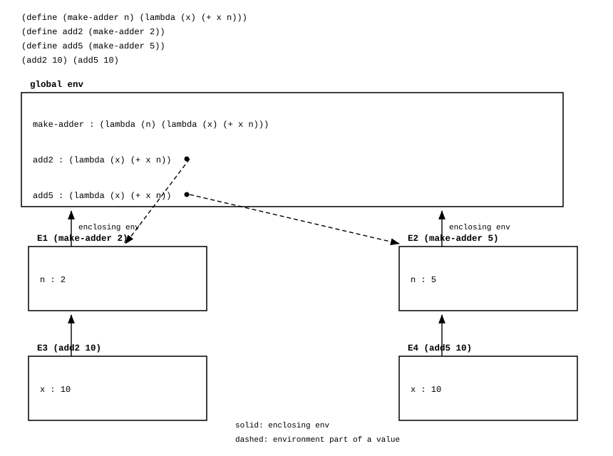

The lambda calculus (also written as λ-calculus) is a formal system for expressing computation based on function abstraction and application using variable binding and substitution. The calculus is a universal machine: a model of computation that can be used to simulate any Turing machine. Alonzo Church introduced it in the 1930s as part of his research into the foundations of mathematics. Racket implements it directly: `lambda` is the abstraction, and `(f a)` is the application.

<!--more-->

---

## 1. Overview

A **lambda term** is a variable, an abstraction, or an application. Its syntax is given by the grammar

\[
e ::= x \mid \lambda x.\, e \mid e\, e
\]

where variables range over an infinite set of names. A term is valid when it can be obtained by repeated application of those three rules. Since the calculus has no store and no machine state, computation is substitution. Racket writes a variable as an identifier, and the three forms below map onto `lambda` and on the application form `(f a)`.

**Abstraction.** The term \(\lambda x.\, M\) is the function of one parameter \(x\) with body \(M\). The dot separates the parameter from the body, and the body extends to the right until a parenthesis closes it, so \(\lambda x.\, \lambda y.\, x\) means \(\lambda x.\, (\lambda y.\, x)\). An abstraction is a value: it has no name, and it can be created where it is needed, passed as an argument, and returned as a result. Racket's `lambda` is the same form, and the identity function is written in both notations as follows.

```racket
(define identity (lambda (x) x))
(identity 'a)   ; => 'a
```

**Application.** The term \(M\, N\) applies the operator \(M\) to the operand \(N\). Application associates to the left, so \(M\, N\, P\) means \((M\, N)\, P\), and the operator position may hold any term, including another application. Racket writes application as a parenthesized list whose first element is the operator; the core form is `#%app`.

```racket
(define K (lambda (x) (lambda (y) x)))
((K 'kept) 'ignored)   ; => 'kept
```

**Currying.** An abstraction binds exactly one parameter, so a function of two parameters is a nest of abstractions: the function \(x \mapsto y \mapsto x^{2} + y^{2}\) returns a function of \(y\), and the second application supplies \(y\). That transformation is currying, and it is why one-parameter abstraction suffices for any number of inputs. The uncurried function of the pair \((5, 2)\) and the curried version both yield 29; the curried one takes two β-reduction steps.

```racket
(define curried-add (lambda (x) (lambda (y) (+ x y))))
((curried-add 4) 9)   ; => 13
```

**Free and bound variables.** An occurrence of \(x\) is free when no enclosing abstraction binds it, and bound when it lies in the body of an enclosing \(\lambda x\). In \(\lambda x.\, x\, y\) the occurrence of \(x\) is bound and \(y\) is free. The free variables of a term are defined by induction, which makes the informal account precise:

\[
\begin{align*}
\mathrm{FV}(x) &= \{x\} \\
\mathrm{FV}(M\, N) &= \mathrm{FV}(M) \cup \mathrm{FV}(N) \\
\mathrm{FV}(\lambda x.\, M) &= \mathrm{FV}(M) \setminus \{x\}
\end{align*}
\]

A term with no free variables is **closed**, and a closed term denotes a function of its arguments and nothing else. Racket resolves the same distinction when a program is expanded: a free identifier is looked up in the enclosing scope, and one with no binding at all is an error.

```racket
(define y 10)
(define add-y (lambda (x) (+ x y)))
(add-y 1)                  ; => 11
(let ([y 100]) (add-y 1))  ; => 11, the free y is the outer one
```

**Substitution.** The notation \(M[x := N]\) replaces every free occurrence of \(x\) in \(M\) by \(N\), and it is defined by cases over the structure of \(M\). A variable is replaced when its name matches, so \(x[x := N] = N\) and \(y[x := N] = y\) for \(y \neq x\). An application distributes the substitution to both subterms, so \((M_1\, M_2)[x := N] = (M_1[x := N])\, (M_2[x := N])\). An abstraction whose binder is \(x\) is unchanged, since the inner binder hides the outer \(x\); an abstraction whose binder \(y\) is distinct becomes \(\lambda y.\, (M[x := N])\), except that when \(y \in \mathrm{FV}(N)\) the binder is renamed first. Substitution is the only operation that computes, which is why it is defined so carefully.

**α-conversion.** The name chosen for a bound variable does not matter. If \(y \notin \mathrm{FV}(M)\), then \(\lambda x.\, M\) and \(\lambda y.\, M[x := y]\) are **α-equivalent**, written \(\lambda x.\, M \equiv_{\alpha} \lambda y.\, M[x := y]\), and the relation is the smallest congruence generated by that rule. So `(lambda (x) x)` and `(lambda (z) z)` denote the same function. α-renaming is a property of the notation rather than a step a program performs: in Racket the inner parameter is a distinct binding, so no capture arises in the first place. De Bruijn's 1972 notation makes the equivalence syntactic by writing a variable as the number of abstractions between the use and its binder.

```racket
(define y 'free)
(define f (lambda (x) (lambda (y) (list x y))))
((f y) 'bound)   ; => '(free bound)
```

**β-reduction.** A **β-redex** is an application of the form \((\lambda x.\, t)\, s\), and **β-reduction** rewrites it to \(t[x := s]\). The subterm that is rewritten is the redex, and the term it reduces to is its **reduct**. For example, \((\lambda x.\, x)\, s \rightarrow s\) shows that \(\lambda x.\, x\) is the identity, and \((\lambda x.\, y)\, s \rightarrow y\) shows that \(\lambda x.\, y\) is the constant function returning \(y\). Racket evaluates a redex by entering the body with the parameter bound to the evaluated operand, which is the machine counterpart of the same substitution.

```racket
((lambda (x) (+ x 1)) 41)   ; => 42
```

**β-normal form.** A term with no β-redex is a **β-normal form**, and it is unique when it exists: by the Church-Rosser theorem, any two reduction sequences that terminate from the same term produce the same normal form, up to α-conversion. The untyped calculus is nevertheless neither strongly nor weakly normalising, because there are terms with no normal form at all. The smallest is \(\Omega = \omega\, \omega\), where \(\omega = \lambda x.\, x\, x\): one reduction substitutes \(\omega\) for \(x\) and returns \(\Omega\) again. A Racket binding evaluates its right-hand side, so the cycle is written under a `lambda` and diverges only when it is called.

```racket
(define (omega) ((lambda (x) (x x)) (lambda (x) (x x))))
```

**η-conversion.** The rule \(\lambda x.\, f\, x \rightarrow f\), valid when \(x\) is not free in \(f\), expresses extensionality: two functions are the same when they agree on every argument. It is a conversion rather than a reduction rule for computation, and Racket leaves `(lambda (x) (f x))` as a procedure instead of replacing it by `f`. The term is a β-normal form and is η-equivalent to `f`.

**Evaluation order.** β-reduction says a redex *may* be contracted; it does not say which one to contract first. That choice is the evaluation strategy, and every strategy answers two questions.

1. Is the argument reduced before it is passed? *Yes* means the argument is evaluated at the call site. *No* means it is passed as a computation and evaluated by the body, only if and when the body uses it.
2. Is the body of an abstraction reduced before the abstraction is called? *Yes* reduces under the binder. *No* stops at the binder, and the term is only evaluated when it is applied to an argument.

The four common strategies are the four combinations of those answers.

| Strategy | Argument reduced first? | Reduces under a binder? |
|----------|-------------------------|--------------------------|
| Normal order | no | yes |
| Call by name | no | no |
| Applicative order | yes | yes |
| Call by value | yes | no |

**Normal order** passes the argument as a computation, and it reduces the body of an abstraction before the abstraction is called. Because the argument is passed unevaluated, the body decides whether to evaluate it, which is why `(lambda (x) (lambda (y) y))` applied to \(\Omega\) returns \(\lambda y.\, y\). Because it reduces under the binder, it reaches a full β-normal form whenever one exists.

```racket
#lang lazy
(define (const-first x) (lambda (y) x))
(define (omega) ((lambda (x) (x x)) (lambda (x) (x x))))
((const-first 'kept) (omega))   ; => 'kept, the argument is never evaluated
```

**Call by name** is normal order without reduction under the binder. Everything outside an abstraction is reduced exactly as normal order reduces it; the body of an abstraction is not touched until the abstraction is applied.

That single difference is visible on one term: \(\lambda x.\, \Omega\). Normal order reduces the body, so it starts the cycle of \(\Omega\) and never returns. Call by name stops at the binder, so it returns the abstraction with the cycle still inside it, and the cycle only begins if someone applies that abstraction.

```racket
(define (omega) ((lambda (x) (x x)) (lambda (x) (x x))))

;; call by name: the body is not reduced, so this returns a procedure
(define by-name (lambda (x) (omega)))
(procedure? by-name)   ; => #t
```

The same term under normal order is written by forcing the body first, and it does not return:

```racket
(define (omega) ((lambda (x) (x x)) (lambda (x) (x x))))
(define by-normal-order (let ([body (omega)]) (lambda (x) body)))   ; does not return
```

The two consequences follow from the same rule. An argument that is passed as a computation is evaluated only when the body uses it, so an unused argument never runs, and an argument used twice runs twice because nothing is shared. The counter below shows both:

```racket
(define calls 0)
(define (tick) (set! calls (add1 calls)) 'v)

(define (ignore th) 'done)
(ignore (lambda () (tick)))   ; => 'done
calls                         ; => 0, the argument never ran

(define (twice th) (list (th) (th)))
(twice (lambda () (tick)))    ; => '(v v)
calls                         ; => 2, once per use, not once per call
```

**Applicative order** evaluates the argument at the call site, and it reduces the body of an abstraction before the abstraction is called. Because the argument is evaluated first, a divergent argument is evaluated even when the body would drop it, so this strategy can fail on a term that has a normal form.

```racket
(define log '())
(define (note tag v) (set! log (cons tag log)) v)
(define (ignore y) 'done)

(ignore (note 'arg 1))            ; => 'done
(reverse log)                     ; => '(arg), the argument ran before the body
```

**Call by value** is applicative order without reduction under the binder. The argument is evaluated at the call site, so an argument the body never uses is still evaluated, and a used argument is evaluated once. The result of a call is a value: a procedure or a datum in Racket. This is the rule of Racket, Scheme, Standard ML, and OCaml. Racket evaluates the operator, then the operands from left to right, and then enters the body; only special forms such as `if`, `cond`, and `lambda` decide for themselves which subexpressions to evaluate.

```racket
(define (say tag v) (displayln tag) v)
(list (say 'first 1) (say 'second 2) (say 'third 3))   ; prints first, second, third

(define (const-first x y) x)
(const-first 'kept (error "operand evaluated"))        ; raises the error
```

**Call by need** is call by name that remembers the first result. The argument is passed as a computation, as in call by name, but once the body demands it the value is stored and later uses read that value. An unused argument is still never evaluated; a used argument is evaluated once. Haskell's non-strict functions use this strategy, and so does `#lang lazy`.

```racket
(define count 0)
(define p (delay (begin (set! count (add1 count)) 1)))
(+ (force p) (force p))   ; => 2
count                     ; => 1, evaluated once and then shared
```

**Separating the four.** Each of the two questions above halves the four strategies, so two test terms together identify which one is in use. The first term has a diverging argument that the body discards, which tests whether the argument is reduced first. The second term holds a redex inside the body of an abstraction, which tests whether reduction goes under a binder.

| Strategy | \((\lambda x.\, \lambda y.\, y)\, \Omega\) | \(\lambda x.\, ((\lambda y.\, y)\, z)\) |
|----------|-----------------------------------------------|--------------------------------------------|
| Normal order | \(\lambda y.\, y\) | \(\lambda x.\, z\) |
| Call by name | \(\lambda y.\, y\) | \(\lambda x.\, ((\lambda y.\, y)\, z)\) |
| Applicative order | diverges | \(\lambda x.\, z\) |
| Call by value | diverges | \(\lambda x.\, ((\lambda y.\, y)\, z)\) |

The first column separates the strategies that evaluate the argument first from those that pass it as a computation. The second separates the strategies that reduce under a binder from those that stop at it. The four rows are therefore all different, and each row states which combination of the two answers it implements.

**Full β-reduction** is not a strategy but the relation itself: any redex may be contracted at any time. It matters for the confluence result, which says that any two complete sequences end at the same β-normal form, while the strategies above govern which of those sequences a concrete evaluator follows.

```racket
(define (square x) (* x x))
(+ (square 2) (square 3))   ; => 13, whichever redex is contracted first
```


**Call-by-value fixed point.** Because call by value reduces the operand first, the combinator \(Y = \lambda g.\, (\lambda x.\, g\, (x\, x))\, (\lambda x.\, g\, (x\, x))\) diverges: its argument is a self-application. The repair is the combinator \(Z\), which delays that self-application under an extra abstraction, an η-expansion of \(x\, x\):

\[
Z = \lambda g.\, (\lambda x.\, g\, (\lambda v.\, x\, x\, v))\, (\lambda x.\, g\, (\lambda v.\, x\, x\, v))
\]

```racket
(define Z
  (lambda (g)
    ((lambda (x) (g (lambda (v) ((x x) v))))
     (lambda (x) (g (lambda (v) ((x x) v)))))))
```

Section 3 develops the fixed-point equation, the reduction that establishes it, and the use of \(Y\) and \(Z\) to define factorial, summation, and Fibonacci.

**Typing.** A type discipline changes which terms are admitted. The calculus may be untyped or typed, and the typed calculi are strictly weaker in what they can express. In the simply typed lambda calculus the self-application \(x\, x\) has no type, because the operator would have to be a function that accepts itself, so the fixed-point combinator cannot be expressed and general recursion is added as a primitive. Every reduction sequence of a simply typed term is finite, whereas an untyped reduction sequence may be infinite. Typed Racket applies the same restriction to Racket, rejecting the self-application with a type error.

---

## 2. Encoding data

The calculus has no data. Booleans, numerals, and pairs are encoded by the way a term uses its arguments. Because functions are first-class values, a datum can be represented as a function that selects or iterates, and the encodings below are the standard ones.

The **Church Booleans** are the two selectors:

\[
\begin{align*}
\mathrm{TRUE} &= \lambda x.\, \lambda y.\, x \\
\mathrm{FALSE} &= \lambda x.\, \lambda y.\, y
\end{align*}
\]

The encoding is not an arbitrary trick. It follows from one specification, the meaning a conditional must have: an expression that chooses between a then-branch and an else-branch returns the then-branch when the condition is true and the else-branch when it is false. In the calculus the only way to choose between two things is to be applied to them, so the condition must be a term that takes the two branches as arguments and returns one of them. TRUE returns the first, and FALSE returns the second. That requirement determines both constants, and it also determines the conditional itself: applying the condition to the two branches *is* the conditional, so no `if` operator is needed.

\[
\mathrm{IFTHENELSE} = \lambda p.\, \lambda a.\, \lambda b.\, p\, a\, b
\]

The connectives then follow by reading each one as a conditional. NOT \(p\) is "if \(p\) then FALSE else TRUE", which is \(p\) applied to FALSE and TRUE. AND \(p\, q\) is "if \(p\) then \(q\) else FALSE", which is \(p\) applied to \(q\) and FALSE. OR \(p\, q\) is "if \(p\) then TRUE else \(q\)".

\[
\begin{align*}
\mathrm{NOT} &= \lambda p.\, p\, \mathrm{FALSE}\, \mathrm{TRUE} \\
\mathrm{AND} &= \lambda p.\, \lambda q.\, p\, q\, \mathrm{FALSE} \\
\mathrm{OR} &= \lambda p.\, \lambda q.\, p\, \mathrm{TRUE}\, q
\end{align*}
\]

The shorthand forms in the table above replace the constant in the unused branch by \(p\) itself. In AND \(p\, q\), the else branch is reached only when \(p\) is false, so any false term serves there, and \(p\) is false at that point; writing \(p\) instead of FALSE gives \(p\, q\, p\). In OR \(p\, q\), the then branch is reached only when \(p\) is true, so any true term serves, and \(p\) is true there; writing \(p\) gives \(p\, p\, q\). The substitutions are valid and shorter, which is why the standard forms use them.

```racket
(define ctrue (lambda (x) (lambda (y) x)))
(define cfalse (lambda (x) (lambda (y) y)))

(define (cif p) (lambda (a) (lambda (b) ((p a) b))))
(define (cnot p) ((p cfalse) ctrue))
(define (cand-by-if p q) ((p q) cfalse))
(define (cor-by-if p q) ((p ctrue) q))
(define (cand p) (lambda (q) ((p q) p)))
(define (cor p) (lambda (q) ((p p) q)))
(define (to-bool b) ((b #t) #f))
```

| Expression | Value |
|------------|-------|
| `(to-bool (cnot ctrue))` | `#f` |
| `(to-bool (cnot cfalse))` | `#t` |
| `(to-bool ((cand-by-if ctrue) cfalse))` | `#f`, the direct form |
| `(to-bool ((cand ctrue) cfalse))` | `#f`, the shorthand |
| `(to-bool ((cor-by-if cfalse) ctrue))` | `#t`, the direct form |
| `(to-bool ((cor cfalse) ctrue))` | `#t`, the shorthand |

`AND TRUE FALSE` reduces to `TRUE FALSE TRUE` and then to `FALSE`. Every branch of that reduction is a β-step on a term, and the value of the encoding is that the table of connectives follows from the selectors alone.

A **pair** encapsulates two values as an abstraction that expects a handler. `PAIR` applies the handler to both components, and the selectors supply a handler that keeps one of them:

\[
\begin{align*}
\mathrm{PAIR} &= \lambda x.\, \lambda y.\, \lambda f.\, f\, x\, y \\
\mathrm{FIRST} &= \lambda p.\, p\, (\lambda x.\, \lambda y.\, x) \\
\mathrm{SECOND} &= \lambda p.\, p\, (\lambda x.\, \lambda y.\, y)
\end{align*}
\]

```racket
(define (pair x) (lambda (y) (lambda (sel) ((sel x) y))))
(define (pfirst p) (p (lambda (x) (lambda (y) x))))
(define (psecond p) (p (lambda (x) (lambda (y) y))))

(define pair1 ((pair 'a) 'b))
(pfirst pair1)    ; => 'a
(psecond pair1)   ; => 'b
```

A linked list is either the empty list or a pair of an element and a smaller list, so the pair encoding already carries the structure of a list.

A **Church numeral** is a higher-order function. It takes a function \(f\) and returns the \(n\)-th composition of \(f\):

\[
\begin{align*}
0 &= \lambda f.\, \lambda x.\, x \\
1 &= \lambda f.\, \lambda x.\, f\, x \\
2 &= \lambda f.\, \lambda x.\, f\, (f\, x) \\
\mathrm{SUCC} &= \lambda n.\, \lambda f.\, \lambda x.\, f\, (n\, f\, x)
\end{align*}
\]

Repeated composition obeys two laws of exponents, \(f^{(m)} \circ f^{(n)} = f^{(m+n)}\) and \((f^{(n)})^{(m)} = f^{(m \cdot n)}\), and those laws are why the numerals can do arithmetic:

\[
\begin{align*}
\mathrm{PLUS} &= \lambda m.\, \lambda n.\, \lambda f.\, \lambda x.\, m\, f\, (n\, f\, x) \\
\mathrm{MULT} &= \lambda m.\, \lambda n.\, \lambda f.\, m\, (n\, f) \\
\mathrm{POW} &= \lambda b.\, \lambda n.\, n\, b
\end{align*}
\]

```racket
(define zero (lambda (f) (lambda (x) x)))
(define (succ n) (lambda (f) (lambda (x) (f ((n f) x)))))
(define (plus m) (lambda (n) (lambda (f) (lambda (x) ((m f) ((n f) x))))))
(define (mult m) (lambda (n) (lambda (f) (m (n f)))))
(define (pow b) (lambda (n) (n b)))

(define (church->int n) ((n add1) 0))
(define (int->church k)
  (if (zero? k) zero (succ (int->church (sub1 k)))))
```

The numeral two is written as two applications of `succ` to `zero`, not as a pre-written tower. `church->int` applies the numeral to `add1` and to `0`, and the Racket procedure supplies both the iteration and the arithmetic.

The predecessor is the involved case. It is specified by two equations, \(\mathrm{PRED}\, (\mathrm{SUCC}\, n) = n\) and \(\mathrm{PRED}\, 0 = 0\), and the standard term uses the shifting function \(T = \lambda g.\, \lambda h.\, h\, (g\, f)\):

\[
\mathrm{PRED} = \lambda n.\, \lambda f.\, \lambda x.\, n\, (\lambda g.\, \lambda h.\, h\, (g\, f))\, (\lambda u.\, x)\, (\lambda u.\, u)
\]

```racket
(define (pred n)
  (lambda (f)
    (lambda (x)
      (((n (lambda (g) (lambda (h) (h (g f))))) (lambda (u) x))
       (lambda (u) u)))))
(define (iszero n) ((n (lambda (_) cfalse)) ctrue))

(define two (int->church 2))
(define three (int->church 3))
```

`iszero` and `pred` reuse `ctrue` and `cfalse` from the Boolean definitions above.

| Expression | Value |
|------------|-------|
| `(church->int zero)` | 0 |
| `(church->int two)` | 2 |
| `(church->int ((plus two) three))` | 5 |
| `(church->int ((mult two) three))` | 6 |
| `(church->int ((pow two) three))` | 8 |
| `(church->int (pred three))` | 2 |
| `(church->int (pred zero))` | 0 |
| `(to-bool (iszero zero))` | `#t` |
| `(to-bool (iszero two))` | `#f` |

Predecessor of zero is zero. The term threads the shifting function through the iterator; on zero that function is never applied, and the result is the numeral zero. The zero test is the most fundamental predicate: it applies the numeral to a function that discards its argument and returns `FALSE`, with `TRUE` as the base case, so a numeral of zero applications returns `TRUE`.

---

## 3. Recursion and the Y combinator

Recursion is what makes the calculus a general-purpose language rather than a notation for finite expressions. A loop and a recursive function both need a name that the body can use to refer to itself, and the pure calculus has no names: a term can mention only the parameters of the abstractions that enclose it.

The **Y combinator** supplies that name as an ordinary term. It takes a description of one step and returns the function that repeats the step, so it is the calculus form of a loop.

**Deduction.** recursion can be done  in five rewrites. The body never changes; only what stands where the recursive call belongs.

```racket
#lang racket

;; (1) a placeholder that never returns, so no wrong answer is produced
(define (eternity n) (eternity n))
(define length0 (lambda (n) (if (zero? n) 0 (add1 (eternity (sub1 n))))))
(length0 0)                                    ; => 0

;; (2) write the body out again in place of the placeholder
(define length1
  (lambda (n)
    (if (zero? n) 0
        (add1 ((lambda (n) (if (zero? n) 0 (add1 (eternity (sub1 n))))) (sub1 n))))))
(length1 1)                                    ; => 1

;; (3) name the body, and nest it once per element
(define (make-length length)
  (lambda (n) (if (zero? n) 0 (add1 (length (sub1 n))))))
((make-length (make-length (make-length eternity))) 2)   ; => 2

;; (4) let the body receive itself, so no copy is written by hand
(define (make-length-self mk)
  (lambda (n) (if (zero? n) 0 (add1 ((mk mk) (sub1 n))))))
(((lambda (mk) (mk mk)) make-length-self) 3)   ; => 3

;; (5) factor the self-application out: the plain body works again
(define Y
  (lambda (le)
    ((lambda (f) (f f))
     (lambda (f) (le (lambda (x) ((f f) x)))))))
(define length
  (Y (lambda (f) (lambda (n) (if (zero? n) 0 (add1 (f (sub1 n))))))))
(map length '(0 1 2 3 4))                      ; => '(0 1 2 3 4)
```

Step (4) is the one that removes the copies: `make-length-self` applies its argument to itself, so `(mk mk)` rebuilds the whole function at each call. Step (5) hides that self-application inside `Y`, and then the body of step (1) is enough. The inner `(lambda (x) ((f f) x))` in `Y` delays the self-application behind an abstraction, which is why this form works under call by value as well as under normal order.

**Why the equation holds.** The combinator satisfies a fixed-point equation rather than merely producing a recursive value. If \(r\) were the function \(F\) being defined, then \(G\, F\) would also be \(F\), because \(G\, F\) is the function that multiplies \(n\) by \(F(n-1)\). The equation \(F = G\, F\) says that \(F\) is a **fixed point** of \(G\), and a **fixed-point combinator** is a term that produces such a fixed point for any functional: \(Y\, G = G\, (Y\, G)\). So \(Y\, G\) is the recursive function, and every occurrence of \(r\) in the body of \(G\) becomes a call to \(Y\, G\) again. Factorial is the same pattern with a different body:

\[
G = \lambda r.\, \lambda n.\, (\mathrm{if}\; n = 0 \;\mathrm{then}\; 1 \;\mathrm{else}\; n \times (r\, (n - 1)))
\]

The shorter form

\[
Y = \lambda g.\, (\lambda x.\, g\, (x\, x))\, (\lambda x.\, g\, (x\, x))
\]

is the standard presentation. Reducing \(Y\, G\) shows how the self-application supplies the term to itself:

\[
\begin{align*}
Y\, G &\rightarrow (\lambda x.\, G\, (x\, x))\, (\lambda x.\, G\, (x\, x)) \\
      &\rightarrow G\, ((\lambda x.\, G\, (x\, x))\, (\lambda x.\, G\, (x\, x))) \\
      &= G\, (Y\, G)
\end{align*}
\]

The reduction ends at \(G\, (Y\, G)\), which is what the equation requires: the argument that \(G\) receives is again the whole fixed point. The term therefore has no normal form in the strict sense, and the recursion unfolds one step at a time as the body demands it.

**Self-application without a combinator.** A single recursive function can be written without a combinator by performing the self-application at the definition site. The term \(E\) receives itself as its first argument, and each recursive call becomes \(s\, s\):

\[
E = \lambda s.\, \lambda n.\, (\mathrm{if}\; n = 0 \;\mathrm{then}\; 1 \;\mathrm{else}\; n \times (s\, s\, (n - 1))), \qquad F = (\lambda x.\, x\, x)\, E
\]

```racket
(define (fact-self-application n)
  ((lambda (self) (self self n))
   (lambda (self k) (if (zero? k) 1 (* k (self self (sub1 k)))))))

(fact-self-application 5)   ; => 120
```

The difference from \(Y\) is that the rewrite is repeated by hand at every call site. \(Y\) performs it once, at the moment the fixed point is built, so the body of \(G\) needs no self-application.

**\(Y\) under non-strict evaluation.** Under normal order, \(Y\) works as written, because the operand \((x\, x)\) is substituted before it is reduced and the body of \(g\) decides when it is needed. `#lang lazy` implements that behavior, and the three classic recursive functions follow from their functionals without any change to the combinator:

```racket
#lang lazy
(define Y (lambda (g) ((lambda (x) (g (x x))) (lambda (x) (g (x x))))))

(define fact-gen (lambda (self) (lambda (n) (if (= n 0) 1 (* n (self (- n 1)))))))
(define sum-gen  (lambda (self) (lambda (n) (if (= n 0) 0 (+ n (self (- n 1)))))))
(define fib-gen  (lambda (self) (lambda (n) (if (< n 2) n (+ (self (- n 1)) (self (- n 2)))))))

((Y fact-gen) 5)    ; => 120
((Y sum-gen) 10)    ; => 55
((Y fib-gen) 10)    ; => 55
```

Each functional receives its own fixed point as `self`, so `(self k)` is a call to the function being defined. The fixed-point equation holds as an identity on the two terms: `Y g` and `g (Y g)` give the same results on every input.

```racket
#lang lazy
(define Y (lambda (g) ((lambda (x) (g (x x))) (lambda (x) (g (x x))))))
(define g (lambda (self) (lambda (n) n)))
(equal? (map (Y g) '(0 1 2)) (map (g (Y g)) '(0 1 2)))   ; => #t
```

**\(Y\) under call by value.** Racket's default language evaluates the operand first, so the argument \((x\, x)\) is reduced before it is passed to \(g\), and that reduction reproduces the same argument indefinitely. The definition of `fact` as `(Y fact-gen)` does not terminate under `#lang racket`.

The repair is to delay the self-application behind an abstraction. The combinator \(Z\) passes \(g\) a function that performs the self-application only when it is called:

\[
Z = \lambda g.\, (\lambda x.\, g\, (\lambda v.\, x\, x\, v))\, (\lambda x.\, g\, (\lambda v.\, x\, x\, v))
\]

The inner \(\lambda v.\, x\, x\, v\) is an η-expansion of \(x\, x\): an abstraction whose body applies \(x\) to \(x\) and then applies the result to \(v\). Since an abstraction is a value, the argument of \(g\) is a value, and \(g\) can be entered before the recursion is unfolded. The recursive call then happens when \(v\) is supplied.

```racket
(define Z
  (lambda (g)
    ((lambda (x) (g (lambda (v) ((x x) v))))
     (lambda (x) (g (lambda (v) ((x x) v)))))))

(define fact-gen (lambda (self) (lambda (n) (if (= n 0) 1 (* n (self (- n 1)))))))
(define sum-gen  (lambda (self) (lambda (n) (if (= n 0) 0 (+ n (self (- n 1)))))))
(define fib-gen  (lambda (self) (lambda (n) (if (< n 2) n (+ (self (- n 1)) (self (- n 2)))))))

(map (Z fact-gen) '(0 1 2 3 4 5))     ; => '(1 1 2 6 24 120)
((Z sum-gen) 100)                     ; => 5050
(map (Z fib-gen) '(0 1 2 3 4 5 6 7 8 9 10))   ; => '(0 1 1 2 3 5 8 13 21 34 55)
```

The functionals are identical to the ones used with \(Y\) under `#lang lazy`. Only the combinator changes, because only the evaluation order changes.

**What a language provides instead.** A Racket definition needs no combinator, because the binding is in scope in the body and the name refers to the procedure being defined:

```racket
(define (fact n) (if (zero? n) 1 (* n (fact (sub1 n)))))
(fact 5)   ; => 120
```

All three forms compute the same function. The difference is where the recursion lives: in a hand-written self-application, in a term that rebuilds itself through \(Y\) or \(Z\), or in a binding that the language creates before the body runs. `define` is the language's answer to the fixed-point combinator, and Racket's internal definitions are specified to behave as if the bound names were in scope throughout the body.

The distinction is visible in the surface forms. A `let` binding is not in scope in its own right-hand side, which is exactly the restriction that makes the non-recursive `let` an application of an abstraction. A module that refers to the name there does not compile:

```racket
(let ([f (lambda (k) (f k))]) (f 1))   ; f: unbound identifier
```

`letrec` extends the scope to the right-hand sides, which is what a recursive definition needs, and it is the direct analogue of \(Z\): the binding exists before any right-hand side is evaluated.

```racket
(letrec ([f (lambda (k) (if (zero? k) 1 (* k (f (sub1 k)))))]) (f 5))   ; => 120
```

---

## 4. The environment model of evaluation

The calculus substitutes an argument into the body of an abstraction, so the body is evaluated with the parameter replaced by the argument term. A Racket program does not rewrite its body. SICP calls the replacement rule the **substitution model**, and it introduces a second account for the same computations, the **environment model of evaluation**. The environment model replaces the substitution model for one purpose: it specifies what it means to apply a compound procedure to arguments. Its objects are environments, frames, bindings, and procedure objects.

**The substitution model.** For a closed application, substitution and the machine agree. Applying \((\lambda x.\, (+ x 1))\) to 41 substitutes 41 for \(x\) in the body and leaves \((+ 41\ 1)\), which evaluates to 42. The value of a function in this model is the abstraction itself, and there is no state.

\[
((\lambda x.\, (+ x\, 1))\, 41) \rightarrow (+ 41\ 1) \rightarrow 42
\]

```racket
((lambda (x) (+ x 1)) 41)   ; => 42
```

**Environment and frame.** An environment is a sequence of frames. A frame is a table of bindings, together with a pointer to the enclosing environment; that pointer is what makes the sequence an environment. A binding associates a name with a value, and `define` adds a binding to a frame.

**Procedure object.** In the environment model a procedure is always a pair: some code and a pointer to an environment. Procedures are created in exactly one way, by evaluating a `lambda` expression. The code comes from the text of the expression, and the environment part is the environment in which the `lambda` was evaluated. A procedure definition is sugar for an implicit `lambda`:

```racket
;; (define (make-adder n) (lambda (x) (+ x n))) is sugar for
(define make-adder (lambda (n) (lambda (x) (+ x n))))

(define add2 (make-adder 2))
(add2 5)   ; => 7
```

The environment part is not optional. `make-adder` itself is a procedure whose environment part is the global environment, because its `lambda` was evaluated there. Its body evaluates to a second `lambda`, and the environment in which that second `lambda` is evaluated is the frame created by the call `(make-adder 2)`. So the value returned by `(make-adder 2)` is a procedure object whose environment part points to that frame.



**Applying a procedure.** The environment model states the rule in one sentence: to apply a procedure to arguments, construct a frame that binds the formal parameters to the arguments, make the enclosing environment of that frame the environment part of the procedure, and evaluate the body in the resulting environment. For `(add2 5)` that means a frame with `x : 5` whose enclosing environment is E1, and the body `(+ x n)` then reads `x` in E2 and `n` in E1. The result is 7, and E2 is discarded when the call returns while E1 remains.

Two calls to `make-adder` create two frames, so the two returned procedure objects have the same code and different environment parts. Each call frame binds only `x`, and each closure reads `n` from its own frame:

```racket
(define make-adder (lambda (n) (lambda (x) (+ x n))))

(define add2 (make-adder 2))   ; frame E1 binds n to 2
(define add5 (make-adder 5))   ; frame E2 binds n to 5

(add2 10)   ; => 12: x is 10 in the call frame, n is 2 in E1
(add5 10)   ; => 15: x is 10 in the call frame, n is 5 in E2
```

`n` is not bound in the global environment at all. Only the frames created by the two calls to `make-adder` bind it, and each closure reads the binding in the frame its environment part names.

**The environment part is fixed at creation.** Because a procedure object carries the environment in which its `lambda` was evaluated, a free variable takes its value from that environment and not from the environment of the caller. A caller that rebinds the name cannot change what the procedure sees, which is the run-time form of the lexical-scope rule that α-conversion protects.

```racket
(define x 'outer)
(define (show) x)
(define (shadowed) (define x 'inner) (show))
(shadowed)   ; => 'outer
```

**A frame holds locations, so a procedure can carry state.** The bindings in a frame are locations that can be assigned, not copies of values, and SICP introduces assignment into the environment model on exactly this basis. A procedure that assigns a free variable mutates the location that every application of that procedure reads. Two procedure objects created by two calls to `make-counter` point to two different frames, so each count advances independently.

```racket
(define (make-counter)
  (define n 0)
  (lambda () (set! n (add1 n)) n))

(define c1 (make-counter))
(define c2 (make-counter))
(list (c1) (c1) (c2))   ; => '(1 2 1)
```

State is outside the pure calculus. The substitutions of section 1 cannot observe it, and this is the point at which the environment model and the substitution model describe different objects: the substitution model copies values into a term, while the environment model names a location that can be assigned.

**Frames and the continuation.** A frame records one more thing: where the value is to be used. That pending computation is the continuation, the term surrounding the application in the calculus sense. A non-tail call keeps its frame alive because the continuation has more work to do; a tail call replaces the current frame, because the continuation of the callee is the continuation of the caller. That is why a loop written as a tail call runs in constant space, while a non-tail recursion of the same depth builds a frame per level. Racket requires tail calls to be safe for space in this sense.

```racket
(define (loop n) (if (zero? n) 'done (loop (sub1 n))))
(loop 1000000)   ; => 'done, in constant space
```

**Recursive frames.** A recursive definition needs a frame in which the name is already bound. `letrec` creates the frame first and evaluates the right-hand sides inside it, so the name is visible in its own definition. That is what the extra abstraction in \(Z\) arranges inside a pure term: the recursive value exists before it is applied.

```racket
(letrec ([fact (lambda (n) (if (zero? n) 1 (* n (fact (sub1 n)))))])
  (fact 5))   ; => 120
```

**Deferred evaluation.** A frame is also the device that postpones work. A thunk is a procedure object with no parameters whose body is evaluated when the thunk is applied, so an argument can be passed as a frame rather than as a value. `#lang lazy` uses this to evaluate an argument only when the body demands it, which is the non-strict rule from section 1.

```racket
#lang lazy
(define (const-first x) (lambda (y) x))
(define (omega) ((lambda (x) (x x)) (lambda (x) (x x))))
((const-first 'kept) (omega))   ; => 'kept
```

Effects and mutable state sit outside the calculus. Substitution of a term that prints or writes a cell can observe which redex was contracted, and the confluence of the pure calculus does not extend unchanged to a language with assignment.

---

## 5. Continuations

A continuation is the rest of a computation, taken as a value. The previous section met it as the pending work recorded in a frame. A frame's continuation is normally invisible: the program cannot name it, pass it, or save it. `call/cc` makes it visible, by taking the continuation of the point where it appears and handing it to the procedure it is given. The procedure that `call/cc` supplies is itself a continuation, so calling it abandons the current computation and resumes the captured one.

```racket
(define captured #f)
(+ 1 (* 3 (call/cc (lambda (k) (set! captured k) 100))))   ; => 301
(captured 2)                                                ; => 7, the same two frames run again
```

The second call does not recompute `* 3` and `+ 1` from a stored list of numbers. It resumes the frames themselves, which is why `captured` can be called any number of times and why each call yields a different result. No variable holding `100` or a list of remaining work would produce that.

**Suspension is the continuation.** A generator is the standard use: the producer stops in the middle of its own code and continues there on the next request. The suspension is the continuation captured at the `yield` point, and no other state is stored.

```racket
(struct leaf (v) #:transparent)
(struct node (l r) #:transparent)

(define (make-generator body)
  (define producer-k #f)   ; continuation of the suspended producer
  (define consumer-k #f)   ; continuation of the waiting caller
  (define (yield v)
    (call/cc (lambda (here)
               (set! producer-k here)     ; stop here; resume at this point
               (consumer-k v))))          ; hand v to the caller
  (define (start) (body yield) (yield 'done))
  (lambda ()
    (call/cc (lambda (k)
               (set! consumer-k k)
               (if producer-k (producer-k #f) (start))))))

(define (tree-gen t)
  (make-generator
   (lambda (yield)
     (let loop ([n t])
       (cond [(leaf? n) (yield (leaf-v n))]
             [else (loop (node-l n)) (loop (node-r n))])))))

(define g (tree-gen (node (leaf 1) (node (leaf 2) (leaf 3)))))
(list (g) (g))   ; => '(1 2)
(list (g) (g))   ; => '(3 done)
```

The body of the generator is an ordinary recursive traversal. It has no stack variable, no phase flag, and no knowledge that it will be suspended: `yield` captures the continuation of the call to `yield`, and `producer-k` holds it. When the second `list` calls `g`, `producer-k` is invoked and the loop continues inside `loop`, on the right-hand branch of the node, exactly where it stopped. The state that a hand-written version would have to store as a list of pending nodes lives in the frames themselves.

**Continuation usage in programming languages.** A continuation is the rest of a computation taken as a value, and a language either exposes that value or hides it and supplies a fixed place where it may be captured. The distinction matters because the exposed form is general and the hidden form is not: a captured continuation can be resumed any number of times, from any point in the program, while a `yield`, an `await`, or a blocked call resumes once, at the place the language chose. The mechanisms below are the ways languages provide the hidden form, and `call/cc` is the general one.

**CPS in a compiler.** Continuation-passing style is a rewrite of the program in which no function returns. Each function takes an extra parameter, its continuation, and instead of producing a value it calls that parameter with the value. Every call is therefore the last thing the function does, and the rest of the computation travels as an argument.

A compiler can perform that rewrite on the whole program. The result has two properties it can use.

No call needs a return address, because no call is followed by work in the caller. The compiler emits a jump for each call and passes the continuation as an argument, so the machine never pushes a frame to return to. A tail call in the source and an ordinary call after the rewrite are the same jump.

The continuation is an ordinary value, so it can be kept in a heap object rather than on a stack. That is how a Scheme implementation provides first-class continuations, and why a program can call the same continuation more than once.

```racket
;; Direct style: * 3 and + 1 are pending in the caller's frames.
(+ 1 (* 3 100))   ; => 301

;; CPS: no function returns; each passes its result to the next.
(define (times3-then k) (k (* 3 100)))
(define (plus1-then k) (k (+ 1 (times3-then values))))
(plus1-then values)   ; => 301
```

In the second version the call to `times3-then` is in tail position and its result is delivered through `values`, the identity continuation. Compiling that form needs no stack: `plus1-then` jumps to `times3-then` with `k` in a register, and `times3-then` jumps to `k`.

**Goroutine.** A goroutine suspends in the middle of a function and resumes later, possibly on another operating-system thread. The frames that must stay alive are the continuation, and the runtime keeps them as data it can move.

```go
func worker(done chan bool) {
	fmt.Println("goroutine: start")
	time.Sleep(20 * time.Millisecond)   // suspends here
	fmt.Println("goroutine: end")
	done <- true
}

func main() {
	done := make(chan bool)
	go worker(done)                     // runs concurrently
	fmt.Println("main: continues")
	<-done                              // wait for the goroutine
}
```

```
main: continues
goroutine: start
goroutine: end
```

The function is straight-line code, and `time.Sleep` marks where the suspension happens. The runtime, not the program, holds the continuation; it grows the goroutine's stack and moves it when the goroutine resumes on another thread.

**Virtual thread.** A virtual thread is the same mechanism in the JVM. It is scheduled by the runtime rather than the operating system, and when it blocks its stack is moved off the carrier thread.

```java
Thread vt = Thread.ofVirtual().start(() -> {
    System.out.println("virtual thread: start");
    try { Thread.sleep(20); } catch (InterruptedException e) { }  // unmounts
    System.out.println("virtual thread: end");
});
System.out.println("main: continues");
vt.join();
```

```
main: continues
virtual thread: start
virtual thread: end
```

The code differs from an ordinary thread only in `Thread.ofVirtual()`. The suspension point is `Thread.sleep`, and the continuation, which is the whole call stack at that point, is stored by the JVM so that the carrier thread can run something else meanwhile.

**Generator.** A generator restricts suspension to explicit points, so the compiler only has to save state where `yield` appears.

```python
def countdown(n):
    while n > 0:
        yield n          # suspends here, resumes on the next call
        n -= 1

g = countdown(3)
print(next(g), next(g), next(g))
```

```
3 2 1
```

`next(g)` resumes the function at the line after the previous `yield`, with all local variables intact. The compiler does not have to capture an arbitrary continuation, because `yield` is the only place where the function may stop.

**Async function.** An async function is the same mechanism with `await` in place of `yield`, and its continuation is resumed by the event loop rather than by a caller.

```javascript
async function load() {
  const a = await fetch("/a.json");   // suspends, resumes in the event loop
  const b = await fetch("/b.json");
  return [a.status, b.status];
}
```

The two `await` expressions are the only suspension points. The runtime stores the state of `load` at each one, so the function reads as a sequence of steps while the thread is free between them.

**Saved continuation.** The unrestricted form is available when the language exposes `call/cc`, and it resumes at any point, any number of times:

```racket
(define saved #f)
(call/cc (lambda (k) (set! saved k) 'first))   ; => 'first
(saved 'second)                                ; => 'second
```

The difference from the previous four is scope. `yield`, `await`, `sleep`, and an unmounted virtual thread resume once, at the place the language chose. `saved` can be called from anywhere, and each call re-enters the same expression.

## 6. References

- [*Structure and Interpretation of Computer Programs*](https://mitp-content-server.mit.edu/books/content/sectbyfn/books_pres_0/6515/sicp.zip/full-text/book/book.html) — Harold Abelson and Gerald Jay Sussman, with Julie Sussman. 2nd ed. MIT Press, 1996.
- [*The Little Schemer*](https://vpb.smallyu.net/%5BType%5D%20books/The%20Little%20Schemer.pdf) — Daniel P. Friedman and Matthias Felleisen. 4th ed. MIT Press, 1996.

