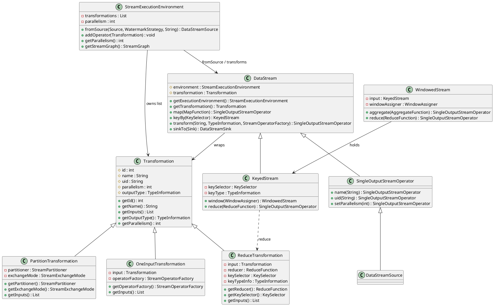
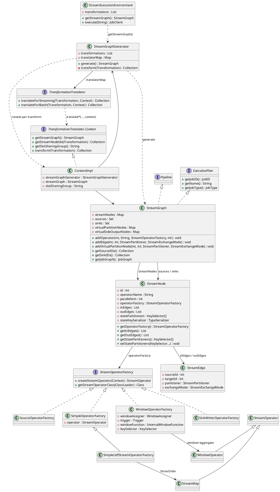
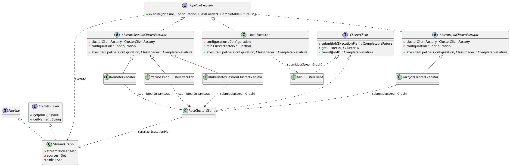
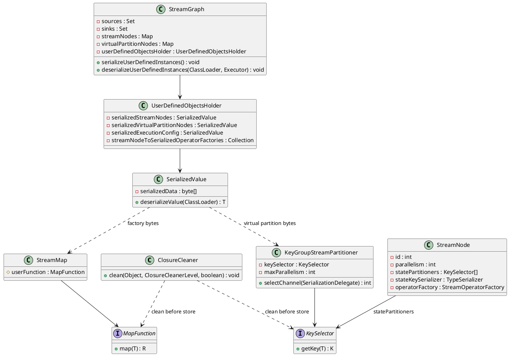

**Apache Flink** is a distributed engine for continuous (and bounded) dataflow programs. A job is a graph of operators; the runtime places parallel **tasks** on **TaskManagers**, keeps operator **state** local to those tasks, and advances time with **watermarks** so windows and timers close at well-defined points.

<!--more-->

---

## 1. Overview


**Apache Flink** is a distributed engine for continuous (and bounded) **dataflow** programs. A job is a graph of operators. The runtime places parallel **tasks** on workers, keeps operator **state** local to those tasks, and advances **event time** with **watermarks** so windows and timers close at well-defined points.


Default execution is **streaming**: records flow continuously and checkpoints snapshot state for recovery. The same operators can run in **batch** style (`RuntimeExecutionMode.BATCH`) when every input is bounded. Parallelism is per operator (or a job default): a logical operator with parallelism `p` becomes `p` **subtasks** that share no mutable state. Keyed state is partitioned by key group so rescale can move groups without rewriting every key.

### Usage example

You build a pipeline with the DataStream API (`StreamExecutionEnvironment`) or the Table / SQL API—sources in, transforms, sinks out—then call `execute` (or submit a JAR) so the cluster runs the job until it is cancelled, fails past recovery, or finishes when all bounded inputs end. A typical job:

```java
StreamExecutionEnvironment env = StreamExecutionEnvironment.getExecutionEnvironment();
env.enableCheckpointing(10_000);

env.fromSource(ordersSource, watermarkStrategy, "orders")
    .map(new ParseOrder())
    .keyBy(Order::getUserId)
    .window(TumblingEventTimeWindows.of(Duration.ofMinutes(1)))
    .aggregate(new CountPerUser())
    .sinkTo(kafkaSink);

env.execute("orders-per-minute");
```

Here Kafka (or another connector) is the source, keyed windows hold per-user counts in operator state, and another connector is the sink.

### Cluster roles

That job is scheduled onto a Flink cluster with two process roles:

| Role | Responsibility |
|------|----------------|
| **JobManager** | Accepts jobs, builds the scheduling plan, coordinates checkpoints, recovers failures |
| **TaskManager** | Hosts **task slots**; runs one or more subtasks; holds keyed/operator state locally |

One JobManager is the leader for a given high-availability setup. The client submits to the JobManager. TaskManagers register slots with the ResourceManager; the JobMaster claims slots and deploys tasks into them. Source and sink connectors run inside those tasks—the JobManager never sees individual records. When operators repartition (for example after `keyBy`), TaskManagers exchange records over pipelined network buffers (shuffle). Checkpoints are triggered by the JobManager and acknowledged by the tasks.

---

## 2. Client job submission

User code does not schedule tasks. On the client, Flink records the pipeline and submits that plan:

1. **API `Transformation`s** — each DataStream call appends a node to a list on the environment.
2. **`StreamGraph`** — `StreamGraphGenerator` turns that list into `StreamNode` / `StreamEdge` (partitioners, exchange mode).
3. **Submit** — a `PipelineExecutor` hands the `StreamGraph` (`ExecutionPlan`) to a `ClusterClient`. `RestClusterClient` writes that graph and uploads it. It does not build a `JobGraph`.
4. **Function serialization** — the mapping function and the hash function are user classes. They are cleaned, then stored as bytes, because the node map and the operator factory are transient.

`JobGraph` compilation, the `ExecutionGraph`, and task deployment run on the cluster. That path is [JobManager](/post/data/stream/flink/jobmanager/).

The stages below reuse the §1 **orders-per-minute** example, up to the graph the client actually sends:

```text
API:     orders -> ParseOrder -> keyBy(userId) -> window -> aggregate -> kafkaSink
Stream:  [orders] --fwd--> [ParseOrder] --hash--> [window+agg] --fwd--> [kafkaSink]
```

### 2.1 StreamGraph generation

Building a `StreamGraph` is a two-phase procedure on the client. User code first accumulates API metadata; only an explicit `getStreamGraph` / `execute` turns that metadata into a graph. Nothing processes records yet—operator factories create runtime **`StreamOperator`s** later, when tasks deploy on workers.

Procedures:

1. **API call** (§2.1.1) — each `fromSource` / `map` / `keyBy` / … returns a **`DataStream`** (or related) handle and appends a **`Transformation`** to `StreamExecutionEnvironment`’s list.
2. **StreamGraph translation** (§2.1.2) — `getStreamGraph` / `execute` hands that list to **`StreamGraphGenerator`**, which dispatches each **`Transformation`** to a **`TransformationTranslator`** that writes **`StreamNode`s** / **`StreamEdge`s** (`fwd`, `hash`, …).

#### 2.1.1 API call

When user code writes a DataStream job, each call like `fromSource`, `map`, or `keyBy` looks like it builds a pipeline—but at this stage Flink only records what was requested. Every call returns a **`DataStream`** (or a close relative such as `KeyedStream`) for further chaining, and behind the scenes it adds a **`Transformation`** to a list on **`StreamExecutionEnvironment`**. That list is the real program so far; the `DataStream` objects are just convenient handles. No tasks run and no records move until the code later asks for a graph or calls `execute`.



```java
// DataStream.map: create a Transformation and register it on the env (no task yet)
public <R> SingleOutputStreamOperator<R> map(MapFunction<T, R> mapper) {
    return transform(
        "Map",
        getType().getTypeClass() /* simplified */,
        new OneInputTransformation<>(
            this.transformation,
            "Map",
            new MapOperatorFactory<>(mapper),
            TypeExtractor.getMapReturnTypes(mapper, getType()),
            parallelism));
}

protected <R> SingleOutputStreamOperator<R> transform(
        String operatorName,
        TypeInformation<R> outTypeInfo,
        OneInputTransformation<T, R> transformation) {
    // registers on StreamExecutionEnvironment.transformations
    getExecutionEnvironment().addOperator(transformation);
    return new SingleOutputStreamOperator<>(getExecutionEnvironment(), transformation);
}
```

For **orders-per-minute**, after the fluent chain the environment’s list holds transforms for `orders`, `ParseOrder`, `keyBy(userId)`, window+aggregate, and `kafkaSink`—still only metadata.

#### 2.1.2 StreamGraph translation

When user code calls `execute` (or `getStreamGraph`), the client turns the environment’s **`Transformation`** list into a **`StreamGraph`**. **`StreamGraphGenerator`** does not hard-code per-type `instanceof` logic for the common operators; it looks up a **`TransformationTranslator`** in `translatorMap` and delegates with a **`TransformationTranslator.Context`** (`ContextImpl`) that exposes the in-progress `StreamGraph`, already-translated parent node ids, and recursive `transform(...)`. Each translator writes **`StreamNode`s** / **`StreamEdge`s** (or a virtual partition node for `keyBy`) into the graph. Runtime **`StreamOperator`** instances are still not created here; factories on the nodes create them later when tasks deploy on workers.



```java
// Client entry: build StreamGraph, then continue toward JobGraph / cluster
public JobClient execute(String jobName) throws Exception {
    StreamGraph streamGraph = getStreamGraph(); // clears transformations by default
    streamGraph.setJobName(jobName);
    return execute(streamGraph);
}

public StreamGraph getStreamGraph() {
    return getStreamGraph(true);
}

public StreamGraph getStreamGraph(boolean clearTransformations) {
    StreamGraph graph = new StreamGraphGenerator(transformations, /* config */).generate();
    if (clearTransformations) {
        transformations.clear();
    }
    return graph;
}

// StreamGraphGenerator: recurse from sinks, dispatch by Transformation class
private Collection<Integer> transform(Transformation<?> transform) {
    if (alreadyTransformed.containsKey(transform)) {
        return alreadyTransformed.get(transform);
    }
    TransformationTranslator<?, Transformation<?>> translator =
        translatorMap.get(transform.getClass());
    // e.g. OneInputTransformation -> OneInputTransformationTranslator
    //      PartitionTransformation -> PartitionTransformationTranslator
    Collection<Integer> ids = shouldExecuteInBatchMode
        ? translator.translateForBatch(transform, context)
        : translator.translateForStreaming(transform, context);
    alreadyTransformed.put(transform, ids);
    return ids;
}

// translatorMap (excerpt for orders-per-minute)
translatorMap.put(SourceTransformation.class, new SourceTransformationTranslator<>());
translatorMap.put(OneInputTransformation.class, new OneInputTransformationTranslator<>());
translatorMap.put(PartitionTransformation.class, new PartitionTransformationTranslator<>());
translatorMap.put(ReduceTransformation.class, new ReduceTransformationTranslator<>());
translatorMap.put(SinkTransformation.class, new SinkTransformationTranslator<>());
```

For **orders-per-minute**, translators produce this `StreamGraph` content:

```text
Transformation                     Translator                              Graph effect
-------------------------------    ------------------------------------    ------------------------------------------
SourceTransformation(orders)       SourceTransformationTranslator          StreamNode orders
OneInputTransformation(ParseOrder) OneInputTransformationTranslator        StreamNode ParseOrder + fwd edge
PartitionTransformation(keyBy)     PartitionTransformationTranslator       virtual partition (no physical node)
OneInputTransformation(window+agg) OneInputTransformationTranslator        StreamNode window+aggregate + hash edge
SinkTransformation(kafkaSink)      SinkTransformationTranslator            StreamNode kafkaSink + fwd edge

StreamNodes:
  orders              SourceOperatorFactory
  ParseOrder          MapOperatorFactory
  window+aggregate    WindowOperatorFactory
  kafkaSink           SinkOperatorFactory

StreamEdges:
  orders           --fwd-->              ParseOrder
  ParseOrder       --hash(userId)-->     window+aggregate
  window+aggregate --fwd-->              kafkaSink
```

`keyBy` is handled by **`PartitionTransformationTranslator`**: it registers a virtual node so the downstream edge carries the hash partitioner—not a separate running operator.

### 2.2 Submit the StreamGraph

`execute` builds the `StreamGraph`, then a **`PipelineExecutor`** (chosen by `execution.target`) submits that object. Session and job executors obtain a **`ClusterClient`** and call **`submitJob(ExecutionPlan)`**. **`RestClusterClient`** writes the `StreamGraph` to a temporary file and uploads it with the user jars. **`MiniClusterClient`** does the same hand-off into a local MiniCluster. Neither client compiles a `JobGraph`.



```java
// --- Step 1: user code / env.execute ---
public JobClient execute(String jobName) throws Exception {
    StreamGraph streamGraph = getStreamGraph();
    streamGraph.setJobName(jobName);
    return execute(streamGraph);
}

// --- Step 2: pick a PipelineExecutor (local / remote / yarn / k8s, …) ---
public JobClient executeAsync(StreamGraph streamGraph) throws Exception {
    PipelineExecutorFactory factory =
        executorServiceLoader.getExecutorFactory(configuration);
    return factory.getExecutor(configuration)
        .execute(streamGraph, configuration, userClassloader)
        .get();
}

// --- Step 3: submit the StreamGraph; no JobGraph on the client ---
StreamGraph streamGraph = PipelineExecutorUtils.getStreamGraph(pipeline, configuration);
streamGraph.serializeUserDefinedInstances();
return clusterClient.submitJob(streamGraph);

// RestClusterClient: write the StreamGraph bytes and POST them
public CompletableFuture<JobID> submitJob(ExecutionPlan executionPlan) {
    Path executionPlanFile = Files.createTempFile(
        "flink-executionPlan-" + executionPlan.getJobID(), ".bin");
    try (ObjectOutputStream out = new ObjectOutputStream(Files.newOutputStream(executionPlanFile))) {
        out.writeObject(executionPlan); // StreamGraph, not JobGraph
    }
    return sendRetriableRequest(/* ... */).thenApply(ignored -> executionPlan.getJobID());
}
```

`writeObject` writes the non-transient fields: job id, name, `sources`, `sinks`, checkpoint settings. Numbers, strings, enums, and Flink `TypeSerializer`s (the layout of an `Order` field such as `userId`) go out as ordinary Java objects. The orders themselves stay in the source.

The node map, the virtual-partition map, and each `operatorFactory` are `transient`. `writeObject` skips them. Those objects hold the user functions, so they are packed into bytes first (§2.3). The cluster compiles the restored `StreamGraph` into a `JobGraph` inside the JobMaster. See [JobManager](/post/data/stream/flink/jobmanager/).

### 2.3 Function serialization

A user function has to arrive as a live object on a TaskManager, and the class that implements it (`ParseOrder`, the `keyBy` lambda) exists only in the user JAR. Java deserialization loads classes with the class loader that is reading the stream. When the cluster first reads `flink-executionPlan-….bin`, that loader is the system loader, which has Flink and not the job. A `MapFunction` or `KeySelector` written as a normal field would fail there with `ClassNotFoundException`.

Flink therefore keeps every object that can point at user code **transient**, and ships a `byte[]` instead. A `byte[]` deserializes with the system loader. The bytes are turned back into the function later, when the user class loader is available.

Two steps make that byte array.

**1. Make the function serializable (`ClosureCleaner`).** `map` and `keyBy` call `StreamExecutionEnvironment.clean` before the function is stored. `ClosureCleaner.clean` tries `InstantiationUtil.serializeObject`. When that succeeds, it stops. When it fails, the usual cause is a non-static inner class: the compiler added a `this$0` field pointing at the enclosing object, and Java would then serialize that whole object. The cleaner reads the function’s bytecode with ASM. If no method reads `this$0`, it sets that field to `null` and serializes again. If the bytecode does read the enclosing instance, nulling the field would break the function, so the field stays and the retry throws `InvalidProgramException` (“The implementation of the MapFunction is not serializable”). Classes that define `writeObject`, `writeReplace`, or `Externalizable` are left alone.

**2. Copy transient user objects into `SerializedValue` (`serializeUserDefinedInstances`).** This runs immediately before `submitJob`. `SerializedValue` calls `InstantiationUtil.serializeObject` and keeps only the `byte[]`. The holder that stores those arrays, `UserDefinedObjectsHolder`, is a normal field of `StreamGraph`, so `writeObject` does write it.

The copy is ordered, because the factory is transient on the node as well as the node map being transient on the graph:

1. Each `StreamOperatorFactory` is wrapped in its own `SerializedValue` (this can run in parallel). That is the only copy of the factory.
2. The `StreamNode` map is then wrapped. `operatorFactory` is already skipped, so those bytes contain the node’s plain fields, its `TypeSerializer`s, and `statePartitioners`.
3. The virtual-partition map (each entry is parent id, `StreamPartitioner`, exchange mode) and the execution config are wrapped the same way.

On the cluster, `deserializeUserDefinedInstances(userClassLoader)` reverses that: `SerializedValue.deserializeValue` reads the bytes with the user class loader, restores the transient maps, and calls `StreamNode.setOperatorFactory`.



```java
// --- Step 1: map / keyBy. Fail here if the function cannot be serialized. ---
public <F> F clean(F f) {
    ClosureCleaner.clean(f, config.getClosureCleanerLevel(), true);
    return f;
}

// ClosureCleaner: already serializable → return.
// Otherwise, if this$0 is never read, set it to null and try again.
if (canBeSerialized(func)) {
    return;
}
// ... ASM This0AccessFinder: GETFIELD this$0 ...
if (!accessesClosure) {
    this0.set(func, null);
}
InstantiationUtil.serializeObject(func); // InvalidProgramException if this still fails

// --- Step 2: before submitJob. Transient fields become byte arrays. ---
// factory first (it is transient on StreamNode), then the node map, then partitions
streamNodeToSerializedOperatorFactories =
    serializeOperatorFactories(streamNodes.values(), serializationExecutor);
serializedStreamNodes = new SerializedValue<>(streamNodes);
serializedVirtualPartitionNodes = new SerializedValue<>(virtualPartitionNodes);

public SerializedValue(T value) throws IOException {
    this.serializedData = InstantiationUtil.serializeObject(value);
}

// Cluster, once the user class loader exists:
public T deserializeValue(ClassLoader loader) throws IOException, ClassNotFoundException {
    return InstantiationUtil.deserializeObject(serializedData, loader);
}
```

**Mapping function.** `ParseOrder` is the `MapFunction` in `StreamMap.userFunction`. The translator stores that operator inside the node’s `StreamOperatorFactory`. Because the factory is `transient`, it appears only in `streamNodeToSerializedOperatorFactories`.

**Hashing function.** `keyBy(Order::getUserId)` is a `KeySelector`. `PartitionTransformationTranslator` puts it on a `KeyGroupStreamPartitioner` in the virtual-partition map, and the window node also stores it in `statePartitioners`. The partitioner therefore rides inside `serializedVirtualPartitionNodes`. `statePartitioners` is a normal field of `StreamNode`, so the same selector also rides inside `serializedStreamNodes`. After restore, `selectChannel` calls `keySelector.getKey(record)` and `KeyGroupRangeAssignment.assignKeyToParallelOperator`, which is `murmurHash(key.hashCode())` modulo max parallelism. `stateKeySerializer` is the `TypeSerializer` for the key bytes; that object is one of the plain fields inside the node bytes.

```java
public int selectChannel(SerializationDelegate<StreamRecord<T>> record) {
    K key = keySelector.getKey(record.getInstance().getValue());
    return KeyGroupRangeAssignment.assignKeyToParallelOperator(
            key, maxParallelism, numberOfChannels);
}

public static int assignToKeyGroup(Object key, int maxParallelism) {
    return MathUtils.murmurHash(key.hashCode()) % maxParallelism;
}
```

For **orders-per-minute**:

```text
Piece              Lives in                         Serialized as
-----------------  -------------------------------  -----------------------------------------
ParseOrder         StreamMap.userFunction           SerializedValue of the operator factory
                   inside operatorFactory           (factory is transient)
keyBy(userId)      KeyGroupStreamPartitioner        SerializedValue of virtualPartitionNodes
                   and statePartitioners            and of the StreamNode map
userId layout      stateKeySerializer               inside the StreamNode bytes
node id, edges     StreamNode fields                inside the StreamNode bytes
```
