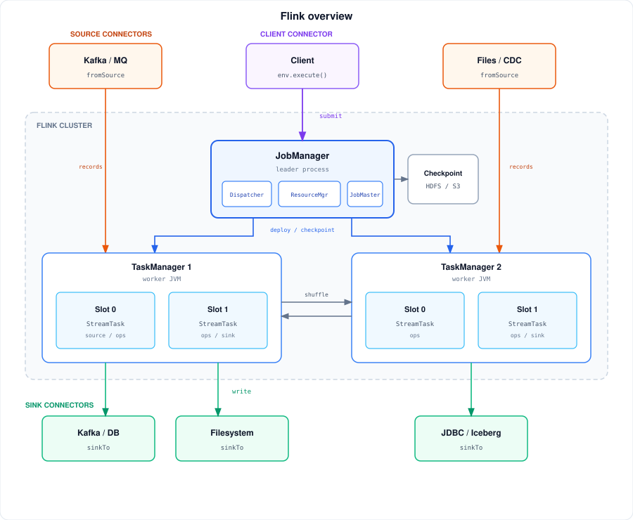
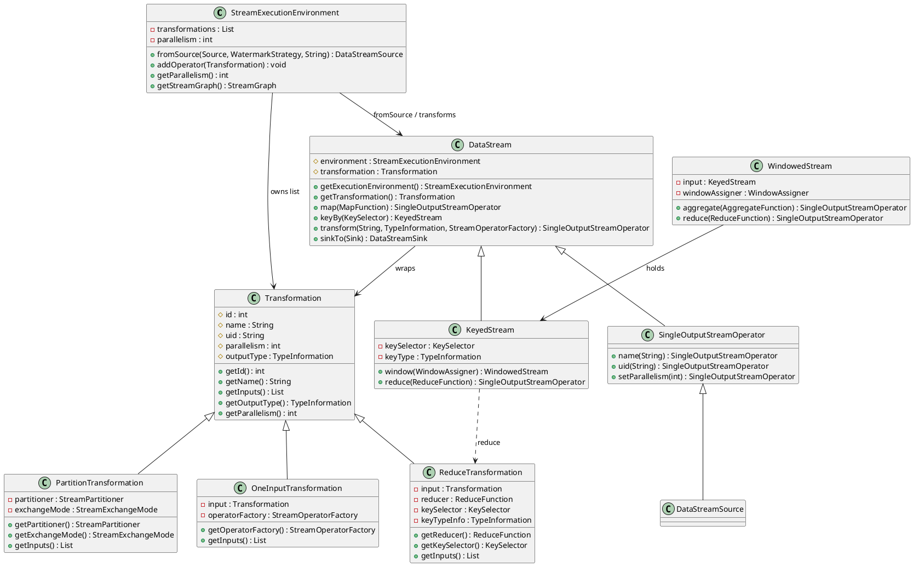
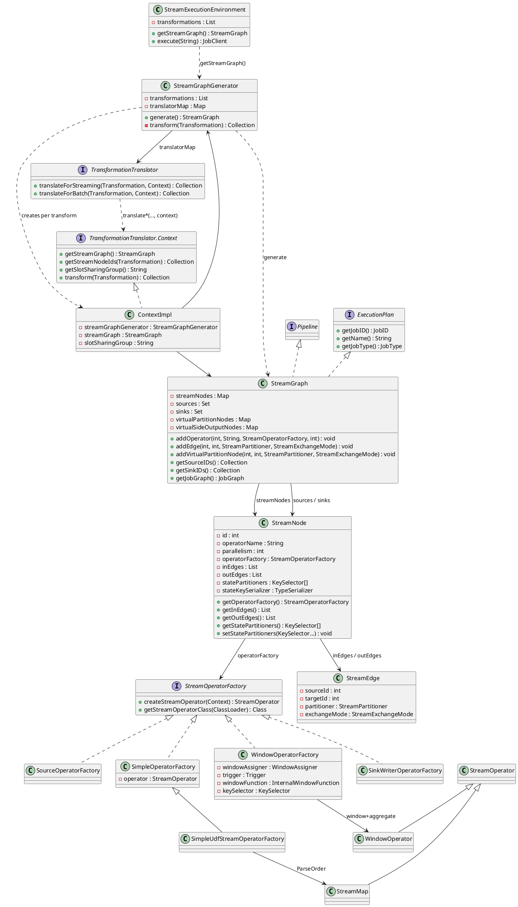
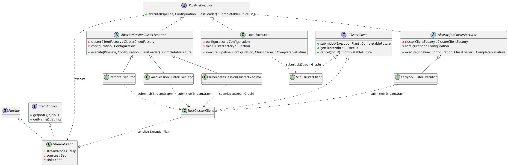
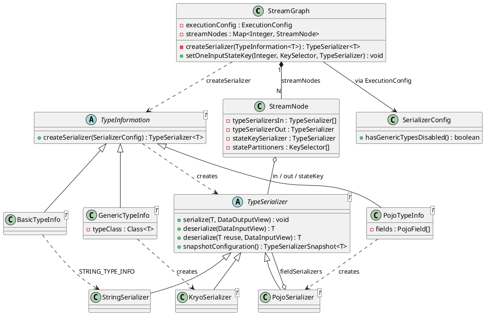
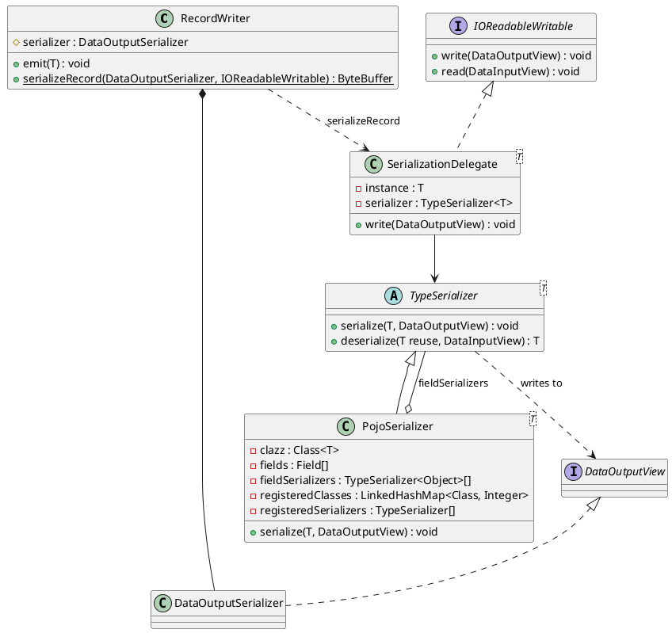
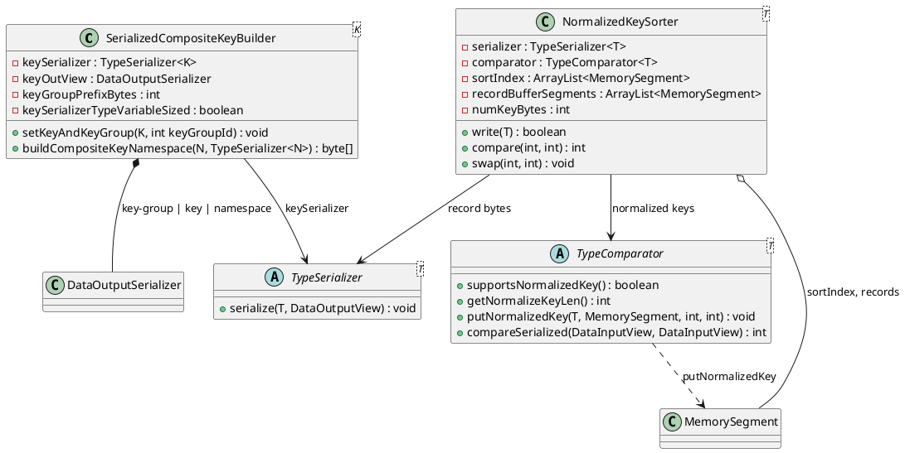
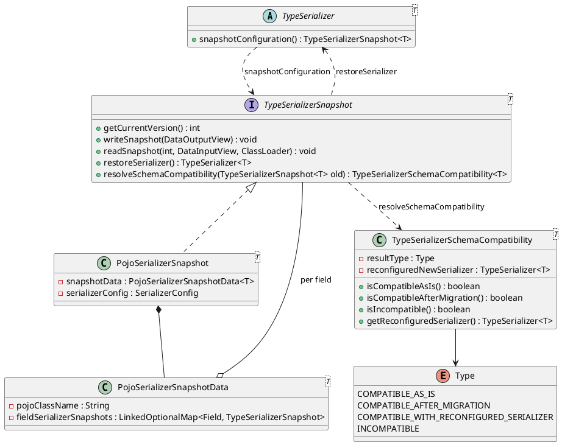

**Apache Flink** is a distributed engine for continuous (and bounded) dataflow programs. A job is a graph of operators; the runtime places parallel **tasks** on **TaskManagers**, keeps operator **state** local to those tasks, and advances time with **watermarks** so windows and timers close at well-defined points.

<!--more-->

---

## 1. Overview


**Apache Flink** is a distributed engine for continuous (and bounded) **dataflow** programs. A job is a graph of operators. The runtime places parallel **tasks** on workers, keeps operator **state** local to those tasks, and advances **event time** with **watermarks** so windows and timers close at well-defined points.



Default execution is **streaming**: records flow continuously and checkpoints snapshot state for recovery. The same operators can run in **batch** style (`RuntimeExecutionMode.BATCH`) when every input is bounded. Parallelism is per operator (or a job default): a logical operator with parallelism `p` becomes `p` **subtasks** that share no mutable state. Keyed state is partitioned by key group so rescale can move groups without rewriting every key.

### Usage example

You build a pipeline with the DataStream API (`StreamExecutionEnvironment`) or the Table / SQL API—sources in, transforms, sinks out—then call `execute` (or submit a JAR) so the cluster runs the job until it is cancelled, fails past recovery, or finishes when all bounded inputs end. A typical job:

```java
StreamExecutionEnvironment env = StreamExecutionEnvironment.getExecutionEnvironment();
env.enableCheckpointing(10_000);

env.fromSource(ordersSource, watermarkStrategy, "orders")
    .map(new ParseOrder())
    .keyBy(Order::getUserId)
    .window(TumblingEventTimeWindows.of(Duration.ofMinutes(1)))
    .aggregate(new CountPerUser())
    .sinkTo(kafkaSink);

env.execute("orders-per-minute");
```

Here Kafka (or another connector) is the source, keyed windows hold per-user counts in operator state, and another connector is the sink.

### Cluster deployment

Flink is deployed as a cluster of one **JobManager** process and several **TaskManager** processes. Two deployments are in common use. An **application cluster** is created for one job and removed with that job, so its JobManager serves that job alone. A **session cluster** is started first and then accepts many jobs; they share the JobManager and the slots, and each job still gets its own **JobMaster** inside that process.

| Deployment | When the cluster exists | What the JobManager serves |
|------------|-------------------------|----------------------------|
| **Application** | Created with the job, deleted with the job | That one job |
| **Session** | Started beforehand, stays up | Every job submitted into it |

#### Application cluster

This is the usual production deployment on Kubernetes: one `FlinkDeployment` is one cluster is one job.

```text
FlinkDeployment "orders-per-minute"
  JobManager pod
    Dispatcher          cluster REST entry
    ResourceManager     creates and tracks this cluster's TaskManagers
    JobMaster           this job only: schedule, deploy, checkpoints
  TaskManager pod     TaskManager pod
    slot   slot          slot   slot
          \________ shuffle after keyBy ________/
```

A `FlinkDeployment` (the Flink Kubernetes Operator), or `flink run-application -t kubernetes-application`, asks Kubernetes for a JobManager pod and a Service in front of it. The pod starts the Dispatcher and the ResourceManager, then runs the job’s `main` in that same process. `env.execute` submits to the local Dispatcher, and the Dispatcher starts the JobMaster. The ResourceManager creates TaskManager pods through the Kubernetes API, enough slots for the job’s parallelism. Each TaskManager registers its slots, the JobMaster claims them and deploys the tasks. Deleting the `FlinkDeployment` deletes the pods. The operator’s list of deployments is the list of clusters.

The Dispatcher and the ResourceManager belong to the cluster. The JobMaster belongs to the job. Here they share one JVM and one job, so the JobManager process is dedicated to that job. TaskManagers are separate JVMs. Source and sink connectors run inside the tasks. Records stay on the TaskManagers; after `keyBy` those processes shuffle with each other. Checkpoint files go to S3 or HDFS: the tasks write the state, the JobManager keeps the handles.

#### Session cluster

A session cluster starts the workers and then waits for jobs. On a set of machines, `bin/start-cluster.sh` launches one JobManager and a TaskManager for each host in `config/workers`. Those TaskManagers register their slots with the ResourceManager. Each later client, with `execution.target` set to `remote`, uploads a `StreamGraph` to the Dispatcher’s REST port. The Dispatcher starts another JobMaster in the same JVM. The jobs share the Dispatcher, the ResourceManager, and the slot pool. A Kubernetes session is the same shape with a long-lived JobManager pod.

```text
one session JobManager pod
  Dispatcher
  ResourceManager
  JobMaster (orders-per-minute)
  JobMaster (another job)
        |
TaskManager pool, shared slots
```

With high availability, extra JobManager pods stand by. One of them holds the leader lease (a Kubernetes ConfigMap, or ZooKeeper). TaskManagers and clients follow the leader.

---

## 2. Client job submission

User code does not schedule tasks. On the client, Flink records the pipeline and submits that plan:

1. **API `Transformation`s** — each DataStream call appends a node to a list on the environment.
2. **`StreamGraph`** — `StreamGraphGenerator` turns that list into `StreamNode` / `StreamEdge` (partitioners, exchange mode).
3. **Submit** — a `PipelineExecutor` hands the `StreamGraph` (`ExecutionPlan`) to a `ClusterClient`. `RestClusterClient` writes that graph and uploads it. It does not build a `JobGraph`.
4. **StreamGraph serialization** — the plan is Java-serialized once, with the user JARs alongside. Records and state use Flink's own `TypeSerializer`s, which the client fixes per stream while building the graph and ships inside it.

`JobGraph` compilation, the `ExecutionGraph`, and task deployment run on the cluster. That path is [JobManager](/post/data/stream/flink/jobmanager/).

The stages below reuse the §1 **orders-per-minute** example, up to the graph the client actually sends:

```text
API:     orders -> ParseOrder -> keyBy(userId) -> window -> aggregate -> kafkaSink
Stream:  [orders] --fwd--> [ParseOrder] --hash--> [window+agg] --fwd--> [kafkaSink]
```

### 2.1 StreamGraph generation

Building a `StreamGraph` is a two-phase procedure on the client. User code first accumulates API metadata; only an explicit `getStreamGraph` / `execute` turns that metadata into a graph. Nothing processes records yet—operator factories create runtime **`StreamOperator`s** later, when tasks deploy on workers.

Procedures:

1. **API call** (§2.1.1) — each `fromSource` / `map` / `keyBy` / … returns a **`DataStream`** (or related) handle and appends a **`Transformation`** to `StreamExecutionEnvironment`’s list.
2. **StreamGraph translation** (§2.1.2) — `getStreamGraph` / `execute` hands that list to **`StreamGraphGenerator`**, which dispatches each **`Transformation`** to a **`TransformationTranslator`** that writes **`StreamNode`s** / **`StreamEdge`s** (`fwd`, `hash`, …).

#### 2.1.1 API call

When user code writes a DataStream job, each call like `fromSource`, `map`, or `keyBy` looks like it builds a pipeline—but at this stage Flink only records what was requested. Every call returns a **`DataStream`** (or a close relative such as `KeyedStream`) for further chaining, and behind the scenes it adds a **`Transformation`** to a list on **`StreamExecutionEnvironment`**. That list is the real program so far; the `DataStream` objects are just convenient handles. No tasks run and no records move until the code later asks for a graph or calls `execute`.



```java
// DataStream.map: create a Transformation and register it on the env (no task yet)
public <R> SingleOutputStreamOperator<R> map(MapFunction<T, R> mapper) {
    return transform(
        "Map",
        getType().getTypeClass() /* simplified */,
        new OneInputTransformation<>(
            this.transformation,
            "Map",
            new MapOperatorFactory<>(mapper),
            TypeExtractor.getMapReturnTypes(mapper, getType()),
            parallelism));
}

protected <R> SingleOutputStreamOperator<R> transform(
        String operatorName,
        TypeInformation<R> outTypeInfo,
        OneInputTransformation<T, R> transformation) {
    // registers on StreamExecutionEnvironment.transformations
    getExecutionEnvironment().addOperator(transformation);
    return new SingleOutputStreamOperator<>(getExecutionEnvironment(), transformation);
}
```

For **orders-per-minute**, after the fluent chain the environment’s list holds transforms for `orders`, `ParseOrder`, `keyBy(userId)`, window+aggregate, and `kafkaSink`—still only metadata.

#### 2.1.2 StreamGraph translation

When user code calls `execute` (or `getStreamGraph`), the client turns the environment’s **`Transformation`** list into a **`StreamGraph`**. **`StreamGraphGenerator`** does not hard-code per-type `instanceof` logic for the common operators; it looks up a **`TransformationTranslator`** in `translatorMap` and delegates with a **`TransformationTranslator.Context`** (`ContextImpl`) that exposes the in-progress `StreamGraph`, already-translated parent node ids, and recursive `transform(...)`. Each translator writes **`StreamNode`s** / **`StreamEdge`s** (or a virtual partition node for `keyBy`) into the graph. Runtime **`StreamOperator`** instances are still not created here; factories on the nodes create them later when tasks deploy on workers.



```java
// Client entry: build StreamGraph, then continue toward JobGraph / cluster
public JobClient execute(String jobName) throws Exception {
    StreamGraph streamGraph = getStreamGraph(); // clears transformations by default
    streamGraph.setJobName(jobName);
    return execute(streamGraph);
}

public StreamGraph getStreamGraph() {
    return getStreamGraph(true);
}

public StreamGraph getStreamGraph(boolean clearTransformations) {
    StreamGraph graph = new StreamGraphGenerator(transformations, /* config */).generate();
    if (clearTransformations) {
        transformations.clear();
    }
    return graph;
}

// StreamGraphGenerator: recurse from sinks, dispatch by Transformation class
private Collection<Integer> transform(Transformation<?> transform) {
    if (alreadyTransformed.containsKey(transform)) {
        return alreadyTransformed.get(transform);
    }
    TransformationTranslator<?, Transformation<?>> translator =
        translatorMap.get(transform.getClass());
    // e.g. OneInputTransformation -> OneInputTransformationTranslator
    //      PartitionTransformation -> PartitionTransformationTranslator
    Collection<Integer> ids = shouldExecuteInBatchMode
        ? translator.translateForBatch(transform, context)
        : translator.translateForStreaming(transform, context);
    alreadyTransformed.put(transform, ids);
    return ids;
}

// translatorMap (excerpt for orders-per-minute)
translatorMap.put(SourceTransformation.class, new SourceTransformationTranslator<>());
translatorMap.put(OneInputTransformation.class, new OneInputTransformationTranslator<>());
translatorMap.put(PartitionTransformation.class, new PartitionTransformationTranslator<>());
translatorMap.put(ReduceTransformation.class, new ReduceTransformationTranslator<>());
translatorMap.put(SinkTransformation.class, new SinkTransformationTranslator<>());
```

For **orders-per-minute**, translators produce this `StreamGraph` content:

```text
Transformation                     Translator                              Graph effect
-------------------------------    ------------------------------------    ------------------------------------------
SourceTransformation(orders)       SourceTransformationTranslator          StreamNode orders
OneInputTransformation(ParseOrder) OneInputTransformationTranslator        StreamNode ParseOrder + fwd edge
PartitionTransformation(keyBy)     PartitionTransformationTranslator       virtual partition (no physical node)
OneInputTransformation(window+agg) OneInputTransformationTranslator        StreamNode window+aggregate + hash edge
SinkTransformation(kafkaSink)      SinkTransformationTranslator            StreamNode kafkaSink + fwd edge

StreamNodes:
  orders              SourceOperatorFactory
  ParseOrder          MapOperatorFactory
  window+aggregate    WindowOperatorFactory
  kafkaSink           SinkOperatorFactory

StreamEdges:
  orders           --fwd-->              ParseOrder
  ParseOrder       --hash(userId)-->     window+aggregate
  window+aggregate --fwd-->              kafkaSink
```

`keyBy` is handled by **`PartitionTransformationTranslator`**: it registers a virtual node so the downstream edge carries the hash partitioner—not a separate running operator.

### 2.2 Submit the StreamGraph

`execute` builds the `StreamGraph`, then a **`PipelineExecutor`** (chosen by `execution.target`) submits that object. Session and job executors obtain a **`ClusterClient`** and call **`submitJob(ExecutionPlan)`**. **`RestClusterClient`** writes the `StreamGraph` to a temporary file and uploads it with the user jars. **`MiniClusterClient`** does the same hand-off into a local MiniCluster. Neither client compiles a `JobGraph`.



```java
// --- Step 1: user code / env.execute ---
public JobClient execute(String jobName) throws Exception {
    StreamGraph streamGraph = getStreamGraph();
    streamGraph.setJobName(jobName);
    return execute(streamGraph);
}

// --- Step 2: pick a PipelineExecutor (local / remote / yarn / k8s, …) ---
public JobClient executeAsync(StreamGraph streamGraph) throws Exception {
    PipelineExecutorFactory factory =
        executorServiceLoader.getExecutorFactory(configuration);
    return factory.getExecutor(configuration)
        .execute(streamGraph, configuration, userClassloader)
        .get();
}

// --- Step 3: submit the StreamGraph; no JobGraph on the client ---
StreamGraph streamGraph = PipelineExecutorUtils.getStreamGraph(pipeline, configuration);
streamGraph.serializeUserDefinedInstances();
return clusterClient.submitJob(streamGraph);

// RestClusterClient: write the StreamGraph bytes and POST them
public CompletableFuture<JobID> submitJob(ExecutionPlan executionPlan) {
    Path executionPlanFile = Files.createTempFile(
        "flink-executionPlan-" + executionPlan.getJobID(), ".bin");
    try (ObjectOutputStream out = new ObjectOutputStream(Files.newOutputStream(executionPlanFile))) {
        out.writeObject(executionPlan); // StreamGraph, not JobGraph
    }
    return sendRetriableRequest(/* ... */).thenApply(ignored -> executionPlan.getJobID());
}
```

The bytes in that file are Java serialization of the `StreamGraph` (§2.3). After the JobMaster restores the graph, it compiles a `JobGraph`. See [JobManager](/post/data/stream/flink/jobmanager/).

### 2.3 StreamGraph serialization

Serialization turns a Java object into bytes and back. A Flink job needs it in two places:

- **The plan**, once per submission. The client writes the `StreamGraph` with ordinary Java serialization and uploads the user JARs beside it.
- **The data**, all the time. Every record sent between tasks, every value in keyed state, and every checkpoint is bytes.

For the data, Flink does not use Java serialization. It uses its own framework, built on two types. A `TypeInformation` describes the type of a stream, for example "`Order`, a POJO with fields `amount` and `userId`". A `TypeSerializer`, created from that `TypeInformation`, reads and writes values of exactly that type.

The difference from Java serialization is *when the type is known*. Java serialization learns the type from each object at runtime, so it writes the class name and field descriptions into the bytes. Flink learns the type on the client, while building the `StreamGraph`, and stores the serializers in the `StreamNode`s. The bytes then hold only field values. Records become smaller and can be decoded one at a time, the runtime can compare keys without deserializing them, and checkpoints record which serializer wrote the state, so a changed job can check whether it can still read it.

The diagram shows how the graph holds the serializers and which `TypeInformation` creates which `TypeSerializer`:



#### 2.3.1 Serializers are fixed at graph build

Flink chooses a serializer for every stream on the client, before the job starts. The cluster receives these serializers inside the plan and never has to work out a record's type at runtime.

The choice starts from the user function. `TypeExtractor` derives the output type of each function from its generic signature: `ParseOrder implements MapFunction<String, Order>` gives `Order`, and `returns(...)` supplies the type when erasure hides it. A class that is public, has a public no-argument constructor, and exposes every field publicly or through a getter and setter becomes a `PojoTypeInfo`; other classes become a `GenericTypeInfo`. Basic types, tuples, rows, and Avro types have their own `TypeInformation`.

`StreamGraph.addOperator` turns the input and output types into serializers with the job's `SerializerConfig`, and `keyBy` stores the key serializer on the keyed node:

```java
setSerializers(vertexID, createSerializer(inTypeInfo), null, createSerializer(outTypeInfo));

private <T> TypeSerializer<T> createSerializer(TypeInformation<T> typeInfo) {
    return typeInfo != null && !(typeInfo instanceof MissingTypeInfo)
            ? typeInfo.createSerializer(executionConfig.getSerializerConfig())
            : null;
}

public void setOneInputStateKey(
        Integer vertexID, KeySelector<?, ?> keySelector, TypeSerializer<?> keySerializer) {
    StreamNode node = getStreamNode(vertexID);
    node.setStatePartitioners(keySelector);
    node.setStateKeySerializer(keySerializer);
}
```

A task receives its serializers with its configuration and applies them to every element. The field layout of a POJO is resolved once by reflection when the serializer is created, not once per record.

For **orders-per-minute**, the client places three kinds of serializer on the `StreamGraph`. The forward edge from `orders` to `ParseOrder` carries `String` with a `StringSerializer`; the two operators are usually chained, so those records are handed over as objects. The hash edge from `ParseOrder` to the window carries `Order` with a `PojoSerializer`, which writes every record into network buffers. The window-and-aggregate node has a `StringSerializer` as `stateKeySerializer` for `userId`, which forms the key bytes in RocksDB, and a serializer for the aggregate's accumulator, derived from its `TypeInformation`, which writes the state values and their checkpoints.

#### 2.3.2 Compact, self-contained records

Because the serializer already knows the type, a record's bytes contain only its field values, with no class name or field descriptions. Each record is also complete on its own: it can be decoded without the bytes that came before it.

`PojoSerializer` writes one flags byte and then each field in name order, each preceded by a null marker. The class name is written only when the runtime object is an unregistered subclass of the declared type:

```java
public void serialize(T value, DataOutputView target) throws IOException {
    // ... flags: IS_NULL, NO_SUBCLASS, IS_SUBCLASS, IS_TAGGED_SUBCLASS ...
    target.writeByte(flags);
    if ((flags & IS_SUBCLASS) != 0) {
        target.writeUTF(actualClass.getName());
    } else if ((flags & IS_TAGGED_SUBCLASS) != 0) {
        target.writeByte(subclassTag);
    }
    if ((flags & NO_SUBCLASS) != 0) {
        for (int i = 0; i < numFields; i++) {
            Object o = (fields[i] != null) ? fields[i].get(value) : null;
            if (o == null) {
                target.writeBoolean(true);
            } else {
                target.writeBoolean(false);
                fieldSerializers[i].serialize(o, target);
            }
        }
    }
    // ... subclass: delegate to the subclass serializer ...
}
```

For an `Order` with fields `userId = "u1"` and `amount = 12.5`, the record is 14 bytes: the flags byte `NO_SUBCLASS`; for `amount`, a null marker and the 8-byte IEEE 754 double; for `userId`, a null marker, the variable-length value length + 1 = 3, and the two characters `u` and `1` in one byte each.

Java serialization of the same object in a fresh `ObjectOutputStream` produces 86 bytes on JDK 25: a stream header, the class descriptor with the class name, `serialVersionUID`, and the name and type code of each field, and then the values. Inside one long stream, later objects of the same class refer back to the descriptor; measured over 1,000 objects this drops to about 19 bytes per object. That saving depends on the reader having seen the whole stream.

Flink cannot rely on such a shared stream. `RecordWriter` routes each record to one of many subpartitions, and every keyed-state value is stored and read on its own. A `TypeSerializer` record is decodable alone because the metadata lives in the serializer, not in the bytes. On the network path, `RecordWriter` wraps each record in a `SerializationDelegate`, whose `write` calls the edge's `TypeSerializer`, and prefixes the result with its length:



```java
public static ByteBuffer serializeRecord(
        DataOutputSerializer serializer, IOReadableWritable record) throws IOException {
    serializer.setPositionUnsafe(4);
    record.write(serializer);
    serializer.writeIntUnsafe(serializer.length() - 4, 0);
    return serializer.wrapAsByteBuffer();
}
```

On the read side, `TypeSerializer.deserialize(T reuse, DataInputView source)` can fill an existing instance. With `pipeline.object-reuse` enabled (default `false`), the runtime passes the same instance for each record, which removes one allocation per element at the cost that a user function must not keep a reference to its input.

#### 2.3.3 Work on serialized bytes

A Flink serializer always writes equal values as equal bytes. The runtime can therefore store, look up, and sort by key using the bytes alone, without turning them back into objects.

The RocksDB state backend uses this for keyed state: `SerializedCompositeKeyBuilder` builds each state key as the key-group id prefix, then the serialized key, then the serialized namespace (for a window operator, the window). RocksDB stores and looks up entries by comparing bytes and never deserializes the key to find a value. The key-group prefix also makes every key group a contiguous byte range, which is the unit that checkpoints and rescaling assign to subtasks.

The batch runtime applies the same idea to sorting. A `TypeComparator` that supports normalized keys writes a fixed-length, byte-comparable prefix of each key into a `MemorySegment` (`putNormalizedKey`), and `NormalizedKeySorter` sorts records by comparing those prefixes in managed memory, deserializing only to break ties.



#### 2.3.4 Schema evolution of state

State outlives code. A job is stopped with a savepoint, its classes are changed, and it is restarted from that savepoint. Flink stores a description of the old serializer next to the state, so the new job can decide whether to read the old bytes as they are, convert them, or refuse to start.

That description is a `TypeSerializerSnapshot`. It records the serializer's configuration: for a POJO, the class and the snapshot of each field serializer. On restore, the new serializer's snapshot calls `resolveSchemaCompatibility` with the old snapshot. The result is one of four types. `COMPATIBLE_AS_IS` means the new serializer reads the old bytes directly. `COMPATIBLE_WITH_RECONFIGURED_SERIALIZER` means the result carries a reconfigured serializer that is used instead. `COMPATIBLE_AFTER_MIGRATION` means the state backend reads every value with the old serializer, obtained from `restoreSerializer()` on the old snapshot, and writes it again with the new one. `INCOMPATIBLE` fails the restore.



For a POJO, adding or removing a field yields `COMPATIBLE_AFTER_MIGRATION`: the old serializer, restored from its snapshot, reads each value, and the new serializer writes it back; an added field keeps the value set by the no-argument constructor. A different POJO class or an incompatible field serializer, such as a changed field type, yields `INCOMPATIBLE`, and the job fails at restore time rather than reading corrupt values. Java serialization offers only the `serialVersionUID` check: without an explicit value, any change to the class changes the computed identifier and reading fails with `InvalidClassException`.

#### 2.3.5 Kryo fallback for generic types

Not every class can be analyzed field by field. For those, Flink falls back to the general-purpose Kryo library. The fallback keeps the job running but gives up most of the advantages above, so Flink lets a job forbid it.

A type that does not qualify for a specialized `TypeInformation` becomes a `GenericTypeInfo`, whose serializer is `KryoSerializer`. Kryo handles arbitrary object graphs, but it writes class identity into the bytes, it is slower than a field-wise serializer, and its state cannot evolve under the snapshot rules above. Setting `pipeline.generic-types: false` makes `GenericTypeInfo.createSerializer` throw `UnsupportedOperationException`. Since `createSerializer` runs while the `StreamGraph` is built, the error appears on the client, at submission, naming the type that would have gone through Kryo.

```java
public TypeSerializer<T> createSerializer(SerializerConfig config) {
    if (config.hasGenericTypesDisabled()) {
        throw new UnsupportedOperationException(
                "Generic types have been disabled in the ExecutionConfig and type "
                        + this.typeClass.getName() + " is treated as a generic type.");
    }
    return new KryoSerializer<T>(this.typeClass, config);
}
```
