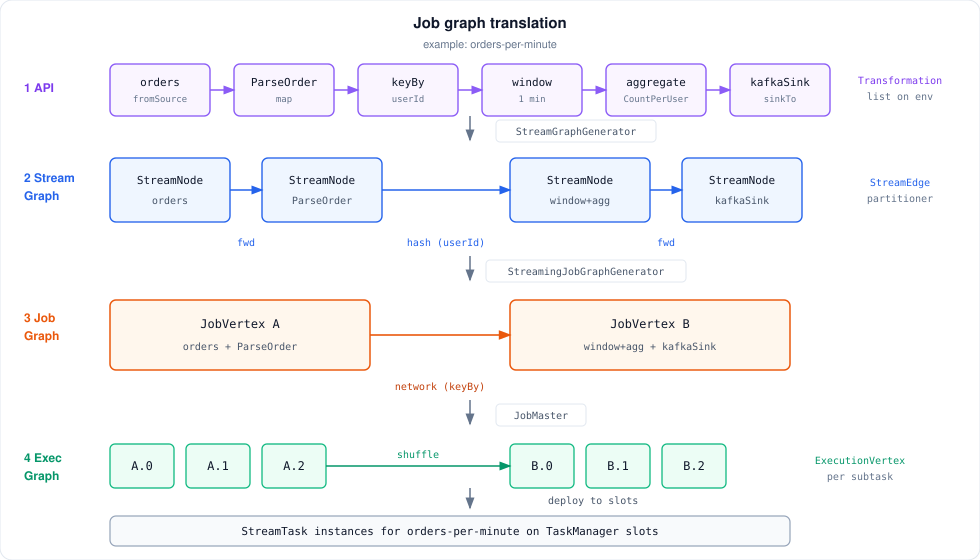
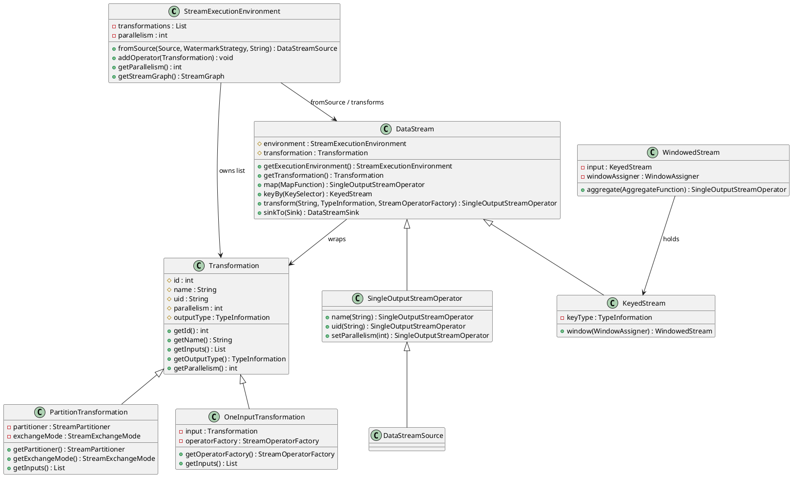
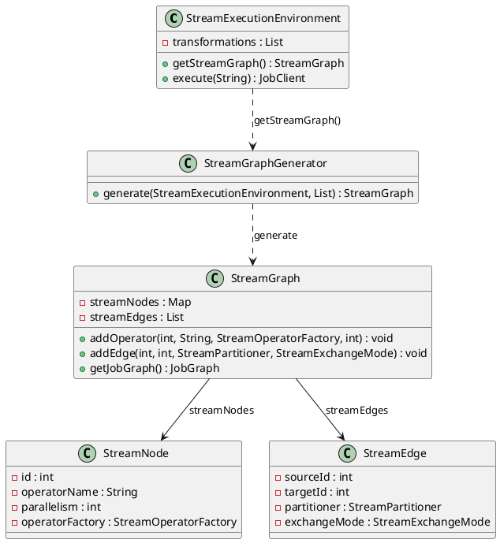
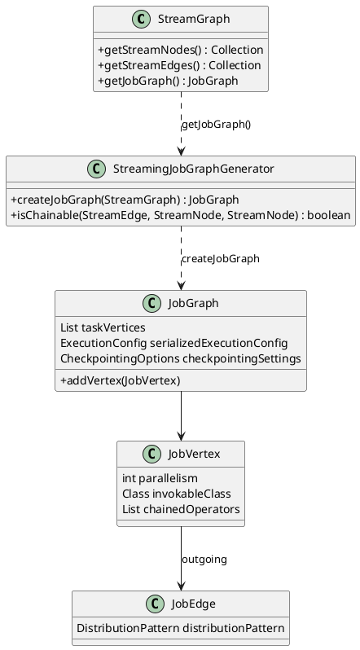
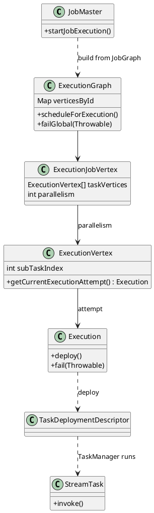
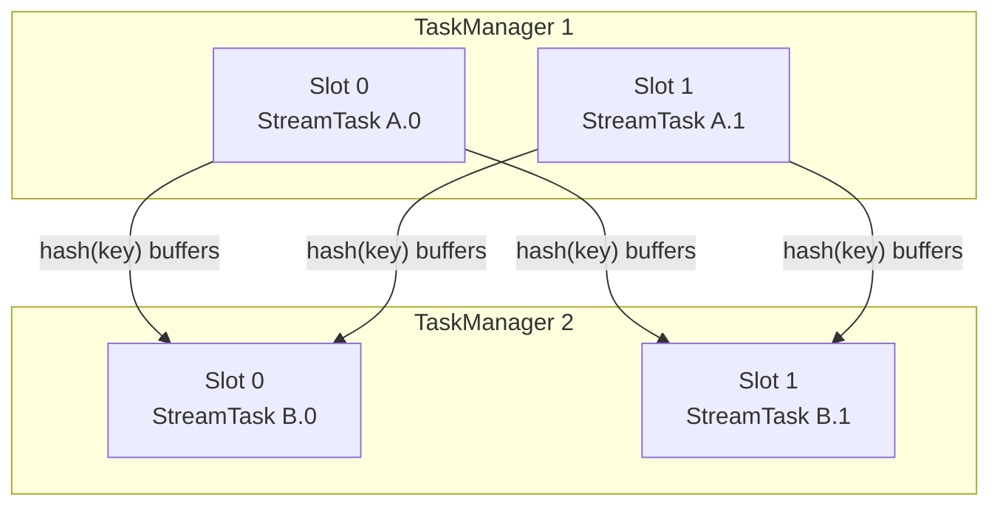
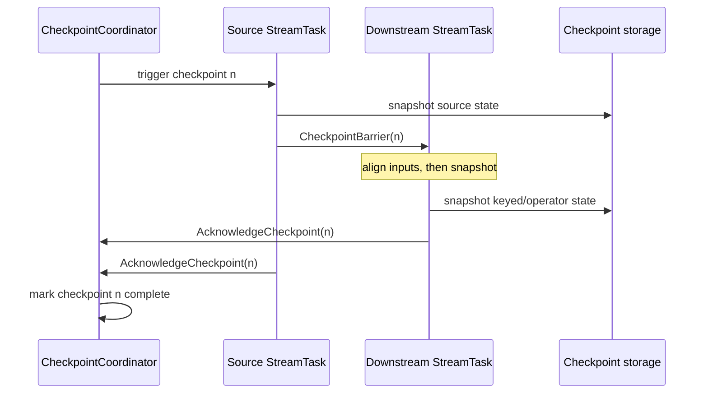

**Apache Flink** is a distributed engine for continuous (and bounded) dataflow programs. A job is a graph of operators; the runtime places parallel **tasks** on **TaskManagers**, keeps operator **state** local to those tasks, and advances time with **watermarks** so windows and timers close at well-defined points.

<!--more-->

---

## 1. Overview


**Apache Flink** is a distributed engine for continuous (and bounded) **dataflow** programs. A job is a graph of operators. The runtime places parallel **tasks** on workers, keeps operator **state** local to those tasks, and advances **event time** with **watermarks** so windows and timers close at well-defined points.


Default execution is **streaming**: records flow continuously and checkpoints snapshot state for recovery. The same operators can run in **batch** style (`RuntimeExecutionMode.BATCH`) when every input is bounded. Parallelism is per operator (or a job default): a logical operator with parallelism `p` becomes `p` **subtasks** that share no mutable state. Keyed state is partitioned by key group so rescale can move groups without rewriting every key.

### Usage example

You build a pipeline with the DataStream API (`StreamExecutionEnvironment`) or the Table / SQL API—sources in, transforms, sinks out—then call `execute` (or submit a JAR) so the cluster runs the job until it is cancelled, fails past recovery, or finishes when all bounded inputs end. A typical job:

```java
StreamExecutionEnvironment env = StreamExecutionEnvironment.getExecutionEnvironment();
env.enableCheckpointing(10_000);

env.fromSource(ordersSource, watermarkStrategy, "orders")
    .map(new ParseOrder())
    .keyBy(Order::getUserId)
    .window(TumblingEventTimeWindows.of(Duration.ofMinutes(1)))
    .aggregate(new CountPerUser())
    .sinkTo(kafkaSink);

env.execute("orders-per-minute");
```

Here Kafka (or another connector) is the source, keyed windows hold per-user counts in operator state, and another connector is the sink.

### Cluster roles

That job is scheduled onto a Flink cluster with two process roles:

| Role | Responsibility |
|------|----------------|
| **JobManager** | Accepts jobs, builds the scheduling plan, coordinates checkpoints, recovers failures |
| **TaskManager** | Hosts **task slots**; runs one or more subtasks; holds keyed/operator state locally |

One JobManager is the leader for a given high-availability setup. The client submits to the JobManager. TaskManagers register slots with the ResourceManager; the JobMaster claims slots and deploys tasks into them. Source and sink connectors run inside those tasks—the JobManager never sees individual records. When operators repartition (for example after `keyBy`), TaskManagers exchange records over pipelined network buffers (shuffle). Checkpoints are triggered by the JobManager and acknowledged by the tasks.

---

## 2. Job graph translation

User code does not schedule threads directly. Flink lowers the API graph in stages until each TaskManager runs concrete `StreamTask` instances:

1. **API `Transformation`s** — each DataStream call appends a node to a list on the environment.
2. **`StreamGraph`** — `StreamGraphGenerator` turns that list into `StreamNode` / `StreamEdge` (partitioners, exchange mode).
3. **`JobGraph`** — `StreamingJobGraphGenerator` collapses chainable sequences into `JobVertex` units and places network edges where repartition is required.
4. **`ExecutionGraph`** — the JobMaster expands each vertex to `parallelism` execution vertices and deploys `StreamTask`s onto slots.



The stages below reuse the §1 **orders-per-minute** example:

```text
API:     orders -> ParseOrder -> keyBy(userId) -> window -> aggregate -> kafkaSink
Stream:  [orders] --fwd--> [ParseOrder] --hash--> [window+agg] --fwd--> [kafkaSink]
Job:     JobVertex_A(orders+ParseOrder)  ==network==>  JobVertex_B(window+agg+kafkaSink)
Exec:    A.0 A.1 ...     shuffle      B.0 B.1 ...
```

`StreamGraph.getJobGraph` is the bridge the client (or Application Mode cluster entrypoint) uses before the JobMaster materializes the `ExecutionGraph`. Failures restart from the last completed checkpoint by resetting tasks and restoring state handles recorded in that checkpoint.

### 2.1 StreamGraph generation

Building a `StreamGraph` is a two-phase procedure on the client. User code first accumulates API metadata; only an explicit `getStreamGraph` / `execute` turns that metadata into a graph. Nothing processes records yet—operator factories create runtime **`StreamOperator`s** later, when tasks deploy on workers.

Procedures:

1. **API call** (§2.1.1) — each `fromSource` / `map` / `keyBy` / … returns a **`DataStream`** (or related) handle and appends a **`Transformation`** to `StreamExecutionEnvironment`’s list.
2. **Client job execution** (§2.1.2) — `getStreamGraph` / `execute` hands that list to **`StreamGraphGenerator`**, which builds **`StreamNode`s** and **`StreamEdge`s** (partitioner + exchange mode: `fwd`, `hash`, …).

#### 2.1.1 API call

When user code writes a DataStream job, each call like `fromSource`, `map`, or `keyBy` looks like it builds a pipeline—but at this stage Flink only records what was requested. Every call returns a **`DataStream`** (or a close relative such as `KeyedStream`) for further chaining, and behind the scenes it adds a **`Transformation`** to a list on **`StreamExecutionEnvironment`**. That list is the real program so far; the `DataStream` objects are just convenient handles. No tasks run and no records move until the code later asks for a graph or calls `execute`.



```java
// DataStream.map: create a Transformation and register it on the env (no task yet)
public <R> SingleOutputStreamOperator<R> map(MapFunction<T, R> mapper) {
    return transform(
        "Map",
        getType().getTypeClass() /* simplified */,
        new OneInputTransformation<>(
            this.transformation,
            "Map",
            new MapOperatorFactory<>(mapper),
            TypeExtractor.getMapReturnTypes(mapper, getType()),
            parallelism));
}

protected <R> SingleOutputStreamOperator<R> transform(
        String operatorName,
        TypeInformation<R> outTypeInfo,
        OneInputTransformation<T, R> transformation) {
    // registers on StreamExecutionEnvironment.transformations
    getExecutionEnvironment().addOperator(transformation);
    return new SingleOutputStreamOperator<>(getExecutionEnvironment(), transformation);
}
```

For **orders-per-minute**, after the fluent chain the environment’s list holds transforms for `orders`, `ParseOrder`, `keyBy(userId)`, window+aggregate, and `kafkaSink`—still only metadata.

#### 2.1.2 Client job execution

When user code calls `execute` (or `getStreamGraph`), the client finally turns the environment’s **`Transformation`** list into a **`StreamGraph`**. **`StreamGraphGenerator`** walks that list: each physical transform becomes a **`StreamNode`** (name, parallelism, operator factory); connections become **`StreamEdge`s** carrying a partitioner and exchange mode (`fwd`, `hash`, …). A `PartitionTransformation` from `keyBy` does not become its own node—it only configures the edge. Runtime **`StreamOperator`** instances are still not created here; factories on the nodes create them later when tasks deploy on workers.



```java
// Client entry: execute builds the StreamGraph, then continues toward JobGraph / cluster
public JobClient execute(String jobName) throws Exception {
    StreamGraph streamGraph = getStreamGraph();
    streamGraph.setJobName(jobName);
    return execute(streamGraph);
}

public StreamGraph getStreamGraph() {
    return StreamGraphGenerator.generate(this, transformations);
}

// Simplified StreamGraphGenerator: Transformation list -> nodes + edges
StreamGraph generate(List<Transformation<?>> transforms) {
    StreamGraph graph = new StreamGraph(/* config */);
    for (Transformation<?> t : transforms) {
        if (t instanceof PartitionTransformation) {
            // keyBy / rebalance / ... : no StreamNode, only edge wiring
            PartitionTransformation<?> p = (PartitionTransformation<?>) t;
            // edge source = p.getInputs().get(0), target = downstream physical node
            graph.addEdge(sourceId, targetId, p.getPartitioner(), p.getExchangeMode());
        } else {
            // source / map / window+agg / sink : one StreamNode with an operator factory
            graph.addOperator(
                t.getId(),
                t.getName(),
                ((OneInputTransformation<?, ?>) t).getOperatorFactory(),
                t.getParallelism());
            for (Transformation<?> input : t.getInputs()) {
                graph.addEdge(input.getId(), t.getId(), /* default fwd unless overridden */, FORWARD);
            }
        }
    }
    return graph;
}
```

For **orders-per-minute**, the resulting `StreamGraph` content is:

```text
StreamNodes:
  orders              SourceOperatorFactory
  ParseOrder          MapOperatorFactory
  window+aggregate    WindowOperatorFactory   // window + aggregate → one node
  kafkaSink           SinkOperatorFactory

StreamEdges:
  orders           --fwd-->              ParseOrder
  ParseOrder       --hash(userId)-->     window+aggregate
  window+aggregate --fwd-->              kafkaSink
```

`keyBy(Order::getUserId)` is only the **hash** edge between `ParseOrder` and `window+aggregate`, not a separate node.

### 2.2 StreamGraph → JobGraph

**`StreamingJobGraphGenerator.createJobGraph`** walks the `StreamGraph` and builds a **`JobGraph`**: one **`JobVertex`** per chain of operators that can run in the same thread. Chaining is allowed when the edge is **forward** (same parallelism, no re-partition), chaining is enabled, and the operators are compatible. Everything inside a chain shares one mailbox—there is no network hop between chained `map` / `filter` steps. Edges that hash or rebalance become **network** intermediate result partitions between vertices.



```java
public static JobGraph createJobGraph(StreamGraph streamGraph) {
    JobGraph jobGraph = new JobGraph(streamGraph.getJobID(), streamGraph.getJobName());
    // walk StreamNodes in topological order; start a JobVertex at chain heads
    for (StreamNode source : streamGraph.getSources()) {
        createChain(source, jobGraph, streamGraph);
    }
    return jobGraph;
}

static boolean isChainable(StreamEdge edge, StreamNode up, StreamNode down) {
    return edge.getPartitioner() instanceof ForwardPartitioner
        && up.getParallelism() == down.getParallelism()
        && down.isChainingEnabled()
        && /* same slot-sharing group, compatible operators, ... */ true;
}

// Chain head becomes one JobVertex; chained bodies become StreamConfig entries
// inside that vertex. Non-chainable edges create IntermediateDataSet + JobEdge.
```

In **orders-per-minute**, `orders` and `ParseOrder` chain into **JobVertex A**; `window+agg` and `kafkaSink` chain into **JobVertex B**; the `keyBy(userId)` hash edge is the network boundary between A and B.

### 2.3 JobGraph → ExecutionGraph

On the JobManager, the **JobMaster** turns the submitted `JobGraph` into an **`ExecutionGraph`**: each `JobVertex` expands to `parallelism` **`ExecutionVertex`** instances (subtasks `A.0`, `A.1`, …). The scheduler requests slots, deploys tasks, and each successful deployment starts a **`StreamTask`** (or source/sink specialization) in a TaskManager slot. Failures reset executions and restore state from the latest completed checkpoint.



```java
// JobMaster (simplified): JobGraph -> ExecutionGraph -> schedule
ExecutionGraph executionGraph = DefaultExecutionGraphBuilder.buildGraph(
    jobGraph,
    configuration,
    blobWriter,
    /* ... */);

executionGraph.scheduleForExecution();

// Each ExecutionVertex gets an Execution attempt that deploys to a slot
Execution execution = executionVertex.getCurrentExecutionAttempt();
LogicalSlot slot = slotPool.allocateSlot(/* ... */);
execution.deploy(slot); // TaskManager receives TaskDeploymentDescriptor

// On the worker: load invokable (e.g. OneInputStreamTask) and run
StreamTask<?, ?> task = createInvokable(deployment);
task.invoke(); // mailbox loop: records, timers, checkpoint barriers
```

After this step the logical pipeline is concrete parallel work: TaskManagers run `StreamTask`s, exchange buffers on network edges, and acknowledge checkpoints back to the JobMaster.

---

## 3. TaskManagers, slots, and data exchange

A TaskManager is a JVM worker. It advertises a fixed number of **slots**; each slot can run one parallel pipeline slice (one subtask from each chained JobVertex sharing that slot in slot-sharing groups). CPU and managed memory are budgeted per slot.

Records leave a chain through a **result partition** and enter the downstream chain through an **input gate**. Exchange modes matter:

| Mode | Behavior |
|------|----------|
| **Pipelined** | Producer sends buffers as soon as they fill; consumer reads concurrently (default streaming) |
| **Blocking** | Producer finishes a partition before the consumer reads (common in batch) |

Partitioners on `StreamEdge` decide routing: `ForwardPartitioner` keeps data local to the same subtask index, `KeyGroupStreamPartitioner` (after `keyBy`) hashes keys into key groups, `RebalancePartitioner` round-robins for load balance.



Backpressure is local: when a consumer’s input buffers fill, credit-based flow control slows the upstream output. That pressure propagates through pipelined edges until sources throttle or buffer timeouts fire.

---

## 4. State and checkpoints

Stateful operators store values in a **state backend** (heap, RocksDB, or others). After `keyBy`, state is **keyed**: each key group lives with the subtask that owns that group. Operator state (e.g. source offsets as list state) is redistributed on rescale by redistribution schemes declared on the state descriptor.

Consistency across the distributed graph uses **checkpoints**. The JobMaster’s `CheckpointCoordinator` periodically triggers a checkpoint:

1. Allocate a checkpoint id and storage location.
2. Send a trigger to source tasks (and notify operator coordinators when present).
3. Sources inject a **checkpoint barrier** into each outgoing stream.
4. Barriers flow with the data. On alignment (exactly-once), a task waits until the barrier arrives on all input channels for that checkpoint, then snapshots its state and forwards the barrier downstream.
5. Tasks acknowledge the coordinator with state handles. When all acknowledge, the checkpoint is marked **completed** and becomes the recovery baseline.



Exactly-once end-to-end additionally requires transactional sinks (or two-phase commit operators) that commit only after the checkpoint that includes their side effects completes. At-least-once can skip full barrier alignment so barriers overtake buffered data; recovery may replay more records.

Savepoints are user-triggered checkpoints with a stable format used for stop-with-savepoint, deploy upgrades, and rescaling. Externalized checkpoints keep metadata after job termination when retention is configured.

On recovery, the JobMaster resumes from the latest completed checkpoint: tasks restore state handles, sources re-emit from the offsets stored in that snapshot, and in-flight data after the barriers is discarded or replayed according to the mode.

---

## 5. Event time and watermarks

Flink distinguishes **processing time** (wall clock on the machine) from **event time** (timestamps carried by records). Event-time windows and timers fire from the progress of **watermarks**, not from wall-clock ticks.

A `WatermarkStrategy` supplies:

- a `TimestampAssigner` that stamps each record;
- a `WatermarkGenerator` that emits watermark values (periodically or on records).

`WatermarkStrategy.forBoundedOutOfOrderness(Duration)` is the common generator: it tracks the max observed event timestamp and emits `maxEventTs - outOfOrderness` (minus one millisecond in the usual formulation), so late arrivals within the bound can still join open windows.

```java
DataStream<Event> events = env.fromSource(
    source,
    WatermarkStrategy
        .<Event>forBoundedOutOfOrderness(Duration.ofSeconds(5))
        .withTimestampAssigner((e, ts) -> e.getEventTimeMillis()),
    "events");

events
    .keyBy(Event::getKey)
    .window(TumblingEventTimeWindows.of(Duration.ofMinutes(1)))
    .aggregate(new CountAggregate())
    .sinkTo(sink);
```

Watermarks propagate downstream. At a multi-input operator, the effective watermark is the **minimum** across inputs (and channels): the operator must not advance event time past data that might still arrive on a slower channel. Idle sources can be marked idle so they do not hold the minimum forever.

```text
records:   t=10  t=12  t=11  t=18  t=20
watermark:              ....  W=13       W=15
bound = 5s  =>  W ≈ maxEventTs - 5s

window [0,60s): closes when watermark >= 60s
```

Late records that arrive after the watermark has passed their window are either dropped, sent to a side output configured for lateness, or allowed into still-open windows if `allowedLateness` extends the lifetime. Processing-time windows ignore watermarks and fire on timer service wall-clock deadlines.

---

## 6. Minimal job shape

A complete streaming job always has the same outer shape: environment, source with timestamps if event time is used, keyed stateful (or windowed) operators, sink, and checkpoint configuration.

```java
StreamExecutionEnvironment env = StreamExecutionEnvironment.getExecutionEnvironment();
env.enableCheckpointing(10_000); // ms
env.getCheckpointConfig().setCheckpointingConsistencyMode(CheckpointingMode.EXACTLY_ONCE);

env.fromSource(source, watermarkStrategy, "src")
    .map(new ParseFn())
    .keyBy(Event::getKey)
    .process(new StatefulCountFn())
    .sinkTo(sink);

env.execute("order-count");
```

`StatefulCountFn` would hold a `ValueState<Long>` (or `MapState`) under the current key; after every checkpoint that state is part of the acknowledged snapshot. With RocksDB, large keyed state stays on local disk and is uploaded incrementally according to the configured checkpoint storage (JobManager + durable filesystem, or a fully remote incremental scheme).

The JobManager never sees individual records. It only schedules tasks, triggers checkpoints, and restores state handles. Throughput and latency are determined by slot count, chain boundaries, network buffers, state backend, and watermark delay—not by a central broker inside Flink itself.
