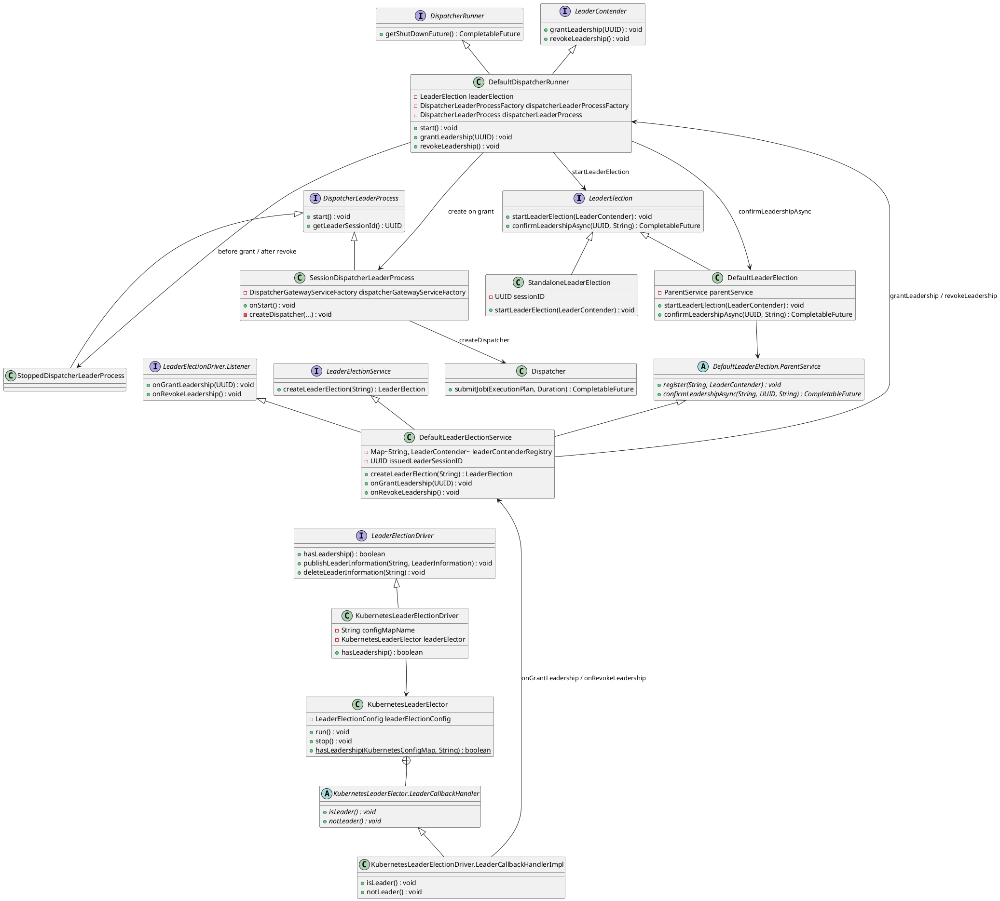
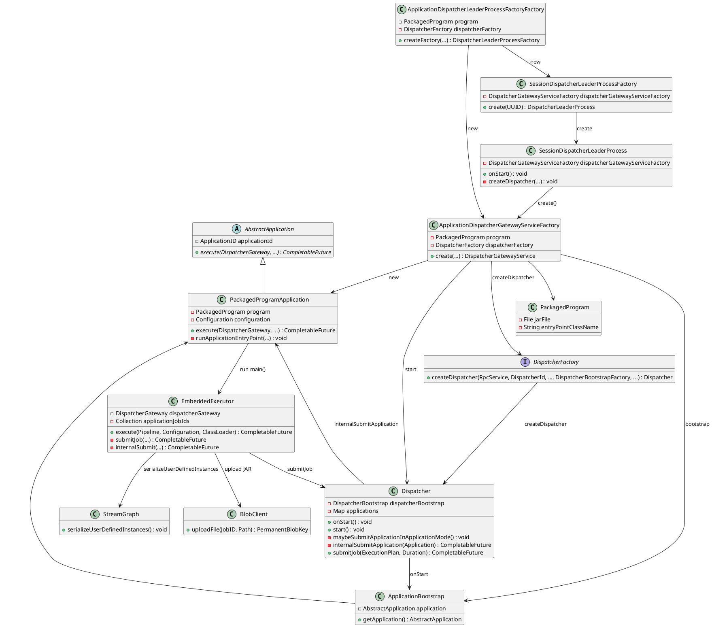
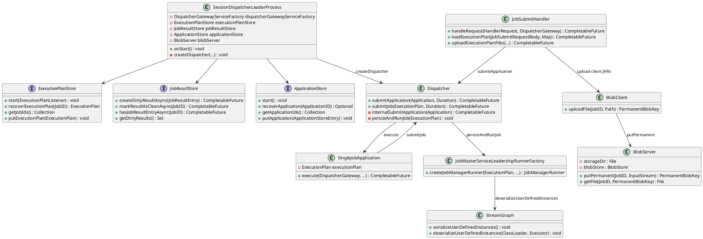
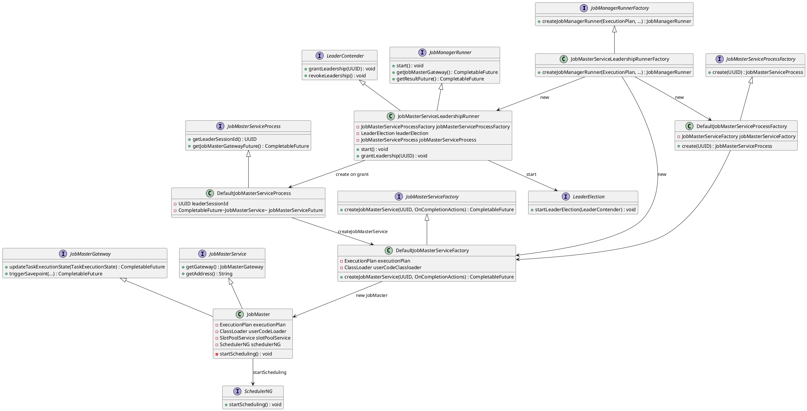
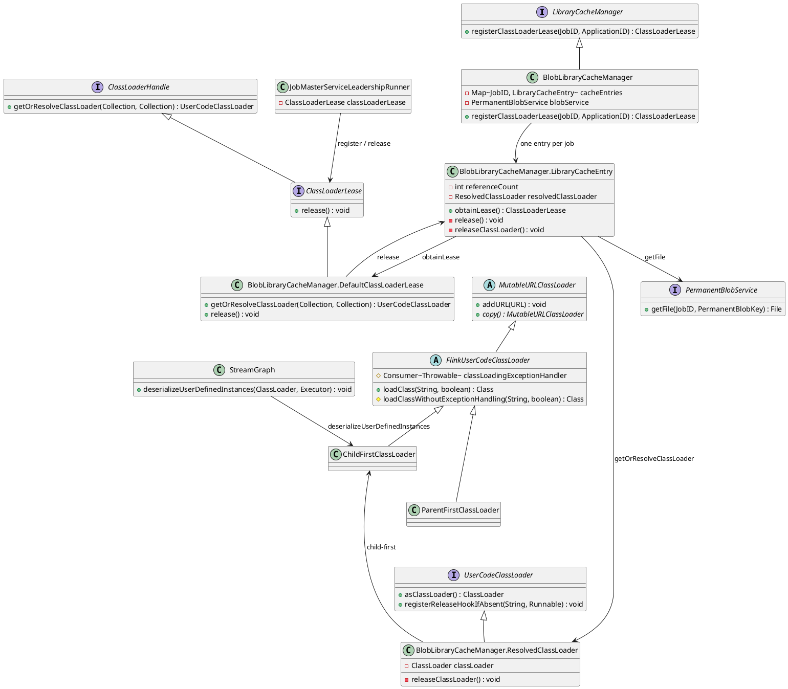
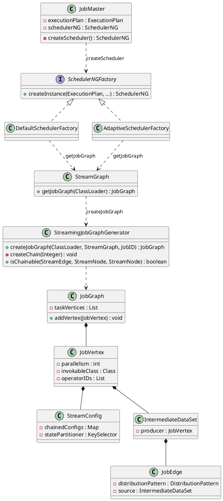
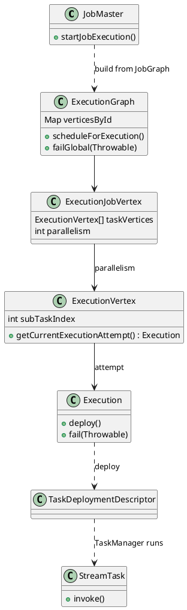
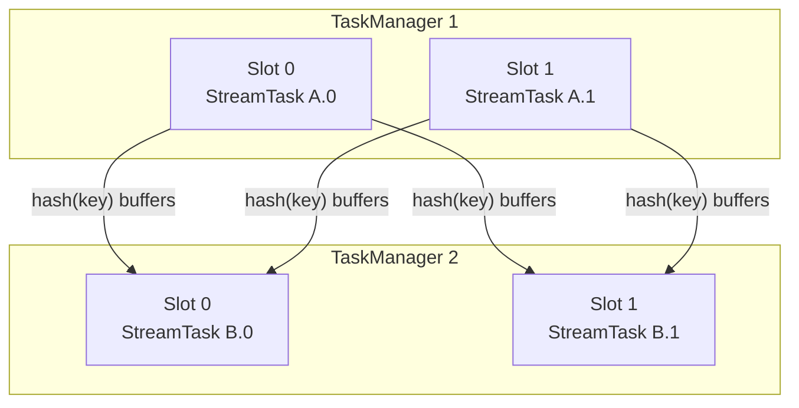
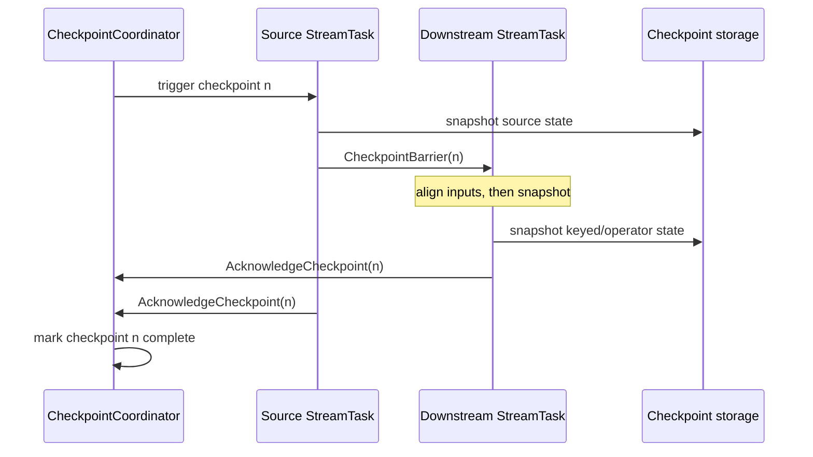

A **JobManager** is the process that takes a Flink job and runs it. It finds workers that have room, and keeps the job going until it finishes. The data itself is processed on those workers.

The program arrives in one of two ways. An **application cluster** already has the user JAR on the JobManager. It runs `main()` itself and copies that JAR into the BlobServer, so the workers can load it. A **session cluster** receives a client request: the client uploads the JAR, then submits the job. Either way the JobManager splits the program into tasks and starts them. 

<!--more-->

---

## 1. Overview

The **JobManager** is the process that owns a running job. One JVM holds three services:

- **Dispatcher** — starts each application, then a JobMaster for each of its jobs.
- **ResourceManager** — registry of TaskManagers and free slots.
- **JobMaster** — one per job. Compiles the plan and deploys tasks.

Records stay on the TaskManagers. This post continues from [cluster topology and client job submission](/post/data/stream/flink/client/).

The Dispatcher is reached by two paths:

1. **Application cluster** — the user JAR is already on the JobManager, in the image or fetched from remote storage. At startup the Dispatcher creates a `PackagedProgramApplication` and runs `main()` there. Each `execute()` goes through `EmbeddedExecutor`, which copies that local JAR into the BlobServer with `BlobClient` and then calls `submitJob`. TaskManagers download it by `PermanentBlobKey`, the same way as in a session cluster. The submitting client sends no job request.
2. **Session cluster** — the client has already run `main()` and built the `StreamGraph`. It sends that plan and the user JARs in one REST call. `JobSubmitHandler` stores each JAR in the BlobServer, wraps the plan in a `SingleJobApplication`, and calls `submitApplication`.

Both paths are job dispatch (§3). They differ in which `AbstractApplication` is registered and who copies the JAR into the BlobServer. They meet at `Dispatcher.submitJob`, which starts the JobMaster. That JobMaster compiles the `JobGraph` (§4) and deploys the `ExecutionGraph` (§5).

**Orders-per-minute** is the example: `orders → ParseOrder → keyBy(userId) → window → kafkaSink`. Once the JobMaster holds that `StreamGraph`, both paths become two chained tasks and a hash shuffle:


---

## 2. JobManager election

A Flink cluster needs one place that accepts jobs. That place is the Dispatcher inside a JobManager. If two JobManagers both accepted jobs, they would start the same work twice. So when you run more than one JobManager, they choose a single working process. The others stay up and do nothing until the working one dies.

One JobManager process is enough for either mode. The extras are only for failover. A session cluster often has them, because the cluster stays up across many jobs. An application cluster often has one: if it dies, Kubernetes or YARN starts that application again. Both modes use the same election code when you do configure extras.

The TaskManagers are a different group. They run the data. This election does not choose a TaskManager. It only chooses which JobManager may run the Dispatcher: accept an application, call `submitJob`, and restore saved plans after a restart. After a job is submitted, that job's JobMaster has its own election (§3.4). This section is only the Dispatcher election.

Each JobManager process has a `DefaultDispatcherRunner`. It joins the election by calling `leaderElection.startLeaderElection(this)`. The service calls back:

- `grantLeadership` — this process won. The runner builds a `SessionDispatcherLeaderProcess` and starts it. That process creates the Dispatcher. Clients can now submit jobs here.
- `revokeLeadership` — this process lost, or the grant was a tie that got corrected. The runner stops that process. The Dispatcher goes away. No second Dispatcher is left running on a waiting JobManager.

Before a grant, and after a revoke, the runner holds a `StoppedDispatcherLeaderProcess`. That object does not create a Dispatcher.

`leaderSessionId` is a new id for this win. It is not the session-cluster type. The next win gets a new id, so an old Dispatcher cannot keep acting after it has lost.

The class name `SessionDispatcherLeaderProcess` is historical. It was written for session mode, and application mode still uses `SessionDispatcherLeaderProcessFactory`. What changes is the factory handed in. Application mode passes `ApplicationDispatcherGatewayServiceFactory`, which starts the user `main()`. Session mode passes `DefaultDispatcherGatewayServiceFactory`, which waits for a client submission. Both factories are called from the same leader process once `grantLeadership` fires.



### Election Mechanism

With one JobManager and no high availability, there is nothing to race. `StandaloneLeaderElection` grants leadership to that single process as soon as it starts. The Dispatcher comes up and stays up.

With several JobManagers, the ConfigMap decides the winner. Each process runs the same steps.

On Kubernetes that store is a **ConfigMap**. A ConfigMap is a small Kubernetes object made of text keys and values. It is not a file inside the JobManager process. The API server keeps it in etcd, with the rest of the cluster's objects. Flink uses one named `{clusterId}-cluster-config-map`. The JobManager that holds the lock writes its id into that object. After the Dispatcher has started, it writes the Dispatcher address there too. The other JobManagers watch the same ConfigMap and read that address when they need to send a job.

1. `DefaultDispatcherRunner.start` registers itself as a `LeaderContender`.

```java
void start() throws Exception {
    leaderElection.startLeaderElection(this);
}
```

With no high availability, `leaderElection` is a `StandaloneLeaderElection`. It grants in the same call.

```java
@Override
public void startLeaderElection(LeaderContender contender) throws Exception {
    synchronized (lock) {
        Preconditions.checkState(
                leaderContender == null,
                "No LeaderContender should have been registered with this LeaderElection, yet.");
        this.leaderContender = contender;

        // One process, no shared store. The Dispatcher starts immediately.
        this.leaderContender.grantLeadership(sessionID);
    }
}
```

With high availability, `leaderElection` is a `DefaultLeaderElection`. `startLeaderElection` does not talk to Kubernetes. It only hands the contender to the service.

```java
@Override
public void startLeaderElection(LeaderContender contender) throws Exception {
    Preconditions.checkNotNull(contender);
    parentService.register(componentId, contender);
}
```

`parentService` is the `DefaultLeaderElectionService`. The first `register` creates the driver, and that constructor is the call that joins the election. The contender is saved in `leaderContenderRegistry` so a later grant can find it. A second component id on the same service only does the `put`. If this process is already the leader, that new contender is granted the current `issuedLeaderSessionID` at once.

```java
@Override
protected void register(String componentId, LeaderContender contender) throws Exception {
    checkNotNull(componentId, "componentId must not be null.");
    checkNotNull(contender, "Contender must not be null.");

    synchronized (lock) {
        Preconditions.checkState(
                running,
                "The DefaultLeaderElectionService should have established a connection to the backend before it's started.");

        // First contender: open the driver. Later contenders reuse it.
        if (leaderElectionDriver == null) {
            createLeaderElectionDriver();
        }

        Preconditions.checkState(
                leaderContenderRegistry.put(componentId, contender) == null,
                "There shouldn't be any contender registered under the passed component '%s'.",
                componentId);

        if (issuedLeaderSessionID != null) {
            runInLeaderEventThread(
                    LEADER_ACQUISITION_EVENT_LOG_NAME,
                    () ->
                            notifyLeaderContenderOfLeadership(
                                    componentId, issuedLeaderSessionID));
        }
    }
}

private void createLeaderElectionDriver() throws Exception {
    Preconditions.checkState(
            leaderContenderRegistry.isEmpty(),
            "No LeaderContender should have been registered, yet.");
    Preconditions.checkState(
            leaderElectionDriver == null,
            "This DefaultLeaderElectionService cannot be reused. Calling startLeaderElectionBackend can only be called once to establish the connection to the HA backend.");

    // The service is the LeaderElectionDriver.Listener passed into the driver.
    leaderElectionDriver = leaderElectionDriverFactory.create(this);
}
```

2. The driver talks to the ConfigMap. `KubernetesLeaderElectionDriver` builds a `KubernetesLeaderElector` and calls `run()`. That elector holds a `ConfigMapLock` on `{clusterId}-cluster-config-map` and starts a fabric8 `LeaderElector`. The others wait on the same ConfigMap.

```java
this.leaderElector =
        kubeClient.createLeaderElector(
                leaderElectionConfiguration, new LeaderCallbackHandlerImpl());

kubernetesWatch =
        configMapSharedWatcher.watch(
                configMapName, new ConfigMapCallbackHandlerImpl(), watchExecutor);

leaderElector.run();
```

```java
.withLock(
        new ConfigMapLock(
                new ObjectMetaBuilder()
                        .withNamespace(kubernetesClient.getNamespace())
                        .withName(leaderConfig.getConfigMapName())
                        .withLabels(
                                KubernetesUtils.getConfigMapLabels(
                                        leaderConfig.getClusterId()))
                        .build(),
                leaderConfig.getLockIdentity()))

public void run() {
    synchronized (lock) {
        if (executorService.isShutdown()) {
            // The elector was already stopped. Do not start another session.
        } else {
            resetInternalLeaderElector();
        }
    }
}

private void resetInternalLeaderElector() {
    cancelCurrentLeaderElectionSession();
    currentLeaderElectionSession =
            new LeaderElector(kubernetesClient, leaderElectionConfig, executorService).start();
}
```

`start()` may run only once. It calls `acquire()`, which retries `tryAcquireOrRenew` until this process holds the lock. The callbacks were wired in the elector constructor: `onStartLeading` is `LeaderCallbackHandler.isLeader`, and `onStopLeading` is `notLeader`.

```java
.withLeaderCallbacks(
        new LeaderCallbacks(
                leaderCallbackHandler::isLeader,
                leaderCallbackHandler::notLeader,
                newLeader ->
                        LOG.info(
                                "New leader elected {} for {}.",
                                newLeader,
                                leaderConfig.getConfigMapName())))
```

```java
public CompletableFuture<?> start() {
    synchronized (this) {
        if (started || stopped) {
            throw new IllegalStateException(
                    "LeaderElector may only be used once, please create another instance");
        }
        started = true;
    }
    CompletableFuture<Void> result = new CompletableFuture<>();
    CompletableFuture<?> acquireFuture = acquire();

    acquireFuture.whenComplete((v, t) -> {
        if (t == null) {
            // The lock is ours. Keep renewing it until the deadline is missed.
            CompletableFuture<?> renewFuture = renewWithTimeout();
            result.whenComplete((v1, t1) -> renewFuture.cancel(true));
            renewFuture.whenComplete((v1, t1) -> {
                stopLeading();
                if (t1 != null) {
                    result.completeExceptionally(t1);
                } else {
                    result.complete(null);
                }
            });
        } else {
            // Cancelled, or the acquire loop failed. Drop the lock if we hold it.
            stopLeading();
        }
    });
    result.whenComplete((v, t) -> acquireFuture.cancel(true));
    return result;
}

private CompletableFuture<Void> acquire() {
    return loop(completion -> {
        try {
            if (tryAcquireOrRenew()) {
                completion.complete(null);
            }
        } catch (KubernetesClientException exception) {
            if (exception.getCode() == HttpURLConnection.HTTP_CONFLICT) {
                // Another update won the compare. Retry.
            } else {
                // A transient API error. Retry.
            }
        }
    }, () -> jitter(leaderElectionConfig.getRetryPeriod(), JITTER_FACTOR).toMillis(), executor);
}
```

`tryAcquireOrRenew` reads the lock record on the ConfigMap. No record means this process creates one and becomes leader. A record held by someone else is left alone until `renewTime + leaseDuration` has passed. An expired record, or a record this process already holds, is updated with this process's identity.

```java
synchronized boolean tryAcquireOrRenew() {
    if (stopped) {
        return false;
    }
    final Lock lock = leaderElectionConfig.getLock();
    final ZonedDateTime now = now();
    final LeaderElectionRecord oldLeaderElectionRecord = lock.get(kubernetesClient);
    if (oldLeaderElectionRecord == null) {
        final LeaderElectionRecord newLeaderElectionRecord = new LeaderElectionRecord(
                lock.identity(), leaderElectionConfig.getLeaseDuration(), now, now, 0);
        lock.create(kubernetesClient, newLeaderElectionRecord);
        updateObserved(newLeaderElectionRecord);
        return true;
    }
    updateObserved(oldLeaderElectionRecord);
    final boolean isLeader = isLeader(oldLeaderElectionRecord);
    if (!isLeader && !canBecomeLeader(oldLeaderElectionRecord)) {
        // Another process renewed recently. Wait and retry.
        return false;
    }
    final LeaderElectionRecord newLeaderElectionRecord = new LeaderElectionRecord(
            lock.identity(),
            leaderElectionConfig.getLeaseDuration(),
            isLeader ? oldLeaderElectionRecord.getAcquireTime() : now,
            now,
            oldLeaderElectionRecord.getLeaderTransitions() + (isLeader ? 0 : 1));
    lock.update(kubernetesClient, newLeaderElectionRecord);
    updateObserved(newLeaderElectionRecord);
    return true;
}

protected final boolean canBecomeLeader(LeaderElectionRecord leaderElectionRecord) {
    return Utils.isNullOrEmpty(leaderElectionRecord.getHolderIdentity())
            || now().isAfter(leaderElectionRecord.getRenewTime().plus(leaderElectionConfig.getLeaseDuration()));
}
```

`updateObserved` is where the win becomes a callback. If the holder identity changes to this process, `onStartLeading` runs, which is `isLeader` above.

```java
private void updateObserved(LeaderElectionRecord leaderElectionRecord) {
    final LeaderElectionRecord current = observedRecord.getAndSet(leaderElectionRecord);
    if (!Objects.equals(leaderElectionRecord, current)) {
        final String currentLeader = current == null ? null : current.getHolderIdentity();
        final String newLeader = leaderElectionRecord.getHolderIdentity();
        if (!Objects.equals(newLeader, currentLeader)) {
            leaderElectionConfig.getLeaderCallbacks().onNewLeader(newLeader);
            if (Objects.equals(currentLeader, leaderElectionConfig.getLock().identity())) {
                leaderElectionConfig.getLeaderCallbacks().onStopLeading();
            } else if (Objects.equals(newLeader, leaderElectionConfig.getLock().identity())) {
                leaderElectionConfig.getLeaderCallbacks().onStartLeading();
            }
        }
    }
}
```

3. The driver that wins calls `onGrantLeadership` with a fresh `leaderSessionId`. Kubernetes does that from `LeaderCallbackHandlerImpl.isLeader`.

```java
@Override
public void isLeader() {
    leaderElectionListener.onGrantLeadership(UUID.randomUUID());
}
```

`DefaultLeaderElectionService` stores that id in `issuedLeaderSessionID`, then walks `leaderContenderRegistry` and calls `grantLeadership` on each contender. An id that is no longer the issued one is ignored.

```java
@Override
public void onGrantLeadership(UUID leaderSessionID) {
    runInLeaderEventThread(
            LEADER_ACQUISITION_EVENT_LOG_NAME,
            () -> onGrantLeadershipInternal(leaderSessionID));
}

private void onGrantLeadershipInternal(UUID newLeaderSessionId) {
    Preconditions.checkState(
            issuedLeaderSessionID == null,
            "The leadership should have been granted while not having the leadership acquired.");

    issuedLeaderSessionID = newLeaderSessionId;

    leaderContenderRegistry
            .keySet()
            .forEach(
                    componentId ->
                            notifyLeaderContenderOfLeadership(
                                    componentId, issuedLeaderSessionID));
}

private void notifyLeaderContenderOfLeadership(String componentId, UUID sessionID) {
    if (!leaderContenderRegistry.containsKey(componentId)) {
        return;
    } else if (!sessionID.equals(issuedLeaderSessionID)) {
        // A late grant for an old session id. The current id stays in place.
        return;
    }

    Preconditions.checkState(
            !confirmedLeaderInformation.hasLeaderInformation(componentId),
            "The leadership should have been granted while not having the leadership acquired.");

    leaderContenderRegistry.get(componentId).grantLeadership(issuedLeaderSessionID);
}
```

On the runner, `grantLeadership` starts `SessionDispatcherLeaderProcess`, which creates the Dispatcher.

```java
@Override
public void grantLeadership(UUID leaderSessionID) {
    runActionIfRunning(
            () -> {
                startNewDispatcherLeaderProcess(leaderSessionID);
            });
}
```

4. The Dispatcher has an address only after it has started. The runner waits for that address, then calls `confirmLeadershipAsync(leaderSessionId, address)`.

```java
private void forwardConfirmLeaderSessionFuture(
        UUID leaderSessionID, DispatcherLeaderProcess newDispatcherLeaderProcess) {
    FutureUtils.assertNoException(
            newDispatcherLeaderProcess
                    .getLeaderAddressFuture()
                    .thenCompose(
                            leaderAddress ->
                                    leaderElection.confirmLeadershipAsync(
                                            leaderSessionID, leaderAddress)));
}
```

`DefaultLeaderElection` forwards that call to the service. The service writes the session id and the address into the ConfigMap only when `hasLeadershipInternal` is still true: the driver still holds the lock, the contender is still registered, and the id is still `issuedLeaderSessionID`. A late confirmation for a lost lock is not published. Other processes read the confirmed record to find where to send jobs.

```java
@Override
public CompletableFuture<Void> confirmLeadershipAsync(
        UUID leaderSessionID, String leaderAddress) {
    return parentService.confirmLeadershipAsync(componentId, leaderSessionID, leaderAddress);
}
```

```java
if (hasLeadershipInternal(componentId, leaderSessionID)) {
    final LeaderInformation newConfirmedLeaderInformation =
            LeaderInformation.known(leaderSessionID, leaderAddress);
    confirmedLeaderInformation =
            LeaderInformationRegister.merge(
                    confirmedLeaderInformation, componentId, newConfirmedLeaderInformation);
    leaderElectionDriver.publishLeaderInformation(
            componentId, newConfirmedLeaderInformation);
}
```

```java
private boolean hasLeadershipInternal(String componentId, UUID leaderSessionId) {
    if (leaderElectionDriver != null) {
        if (leaderContenderRegistry.containsKey(componentId)) {
            return leaderElectionDriver.hasLeadership()
                    && leaderSessionId.equals(issuedLeaderSessionID);
        } else {
            return false;
        }
    } else {
        return false;
    }
}
```

5. If the lock is lost — the process dies, or the callback says `notLeader` — the driver calls `onRevokeLeadership`. The service clears `issuedLeaderSessionID` and calls `revokeLeadership` on every contender still in the registry. The runner stops the Dispatcher. The next process that takes the lock gets a new `leaderSessionId` and repeats from step 3.

```java
@Override
public void notLeader() {
    leaderElectionListener.onRevokeLeadership();
    leaderElector.run();
}
```

```java
private void onRevokeLeadershipInternal() {
    Preconditions.checkState(
            issuedLeaderSessionID != null,
            "The leadership should have been revoked while having the leadership acquired.");

    if (!leaderContenderRegistry.isEmpty()) {
        leaderContenderRegistry.forEach(this::notifyLeaderContenderOfLeadershipLoss);
    }
    issuedLeaderSessionID = null;
}
```

```java
@Override
public void revokeLeadership() {
    runActionIfRunning(
            () -> {
                this.stopDispatcherLeaderProcess();
            });
}
```

## 3. Job dispatch

Both cluster types register an application, then call `Dispatcher.submitJob`. That call starts the JobMaster.

An **application cluster** starts a `PackagedProgramApplication` and runs `main()` on the JobManager (§3.1). A **session cluster** receives a client plan, wraps it in a `SingleJobApplication`, and does not run `main()` again (§3.2).

`submitJob` persists the plan and builds the JobMaster. The user classes for that job are loaded and released in §3.5. Compiling the restored `StreamGraph` into a `JobGraph` is §4.

### 3.1 Application cluster

The factory creates the application before the Dispatcher RPC starts. The user program is a `PackagedProgram` (JAR plus entry class), not a client-built `StreamGraph`.



```java
PackagedProgramApplication bootstrapApplication =
        new PackagedProgramApplication(
                applicationId,
                program,
                recoveredJobInfos,
                recoveredTerminalJobInfos,
                configuration,
                jobCountLimits.f0,
                jobCountLimits.f1,
                true,
                configuration.get(DeploymentOptions.SUBMIT_FAILED_JOB_ON_APPLICATION_ERROR),
                configuration.get(DeploymentOptions.SHUTDOWN_ON_APPLICATION_FINISH));
```

`onStart` treats an `ApplicationBootstrap` as application mode and submits that application on the dispatcher thread.

```java
if (dispatcherBootstrap instanceof ApplicationBootstrap) {
    // Application Mode
    maybeSubmitApplicationInApplicationMode();
} else {
    // Session Mode
    recoverApplicationsAndJobsInSessionMode();
}
```

```java
if (applicationResult == null) {
    try {
        internalSubmitApplication(application).get();
    } catch (Throwable throwable) {
        onFatalError(
                new DispatcherException(
                        String.format("Could not start application %s.", applicationId),
                        throwable));
    }
}
```

`internalSubmitApplication` puts the application in `applications`, then calls `execute`. `PackagedProgramApplication.execute` schedules `runApplicationEntryPoint`, which runs the user program through `EmbeddedExecutor`. That executor is the only place an application-cluster job calls `submitJob`.

```java
return dispatcherGateway
        .getBlobServerPort(rpcTimeout)
        .thenCombine(
                dispatcherGateway.getBlobServerAddress(rpcTimeout),
                (blobServerPort, blobServerAddress) ->
                        new InetSocketAddress(
                                blobServerAddress.getHostName(), blobServerPort))
        .thenCompose(
                blobServerAddress -> {
                    try {
                        ClientUtils.extractAndUploadExecutionPlanFiles(
                                streamGraph,
                                () -> new BlobClient(blobServerAddress, configuration));
                        streamGraph.serializeUserDefinedInstances();
                    } catch (Exception e) {
                        throw new CompletionException(e);
                    }

                    return internalSubmit(dispatcherGateway, streamGraph, rpcTimeout);
                })
        .thenApply(ack -> streamGraph.getJobID());
```

`EmbeddedExecutor.internalSubmit` is `dispatcherGateway.submitJob`. The JAR is already on this process; `BlobClient` only publishes it so TaskManagers can download it by `PermanentBlobKey`.

### 3.2 Session cluster

The client has already run `main()` and built the `StreamGraph`. That plan and the user JARs arrive at `JobSubmitHandler.handleRequest` as one `HandlerRequest`. `uploadedFiles` holds the execution-plan file and the user JARs, as temporary files on that process. The handler uploads the JARs, then submits a `SingleJobApplication`.

**Upload jars** copies those JARs into the BlobServer with `putPermanent`. The file lands under `storageDir` as `job_<jobId>/blob_<key>`, and the same bytes are copied to `blobStore` when high availability is on. Each TaskManager holds a `PermanentBlobCache`. Its `getFile` reads the local cache, and downloads from the BlobServer by `PermanentBlobKey` when the file is missing.

**Submit the application** wraps the plan in `SingleJobApplication` and calls `gateway.submitApplication`. That application's `execute` forwards the same plan to `submitJob`. It does not run `main()`.



`handleRequest` is the whole procedure: index the uploaded files, read the plan, upload the JARs, then submit.

```java
// Multipart files from the client: the execution-plan file and the user JARs.
private final Collection<File> uploadedFiles;

@Nonnull
public Collection<File> getUploadedFiles() {
    return uploadedFiles;
}
```

```java
@Override
protected CompletableFuture<JobSubmitResponseBody> handleRequest(
            @Nonnull HandlerRequest<JobSubmitRequestBody> request,
            @Nonnull DispatcherGateway gateway)
            throws RestHandlerException {
        // Temp files from the request, indexed by the name the client sent.
        final Collection<File> uploadedFiles = request.getUploadedFiles();
        final Map<String, Path> nameToFile =
                uploadedFiles.stream()
                        .collect(Collectors.toMap(File::getName, Path::fromLocalFile));

        if (uploadedFiles.size() != nameToFile.size()) {
            throw new RestHandlerException(
                    String.format(
                            "The number of uploaded files was %s than the expected count. Expected: %s Actual %s",
                            uploadedFiles.size() < nameToFile.size() ? "lower" : "higher",
                            nameToFile.size(),
                            uploadedFiles.size()),
                    HttpResponseStatus.BAD_REQUEST);
        }

        final JobSubmitRequestBody requestBody = request.getRequestBody();

        if (requestBody.executionPlanFileName == null) {
            throw new RestHandlerException(
                    String.format(
                            "The %s field must not be omitted or be null.",
                            JobSubmitRequestBody.FIELD_NAME_JOB_GRAPH),
                    HttpResponseStatus.BAD_REQUEST);
        }

        // Read the execution-plan file into a StreamGraph shell.
        CompletableFuture<ExecutionPlan> executionPlanFuture =
                loadExecutionPlan(requestBody, nameToFile);

        // JAR paths among those uploaded files. Still local temp files.
        Collection<Path> jarFiles = getJarFilesToUpload(requestBody.jarFileNames, nameToFile);

        Collection<Tuple2<String, Path>> artifacts =
                getArtifactFilesToUpload(requestBody.artifactFileNames, nameToFile);

        // Copy the JARs into the BlobServer and record their PermanentBlobKeys.
        CompletableFuture<ExecutionPlan> finalizedExecutionPlanFuture =
                uploadExecutionPlanFiles(
                        gateway, executionPlanFuture, jarFiles, artifacts, configuration);

        // Register a SingleJobApplication. Its execute() calls submitJob.
        CompletableFuture<Acknowledge> jobSubmissionFuture =
                finalizedExecutionPlanFuture.thenCompose(
                        executionPlan -> {
                            SingleJobApplication application =
                                    new SingleJobApplication(executionPlan);
                            return gateway.submitApplication(application, timeout);
                        });

        return jobSubmissionFuture.thenCombine(
                executionPlanFuture,
                (ack, executionPlan) ->
                        new JobSubmitResponseBody("/jobs/" + executionPlan.getJobID()));
    }

    private CompletableFuture<ExecutionPlan> loadExecutionPlan(
            JobSubmitRequestBody requestBody, Map<String, Path> nameToFile)
            throws MissingFileException {
        // The execution-plan entry in uploadedFiles, not a JAR.
        final Path executionPlanFile =
                getPathAndAssertUpload(
                        requestBody.executionPlanFileName, FILE_TYPE_EXECUTION_PLAN, nameToFile);

        return CompletableFuture.supplyAsync(
                () -> {
                    ExecutionPlan executionPlan;
                    try (ObjectInputStream objectIn =
                            new ObjectInputStream(
                                    executionPlanFile.getFileSystem().open(executionPlanFile))) {
                        // Shell only: job id, sources, sinks, and SerializedValue bytes.
                        executionPlan = (ExecutionPlan) objectIn.readObject();
                    } catch (Exception e) {
                        throw new CompletionException(
                                new RestHandlerException(
                                        "Failed to deserialize ExecutionPlan.",
                                        HttpResponseStatus.BAD_REQUEST,
                                        e));
                    }
                    return executionPlan;
                },
                executor);
    }
```

### 3.3 Upload jars

`getJarFilesToUpload` picks the JAR entries out of `uploadedFiles`. Those paths are still local temp files. `uploadExecutionPlanFiles` asks the Dispatcher for the BlobServer address and sends each JAR through a `BlobClient`. The BlobServer stores the bytes and returns a `PermanentBlobKey`, which is written onto the `ExecutionPlan` with `addUserJarBlobKey`. TaskManagers later download the JAR by that key. The execution-plan file is not sent again; `loadExecutionPlan` has already turned it into an object with `readObject`. That object is still a shell: `streamNodes` is null, and `ParseOrder` is still bytes inside a `SerializedValue`.

```java
private CompletableFuture<ExecutionPlan> uploadExecutionPlanFiles(
            DispatcherGateway gateway,
            CompletableFuture<ExecutionPlan> executionPlanFuture,
            Collection<Path> jarFiles,
            Collection<Tuple2<String, Path>> artifacts,
            Configuration configuration) {
        // BlobServer lives with the Dispatcher. TaskManagers download JARs from it.
        CompletableFuture<Integer> blobServerPortFuture = gateway.getBlobServerPort(timeout);
        CompletableFuture<InetAddress> blobServerAddressFuture =
                gateway.getBlobServerAddress(timeout);

        return executionPlanFuture.thenCombine(
                blobServerPortFuture.thenCombine(
                        blobServerAddressFuture,
                        (blobServerPort, blobServerAddress) ->
                                new InetSocketAddress(
                                        blobServerAddress.getHostName(), blobServerPort)),
                (ExecutionPlan executionPlan, InetSocketAddress blobSocketAddress) -> {
                    try {
                        // Each JAR becomes a PermanentBlobKey on the ExecutionPlan.
                        ClientUtils.uploadExecutionPlanFiles(
                                executionPlan,
                                jarFiles,
                                artifacts,
                                () -> new BlobClient(blobSocketAddress, configuration));
                    } catch (FlinkException e) {
                        throw new CompletionException(
                                new RestHandlerException(
                                        "Could not upload job files.",
                                        HttpResponseStatus.INTERNAL_SERVER_ERROR,
                                        e));
                    }
                    return executionPlan;
                });
    }
```

### 3.4 JobMaster creation

A JobMaster runs one job. It asks TaskManagers for slots, deploys the tasks, and drives checkpoints. The JobManager that won the Dispatcher election (§2) can hold many JobMasters, one for each running job. The waiting JobManagers hold none.

The JobMaster election uses the same Kubernetes ConfigMap as the JobManager election, `{clusterId}-cluster-config-map`. There is one lock. The JobManager that wins it also wins the JobMaster election for the jobs it recovers. Each job's election entry in that ConfigMap is `job-{jobId}`.

The participant is a `JobMasterServiceLeadershipRunner` inside that JobManager. `start` registers the runner. If this process already holds the ConfigMap, `grantLeadership` creates the JobMaster. `revokeLeadership` stops it when the lock is lost. A second runner appears only when another JobManager takes the ConfigMap and recovers the same job before the old JobMaster has stopped.

`createJobManagerRunner` returns the runner. It does not construct the JobMaster yet. `grantLeadership` asks the process factory for a `DefaultJobMasterServiceProcess`, and that process asks `DefaultJobMasterServiceFactory` to construct the `JobMaster`.



Both entries call `Dispatcher.submitJob` only after their application is in `applications`. The method refuses a plan with no matching application. `internalSubmitJob` then persists the plan and builds the JobMaster.

```java
@Override
public CompletableFuture<Acknowledge> submitJob(ExecutionPlan executionPlan, Duration timeout) {
    final JobID jobID = executionPlan.getJobID();
    try (MdcCloseable ignored =
            MdcUtils.withContext(
                    MdcUtils.asContextData(jobID, executionPlan.getJobConfiguration()))) {
        log.info("Received job submission '{}' ({}).", executionPlan.getName(), jobID);
    }
    return isInGloballyTerminalState(jobID)
            .thenComposeAsync(
                    isTerminated -> {
                        if (isTerminated) {
                            return FutureUtils.completedExceptionally(
                                    DuplicateJobSubmissionException.ofGloballyTerminated(jobID));
                        } else if (jobManagerRunnerRegistry.isRegistered(jobID)
                                || submittedAndWaitingTerminationJobIDs.contains(jobID)
                                || suspendedJobs.containsKey(jobID)) {
                            return FutureUtils.completedExceptionally(
                                    DuplicateJobSubmissionException.of(jobID));
                        } else if (executionPlan.isPartialResourceConfigured()) {
                            return FutureUtils.completedExceptionally(
                                    new JobSubmissionException(
                                            jobID,
                                            "Currently jobs is not supported if parts of the vertices "
                                                    + "have resources configured. The limitation will be "
                                                    + "removed in future versions."));
                        } else if (executionPlan.getApplicationId().isEmpty()
                                || !applications.containsKey(
                                        executionPlan.getApplicationId().get())) {
                            return FutureUtils.completedExceptionally(
                                    new JobSubmissionException(
                                            jobID,
                                            "Failed to find the associated application for the job. This suggests the job is submitted through an unsupported or incomplete path."));
                        } else {
                            return internalSubmitJob(executionPlan);
                        }
                    },
                    getMainThreadExecutor(jobID));
}
```

```java
private void persistAndRunJob(ExecutionPlan executionPlan) throws Exception {
    executionPlanWriter.putExecutionPlan(executionPlan);
    initJobClientExpiredTime(executionPlan);
    runJob(
            createJobMasterRunner(executionPlan),
            ExecutionType.SUBMISSION,
            executionPlan.getApplicationId().orElse(null));
}
```

`createJobMasterRunner` calls `JobMasterServiceLeadershipRunnerFactory.createJobManagerRunner`. Inside that method the user class loader is built and `deserializeUserDefinedInstances` restores the `StreamGraph`. That restore is §3.5.

```java
@Override
public JobManagerRunner createJobManagerRunner(
            ExecutionPlan executionPlan,
            Configuration configuration,
            RpcService rpcService,
            HighAvailabilityServices highAvailabilityServices,
            HeartbeatServices heartbeatServices,
            JobManagerSharedServices jobManagerServices,
            JobManagerJobMetricGroupFactory jobManagerJobMetricGroupFactory,
            FatalErrorHandler fatalErrorHandler,
            Collection<FailureEnricher> failureEnrichers,
            JobStatusListener jobStatusListener,
            long initializationTimestamp)
            throws Exception {

        checkArgument(!executionPlan.isEmpty(), "The given job is empty");

        final JobMasterConfiguration jobMasterConfiguration =
                JobMasterConfiguration.fromConfiguration(configuration);

        final JobResultStore jobResultStore = highAvailabilityServices.getJobResultStore();

        final LeaderElection jobManagerLeaderElection =
                highAvailabilityServices.getJobManagerLeaderElection(executionPlan.getJobID());

        final SlotPoolServiceSchedulerFactory slotPoolServiceSchedulerFactory =
                DefaultSlotPoolServiceSchedulerFactory.fromConfiguration(
                        configuration, executionPlan.getJobType(), executionPlan.isDynamic());

        if (jobMasterConfiguration.getConfiguration().get(JobManagerOptions.SCHEDULER_MODE)
                == SchedulerExecutionMode.REACTIVE) {
            Preconditions.checkState(
                    slotPoolServiceSchedulerFactory.getSchedulerType()
                            == JobManagerOptions.SchedulerType.Adaptive,
                    "Adaptive Scheduler is required for reactive mode");
        }

        // classLoaderLease, userCodeClassLoader, and deserializeUserDefinedInstances are §3.5.

        final DefaultJobMasterServiceFactory jobMasterServiceFactory =
                new DefaultJobMasterServiceFactory(
                        MdcUtils.scopeToJob(
                                executionPlan.getJobID(), jobManagerServices.getIoExecutor()),
                        rpcService,
                        jobMasterConfiguration,
                        executionPlan,
                        highAvailabilityServices,
                        slotPoolServiceSchedulerFactory,
                        jobManagerServices,
                        heartbeatServices,
                        jobManagerJobMetricGroupFactory,
                        fatalErrorHandler,
                        userCodeClassLoader,
                        failureEnrichers,
                        jobStatusListener,
                        initializationTimestamp);

        final DefaultJobMasterServiceProcessFactory jobMasterServiceProcessFactory =
                new DefaultJobMasterServiceProcessFactory(
                        executionPlan.getJobID(),
                        executionPlan.getName(),
                        executionPlan.getJobType(),
                        executionPlan.getCheckpointingSettings(),
                        initializationTimestamp,
                        jobMasterServiceFactory);

        return new JobMasterServiceLeadershipRunner(
                jobMasterServiceProcessFactory,
                jobManagerLeaderElection,
                jobResultStore,
                classLoaderLease,
                fatalErrorHandler);
    }
```

### 3.5 Job class life cycle

A job's user classes live in a class loader owned by that job. `createJobManagerRunner` registers a lease, then resolves the loader from the blob keys. The default resolve order is child-first: `ParseOrder` and the other task classes are taken from the job JAR before Flink's own classpath. Classes that must stay Flink's, such as `org.apache.flink`, are still loaded parent-first.

The lease is reference-counted. The loader stays open while any lease for that job is held. `JobMasterServiceLeadershipRunner` calls `classLoaderLease.release()` after the JobMaster process has stopped. When the count reaches zero, the manager closes the `URLClassLoader`, drops the cache entry, and clears Jackson's type cache so it does not keep those classes alive. A TaskManager uses the same `LibraryCacheManager` and releases its own lease when the job leaves that process.



`createJobManagerRunner` builds the loader from the blob keys and calls `deserializeUserDefinedInstances`. That restores the node map, the `keyBy` selector, and the `ParseOrder` instance. The application-cluster path reaches the same factory after `EmbeddedExecutor` has already serialized those instances.

```java
@Override
public JobManagerRunner createJobManagerRunner(
        ExecutionPlan executionPlan,
        Configuration configuration,
        RpcService rpcService,
        HighAvailabilityServices highAvailabilityServices,
        HeartbeatServices heartbeatServices,
        JobManagerSharedServices jobManagerServices,
        JobManagerJobMetricGroupFactory jobManagerJobMetricGroupFactory,
        FatalErrorHandler fatalErrorHandler,
        Collection<FailureEnricher> failureEnrichers,
        JobStatusListener jobStatusListener,
        long initializationTimestamp)
        throws Exception {

    // Empty-plan check, JobMasterConfiguration, JobResultStore, the job LeaderElection,
    // the slot-pool scheduler, and the reactive-mode check are in §3.4.

    // User JARs were stored as blob keys in §3. This loader can read ParseOrder.
    final LibraryCacheManager.ClassLoaderLease classLoaderLease =
            jobManagerServices
                    .getLibraryCacheManager()
                    .registerClassLoaderLease(
                            executionPlan.getJobID(),
                            executionPlan.getApplicationId().orElseThrow());

    final ClassLoader userCodeClassLoader =
            classLoaderLease
                    .getOrResolveClassLoader(
                            executionPlan.getUserJarBlobKeys(), executionPlan.getClasspaths())
                    .asClassLoader();

    // Fill the transient node map and operator factories before the JobMaster runs.
    if (executionPlan instanceof StreamGraph) {
        ((StreamGraph) executionPlan)
                .deserializeUserDefinedInstances(
                        userCodeClassLoader, jobManagerServices.getFutureExecutor());
    }

    // userCodeClassLoader is passed to DefaultJobMasterServiceFactory.
    // classLoaderLease is passed to the JobMasterServiceLeadershipRunner returned in §3.4.
}
```

`registerClassLoaderLease` creates one `LibraryCacheEntry` for the job and returns a lease. The first `getOrResolveClassLoader` downloads the JARs and builds the class loader. A later call with the same jar contents reuses that loader.

```java
@Override
public ClassLoaderLease registerClassLoaderLease(JobID jobId, ApplicationID applicationId) {
    synchronized (lockObject) {
        return cacheEntries
                .computeIfAbsent(jobId, jobID -> new LibraryCacheEntry(jobId, applicationId))
                .obtainLease();
    }
}

@Override
public UserCodeClassLoader getOrResolveClassLoader(
        Collection<PermanentBlobKey> requiredJarFiles, Collection<URL> requiredClasspaths)
        throws IOException {
    verifyIsNotClosed();
    return libraryCacheEntry.getOrResolveClassLoader(requiredJarFiles, requiredClasspaths);
}

private UserCodeClassLoader getOrResolveClassLoader(
        Collection<PermanentBlobKey> libraries, Collection<URL> classPaths) throws IOException {
    synchronized (lockObject) {
        verifyIsNotReleased();

        if (resolvedClassLoader == null) {
            boolean systemClassLoader =
                    wrapsSystemClassLoader && libraries.isEmpty() && classPaths.isEmpty();
            resolvedClassLoader =
                    new ResolvedClassLoader(
                            systemClassLoader
                                    ? ClassLoader.getSystemClassLoader()
                                    : createUserCodeClassLoader(
                                            jobId, applicationId, libraries, classPaths),
                            libraries,
                            classPaths,
                            systemClassLoader);
        } else {
            resolvedClassLoader.verifyClassLoader(libraries, classPaths);
        }

        return resolvedClassLoader;
    }
}

private URLClassLoader createUserCodeClassLoader(
        JobID jobId,
        ApplicationID applicationId,
        Collection<PermanentBlobKey> requiredJarFiles,
        Collection<URL> requiredClasspaths)
        throws IOException {
    try {
        final URL[] libraryURLs = new URL[requiredJarFiles.size() + requiredClasspaths.size()];
        int count = 0;
        for (PermanentBlobKey key : requiredJarFiles) {
            try {
                libraryURLs[count] = blobService.getFile(jobId, key).toURI().toURL();
            } catch (Exception e) {
                libraryURLs[count] = blobService.getFile(applicationId, key).toURI().toURL();
            }
            ++count;
        }

        for (URL url : requiredClasspaths) {
            libraryURLs[count] = url;
            ++count;
        }

        return classLoaderFactory.createClassLoader(libraryURLs);
    } catch (Exception e) {
        ExceptionUtils.tryRethrowIOException(e);
        throw new IOException("Library cache could not register the user code libraries.", e);
    }
}
```

`classLoaderFactory.createClassLoader` builds a `ChildFirstClassLoader` unless the resolve order is parent-first. `loadClass` records a failure, then `ChildFirstClassLoader` searches the job JAR before the parent. A name that matches `alwaysParentFirstPatterns` goes to the parent immediately.

```java
@Override
public final Class<?> loadClass(String name, boolean resolve) throws ClassNotFoundException {
    try {
        synchronized (getClassLoadingLock(name)) {
            return loadClassWithoutExceptionHandling(name, resolve);
        }
    } catch (Throwable classLoadingException) {
        classLoadingExceptionHandler.accept(classLoadingException);
        throw classLoadingException;
    }
}

@Override
protected Class<?> loadClassWithoutExceptionHandling(String name, boolean resolve)
        throws ClassNotFoundException {
    Class<?> c = findLoadedClass(name);

    if (c == null) {
        for (String alwaysParentFirstPattern : alwaysParentFirstPatterns) {
            if (name.startsWith(alwaysParentFirstPattern)) {
                return super.loadClassWithoutExceptionHandling(name, resolve);
            }
        }

        try {
            c = findClass(name);
        } catch (ClassNotFoundException e) {
            c = super.loadClassWithoutExceptionHandling(name, resolve);
        }
    } else if (resolve) {
        resolveClass(c);
    }

    return c;
}
```

`StreamGraph.deserializeUserDefinedInstances` forwards to `UserDefinedObjectsHolder`. That holder turns each `SerializedValue` back into an object with the user class loader. The operator-factory bytes become the `StreamMap` that holds `ParseOrder`. The node-map bytes become `streamNodes`, edges, and `statePartitioners`. The method bodies stay in the user JAR; deserialization restores the instances.

```java
// Entry used by createJobManagerRunner. The holder does the actual restore.
public void deserializeUserDefinedInstances(
        ClassLoader userClassLoader, Executor serializationExecutor) throws Exception {
    this.userDefinedObjectsHolder.deserialize(userClassLoader, serializationExecutor);
}

// Operator factories were serialized on their own so this step can run in parallel.
private void deserialize(ClassLoader userClassLoader, Executor serializationExecutor)
        throws Exception {
    Collection<Tuple2<Integer, StreamOperatorFactory<?>>> streamNodeToOperatorFactories =
            deserializeOperators(userClassLoader, serializationExecutor);

    // Node map, edges, keyBy partitioner, and execution config.
    virtualSideOutputNodes =
            serializedVirtualSideOutputNodes.deserializeValue(userClassLoader);
    virtualPartitionNodes =
            serializedVirtualPartitionNodes.deserializeValue(userClassLoader);
    executionConfig = serializedExecutionConfig.deserializeValue(userClassLoader);
    streamNodes = serializedStreamNodes.deserializeValue(userClassLoader);
    // ParseOrder's StreamMap goes back onto its node. It was transient on StreamNode.
    streamNodeToOperatorFactories.forEach(
            tuple2 -> getStreamNode(tuple2.f0).setOperatorFactory(tuple2.f1));
}

private Collection<Tuple2<Integer, StreamOperatorFactory<?>>> deserializeOperators(
        ClassLoader userClassLoader, Executor serializationExecutor) throws Exception {
    List<CompletableFuture<Tuple2<Integer, StreamOperatorFactory<?>>>> futures =
            streamNodeToSerializedOperatorFactories.stream()
                    .map(
                            tuple2 ->
                                    deserializeOperatorFactoriesAsync(
                                            userClassLoader, serializationExecutor, tuple2))
                    .collect(Collectors.toList());
    return FutureUtils.combineAll(futures).get();
}

private CompletableFuture<Tuple2<Integer, StreamOperatorFactory<?>>>
        deserializeOperatorFactoriesAsync(
                ClassLoader userClassLoader,
                Executor serializationExecutor,
                Tuple2<Integer, SerializedValue<StreamOperatorFactory<?>>> tuple2) {
    return CompletableFuture.supplyAsync(
            () -> {
                try {
                    // Loads the user class (ParseOrder) from the JAR, not from these bytes.
                    StreamOperatorFactory<?> streamOperatorFactory =
                            tuple2.f1.deserializeValue(userClassLoader);
                    return Tuple2.of(tuple2.f0, streamOperatorFactory);
                } catch (Throwable throwable) {
                    throw new RuntimeException(
                            String.format(
                                    "Could not deserialize stream node %s", tuple2.f0),
                            throwable);
                }
            },
            serializationExecutor);
}
```

```java
// The byte[] was written on the client. The user class loader turns it back into an object.
public T deserializeValue(ClassLoader loader) throws IOException, ClassNotFoundException {
    Preconditions.checkNotNull(loader, "No classloader has been passed");
    return InstantiationUtil.deserializeObject(serializedData, loader);
}
```

For **orders-per-minute**, after this call the in-memory graph is the one the client built:

```text
streamNodes
  orders            SourceOperatorFactory
  ParseOrder        StreamMap(ParseOrder)          restored from factory bytes
  window+aggregate  WindowOperatorFactory
                    statePartitioners = userId     restored inside the node bytes
                    stateKeySerializer = userId
  kafkaSink         SinkWriterOperatorFactory

virtualPartitionNodes
  keyBy(userId)     KeyGroupStreamPartitioner(Order::getUserId)
```

`getJobGraph` can now walk those nodes. Before `deserializeUserDefinedInstances`, `streamNodes` is null.

The loader is removed when the last lease for the job is released. The runner does that after the JobMaster process has closed.

```java
@Override
public CompletableFuture<Void> closeAsync() {
    // Already STOPPED: return terminationFuture.
    // Otherwise set STOPPED, fail jobMasterGatewayFuture, and complete resultFuture as SUSPENDED.
    final CompletableFuture<Void> processTerminationFuture = jobMasterServiceProcess.closeAsync();

    FutureUtils.runAfterwards(
            processTerminationFuture,
            () -> {
                classLoaderLease.release();
                // leaderElection.close() runs in this same callback.
            });

    // FutureUtils.forward copies this future onto terminationFuture, which is returned.
}
```

`release` drops the reference count. At zero, the cache entry closes the class loader and removes the job.

```java
@Override
public void release() {
    if (isClosed) {
        return;
    }

    isClosed = true;

    libraryCacheEntry.release();
}

private void release() {
    synchronized (lockObject) {
        if (isReleased) {
            return;
        }

        if (referenceCount > 0) {
            referenceCount -= 1;
        }

        if (referenceCount == 0) {
            releaseClassLoader();
            cacheEntries.remove(jobId);
        }
    }
}

private void releaseClassLoader() {
    if (resolvedClassLoader != null) {
        resolvedClassLoader.releaseClassLoader();
        resolvedClassLoader = null;
    }
    isReleased = true;
}
```

Closing that cached loader runs its shutdown hooks and closes the `URLClassLoader`. Jackson's type cache is cleared in the same step, so it does not keep the user classes reachable.

```java
private void releaseClassLoader() {
    runReleaseHooks();

    if (!wrapsSystemClassLoader) {
        try {
            ((Closeable) classLoader).close();
        } catch (IOException e) {
            LOG.warn(
                    "Failed to release user code class loader for "
                            + Arrays.toString(libraries.toArray()));
        }
    }
    // Drop cached Java types that still point at user classes.
    TypeFactory.defaultInstance().clearCache();
}

private void runReleaseHooks() {
    Set<Map.Entry<String, Runnable>> hooks = releaseHooks.entrySet();
    if (!hooks.isEmpty()) {
        for (Map.Entry<String, Runnable> hookEntry : hooks) {
            try {
                hookEntry.getValue().run();
            } catch (Throwable t) {
                LOG.warn(
                        "Failed to run release hook '{}' for user code class loader.",
                        hookEntry.getValue(),
                        t);
            }
        }

        releaseHooks.clear();
    }
}
```

## 4. JobGraph creation

The JobMaster holds that restored `StreamGraph`. This section is the compile. **`StreamingJobGraphGenerator`** runs while the JobMaster builds its scheduler. `DefaultSchedulerFactory` and `AdaptiveSchedulerFactory` both do this:

```java
JobGraph jobGraph;
if (executionPlan instanceof JobGraph) {
    jobGraph = (JobGraph) executionPlan;
} else if (executionPlan instanceof StreamGraph) {
    jobGraph = ((StreamGraph) executionPlan).getJobGraph(userCodeLoader);
}

// StreamGraph.getJobGraph
return StreamingJobGraphGenerator.createJobGraph(userClassLoader, this, jobId, applicationId);
```

That compile decides **operator chaining**: which `StreamNode`s share one thread as a single **`JobVertex`**, and where a **network** boundary must remain. Chainable **forward** edges collapse into one vertex. **Hash** / rebalance edges become **`JobEdge`s** (intermediate result partitions). The orders-per-minute picture of that result is in §1.



```java
public static JobGraph createJobGraph(StreamGraph streamGraph) {
    JobGraph jobGraph = new JobGraph(streamGraph.getJobID(), streamGraph.getJobName());
    for (Integer sourceId : streamGraph.getSourceIDs()) {
        createChain(sourceId, streamGraph, jobGraph);
    }
    return jobGraph;
}

static boolean isChainable(StreamEdge edge, StreamNode up, StreamNode down) {
    return edge.getPartitioner() instanceof ForwardPartitioner
        && up.getParallelism() == down.getParallelism()
        && down.getInEdges().size() == 1
        && up.isSameSlotSharingGroup(down)
        && down.isChainingEnabled();
}
```

**Orders-per-minute**

```text
StreamNodes:  orders --fwd--> ParseOrder --hash(userId)--> window+aggregate --fwd--> kafkaSink
```

| StreamEdge | Partitioner | `isChainable`? | Result |
|---|---|---|---|
| orders → ParseOrder | `fwd` | yes (same parallelism) | same chain |
| ParseOrder → window+aggregate | `hash(userId)` | **no** | network boundary |
| window+aggregate → kafkaSink | `fwd` | yes | same chain |

```text
JobVertex_A  (chain head = orders)
  chained operators:  orders , ParseOrder
  parallelism:        p
       │
       │  JobEdge  (hash / key-group shuffle)
       ▼
JobVertex_B  (chain head = window+aggregate)
  chained operators:  window+aggregate , kafkaSink
  statePartitioner:   userId KeySelector
  parallelism:        p
```

Two deployment units, not four. `keyBy` is only the edge between A and B.

---


## 5. ExecutionGraph

On the JobManager, the **JobMaster** expands the `JobGraph` from §4 into an **`ExecutionGraph`**: each `JobVertex` expands to `parallelism` **`ExecutionVertex`** instances (subtasks `A.0`, `A.1`, …). The scheduler requests slots, deploys tasks, and each successful deployment starts a **`StreamTask`** (or source/sink specialization) in a TaskManager slot. Failures reset executions and restore state from the latest completed checkpoint.



```java
// JobMaster (simplified): JobGraph -> ExecutionGraph -> schedule
ExecutionGraph executionGraph = DefaultExecutionGraphBuilder.buildGraph(
    jobGraph,
    configuration,
    blobWriter,
    /* ... */);

executionGraph.scheduleForExecution();

// Each ExecutionVertex gets an Execution attempt that deploys to a slot
Execution execution = executionVertex.getCurrentExecutionAttempt();
LogicalSlot slot = slotPool.allocateSlot(/* ... */);
execution.deploy(slot); // TaskManager receives TaskDeploymentDescriptor

// On the worker: load invokable (e.g. OneInputStreamTask) and run
StreamTask<?, ?> task = createInvokable(deployment);
task.invoke(); // mailbox loop: records, timers, checkpoint barriers
```

After this step the logical pipeline is concrete parallel work: TaskManagers run `StreamTask`s, exchange buffers on network edges, and acknowledge checkpoints back to the JobMaster.

---

## 6. TaskManagers, slots, and data exchange

A TaskManager is a JVM worker. It advertises a fixed number of **slots**; each slot can run one parallel pipeline slice (one subtask from each chained JobVertex sharing that slot in slot-sharing groups). CPU and managed memory are budgeted per slot.

Records leave a chain through a **result partition** and enter the downstream chain through an **input gate**. Exchange modes matter:

| Mode | Behavior |
|------|----------|
| **Pipelined** | Producer sends buffers as soon as they fill; consumer reads concurrently (default streaming) |
| **Blocking** | Producer finishes a partition before the consumer reads (common in batch) |

Partitioners on `StreamEdge` decide routing: `ForwardPartitioner` keeps data local to the same subtask index, `KeyGroupStreamPartitioner` (after `keyBy`) hashes keys into key groups, `RebalancePartitioner` round-robins for load balance.



Backpressure is local: when a consumer’s input buffers fill, credit-based flow control slows the upstream output. That pressure propagates through pipelined edges until sources throttle or buffer timeouts fire.

---

## 7. State and checkpoints

Stateful operators store values in a **state backend** (heap, RocksDB, or others). After `keyBy`, state is **keyed**: each key group lives with the subtask that owns that group. Operator state (e.g. source offsets as list state) is redistributed on rescale by redistribution schemes declared on the state descriptor.

Consistency across the distributed graph uses **checkpoints**. The JobMaster’s `CheckpointCoordinator` periodically triggers a checkpoint:

1. Allocate a checkpoint id and storage location.
2. Send a trigger to source tasks (and notify operator coordinators when present).
3. Sources inject a **checkpoint barrier** into each outgoing stream.
4. Barriers flow with the data. On alignment (exactly-once), a task waits until the barrier arrives on all input channels for that checkpoint, then snapshots its state and forwards the barrier downstream.
5. Tasks acknowledge the coordinator with state handles. When all acknowledge, the checkpoint is marked **completed** and becomes the recovery baseline.



Exactly-once end-to-end additionally requires transactional sinks (or two-phase commit operators) that commit only after the checkpoint that includes their side effects completes. At-least-once can skip full barrier alignment so barriers overtake buffered data; recovery may replay more records.

Savepoints are user-triggered checkpoints with a stable format used for stop-with-savepoint, deploy upgrades, and rescaling. Externalized checkpoints keep metadata after job termination when retention is configured.

On recovery, the JobMaster resumes from the latest completed checkpoint: tasks restore state handles, sources re-emit from the offsets stored in that snapshot, and in-flight data after the barriers is discarded or replayed according to the mode.

---

## 8. Event time and watermarks

Flink distinguishes **processing time** (wall clock on the machine) from **event time** (timestamps carried by records). Event-time windows and timers fire from the progress of **watermarks**, not from wall-clock ticks.

A `WatermarkStrategy` supplies:

- a `TimestampAssigner` that stamps each record;
- a `WatermarkGenerator` that emits watermark values (periodically or on records).

`WatermarkStrategy.forBoundedOutOfOrderness(Duration)` is the common generator: it tracks the max observed event timestamp and emits `maxEventTs - outOfOrderness` (minus one millisecond in the usual formulation), so late arrivals within the bound can still join open windows.

```java
DataStream<Event> events = env.fromSource(
    source,
    WatermarkStrategy
        .<Event>forBoundedOutOfOrderness(Duration.ofSeconds(5))
        .withTimestampAssigner((e, ts) -> e.getEventTimeMillis()),
    "events");

events
    .keyBy(Event::getKey)
    .window(TumblingEventTimeWindows.of(Duration.ofMinutes(1)))
    .aggregate(new CountAggregate())
    .sinkTo(sink);
```

Watermarks propagate downstream. At a multi-input operator, the effective watermark is the **minimum** across inputs (and channels): the operator must not advance event time past data that might still arrive on a slower channel. Idle sources can be marked idle so they do not hold the minimum forever.

```text
records:   t=10  t=12  t=11  t=18  t=20
watermark:              ....  W=13       W=15
bound = 5s  =>  W ≈ maxEventTs - 5s

window [0,60s): closes when watermark >= 60s
```

Late records that arrive after the watermark has passed their window are either dropped, sent to a side output configured for lateness, or allowed into still-open windows if `allowedLateness` extends the lifetime. Processing-time windows ignore watermarks and fire on timer service wall-clock deadlines.

---

## 9. Minimal job shape

A complete streaming job always has the same outer shape: environment, source with timestamps if event time is used, keyed stateful (or windowed) operators, sink, and checkpoint configuration.

```java
StreamExecutionEnvironment env = StreamExecutionEnvironment.getExecutionEnvironment();
env.enableCheckpointing(10_000); // ms
env.getCheckpointConfig().setCheckpointingConsistencyMode(CheckpointingMode.EXACTLY_ONCE);

env.fromSource(source, watermarkStrategy, "src")
    .map(new ParseFn())
    .keyBy(Event::getKey)
    .process(new StatefulCountFn())
    .sinkTo(sink);

env.execute("order-count");
```

`StatefulCountFn` would hold a `ValueState<Long>` (or `MapState`) under the current key; after every checkpoint that state is part of the acknowledged snapshot. With RocksDB, large keyed state stays on local disk and is uploaded incrementally according to the configured checkpoint storage (JobManager + durable filesystem, or a fully remote incremental scheme).

The JobManager never sees individual records. It only schedules tasks, triggers checkpoints, and restores state handles. Throughput and latency are determined by slot count, chain boundaries, network buffers, state backend, and watermark delay—not by a central broker inside Flink itself.
