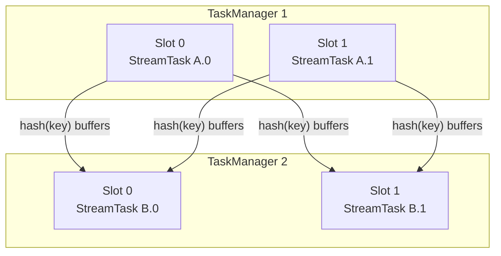
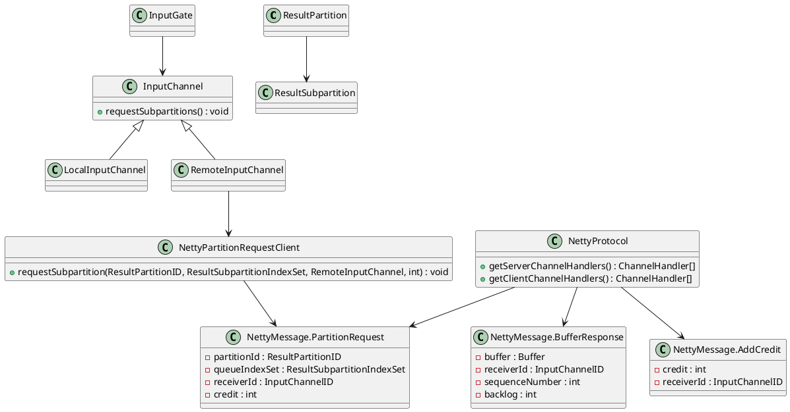

A **TaskManager** is the worker that runs a Flink job. The JobManager only picks a free slot and sends the task. After that, the records, the state, and the event-time clock live on this process.

- **Slots.** Capacity is a fixed number of slots. Chained operators share one slot and one thread, so a record between them is a local call.
- **Direct exchange.** A record for another task goes straight from this worker to that worker. When the receiver is full, this worker slows the sender.
- **Local state and time.** Keyed state stays on the machine that owns the key. The task stamps event time and advances watermarks as records arrive.


<!--more-->

---

## 1. Slot management

Each TaskManager sets its own slot count with `taskmanager.numberOfTaskSlots`. The default is 1. `TaskManagerConfiguration.fromConfiguration` reads that value, and a configured `-1` is stored as 1. The count divides this process's CPU, task heap, task off-heap, managed memory, and network memory into equal shares. One share is the default slot. When the process registers with the ResourceManager it sends the count, that default slot size, and the total resources. Those are the slots this worker can offer.

A TaskManager advertises a fixed number of **slots**. Each slot can run one parallel pipeline slice (one subtask from each chained JobVertex sharing that slot in slot-sharing groups). CPU and managed memory are budgeted per slot.

Records leave a chain through a **result partition** and enter the downstream chain through an **input gate**. Exchange modes matter:

| Mode | Behavior |
|------|----------|
| **Pipelined** | Producer sends buffers as soon as they fill; consumer reads concurrently (default streaming) |
| **Blocking** | Producer finishes a partition before the consumer reads (common in batch) |

Partitioners on `StreamEdge` decide routing: `ForwardPartitioner` keeps data local to the same subtask index, `KeyGroupStreamPartitioner` (after `keyBy`) hashes keys into key groups, `RebalancePartitioner` round-robins for load balance.



Backpressure is local: when a consumer’s input buffers fill, credit-based flow control slows the upstream output. That pressure propagates through pipelined edges until sources throttle or buffer timeouts fire.

**Orders-per-minute Example** . It reads order records, parses each one into an `Order`, groups them by `userId`, counts them in a one-minute window, and writes the counts to Kafka: `orders → ParseOrder → keyBy(userId) → window → kafkaSink`.

At parallelism 2 that pipeline is two tasks. `A` is `orders → ParseOrder`, and `B` is `window → kafkaSink`. They are in one slot-sharing group, so each slot holds the pair with the same subtask index:

```text
Slot 0:  A.0 orders → ParseOrder     B.0 window → kafkaSink
Slot 1:  A.1 orders → ParseOrder     B.1 window → kafkaSink
```

The job needs two slots, not four. The `keyBy(userId)` edge is still a hash from every `A` subtask to every `B` subtask.

## 2. Data exchange

Operators inside one chain pass a record by a method call. The exchange starts at the boundary between two tasks. The producer has already serialized the record into a network **buffer** and appended that buffer to a **result subpartition**. The consumer reads it through an **input channel** on its input gate. Which subpartition receives the record is the partitioner from section 1: forward, hash, or rebalance.

There are two connections.

- **Same TaskManager.** `LocalInputChannel` asks `ResultPartitionManager.createSubpartitionView`. The buffer stays in this process. Sharing a slot does not turn a hash edge into a chain: `A.0` and `B.0` in one slot still meet at a subpartition, and the call is local only because both tasks are on this worker.
- **Another TaskManager.** `RemoteInputChannel` opens a Netty TCP connection to the producer's data port, `taskmanager.data.port` (default `0`, so the operating system assigns it). The assigned port is part of the `TaskManagerLocation` this worker registered. Many input channels share that one TCP connection. Every message carries an `InputChannelID`, so the receiver can hand the bytes to the right channel.

The bytes on that TCP connection are length-prefixed frames, defined by `NettyMessage`. A frame is not a fixed size. The first 4 bytes are the frame length, counting those 4 bytes themselves. Then a 4-byte magic number `0xBADC0FFE`, then a 1-byte message id, then the body. `NettyMessageDecoder` waits until `frame length - 4` more bytes have arrived, checks the magic number, and switches on the id. `AddCredit` has a fixed body. `BufferResponse` grows with the buffer: its header names the buffer size, and the buffer bytes follow in the same frame.

```text
| FRAME LENGTH (4) | MAGIC NUMBER (4) | ID (1) | message body |
```

```java
static final int FRAME_HEADER_LENGTH =
        4 + 4 + 1; // frame length (4), magic number (4), msg ID (1)

static final int MAGIC_NUMBER = 0xBADC0FFE;

static class NettyMessageDecoder extends LengthFieldBasedFrameDecoder {
    NettyMessageDecoder() {
        // max frame, length at offset 0, 4-byte length, length includes itself, strip the length
        super(Integer.MAX_VALUE, 0, 4, -4, 4);
    }

    // decode() reads the magic number, then switches on the message id
}
```

The id selects the message. The consumer speaks first.

1. **`PartitionRequest`.** The consumer names the result partition, the subpartition indexes, its `InputChannelID`, and an initial **credit**. Credit is how many buffers the consumer can accept right now.
2. **`BufferResponse`.** The producer sends one buffer, a sequence number, and the **backlog** (how many buffers are still waiting). It sends only while credit remains.
3. **`AddCredit`.** The consumer frees a buffer and tells the producer it may send that many more.
4. **`BacklogAnnouncement`.** The producer has buffers and zero credit, so it tells the consumer the backlog. The consumer grants credit when it has room again.

That loop is the backpressure in section 1. A full input gate stops granting credit, the producer stops writing that subpartition, and the slowdown follows the pipelined edge back to the source. In the orders-per-minute job, `A.0` keeps a subpartition for `B.0` and another for `B.1`. Each of those is its own input channel, local or remote depending on which TaskManager runs `B`.



A local consumer takes a view of the subpartition in this process.

```java
protected void requestSubpartitions() throws IOException {
    checkState(toBeConsumedBuffers.isEmpty());

    boolean retriggerRequest = false;
    boolean notifyDataAvailable = false;

    synchronized (requestLock) {
        checkState(!isReleased, "LocalInputChannel has been released already");

        if (subpartitionView == null) {
            LOG.debug(
                    "{}: Requesting LOCAL subpartitions {} of partition {}. {}",
                    this,
                    consumedSubpartitionIndexSet,
                    partitionId,
                    channelStatePersister);

            try {
                ResultSubpartitionView subpartitionView =
                        partitionManager.createSubpartitionView(
                                partitionId, consumedSubpartitionIndexSet, this);

                if (subpartitionView == null) {
                    throw new IOException("Error requesting subpartition.");
                }

                this.subpartitionView = subpartitionView;

                if (isReleased) {
                    subpartitionView.releaseAllResources();
                    this.subpartitionView = null;
                } else {
                    notifyDataAvailable = true;
                    upstreamReady.countDown();
                }
            } catch (PartitionNotFoundException notFound) {
                if (increaseBackoff()) {
                    retriggerRequest = true;
                } else {
                    throw notFound;
                }
            }
        }
    }

    if (notifyDataAvailable) {
        notifyDataAvailable(this.subpartitionView);
    }

    // a missing partition is requested again outside the lock
    if (retriggerRequest) {
        inputGate.retriggerPartitionRequest(partitionId.getPartitionId(), channelInfo);
    }
}
```

A remote consumer first obtains a client for the producer's address, then sends the partition request on that TCP connection.

```java
public void requestSubpartitions() throws IOException, InterruptedException {
    if (partitionRequestClient == null) {
        LOG.debug(
                "{}: Requesting REMOTE subpartitions {} of partition {}. {}",
                this,
                consumedSubpartitionIndexSet,
                partitionId,
                channelStatePersister);
        try {
            partitionRequestClient =
                    connectionManager.createPartitionRequestClient(connectionId);
        } catch (IOException e) {
            throw new PartitionConnectionException(partitionId, e);
        }

        partitionRequestClient.requestSubpartition(
                partitionId, consumedSubpartitionIndexSet, this, 0);
    }
}
```

```java
public void requestSubpartition(
        final ResultPartitionID partitionId,
        final ResultSubpartitionIndexSet subpartitionIndexSet,
        final RemoteInputChannel inputChannel,
        int delayMs)
        throws IOException {

    checkNotClosed();

    LOG.debug(
            "Requesting subpartition {} of partition {} with {} ms delay.",
            subpartitionIndexSet,
            partitionId,
            delayMs);

    clientHandler.addInputChannel(inputChannel);

    final PartitionRequest request =
            new PartitionRequest(
                    partitionId,
                    subpartitionIndexSet,
                    inputChannel.getInputChannelId(),
                    inputChannel.getInitialCredit(),
                    inputChannel.needsRecovery());

    final ChannelFutureListener listener =
            future -> {
                if (!future.isSuccess()) {
                    clientHandler.removeInputChannel(inputChannel);
                    inputChannel.onError(
                            new LocalTransportException(
                                    String.format(
                                            "Sending the partition request to '%s [%s] (#%d)' failed.",
                                            connectionId.getAddress(),
                                            connectionId
                                                    .getResourceID()
                                                    .getStringWithMetadata(),
                                            connectionId.getConnectionIndex()),
                                    future.channel().localAddress(),
                                    future.cause()));
                    sendToChannel(
                            new ConnectionErrorMessage(
                                    future.cause() == null
                                            ? new RuntimeException(
                                                    "Cannot send partition request.")
                                            : future.cause()));
                }
            };

    if (delayMs == 0) {
        ChannelFuture f = tcpChannel.writeAndFlush(request);
        f.addListener(listener);
    } else {
        final ChannelFuture[] f = new ChannelFuture[1];
        tcpChannel
                .eventLoop()
                .schedule(
                        () -> {
                            f[0] = tcpChannel.writeAndFlush(request);
                            f[0].addListener(listener);
                        },
                        delayMs,
                        TimeUnit.MILLISECONDS);
    }
}
```

## 3. Event time and watermarks

Flink distinguishes **processing time** (wall clock on the machine) from **event time** (timestamps carried by records). Event-time windows and timers fire from the progress of **watermarks**, not from wall-clock ticks. The client attaches a `WatermarkStrategy` when it builds the source. Each `StreamTask` runs that strategy on its records.

A `WatermarkStrategy` supplies:

- a `TimestampAssigner` that stamps each record;
- a `WatermarkGenerator` that emits watermark values (periodically or on records).

`WatermarkStrategy.forBoundedOutOfOrderness(Duration)` is the common generator: it tracks the max observed event timestamp and emits `maxEventTs - outOfOrderness` (minus one millisecond in the usual formulation), so late arrivals within the bound can still join open windows.

```java
DataStream<Event> events = env.fromSource(
    source,
    WatermarkStrategy
        .<Event>forBoundedOutOfOrderness(Duration.ofSeconds(5))
        .withTimestampAssigner((e, ts) -> e.getEventTimeMillis()),
    "events");

events
    .keyBy(Event::getKey)
    .window(TumblingEventTimeWindows.of(Duration.ofMinutes(1)))
    .aggregate(new CountAggregate())
    .sinkTo(sink);
```

Watermarks propagate downstream. At a multi-input operator, the effective watermark is the **minimum** across inputs (and channels): the operator must not advance event time past data that might still arrive on a slower channel. Idle sources can be marked idle so they do not hold the minimum forever.

```text
records:   t=10  t=12  t=11  t=18  t=20
watermark:              ....  W=13       W=15
bound = 5s  =>  W ≈ maxEventTs - 5s

window [0,60s): closes when watermark >= 60s
```

Late records that arrive after the watermark has passed their window are either dropped, sent to a side output configured for lateness, or allowed into still-open windows if `allowedLateness` extends the lifetime. Processing-time windows ignore watermarks and fire on timer service wall-clock deadlines.
