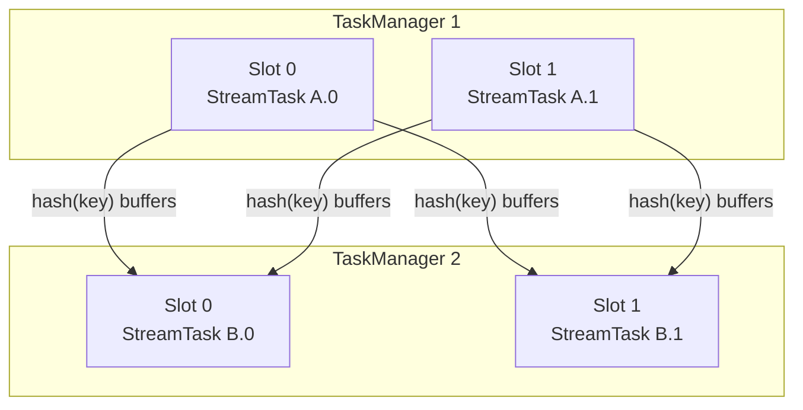
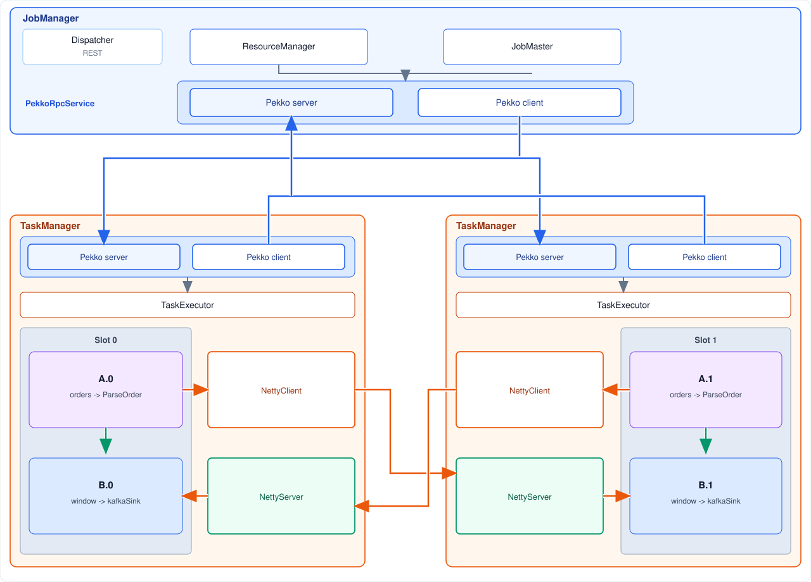
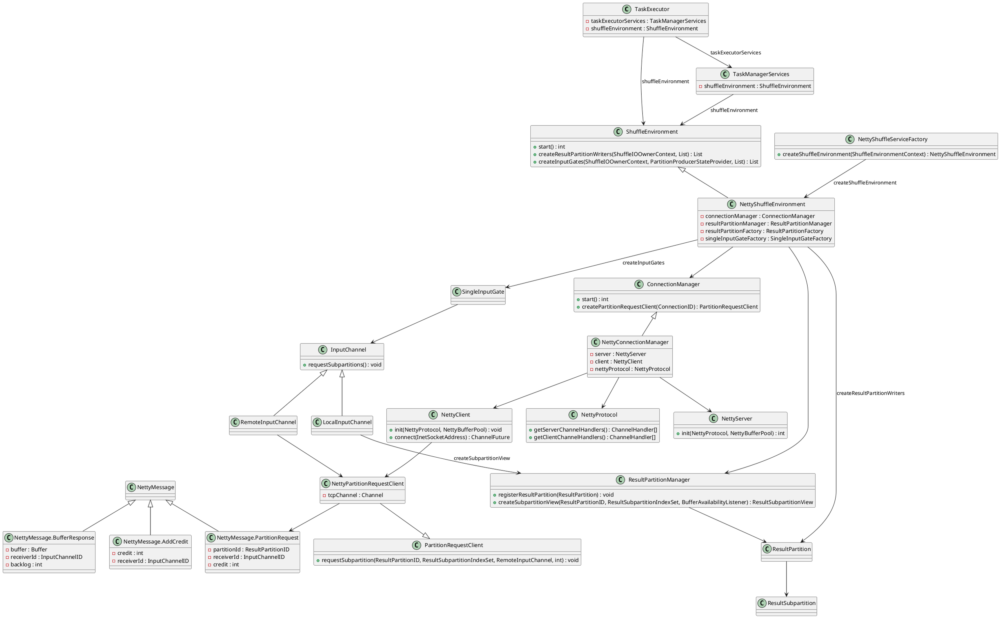
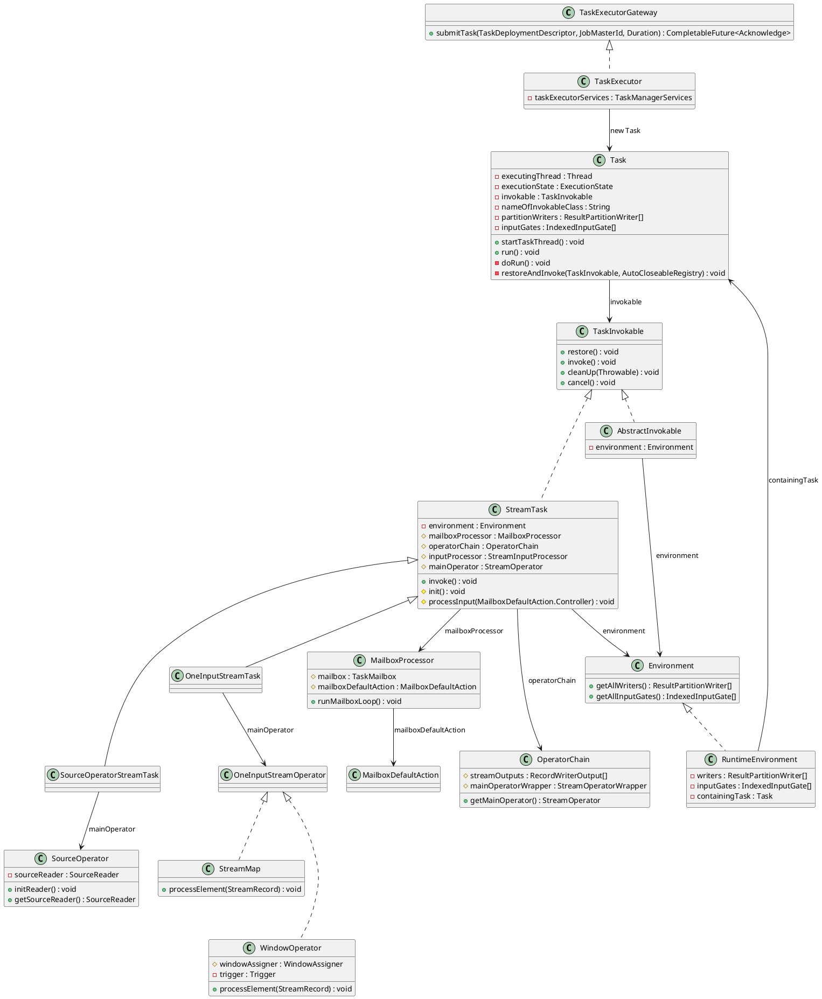

A **TaskManager** is the worker that runs the tasks of a Flink job. The JobManager assigns a free slot and sends the task. This process then holds the slot, moves the records, and executes the operators.

- **Slots.** The process offers a fixed number of slots. Tasks in one slot-sharing group can share a slot. Operators chained inside one task share that task's thread, so a record between them is a method call.
- **Data exchange.** One connection talks to the JobManager about slots and tasks. Another carries records to other TaskManagers. A full input stops granting credit, and the sender slows down.
- **Task execution.** Deployment starts one thread per task. That thread builds the operators, restores them, and runs them until the task finishes. 


<!--more-->

---

## 1. Slot management

Each TaskManager sets its own slot count with `taskmanager.numberOfTaskSlots`. The default is 1. `TaskManagerConfiguration.fromConfiguration` reads that value, and a configured `-1` is stored as 1. The count divides this process's CPU, task heap, task off-heap, managed memory, and network memory into equal shares. One share is the default slot. When the process registers with the ResourceManager it sends the count, that default slot size, and the total resources. Those are the slots this worker can offer.

A TaskManager advertises a fixed number of **slots**. Each slot can run one parallel pipeline slice (one subtask from each chained JobVertex sharing that slot in slot-sharing groups). CPU and managed memory are budgeted per slot.

Records leave a chain through a **result partition** and enter the downstream chain through an **input gate**. Exchange modes matter:

| Mode | Behavior |
|------|----------|
| **Pipelined** | Producer sends buffers as soon as they fill; consumer reads concurrently (default streaming) |
| **Blocking** | Producer finishes a partition before the consumer reads (common in batch) |

Partitioners on `StreamEdge` decide routing: `ForwardPartitioner` keeps data local to the same subtask index, `KeyGroupStreamPartitioner` (after `keyBy`) hashes keys into key groups, `RebalancePartitioner` round-robins for load balance.



Backpressure is local: when a consumer’s input buffers fill, credit-based flow control slows the upstream output. That pressure propagates through pipelined edges until sources throttle or buffer timeouts fire.

**Orders-per-minute Example** . It reads order records, parses each one into an `Order`, groups them by `userId`, counts them in a one-minute window, and writes the counts to Kafka: `orders → ParseOrder → keyBy(userId) → window → kafkaSink`.

At parallelism 2 that pipeline is two tasks. `A` is `orders → ParseOrder`, and `B` is `window → kafkaSink`. They are in one slot-sharing group, so each slot holds the pair with the same subtask index:

```text
Slot 0:  A.0 orders → ParseOrder     B.0 window → kafkaSink
Slot 1:  A.1 orders → ParseOrder     B.1 window → kafkaSink
```

The job needs two slots, not four. The `keyBy(userId)` edge is still a hash from every `A` subtask to every `B` subtask.

## 2. Data exchange

A TaskManager keeps two connections. One is with the JobManager, for slots and tasks. The other is with other TaskManagers, for records.



Operators inside one chain pass a record by a method call. The exchange starts at the boundary between two tasks. The producer has already serialized the record into a network **buffer** and appended that buffer to a **result subpartition**. The consumer reads it through an **input channel** on its input gate. Which subpartition receives the record is the partitioner from section 1: forward, hash, or rebalance.

There are two connections.

- **Same TaskManager.** `LocalInputChannel` asks `ResultPartitionManager.createSubpartitionView`. The buffer stays in this process. Sharing a slot does not turn a hash edge into a chain: `A.0` and `B.0` in one slot still meet at a subpartition, and the call is local only because both tasks are on this worker.
- **Another TaskManager.** `RemoteInputChannel` opens a Netty TCP connection to the producer's data port, `taskmanager.data.port` (default `0`, so the operating system assigns it). The assigned port is part of the `TaskManagerLocation` this worker registered. Many input channels share that one TCP connection. Every message carries an `InputChannelID`, so the receiver can hand the bytes to the right channel.

The bytes on that TCP connection are length-prefixed frames, defined by `NettyMessage`. A frame is not a fixed size. The first 4 bytes are the frame length, counting those 4 bytes themselves. Then a 4-byte magic number `0xBADC0FFE`, then a 1-byte message id, then the body. `NettyMessageDecoder` waits until `frame length - 4` more bytes have arrived, checks the magic number, and switches on the id. `AddCredit` has a fixed body. `BufferResponse` grows with the buffer: its header names the buffer size, and the buffer bytes follow in the same frame.

```text
| FRAME LENGTH (4) | MAGIC NUMBER (4) | ID (1) | message body |
```

```java
static final int FRAME_HEADER_LENGTH =
        4 + 4 + 1; // frame length (4), magic number (4), msg ID (1)

static final int MAGIC_NUMBER = 0xBADC0FFE;

static class NettyMessageDecoder extends LengthFieldBasedFrameDecoder {
    NettyMessageDecoder() {
        // max frame, length at offset 0, 4-byte length, length includes itself, strip the length
        super(Integer.MAX_VALUE, 0, 4, -4, 4);
    }

    // decode() reads the magic number, then switches on the message id
}
```

The id selects the message. The consumer speaks first.

1. **`PartitionRequest`.** The consumer names the result partition, the subpartition indexes, its `InputChannelID`, and an initial **credit**. Credit is how many buffers the consumer can accept right now.
2. **`BufferResponse`.** The producer sends one buffer, a sequence number, and the **backlog** (how many buffers are still waiting). It sends only while credit remains.
3. **`AddCredit`.** The consumer frees a buffer and tells the producer it may send that many more.
4. **`BacklogAnnouncement`.** The producer has buffers and zero credit, so it tells the consumer the backlog. The consumer grants credit when it has room again.

That loop is the backpressure in section 1. A full input gate stops granting credit, the producer stops writing that subpartition, and the slowdown follows the pipelined edge back to the source. In the orders-per-minute job, `A.0` keeps a subpartition for `B.0` and another for `B.1`. Each of those is its own input channel, local or remote depending on which TaskManager runs `B`.



A local consumer takes a view of the subpartition in this process.

```java
protected void requestSubpartitions() throws IOException {
    checkState(toBeConsumedBuffers.isEmpty());

    boolean retriggerRequest = false;
    boolean notifyDataAvailable = false;

    synchronized (requestLock) {
        checkState(!isReleased, "LocalInputChannel has been released already");

        if (subpartitionView == null) {
            LOG.debug(
                    "{}: Requesting LOCAL subpartitions {} of partition {}. {}",
                    this,
                    consumedSubpartitionIndexSet,
                    partitionId,
                    channelStatePersister);

            try {
                ResultSubpartitionView subpartitionView =
                        partitionManager.createSubpartitionView(
                                partitionId, consumedSubpartitionIndexSet, this);

                if (subpartitionView == null) {
                    throw new IOException("Error requesting subpartition.");
                }

                this.subpartitionView = subpartitionView;

                if (isReleased) {
                    subpartitionView.releaseAllResources();
                    this.subpartitionView = null;
                } else {
                    notifyDataAvailable = true;
                    upstreamReady.countDown();
                }
            } catch (PartitionNotFoundException notFound) {
                if (increaseBackoff()) {
                    retriggerRequest = true;
                } else {
                    throw notFound;
                }
            }
        }
    }

    if (notifyDataAvailable) {
        notifyDataAvailable(this.subpartitionView);
    }

    // a missing partition is requested again outside the lock
    if (retriggerRequest) {
        inputGate.retriggerPartitionRequest(partitionId.getPartitionId(), channelInfo);
    }
}
```

A remote consumer first obtains a client for the producer's address, then sends the partition request on that TCP connection.

```java
public void requestSubpartitions() throws IOException, InterruptedException {
    if (partitionRequestClient == null) {
        LOG.debug(
                "{}: Requesting REMOTE subpartitions {} of partition {}. {}",
                this,
                consumedSubpartitionIndexSet,
                partitionId,
                channelStatePersister);
        try {
            partitionRequestClient =
                    connectionManager.createPartitionRequestClient(connectionId);
        } catch (IOException e) {
            throw new PartitionConnectionException(partitionId, e);
        }

        partitionRequestClient.requestSubpartition(
                partitionId, consumedSubpartitionIndexSet, this, 0);
    }
}
```

```java
public void requestSubpartition(
        final ResultPartitionID partitionId,
        final ResultSubpartitionIndexSet subpartitionIndexSet,
        final RemoteInputChannel inputChannel,
        int delayMs)
        throws IOException {

    checkNotClosed();

    LOG.debug(
            "Requesting subpartition {} of partition {} with {} ms delay.",
            subpartitionIndexSet,
            partitionId,
            delayMs);

    clientHandler.addInputChannel(inputChannel);

    final PartitionRequest request =
            new PartitionRequest(
                    partitionId,
                    subpartitionIndexSet,
                    inputChannel.getInputChannelId(),
                    inputChannel.getInitialCredit(),
                    inputChannel.needsRecovery());

    final ChannelFutureListener listener =
            future -> {
                if (!future.isSuccess()) {
                    clientHandler.removeInputChannel(inputChannel);
                    inputChannel.onError(
                            new LocalTransportException(
                                    String.format(
                                            "Sending the partition request to '%s [%s] (#%d)' failed.",
                                            connectionId.getAddress(),
                                            connectionId
                                                    .getResourceID()
                                                    .getStringWithMetadata(),
                                            connectionId.getConnectionIndex()),
                                    future.channel().localAddress(),
                                    future.cause()));
                    sendToChannel(
                            new ConnectionErrorMessage(
                                    future.cause() == null
                                            ? new RuntimeException(
                                                    "Cannot send partition request.")
                                            : future.cause()));
                }
            };

    if (delayMs == 0) {
        ChannelFuture f = tcpChannel.writeAndFlush(request);
        f.addListener(listener);
    } else {
        final ChannelFuture[] f = new ChannelFuture[1];
        tcpChannel
                .eventLoop()
                .schedule(
                        () -> {
                            f[0] = tcpChannel.writeAndFlush(request);
                            f[0].addListener(listener);
                        },
                        delayMs,
                        TimeUnit.MILLISECONDS);
    }
}
```

## 3. Task execution

The JobMaster sends one `TaskDeploymentDescriptor` per execution attempt by calling `TaskExecutorGateway.submitTask`. `TaskExecutor` implements that gateway method. The call checks that this attempt still belongs to the current JobMaster and that `tryMarkSlotActive` can take the slot named in the descriptor. It then builds a `Task`, puts that task in the slot with `taskSlotTable.addTask`, and calls `startTaskThread`. The `Task` object is the thread. Its `run` method calls `doRun`.

`doRun` moves the attempt from `CREATED` to `DEPLOYING`. It loads the user-code class loader, calls `setupPartitionsAndGates` so the result partitions and input gates from section 2 exist, and builds a `RuntimeEnvironment`. `loadAndInstantiateInvokable` loads `TaskInformation.getInvokableClassName()` and calls the constructor that takes that environment. For a streaming job the class is a `StreamTask`: `SourceOperatorStreamTask` when the task is a source operator, `OneInputStreamTask` when the task has one network input. In the orders-per-minute job each of `A.0`, `A.1`, `B.0`, and `B.1` is one of these threads. Operators inside the chain still share that one thread.



`restoreAndInvoke` is the state machine around the user code. `restore` runs while the attempt is `INITIALIZING`. `invoke` runs while it is `RUNNING`. Each transition is reported to the JobMaster through `taskManagerActions.updateTaskExecutionState`. After `invoke` returns, `doRun` finishes the result partitions and moves the attempt to `FINISHED`. A failure or a cancel takes the other branch, `transitionStateOnFailure`.

```java
private void restoreAndInvoke(
        TaskInvokable finalInvokable, AutoCloseableRegistry cleanUpRegistry) throws Exception {
    try {
        // switch to the INITIALIZING state, if that fails, we have been canceled/failed in the
        // meantime
        if (!transitionState(ExecutionState.DEPLOYING, ExecutionState.INITIALIZING)) {
            throw new CancelTaskException();
        }

        taskManagerActions.updateTaskExecutionState(
                new TaskExecutionState(executionId, ExecutionState.INITIALIZING));

        // make sure the user code classloader is accessible thread-locally
        executingThread.setContextClassLoader(userCodeClassLoader.asClassLoader());

        runWithSystemExitMonitoring(finalInvokable::restore);

        if (!transitionState(ExecutionState.INITIALIZING, ExecutionState.RUNNING)) {
            throw new CancelTaskException();
        }

        // notify everyone that we switched to running
        taskManagerActions.updateTaskExecutionState(
                new TaskExecutionState(executionId, ExecutionState.RUNNING));

        runWithSystemExitMonitoring(finalInvokable::invoke);
    } catch (Throwable throwable) {
        cleanUpRegistry.registerCloseable(
                () -> runWithSystemExitMonitoring(() -> finalInvokable.cleanUp(throwable)));
        throw throwable;
    }
    runWithSystemExitMonitoring(() -> finalInvokable.cleanUp(null));
}
```

`StreamTask.restore` builds the `OperatorChain`, calls the task's `init` (a `OneInputStreamTask` builds a `StreamOneInputProcessor` over its input gate and that chain), and restores state. `invoke` then enters the mailbox. `runMailboxLoop` is the whole steady state of the thread: take any mail that is waiting, then run the default action. Mail is how a checkpoint, a timer, or a cancel reaches this thread. The default action is `processInput`.

```java
public final void invoke() throws Exception {
    // Allow invoking method 'invoke' without having to call 'restore' before it.
    if (!isRunning) {
        LOG.debug("Restoring during invoke will be called.");
        restoreInternal();
    }

    // final check to exit early before starting to run
    ensureNotCanceled();

    scheduleBufferDebloater();

    // let the task do its work
    getEnvironment().getMetricGroup().getIOMetricGroup().markTaskStart();
    runMailboxLoop();

    // if this left the run() method cleanly despite the fact that this was canceled,
    // make sure the "clean shutdown" is not attempted
    ensureNotCanceled();

    afterInvoke();
}
```

```java
public void runMailboxLoop() throws Exception {
    suspended = !mailboxLoopRunning;

    final TaskMailbox localMailbox = mailbox;

    checkState(
            localMailbox.isMailboxThread(),
            "Method must be executed by declared mailbox thread!");

    assert localMailbox.getState() == TaskMailbox.State.OPEN : "Mailbox must be opened!";

    final MailboxController mailboxController = new MailboxController(this);

    while (isNextLoopPossible()) {
        // The blocking `processMail` call will not return until default action is available.
        processMail(localMailbox, false);
        if (isNextLoopPossible()) {
            mailboxDefaultAction.runDefaultAction(
                    mailboxController); // lock is acquired inside default action as needed
        }
    }
}
```

`processInput` asks the input processor for one step. `MORE_AVAILABLE` means another record can be read on the next loop. `NOTHING_AVAILABLE` and a full output fall through to a wait: the default action is suspended until the input, the result writer, or the operator chain can accept more. That wait is the same backpressure as section 2, observed from inside the task thread. `END_OF_DATA` and `END_OF_INPUT` finish the input and suspend the default action so the loop can drain the remaining mail and leave `invoke`.

```java
protected void processInput(MailboxDefaultAction.Controller controller) throws Exception {
    DataInputStatus status = inputProcessor.processInput();
    switch (status) {
        case MORE_AVAILABLE:
            if (taskIsAvailable()) {
                return;
            }
            break;
        case NOTHING_AVAILABLE:
            break;
        case END_OF_RECOVERY:
            throw new IllegalStateException("We should not receive this event here.");
        case STOPPED:
            endData(StopMode.NO_DRAIN);
            return;
        case END_OF_DATA:
            endData(StopMode.DRAIN);
            notifyEndOfData();
            return;
        case END_OF_INPUT:
            if (recoveryCompletionFuture != null && !recoveryCompletionFuture.isDone()) {
                // suspend only the default action while recovery is still running
                MailboxDefaultAction.Suspension suspension = controller.suspendDefaultAction();
                recoveryCompletionFuture.whenComplete(
                        (ign, t) ->
                                mainMailboxExecutor.execute(
                                        suspension::resume,
                                        "resume default action after recovery"));
                return;
            }
            controller.suspendDefaultAction();
            mailboxProcessor.suspend();
            return;
    }

    // if the chain, the result writer, the input, or the changelog is unavailable,
    // suspend the default action until that future completes
}
```
