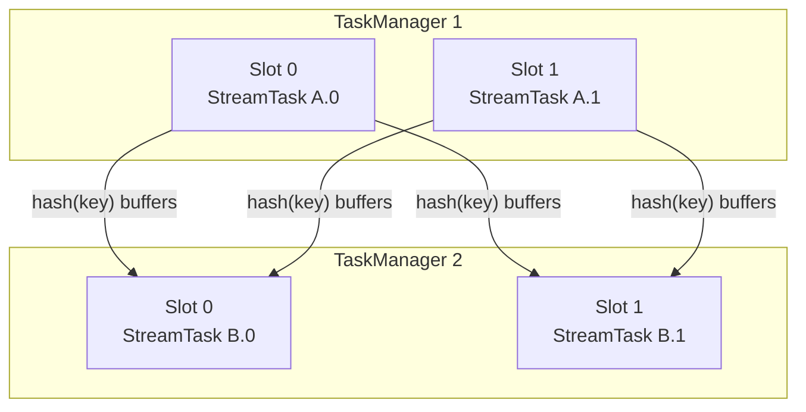
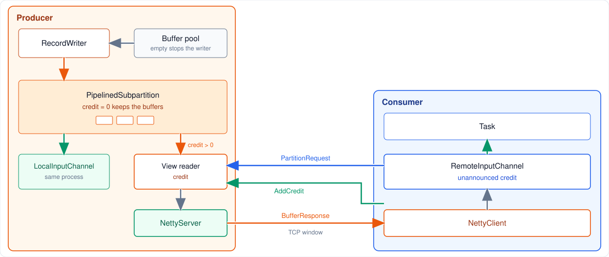
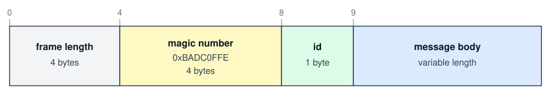
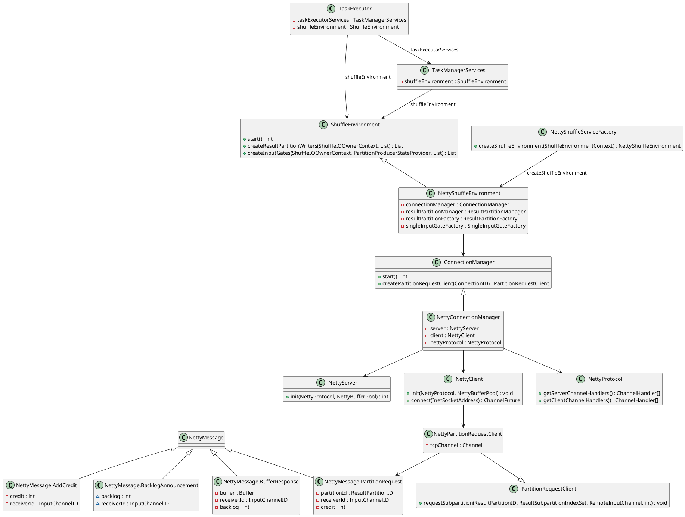
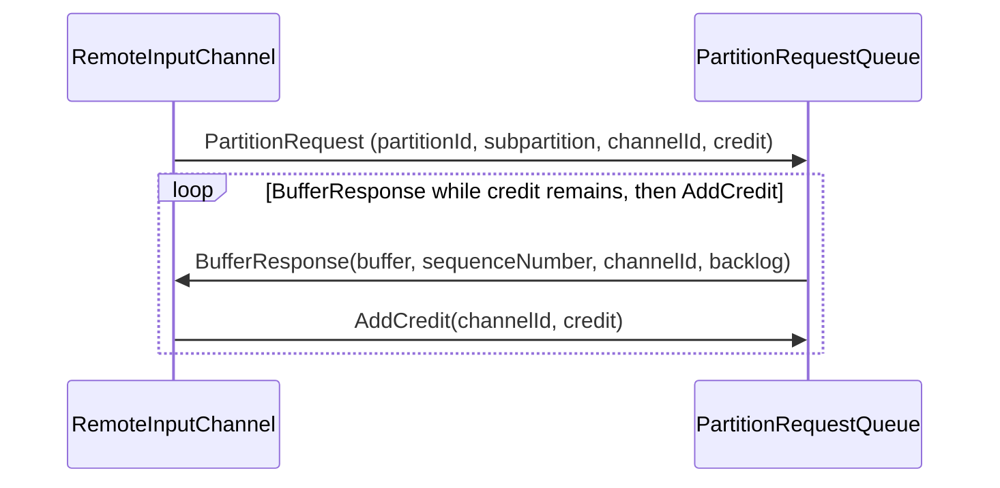
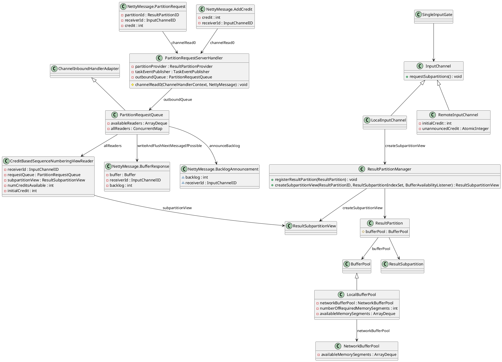
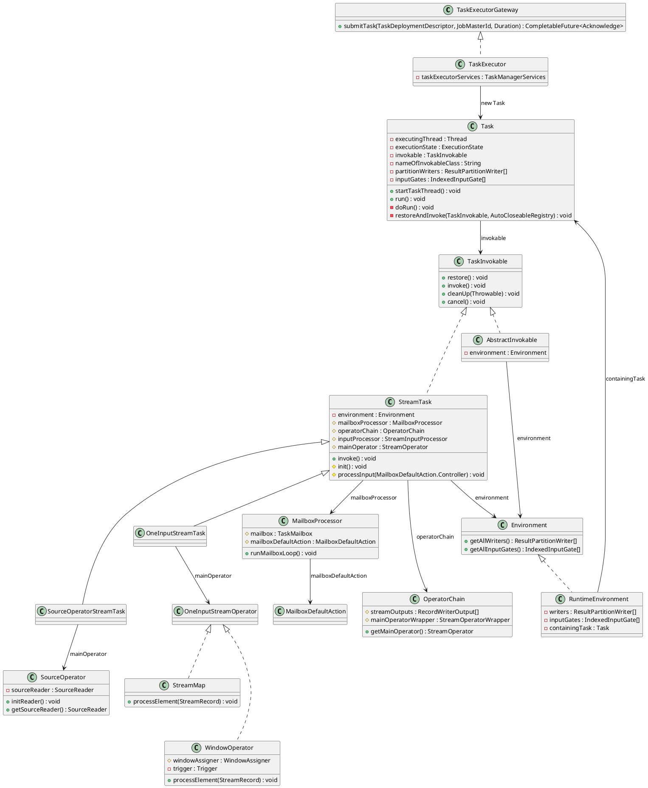

A **TaskManager** is the worker that runs the tasks of a Flink job. The JobManager assigns a free slot and sends the task. This process then holds the slot, moves the records, and executes the operators.

- **Slots.** The process offers a fixed number of slots. Tasks in one slot-sharing group can share a slot. Operators chained inside one task share that task's thread, so a record between them is a method call.
- **Data exchange and back pressure.** One connection talks to the JobMaster about the task. Another carries records to other TaskManagers. A full input stops granting credit, and the sender slows down.
- **Task execution.** Deployment starts one thread per task. That thread builds the operators, restores them, and runs them until the task finishes. 


<!--more-->

---

## 1. Slot management

Each TaskManager sets its own slot count with `taskmanager.numberOfTaskSlots`. The default is 1. `TaskManagerConfiguration.fromConfiguration` reads that value, and a configured `-1` is stored as 1. The count divides this process's CPU, task heap, task off-heap, managed memory, and network memory into equal shares. One share is the default slot. When the process registers with the ResourceManager it sends the count, that default slot size, and the total resources. Those are the slots this worker can offer.

A TaskManager advertises a fixed number of **slots**. Each slot can run one parallel pipeline slice (one subtask from each chained JobVertex sharing that slot in slot-sharing groups). CPU and managed memory are budgeted per slot.

Records leave a chain through a **result partition** and enter the downstream chain through an **input gate**. Exchange modes matter:

| Mode | Behavior |
|------|----------|
| **Pipelined** | Producer sends buffers as soon as they fill; consumer reads concurrently (default streaming) |
| **Blocking** | Producer finishes a partition before the consumer reads (common in batch) |

Partitioners on `StreamEdge` decide routing: `ForwardPartitioner` keeps data local to the same subtask index, `KeyGroupStreamPartitioner` (after `keyBy`) hashes keys into key groups, `RebalancePartitioner` round-robins for load balance.



Backpressure is local: when a consumer’s input buffers fill, credit-based flow control slows the upstream output. That pressure propagates through pipelined edges until sources throttle or buffer timeouts fire.

**Orders-per-minute Example** . It reads order records, parses each one into an `Order`, groups them by `userId`, counts them in a one-minute window, and writes the counts to Kafka: `orders → ParseOrder → keyBy(userId) → window → kafkaSink`.

At parallelism 2 that pipeline is two tasks. `A` is `orders → ParseOrder`, and `B` is `window → kafkaSink`. They are in one slot-sharing group, so each slot holds the pair with the same subtask index:

```text
Slot 0:  A.0 orders → ParseOrder     B.0 window → kafkaSink
Slot 1:  A.1 orders → ParseOrder     B.1 window → kafkaSink
```

The job needs two slots, not four. The `keyBy(userId)` edge is still a hash from every `A` subtask to every `B` subtask.

## 2. Data exchange and back pressure

A TaskManager keeps two kinds of connection.

- **JobMaster.** The JobMaster sends the task on the JobMaster connection. Section 3 is the submit call.
- **Other TaskManagers.** The record connection carries records from one task to another. The figure below is the record path.

A record inside one chain of operators is a method call. On the remote connection, the producer writes the record into a network buffer and appends the buffer to a result subpartition. The consumer reads the buffer through an input channel. Which subpartition receives the record is the partitioner from section 1: forward, hash, or rebalance.

On the same TaskManager, the channel reads the subpartition in the local process. On another TaskManager, the channel opens a TCP connection to the producer's data port. Many channels share the TCP connection. Each message names an input channel, so the bytes reach the named channel.



In the orders-per-minute job, `A.0` to `B.0` stays on one TaskManager. `A.0` to `B.1` crosses to the other. Sharing a slot does not turn the hash edge into a chain: `A.0` and `B.0` still meet at a subpartition.

### 2.1 Netty protocol

Netty is the library a TaskManager uses to carry records to remote TaskManager. `TaskExecutor` holds a `ShuffleEnvironment`. The default environment is a `NettyShuffleEnvironment`, created by `NettyShuffleServiceFactory`. The connection manager is a `NettyConnectionManager`.

`NettyConnectionManager` runs two sides. `NettyServer` listens on the data port. A remote consumer connects to `NettyServer`, so the producer of a record is the server. `NettyClient` opens the outgoing connection: `NettyPartitionRequestClient` is the consumer, and the client sends the request for a subpartition. Many input channels share the TCP connection. `NettyProtocol` encodes and decodes the frames on both sides. The bytes Netty holds come from `NettyBufferPool`, which allocates the bytes off-heap.

The bytes on the connection to remote TaskManager are Netty frames. Every frame has the same front. The numbers above the boxes are the byte offsets.



The length counts every byte of the frame, including its own 4 bytes. The magic number is `0xBADC0FFE`. The id selects the message. The body follows, and its size depends on the id. The consumer speaks first.

1. **`PartitionRequest`**, id 2. The consumer names the partition, the subpartitions, and the input channel. The message also says how many buffers the consumer can accept. The accepted count is the credit.
2. **`BufferResponse`**, id 0. The producer sends one buffer and says how many buffers are still waiting. The waiting count is the backlog.
3. **`AddCredit`**, id 6. The consumer has freed some buffers and tells the producer it may send more.
4. **`BacklogAnnouncement`**, id 9. The producer has buffers and no credit, so it reports the backlog. The consumer grants credit when it has room.



### 2.2 Backpressure

Backpressure slows a producer when the consumer cannot take more buffers. The consumer grants credit, and the producer sends one data buffer for each credit. At zero credit the data buffer stays in the subpartition. An event can still pass, including a checkpoint barrier and a watermark. Buffers that wait fill the task's local buffer pool. The local buffer pool borrows memory from the network buffer pool, which is off-heap memory shared by the TaskManager. When the local pool has no free buffer, the task that writes the records waits, and the operator in the task slows down. The wait is the one in section 3. On the same TaskManager there is no credit message. Unread buffers fill the same pool, so the writer waits in the same way.

`PartitionRequest` is sent once per channel, from `RemoteInputChannel.requestSubpartitions`. The credit in the message is the first credit. After the channel is open, freed buffers are reported with `AddCredit` from `notifyCreditAvailable`, and the producer sends further `BufferResponse` messages. A `PartitionNotFound` answer is the path that sends `PartitionRequest` again, through `retriggerSubpartitionRequest`, until the partition is registered.





```java
// PartitionRequestServerHandler.channelRead0
// Store the initial credit on a new view reader. Other message types sit between these two branches.
if (msgClazz == PartitionRequest.class) {
    PartitionRequest request = (PartitionRequest) msg;

    NetworkSequenceViewReader reader;
    reader =
            new CreditBasedSequenceNumberingViewReader(
                    request.receiverId,
                    request.credit, // buffers the consumer can accept now
                    request.needsRecovery,
                    outboundQueue);

    reader.requestSubpartitionViewOrRegisterListener(
            partitionProvider, request.partitionId, request.queueIndexSet);
} else if (msgClazz == AddCredit.class) {
    AddCredit request = (AddCredit) msg;

    // Add the buffers the consumer has freed.
    outboundQueue.addCreditOrResumeConsumption(
            request.receiverId, reader -> reader.addCredit(request.credit));
}
```

```java
// CreditBasedSequenceNumberingViewReader
// numCreditsAvailable is how many data buffers the server may still send.
private int numCreditsAvailable;

// CreditBasedSequenceNumberingViewReader constructor
CreditBasedSequenceNumberingViewReader(
        InputChannelID receiverId,
        int initialCredit,
        boolean needsRecovery,
        PartitionRequestQueue requestQueue) {
    // The other fields are stored here as well.
    // A recovery request starts with no credit.
    this.numCreditsAvailable = needsRecovery ? 0 : initialCredit;
}

// CreditBasedSequenceNumberingViewReader.addCredit
@Override
public void addCredit(int creditDeltas) {
    numCreditsAvailable += creditDeltas;
}
```

```java
// PipelinedSubpartition.getAvailabilityAndBacklog
// With credit, a waiting buffer may leave. With none, only an event may leave.
public ResultSubpartitionView.AvailabilityWithBacklog getAvailabilityAndBacklog(
        boolean isCreditAvailable) {
    synchronized (buffers) {
        boolean isAvailable;
        if (isCreditAvailable) {
            isAvailable = isDataAvailableUnsafe();
        } else {
            isAvailable = getNextBufferTypeUnsafe().isEvent();
        }
        return new ResultSubpartitionView.AvailabilityWithBacklog(
                isAvailable, getBuffersInBacklogUnsafe());
    }
}
```

```java
// CreditBasedSequenceNumberingViewReader.getAvailabilityAndBacklog
@Override
public ResultSubpartitionView.AvailabilityWithBacklog getAvailabilityAndBacklog() {
    return subpartitionView.getAvailabilityAndBacklog(numCreditsAvailable > 0);
}

// CreditBasedSequenceNumberingViewReader.getNextBuffer
// A data buffer spends one credit. An event does not.
@Nullable
@Override
public BufferAndAvailability getNextBuffer() throws IOException {
    BufferAndBacklog next = subpartitionView.getNextBuffer();
    if (next != null) {
        if (next.buffer().isBuffer() && --numCreditsAvailable < 0) {
            throw new IllegalStateException("no credit available");
        }

        final Buffer.DataType nextDataType = getNextDataType(next);
        return new BufferAndAvailability(
                next.buffer(), nextDataType, next.buffersInBacklog(), next.getSequenceNumber());
    } else {
        return null;
    }
}

// CreditBasedSequenceNumberingViewReader.getNextDataType
// The following item is visible when credit remains, or when the item is an event.
private Buffer.DataType getNextDataType(BufferAndBacklog bufferAndBacklog) {
    final Buffer.DataType nextDataType = bufferAndBacklog.getNextDataType();
    if (numCreditsAvailable > 0 || nextDataType.isEvent()) {
        return nextDataType;
    }
    return Buffer.DataType.NONE;
}
```

```java
// PartitionRequestQueue.writeAndFlushNextMessageIfPossible
// Send one BufferResponse. A closed socket window stops the write.
private void writeAndFlushNextMessageIfPossible(final Channel channel) throws IOException {
    if (fatalError || !channel.isWritable()) {
        return;
    }

    BufferAndAvailability next = null;
    int nextSubpartitionId = -1;
    try {
        while (true) {
            NetworkSequenceViewReader reader = pollAvailableReader();

            if (reader == null) {
                return;
            }

            nextSubpartitionId = reader.peekNextBufferSubpartitionId();
            next = reader.getNextBuffer(); // spends one credit for a data buffer
            if (next == null) {
                if (!reader.isReleased()) {
                    continue;
                }

                Throwable cause = reader.getFailureCause();
                if (cause != null) {
                    ErrorResponse msg = new ErrorResponse(cause, reader.getReceiverId());

                    ctx.writeAndFlush(msg);
                }
            } else {
                if (next.moreAvailable()) {
                    registerAvailableReader(reader);
                }

                BufferResponse msg =
                        new BufferResponse(
                                next.buffer(),
                                next.getSequenceNumber(),
                                reader.getReceiverId(),
                                nextSubpartitionId,
                                next.buffer() instanceof FullyFilledBuffer
                                        ? ((FullyFilledBuffer) next.buffer())
                                                .getPartialBuffers()
                                                .size()
                                        : 0,
                                next.buffersInBacklog());

                // One buffer goes out. The listener calls the method again when the write finishes.
                channel.writeAndFlush(msg).addListener(writeListener);

                return;
            }
        }
    } catch (Throwable t) {
        if (next != null) {
            next.buffer().recycleBuffer();
        }
        throw new IOException(t.getMessage(), t);
    }
}
```

```java
// RemoteInputChannel.notifyBufferAvailable
// The first freed buffers of a batch trigger AddCredit.
public void notifyBufferAvailable(int numAvailableBuffers) throws IOException {
    if (numAvailableBuffers > 0 && unannouncedCredit.getAndAdd(numAvailableBuffers) == 0) {
        notifyCreditAvailable();
    }
}

// NettyPartitionRequestClient.AddCreditMessage.buildMessage
// Copy the freed count into the message and clear it.
Object buildMessage() {
    int credits = inputChannel.getAndResetUnannouncedCredit();
    return credits > 0
            ? new NettyMessage.AddCredit(credits, inputChannel.getInputChannelId())
            : null;
}
```

## 3. Task execution

The JobMaster sends one `TaskDeploymentDescriptor` per execution attempt by calling `TaskExecutorGateway.submitTask`. `TaskExecutor` implements that gateway method. The call checks that this attempt still belongs to the current JobMaster and that `tryMarkSlotActive` can take the slot named in the descriptor. It then builds a `Task`, puts that task in the slot with `taskSlotTable.addTask`, and calls `startTaskThread`. The `Task` object is the thread. Its `run` method calls `doRun`.

`doRun` moves the attempt from `CREATED` to `DEPLOYING`. It loads the user-code class loader, calls `setupPartitionsAndGates` so the result partitions and input gates from section 2 exist, and builds a `RuntimeEnvironment`. `loadAndInstantiateInvokable` loads `TaskInformation.getInvokableClassName()` and calls the constructor that takes that environment. For a streaming job the class is a `StreamTask`: `SourceOperatorStreamTask` when the task is a source operator, `OneInputStreamTask` when the task has one network input. In the orders-per-minute job each of `A.0`, `A.1`, `B.0`, and `B.1` is one of these threads. Operators inside the chain still share that one thread.



`restoreAndInvoke` is the state machine around the user code. `restore` runs while the attempt is `INITIALIZING`. `invoke` runs while it is `RUNNING`. Each transition is reported to the JobMaster through `taskManagerActions.updateTaskExecutionState`. After `invoke` returns, `doRun` finishes the result partitions and moves the attempt to `FINISHED`. A failure or a cancel takes the other branch, `transitionStateOnFailure`.

```java
private void restoreAndInvoke(
        TaskInvokable finalInvokable, AutoCloseableRegistry cleanUpRegistry) throws Exception {
    try {
        // switch to the INITIALIZING state, if that fails, we have been canceled/failed in the
        // meantime
        if (!transitionState(ExecutionState.DEPLOYING, ExecutionState.INITIALIZING)) {
            throw new CancelTaskException();
        }

        taskManagerActions.updateTaskExecutionState(
                new TaskExecutionState(executionId, ExecutionState.INITIALIZING));

        // make sure the user code classloader is accessible thread-locally
        executingThread.setContextClassLoader(userCodeClassLoader.asClassLoader());

        runWithSystemExitMonitoring(finalInvokable::restore);

        if (!transitionState(ExecutionState.INITIALIZING, ExecutionState.RUNNING)) {
            throw new CancelTaskException();
        }

        // notify everyone that we switched to running
        taskManagerActions.updateTaskExecutionState(
                new TaskExecutionState(executionId, ExecutionState.RUNNING));

        runWithSystemExitMonitoring(finalInvokable::invoke);
    } catch (Throwable throwable) {
        cleanUpRegistry.registerCloseable(
                () -> runWithSystemExitMonitoring(() -> finalInvokable.cleanUp(throwable)));
        throw throwable;
    }
    runWithSystemExitMonitoring(() -> finalInvokable.cleanUp(null));
}
```

`StreamTask.restore` builds the `OperatorChain`, calls the task's `init` (a `OneInputStreamTask` builds a `StreamOneInputProcessor` over its input gate and that chain), and restores state. `invoke` then enters the mailbox. `runMailboxLoop` is the whole steady state of the thread: take any mail that is waiting, then run the default action. Mail is how a checkpoint, a timer, or a cancel reaches this thread. The default action is `processInput`.

```java
public final void invoke() throws Exception {
    // Allow invoking method 'invoke' without having to call 'restore' before it.
    if (!isRunning) {
        LOG.debug("Restoring during invoke will be called.");
        restoreInternal();
    }

    // final check to exit early before starting to run
    ensureNotCanceled();

    scheduleBufferDebloater();

    // let the task do its work
    getEnvironment().getMetricGroup().getIOMetricGroup().markTaskStart();
    runMailboxLoop();

    // if this left the run() method cleanly despite the fact that this was canceled,
    // make sure the "clean shutdown" is not attempted
    ensureNotCanceled();

    afterInvoke();
}
```

```java
public void runMailboxLoop() throws Exception {
    suspended = !mailboxLoopRunning;

    final TaskMailbox localMailbox = mailbox;

    checkState(
            localMailbox.isMailboxThread(),
            "Method must be executed by declared mailbox thread!");

    assert localMailbox.getState() == TaskMailbox.State.OPEN : "Mailbox must be opened!";

    final MailboxController mailboxController = new MailboxController(this);

    while (isNextLoopPossible()) {
        // The blocking `processMail` call will not return until default action is available.
        processMail(localMailbox, false);
        if (isNextLoopPossible()) {
            mailboxDefaultAction.runDefaultAction(
                    mailboxController); // lock is acquired inside default action as needed
        }
    }
}
```

`processInput` asks the input processor for one step. `MORE_AVAILABLE` means another record can be read on the next loop. `NOTHING_AVAILABLE` and a full output fall through to a wait: the default action is suspended until the input, the result writer, or the operator chain can accept more. That wait is the same backpressure as section 2, observed from inside the task thread. `END_OF_DATA` and `END_OF_INPUT` finish the input and suspend the default action so the loop can drain the remaining mail and leave `invoke`.

```java
protected void processInput(MailboxDefaultAction.Controller controller) throws Exception {
    DataInputStatus status = inputProcessor.processInput();
    switch (status) {
        case MORE_AVAILABLE:
            if (taskIsAvailable()) {
                return;
            }
            break;
        case NOTHING_AVAILABLE:
            break;
        case END_OF_RECOVERY:
            throw new IllegalStateException("We should not receive this event here.");
        case STOPPED:
            endData(StopMode.NO_DRAIN);
            return;
        case END_OF_DATA:
            endData(StopMode.DRAIN);
            notifyEndOfData();
            return;
        case END_OF_INPUT:
            if (recoveryCompletionFuture != null && !recoveryCompletionFuture.isDone()) {
                // suspend only the default action while recovery is still running
                MailboxDefaultAction.Suspension suspension = controller.suspendDefaultAction();
                recoveryCompletionFuture.whenComplete(
                        (ign, t) ->
                                mainMailboxExecutor.execute(
                                        suspension::resume,
                                        "resume default action after recovery"));
                return;
            }
            controller.suspendDefaultAction();
            mailboxProcessor.suspend();
            return;
    }

    // if the chain, the result writer, the input, or the changelog is unavailable,
    // suspend the default action until that future completes
}
```
