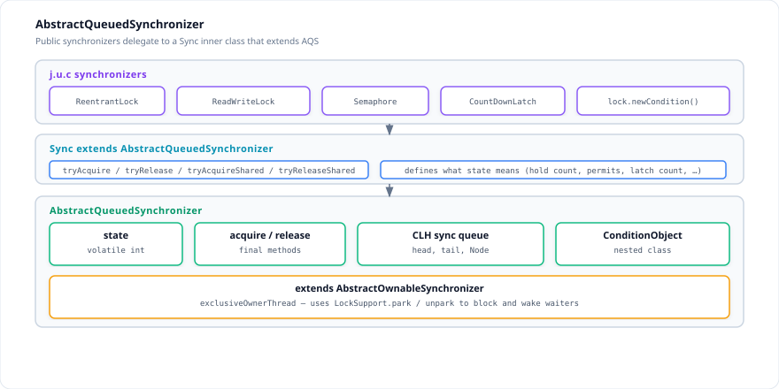
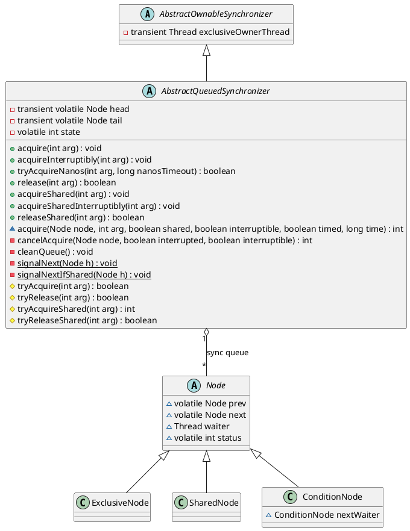
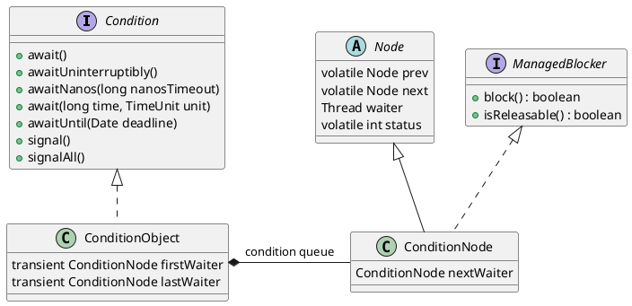
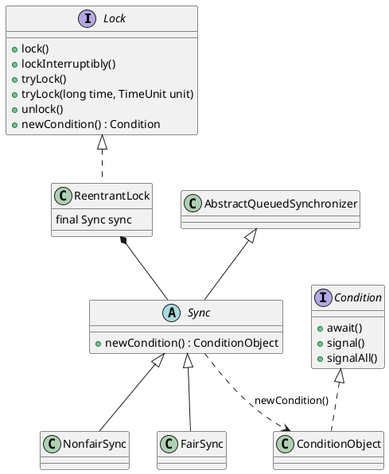
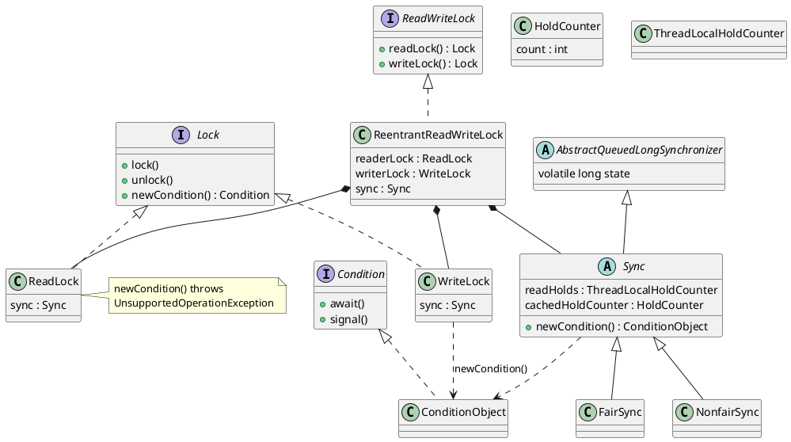
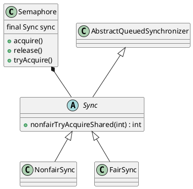
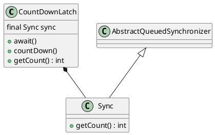
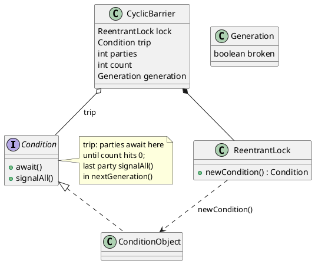
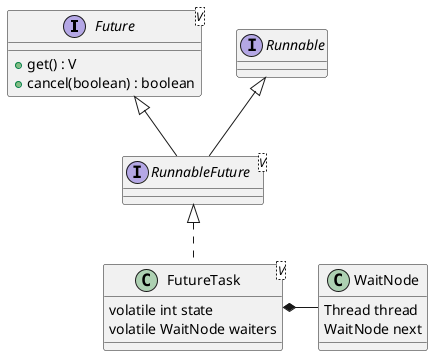

`ReentrantLock`, `Semaphore`, and `CountDownLatch` look unrelated at the API level, but each holds a private **`Sync extends AbstractQueuedSynchronizer`**. The **`Sync`** subclass overrides **`tryAcquire`** / **`tryRelease`** and decides what **`state`** represents. **`AbstractQueuedSynchronizer`** (AQS) is the base class: it owns `state`, the CLH sync queue, `acquire` / `release`, and the nested **`ConditionObject`**.

<!--more-->

---

## 1. Architecture

### 1.1 Design overview

A blocking synchronizer has two operations: **acquire** waits until `state` permits progress; **release** updates `state` and may wake waiters. In the JDK this splits across two classes:

| Class | Responsibility |
|-------|----------------|
| **`Sync extends AQS`** | Override `tryAcquire*` / `tryRelease*`; define what `state` means |
| **`AbstractQueuedSynchronizer`** | Hold `state`, run the `acquire` / `release` loop, manage the CLH queue, park threads via `LockSupport` |



The diagram shows the call chain:

1. **`ReentrantLock`**, **`Semaphore`**, etc. — public API (`lock`, `acquire`, `await`).
2. **`Sync`** — inner class that extends AQS and implements the `try*` hooks. `ReentrantLock.Sync` treats `state` as hold count; `Semaphore.Sync` treats it as permit count.
3. **`AbstractQueuedSynchronizer`** — when `tryAcquire` fails, AQS enqueues the thread on a CLH FIFO queue and blocks it with `LockSupport.park`. On `release`, AQS calls `tryRelease` then `signalNext` to unpark a successor. Also contains **`ConditionObject`** for `await` / `signal`, and extends **`AbstractOwnableSynchronizer`** to track the exclusive owner thread.

`AbstractQueuedLongSynchronizer` is the same design with a `long state` field — used by `ReentrantReadWriteLock`.

Both modes share one sync queue; the node type records the mode:

| Mode | AQS API | Node class | Examples |
|------|---------|------------|----------|
| Exclusive | `acquire` / `release` | `ExclusiveNode` | `ReentrantLock`, write lock |
| Shared | `acquireShared` / `releaseShared` | `SharedNode` | `Semaphore`, `CountDownLatch.await`, read lock |

CAS, memory fences, and the OS primitives behind `park` are covered in [Synchronization](/2024/04/concurrency/synchronization/).

### 1.2 AbstractQueuedSynchronizer

AQS turns a single `int state` and a FIFO queue of waiting threads into a blocking synchronizer. The subclass decides **whether** a thread may pass by implementing the `try*` hooks; AQS decides **what happens when it may not**: it enqueues the thread, parks it, wakes it on release, and removes it on interrupt or timeout.



#### State and hooks

`state` is accessed only through `getState`, `setState` and `compareAndSetState`. The subclass gives it a meaning and overrides the hooks of the mode it supports; the default implementations throw `UnsupportedOperationException`.

```java
// AbstractQueuedSynchronizer.tryAcquire
// exclusive: true if the caller now owns the synchronizer
protected boolean tryAcquire(int arg) {
    throw new UnsupportedOperationException();
}

// AbstractQueuedSynchronizer.tryRelease
// exclusive: true if fully released, so a waiter may now acquire
protected boolean tryRelease(int arg) {
    throw new UnsupportedOperationException();
}

// AbstractQueuedSynchronizer.tryAcquireShared
// shared: < 0 fail; 0 success, nothing left for others; > 0 success, others may succeed too
protected int tryAcquireShared(int arg) {
    throw new UnsupportedOperationException();
}

// AbstractQueuedSynchronizer.tryReleaseShared
// shared: true if a waiting acquire may now succeed
protected boolean tryReleaseShared(int arg) {
    throw new UnsupportedOperationException();
}
```

#### Sync queue and node status

The sync queue is a doubly linked list of nodes, created on first contention. `head` is a dummy node or the node of the last thread that acquired; the **first waiter** is `head.next`, and it is the only queued thread that calls the hook. New waiters are appended at `tail` by CAS.

```java
// AbstractQueuedSynchronizer constants
static final int WAITING   = 1;          // must be 1           -- node will park; releaser must unpark it
static final int CANCELLED = 0x80000000; // must be negative    -- node gave up; status < 0 tests it
static final int COND      = 2;          // in a condition wait -- node is on a condition queue (section 1.3)
```

#### Acquire

The public methods try the hook once and fall back to the internal loop only when it fails. They differ only in the flags they pass:

```java
// AbstractQueuedSynchronizer.acquire
// ReentrantLock.lock: exclusive, ignore interrupts, no timeout
public final void acquire(int arg) {
    if (!tryAcquire(arg))                                // fast path: no queueing
        acquire(null, arg, false, false, false, 0L);     // shared=false, interruptible=false, timed=false
}

// AbstractQueuedSynchronizer.acquireInterruptibly
// ReentrantLock.lockInterruptibly
public final void acquireInterruptibly(int arg)
    throws InterruptedException {
    if (Thread.interrupted() ||                          // already interrupted: fail before trying
        (!tryAcquire(arg) && acquire(null, arg, false, true, false, 0L) < 0))  // < 0: interrupted while queued
        throw new InterruptedException();
}

// AbstractQueuedSynchronizer.tryAcquireNanos
// ReentrantLock.tryLock(long, TimeUnit)
public final boolean tryAcquireNanos(int arg, long nanosTimeout)
    throws InterruptedException {
    if (!Thread.interrupted()) {
        if (tryAcquire(arg))
            return true;
        if (nanosTimeout <= 0L)
            return false;
        int stat = acquire(null, arg, false, true, true,
                           System.nanoTime() + nanosTimeout);  // deadline, not duration
        if (stat > 0)                                    // acquired
            return true;
        if (stat == 0)                                   // timed out
            return false;
    }
    throw new InterruptedException();                    // stat < 0: interrupted
}

// AbstractQueuedSynchronizer.acquireShared
// Semaphore.acquireUninterruptibly; the shared variants of the two methods above
// back Semaphore.acquire, CountDownLatch.await and Semaphore.tryAcquire(long, TimeUnit)
public final void acquireShared(int arg) {
    if (tryAcquireShared(arg) < 0)
        acquire(null, arg, true, false, false, 0L);      // shared=true
}
```

The internal loop does **one** step per iteration and then starts over, so the hook is retried between enqueueing, announcing `WAITING` and parking:

```java
// AbstractQueuedSynchronizer.acquire
// returns > 0 acquired, 0 timed out, < 0 interrupted (interruptible only)
final int acquire(Node node, int arg, boolean shared,
                  boolean interruptible, boolean timed, long time) {
    Thread current = Thread.currentThread();
    byte spins = 0, postSpins = 0;   // retries upon unpark of first thread
    boolean interrupted = false, first = false;
    Node pred = null;               // predecessor of node when enqueued

    for (;;) {
        // 1. Am I the first waiter (pred == head)? If not, make sure pred is alive.
        if (!first && (pred = (node == null) ? null : node.prev) != null &&
            !(first = (head == pred))) {
            if (pred.status < 0) {
                cleanQueue();           // predecessor cancelled
                continue;
            } else if (pred.prev == null) {
                Thread.onSpinWait();    // ensure serialization
                continue;
            }
        }
        // 2. Only the first waiter, or a thread not yet queued, calls the hook.
        if (first || pred == null) {
            boolean acquired;
            try {
                if (shared)
                    acquired = (tryAcquireShared(arg) >= 0);
                else
                    acquired = tryAcquire(arg);
            } catch (Throwable ex) {
                cancelAcquire(node, interrupted, false);   // hook threw: leave the queue
                throw ex;
            }
            if (acquired) {
                if (first) {
                    // 3. Dequeue myself: my node becomes the new dummy head.
                    node.prev = null;
                    head = node;
                    pred.next = null;
                    node.waiter = null;
                    if (shared)
                        signalNextIfShared(node);   // shared: pass the wake-up on
                    if (interrupted)
                        current.interrupt();        // restore the interrupt cleared while waiting
                }
                return 1;
            }
        }
        Node t;
        // 4. Lazy setup: create the queue, then my node, then link it at tail.
        if ((t = tail) == null) {           // initialize queue
            if (tryInitializeHead() == null)
                return acquireOnOOME(shared, arg);
        } else if (node == null) {          // allocate; retry before enqueue
            try {
                node = (shared) ? new SharedNode() : new ExclusiveNode();
            } catch (OutOfMemoryError oome) {
                return acquireOnOOME(shared, arg);
            }
        } else if (pred == null) {          // try to enqueue
            node.waiter = current;
            node.setPrevRelaxed(t);         // avoid unnecessary fence
            if (!casTail(t, node))
                node.setPrevRelaxed(null);  // back out
            else
                t.next = node;
        // 5. Woken first waiter spins briefly (1, 3, 7, ... times) before parking again.
        } else if (first && spins != 0) {
            --spins;                        // reduce unfairness on rewaits
            Thread.onSpinWait();
        // 6. Announce WAITING, then loop once more: a release that happens now
        //    sees WAITING and unparks me, or my next hook attempt sees it.
        } else if (node.status == 0) {
            node.status = WAITING;          // enable signal and recheck
        // 7. Park until unpark, interrupt, timeout or spurious wake-up.
        } else {
            spins = postSpins = (byte)((postSpins << 1) | 1);
            try {
                long nanos;
                if (!timed)
                    LockSupport.park(this);
                else if ((nanos = time - System.nanoTime()) > 0L)
                    LockSupport.parkNanos(this, nanos);
                else
                    break;                  // deadline passed: cancel
            } catch (Error | RuntimeException ex) {
                cancelAcquire(node, interrupted, interruptible); // cancel & rethrow
                throw ex;
            }
            node.clearStatus();
            // park does not say why it returned; remember (and clear) any interrupt
            if ((interrupted |= Thread.interrupted()) && interruptible)
                break;                      // interruptible: cancel
        }
    }
    return cancelAcquire(node, interrupted, interruptible);
}
```

#### Release

Release runs the hook and, if it allows progress, wakes the first waiter. It dequeues nothing; the woken thread dequeues itself in step 3 of the loop.

```java
// AbstractQueuedSynchronizer.release
public final boolean release(int arg) {
    if (tryRelease(arg)) {          // e.g. hold count reached 0
        signalNext(head);           // wake the first waiter
        return true;
    }
    return false;
}

// AbstractQueuedSynchronizer.releaseShared
public final boolean releaseShared(int arg) {
    if (tryReleaseShared(arg)) {    // e.g. permits returned, latch reached 0
        signalNext(head);
        return true;
    }
    return false;
}

// AbstractQueuedSynchronizer.signalNext
private static void signalNext(Node h) {
    Node s;
    // status == 0: the waiter has not announced WAITING, so it has not parked
    // and will see the released state on its next hook attempt
    if (h != null && (s = h.next) != null && s.status != 0) {
        s.getAndUnsetStatus(WAITING);
        LockSupport.unpark(s.waiter);
    }
}
```

#### Exclusive and shared mode

Both modes share the queue and the loop. The node type (`ExclusiveNode` or `SharedNode`) selects the hook in step 2, and a shared node that acquires also wakes its successor in step 3:

```java
// AbstractQueuedSynchronizer.signalNextIfShared
private static void signalNextIfShared(Node h) {
    Node s;
    // wake only a shared successor: readers pass one after another,
    // a queued writer (ExclusiveNode) stops the chain
    if (h != null && (s = h.next) != null &&
        (s instanceof SharedNode) && s.status != 0) {
        s.getAndUnsetStatus(WAITING);
        LockSupport.unpark(s.waiter);
    }
}
```

A release wakes one thread, so shared mode relies on this **propagation**. When `CountDownLatch.countDown` brings the count to zero, each `await` caller that succeeds wakes the next, until every waiter has passed or a hook fails.

#### Interrupts

An interrupt makes `park` return just like `unpark` does; it does not grant the synchronizer. Step 7 records it and step 3 or `cancelAcquire` acts on it:

```java
// AbstractQueuedSynchronizer.acquire (after park returns)
node.clearStatus();
if ((interrupted |= Thread.interrupted()) && interruptible)  // Thread.interrupted() clears the flag
    break;              // lockInterruptibly, tryLock(timeout): cancel -> InterruptedException
                        // lock(): keep waiting; flag restored by current.interrupt() on success
```

Because `lock()` restores the flag after acquiring, a caller can still react to an interrupt that arrived while it waited:

```java
lock.lock();                                      // never throws InterruptedException
try {
    if (Thread.currentThread().isInterrupted())   // interrupt received while waiting
        return;
    // critical section
} finally {
    lock.unlock();
}
```

#### Cancellation

A waiter leaves the queue through `cancelAcquire` when it is interrupted on an interruptible path, times out, or the hook throws:

```java
// AbstractQueuedSynchronizer.cancelAcquire
private int cancelAcquire(Node node, boolean interrupted,
                          boolean interruptible) {
    if (node != null) {
        node.waiter = null;
        node.status = CANCELLED;    // mark only; other threads may be linking to it
        if (node.prev != null)
            cleanQueue();           // unlink cancelled nodes
    }
    if (interrupted) {
        if (interruptible)
            return CANCELLED;       // negative -> InterruptedException
        else
            Thread.currentThread().interrupt();   // keep the flag for the caller
    }
    return 0;                       // timeout -> tryAcquireNanos returns false
}
```

`cleanQueue` walks from `tail` toward `head` and unsplices cancelled nodes by CAS:

```java
// AbstractQueuedSynchronizer.cleanQueue
private void cleanQueue() {
    for (;;) {                               // restart point
        for (Node q = tail, s = null, p, n;;) { // (p, q, s) triples
            if (q == null || (p = q.prev) == null)
                return;                      // end of list
            if (s == null ? tail != q : (s.prev != q || s.status < 0))
                break;                       // inconsistent
            if (q.status < 0) {              // cancelled
                if ((s == null ? casTail(q, p) : s.casPrev(q, p)) &&
                    q.prev == p) {
                    if (s != null)
                        p.casNext(q, s);     // OK if fails
                    if (p.prev == null)      // p is head: s is now the first waiter;
                        signalNext(p);       // wake it in case the release went to q
                }
                break;
            }
            if ((n = p.next) != q) {         // help finish
                if (n != null && q.prev == p) {
                    p.casNext(n, q);
                    if (p.prev == null)
                        signalNext(p);
                }
                break;
            }
            s = q;
            q = q.prev;
        }
    }
}
```

Waiters also clean up for themselves: step 1 of the loop calls `cleanQueue` when the predecessor's `status < 0`.

### 1.3 ConditionObject

`ConditionObject` is nested inside AQS and backs `Lock.newCondition()`. It reuses `ConditionNode` but maintains a **separate condition queue** (`firstWaiter` / `lastWaiter`), distinct from the CLH sync queue:



**`await()`** (caller must hold the exclusive lock):

1. `enableWait(node)` — enqueue on the condition list, then **`release(savedState)`**.
2. Park (`ForkJoinPool.managedBlock` or `LockSupport.park`) until signalled.
3. `reacquire(node, savedState)` — competitive `acquire`; may re-enter the sync queue.
4. Restore interrupt status if interrupted after a real signal.

**`signal()`** transfers nodes from the condition queue to the sync queue. The signalled thread does not run until it re-acquires the lock:

```java
private void doSignal(ConditionNode first, boolean all) {
    while (first != null) {
        ConditionNode next = first.nextWaiter;
        if ((first.getAndUnsetStatus(COND) & COND) != 0) {
            enqueue(first);
            if (!all) break;
        }
        first = next;
    }
}
```

Unlike `synchronized`, each `Condition` instance has its own wait set rather than sharing one per monitor.

#### Interrupts and cancellation in condition waits

Condition handling reuses `Node.status` but applies **`COND`** rather than `CANCELLED` for the primary wait protocol. A `ConditionNode` on the condition queue carries `COND | WAITING`; transfer to the sync queue clears `COND` and proceeds through normal `acquire`.

**`enableWait` failure.** If the lock is not held exclusively, or `release` fails, the node is marked `CANCELLED` and `IllegalMonitorStateException` is thrown — the thread never entered a valid wait:

```java
node.status = CANCELLED; // lock not held or inconsistent
throw new IllegalMonitorStateException();
```

**Interrupt or timeout while still on the condition queue.** In `await()`, `awaitNanos()`, and related timed methods, the wait loop tests whether the node **remains on the condition queue** by atomically clearing and inspecting the `COND` bit:

```java
if (interrupted |= Thread.interrupted()) {
    if (cancelled = (node.getAndUnsetStatus(COND) & COND) != 0)
        break;              // still on condition queue — abort wait
}
// else: interrupted after signal() already cleared COND and enqueued node
```

| `cancelled` | Meaning | Subsequent action |
|-------------|---------|-------------------|
| `true` | `COND` was present — thread not yet transferred by `signal()` | `unlinkCancelledWaiters(node)`; `reacquire`; throw `InterruptedException` or return `false` on timeout |
| `false` | `signal()` already ran — `doSignal` cleared `COND` and called `enqueue` | `reacquire` via sync queue; restore interrupt if interrupted after signal |

`doSignal` skips nodes whose `COND` bit was already cleared (for example, by a concurrent interrupt):

```java
if ((first.getAndUnsetStatus(COND) & COND) != 0)
    enqueue(first);
```

**`unlinkCancelledWaiters`.** Removes condition-queue entries that no longer carry the `COND` flag — nodes aborted before transfer. The sync-queue `CANCELLED` marker is not used for this path; the node is simply unlinked from `firstWaiter` / `lastWaiter`.

**`reacquire`.** After any `await` variant, the thread re-enters the sync queue through non-interruptible `acquire(node, savedState, …)` — even following interruptible `await()`, and even when the wait was cancelled on the condition queue: the thread must hold the lock again before `await` throws `InterruptedException`, because the caller's `finally { lock.unlock(); }` expects it to.

**`awaitUninterruptibly`.** Does not use the `cancelled` / `COND` abort path; the loop runs until `canReacquire(node)` — that is, until `signal()` has enqueued the node and links are consistent.

---

## 2. Implementation

### 2.1 LockSupport

AQS stores the waiting thread in `Node.waiter` and calls **`LockSupport.unpark`** from `signalNext`. Each thread holds at most **one permit**; `park()` consumes it or blocks. Parking is per-thread, not bound to a lock object. Short spins (`postSpins`, `Thread.onSpinWait`) before parking cut context switches when the releaser is still on-CPU.

### 2.2 Built-in synchronizers

| Class | AQS base | `state` meaning | Mode |
|-------|----------|-----------------|------|
| `ReentrantLock` | `AbstractQueuedSynchronizer` | hold count (0 = unlocked) | exclusive |
| `ReentrantReadWriteLock` | `AbstractQueuedLongSynchronizer` | high 32 = reads, low 32 = writes | both |
| `Semaphore` | `AbstractQueuedSynchronizer` | available permits | shared |
| `CountDownLatch` | `AbstractQueuedSynchronizer` | countdown (0 = open) | shared |
| `CyclicBarrier` | — (`ReentrantLock` + `Condition`) | `count` under lock | — |
| `FutureTask` | — (own CAS `state` + `WaitNode` stack) | task lifecycle | — |

#### ReentrantLock

A reentrant mutual-exclusion lock: one thread holds it at a time, but the owner may acquire it again. It supports optional FIFO fairness, timed and interruptible acquire, and multiple condition variables on the same lock. Use it wherever `synchronized` is too limited — `tryLock`, fairness, or separate *notFull* / *notEmpty* waits on one buffer.



`lock.newCondition()` returns a **`ConditionObject`** on the same `Sync`. A thread **`await`**s only while holding the lock; `await` releases the lock and waits on the condition queue; **`signal`** moves waiters back to the sync queue. One lock can have many conditions (e.g. *notFull* and *notEmpty*).

Fairness is not in AQS — it is chosen in the **`Sync` subclass**. The default constructor uses **`NonfairSync`**; `new ReentrantLock(true)` uses **`FairSync`**:

```java
public ReentrantLock() {
    sync = new NonfairSync();
}

public ReentrantLock(boolean fair) {
    sync = fair ? new FairSync() : new NonfairSync();
}
```

**NonfairSync** skips the queue check, so a new thread can **barge** ahead of waiters:

```java
final boolean initialTryLock() {
    Thread current = Thread.currentThread();
    if (compareAndSetState(0, 1)) {
        setExclusiveOwnerThread(current);
        return true;
    } else if (getExclusiveOwnerThread() == current) {
        setState(getState() + 1);
        return true;
    }
    return false;
}

protected final boolean tryAcquire(int acquires) {
    if (getState() == 0 && compareAndSetState(0, acquires)) {
        setExclusiveOwnerThread(Thread.currentThread());
        return true;
    }
    return false;
}
```

**FairSync** calls `hasQueuedThreads()` / `hasQueuedPredecessors()` before CAS:

```java
final boolean initialTryLock() {
    Thread current = Thread.currentThread();
    int c = getState();
    if (c == 0) {
        if (!hasQueuedThreads() && compareAndSetState(0, 1)) {
            setExclusiveOwnerThread(current);
            return true;
        }
    } else if (getExclusiveOwnerThread() == current) {
        setState(++c);
        return true;
    }
    return false;
}

protected final boolean tryAcquire(int acquires) {
    if (getState() == 0 && !hasQueuedPredecessors() &&
        compareAndSetState(0, acquires)) {
        setExclusiveOwnerThread(Thread.currentThread());
        return true;
    }
    return false;
}
```

`lock()` always tries `initialTryLock()` before `acquire(1)`, so a fair lock still takes the fast path when the queue is empty.

`state` is the reentrant hold count; `exclusiveOwnerThread` is the owner. `tryRelease` decrements and returns `true` at zero, which triggers `signalNext`:

```java
protected final boolean tryRelease(int releases) {
    int c = getState() - releases;
    if (getExclusiveOwnerThread() != Thread.currentThread())
        throw new IllegalMonitorStateException();
    boolean free = (c == 0);
    if (free) setExclusiveOwnerThread(null);
    setState(c);
    return free;
}
```

#### ReentrantReadWriteLock

A read/write lock: many threads may hold the read lock together; the write lock excludes all readers and other writers. Both modes are reentrant. It fits read-heavy data — caches, config snapshots — where writes are infrequent but must see a consistent view.



Only **`writeLock().newCondition()`** is supported — `await` must release exclusive ownership. **`readLock().newCondition()`** throws `UnsupportedOperationException`.

`SHARED_SHIFT = 32`: low 32 bits hold write count, high 32 bits hold read count. `ReadLock` calls `acquireShared`; `WriteLock` calls `acquire`. Per-thread read recursion is tracked in `ThreadLocalHoldCounter`.

#### Semaphore

A counting semaphore tracks a pool of permits. `acquire` takes one and blocks when the pool is empty; `release` returns one. There is no owner — any thread may release. Typical uses are connection pools, rate limiters, and any cap of *N* concurrent workers.



`state` holds available permits. **NonfairSync** subtracts via CAS with no queue check. **FairSync** returns `-1` when `hasQueuedPredecessors()` is true, forcing the thread to enqueue:

```java
// NonfairSync — barging allowed
protected int tryAcquireShared(int acquires) {
    for (;;) {
        int available = getState();
        int remaining = available - acquires;
        if (remaining < 0 || compareAndSetState(available, remaining))
            return remaining;
    }
}

// FairSync
protected int tryAcquireShared(int acquires) {
    for (;;) {
        if (hasQueuedPredecessors())
            return -1;
        int available = getState();
        int remaining = available - acquires;
        if (remaining < 0 || compareAndSetState(available, remaining))
            return remaining;
    }
}
```

#### CountDownLatch

A one-shot countdown latch starts at *N*. Threads `await` until `countDown` has been called *N* times; then every waiter is released at once. The count cannot be reset — use a new latch or a `CyclicBarrier` when the gate must fire again. Common pattern: wait for all workers to finish startup before processing begins.



`state` is the remaining count. `await` succeeds only when `state == 0`; the last `countDown` returns `true` from `tryReleaseShared` and wakes all waiters.

```java
protected int tryAcquireShared(int acquires) {
    return (getState() == 0) ? 1 : -1;
}

protected boolean tryReleaseShared(int releases) {
    for (;;) {
        int c = getState();
        if (c == 0) return false;
        int nextc = c - 1;
        if (compareAndSetState(c, nextc))
            return nextc == 0;
    }
}
```

#### CyclicBarrier

A cyclic barrier synchronizes a fixed number of parties. Each calls `await`; when the last arrives, an optional action runs and everyone proceeds. The barrier then resets for the next round — suited to parallel algorithms that advance in lockstep phases. `reset()` or a broken barrier starts a fresh cycle.



Field **`trip`** is the condition all parties share. Under `lock`, each party decrements `count`; non-last threads **`trip.await()`**; the last thread runs the barrier action and **`trip.signalAll()`** in **`nextGeneration()`** to release everyone for the next cycle.

Fields and setup:

```java
private final ReentrantLock lock = new ReentrantLock();
private final Condition trip = lock.newCondition();
```

Each party decrements `count` under `lock`. Non-last parties **`trip.await()`**; the last party runs `barrierCommand`, then **`nextGeneration()`** resets `count` and **`trip.signalAll()`** wakes everyone:

```java
private void nextGeneration() {
    trip.signalAll();
    count = parties;
    generation = new Generation();
}

// inside dowait(), after lock.lock()
int index = --count;
if (index == 0) {          // last party — trip the barrier
    if (barrierCommand != null)
        barrierCommand.run();
    nextGeneration();
    return 0;
}
for (;;) {
    if (!timed)
        trip.await();      // wait for last party to signal
    else if (nanos > 0L)
        nanos = trip.awaitNanos(nanos);
    if (g != generation)     // woken by nextGeneration()
        return index;
}
```

#### FutureTask

A `FutureTask` wraps a `Callable` or `Runnable`, runs it on an executor, and exposes the result through `Future`. Callers block on `get()` until the task completes, fails, or is cancelled — the usual task type behind `ExecutorService.submit`.



---

## Summary

| Piece | Role |
|-------|------|
| **`state` + hooks** | Subclass decides when acquire / release succeeds |
| **`acquire` / `release`** | Template loop: try → enqueue → park → retry |
| **CLH queue** | FIFO waiters; fair mode checks `hasQueuedPredecessors` |
| **`LockSupport`** | Per-thread park / unpark |
| **`ConditionObject`** | Separate condition queue; `signal` enqueues onto sync queue |
| **Concrete syncs** | Thin wrappers mapping domain semantics onto `state` |

Every AQS-backed class wraps a **`Sync`** inner class: read how **`state`** is encoded, then read **`tryAcquire*`** / **`tryRelease*`**.
