A Java thread pool separates **task submission** from **task execution**. Submitting threads hand `Runnable` objects to an `ExecutorService`; a set of worker threads removes those tasks and runs them. In `ThreadPoolExecutor` and `ScheduledThreadPoolExecutor` the hand-off point between the two sides is a `java.util.concurrent.BlockingQueue<Runnable>`. The queue therefore decides how tasks are buffered, ordered and throttled, and the pool decides how many threads consume them.

This article first enumerates the thread pool and blocking queue types of the JDK. Part 1 then examines the OpenJDK `BlockingQueue` implementations: the dual-condition bounded buffer, the two-lock design of `LinkedBlockingQueue`, the heap-backed `PriorityBlockingQueue`, the zero-capacity rendezvous of `SynchronousQueue`, and the timed waiting protocol of `DelayQueue`. Part 2 examines the thread pools built on them: the control state, admission, worker loop, rejection and shutdown of `ThreadPoolExecutor`, the `Executors` factories, and the scheduling of `ScheduledThreadPoolExecutor`.
<!--more-->

---

## 1. Overview

### 1.1 Thread pool types

The JDK provides four `ExecutorService` implementations. Only the first two own a `BlockingQueue` work queue; `ForkJoinPool` uses per-worker work-stealing deques, and `ThreadPerTaskExecutor` does not queue at all.

| Implementation | Threads | Task storage | Purpose |
|----------------|---------|--------------|---------|
| `ThreadPoolExecutor` | between `corePoolSize` and `maximumPoolSize` platform threads; extra threads expire after `keepAliveTime` | any `BlockingQueue<Runnable>` supplied to the constructor | general-purpose pool for independent tasks |
| `ScheduledThreadPoolExecutor` | `corePoolSize` threads (subclass of `ThreadPoolExecutor`) | internal `DelayedWorkQueue`, a heap ordered by trigger time | delayed and periodic tasks |
| `ForkJoinPool` | a target parallelism, usually the number of processors | one work-stealing deque per worker plus submission queues | recursive divide-and-conquer tasks and asynchronous stages; see [Java Fork/Join Framework](/post/java/concurrency/fork-join-framework/) |
| `ThreadPerTaskExecutor` (package-private) | one new thread per task, never reused | none | virtual-thread executors; a thread per task is cheap when threads are virtual |

Applications normally obtain these through the `Executors` factory methods. Each factory fixes the pool parameters and the work queue:

| Factory method | Implementation | Core / maximum threads | Keep-alive | Work queue |
|----------------|----------------|------------------------|------------|------------|
| `newFixedThreadPool(int nThreads)` | `ThreadPoolExecutor` | `nThreads` / `nThreads` | 0 | `LinkedBlockingQueue` (unbounded) |
| `newSingleThreadExecutor()` | `ThreadPoolExecutor` wrapped in `AutoShutdownDelegatedExecutorService` | 1 / 1 | 0 | `LinkedBlockingQueue` (unbounded) |
| `newCachedThreadPool()` | `ThreadPoolExecutor` | 0 / `Integer.MAX_VALUE` | 60 s | `SynchronousQueue` (no storage) |
| `newScheduledThreadPool(int corePoolSize)` | `ScheduledThreadPoolExecutor` | `corePoolSize` / `Integer.MAX_VALUE` | 10 ms | `DelayedWorkQueue` (unbounded) |
| `newSingleThreadScheduledExecutor()` | `ScheduledThreadPoolExecutor` wrapped in `DelegatedScheduledExecutorService` | 1 / `Integer.MAX_VALUE` | 10 ms | `DelayedWorkQueue` (unbounded) |
| `newWorkStealingPool()` / `newWorkStealingPool(int parallelism)` | `ForkJoinPool` in async (FIFO) mode | parallelism | — | work-stealing deques |
| `newThreadPerTaskExecutor(ThreadFactory threadFactory)` | `ThreadPerTaskExecutor` | unbounded | — | none |
| `newVirtualThreadPerTaskExecutor()` | `ThreadPerTaskExecutor` with `Thread.ofVirtual().factory()` | unbounded | — | none |

The delegating wrappers expose only the `ExecutorService` or `ScheduledExecutorService` methods, so a caller cannot cast the result back to `ThreadPoolExecutor` and change its pool size.

### 1.2 Blocking queue types

| Class | Bound | Ordering | Typical use with a pool |
|-------|-------|----------|-------------------------|
| `ArrayBlockingQueue` | fixed at construction | FIFO | custom `ThreadPoolExecutor` with a bounded backlog |
| `LinkedBlockingQueue` | optional; default `Integer.MAX_VALUE` | FIFO | `newFixedThreadPool`, `newSingleThreadExecutor` |
| `LinkedBlockingDeque` | optional; default `Integer.MAX_VALUE` | FIFO or LIFO from either end | producer–consumer pipelines that need access to both ends |
| `PriorityBlockingQueue` | unbounded | `Comparator` or `Comparable` order | priority dispatch of tasks |
| `SynchronousQueue` | zero | FIFO (fair) or LIFO (non-fair) hand-off | `newCachedThreadPool` |
| `DelayQueue` | unbounded | ascending expiration time | deferred elements that become available after a delay |
| `LinkedTransferQueue` | unbounded | FIFO; adds `transfer` / `tryTransfer` | producers that wait until a consumer receives the element |
| `ScheduledThreadPoolExecutor.DelayedWorkQueue` (internal) | unbounded | ascending trigger time, then sequence number | work queue of `ScheduledThreadPoolExecutor` |

Part 1 examines the queues; Part 2 examines the pools that consume them.

---

## 2. Part 1 — BlockingQueue

`java.util.concurrent.BlockingQueue` extends `Queue` with **blocking insertion and retrieval**: a producer invoking `put` suspends when capacity is exhausted; a consumer invoking `take` suspends when no element is available. All JDK implementations are thread-safe and intended for producer–consumer pipelines; their primary deployment is as the `workQueue` of `ThreadPoolExecutor`.

The sections below examine the OpenJDK implementations: the dual-condition bounded-buffer pattern, the two-lock design of `LinkedBlockingQueue`, the heap-backed `PriorityBlockingQueue`, the zero-capacity rendezvous semantics of `SynchronousQueue`, and the timed waiting protocol of `DelayQueue`.

### 2.1 Interface contract

`BlockingQueue<E>` defines four variants of each operation: one that throws an exception, one that returns a sentinel value, one that blocks indefinitely, and one that blocks up to a specified timeout:

| | Throws exception | Special value | Blocks | Times out |
|--|------------------|---------------|--------|-----------|
| **Insert** | `add(e)` | `offer(e)` | `put(e)` | `offer(e, time, unit)` |
| **Remove** | `remove()` | `poll()` | `take()` | `poll(time, unit)` |
| **Examine** | `element()` | `peek()` | — | — |

Properties common to all implementations:

- **Null prohibition** — `null` elements are rejected; `null` is reserved as the failure indicator for non-blocking `poll`.
- **Capacity semantics** — bounded implementations report `remainingCapacity()`; implementations without an intrinsic bound always return `Integer.MAX_VALUE`.
- **Operation atomicity** — individual queue operations are atomic; compound `Collection` operations (`addAll`, `removeAll`, etc.) are not guaranteed to be atomic unless explicitly documented by the implementation.
- **No shutdown protocol** — the interface defines no close or shutdown operation; callers typically employ poison-pill elements or external cancellation.

Blocking methods declare `InterruptedException` and respond to thread interruption while waiting on internal conditions.

### 2.2 Standard implementations

| Class | Backing structure | Capacity | Ordering | Synchronization |
|-------|-------------------|----------|----------|-----------------|
| `ArrayBlockingQueue` | circular `Object[]` | fixed at construction | FIFO | one `ReentrantLock`; two `Condition` variables |
| `LinkedBlockingQueue` | singly linked nodes | optional bound (default `Integer.MAX_VALUE`) | FIFO | separate `putLock` and `takeLock`; `AtomicInteger count` |
| `PriorityBlockingQueue` | binary heap (`Object[]`) | unbounded† | priority order | one `ReentrantLock`; CAS spinlock during heap resize |
| `SynchronousQueue` | none (direct transfer) | zero | FIFO or LIFO | non-blocking dual stack/queue (`Transferer`) |
| `DelayQueue` | `PriorityQueue<Delayed>` | unbounded† | ascending expiration time | one `ReentrantLock`; leader–follower timed wait |
| `LinkedBlockingDeque` | doubly linked nodes | optional bound (default `Integer.MAX_VALUE`) | FIFO or LIFO | one `ReentrantLock`; two `Condition` variables |
| `LinkedTransferQueue` | dual linked list of `DualNode` | unbounded† | FIFO | lock-free CAS; `LockSupport.park` for waiting consumers and transferring producers |
| `DelayedWorkQueue` (internal) | binary heap of `RunnableScheduledFuture` with stored heap indices | unbounded† | ascending trigger time | one `ReentrantLock`; leader–follower timed wait |

†Unbounded with respect to the `BlockingQueue` API; `PriorityBlockingQueue`, `DelayQueue`, `LinkedTransferQueue` and `DelayedWorkQueue` may still fail with `OutOfMemoryError` under sustained insertion.

`LinkedTransferQueue` also implements `BlockingQueue` (via `TransferQueue`) but is optimized for `transfer` and `tryTransfer`. The first five implementations are those used by `Executors` factory methods and typical `ThreadPoolExecutor` configurations; `DelayedWorkQueue` is private to `ScheduledThreadPoolExecutor`.

Implementations fall into three structural categories:

1. **Bounded buffer** (`ArrayBlockingQueue`, `LinkedBlockingQueue`, `LinkedBlockingDeque`) — elements reside in a fixed or capacity-limited structure; producers block at capacity, consumers block when empty.
2. **Unbounded heap** (`PriorityBlockingQueue`, `DelayQueue`, `DelayedWorkQueue`) — insertion does not block on capacity; retrieval blocks while empty, or until expiration in `DelayQueue` and `DelayedWorkQueue`.
3. **Direct handoff** (`SynchronousQueue`, `LinkedTransferQueue`) — waiting threads are linked as nodes and matched by CAS; `SynchronousQueue` stores no element at all, while `LinkedTransferQueue` stores elements and lets a producer optionally wait until its element is received.

---

### 2.3 ArrayBlockingQueue

A **fixed-capacity bounded buffer**: storage is allocated once at construction, the capacity is immutable, and memory consumption is bounded.

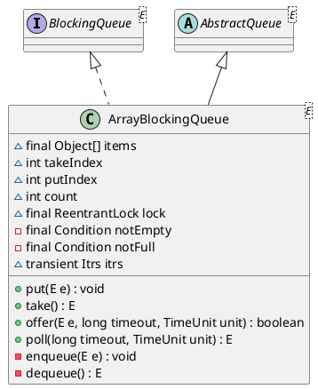

| Field | Role |
|-------|------|
| `items` | ring-buffer array |
| `takeIndex` / `putIndex` | dequeue and enqueue indices |
| `count` | current element count (≤ `items.length`) |
| `lock` | exclusive lock for all structural mutations |
| `notEmpty` / `notFull` | condition variables for consumers and producers |

Non-blocking variants (`offer`, `poll`) acquire the lock once and return immediately when the buffer is full or empty, respectively. `drainTo` transfers multiple elements under a single lock acquisition.

**Condition wait and wake-up.** Every lock-based queue in this part (`ArrayBlockingQueue`, `LinkedBlockingQueue`, `LinkedBlockingDeque`, `PriorityBlockingQueue`, `DelayQueue`, `DelayedWorkQueue`) waits on a `Condition` of its `ReentrantLock`. Two rules of `Condition` shape every queue method below:

1. `await` releases the lock while the thread waits and reacquires it before returning, so the thread that changes the queue state can enter.
2. `signal` only marks one waiter as runnable. The woken thread continues after the signalling thread unlocks, and another thread may take the lock first and consume the change.

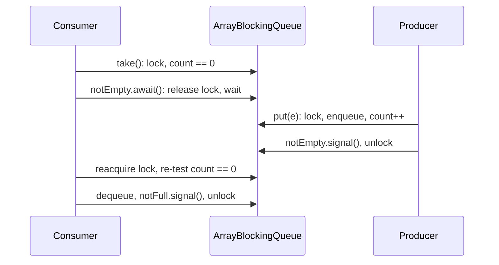

Because of rule 2, every queue re-tests its wait predicate in a `while` loop after `await` returns. Because each insertion adds one element and each removal frees one slot, `signal` (one waiter) suffices instead of `signalAll`. How `Condition` itself is implemented is covered in [Synchronizer Framework](/post/java/concurrency/synchronizer-framework/).

Constructing the lock with the fairness flag (`new ReentrantLock(fair)`) enforces FIFO ordering among contending threads at the expense of throughput.

**Blocking and unblocking.** Waiting happens only in the public methods; waking happens in the private `enqueue` and `dequeue`, which the single-element insertion and removal paths call with the lock held, and in the bulk-removal paths listed in the table below:

```java
// ArrayBlockingQueue.put
public void put(E e) throws InterruptedException {
    Objects.requireNonNull(e);
    final ReentrantLock lock = this.lock;
    lock.lockInterruptibly();
    try {
        while (count == items.length)
            notFull.await();
        enqueue(e);
    } finally {
        lock.unlock();
    }
}

// ArrayBlockingQueue.enqueue
private void enqueue(E e) {
    // assert lock.isHeldByCurrentThread();
    // assert lock.getHoldCount() == 1;
    // assert items[putIndex] == null;
    final Object[] items = this.items;
    items[putIndex] = e;
    if (++putIndex == items.length) putIndex = 0;
    count++;
    notEmpty.signal();
}

// ArrayBlockingQueue.dequeue
private E dequeue() {
    // assert lock.isHeldByCurrentThread();
    // assert lock.getHoldCount() == 1;
    // assert items[takeIndex] != null;
    final Object[] items = this.items;
    @SuppressWarnings("unchecked")
    E e = (E) items[takeIndex];
    items[takeIndex] = null;
    if (++takeIndex == items.length) takeIndex = 0;
    count--;
    if (itrs != null)
        itrs.elementDequeued();
    notFull.signal();
    return e;
}
```

```java
// ArrayBlockingQueue.take
public E take() throws InterruptedException {
    final ReentrantLock lock = this.lock;
    lock.lockInterruptibly();
    try {
        while (count == 0)
            notEmpty.await();
        return dequeue();
    } finally {
        lock.unlock();
    }
}
```

The timed variants replace `await` with `awaitNanos`, which returns the remaining wait time; the loop gives up when that value reaches zero:

```java
// ArrayBlockingQueue.poll
public E poll(long timeout, TimeUnit unit) throws InterruptedException {
    long nanos = unit.toNanos(timeout);
    final ReentrantLock lock = this.lock;
    lock.lockInterruptibly();
    try {
        while (count == 0) {
            if (nanos <= 0L)
                return null;
            nanos = notEmpty.awaitNanos(nanos);
        }
        return dequeue();
    } finally {
        lock.unlock();
    }
}
```

| Thread | Blocks when | Waits on | Woken by |
|--------|-------------|----------|----------|
| producer in `put` / timed `offer` | `count == items.length` | `notFull` | `dequeue()` in `take` and `poll`; `removeAt` (used by `remove(Object)` and iterators); `clear` and `drainTo` signal once per freed slot while `lock.hasWaiters(notFull)` |
| consumer in `take` / timed `poll` | `count == 0` | `notEmpty` | `enqueue()` in `put`, `offer`, `add` |

`enqueue` signals unconditionally, even when no consumer waits; `signal` on an empty condition queue only reads `firstWaiter` and returns. Both conditions belong to the same lock, so a producer and a consumer never run concurrently: the single lock is the throughput limit of this queue. `lockInterruptibly` and the interruptible `await` make every blocking method respond to interruption both while acquiring the lock and while waiting.

**Application profile:** fixed worker pools, explicit back-pressure with a known upper bound (`ThreadPoolExecutor` with a bounded queue), workloads where per-element node allocation is undesirable.

### 2.4 LinkedBlockingDeque

`LinkedBlockingDeque` is an optionally bounded double-ended queue over doubly linked nodes (`first`, `last`, `prev`, `next`). It cannot use the two-lock scheme of `LinkedBlockingQueue`, because operations at both ends may touch the same node when the deque holds zero or one element. It returns to the design of `ArrayBlockingQueue`: one `ReentrantLock` with `notEmpty` and `notFull`. `count` is a `volatile int` written only under the lock; it is volatile so that `pollFirst`, `pollLast` and similar fast paths can return `null` on an empty deque without locking.

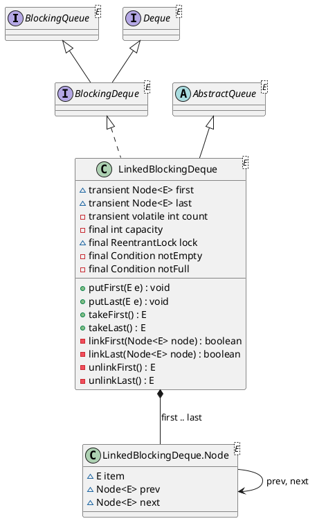

**Blocking and unblocking.** The four primitive link operations make the state change and issue the wake-up; they return `false` or `null` instead of blocking, and the public methods wrap them in wait loops:

```java
// LinkedBlockingDeque.linkFirst
private boolean linkFirst(Node<E> node) {
    // assert lock.isHeldByCurrentThread();
    int c;
    if ((c = count) >= capacity)
        return false;
    Node<E> f = first;
    node.next = f;
    first = node;
    if (last == null)
        last = node;
    else
        f.prev = node;
    count = c + 1;
    notEmpty.signal();
    return true;
}

// LinkedBlockingDeque.unlinkFirst
private E unlinkFirst() {
    // assert lock.isHeldByCurrentThread();
    Node<E> f = first;
    if (f == null)
        return null;
    Node<E> n = f.next;
    E item = f.item;
    f.item = null;
    f.next = f; // help GC
    first = n;
    if (n == null)
        last = null;
    else
        n.prev = null;
    --count;
    notFull.signal();
    return item;
}

// LinkedBlockingDeque.putFirst
public void putFirst(E e) throws InterruptedException {
    if (e == null) throw new NullPointerException();
    Node<E> node = new Node<E>(e);
    final ReentrantLock lock = this.lock;
    lock.lockInterruptibly();
    try {
        while (!linkFirst(node))
            notFull.await();
    } finally {
        lock.unlock();
    }
}

// LinkedBlockingDeque.takeFirst
public E takeFirst() throws InterruptedException {
    final ReentrantLock lock = this.lock;
    lock.lockInterruptibly();
    try {
        E x;
        while ( (x = unlinkFirst()) == null)
            notEmpty.await();
        return x;
    } finally {
        lock.unlock();
    }
}

// LinkedBlockingDeque.put
public void put(E e) throws InterruptedException {
    putLast(e);
}

// LinkedBlockingDeque.take
public E take() throws InterruptedException {
    return takeFirst();
}
```

`linkLast`, `unlinkLast`, `putLast` and `takeLast` are symmetric. As in `PriorityBlockingQueue`, the wait predicate is the primitive itself: `while (!linkFirst(node))` both tests capacity and inserts. Producers at either end share `notFull` and consumers at either end share `notEmpty`, so a `takeLast` wakes a producer waiting in `putFirst`. Bulk operations wake more than one thread: `addAll` calls `notEmpty.signalAll()` after linking a whole chain, and `clear` calls `notFull.signalAll()`.

| Thread | Blocks when | Waits on | Woken by |
|--------|-------------|----------|----------|
| producer in `putFirst` / `putLast` / timed `offerFirst` / `offerLast` | `count >= capacity` | `notFull` | `unlinkFirst`, `unlinkLast`, `unlink` (removal of an inner node); `clear` (`signalAll`) |
| consumer in `takeFirst` / `takeLast` / timed `pollFirst` / `pollLast` | `first == null` (or `last == null`) | `notEmpty` | `linkFirst`, `linkLast`; `addAll` (`signalAll`) |

**Application profile:** work queues that need LIFO access for the owner and FIFO access for others, and pipelines that must re-insert an element at the head after a failed attempt.

### 2.5 PriorityBlockingQueue

A logically unbounded **priority heap** applying the same ordering contract as `PriorityQueue` (`Comparator` or `Comparable`). Insertion never blocks on capacity; `take` waits on `notEmpty` when the heap contains no elements.

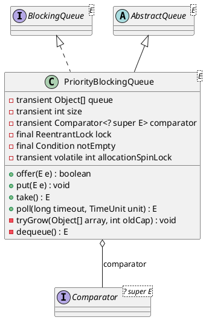

| Field | Role |
|-------|------|
| `queue` | array-backed binary min-heap |
| `size` | element count |
| `lock` | serializes all public operations |
| `notEmpty` | consumer wait set when `size == 0` |
| `allocationSpinLock` | CAS-guarded spinlock for heap expansion without holding `lock` |

Heap growth allocates a replacement array. Performing allocation under the main lock would block all consumers behind resize. A thread requiring expansion therefore acquires `allocationSpinLock` by CAS, copies elements, and releases the spinlock — permitting concurrent `take` operations against the existing array during expansion.

```java
// PriorityBlockingQueue.take
public E take() throws InterruptedException {
    final ReentrantLock lock = this.lock;
    lock.lockInterruptibly();
    E result;
    try {
        while ( (result = dequeue()) == null)   // extract root; sift-down
            notEmpty.await();
    } finally {
        lock.unlock();
    }
    return result;
}
```

**Blocking and unblocking.** Only consumers ever block. The producer side has no wait loop; its only interaction with blocking is the `notEmpty.signal()` after each insertion, and the temporary release of the main lock during resize:

```java
// PriorityBlockingQueue.offer
public boolean offer(E e) {
    if (e == null)
        throw new NullPointerException();
    final ReentrantLock lock = this.lock;
    lock.lock();
    int n, cap;
    Object[] es;
    while ((n = size) >= (cap = (es = queue).length))
        tryGrow(es, cap);
    try {
        final Comparator<? super E> cmp;
        if ((cmp = comparator) == null)
            siftUpComparable(n, e, es);
        else
            siftUpUsingComparator(n, e, es, cmp);
        size = n + 1;
        notEmpty.signal();
    } finally {
        lock.unlock();
    }
    return true;
}

// PriorityBlockingQueue.put
public void put(E e) {
    offer(e); // never need to block
}

// PriorityBlockingQueue.tryGrow
private void tryGrow(Object[] array, int oldCap) {
    lock.unlock(); // must release and then re-acquire main lock
    Object[] newArray = null;
    if (allocationSpinLock == 0 &&
        ALLOCATIONSPINLOCK.compareAndSet(this, 0, 1)) {
        try {
            int growth = (oldCap < 64)
                ? (oldCap + 2) // grow faster if small
                : (oldCap >> 1);
            int newCap = ArraysSupport.newLength(oldCap, 1, growth);
            if (queue == array)
                newArray = new Object[newCap];
        } finally {
            allocationSpinLock = 0;
        }
    }
    if (newArray == null) // back off if another thread is allocating
        Thread.yield();
    lock.lock();
    if (newArray != null && queue == array) {
        queue = newArray;
        System.arraycopy(array, 0, newArray, 0, oldCap);
    }
}

// PriorityBlockingQueue.poll
public E poll(long timeout, TimeUnit unit) throws InterruptedException {
    long nanos = unit.toNanos(timeout);
    final ReentrantLock lock = this.lock;
    lock.lockInterruptibly();
    E result;
    try {
        while ( (result = dequeue()) == null && nanos > 0)
            nanos = notEmpty.awaitNanos(nanos);
    } finally {
        lock.unlock();
    }
    return result;
}
```

| Thread | Blocks when | Waits on | Woken by |
|--------|-------------|----------|----------|
| consumer in `take` / timed `poll` | `dequeue()` returns `null` (heap empty) | `notEmpty` | `offer` (and `put`, `add`, timed `offer`, which delegate to it) |
| producer in `offer` during resize | another thread holds `allocationSpinLock` | nothing; `Thread.yield()` then retry | — |

The wait predicate is `dequeue() == null`, so the same call both tests and removes. `tryGrow` is the subtle part: it is called with the main lock held, releases it, allocates outside the lock, and reacquires it. Consumers blocked in `lock.lockInterruptibly()` or woken from `notEmpty` can therefore run against the old array during allocation. Because the queue may have changed while the lock was released, `offer` re-reads `size` and `queue` in its `while` loop, and `tryGrow` installs the new array only if `queue == array`, that is, if no other thread installed one first. A thread that loses the spinlock race yields instead of spinning so that the allocating thread can finish.

No `notFull` condition exists: `put` and `offer` succeed until memory is exhausted. Iterators are weakly consistent and do not guarantee priority order; ordered bulk removal requires `drainTo` or explicit sorting of extracted elements.

**Application profile:** priority-based task scheduling; event ordering where FIFO tie-breaking among equal priorities is not required (or is supplied via a secondary key, as in the Javadoc `FIFOEntry` example).

### 2.6 SynchronousQueue

`SynchronousQueue` implements a **zero-capacity** handoff channel: no internal buffer exists, not even capacity one. An element is transferred only when a producer and a consumer rendezvous concurrently — equivalent to a CSP rendezvous or Ada entry call. `remainingCapacity()` is always zero; `peek()` always returns `null`.

#### 2.6.1 Structure

All synchronization is delegated to a single **`Transferer`** — a package-private subclass of `LinkedTransferQueue` that adds LIFO transfer (`xferLifo`). The queue itself holds no element array and no `ReentrantLock`; blocking is mediated by **`DualNode`** wait cells and `LockSupport`.

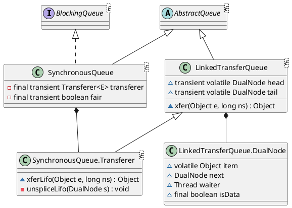

| Component | Role |
|-----------|------|
| `transferer` | owns the dual transfer structure (`head`; `tail` used in FIFO mode) |
| `fair` | `true` → FIFO `xfer`; `false` (default) → LIFO `xferLifo` |
| `DualNode` | one node per waiting `put` or `take`; carries no buffered queue slot |

**`DualNode` fields.**

| Field | Producer node (`put`) | Consumer node (`take`) |
|-------|----------------------|------------------------|
| `isData` | `true` | `false` |
| `item` | element offered; CAS-updated on match | initially `null`; CAS-updated to receive element |
| `next` | link in FIFO list or LIFO stack | same |
| `waiter` | blocked thread until `unpark` | same |

A node is **live** while unmatched and **matched** once `isData` disagrees with whether `item` is non-null:

```java
// LinkedTransferQueue.DualNode.matched
final boolean matched() {
    return isData != (item != null);
}
```

The transfer structure is always in exactly one of three states (Scherer–Scott **dual queue**):

1. **Empty** — no unmatched `DualNode` instances.
2. **Data mode** — one or more unmatched producer nodes (`isData == true`, `item != null`).
3. **Request mode** — one or more unmatched consumer nodes (`isData == false`, `item == null`).

Coordination on the fast path uses `VarHandle` CAS on `head`, `tail`, `next`, and `item`; there is no global mutex.

#### 2.6.2 Unified transfer entry point

Every public operation reduces to **`xfer(Object e, long nanos)`**:

```java
// SynchronousQueue.xfer
private Object xfer(Object e, long nanos) {
    Transferer<E> x = transferer;
    return (fair) ? x.xfer(e, nanos) : x.xferLifo(e, nanos);
}
```

| Argument | Interpretation |
|----------|----------------|
| `e != null` | **producer** transfer (`put` / `offer`); `haveData = true` |
| `e == null` | **consumer** transfer (`take` / `poll`); `haveData = false` |
| `nanos` | `0` — non-blocking (`offer` / `poll`); `Long.MAX_VALUE` — unbounded wait (`put` / `take`); otherwise timed |

**Return-value contract** (from `xfer`):

| Return | Meaning |
|--------|---------|
| `null` | producer handoff complete (`put` succeeded) |
| non-`null` element | consumer received item (`take` succeeded) |
| `e` (same reference passed in) | no match within allotted time, or interrupt during wait |

Public wrappers interpret this contract:

```java
// SynchronousQueue.put — success when xfer returns null
public void put(E e) throws InterruptedException {
    Objects.requireNonNull(e);
    if (!Thread.interrupted()) {
        if (xfer(e, Long.MAX_VALUE) == null)
            return;
        Thread.interrupted(); // failure possible only due to interrupt
    }
    throw new InterruptedException();
}

// SynchronousQueue.take — success when xfer returns non-null
@SuppressWarnings("unchecked")
public E take() throws InterruptedException {
    Object e;
    if (!Thread.interrupted()) {
        if ((e = xfer(null, Long.MAX_VALUE)) != null)
            return (E) e;
        Thread.interrupted();
    }
    throw new InterruptedException();
}
```

#### 2.6.3 `put` mechanism

A `put(e)` invokes `xfer(e, ns)` with `haveData = true`. The transfer loop attempts, in order:

1. **Locate a complementary node** — scan from `head` (LIFO) or `head`/`tail` (FIFO) for an unmatched **request** node (`isData == false`, `item == null`).
2. **Fulfill in place** — on a complementary node `p`, execute `p.cmpExItem(m, e)` (CAS `item` from `null` to `e` on the consumer node, or the symmetric CAS on a data node when the caller is `take`). On success:
   - read the prior value `m` (the element delivered to the consumer, or `null` for a fulfilled `put`);
   - `LockSupport.unpark(p.waiter)`;
   - collapse or advance `head` / pop the stack;
   - return `null` (producer done — element handed off without allocating a producer node).
3. **Enqueue and block** — if no complementary node exists and `ns > 0`, allocate `new DualNode(e, true)`, append (FIFO) or push (LIFO), then `await(e, ns, …)` until a consumer matches or the wait is cancelled.
4. **Immediate failure** — if `ns == 0` (`offer`) and no matcher is present, return `e` without waiting.

For a **blocking `put` with no waiting consumer**, the producer thread parks on its own data node until a `take` performs step 2 against that node.

#### 2.6.4 `take` mechanism

A `take()` invokes `xfer(null, ns)` with `haveData = false`. The protocol is symmetric to `put`:

1. **Locate a complementary node** — scan for an unmatched **data** node (`isData == true`, `item != null`).
2. **Fulfill in place** — `p.cmpExItem(m, null)` CASes the element out of the producer node (`m` is the transferred item). On success, `unpark(p.waiter)` and return `m` to the consumer.
3. **Enqueue and block** — allocate `new DualNode(null, false)` (request node), link it, and `await(null, ns, …)` until a `put` supplies an element via CAS.
4. **Immediate failure** — `poll()` with `ns == 0` returns `null` when no producer is waiting.

A matched **request** node ends with `item != null` (element received); a matched **data** node ends with `item == null` (element taken). In both cases `matched()` becomes true and the node is eventually unspliced from the structure.

#### 2.6.5 FIFO vs LIFO traversal

| Policy | Method | Linking | Match order |
|--------|--------|---------|-------------|
| Non-fair (default) | `xferLifo` | push at `head` (stack) | most recently arrived waiter |
| Fair | `xfer` | append at `tail` (slack list) | oldest arrived waiter |

Both variants share the same complementary-match logic (`cmpExItem`, `unpark`, `matched`); they differ only in how unmatched nodes are ordered when no peer is available.

#### 2.6.6 Waiting, cancellation, and visibility

An unmatched node blocks in **`DualNode.await`**: brief spin (`Thread.onSpinWait`), then `LockSupport.park` / `parkNanos`, or `ForkJoinPool.managedBlock` on a `ForkJoinWorkerThread`. The waiter publishes itself in `node.waiter` before parking.

Cancellation (timeout or interrupt) attempts an impossible `cmpExItem` to mark the node matched, then **`unsplice`** / **`unspliceLifo`** removes it from the structure so cancelled waiters do not block subsequent transfers.

#### 2.6.7 Blocking and unblocking in code

No lock and no `Condition` are involved. A thread blocks by parking on its own `DualNode`, and the thread that matches the node wakes it with `LockSupport.unpark(node.waiter)`. The default non-fair path is `Transferer.xferLifo`:

```java
// SynchronousQueue.Transferer.xferLifo
final Object xferLifo(Object e, long ns) {
    boolean haveData = (e != null);
    Object m;                              // the match or e if none
    outer: for (DualNode s = null, p = head;;) {
        while (p != null) {
            boolean isData; DualNode n, u; // help collapse
            if ((isData = p.isData) != ((m = p.item) != null))
                p = (p == (u = cmpExHead(p, (n = p.next)))) ? n : u;
            else if (isData == haveData)   // same mode; push below
                break;
            else if (p.cmpExItem(m, e) != m)
                p = head;                  // missed; restart
            else {                         // matched complementary node
                Thread w = p.waiter;
                cmpExHead(p, p.next);
                LockSupport.unpark(w);
                break outer;
            }
        }
        if (ns == 0L) {                    // no match, no wait
            m = e;
            break;
        }
        if (s == null)                     // try to push node and wait
            s = new DualNode(e, haveData);
        s.next = p;
        if (p == (p = cmpExHead(p, s))) {
            if ((m = s.await(e, ns, this,  // spin if (nearly) empty
                             p == null || p.waiter == null)) == e)
                unspliceLifo(s);           // cancelled
            else if (m != null)
                s.selfLinkItem();
            break;
        }
    }
    return m;
}
```

The **unblocking** side is the `else` branch of the inner loop. The arriving thread finds a complementary node at the top of the stack, CASes its `item` (inserting `e` for a `put`, or taking the element by writing `null` for a `take`), pops the node and unparks its waiter. The CAS is the single linearization point of the hand-off: exactly one of several racing threads can match a given node; the losers restart from the new `head`. Already matched or cancelled nodes found at the top are popped on the way (`help collapse`).

The **blocking** side is the tail of the outer loop: when the top node has the same mode or the stack is empty, the thread pushes its own node with a CAS on `head` and calls `DualNode.await`:

```java
// LinkedTransferQueue.DualNode.await
final Object await(Object e, long ns, Object blocker, boolean spin) {
    Object m;                      // the match or e if none
    boolean timed = (ns != Long.MAX_VALUE);
    long deadline = (timed) ? System.nanoTime() + ns : 0L;
    boolean upc = isUniprocessor;  // don't spin but later recheck
    Thread w = Thread.currentThread();
    if (spin && ForkJoinWorkerThread.hasKnownQueuedWork())
        spin = false;              // don't spin
    int spins = (spin & !upc) ? SPINS : 0; // negative when may park
    while ((m = item) == e) {
        if (spins >= 0) {
            if (--spins >= 0)
                Thread.onSpinWait();
            else {                 // prepare to park
                if (spin)          // occasionally recheck
                    checkForUniprocessor(upc);
                LockSupport.setCurrentBlocker(blocker);
                waiter = w;        // ensure ordering
                VarHandle.fullFence();
            }
        } else if (w.isInterrupted() ||
                   (timed &&       // try to cancel with impossible match
                    ((ns = deadline - System.nanoTime()) <= 0L))) {
            m = cmpExItem(e, (e == null) ? this : null);
            break;
        } else if (timed) {
            if (ns < SPIN_FOR_TIMEOUT_THRESHOLD)
                Thread.onSpinWait();
            else
                LockSupport.parkNanos(ns);
        } else if (w instanceof ForkJoinWorkerThread) {
            try {
                ForkJoinPool.managedBlock(this);
            } catch (InterruptedException cannotHappen) { }
        } else
            LockSupport.park();
    }
    if (spins < 0) {
        LockSupport.setCurrentBlocker(null);
        waiter = null;
    }
    return m;
}
```

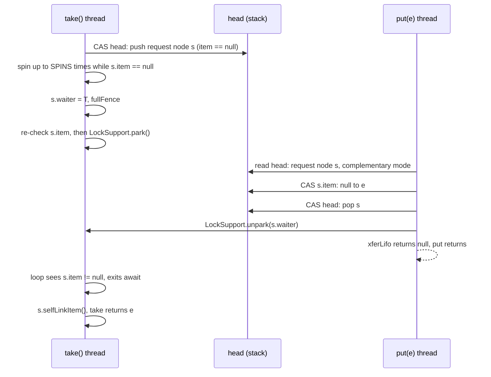

The waiting protocol avoids a **lost wake-up** without a lock:

1. **Spin first.** A waiter near the top of the stack (`p == null || p.waiter == null`, meaning its predecessor is not parked) spins up to `SPINS` (128) iterations, because a partner is likely to arrive within microseconds. Spinning is disabled on a uniprocessor and on a `ForkJoinWorkerThread` that has queued work.
2. **Publish, fence, re-check.** Before parking, the waiter stores itself in `waiter` and issues a full fence. The matching thread writes `item` by CAS and then reads `waiter`. Either the matcher sees the waiter and unparks it, or the waiter's next loop test sees the new `item` and never parks. `unpark` before `park` is also harmless, because the permit makes the following `park` return immediately.
3. **Loop on the item, not on the wake-up.** `park` may return spuriously, so the loop exits only when `item` differs from the original value `e`.
4. **Cancel by impossible match.** On interrupt or timeout, the waiter CASes its own `item` to a value no partner would write: itself for a request node, `null` for a data node. If that CAS succeeds, `await` returns `e`, the caller unsplices the node, and the public method reports failure or throws `InterruptedException`. If the CAS fails, a partner matched first and the transfer counts as successful even though the thread was interrupted.
5. **Fork/join awareness.** An untimed waiter on a `ForkJoinWorkerThread` blocks through `ForkJoinPool.managedBlock`, which lets the pool activate a compensating worker while this one is blocked.

After a successful match, a consumer's node holds the received element; `selfLinkItem` replaces it with a self-reference so the node, which may still be reachable from stale pointers, does not retain the element.

**Application profile:** `Executors.newCachedThreadPool()` uses a non-fair `SynchronousQueue` as the handoff point between submitting threads and worker threads — each task is transferred directly without queuing, and the pool may create a new worker when no idle consumer is available.

### 2.7 DelayQueue

`DelayQueue<E extends Delayed>` delegates storage to a **`PriorityQueue`** ordered by `Delayed.getDelay()`. Only elements whose delay has elapsed (≤ 0) are eligible for removal. Insertion is unbounded and non-blocking (`put` delegates to `offer`).

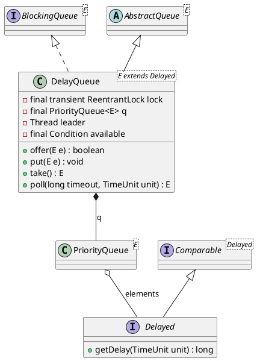

Blocking retrieval employs a **leader–follower** protocol to limit concurrent timed waits:

```java
// DelayQueue.take (wait loop)
for (;;) {
    E first = q.peek();
    if (first == null)
        available.await();
    else {
        long delay = first.getDelay(NANOSECONDS);
        if (delay <= 0L)
            return q.poll();
        first = null;
        if (leader != null)
            available.await();           // follower: indefinite wait
        else {
            Thread thisThread = Thread.currentThread();
            leader = thisThread;
            try {
                available.awaitNanos(delay);  // leader: timed wait until expiration
            } finally {
                if (leader == thisThread)
                    leader = null;
            }
        }
    }
}
```

Exactly one thread (the **leader**) executes a timed wait corresponding to the head element's remaining delay. Remaining threads await on `available` without independent timers. Insertion of an element with an earlier expiration invalidates the leader and signals waiters. `ScheduledThreadPoolExecutor` employs an analogous internal `DelayedWorkQueue` for scheduled task dispatch.

**Blocking and unblocking.** The complete `take` adds a `finally` block to the loop shown above, and `offer` contains the only external wake-up:

```java
// DelayQueue.offer
public boolean offer(E e) {
    final ReentrantLock lock = this.lock;
    lock.lock();
    try {
        q.offer(e);
        if (q.peek() == e) {
            leader = null;
            available.signal();
        }
        return true;
    } finally {
        lock.unlock();
    }
}

// DelayQueue.take
public E take() throws InterruptedException {
    final ReentrantLock lock = this.lock;
    lock.lockInterruptibly();
    try {
        for (;;) {
            E first = q.peek();
            if (first == null)
                available.await();
            else {
                long delay = first.getDelay(NANOSECONDS);
                if (delay <= 0L)
                    return q.poll();
                first = null; // don't retain ref while waiting
                if (leader != null)
                    available.await();
                else {
                    Thread thisThread = Thread.currentThread();
                    leader = thisThread;
                    try {
                        available.awaitNanos(delay);
                    } finally {
                        if (leader == thisThread)
                            leader = null;
                    }
                }
            }
        }
    } finally {
        if (leader == null && q.peek() != null)
            available.signal();
        lock.unlock();
    }
}
```

All waiters share one condition, `available`, but wait in two different ways:

| Waiter | Condition | Wait | Woken by |
|--------|-----------|------|----------|
| any consumer, queue empty | `q.peek() == null` | `available.await()` | `offer` of the first element (it becomes the head) |
| follower, head not yet expired | `leader != null` | `available.await()`, untimed | `offer` of a new head, or the `finally` hand-off of a returning consumer |
| leader, head not yet expired | `leader == null`, becomes leader | `available.awaitNanos(delay)` | its own timeout when the head expires, or `offer` of a new head |

The three wake-up paths are:

1. **Expiry.** The leader's `awaitNanos(delay)` times out exactly when the head expires. The leader clears `leader`, loops, sees `delay <= 0` and polls the head.
2. **Earlier head.** `offer` signals only if the new element became the head, because only then is the leader's timer too long. It resets `leader = null` first, so the woken thread, which may be the old leader or a follower, re-runs the loop and becomes the new leader with the shorter delay.
3. **Hand-off.** The `finally` block of `take` runs when a consumer returns an element or is interrupted. If no leader exists and elements remain, it signals one follower, which becomes the next leader for the new head. Without this signal, the followers would wait forever because nobody holds a timer for the new head.

Insertion never waits: `put` and timed `offer` delegate to `offer`. `first = null` before waiting drops the reference to the head, so that a waiting thread does not keep an element alive after another thread removed it.

**Application profile:** deferred execution, timeout management, and the scheduling substrate of `ScheduledExecutorService`.

### 2.8 LinkedTransferQueue

`LinkedTransferQueue` is an unbounded FIFO queue built on the same `DualNode` dual structure as `SynchronousQueue` (section 2.6), but it may also store elements. A node in the list is either a data node (an element waiting for a consumer) or a request node (a consumer waiting for an element), never a mix. The `ns` argument of `xfer` selects whether, and how long, the caller waits:

| `ns` | Callers | Behavior when no complementary node exists |
|------|---------|--------------------------------------------|
| `-1` (async) | `put`, `offer`, `add`, timed `offer` | append a data node and return immediately; the producer never blocks |
| `0` (immediate) | `poll()`, `tryTransfer(e)` | return without appending |
| `> 0` (timed) | `poll(timeout, unit)`, `tryTransfer(e, timeout, unit)` | append a node and wait up to `ns` |
| `Long.MAX_VALUE` (sync) | `take`, `transfer` | append a node and wait until matched or interrupted |

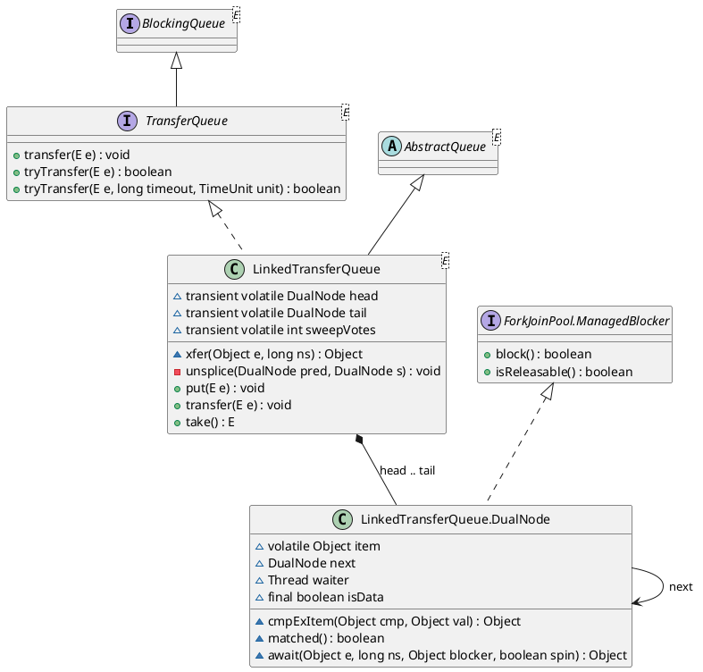

```java
// LinkedTransferQueue.xfer
final Object xfer(Object e, long ns) {
    boolean haveData = (e != null);
    Object m;                           // the match or e if none
    DualNode s = null, p;               // enqueued node and its predecessor
    restart: for (DualNode prevp = null;;) {
        DualNode h, t, q;
        if ((h = head) == null &&       // initialize unless immediate
            (ns == 0L ||
             (h = cmpExHead(null, s = new DualNode(e, haveData))) == null)) {
            p = null;                   // no predecessor
            break;                      // else lost init race
        }
        p = (t = tail) != null && t.isData == haveData && t != prevp ? t : h;
        prevp = p;                      // avoid known self-linked tail path
        do {
            m = p.item;
            q = p.next;
            if (p.isData != haveData && haveData != (m != null)) {
                if (p.cmpExItem(m, e) == m) {
                    Thread w = p.waiter; // matched complementary node
                    if (p != h && h == cmpExHead(h, (q == null) ? p : q))
                        h.next = h;     // advance head; self-link old
                    LockSupport.unpark(w);
                    return m;
                }
                continue restart;
            } else if (q == null) {
                if (ns == 0L)           // try to append unless immediate
                    break restart;
                if (s == null)
                    s = new DualNode(e, haveData);
                if ((q = p.cmpExNext(null, s)) == null) {
                    if (p != t)
                        cmpExTail(t, s);
                    break restart;
                }
            }
        } while (p != (p = q));         // restart if self-linked
    }
    if (s == null || ns <= 0L)
        m = e;                          // don't wait
    else if ((m = s.await(e, ns, this,  // spin if at or near head
                          p == null || p.waiter == null)) == e)
        unsplice(p, s);                 // cancelled
    else if (m != null)
        s.selfLinkItem();

    return m;
}

// LinkedTransferQueue.put
public void put(E e) {
    Objects.requireNonNull(e);
    xfer(e, -1L);
}

// LinkedTransferQueue.transfer
public void transfer(E e) throws InterruptedException {
    Objects.requireNonNull(e);
    if (!Thread.interrupted()) {
        if (xfer(e, Long.MAX_VALUE) == null)
            return;
        Thread.interrupted(); // failure possible only due to interrupt
    }
    throw new InterruptedException();
}

// LinkedTransferQueue.take
@SuppressWarnings("unchecked")
public E take() throws InterruptedException {
    Object e;
    if (!Thread.interrupted()) {
        if ((e = xfer(null, Long.MAX_VALUE)) != null)
            return (E) e;
        Thread.interrupted();
    }
    throw new InterruptedException();
}
```

The unblocking path is the match branch: the arriving thread CASes the `item` of the first complementary node, advances `head` past it, and unparks the node's `waiter`. The blocking path is the append branch followed by `s.await`, the same spin-then-park protocol described in section 2.6.7. Traversal starts at `tail` when the tail has the caller's mode (a likely append) and at `head` otherwise (a likely match).

| Thread | Blocks when | Woken by |
|--------|-------------|----------|
| consumer in `take` / timed `poll` | no data node in the list | a producer's `xfer` matching its request node: `put`, `offer`, `transfer`, `tryTransfer` |
| producer in `transfer` / timed `tryTransfer` | no request node in the list | a consumer's `xfer` matching its data node: `take`, `poll` |
| producer in `put` / `offer` | never | — |

Because `put` never blocks, a `LinkedTransferQueue` used only through the `BlockingQueue` methods behaves like an unbounded `LinkedBlockingQueue` without locks. `transfer` adds the `SynchronousQueue` guarantee on demand: the producer returns only after a consumer has received its element.

**Application profile:** message passing in which some producers must know that their element has been consumed, and lock-free unbounded hand-off between threads.

### 2.9 DelayedWorkQueue

`ScheduledThreadPoolExecutor.DelayedWorkQueue` combines the heap of `PriorityBlockingQueue` with the leader–follower wait of `DelayQueue`, specialized for `RunnableScheduledFuture`. Each `ScheduledFutureTask` stores its `heapIndex`, so `remove` on cancellation runs in O(log n). Section 3.10 describes how the executor uses it; this section covers only blocking.

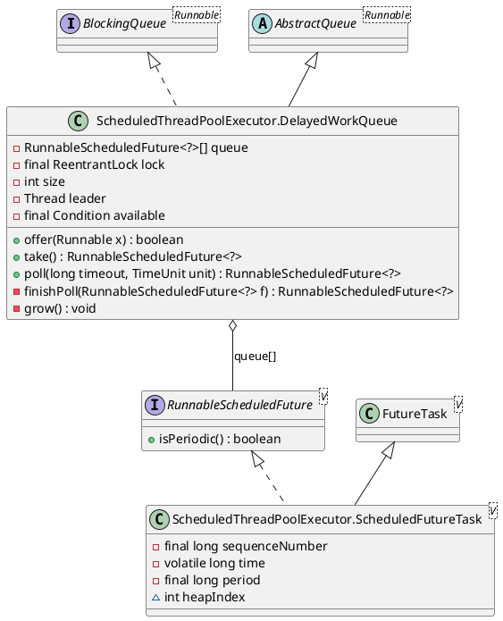

```java
// ScheduledThreadPoolExecutor.DelayedWorkQueue.offer
public boolean offer(Runnable x) {
    if (x == null)
        throw new NullPointerException();
    RunnableScheduledFuture<?> e = (RunnableScheduledFuture<?>)x;
    final ReentrantLock lock = this.lock;
    lock.lock();
    try {
        int i = size;
        if (i >= queue.length)
            grow();
        size = i + 1;
        if (i == 0) {
            queue[0] = e;
            setIndex(e, 0);
        } else {
            siftUp(i, e);
        }
        if (queue[0] == e) {
            leader = null;
            available.signal();
        }
    } finally {
        lock.unlock();
    }
    return true;
}

// ScheduledThreadPoolExecutor.DelayedWorkQueue.finishPoll
private RunnableScheduledFuture<?> finishPoll(RunnableScheduledFuture<?> f) {
    int s = --size;
    RunnableScheduledFuture<?> x = queue[s];
    queue[s] = null;
    if (s != 0)
        siftDown(0, x);
    setIndex(f, -1);
    return f;
}

// ScheduledThreadPoolExecutor.DelayedWorkQueue.take
public RunnableScheduledFuture<?> take() throws InterruptedException {
    final ReentrantLock lock = this.lock;
    lock.lockInterruptibly();
    try {
        for (;;) {
            RunnableScheduledFuture<?> first = queue[0];
            if (first == null)
                available.await();
            else {
                long delay = first.getDelay(NANOSECONDS);
                if (delay <= 0L)
                    return finishPoll(first);
                first = null; // don't retain ref while waiting
                if (leader != null)
                    available.await();
                else {
                    Thread thisThread = Thread.currentThread();
                    leader = thisThread;
                    try {
                        available.awaitNanos(delay);
                    } finally {
                        if (leader == thisThread)
                            leader = null;
                    }
                }
            }
        }
    } finally {
        if (leader == null && queue[0] != null)
            available.signal();
        lock.unlock();
    }
}
```

The wait and wake-up rules are those of `DelayQueue`: one leader sleeps with `awaitNanos(delay)` until the earliest task is due, followers sleep untimed, `offer` of a new earliest task resets the leader and signals, and a returning `take` hands leadership on in `finally`. Two differences matter for the pool:

- **Growth under the lock.** `grow()` copies the array while holding the lock. Unlike `PriorityBlockingQueue.tryGrow`, it does not release the lock, so consumers wait during the copy; the queue size of a scheduler is normally small.
- **Timed poll for idle workers.** Workers above the core size, or all workers when `allowCoreThreadTimeOut` is set, call `poll(keepAliveTime, NANOSECONDS)`. The timed `poll` waits for the shorter of its own timeout and the head delay, and becomes leader only when the head is due before its own timeout (`nanos >= delay` and no leader):

```java
// ScheduledThreadPoolExecutor.DelayedWorkQueue.poll
public RunnableScheduledFuture<?> poll(long timeout, TimeUnit unit)
    throws InterruptedException {
    long nanos = unit.toNanos(timeout);
    final ReentrantLock lock = this.lock;
    lock.lockInterruptibly();
    try {
        for (;;) {
            RunnableScheduledFuture<?> first = queue[0];
            if (first == null) {
                if (nanos <= 0L)
                    return null;
                else
                    nanos = available.awaitNanos(nanos);
            } else {
                long delay = first.getDelay(NANOSECONDS);
                if (delay <= 0L)
                    return finishPoll(first);
                if (nanos <= 0L)
                    return null;
                first = null; // don't retain ref while waiting
                if (nanos < delay || leader != null)
                    nanos = available.awaitNanos(nanos);
                else {
                    Thread thisThread = Thread.currentThread();
                    leader = thisThread;
                    try {
                        long timeLeft = available.awaitNanos(delay);
                        nanos -= delay - timeLeft;
                    } finally {
                        if (leader == thisThread)
                            leader = null;
                    }
                }
            }
        }
    } finally {
        if (leader == null && queue[0] != null)
            available.signal();
        lock.unlock();
    }
}
```

### 2.10 Selection criteria

| Requirement | Implementation |
|-------------|----------------|
| Fixed capacity; minimal allocation overhead | `ArrayBlockingQueue` |
| High concurrency; multiple producers and consumers | `LinkedBlockingQueue` |
| Priority-ordered dispatch | `PriorityBlockingQueue` |
| Synchronous handoff without buffering | `SynchronousQueue` |
| Time-based deferral | `DelayQueue` |
| FIFO ordering among blocked waiters | `ArrayBlockingQueue(fair)` or `SynchronousQueue(fair)` |
| Insertion and removal at both ends | `LinkedBlockingDeque` |
| Unbounded lock-free queue; optional wait until consumed | `LinkedTransferQueue` |

The implementations block and unblock in one of two ways:

| Mechanism | Queues | Block | Unblock |
|-----------|--------|-------|---------|
| lock and condition | `ArrayBlockingQueue`, `LinkedBlockingQueue`, `LinkedBlockingDeque`, `PriorityBlockingQueue`, `DelayQueue`, `DelayedWorkQueue` | `Condition.await` / `awaitNanos` in a `while` loop over the wait predicate, releasing the lock | `Condition.signal` by the thread that changed the state, while holding the same lock |
| dual node and park | `SynchronousQueue`, `LinkedTransferQueue` | append or push an own `DualNode`, spin, publish `waiter`, `LockSupport.park` while `item` is unchanged | CAS on the waiter's `item`, then `LockSupport.unpark(waiter)` |

With the exception of `SynchronousQueue` and `LinkedTransferQueue`, standard implementations coordinate blocking through `ReentrantLock` and `Condition`. `SynchronousQueue` and `LinkedTransferQueue` pair producers and consumers via CAS-based dual structures and park unmatched threads with `LockSupport`. The synchronization model of each implementation directly governs its latency distribution, fairness properties, and memory characteristics under contention.

---

## 3. Part 2 — Thread pool

### 3.1 Executor hierarchy

`Executor` defines the single method `execute(Runnable)`. `ExecutorService` adds lifecycle (`shutdown`, `shutdownNow`, `awaitTermination`) and result-bearing submission (`submit`, `invokeAll`, `invokeAny`). `AbstractExecutorService` implements `submit` by wrapping the task with `newTaskFor` into a `FutureTask` and passing it to `execute`, so a concrete pool only has to implement `execute` and the lifecycle methods.

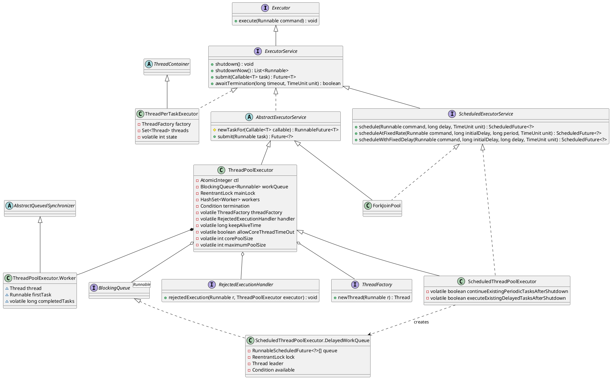

| Type | Role |
|------|------|
| `ThreadPoolExecutor` | Owns the work queue and the set of `Worker` objects. `ctl` packs the run state and the worker count; `mainLock` guards `workers` and the statistics. |
| `Worker` | Wraps one pool thread and its optional first task. It extends `AbstractQueuedSynchronizer` to provide a non-reentrant lock that is held while a task runs. |
| `RejectedExecutionHandler` | Receives tasks that `execute` cannot accept. |
| `ThreadFactory` | Creates the thread of each `Worker`; the default comes from `Executors.defaultThreadFactory()`. |
| `ScheduledThreadPoolExecutor` | A `ThreadPoolExecutor` whose constructor always installs a `DelayedWorkQueue` and whose tasks are `ScheduledFutureTask` objects. |
| `ForkJoinPool` | Work-stealing pool; in the current JDK it also implements `ScheduledExecutorService`. |
| `ThreadPerTaskExecutor` | Starts one thread per task and tracks live threads in a concurrent set; it does not extend `AbstractExecutorService`. |

### 3.2 Pool parameters

The full `ThreadPoolExecutor` constructor exposes every policy of the pool:

```java
// ThreadPoolExecutor.ThreadPoolExecutor
public ThreadPoolExecutor(int corePoolSize,
                          int maximumPoolSize,
                          long keepAliveTime,
                          TimeUnit unit,
                          BlockingQueue<Runnable> workQueue,
                          ThreadFactory threadFactory,
                          RejectedExecutionHandler handler) {
    if (corePoolSize < 0) {
        throw new IllegalArgumentException("corePoolSize must be non-negative");
    } else if (maximumPoolSize <= 0) {
        throw new IllegalArgumentException("maximumPoolSize must be positive");
    } else if (maximumPoolSize < corePoolSize) {
        throw new IllegalArgumentException("maximumPoolSize must be greater than or equal to corePoolSize");
    } else if (keepAliveTime < 0) {
        throw new IllegalArgumentException("keepAliveTime must be non-negative");
    }
    Objects.requireNonNull(unit, "unit");
    Objects.requireNonNull(workQueue, "workQueue");
    Objects.requireNonNull(threadFactory, "threadFactory");
    Objects.requireNonNull(handler, "handler");
    this.corePoolSize = corePoolSize;
    this.maximumPoolSize = maximumPoolSize;
    this.workQueue = workQueue;
    this.keepAliveTime = unit.toNanos(keepAliveTime);
    this.threadFactory = threadFactory;
    this.handler = handler;

    String name = Objects.toIdentityString(this);
    this.container = SharedThreadContainer.create(name);
}
```

| Parameter | Meaning |
|-----------|---------|
| `corePoolSize` | Number of workers that `execute` creates before it starts queuing. Core workers wait with `take()` and do not expire unless `allowCoreThreadTimeOut(true)` is set. |
| `maximumPoolSize` | Upper bound on workers. Workers above the core size are created only when the queue refuses a task. |
| `keepAliveTime`, `unit` | How long a worker that is subject to expiry waits in `poll` before it exits. Stored in nanoseconds. |
| `workQueue` | The `BlockingQueue` that holds tasks between submission and execution. |
| `threadFactory` | Creates worker threads. |
| `handler` | Rejection policy; the shorter constructors use `AbortPolicy`. |

No worker exists after construction. Workers are created lazily by `execute`, or eagerly by `prestartCoreThread` and `prestartAllCoreThreads`.

### 3.3 Control state

`ThreadPoolExecutor` stores two values in one `AtomicInteger`: the high 3 bits hold the run state and the low 29 bits hold the worker count. A single CAS can therefore check the state and change the count together.

```java
// ThreadPoolExecutor fields
private final AtomicInteger ctl = new AtomicInteger(ctlOf(RUNNING, 0));
private static final int COUNT_BITS = Integer.SIZE - 3;
private static final int COUNT_MASK = (1 << COUNT_BITS) - 1;

// runState is stored in the high-order bits
private static final int RUNNING    = -1 << COUNT_BITS;
private static final int SHUTDOWN   =  0 << COUNT_BITS;
private static final int STOP       =  1 << COUNT_BITS;
private static final int TIDYING    =  2 << COUNT_BITS;
private static final int TERMINATED =  3 << COUNT_BITS;

// Packing and unpacking ctl
private static int runStateOf(int c)     { return c & ~COUNT_MASK; }
private static int workerCountOf(int c)  { return c & COUNT_MASK; }
private static int ctlOf(int rs, int wc) { return rs | wc; }
```

`RUNNING` is negative and the other states are increasing non-negative values, so state comparisons are plain integer comparisons: `isRunning(c)` is `c < SHUTDOWN`, and `runStateAtLeast(c, s)` is `c >= s`. The worker count is limited to `COUNT_MASK` (2^29 − 1), which is why `addWorker` masks `maximumPoolSize` with `COUNT_MASK`.

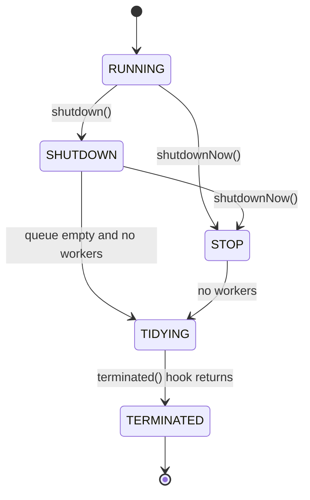

| State | New tasks | Queued tasks | Running tasks |
|-------|-----------|--------------|---------------|
| `RUNNING` | accepted | processed | run |
| `SHUTDOWN` | rejected | processed | run to completion |
| `STOP` | rejected | drained and returned by `shutdownNow` | interrupted |
| `TIDYING` | rejected | none | none; `terminated()` is running |
| `TERMINATED` | rejected | none | none; `awaitTermination` returns |

### 3.4 Task admission

`execute` decides, in three steps, whether a task starts a new worker, enters the queue, or is rejected:

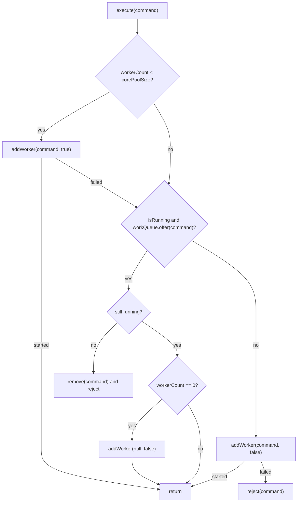

```java
// ThreadPoolExecutor.execute
public void execute(Runnable command) {
    Objects.requireNonNull(command, "command");
    int c = ctl.get();
    if (workerCountOf(c) < corePoolSize) {
        if (addWorker(command, true))
            return;
        c = ctl.get();
    }
    if (isRunning(c) && workQueue.offer(command)) {
        int recheck = ctl.get();
        if (! isRunning(recheck) && remove(command))
            reject(command);
        else if (workerCountOf(recheck) == 0)
            addWorker(null, false);
    }
    else if (!addWorker(command, false))
        reject(command);
}
```

1. **Below core size** — start a worker whose first task is `command`. The task does not pass through the queue.
2. **Queue** — offer the task with the non-blocking `offer`. After a successful offer, the state is checked again: if the pool shut down in the meantime, the task is removed and rejected; if every worker has died, a worker without a first task is started so the queued task is not stranded.
3. **Above core size** — if `offer` failed, start a non-core worker with `command` as first task. If that fails because `maximumPoolSize` is reached or the pool is shut down, reject.

Because step 2 uses `offer`, the queue type decides when step 3 happens. An unbounded `LinkedBlockingQueue` never refuses, so the pool never grows beyond `corePoolSize` and `maximumPoolSize` has no effect. A `SynchronousQueue` refuses whenever no idle worker is waiting in `poll` or `take`, so every task that finds no idle worker creates a thread. A bounded `ArrayBlockingQueue` refuses only when full.

### 3.5 Worker creation

`addWorker` first reserves a slot in the worker count with CAS, then creates and starts the thread:

```java
// ThreadPoolExecutor.addWorker
private boolean addWorker(Runnable firstTask, boolean core) {
    retry:
    for (int c = ctl.get();;) {
        // Check if queue empty only if necessary.
        if (runStateAtLeast(c, SHUTDOWN)
            && (runStateAtLeast(c, STOP)
                || firstTask != null
                || workQueue.isEmpty()))
            return false;

        for (;;) {
            if (workerCountOf(c)
                >= ((core ? corePoolSize : maximumPoolSize) & COUNT_MASK))
                return false;
            if (compareAndIncrementWorkerCount(c))
                break retry;
            c = ctl.get();  // Re-read ctl
            if (runStateAtLeast(c, SHUTDOWN))
                continue retry;
            // else CAS failed due to workerCount change; retry inner loop
        }
    }

    boolean workerStarted = false;
    boolean workerAdded = false;
    Worker w = null;
    try {
        w = new Worker(firstTask);
        final Thread t = w.thread;
        if (t != null) {
            final ReentrantLock mainLock = this.mainLock;
            mainLock.lock();
            try {
                // Recheck while holding lock.
                // Back out on ThreadFactory failure or if
                // shut down before lock acquired.
                int c = ctl.get();

                if (isRunning(c) ||
                    (runStateLessThan(c, STOP) && firstTask == null)) {
                    if (t.getState() != Thread.State.NEW)
                        throw new IllegalThreadStateException();
                    workers.add(w);
                    workerAdded = true;
                    int s = workers.size();
                    if (s > largestPoolSize)
                        largestPoolSize = s;
                }
            } finally {
                mainLock.unlock();
            }
            if (workerAdded) {
                container.start(t);
                workerStarted = true;
            }
        }
    } finally {
        if (! workerStarted)
            addWorkerFailed(w);
    }
    return workerStarted;
}
```

The first loop admits a worker in `SHUTDOWN` only when it has no first task and the queue is non-empty; such a worker helps drain the queue. The second phase re-checks the state under `mainLock`, because `shutdown` takes the same lock. If the thread factory returns `null`, throws, or the state changed, `addWorkerFailed` removes the worker, decrements the count and calls `tryTerminate`.

`Worker` is both the `Runnable` of its thread and a lock:

```java
// ThreadPoolExecutor.Worker.Worker
Worker(Runnable firstTask) {
    setState(-1); // inhibit interrupts until runWorker
    this.firstTask = firstTask;
    this.thread = getThreadFactory().newThread(this);
}

// ThreadPoolExecutor.Worker.run
public void run() {
    runWorker(this);
}

// ThreadPoolExecutor.Worker.tryAcquire
protected boolean tryAcquire(int unused) {
    if (compareAndSetState(0, 1)) {
        setExclusiveOwnerThread(Thread.currentThread());
        return true;
    }
    return false;
}
```

The lock state means: −1 before the thread starts, 0 while idle, 1 while running a task. It is deliberately non-reentrant. `interruptIdleWorkers` interrupts a worker only if `w.tryLock()` succeeds, so `shutdown` and pool reconfiguration wake idle workers blocked in the queue but never interrupt a running task, even if that task itself calls a method such as `setCorePoolSize` that tries to lock workers.

### 3.6 Worker loop

Each worker thread runs `runWorker`, which keeps taking tasks from `getTask` until it returns `null`:

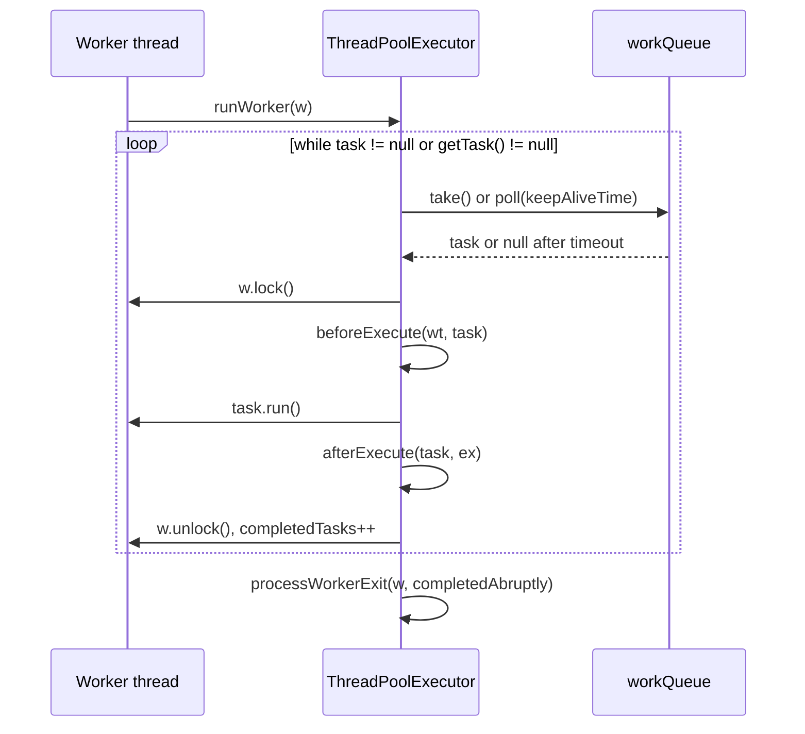

```java
// ThreadPoolExecutor.runWorker
final void runWorker(Worker w) {
    Thread wt = Thread.currentThread();
    Runnable task = w.firstTask;
    w.firstTask = null;
    w.unlock(); // allow interrupts
    boolean completedAbruptly = true;
    try {
        while (task != null || (task = getTask()) != null) {
            w.lock();
            // If pool is stopping, ensure thread is interrupted;
            // if not, ensure thread is not interrupted.  This
            // requires a recheck in second case to deal with
            // shutdownNow race while clearing interrupt
            if ((runStateAtLeast(ctl.get(), STOP) ||
                 (Thread.interrupted() &&
                  runStateAtLeast(ctl.get(), STOP))) &&
                !wt.isInterrupted())
                wt.interrupt();
            try {
                beforeExecute(wt, task);
                try {
                    task.run();
                    afterExecute(task, null);
                } catch (Throwable ex) {
                    afterExecute(task, ex);
                    throw ex;
                }
            } finally {
                task = null;
                w.completedTasks++;
                w.unlock();
            }
        }
        completedAbruptly = false;
    } finally {
        processWorkerExit(w, completedAbruptly);
    }
}
```

Before each task the worker clears a stale interrupt left by an idle-worker wake-up, unless the pool is in `STOP`, in which case it makes sure the interrupt is set. An exception thrown by the task is passed to `afterExecute` and then rethrown, which ends the loop with `completedAbruptly == true`; the thread dies and `processWorkerExit` replaces it. Tasks submitted through `submit` are `FutureTask` objects that capture the exception in the future, so they do not end the worker.

`getTask` is where the blocking queue sets the thread lifetime:

```java
// ThreadPoolExecutor.getTask
private Runnable getTask() {
    boolean timedOut = false; // Did the last poll() time out?

    for (;;) {
        int c = ctl.get();

        // Check if queue empty only if necessary.
        if (runStateAtLeast(c, SHUTDOWN)
            && (runStateAtLeast(c, STOP) || workQueue.isEmpty())) {
            decrementWorkerCount();
            return null;
        }

        int wc = workerCountOf(c);

        // Are workers subject to culling?
        boolean timed = allowCoreThreadTimeOut || wc > corePoolSize;

        if ((wc > maximumPoolSize || (timed && timedOut))
            && (wc > 1 || workQueue.isEmpty())) {
            if (compareAndDecrementWorkerCount(c))
                return null;
            continue;
        }

        try {
            Runnable r = timed ?
                workQueue.poll(keepAliveTime, TimeUnit.NANOSECONDS) :
                workQueue.take();
            if (r != null)
                return r;
            timedOut = true;
        } catch (InterruptedException retry) {
            timedOut = false;
        }
    }
}
```

| Condition | Queue call | Effect |
|-----------|------------|--------|
| `workerCount <= corePoolSize` and core timeout disabled | `take()` | the worker waits indefinitely; core threads persist |
| `workerCount > corePoolSize` or `allowCoreThreadTimeOut` | `poll(keepAliveTime, NANOSECONDS)` | a `null` result marks the worker as timed out; on the next iteration it decrements the count and exits |
| `SHUTDOWN` with an empty queue, or `STOP` | none | `getTask` returns `null` and the worker exits |
| interrupted while waiting | — | the interrupt only forces a re-check of the state; the loop continues |

A timed-out worker exits only if it is not the last worker while tasks remain queued (`wc > 1 || workQueue.isEmpty()`). No particular worker is selected for expiry: the first worker whose `poll` times out and wins the CAS on `ctl` exits.

When a worker exits, `processWorkerExit` removes it, calls `tryTerminate`, and starts a replacement worker if the exit was abrupt or if fewer than the minimum number of workers remain:

```java
// ThreadPoolExecutor.processWorkerExit
private void processWorkerExit(Worker w, boolean completedAbruptly) {
    if (completedAbruptly) // If abrupt, then workerCount wasn't adjusted
        decrementWorkerCount();

    final ReentrantLock mainLock = this.mainLock;
    mainLock.lock();
    try {
        completedTaskCount += w.completedTasks;
        workers.remove(w);
    } finally {
        mainLock.unlock();
    }

    tryTerminate();

    int c = ctl.get();
    if (runStateLessThan(c, STOP)) {
        if (!completedAbruptly) {
            int min = allowCoreThreadTimeOut ? 0 : corePoolSize;
            if (min == 0 && ! workQueue.isEmpty())
                min = 1;
            if (workerCountOf(c) >= min)
                return; // replacement not needed
        }
        addWorker(null, false);
    }
}
```

### 3.7 Queue choice and back-pressure

The queue passed to the constructor determines how the pool behaves under load:

| Factory method | Work queue | Semantics |
|----------------|------------|-----------|
| `newFixedThreadPool(n)` | `LinkedBlockingQueue` (unbounded) | fixed thread count; unbounded task backlog |
| `newSingleThreadExecutor()` | `LinkedBlockingQueue` | single worker; FIFO task ordering |
| `newCachedThreadPool()` | `SynchronousQueue` | no task buffering; thread creation when no idle worker is available |
| `ThreadPoolExecutor` (custom) | `ArrayBlockingQueue(cap)` | bounded thread count and bounded backlog |

Queue selection jointly determines **back-pressure** behavior: a bounded queue causes `execute` to reject (under the default handler) when full; `SynchronousQueue` applies back-pressure by creating threads up to `maximumPoolSize`; an unbounded `LinkedBlockingQueue` accepts all submissions but permits unbounded backlog growth.

The three options form a trade-off between memory and threads:

| Queue | Pool growth past core | Failure mode under overload |
|-------|-----------------------|-----------------------------|
| unbounded `LinkedBlockingQueue` | never | backlog grows until `OutOfMemoryError`; latency grows without limit |
| `SynchronousQueue` with large `maximumPoolSize` | for every task that finds no idle worker | thread count grows until native thread creation fails |
| bounded `ArrayBlockingQueue` or `LinkedBlockingQueue(capacity)` | only when the queue is full | the rejection handler runs |

A bounded queue combined with a bounded `maximumPoolSize` is the only configuration that limits both memory and threads; it moves the overload decision to the rejection handler.

### 3.8 Rejection policies

`reject(command)` calls `handler.rejectedExecution(command, this)`. It is reached when the pool is shut down, or when the queue refuses the task and `maximumPoolSize` workers already exist. The JDK provides four handlers as nested classes of `ThreadPoolExecutor`:

| Handler | Behavior |
|---------|----------|
| `AbortPolicy` (default) | Throws `RejectedExecutionException`. |
| `CallerRunsPolicy` | Runs the task in the thread that called `execute`, unless the pool is shut down. The submitter is busy while it runs, which slows submission and acts as back-pressure. |
| `DiscardPolicy` | Drops the task silently. |
| `DiscardOldestPolicy` | Unless the pool is shut down, removes the head of the queue with `poll()` and calls `execute` again. |

```java
// ThreadPoolExecutor.CallerRunsPolicy.rejectedExecution
public void rejectedExecution(Runnable r, ThreadPoolExecutor e) {
    if (!e.isShutdown()) {
        r.run();
    }
}

// ThreadPoolExecutor.DiscardOldestPolicy.rejectedExecution
public void rejectedExecution(Runnable r, ThreadPoolExecutor e) {
    if (!e.isShutdown()) {
        e.getQueue().poll();
        e.execute(r);
    }
}
```

`DiscardOldestPolicy` drops whatever `poll()` returns, which with a `PriorityBlockingQueue` is the highest-priority task rather than the oldest one. Dropped `FutureTask` objects are never completed, so a caller waiting on their `Future` blocks forever; the Javadoc recommends a custom handler that cancels the dropped future.

### 3.9 Shutdown and termination

```java
// ThreadPoolExecutor.shutdown
public void shutdown() {
    final ReentrantLock mainLock = this.mainLock;
    mainLock.lock();
    try {
        advanceRunState(SHUTDOWN);
        interruptIdleWorkers();
        onShutdown(); // hook for ScheduledThreadPoolExecutor
    } finally {
        mainLock.unlock();
    }
    tryTerminate();
}

// ThreadPoolExecutor.shutdownNow
public List<Runnable> shutdownNow() {
    List<Runnable> tasks;
    final ReentrantLock mainLock = this.mainLock;
    mainLock.lock();
    try {
        advanceRunState(STOP);
        interruptWorkers();
        tasks = drainQueue();
    } finally {
        mainLock.unlock();
    }
    tryTerminate();
    return tasks;
}
```

`shutdown` moves to `SHUTDOWN` and interrupts only idle workers, which are blocked in `take` or `poll`. Those workers re-enter `getTask`; while the queue still holds tasks they keep running them, and they exit once it is empty. `shutdownNow` moves to `STOP`, interrupts every started worker with `interruptIfStarted`, and drains the queue into the returned list. A running task stops only if it responds to interruption.

`tryTerminate` is called after every action that might allow termination: worker exit, task removal and both shutdown methods.

```java
// ThreadPoolExecutor.tryTerminate
final void tryTerminate() {
    for (;;) {
        int c = ctl.get();
        if (isRunning(c) ||
            runStateAtLeast(c, TIDYING) ||
            (runStateLessThan(c, STOP) && ! workQueue.isEmpty()))
            return;
        if (workerCountOf(c) != 0) { // Eligible to terminate
            interruptIdleWorkers(ONLY_ONE);
            return;
        }

        final ReentrantLock mainLock = this.mainLock;
        mainLock.lock();
        try {
            if (ctl.compareAndSet(c, ctlOf(TIDYING, 0))) {
                try {
                    terminated();
                } finally {
                    ctl.set(ctlOf(TERMINATED, 0));
                    termination.signalAll();
                    container.close();
                }
                return;
            }
        } finally {
            mainLock.unlock();
        }
        // else retry on failed CAS
    }
}
```

When the pool is eligible to terminate but workers remain, `tryTerminate` interrupts one idle worker. That worker exits from `getTask`, calls `tryTerminate` from `processWorkerExit`, and interrupts the next one, so the shutdown signal propagates through the idle workers one at a time. The last exiting worker moves the pool to `TIDYING`, runs the `terminated()` hook, sets `TERMINATED` and signals `awaitTermination` waiters through the `termination` condition.

### 3.10 ScheduledThreadPoolExecutor

`ScheduledThreadPoolExecutor` reuses the whole worker machinery of `ThreadPoolExecutor` and changes only the queue and the task type. Every constructor passes `Integer.MAX_VALUE` as maximum size and a new `DelayedWorkQueue`:

```java
// ScheduledThreadPoolExecutor.ScheduledThreadPoolExecutor
public ScheduledThreadPoolExecutor(int corePoolSize) {
    super(corePoolSize, Integer.MAX_VALUE,
          DEFAULT_KEEPALIVE_MILLIS, MILLISECONDS,
          new DelayedWorkQueue());
}
```

`DelayedWorkQueue` is unbounded, so `offer` never fails and the pool never grows past `corePoolSize`. It is a binary heap of `RunnableScheduledFuture` ordered by trigger time and then by a sequence number, which keeps FIFO order among tasks with the same trigger time. It uses the same leader–follower wait as `DelayQueue` (section 2.7). Each `ScheduledFutureTask` records its `heapIndex`, so cancelling a task removes it in O(log n) instead of a linear search.

Scheduled tasks bypass `execute`. `schedule` wraps the command in a `ScheduledFutureTask`, and `delayedExecute` adds it directly to the queue and starts a worker without a first task, because the task must not run before its delay elapses:

```java
// ScheduledThreadPoolExecutor.schedule
public ScheduledFuture<?> schedule(Runnable command,
                                   long delay,
                                   TimeUnit unit) {
    if (command == null || unit == null)
        throw new NullPointerException();
    RunnableScheduledFuture<Void> t = decorateTask(command,
        new ScheduledFutureTask<Void>(command, null,
                                      triggerTime(delay, unit),
                                      sequencer.getAndIncrement()));
    delayedExecute(t);
    return t;
}

// ScheduledThreadPoolExecutor.delayedExecute
private void delayedExecute(RunnableScheduledFuture<?> task) {
    if (isShutdown())
        reject(task);
    else {
        super.getQueue().add(task);
        if (!canRunInCurrentRunState(task) && remove(task))
            task.cancel(false);
        else
            ensurePrestart();
    }
}

// ThreadPoolExecutor.ensurePrestart
void ensurePrestart() {
    int wc = workerCountOf(ctl.get());
    if (wc < corePoolSize)
        addWorker(null, true);
    else if (wc == 0)
        addWorker(null, false);
}
```

A periodic task re-queues itself after each run. `scheduleAtFixedRate` stores a positive `period` and `scheduleWithFixedDelay` stores a negative one; `setNextRunTime` uses the sign to choose between the two policies:

```java
// ScheduledThreadPoolExecutor.ScheduledFutureTask.run
public void run() {
    if (!canRunInCurrentRunState(this))
        cancel(false);
    else if (!isPeriodic())
        super.run();
    else if (super.runAndReset()) {
        setNextRunTime();
        reExecutePeriodic(outerTask);
    }
}

// ScheduledThreadPoolExecutor.ScheduledFutureTask.setNextRunTime
private void setNextRunTime() {
    long p = period;
    if (p > 0)
        time += p;
    else
        time = triggerTime(-p);
}
```

| Method | `period` | Next trigger time |
|--------|----------|-------------------|
| `scheduleAtFixedRate` | `+period` | previous trigger time plus the period; late runs catch up but never overlap |
| `scheduleWithFixedDelay` | `-delay` | current time plus the delay, measured from the end of the run |

`runAndReset` returns `false` when the task throws, so an exception in a periodic task silently ends all future runs; the exception is visible only through the returned `ScheduledFuture`. At shutdown, `onShutdown` cancels periodic tasks unless `continueExistingPeriodicTasksAfterShutdown` is set, and keeps delayed one-shot tasks unless `executeExistingDelayedTasksAfterShutdown` is cleared.

### 3.11 ThreadPerTaskExecutor

`ThreadPerTaskExecutor` backs `newThreadPerTaskExecutor` and `newVirtualThreadPerTaskExecutor`. It has no queue and no reuse: each `execute` creates a thread from the factory, adds it to the `threads` set, and starts it.

```java
// ThreadPerTaskExecutor.execute
@Override
public void execute(Runnable task) {
    start(task);
}

// ThreadPerTaskExecutor.start
private Thread start(Runnable task) {
    Objects.requireNonNull(task);
    ensureNotShutdown();
    Thread thread = newThread(new TaskRunner(this, task));
    start(thread);
    return thread;
}

// ThreadPerTaskExecutor.start
private void start(Thread thread) {
    assert thread.getState() == Thread.State.NEW;
    threads.add(thread);

    boolean started = false;
    try {
        if (state == RUNNING) {
            JLA.start(thread, this);
            started = true;
        }
    } finally {
        if (!started) {
            taskComplete(thread);
        }
    }

    // throw REE if thread not started and no exception thrown
    if (!started) {
        throw new RejectedExecutionException();
    }
}
```

With virtual threads the cost that pooling avoids, creating and blocking a platform thread, is small, so the executor imposes no limit. Concurrency limits for a virtual-thread executor are applied to the resource being protected, for example with a `Semaphore`, rather than by bounding the number of threads.

### 3.12 Pool selection

| Requirement | Pool |
|-------------|------|
| Independent CPU-bound tasks, bounded resource use | `ThreadPoolExecutor` with core = maximum ≈ processor count and a bounded queue |
| Bursts of short tasks with no buffering | `newCachedThreadPool()` or a `ThreadPoolExecutor` with `SynchronousQueue` and a finite maximum |
| Delayed or periodic execution | `ScheduledThreadPoolExecutor` |
| Recursive divide-and-conquer, parallel streams, `CompletableFuture` async stages | `ForkJoinPool` |
| Many tasks that mostly block on I/O | `newVirtualThreadPerTaskExecutor()` |
