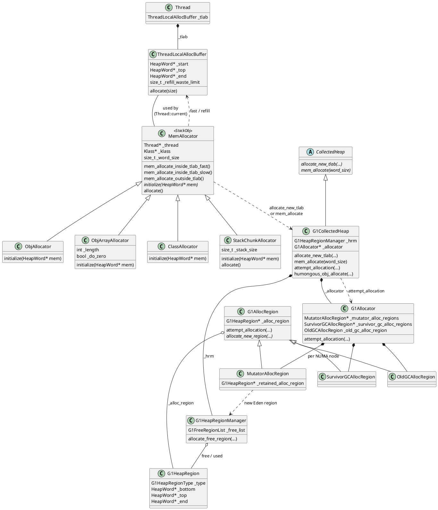

HotSpot **memory management** places Java objects in the heap and reclaims them when they become unreachable. Mutators allocate; a **garbage collector** discovers live objects from GC roots, frees or relocates storage, and returns space so allocation can continue. On modern JDKs the collector that does this by default is **G1** (Garbage-First).

<!--more-->

---

## 1. Overview

A Java process uses several native memory domains. The **Java heap** holds ordinary instances and arrays—the memory `new` draws from and that garbage collection manages. **Metaspace** holds class metadata outside that heap. Thread stacks, the code cache, and direct buffers are further pools; they are not reclaimed by the same young/old collectors that service object allocation.

For heap objects the contract is reachability: a thread obtains storage, initializes the object ([header and klass pointer](/post/java/jvm/object/)), and any path still reachable from **GC roots** (locals, statics, JNI handles, and similar) keeps the object alive. When no such path remains, the collector may reuse the storage. HotSpot collectors are typically **generational**: most objects die in a young area (Eden, then Survivor); survivors are **tenured** into an old area that is reclaimed less often.

Which collector HotSpot selects when none is named on the command line depends on the JDK version (and, historically, on whether the machine looked “server-class”):

| JDK | Ergonomic default (no `-XX:+Use*GC`) |
|-----|--------------------------------------|
| **5–8** | **Parallel** on server-class machines; **Serial** on client / constrained machines |
| **9–26** | **G1** on server-class machines ([JEP 248](https://openjdk.org/jeps/248)); **Serial** when treated as constrained (typically one CPU or under about 1792 MB of memory) |
| **27+** | **G1** in all environments ([JEP 523](https://openjdk.org/jeps/523)) |

**G1** partitions that Java heap into equally sized **regions**—contiguous ranges of virtual memory that are the unit of both allocation and reclaim. At any moment a region is free, or assigned as Eden, Survivor, Old, or Humongous. Young and old generations are therefore **sets of regions**, typically noncontiguous in address order, rather than one Eden slab and one Old slab. Region size is chosen at startup from the maximum heap (on the order of **2048** regions, between **1 MB** and an ergonomic **32 MB**, hard max **512 MB** on 64-bit), or set with `G1HeapRegionSize`.


G1 meets a pause-time goal (default **200 ms**, `MaxGCPauseMillis`) by evacuating live objects from a chosen **collection set** and by marking the old generation concurrently. Mutators **allocate** into regions; the **GC cycle** then marks, evacuates, and frees them back for reuse.

---

## 2. Memory allocation

A mutator thread allocates objects and writes references, so it mutates the object graph. The collector traces that graph and reclaims storage. A Java `new` is mutator allocation: the thread asks `MutatorAllocRegion` for Eden space for an object that did not exist before. During evacuation the collector copies an existing object into a `SurvivorGCAllocRegion` or an `OldGCAllocRegion` while the mutator is stopped at a safepoint.

The heap is a sequence of equal `G1HeapRegion`s. Each region is a range of `HeapWord`s from `_bottom` to `_end`, and `_top` is its bump pointer. A thread's TLAB is a subrange of the current Eden region: the thread bumps the TLAB `_top`, and the region `_top` moves only when a new TLAB, or an allocation outside any TLAB, is taken from the region.


HotSpot routes mutator allocation through `MemAllocator`, a `StackObj` that lives for one allocation on the current thread. It stores `Thread* _thread` (must be `Thread::current()`) so the fast path can reach that thread's TLAB without repeatedly calling `Thread::current()`, and so slow-path bookkeeping (bytes allocated, sampling) stays on the right thread. `allocate()` reserves the raw words through the three paths below, then calls the subclass `initialize` to finish the object. `CollectedHeap` selects the subclass from the kind of object:

- `ObjAllocator`, from `obj_allocate`, zeroes the body and installs the header. This constructs an ordinary instance.
- `ObjArrayAllocator`, from `array_allocate`, stores `_length` before the class identity, so a concurrent collector can parse the array as soon as the header is published. It covers object arrays and type arrays. `_do_zero` selects whether the elements are cleared.
- `ClassAllocator`, from `class_allocate`, stores the `java.lang.Class` mirror's `oop_size` before the class identity.
- `StackChunkAllocator`, used when freezing a virtual-thread stack, installs the chunk's size, bottom, and sp, and leaves the stack payload unzeroed.

G1 uses these classes directly. ZGC and Shenandoah substitute `ZObjArrayAllocator` and `ShenandoahObjArrayAllocator` for `ObjArrayAllocator`.

Each `Thread` owns a `ThreadLocalAllocBuffer` (`_tlab`). Under G1, heap entry points land on `G1CollectedHeap`, which owns the region table (`G1HeapRegionManager`) and the current allocating regions (`G1Allocator`). Mutator traffic goes through `MutatorAllocRegion` into a live Eden `G1HeapRegion`; GC evacuation uses sibling alloc regions for Survivor and Old.



`MemAllocator::mem_allocate` tries the TLAB, then a refill, then one object from the heap. A null result from either TLAB step falls through; `-XX:-UseTLAB` skips both TLAB steps.

```cpp
// MemAllocator.mem_allocate
HeapWord* MemAllocator::mem_allocate(Allocation& allocation) const {
  // 1. UseTLAB: bump the current TLAB. Success returns the object.
  //    The object does not fit, or UseTLAB is false: continue.
  if (UseTLAB) {
    HeapWord* mem = mem_allocate_inside_tlab_fast();
    if (mem != nullptr) {
      return mem;
    }
  }

  // 2. Anything after this point may block at a safepoint. Checked in debug builds.
  DEBUG_ONLY(allocation._thread->check_for_valid_safepoint_state());

  // 3. UseTLAB: refill the TLAB and place the object in the new buffer.
  //    A null return means "do not use a TLAB for this object": continue.
  if (UseTLAB) {
    HeapWord* mem = mem_allocate_inside_tlab_slow(allocation);
    if (mem != nullptr) {
      return mem;
    }
  }

  // 4. One object from the shared heap. The thread's TLAB, if any, is left as it is.
  return mem_allocate_outside_tlab(allocation);
}
```

**TLAB fast path.** `allocate` returns the old `_top` when the object fits, and null when it does not.

```cpp
// MemAllocator.mem_allocate_inside_tlab_fast
HeapWord* MemAllocator::mem_allocate_inside_tlab_fast() const {
  return _thread->tlab().allocate(_word_size);
}

// ThreadLocalAllocBuffer.allocate
inline HeapWord* ThreadLocalAllocBuffer::allocate(size_t size) {
  HeapWord* obj = top();
  // 1. end() - top() is large enough: publish the new top and return the old one.
  if (pointer_delta(end(), obj) >= size) {
    set_top(obj + size);
    return obj;
  }
  // 2. The object does not fit. The TLAB is unchanged.
  return nullptr;
}
```

**TLAB refill.** Four exits: the sampling retry succeeds, the leftover space is too large to discard, no legal TLAB can hold the object, or the heap cannot give a new TLAB. The last three return null so `mem_allocate` uses the outside-TLAB path. `allocate_new_tlab` does not run a GC.

```cpp
// MemAllocator.mem_allocate_inside_tlab_slow
HeapWord* MemAllocator::mem_allocate_inside_tlab_slow(Allocation& allocation) const {
  HeapWord* mem = nullptr;
  ThreadLocalAllocBuffer& tlab = _thread->tlab();

  // 1. JVMTI allocation sampling pulls end() back to the sample point, so the fast path
  //    can fail while the real TLAB still has room. Restore that end and retry once.
  if (JvmtiExport::should_post_sampled_object_alloc()) {
    tlab.set_back_allocation_end();
    mem = tlab.allocate(_word_size);
    if (mem != nullptr) {
      return mem;
    }
  }

  // 2. Leftover space is above the waste limit (initially desired_size / TLABRefillWasteFraction).
  //    Keep this TLAB. record_slow_allocation raises the limit so the same size does not
  //    take this branch on every later call. Caller allocates this object outside the TLAB.
  if (tlab.free() > tlab.refill_waste_limit()) {
    tlab.record_slow_allocation(_word_size);
    return nullptr;
  }

  // 3. The remainder is small enough to discard. Record it and retire the TLAB,
  //    which fills the gap with a dummy object.
  tlab.record_refill_waste();
  _thread->retire_tlab();

  // 4. compute_size returns 0 when the object plus the alignment reserve is larger than
  //    the maximum TLAB. A humongous object, larger than half a G1 region, takes this branch.
  size_t new_tlab_size = tlab.compute_size(_word_size);
  if (new_tlab_size == 0) {
    return nullptr;
  }

  // 5. Ask the heap for a new TLAB of any size between min_tlab_size and new_tlab_size.
  //    Failure does not collect; the caller retries through mem_allocate_outside_tlab,
  //    which is allowed to stop for a GC.
  size_t min_tlab_size = ThreadLocalAllocBuffer::compute_min_size(_word_size);
  mem = Universe::heap()->allocate_new_tlab(
      min_tlab_size, new_tlab_size, &allocation._allocated_tlab_size);
  if (mem == nullptr) {
    return nullptr;
  }

  // 6. ZeroTLAB clears the new buffer. ZapTLAB fills it with badHeapWordVal except the
  //    header, so a concurrent collector does not parse the unallocated tail as an object.
  //    Neither flag: the buffer is left uninitialized.
  if (ZeroTLAB) {
    Copy::zero_to_words(mem, allocation._allocated_tlab_size);
  } else if (ZapTLAB) {
    size_t hdr_size = oopDesc::header_size();
    Copy::fill_to_words(mem + hdr_size, allocation._allocated_tlab_size - hdr_size, badHeapWordVal);
  }

  // 7. Install the buffer as this thread's TLAB and bump its top past this object.
  _thread->fill_tlab(mem, _word_size, allocation._allocated_tlab_size);
  return mem;
}
```

Under G1 the refill asks the mutator alloc region for Eden space and passes `allow_gc` as false:

```cpp
// G1CollectedHeap.allocate_new_tlab
HeapWord* G1CollectedHeap::allocate_new_tlab(size_t min_size,
                                             size_t requested_size,
                                             size_t* actual_size) {
  // A humongous request never reaches here; mem_allocate_inside_tlab_slow returned null at step 4.
  assert(!is_humongous(requested_size), "we do not allow humongous TLABs");
  // No collection. Null means the Eden region could not supply the TLAB.
  return attempt_allocation(min_size, requested_size, actual_size, false /* allow_gc */);
}
```

**Outside the TLAB.** This is step 4 of `mem_allocate`: `-XX:-UseTLAB`, a TLAB kept because its remainder is too large to discard, an object that cannot fit in any TLAB, or a refill that the heap refused. The current TLAB is not retired here.

```cpp
// MemAllocator.mem_allocate_outside_tlab
HeapWord* MemAllocator::mem_allocate_outside_tlab(Allocation& allocation) const {
  allocation._allocated_outside_tlab = true;
  // 1. One object from the heap. G1 may stop for a GC on this call.
  HeapWord* mem = Universe::heap()->mem_allocate(_word_size);
  // 2. Still no space: the caller reports allocation failure.
  if (mem == nullptr) {
    return mem;
  }

  // 3. Count the bytes on the thread and on the heap sampler. The TLAB statistics are unchanged.
  size_t size_in_bytes = _word_size * HeapWordSize;
  _thread->incr_allocated_bytes(size_in_bytes);
  _thread->heap_sampler().inc_outside_tlab_bytes(size_in_bytes);
  return mem;
}
```

G1's `mem_allocate` splits that request. A humongous object takes whole regions. Anything smaller is one block from the mutator region, and this call is allowed to collect:

```cpp
// G1CollectedHeap.mem_allocate
HeapWord* G1CollectedHeap::mem_allocate(size_t word_size) {
  // 1. Larger than half a region: one or more free regions, not the current Eden region.
  if (is_humongous(word_size)) {
    return attempt_allocation_humongous(word_size);
  }
  // 2. Otherwise a single block, min size equal to the object. allow_gc is true,
  //    so a failed attempt can run an evacuation pause and retry.
  size_t dummy = 0;
  return attempt_allocation(word_size, word_size, &dummy, true /* allow_gc */);
}

// G1CollectedHeap.is_humongous
static bool is_humongous(size_t word_size) {
  return word_size > _humongous_object_threshold_in_words;
}
```

---

## 3. GC cycle

G1 alternates a **Young-Only** phase with a **Space-Reclamation** phase. Young-Only starts with normal young collections that promote into Old. When old occupancy warrants it, a Concurrent Start young collection begins marking; Remark and Cleanup finish that analysis; Prepare Mixed (if candidates exist) leads into mixed collections that also evacuate selected old regions. When further old reclaim is not worth the pause, the cycle returns to Young-Only. Full GC is the backup when evacuation cannot free space.


Each part of the ring runs on a known thread. A mutator that needs a collection only posts a VM operation and waits. The parallel copy inside a pause is done by the **GC Thread** pool (`ParallelGCThreads`).

**Young and mixed pauses** run on the **VM thread**. Mutators are at the safepoint. The same operation covers a normal young collection and a mixed collection; the collection set is what differs.

```cpp
// VM_G1CollectForAllocation.doit
void VM_G1CollectForAllocation::doit() {
  G1CollectedHeap* g1h = G1CollectedHeap::heap();
  GCCauseSetter x(g1h, _gc_cause);
  // 1. VM thread: evacuate the collection set (young, or young plus old candidates)
  g1h->do_collection_pause_at_safepoint(_word_size);

  if (_word_size > 0) {
    // 2. the allocation that triggered the pause retries, and may escalate
    _result = g1h->satisfy_failed_allocation(_word_size);
  } else if (g1h->should_upgrade_to_full_gc()) {
    // 3. no regions left: this same VM thread continues into a full collection
    g1h->upgrade_to_full_collection();
  }
}
```

**Concurrent Start** is that same VM-thread pause, taken when old occupancy crosses the threshold. At the end of the pause the VM thread wakes the dedicated **`G1ConcurrentMarkThread`**.

```cpp
// G1ConcurrentMark.start_full_concurrent_cycle
void G1ConcurrentMark::start_full_concurrent_cycle() {
  // 1. VM thread, still in the safepoint: begin weak-reference discovery for this cycle
  ReferenceProcessor* rp = _g1h->ref_processor_cm();
  rp->start_discovery(false /* always_clear */);

  // 2. turn on SATB queue recording on every thread
  SATBMarkQueueSet& satb_mq_set = G1BarrierSet::satb_mark_queue_set();
  satb_mq_set.set_active_all_threads(true, /* new active value */ false /* expected_active */);

  // 3. wake G1ConcurrentMarkThread; it waits on G1CGC_lock
  cm_thread()->start_full_cycle();
}
```

**Concurrent mark** runs on **`G1ConcurrentMarkThread`** while mutators run. The graph walk itself is a parallel task on the **G1 Conc** worker pool (`ConcGCThreads`). Remark and Cleanup are not done on this thread.

```cpp
// G1ConcurrentMarkThread.concurrent_mark_cycle_do
void G1ConcurrentMarkThread::concurrent_mark_cycle_do() {
  // 1. this thread: scan roots of regions evacuated during Concurrent Start
  if (phase_scan_root_regions()) return;
  // 2. this thread drives the loop; G1 Conc workers run mark_from_roots
  if (phase_mark_loop()) return;
  // 3. this thread: rebuild remembered sets and scrub dead objects
  if (phase_rebuild_and_scrub()) return;
  if (phase_delay_to_keep_mmu_before_cleanup()) return;
  // 4. hand Cleanup to the VM thread
  if (phase_cleanup()) return;
  if (phase_clear_cld_claimed_marks()) return;
  // 5. this thread: clear the bitmap for the next cycle
  phase_clear_bitmap_for_next_mark();
}
```

**Remark and Cleanup** are stop-the-world pauses. `G1ConcurrentMarkThread` only requests them. The **VM thread** runs them, with the GC Thread workers.

```cpp
// G1ConcurrentMarkThread.subphase_remark
bool G1ConcurrentMarkThread::subphase_remark() {
  // mark thread blocks here until the VM thread finishes the pause
  VM_G1PauseRemark op;
  VMThread::execute(&op);
  return _cm->has_aborted();
}

// G1ConcurrentMarkThread.phase_cleanup
bool G1ConcurrentMarkThread::phase_cleanup() {
  VM_G1PauseCleanup op;
  VMThread::execute(&op);
  return _cm->has_aborted();
}
```

**Full GC** is off the ring. It also runs on the **VM thread**, when evacuation cannot free enough space for the allocation that requested the pause.

```cpp
// VM_G1CollectFull.doit
void VM_G1CollectFull::doit() {
  G1CollectedHeap* g1h = G1CollectedHeap::heap();
  GCCauseSetter x(g1h, _gc_cause);
  bool clear_all_soft_refs = _gc_cause == GCCause::_metadata_GC_clear_soft_refs ||
                             _gc_cause == GCCause::_wb_full_gc;
  // VM thread: compact the whole heap
  g1h->do_full_collection(size_t(0) /* allocation_word_size */,
                          clear_all_soft_refs,
                          false /* do_maximal_compaction */);
}
```

Card refinement is not a dot on the ring. The **`G1ConcurrentRefineThread`** (`G1 Refine Control`) runs it concurrently, on its own workers, so a later evacuation pause can use remembered sets that are already built.

```cpp
// G1ConcurrentRefineThread.run_service
void G1ConcurrentRefineThread::run_service() {
  // 1. this thread sleeps until dirty cards need a sweep
  while (wait_for_work()) {
    // 2. yield at a safepoint, then sweep; its workers update remembered sets
    do_refinement();
  }
}
```

Inside that cycle, three mechanisms work together: concurrent mark decides which old regions are candidates; evacuation copies live objects out of the collection set; freeing returns empty regions to the allocator.

### 3.1 Concurrent mark

Young collections alone promote survivors into Old and do not compact the old generation. When old occupancy crosses **InitiatingHeapOccupancyPercent** (default **45%** of current old capacity, usually adapted by **adaptive IHOP**), G1 schedules a **Concurrent Start** young collection: it still evacuates Eden/Survivor, and it starts concurrent marking of the old generation.

Marking uses **snapshot-at-the-beginning (SATB)**. At Concurrent Start, G1 takes a virtual snapshot of liveness; a mutator pre-barrier logs the previous referent of a reference field into a thread-local SATB buffer before the store so objects live at mark start stay in the snapshot. The G1 Conc workers, driven by `G1ConcurrentMarkThread`, walk the object graph with the marking bitmap and drain those buffers while the application runs. Normal young collections, which are still VM-thread pauses, may continue until marking finishes.


Two STW pauses complete the analysis:

1. **Remark** — drains remaining SATB work, finishes reference processing related to marking, and may reclaim completely empty regions.
2. **Cleanup** — accounts live data per old region, rebuilds remembered sets for collection-set candidates, and decides whether a Space-Reclamation (mixed) phase should follow.

Marking answers which old regions are sparse (or poorly connected) enough to be worth evacuating later. It does not by itself free those regions for mutator allocation.

### 3.2 Evacuation

G1 reclaims by **evacuation**: live objects in a **collection set (CSet)** are copied into free regions, and references (from roots and remembered sets) are updated to the new locations. The VM thread runs the pause. The GC Thread workers do the parallel copy. A young or mixed pause roughly: disconnect TLABs and select the CSet; merge heap roots and remembered sets for that CSet; copy objects; then post-evacuate cleanup.

**Remembered sets (RSets)** record approximate locations outside a region that may point into it (cards, by default 512-byte granules). Mutators dirty cards on reference stores. `G1ConcurrentRefineThread` and its workers turn those dirty cards into RSet entries, so the pause need not scan the entire old generation for pointers into the CSet.

**Young-only** collections put every Eden and Survivor region into the CSet. Surviving objects go to Survivor or, when aged out, to Old. No old region is evacuated—the common case while the Young-Only phase fills Old.

**Mixed** collections still evacuate all young regions, and add a budgeted number of **old candidate** regions chosen after marking (low live bytes, favorable connectivity). Policy spreads old reclaim across several mixed pauses (`G1MixedGCCountTarget`, default **8**). Regions whose live bytes exceed `G1MixedGCLiveThresholdPercent` (default **85%** of a region) stay out of the mixed CSet. Humongous objects are normally only dropped when dead, not moved, except in last-resort efforts.


If destination space is insufficient, **evacuation failure** leaves objects in place and schedules those regions for later collection. Sustained failure may escalate to a **Full GC** (whole-heap compacting STW).

### 3.3 Free

After a successful evacuation, source regions in the CSet contain no live objects. G1 returns them to the **free** list: their type becomes Free, and the memory manager may later hand them out again as Eden, Survivor, Old, or Humongous destinations. That is the step that makes the gray cells in the heap layout reusable.

Completely empty regions can also appear without a full CSet evacuation—for example after Remark/Cleanup when marking finds a region with no live data, or when a dead humongous object is reclaimed. Those regions likewise become Free.

Policy keeps a fraction of the heap in reserve (`G1ReservePercent`) so evacuation always has destination space. Space-Reclamation (mixed) stops when further old evacuation would not free enough space worth the pause (`G1HeapWastePercent`, default **5%**), and the cycle returns to Young-Only with a larger free pool for allocation.

| Lever | Default (typical) | Role in the cycle |
|-------|-------------------|-------------------|
| `MaxGCPauseMillis` | 200 | Bounds how large Eden and mixed CSets may be |
| `InitiatingHeapOccupancyPercent` | 45 | When concurrent mark (then mixed reclaim) starts |
| `G1ReservePercent` | 10 | Free regions held back for evacuation destinations |
| `G1MixedGCCountTarget` | 8 | How many mixed pauses spread old freeing |
| `G1MixedGCLiveThresholdPercent` | 85 | Skip dense old regions in the CSet |
| `G1HeapWastePercent` | 5 | Stop mixed reclaim when little free space remains to gain |

Logs (`-Xlog:gc*` and `-Xlog:gc+phases=debug`) show pause kind, CSet composition, and whether regions were freed or evacuation failed. Building a debuggable HotSpot for stepping these paths is covered in [JVM build and debug](/post/java/jvm/build-debug/).

---

## 4. References

- [Garbage-First (G1) Garbage Collector — HotSpot Virtual Machine Garbage Collection Tuning Guide (Java SE 22)](https://docs.oracle.com/en/java/javase/22/gctuning/garbage-first-g1-garbage-collector1.html#GUID-ED3AB6D3-FD9B-4447-9EDF-983ED2F7A573)
- [JEP 248: Make G1 the Default Garbage Collector](https://openjdk.org/jeps/248)
- [JEP 523: Make G1 the Default Garbage Collector in All Environments](https://openjdk.org/jeps/523)
