HotSpot **memory management** places Java objects in the heap and reclaims them when they become unreachable. Mutators allocate; a **garbage collector** discovers live objects from GC roots, frees or relocates storage, and returns space so allocation can continue. On modern JDKs the collector that does this by default is **G1** (Garbage-First).

<!--more-->

---

## 1. Overview

A Java process uses several native memory domains. The **Java heap** holds ordinary instances and arrays—the memory `new` draws from and that garbage collection manages. **Metaspace** holds class metadata outside that heap. Thread stacks, the code cache, and direct buffers are further pools; they are not reclaimed by the same young/old collectors that service object allocation.

For heap objects the contract is reachability: a thread obtains storage, initializes the object ([header and klass pointer](/post/java/jvm/object/)), and any path still reachable from **GC roots** (locals, statics, JNI handles, and similar) keeps the object alive. When no such path remains, the collector may reuse the storage. HotSpot collectors are typically **generational**: most objects die in a young area (Eden, then Survivor); survivors are **tenured** into an old area that is reclaimed less often.

Which collector HotSpot selects when none is named on the command line depends on the JDK version (and, historically, on whether the machine looked “server-class”):

| JDK | Ergonomic default (no `-XX:+Use*GC`) |
|-----|--------------------------------------|
| **5–8** | **Parallel** on server-class machines; **Serial** on client / constrained machines |
| **9–26** | **G1** on server-class machines ([JEP 248](https://openjdk.org/jeps/248)); **Serial** when treated as constrained (typically one CPU or under about 1792 MB of memory) |
| **27+** | **G1** in all environments ([JEP 523](https://openjdk.org/jeps/523)) |

**G1** partitions that Java heap into equally sized **regions**—contiguous ranges of virtual memory that are the unit of both allocation and reclaim. At any moment a region is free, or assigned as Eden, Survivor, Old, or Humongous. Young and old generations are therefore **sets of regions**, typically noncontiguous in address order, rather than one Eden slab and one Old slab. Region size is chosen at startup from the maximum heap (on the order of **2048** regions, between **1 MB** and an ergonomic **32 MB**, hard max **512 MB** on 64-bit), or set with `G1HeapRegionSize`.

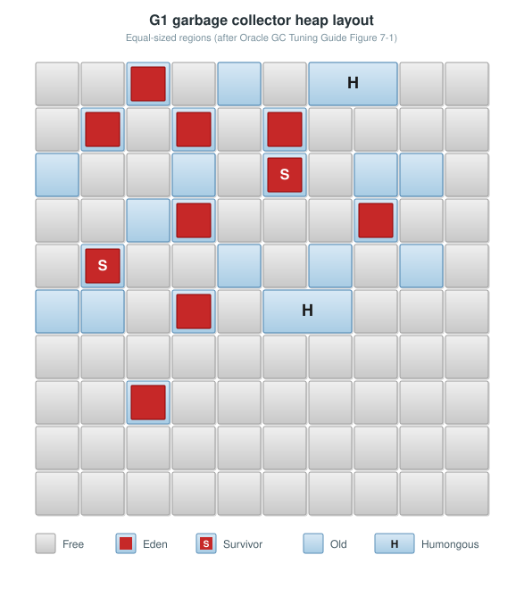

G1 meets a pause-time goal (default **200 ms**, `MaxGCPauseMillis`) by evacuating live objects from a chosen **collection set** and by marking the old generation concurrently. Mutators **allocate** into regions; the **GC cycle** then marks, evacuates, and frees them back for reuse.

---

## 2. Memory allocation

A mutator thread allocates objects and writes references, so it mutates the object graph. The collector traces that graph and reclaims storage. A Java `new` is mutator allocation: the thread asks `MutatorAllocRegion` for Eden space for an object that did not exist before. During evacuation the collector copies an existing object into a `SurvivorGCAllocRegion` or an `OldGCAllocRegion` while the mutator is stopped at a safepoint.

The heap is a sequence of equal `G1HeapRegion`s. Each region is a range of `HeapWord`s from `_bottom` to `_end`, and `_top` is its bump pointer. A thread's TLAB is a subrange of the current Eden region: the thread bumps the TLAB `_top`, and the region `_top` moves only when a new TLAB, or an allocation outside any TLAB, is taken from the region.

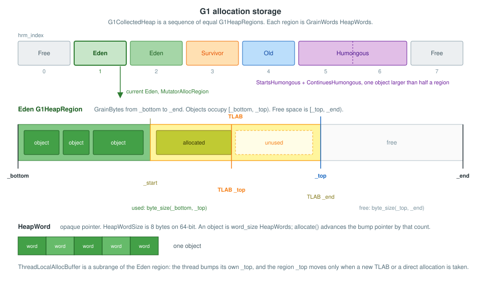

HotSpot routes mutator allocation through `MemAllocator`, a `StackObj` that lives for one allocation on the current thread. It stores `Thread* _thread` (must be `Thread::current()`) so the fast path can reach that thread's TLAB without repeatedly calling `Thread::current()`, and so slow-path bookkeeping (bytes allocated, sampling) stays on the right thread. `allocate()` reserves the raw words through the three paths below, then calls the subclass `initialize` to finish the object. `CollectedHeap` selects the subclass from the kind of object:

- `ObjAllocator`, from `obj_allocate`, zeroes the body and installs the header. This constructs an ordinary instance.
- `ObjArrayAllocator`, from `array_allocate`, stores `_length` before the class identity, so a concurrent collector can parse the array as soon as the header is published. It covers object arrays and type arrays. `_do_zero` selects whether the elements are cleared.
- `ClassAllocator`, from `class_allocate`, stores the `java.lang.Class` mirror's `oop_size` before the class identity.
- `StackChunkAllocator`, used when freezing a virtual-thread stack, installs the chunk's size, bottom, and sp, and leaves the stack payload unzeroed.

G1 uses these classes directly. ZGC and Shenandoah substitute `ZObjArrayAllocator` and `ShenandoahObjArrayAllocator` for `ObjArrayAllocator`.

Each `Thread` owns a `ThreadLocalAllocBuffer` (`_tlab`). Under G1, heap entry points land on `G1CollectedHeap`, which owns the region table (`G1HeapRegionManager`) and the current allocating regions (`G1Allocator`). Mutator traffic goes through `MutatorAllocRegion` into a live Eden `G1HeapRegion`; GC evacuation uses sibling alloc regions for Survivor and Old.

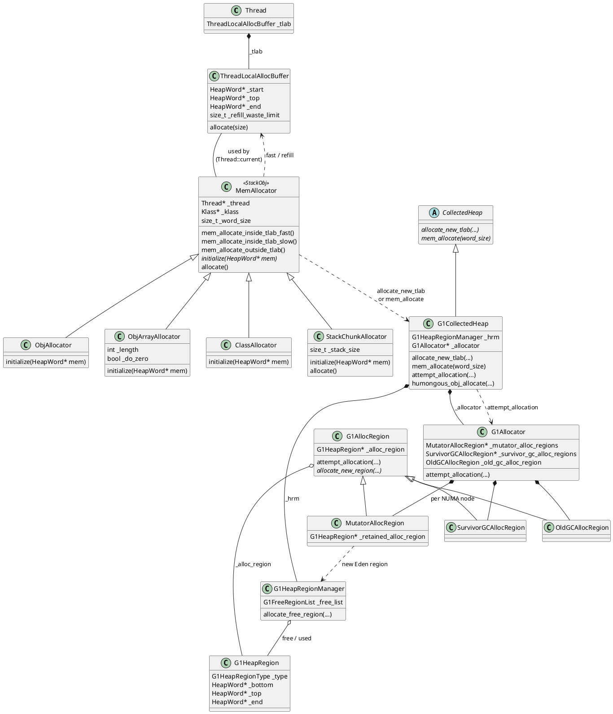

`MemAllocator::mem_allocate` tries the TLAB, then a refill, then one object from the heap. A null result from either TLAB step falls through; `-XX:-UseTLAB` skips both TLAB steps.

```cpp
// memAllocator.cpp
HeapWord* MemAllocator::mem_allocate(Allocation& allocation) const {
  // 1. UseTLAB: bump the current TLAB. Success returns the object.
  //    The object does not fit, or UseTLAB is false: continue.
  if (UseTLAB) {
    HeapWord* mem = mem_allocate_inside_tlab_fast();
    if (mem != nullptr) {
      return mem;
    }
  }

  // 2. Anything after this point may block at a safepoint. Checked in debug builds.
  DEBUG_ONLY(allocation._thread->check_for_valid_safepoint_state());

  // 3. UseTLAB: refill the TLAB and place the object in the new buffer.
  //    A null return means "do not use a TLAB for this object": continue.
  if (UseTLAB) {
    HeapWord* mem = mem_allocate_inside_tlab_slow(allocation);
    if (mem != nullptr) {
      return mem;
    }
  }

  // 4. One object from the shared heap. The thread's TLAB, if any, is left as it is.
  return mem_allocate_outside_tlab(allocation);
}
```

**TLAB fast path.** `allocate` returns the old `_top` when the object fits, and null when it does not.

```cpp
// memAllocator.cpp
HeapWord* MemAllocator::mem_allocate_inside_tlab_fast() const {
  return _thread->tlab().allocate(_word_size);
}

// threadLocalAllocBuffer.inline.hpp
inline HeapWord* ThreadLocalAllocBuffer::allocate(size_t size) {
  HeapWord* obj = top();
  // 1. end() - top() is large enough: publish the new top and return the old one.
  if (pointer_delta(end(), obj) >= size) {
    set_top(obj + size);
    return obj;
  }
  // 2. The object does not fit. The TLAB is unchanged.
  return nullptr;
}
```

**TLAB refill.** Four exits: the sampling retry succeeds, the leftover space is too large to discard, no legal TLAB can hold the object, or the heap cannot give a new TLAB. The last three return null so `mem_allocate` uses the outside-TLAB path. `allocate_new_tlab` does not run a GC.

```cpp
// memAllocator.cpp
HeapWord* MemAllocator::mem_allocate_inside_tlab_slow(Allocation& allocation) const {
  HeapWord* mem = nullptr;
  ThreadLocalAllocBuffer& tlab = _thread->tlab();

  // 1. JVMTI allocation sampling pulls end() back to the sample point, so the fast path
  //    can fail while the real TLAB still has room. Restore that end and retry once.
  if (JvmtiExport::should_post_sampled_object_alloc()) {
    tlab.set_back_allocation_end();
    mem = tlab.allocate(_word_size);
    if (mem != nullptr) {
      return mem;
    }
  }

  // 2. Leftover space is above the waste limit (initially desired_size / TLABRefillWasteFraction).
  //    Keep this TLAB. record_slow_allocation raises the limit so the same size does not
  //    take this branch on every later call. Caller allocates this object outside the TLAB.
  if (tlab.free() > tlab.refill_waste_limit()) {
    tlab.record_slow_allocation(_word_size);
    return nullptr;
  }

  // 3. The remainder is small enough to discard. Record it and retire the TLAB,
  //    which fills the gap with a dummy object.
  tlab.record_refill_waste();
  _thread->retire_tlab();

  // 4. compute_size returns 0 when the object plus the alignment reserve is larger than
  //    the maximum TLAB. A humongous object, larger than half a G1 region, takes this branch.
  size_t new_tlab_size = tlab.compute_size(_word_size);
  if (new_tlab_size == 0) {
    return nullptr;
  }

  // 5. Ask the heap for a new TLAB of any size between min_tlab_size and new_tlab_size.
  //    Failure does not collect; the caller retries through mem_allocate_outside_tlab,
  //    which is allowed to stop for a GC.
  size_t min_tlab_size = ThreadLocalAllocBuffer::compute_min_size(_word_size);
  mem = Universe::heap()->allocate_new_tlab(
      min_tlab_size, new_tlab_size, &allocation._allocated_tlab_size);
  if (mem == nullptr) {
    return nullptr;
  }

  // 6. ZeroTLAB clears the new buffer. ZapTLAB fills it with badHeapWordVal except the
  //    header, so a concurrent collector does not parse the unallocated tail as an object.
  //    Neither flag: the buffer is left uninitialized.
  if (ZeroTLAB) {
    Copy::zero_to_words(mem, allocation._allocated_tlab_size);
  } else if (ZapTLAB) {
    size_t hdr_size = oopDesc::header_size();
    Copy::fill_to_words(mem + hdr_size, allocation._allocated_tlab_size - hdr_size, badHeapWordVal);
  }

  // 7. Install the buffer as this thread's TLAB and bump its top past this object.
  _thread->fill_tlab(mem, _word_size, allocation._allocated_tlab_size);
  return mem;
}
```

Under G1 the refill asks the mutator alloc region for Eden space and passes `allow_gc` as false:

```cpp
// g1CollectedHeap.cpp
HeapWord* G1CollectedHeap::allocate_new_tlab(size_t min_size,
                                             size_t requested_size,
                                             size_t* actual_size) {
  // A humongous request never reaches here; mem_allocate_inside_tlab_slow returned null at step 4.
  assert(!is_humongous(requested_size), "we do not allow humongous TLABs");
  // No collection. Null means the Eden region could not supply the TLAB.
  return attempt_allocation(min_size, requested_size, actual_size, false /* allow_gc */);
}
```

**Outside the TLAB.** This is step 4 of `mem_allocate`: `-XX:-UseTLAB`, a TLAB kept because its remainder is too large to discard, an object that cannot fit in any TLAB, or a refill that the heap refused. The current TLAB is not retired here.

```cpp
// memAllocator.cpp
HeapWord* MemAllocator::mem_allocate_outside_tlab(Allocation& allocation) const {
  allocation._allocated_outside_tlab = true;
  // 1. One object from the heap. G1 may stop for a GC on this call.
  HeapWord* mem = Universe::heap()->mem_allocate(_word_size);
  // 2. Still no space: the caller reports allocation failure.
  if (mem == nullptr) {
    return mem;
  }

  // 3. Count the bytes on the thread and on the heap sampler. The TLAB statistics are unchanged.
  size_t size_in_bytes = _word_size * HeapWordSize;
  _thread->incr_allocated_bytes(size_in_bytes);
  _thread->heap_sampler().inc_outside_tlab_bytes(size_in_bytes);
  return mem;
}
```

G1's `mem_allocate` splits that request. A humongous object takes whole regions. Anything smaller is one block from the mutator region, and this call is allowed to collect:

```cpp
// g1CollectedHeap.cpp
HeapWord* G1CollectedHeap::mem_allocate(size_t word_size) {
  // 1. Larger than half a region: one or more free regions, not the current Eden region.
  if (is_humongous(word_size)) {
    return attempt_allocation_humongous(word_size);
  }
  // 2. Otherwise a single block, min size equal to the object. allow_gc is true,
  //    so a failed attempt can run an evacuation pause and retry.
  size_t dummy = 0;
  return attempt_allocation(word_size, word_size, &dummy, true /* allow_gc */);
}

// g1CollectedHeap.hpp
static bool G1CollectedHeap::is_humongous(size_t word_size) {
  return word_size > _humongous_object_threshold_in_words;
}
```

---

## 3. GC cycle

G1 alternates a **Young-Only** phase with a **Space-Reclamation** phase, cycling through the same sequence of phases. Full GC is the backup when evacuation cannot free enough space.

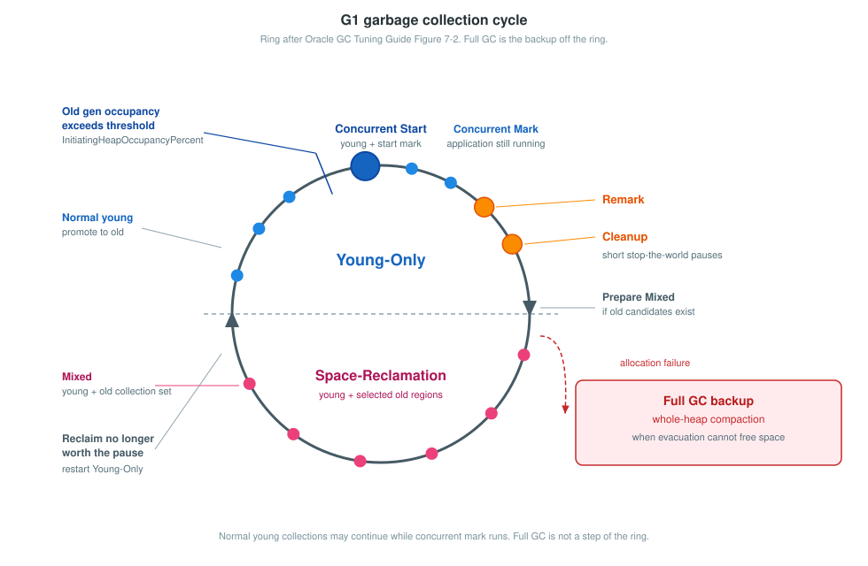

Every step of the cycle runs on dedicated GC threads. A mutator that needs a collection never collects by itself: it posts a VM operation and blocks. Every pause runs on the **VM thread** together with the **GC Thread** pool (`ParallelGCThreads`); between pauses, the **marker** and **refinement** threads drive their own worker pools through marking and card refinement.

Collection is event-driven. When an ordinary allocation cannot find space in Eden, `attempt_allocation_slow` asks for a collection pause with the cause `_g1_inc_collection_pause`:

```cpp
// g1CollectedHeap.cpp — the mutator cannot refill Eden
HeapWord* G1CollectedHeap::attempt_allocation_slow(uint node_index, size_t word_size, bool allow_gc) {
  uint gc_count_before;
  {
    MutexLocker x(Heap_lock);
    // Retry under the lock in case another thread changed the region while we waited.
    result = _allocator->attempt_allocation_locked(node_index, word_size);
    if (result != nullptr) {
      return result;
    }
    gc_count_before = total_collections();   // remember the GC count for the pause
  }

  bool succeeded;
  result = do_collection_pause(word_size, gc_count_before, &succeeded,
                               GCCause::_g1_inc_collection_pause);
  if (succeeded) {
    return result;   // the pause freed space; the mutator allocates from it
  }
}
```

`do_collection_pause` does not collect: it posts a VM operation and the mutator blocks until it completes:

```cpp
// g1CollectedHeap.cpp — on the allocating mutator
HeapWord* G1CollectedHeap::do_collection_pause(size_t word_size,
                                               uint gc_count_before,
                                               bool* succeeded,
                                               GCCause::Cause gc_cause) {
  VM_G1CollectForAllocation op(word_size, gc_count_before, gc_cause);
  VMThread::execute(&op);   // the allocating mutator blocks here
}
```

On the VM thread, the operation performs the pause and then settles the allocation that requested it:

```cpp
// g1VMOperations.cpp — on the VM thread
void VM_G1CollectForAllocation::doit() {
  G1CollectedHeap* g1h = G1CollectedHeap::heap();
  GCCauseSetter x(g1h, _gc_cause);
  // Try a partial collection of some kind.
  g1h->do_collection_pause_at_safepoint(_word_size);

  if (_word_size > 0) {
    // An allocation had been requested. Do it, eventually trying a stronger kind of GC.
    _result = g1h->satisfy_failed_allocation(_word_size);
  }
}
```

Inside the pause, the VM thread decides the kind of pause, runs the collection, and schedules the next step of the cycle when the collector state calls for it:

```cpp
// g1CollectedHeap.cpp — on the VM thread
void G1CollectedHeap::do_collection_pause_at_safepoint(size_t allocation_word_size) {
  policy()->decide_on_concurrent_start_pause();
  bool should_start_concurrent_mark_operation = collector_state()->is_in_concurrent_start_gc();

  G1YoungCollector collector(gc_cause(), allocation_word_size);
  collector.collect();
  _collector_state = collector.next_state();   // the state the next pause reads

  if (should_start_concurrent_mark_operation) {
    // This pause is the Concurrent Start: start the marking cycle.
    start_concurrent_cycle(collector.concurrent_operation_is_full_mark());
  }
}
```

The steps divide into two parts, following the two halves of the cycle:

**Young-Only (upper half)**

Normal young collections repeat in this half, promoting survivors into Old, and the marking work that later enables old evacuation runs between them. No old region is evacuated here.

1. **Young promotion** — normal young collections evacuate Eden and Survivor regions and promote aged objects into Old; they repeat until non-young occupancy crosses the initiating threshold (`G1IHOP`).
2. **Concurrent Start** — a young pause that snapshots the roots and starts marking the old generation.
3. **Concurrent Mark** — marking runs beside the mutators; normal young collections may continue.
4. **Remark** — a short stop-the-world pause that drains the remaining marking work.
5. **Cleanup** — a short stop-the-world pause that accounts live data and selects the old regions worth evacuating.

**Space-Reclamation (lower half)**

Mixed collections repeat in this half, each evacuating young regions plus some of the old regions marking identified. When further old reclaim is no longer worth the pause, the cycle restarts Young-Only.

6. **Prepare Mixed** — if Cleanup found old candidates, the entry step from the upper half; the mixed collection set is prepared.
7. **Mixed** — mixed pauses evacuate young regions plus selected old regions, and the emptied regions return to the free list.
8. **Restart Young-Only** — back to the upper half: the cycle starts over.

Full GC is not a step of the cycle: it is the backup that compacts the whole heap when evacuation cannot free enough space.

Each step is triggered either by an allocation that failed or by the step before it. The figure groups the steps in the pool that executes them and draws the calls between the pools as a state machine:

![State machine of the G1 cycle grouped by thread pool: the VM thread and GC Thread pool package holds every stop-the-world step (Young promotion to Concurrent Start, then Remark, Cleanup, Prepare Mixed, Mixed, and back to Young promotion); the G1 Main Marker and G1 Conc pool package holds Concurrent Mark; an arrow labeled start_concurrent_cycle() and notify() goes from the end of the Concurrent Start pause to wake the marker thread, and an arrow labeled marker posts VM_G1PauseRemark returns from the marker to the Remark pause; the marker also posts Cleanup; the G1 Refine Control and G1 Refinement Workers package runs between pauses and starts no step of its own](images/g1-cycle-triggers.svg)

The cycle trades one long pause for many short ones. Every young and mixed collection is a stop-the-world pause, so the cycle contains many of them, but each is kept short: the pause-time target (`MaxGCPauseMillis`, **200 ms** by default) steers how much work a pause may take, while the expensive graph work—marking and remembered-set maintenance—runs concurrently between pauses.

The sections below cover the mechanisms in turn: young promotion (§3.2), concurrent marking with its Remark and Cleanup pauses (§3.3), evacuation (§3.4), freeing emptied regions (§3.5), and the old threshold check that decides when the cycle restarts (§3.6).

### 3.1 GC threads

A collection is executed by a small set of native threads with strict roles. HotSpot separates them into **drivers** and **worker pools**:

- A **driver** is one named thread that owns the control flow of one GC job. It runs the serial parts—deciding, selecting, switching phases—and blocks while the parallel part of a phase runs.
- A **worker** never decides anything. It takes one slice of the task its driver posted, runs `work(worker_id)`, and goes back to sleep.

Every pool is a `WorkerThreads` object and every unit of parallel work is a `WorkerTask`. G1 has exactly three driver/pool pairs:

| Driver (class) | Its pool | Worker threads | Default count | Parallel work |
|---|---|---|---|---|
| **VM thread** (`VMThread`) | `G1CollectedHeap::_workers` | `GC Thread#0…` | `ParallelGCThreads` | prepare and evacuate the collection set, post-evacuate cleanup, Remark work |
| **G1 Main Marker** (`G1ConcurrentMarkThread`) | `G1ConcurrentMark::_concurrent_workers` | `G1 Conc#0…` | `ConcGCThreads` | root-region scan, mark the object graph, rebuild and scrub, clear bitmap |
| **G1 Refine Control** (`G1ConcurrentRefineThread`) | `G1ConcurrentRefineThreadControl::_workers` | `G1 Refinement Workers#0…` | `G1ConcRefinementThreads` | sweep dirty card tables into remembered sets |

The architecture follows one rule: **one pool, one driver**. A pool runs at most one task at a time, and only its own driver calls `run_task` on it. There is no work stealing between pools and no shared queue to arbitrate—which is why the pool code is this small.

**The worker counts.** All three counts are ergonomic and fixed before the pools are created:

- `ParallelGCThreads` — the CPU count up to 8, plus 5/8 of the remaining CPUs (`WorkerPolicy::calc_parallel_worker_threads`). 16 CPUs give 8 + 8×5/8 = 13.
- `ConcGCThreads = (ParallelGCThreads + 2) / 4` (`g1Arguments.cpp`).
- `G1ConcRefinementThreads = MIN2(ParallelGCThreads, flag_max)` (`g1Arguments.cpp`).

These are ceilings, not thread counts. With `UseDynamicNumberOfGCThreads` (default true) each pool creates **one** worker at startup and grows up to the ceiling on demand:

```cpp
// workerThread.cpp
void WorkerThreads::initialize_workers() {
  const uint initial_active_workers = UseDynamicNumberOfGCThreads ? 1 : _max_workers;
  if (set_active_workers(initial_active_workers) != initial_active_workers) {
    vm_exit_during_initialization();
  }
}

uint WorkerThreads::set_active_workers(uint num_workers) {
  // Create the missing workers on demand.
  while (_created_workers < num_workers) {
    WorkerThread* const worker = create_worker(_created_workers);
    ...
    _workers[_created_workers] = worker;
    _created_workers++;
  }
  _active_workers = MIN2(_created_workers, num_workers);
}
```

The number used for a given phase is chosen from the number of Java threads and the heap size (`WorkerPolicy::calc_default_active_workers`) and is logged, for example as `Using 4 workers of 13 for evacuation`.

**Class picture.**

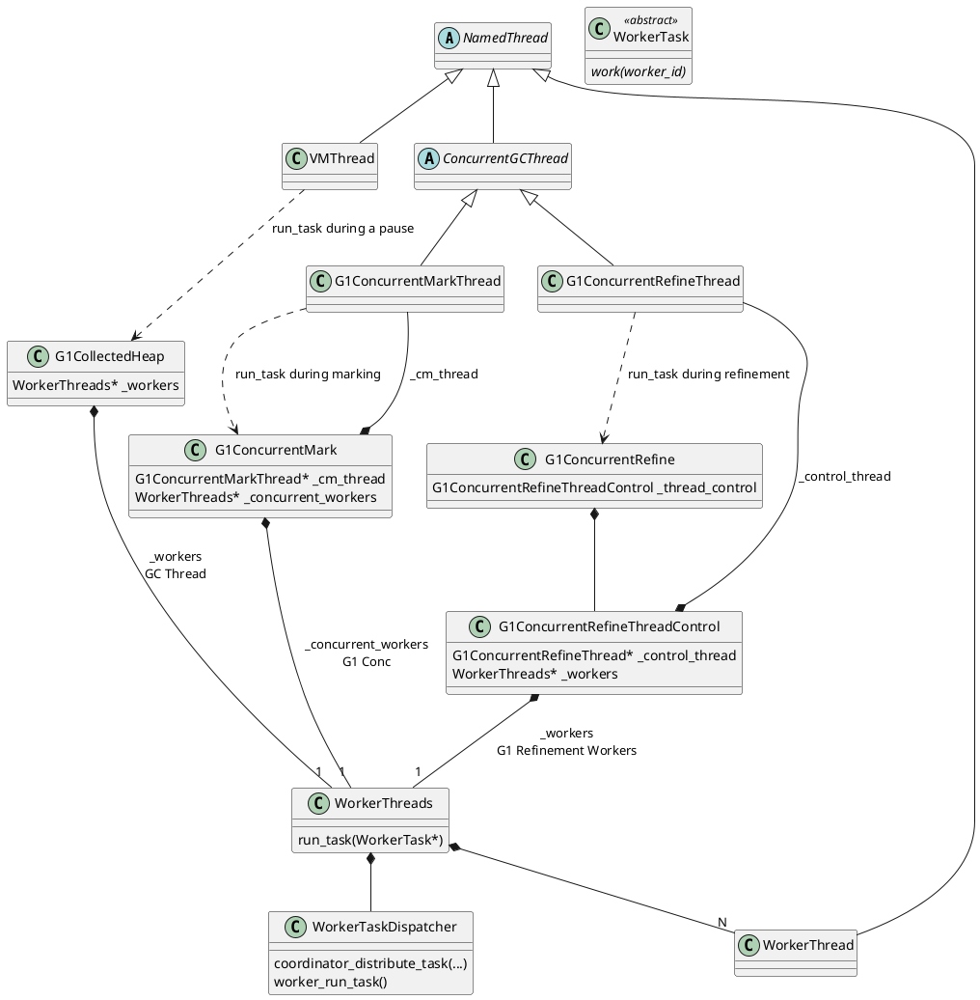

**The driver-to-pool handoff.** `WorkerThreads::run_task` is a synchronous call: the driver returns from it only after every worker has finished the task. The protocol lives in `WorkerTaskDispatcher`.

```cpp
// workerThread.cpp — called on the driver; returns when the task is done
void WorkerThreads::run_task(WorkerTask* task) {
  _dispatcher.coordinator_distribute_task(task, _active_workers);
}

// workerThread.cpp — driver side
void WorkerTaskDispatcher::coordinator_distribute_task(WorkerTask* task, uint num_workers) {
  // 1. Publish the task and how many workers must report done.
  _task = task;
  _not_finished.store_relaxed(num_workers);
  // 2. Wake that many workers.
  _start_semaphore.signal(num_workers);
  // 3. Block until the last worker signals back. The phase ends here.
  _end_semaphore.wait();
  ...
}

// workerThread.cpp — worker side, called in a loop
void WorkerTaskDispatcher::worker_run_task() {
  // 1. Park until a task is dispatched. This is what idle workers do.
  _start_semaphore.wait();
  // 2. Claim the next dense id, in wake-up order: 0, 1, ..., n-1.
  const uint worker_id = _started.fetch_then_add(1u);
  WorkerThread::set_worker_id(worker_id);
  // 3. Enter the task's GC id and run this worker's slice.
  GCIdMark gc_id_mark(_task->gc_id());
  _task->work(worker_id);
  // 4. Report done; the last worker out wakes the driver.
  const uint not_finished = _not_finished.sub_then_fetch(1u);
  if (not_finished == 0) {
    _end_semaphore.signal();
  }
}

// workerThread.cpp — the entire life of a worker
void WorkerThread::run() {
  while (true) {
    _dispatcher->worker_run_task();
  }
}
```

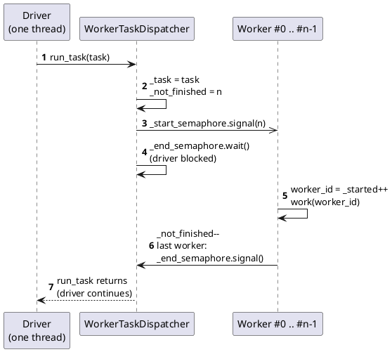

Three properties follow from this protocol:

1. **`run_task` is a join.** The driver cannot run ahead of the workers, and the next phase cannot start until the driver starts it.
2. **Worker ids are dense and reassigned on every task** (`0..n-1`, in wake-up order). Task code uses the id to index per-worker state, so that state needs no locking. No code assumes that a particular OS thread always gets a particular id.
3. **A task can run with fewer workers than the ceiling.** `run_task` wakes only `_active_workers`; a driver may also request a specific count for a small job (`run_task(task, num_workers)`), like the root-region scan, which uses one worker per remaining root region.

#### 3.1.1 GC Thread pool: the VM thread's workers

The GC Thread pool does the stop-the-world work of a collection. Its workers evacuate live objects out of the collection set during young and mixed pauses, and run the passes around the copy: preparing the regions before evacuation and cleaning up after it.

**Scheduling.** The pool is idle between pauses and never starts a phase on its own. Its trigger is always a GC VM operation: a mutator whose allocation failed posts `VM_G1CollectForAllocation`; the marker thread posts `VM_G1PauseRemark` or `VM_G1PauseCleanup` for the concurrent cycle's stop-the-world parts; explicit and periodic collection requests post theirs. The poster blocks until the operation has run.

G1 creates this pool once, during heap initialization, with the parallel GC thread count as its ceiling:

```cpp
// g1CollectedHeap.cpp
jint G1CollectedHeap::initialize() {
  _workers = new WorkerThreads("GC Thread", ParallelGCThreads);
  _workers->initialize_workers();
}
```

The VM thread is the pool's only driver: the serial logic of a pause runs on it, and the copies run on the pool. A Java thread that cannot satisfy an allocation does not collect by itself. It builds a VM operation, hands it to the VM thread, and blocks:

```cpp
// vmThread.cpp — the calling thread's path
void VMThread::execute(VM_Operation* op) {
  op->set_calling_thread(t);
  wait_until_executed(op);   // the caller sleeps here ...
  op->doit_epilogue();       // ... until the operation has run
}
```

The VM thread loops in `wait_for_operation`, and `inner_execute` posts a full safepoint when the operation is a GC, so every Java thread stops at the next polling point. Only then does the operation's `doit` run, on the VM thread:

```cpp
// vmThread.cpp
void VMThread::inner_execute(VM_Operation* op) {
  if (_cur_vm_operation->evaluate_at_safepoint() &&
      !SafepointSynchronize::is_at_safepoint()) {
    SafepointSynchronize::begin();   // all Java threads stop here
    end_safepoint = true;
  }
  evaluate_operation(_cur_vm_operation);   // op->evaluate() -> doit()
  ...
}
```

For an allocation failure the operation is `VM_G1CollectForAllocation`: it runs one young (or mixed) pause, and then lets the blocked allocation retry (§3.4 shows its full `doit`).

`do_collection_pause_at_safepoint` builds a `G1YoungCollector` and calls `collect()`. Everything up to here has been serial, and it stays serial wherever it can: selecting the collection set, fixing up the allocation regions, deciding the next collector state. Only the heavy phases are dispatched, each through one `run_task` call—`G1PrepareEvacuationTask`, `G1EvacuateRegionsTask`, the optional `G1EvacuateOptionalRegionsTask`, and the post-evacuate batch tasks. The driver side of every one of them is the same three lines:

```cpp
// g1YoungCollector.cpp — driver side; blocks for the whole phase
Tickspan G1YoungCollector::run_task_timed(WorkerTask* task) {
  Ticks start = Ticks::now();
  workers()->run_task(task);
  return Ticks::now() - start;
}
```

The classes behind one evacuation task:

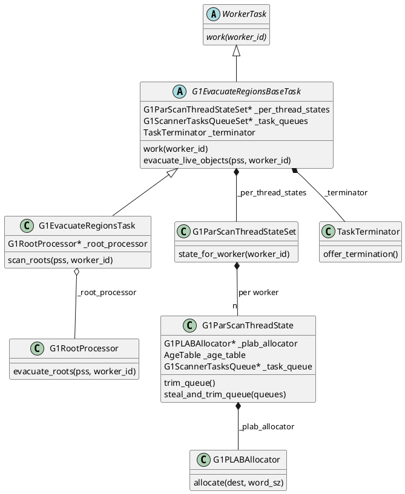

The worker side of the main task shows what each worker does—the same three steps for all of them, with no shared mutable state except the work queues:

```cpp
// g1YoungCollector.cpp — worker side
void G1EvacuateRegionsBaseTask::work(uint worker_id) {
  start_work(worker_id);
  {
    ResourceMark rm;
    // 1. This worker's private scan state: PLAB allocator, age table, queues.
    G1ParScanThreadState* pss = _per_thread_states->state_for_worker(worker_id);
    pss->set_ref_discoverer(_g1h->ref_processor_stw());
    // 2. Entry points into the collection set: roots, remembered sets, code roots.
    scan_roots(pss, worker_id);
    // 3. Follow references: drain the own queue, steal from others, until all
    //    queues are empty and the terminator declares the work finished.
    evacuate_live_objects(pss, worker_id);
  }
  end_work(worker_id);
}
```

Copying uses the private `G1ParScanThreadState` (and inside it the `G1PLABAllocator`), so the allocation path needs no locks; load balancing happens only when a worker exhausts its own queue and steals from a peer (`G1ParEvacuateFollowersClosure`). The VM thread stays parked in `_end_semaphore.wait()` and wakes for the next serial decision.

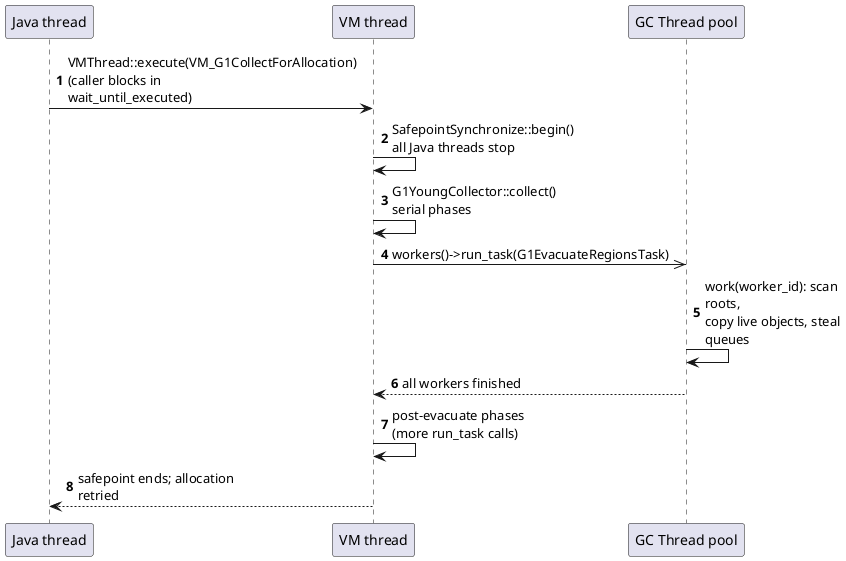

A mixed collection uses the same machine; only the collection set is bigger. Remark and Cleanup, the two stop-the-world parts of the concurrent cycle, also travel through this pair: the marker thread asks the VM thread for the pause, and `remark()` dispatches its own parallel work—reference processing, region liveness, selection for rebuild—to the GC Thread pool.

#### 3.1.2 G1 Conc pool: G1 Main Marker's workers

The G1 Conc pool walks the object graph beside the mutators. Its workers start from the roots captured at Concurrent Start and mark every live object in the old generation while the application keeps allocating and storing references.

**Scheduling.** The pool runs only during a concurrent cycle, which the VM thread starts at the end of a Concurrent Start pause:

```cpp
// g1CollectedHeap.cpp — the VM thread schedules a cycle
void G1CollectedHeap::start_concurrent_cycle(bool concurrent_operation_is_full_mark) {
  MutexLocker x(G1CGC_lock, Mutex::_no_safepoint_check_flag);
  if (concurrent_operation_is_full_mark) {
    _cm->start_full_concurrent_cycle();   // prepare the cycle (§3.3)
  } else {
    _cm->start_undo_concurrent_cycle();
  }
  G1CGC_lock->notify();   // wake the marker thread
}
```

The marker thread sleeps on `G1CGC_lock`, so the notify is what wakes it to run the cycle and dispatch the parallel phases to this pool.

The pool is created together with the marker thread, capped by `ConcGCThreads`:

```cpp
// g1ConcurrentMark.cpp
void G1ConcurrentMark::fully_initialize() {
  _cm_thread = new G1ConcurrentMarkThread(this);
  _max_concurrent_workers = ConcGCThreads;
  _concurrent_workers = new WorkerThreads("G1 Conc", _max_concurrent_workers);
  _concurrent_workers->initialize_workers();
}
```

The marker thread is the pool's only driver: it owns the cycle's control flow and dispatches every parallel phase. It spends most of its time asleep on `G1CGC_lock`, and wakes from the notify that starts a cycle:

```cpp
// g1ConcurrentMarkThread.cpp
void G1ConcurrentMarkThread::run_service() {
  while (wait_for_next_cycle()) {
    ...
    if (state() == FullCycleMarking) {
      concurrent_mark_cycle_do();
    } else {
      concurrent_undo_cycle_do();
    }
    ...
  }
}
```

`concurrent_mark_cycle_do` is a fixed list of phases: scan root regions, mark loop, rebuild and scrub, cleanup, clear bitmap. The parallel phases run on `_concurrent_workers`, driven by the marker thread.

The classes behind one mark cycle:

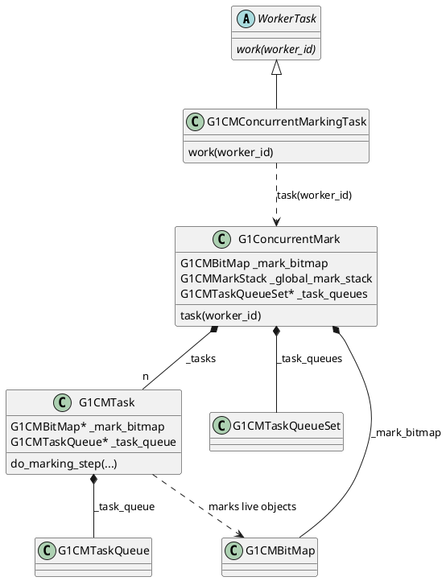

The core is the root walk:

```cpp
// g1ConcurrentMark.cpp — called by the marker thread
void G1ConcurrentMark::mark_from_roots() {
  G1CMConcurrentMarkingTask marking_task(this);
  _concurrent_workers->run_task(&marking_task);   // marker thread blocks here
}
```

Each `G1 Conc` worker owns a `G1CMTask` with a private mark stack and follows references concurrently with the mutators. Workers join the suspendible thread set, so a pause can suspend them at a safe point and resume them afterwards (`G1CMConcurrentMarkingTask::work`).

Remark and Cleanup are the exception: the marker thread does not run them. It submits a VM operation and waits, which hands the pause to the other driver/pool pair:

```cpp
// g1ConcurrentMarkThread.cpp
bool G1ConcurrentMarkThread::subphase_remark() {
  VM_G1PauseRemark op;
  VMThread::execute(&op);   // marker thread blocks; VM thread runs the pause
}
```

So a concurrent cycle uses both pairs: `G1 Main Marker` + `G1 Conc` for everything that runs beside the mutators, and the `VM thread` + `GC Thread` for the two stop-the-world phases. When Cleanup is done the marker thread clears the bitmap, ends the cycle, and goes back to sleep.

#### 3.1.3 G1 Refinement Workers: G1 Refine Control's workers

The G1 Refinement Workers turn dirty cards into remembered-set entries. Each worker sweeps a slice of the dirty card table and records the references it finds into the remembered sets of the target regions, so a later evacuation pause can use them.

**Scheduling.** Refinement is demand-driven: there is no wake-up per dirty card, and a sweep runs only while enough cards are pending. The control thread sleeps on a timed wait and re-evaluates when it wakes; the end of every collection also activates it, so refinement resumes right after a pause:

```cpp
// g1ConcurrentRefineThread.cpp — the control thread's idle wait
bool G1ConcurrentRefineThread::wait_for_work() {
  MonitorLocker ml(notifier(), Mutex::_no_safepoint_check_flag);
  if (!requested_active() && !should_terminate()) {
    ml.wait(cr()->adjust_threads_wait_ms());   // timed: wake up and re-check
  }
  cr()->record_thread_adjustment_needed();
  return !should_terminate();
}

// g1ConcurrentRefineThread.cpp — explicit wake-up, called after a collection
void G1ConcurrentRefineThread::activate() {
  MonitorLocker ml(&_notifier, Mutex::_no_safepoint_check_flag);
  if (!_requested_active || should_terminate()) {
    _requested_active = true;
    ml.notify();
  }
}
```

Refinement has its own pool as well, created next to the control thread when refinement is enabled:

```cpp
// g1ConcurrentRefine.cpp
jint G1ConcurrentRefineThreadControl::initialize(G1ConcurrentRefine* cr) {
  _control_thread = create_refinement_thread();
  _workers = new WorkerThreads("G1 Refinement Workers", max_num_threads());
  _workers->initialize_workers();
}
```

The control thread is the pool's only driver: it does the serial work of a cycle and dispatches the sweeps. Its main loop alternates between waiting for work and refining:

```cpp
// g1ConcurrentRefineThread.cpp
void G1ConcurrentRefineThread::run_service() {
  while (wait_for_work()) {                       // timed wait while idle
    ...
    if (cr()->adjust_num_threads_periodically()) {
      do_refinement();
    } ...
  }
}
```

`do_refinement` does the serial part on the control thread—swap the global, Java, and GC card tables, snapshot the heap—then hands the sweep to the pool:

```cpp
// g1ConcurrentRefine.cpp
void G1ConcurrentRefine::run_with_refinement_workers(WorkerTask* task) {
  _thread_control.run_task(task, num_threads_wanted());
}
```

The classes behind one sweep:

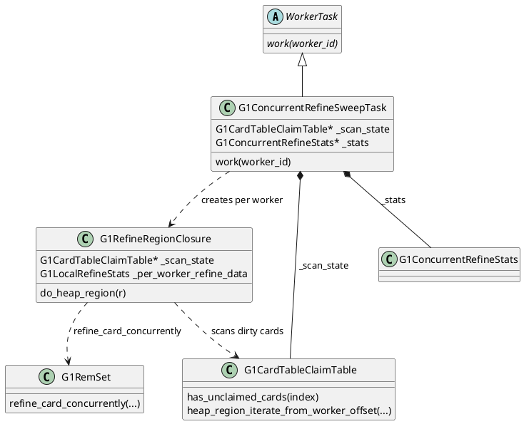

Each refinement worker claims whole regions from a shared claim table and scans their dirty cards:

```cpp
// g1ConcurrentRefineSweepTask.cpp — worker side
void G1ConcurrentRefineSweepTask::work(uint worker_id) {
  G1RefineRegionClosure sweep_cl(worker_id, _scan_state);
  _scan_state->heap_region_iterate_from_worker_offset(&sweep_cl, worker_id, _max_workers);
  ...
}
```

Unlike the other pools this one usually runs far below its ceiling: `num_threads_wanted()` is computed from how many cards are pending (`G1ConcurrentRefineThreadsNeeded`), and the control thread re-evaluates it every ~50 ms. A sweep is also interruptible: when a safepoint request arrives the workers stop at a card boundary (`SuspendibleThreadSet::should_yield`) and the control thread resumes the sweep afterwards.

### 3.2 Young promotion

A young collection evacuates every Eden and Survivor region, and a live object is copied either to a Survivor region or into an Old region. Copying it to Old is **promotion**, and repeated promotion is what fills the old generation. The choice is the object's age, stored in its `markWord` (4 bits, so age runs from 0 to 15), compared with the **tenuring threshold** computed at the start of the pause. Promotion is decided per object, not per region: an Eden region is dismantled object by object, and its live objects can split between Survivor and Old. An Eden object (age 0) goes straight to Old whenever the tenuring threshold is 0, and a worker whose Survivor refill failed promotes every object it copies afterwards, Eden objects included.

`G1Policy` keeps one `AgeTable` for the whole heap and one threshold. Each GC worker is a `G1ParScanThreadState`: it copies that threshold into a local field, copies objects through its own `G1PLABAllocator` (a per-worker buffer, the GC counterpart of a TLAB), and records the ages of objects it placed in Survivor in a local `AgeTable`. At the end of the pause those tables are merged, and the next pause's threshold is computed from the merge.

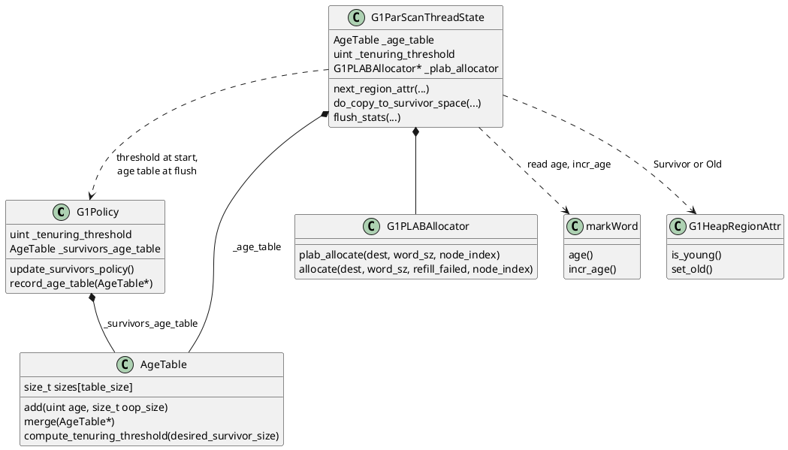

**Where the copy goes.** `next_region_attr` reads the age from the mark word already loaded for the copy (or from the displaced mark, when the header is inflated). A young object younger than the threshold keeps a young destination, which for a successful copy is a Survivor region. Anything else, including an object already in Old, is destined for Old.

```cpp
// g1ParScanThreadState.cpp
G1HeapRegionAttr G1ParScanThreadState::next_region_attr(G1HeapRegionAttr const region_attr, markWord const m, uint& age) {
  if (region_attr.is_young()) {
    age = !m.has_displaced_mark_helper() ? m.age()
                                         : m.displaced_mark_helper().age();
    // Below the threshold: stay young, so the copy lands in Survivor.
    if (age < _tenuring_threshold) {
      return region_attr;
    }
  }
  // Young and old enough: promotion. Already old: old-to-old copy.
  return G1HeapRegionAttr::Old;
}
```

`do_copy_to_survivor_space` asks the PLAB allocator for that destination. If the PLAB is full, `allocate_copy_slow` refills it or allocates this one object directly. The words are then copied and the old object is forwarded to the copy. Only the worker that wins that race ages the copy. A copy that stayed young has its age incremented, capped at `markWord::max_age` (15), written back with `incr_age`, and added to the worker's age table. A promotion does not age the object; it updates the old region's block offset table instead, so the old region can be parsed.

```cpp
// g1ParScanThreadState.cpp
oop G1ParScanThreadState::do_copy_to_survivor_space(G1HeapRegionAttr const region_attr,
                                                    oop const old,
                                                    markWord const old_mark) {
  uint age = 0;
  G1HeapRegionAttr dest_attr = next_region_attr(region_attr, old_mark, age);
  HeapWord* obj_ptr = _plab_allocator->plab_allocate(dest_attr, word_sz, node_index);
  // PLAB full: refill, or allocate this one object directly. Both can fail.
  if (obj_ptr == nullptr) {
    obj_ptr = allocate_copy_slow(&dest_attr, klass, word_sz, age, node_index);
  }
  Copy::aligned_disjoint_words(cast_from_oop<HeapWord*>(old), obj_ptr, word_sz);
  const oop obj = cast_to_oop(obj_ptr);
  const oop forward_ptr = old->forward_to_atomic(obj, old_mark, memory_order_relaxed);
  // This worker installed the forwarding pointer. Another worker already did: undo and return theirs.
  if (forward_ptr == nullptr) {
    if (dest_attr.is_young()) {
      if (age < markWord::max_age) {
        age++;
        obj->incr_age();
      }
      _age_table.add(age, word_sz);
    } else {
      update_bot_after_copying(obj, word_sz);
    }
  }
}
```

An Eden object is allocated at age 0. The first time it survives, the test sees age 0, the copy goes to Survivor, and the age stored there is 1. The age table therefore has no age-0 entry.

**Survivor space exhausted.** If the object does not fit in the Survivor PLAB, the worker tries to refill that PLAB and, failing that, allocates the one object directly in Survivor. When the refill itself failed and the direct allocation also fails, `allocate_in_next_plab` places this object in Old and sets the worker's threshold to 0. Every later young object on that worker then fails `age < _tenuring_threshold` and is promoted, so the worker stops asking for a new Survivor region per object. An object that was simply too large for a PLAB does not change the threshold: the refill is never attempted, and only that object falls through to Old.

```cpp
// g1ParScanThreadState.cpp
HeapWord* G1ParScanThreadState::allocate_in_next_plab(G1HeapRegionAttr* dest,
                                                      size_t word_sz,
                                                      bool previous_plab_refill_failed,
                                                      uint node_index) {
  if (dest->is_young()) {
    HeapWord* const obj_ptr = _plab_allocator->allocate(G1HeapRegionAttr::Old, word_sz,
                                                        &plab_refill_in_old_failed, node_index);
    // A failed Survivor refill means Survivor has no room. Promote from here on.
    if (previous_plab_refill_failed) {
      _tenuring_threshold = 0;
    }
    if (obj_ptr != nullptr) {
      dest->set_old();
    }
    return obj_ptr;
  }
}
```

**Worker cleanup.** One code step remains at the end of the pause: as each worker finishes its share, `flush_stats` retires its PLAB allocator and merges its age table into the policy's table:

```cpp
// g1ParScanThreadState.cpp — each worker, at the end of the pause
size_t G1ParScanThreadState::flush_stats(size_t* surviving_young_words, uint num_workers) {
  flush_numa_stats();
  _plab_allocator->flush_and_retire_stats(num_workers);
  // Merge this worker's AgeTable into the global one.
  _g1h->policy()->record_age_table(&_age_table);
  ...
}
```

**The next threshold.** At the start of the pause, before any copying, `record_young_collection_start` calls `update_survivors_policy` and then clears the age table. The desired Survivor space is `TargetSurvivorRatio` (default **50%**) of the Survivor capacity, and that capacity is the young-list target divided by `SurvivorRatio` (default **8**). `compute_tenuring_threshold` walks the age table from age 1 and stops at the first age whose running total exceeds that size. The threshold is that age, capped by `MaxTenuringThreshold` (default **15**). `AlwaysTenure` forces the threshold to 0, so every young object is promoted immediately; `NeverTenure` sets it above the maximum age, so age alone never promotes.

```cpp
// g1Policy.cpp — called from record_young_collection_start
void G1Policy::update_survivors_policy() {
  double max_survivor_regions_d = (double)young_list_target_length() / (double)SurvivorRatio;
  uint const desired_max_survivor_regions = ceil(max_survivor_regions_d);
  size_t const survivor_size = desired_survivor_size(desired_max_survivor_regions);
  _tenuring_threshold = _survivors_age_table.compute_tenuring_threshold(survivor_size);
}

// ageTable.cpp — AlwaysTenure and NeverTenure return
// MaxTenuringThreshold immediately. Otherwise sizes[] and the desired size are in words.
uint AgeTable::compute_tenuring_threshold(size_t desired_survivor_size) {
  size_t total = 0;
  uint age = 1;
  while (age < table_size) {
    total += sizes[age];
    // Including this age overflowed the desired Survivor space: this age promotes.
    if (total > desired_survivor_size) break;
    age++;
  }
  return age < MaxTenuringThreshold ? age : MaxTenuringThreshold;
}
```

Workers are constructed with that threshold. As each worker finishes, `flush_stats` merges its age table into `G1Policy`'s table through `record_age_table`. The pause that just ran recorded who survived; the next pause tenures against that record.

### 3.3 Concurrent mark

Young collections promote into Old and do not compact it. When non-young occupancy crosses the initiating threshold (`G1IHOP`, default **45%** of the current heap, adapted while `G1UseAdaptiveIHOP` is on; §3.6), G1 schedules a **Concurrent Start** young collection: it still evacuates Eden/Survivor, and it starts concurrent marking of the old generation.

Concurrent Start is still an ordinary young collection—the same pause as Young-Only. Its root scan serves two purposes at once: it fixes up references for evacuation, and it feeds the marking bitmap the roots marking starts from. The pause also exists for the roots themselves: a running thread's stack and registers change with every instruction, so only a stop-the-world point can take a consistent snapshot of them. Riding that snapshot on a pause that has to stop anyway is why the step is called Concurrent Start instead of a separate initial-mark pause. The same safepoint resets what the previous cycle left behind:

```cpp
// g1ConcurrentMark.cpp — before evacuation, at the same safepoint
void G1ConcurrentMark::pre_concurrent_start(GCCause::Cause cause) {
  assert_at_safepoint_on_vm_thread();

  G1CollectedHeap::start_codecache_marking_cycle_if_inactive(true /* concurrent_mark_start */);
  ClassLoaderDataGraph::verify_claimed_marks_cleared(ClassLoaderData::_claim_strong);

  // serial: reset the marking state left by the previous cycle
  // parallel: per old region, take the top-at-mark-start (TAMS) boundary
  G1PreConcurrentStartTask cl(cause, this);
  G1CollectedHeap::heap()->run_batch_task(&cl);
}
```

The root scan runs with marking closures. `create_root_closures` checks the collector state and swaps the plain evacuation closures for marking ones:

```cpp
// g1RootClosures.cpp — closure set for the pause's root scan
G1EvacuationRootClosures* G1EvacuationRootClosures::create_root_closures(G1CollectedHeap* g1h,
                                                                         G1ParScanThreadState* pss,
                                                                         bool process_only_dirty_klasses) {
  if (g1h->collector_state()->is_in_concurrent_start_gc()) {
    ...
    res = new G1ConcurrentStartMarkClosures<...>(g1h, pss);   // should_mark == true
  } else {
    res = new G1EvacuationClosures(g1h, pss, process_only_dirty_klasses);
  }
}
```

A reference into the collection set is evacuated as usual; a reference to a non-moving old object is marked in place, right there in the pause:

```cpp
// g1OopClosures.inline.hpp — one root during the Concurrent Start pause
void G1ParCopyClosure<barrier, should_mark>::do_oop_work(T* p) {
  const G1HeapRegionAttr state = _g1h->region_attr(obj);
  if (state.is_in_cset()) {
    oop forwardee;
    markWord m = obj->mark();
    if (m.is_forwarded()) {
      forwardee = obj->forwardee(m);
    } else {
      forwardee = _par_scan_state->copy_to_survivor_space(state, obj, m);
    }
    RawAccess<IS_NOT_NULL>::oop_store(p, forwardee);   // into young: evacuate
  } else {
    ...
    if (should_mark) {
      mark_object(obj);   // into old: _cm->mark_in_bitmap(_worker_id, obj)
    }
  }
}
```

At the end of the pause, still inside the safepoint, the VM thread wakes the dedicated marker thread:

```cpp
// g1ConcurrentMark.cpp
void G1ConcurrentMark::start_full_concurrent_cycle() {
  // 1. VM thread, still in the safepoint: begin weak-reference discovery for this cycle
  ReferenceProcessor* rp = _g1h->ref_processor_cm();
  rp->start_discovery(false /* always_clear */);

  // 2. turn on SATB queue recording on every thread
  SATBMarkQueueSet& satb_mq_set = G1BarrierSet::satb_mark_queue_set();
  satb_mq_set.set_active_all_threads(true, /* new active value */ false /* expected_active */);

  // 3. mark the cycle in progress; start_concurrent_cycle (§3.1.2) then
  //    notifies G1CGC_lock to wake the marker thread
  cm_thread()->start_full_cycle();
}
```

Marking uses **snapshot-at-the-beginning (SATB)**. At Concurrent Start, G1 takes a virtual snapshot of liveness; a mutator pre-barrier logs the previous referent of a reference field into a thread-local SATB buffer before the store so objects live at mark start stay in the snapshot. The G1 Conc workers, driven by `G1ConcurrentMarkThread`, walk the object graph with the marking bitmap and drain those buffers while the application runs. Normal young collections, which are still VM-thread pauses, may continue until marking finishes.

Each `G1 Conc` worker takes its own `G1CMTask`, with a private mark stack, and steps the graph walk until the work is done:

```cpp
// g1ConcurrentMark.cpp — one G1 Conc worker
void G1CMConcurrentMarkingTask::work(uint worker_id) {
  ResourceMark rm;
  SuspendibleThreadSetJoiner sts_join;   // a pause can suspend this worker
  G1CMTask* task = _cm->task(worker_id);
  task->record_start_time();
  do {
    task->do_marking_step(G1ConcMarkStepDurationMillis,
                          true  /* do_termination */,
                          false /* is_serial */);
    _cm->do_yield_check();               // yield if a pause was requested
  } while (!_cm->has_aborted() && task->has_aborted());
  task->record_end_time();
}
```

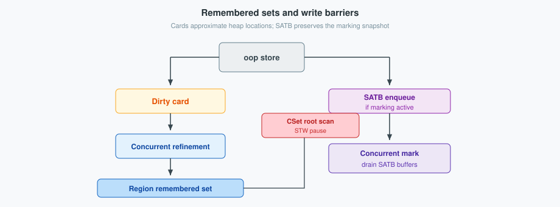

The marker thread then runs `concurrent_mark_cycle_do`, a fixed list of phases:

```cpp
// g1ConcurrentMarkThread.cpp
void G1ConcurrentMarkThread::concurrent_mark_cycle_do() {
  // 1. this thread: scan roots of regions evacuated during Concurrent Start
  if (phase_scan_root_regions()) return;
  // 2. this thread drives the loop; G1 Conc workers run mark_from_roots
  if (phase_mark_loop()) return;
  // 3. this thread: rebuild remembered sets and scrub dead objects
  if (phase_rebuild_and_scrub()) return;
  if (phase_delay_to_keep_mmu_before_cleanup()) return;
  // 4. hand Cleanup to the VM thread
  if (phase_cleanup()) return;
  if (phase_clear_cld_claimed_marks()) return;
  // 5. this thread: clear the bitmap for the next cycle
  phase_clear_bitmap_for_next_mark();
}
```

Two STW pauses complete the analysis (the marker thread only requests them; the VM thread runs them, with the GC Thread workers):

1. **Remark** — drains remaining SATB work, finishes reference processing related to marking, and may reclaim completely empty regions.
2. **Cleanup** — accounts live data per old region, rebuilds remembered sets for collection-set candidates, and decides whether a Space-Reclamation (mixed) phase should follow.

Marking answers which old regions are sparse (or poorly connected) enough to be worth evacuating later. It does not by itself free those regions for mutator allocation.

### 3.4 Evacuation

G1 reclaims by **evacuation**: live objects in a **collection set (CSet)** are copied into free regions, and references (from roots and remembered sets) are updated to the new locations. The VM thread runs the pause. The GC Thread workers do the parallel copy. A young or mixed pause roughly: disconnect TLABs and select the CSet; merge heap roots and remembered sets for that CSet; copy objects; then post-evacuate cleanup.

The pause itself is one VM operation, run with every mutator stopped at the safepoint; the same operation covers a normal young collection and a mixed one, and only the collection set differs:

```cpp
// g1VMOperations.cpp — runs on the VM thread
void VM_G1CollectForAllocation::doit() {
  G1CollectedHeap* g1h = G1CollectedHeap::heap();
  GCCauseSetter x(g1h, _gc_cause);
  // 1. VM thread: evacuate the collection set (young, or young plus old candidates)
  g1h->do_collection_pause_at_safepoint(_word_size);

  if (_word_size > 0) {
    // 2. the allocation that triggered the pause retries, and may escalate
    _result = g1h->satisfy_failed_allocation(_word_size);
  } else if (g1h->should_upgrade_to_full_gc()) {
    // 3. no regions left: this same VM thread continues into a full collection
    g1h->upgrade_to_full_collection();
  }
}
```

The pause that the operation runs has a fixed shape, beginning to end:

```cpp
// g1YoungCollector.cpp — one young (or mixed) pause (setup elided)
void G1YoungCollector::collect() {
  policy()->record_young_collection_start();   // tenuring threshold, pause timers

  pre_evacuate_collection_set(...);            // retire TLABs, select the collection set

  G1ParScanThreadStateSet per_thread_states(...);
  bool may_do_optional_evacuation = collection_set()->num_optional_regions() != 0;
  // The parallel copy: scan roots and remembered sets, copy live objects.
  evacuate_initial_collection_set(&per_thread_states, may_do_optional_evacuation);

  if (may_do_optional_evacuation) {
    evacuate_optional_collection_set(&per_thread_states);   // mixed: remaining old candidates
  }
  post_evacuate_collection_set(..., &per_thread_states);    // refs, free CSet, free list

  _next_state = policy()->record_young_collection_end(...); // statistics, next state
}
```

**Remembered sets (RSets)** record approximate locations outside a region that may point into it (cards, by default 512-byte granules). Mutators dirty cards on reference stores. `G1ConcurrentRefineThread` and its workers turn those dirty cards into RSet entries, so the pause need not scan the entire old generation for pointers into the CSet.

**Young-only** collections put every Eden and Survivor region into the CSet. Surviving objects go to Survivor or, when aged out, to Old. No old region is evacuated—the common case while the Young-Only phase fills Old.

**Mixed** collections still evacuate all young regions, and add a budgeted number of **old candidate** regions chosen after marking (low live bytes, favorable connectivity). Policy spreads old reclaim across several mixed pauses (`G1MixedGCCountTarget`, default **8**). Regions whose live bytes exceed `G1MixedGCLiveThresholdPercent` (default **85%** of a region) stay out of the mixed CSet. Humongous objects are normally only dropped when dead, not moved, except in last-resort efforts.

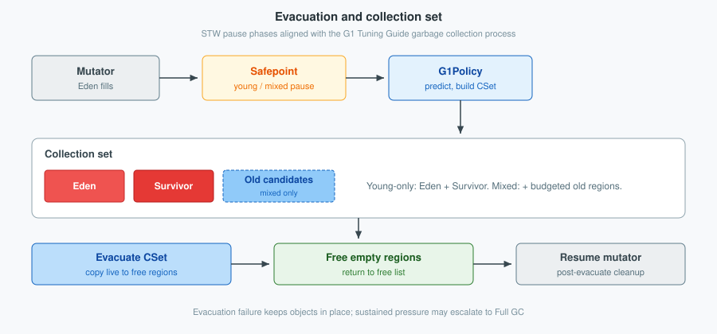

If destination space is insufficient, **evacuation failure** leaves objects in place and schedules those regions for later collection. Sustained failure may escalate to a **Full GC**—a whole-heap compacting STW that is not part of the cycle, but runs on the same VM thread:

```cpp
// g1VMOperations.cpp
void VM_G1CollectFull::doit() {
  G1CollectedHeap* g1h = G1CollectedHeap::heap();
  GCCauseSetter x(g1h, _gc_cause);
  bool clear_all_soft_refs = _gc_cause == GCCause::_metadata_GC_clear_soft_refs ||
                             _gc_cause == GCCause::_wb_full_gc;
  // VM thread: compact the whole heap
  g1h->do_full_collection(size_t(0) /* allocation_word_size */,
                          clear_all_soft_refs,
                          false /* do_maximal_compaction */);
}
```

### 3.5 Free

After a successful evacuation, source regions in the CSet contain no live objects. G1 returns them to the **free** list: their type becomes Free, and the memory manager may later hand them out again as Eden, Survivor, Old, or Humongous destinations. That is the step that makes the gray cells in the heap layout reusable.

Freeing is the last parallel step of the pause. The free-set task has workers claim and clear the CSet regions:

```cpp
// g1YoungGCPostEvacuateTasks.cpp
void G1PostEvacuateCollectionSetCleanupTask2::FreeCollectionSetTask::do_work(uint worker_id) override {
  FreeCSetClosure cl(_surviving_young_words, worker_id,
                     worker_stats(worker_id), _evac_failure_regions);
  _g1h->collection_set_par_iterate_all(&cl, &_claimer, worker_id);
  ...
}
```

Clearing a region resets its metadata, so nothing reads stale contents after reuse:

```cpp
// g1CollectedHeap.cpp
void G1CollectedHeap::free_region(G1HeapRegion* hr, G1FreeRegionList* free_list) {
  // Reset region metadata to allow reuse.
  hr->hr_clear(true /* clear_space */);
  _policy->remset_tracker()->update_at_free(hr);
  if (free_list != nullptr) {
    free_list->add_ordered(hr);
  }
}
```

At the end of the pause, `rebuild_free_region_list` gathers every free region into the list the allocator draws from:

```cpp
// g1CollectedHeap.cpp — end of the pause
void G1CollectedHeap::rebuild_free_region_list() {
  _hrm.rebuild_free_list(workers());
}
```

Completely empty regions can also appear without a full CSet evacuation—for example after Remark/Cleanup when marking finds a region with no live data, or when a dead humongous object is reclaimed. Those regions likewise become Free.

Policy keeps a fraction of the heap in reserve (`G1ReservePercent`) so evacuation always has destination space. Space-Reclamation (mixed) stops when further old evacuation would not free enough space worth the pause (`G1HeapWastePercent`, default **5%**), and the cycle returns to Young-Only with a larger free pool for allocation.

| Lever | Default (typical) | Role in the cycle |
|-------|-------------------|-------------------|
| `MaxGCPauseMillis` | 200 | Bounds how large Eden and mixed CSets may be |
| `G1IHOP` | 45 | Non-young occupancy, as a percent of the current heap, above which the next pause may be a Concurrent Start. Adapted when `G1UseAdaptiveIHOP` is on |
| `G1ReservePercent` | 10 | Free regions held back for evacuation destinations |
| `G1MixedGCCountTarget` | 8 | How many mixed pauses spread old freeing |
| `G1MixedGCLiveThresholdPercent` | 85 | Skip dense old regions in the CSet |
| `G1HeapWastePercent` | 5 | Stop mixed reclaim when little free space remains to gain |

Logs (`-Xlog:gc*` and `-Xlog:gc+phases=debug`) show pause kind, CSet composition, and whether regions were freed or evacuation failed. Building a debuggable HotSpot for stepping these paths is covered in [JVM build and debug](/post/java/jvm/build-debug/).

### 3.6 Old threshold check

Promotion fills Old, and young collections do not compact it. G1 therefore watches **non-young occupancy** (old regions plus humongous regions) and starts a concurrent marking cycle once that occupancy passes a threshold. The check does not start marking itself. It sets a flag, and the next young pause becomes a Concurrent Start.

`G1IHOPControl` owns the threshold. `G1Policy::need_to_start_conc_mark` compares the heap's non-young occupancy with it. `G1CollectorState` carries the result as `_initiate_conc_mark_if_possible`, and `decide_on_concurrent_start_pause` reads that flag at the beginning of the next pause.

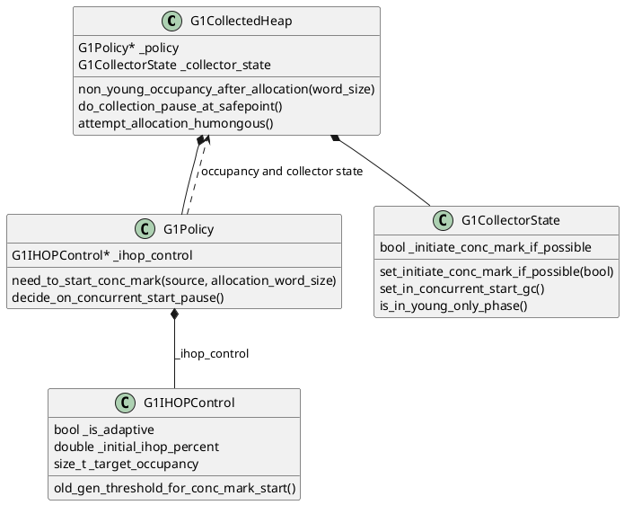

**The threshold.** With adaptive IHOP off, or before `G1AdaptiveIHOPNumInitialSamples` (default **3**) completed cycles, the threshold is `G1IHOP` percent of the current heap. `record_new_heap_size` stores that heap size as `_target_occupancy`. With adaptive IHOP on and enough samples, the threshold is pulled earlier: the effective target (current heap, reduced by `G1ReservePercent` and `G1HeapWastePercent`) minus the space the cycle is predicted to consume before the first mixed collection. That prediction is three terms: old-generation allocation over the predicted cycle length, the peak extra humongous occupancy seen in past cycles, and the young generation expected to be alive at the first mixed collection.

```cpp
// g1IHOPControl.cpp
size_t G1IHOPControl::old_gen_threshold_for_conc_mark_start() const {
  if (!_is_adaptive || !have_enough_data_for_prediction()) {
    return (size_t)(_initial_ihop_percent * _target_occupancy / 100.0);
  }

  size_t old_non_humongous_alloc_bytes =
      (size_t)(predict(&_marking_start_to_mixed_time_s) * predict(&_old_non_humongous_alloc_rate));
  size_t predicted_peak_extra_humongous_occupancy =
      predict(&_peak_extra_humongous_occupancy_in_mark_cycle);
  size_t needed_for_concurrent_cycle = _expected_young_gen_at_first_mixed_gc
                                     + old_non_humongous_alloc_bytes
                                     + predicted_peak_extra_humongous_occupancy;

  size_t target_heap_occupancy = effective_target_occupancy();
  return needed_for_concurrent_cycle < target_heap_occupancy
           ? target_heap_occupancy - needed_for_concurrent_cycle
           : 0;
}
```

**The comparison.** Non-young occupancy is the bytes in old and humongous regions, minus free space in the retained old allocation region. A humongous request is added, because that object will land in non-young regions; an ordinary allocation is not, because it lands in Eden. The check returns true only when occupancy is strictly above the threshold and the collector is still in the young-only phase. A cycle already in progress, or a mixed phase about to start, suppresses it.

```cpp
// g1Policy.cpp — the outer overload refuses during a concurrent
// cycle or when a mixed phase is about to start, then calls this one.
bool G1Policy::need_to_start_conc_mark(const char* source,
                                       const G1CollectorState& state,
                                       size_t allocation_word_size) const {
  size_t marking_initiating_old_gen_threshold =
      _ihop_control->old_gen_threshold_for_conc_mark_start();
  size_t non_young_occupancy =
      _g1h->non_young_occupancy_after_allocation(allocation_word_size);

  if (non_young_occupancy > marking_initiating_old_gen_threshold) {
    return state.is_in_young_only_phase();
  }
  return false;
}
```

**When it runs.** At the end of a young collection, `record_young_collection_end` makes this check and sets `_initiate_conc_mark_if_possible` on the state the next pause will see. The marking does not start in that pause:

```cpp
// g1Policy.cpp — end of the young pause
G1CollectorState G1Policy::record_young_collection_end(bool concurrent_operation_is_full_mark,
                                                       bool allocation_failure,
                                                       size_t allocation_word_size) {
  if (collector_state()->is_in_concurrent_start_gc()) {
    next_state.set_in_normal_young_gc();
  } else if (!about_to_start_mixed_phase() &&
             need_to_start_conc_mark("end of GC", next_state, allocation_word_size)) {
    // The flag the next pause reads.
    next_state.set_initiate_conc_mark_if_possible(true);
  }
}
```

At the beginning of the next pause, `do_collection_pause_at_safepoint` calls `decide_on_concurrent_start_pause`, which turns the flag into a Concurrent Start when the collector is still young-only and not about to start mixed collections. A user or metadata request sets the same flag through `force_concurrent_start_if_outside_cycle`, and only when no concurrent cycle is already running.

```cpp
// g1Policy.cpp
void G1Policy::decide_on_concurrent_start_pause() {
  if (collector_state()->initiate_conc_mark_if_possible()) {
    if (!about_to_start_mixed_phase() && collector_state()->is_in_young_only_phase()) {
      // This pause evacuates the young generation and then starts marking.
      collector_state()->set_in_concurrent_start_gc();
    }
  }
}
```

A humongous allocation can cross the threshold between pauses. `attempt_allocation_humongous` runs the same check before allocating, and a true result requests a collection immediately, because one humongous object can consume many regions.

```cpp
// g1CollectedHeap.cpp
HeapWord* G1CollectedHeap::attempt_allocation_humongous(size_t word_size) {
  if (is_init_completed() &&
      policy()->need_to_start_conc_mark("concurrent humongous allocation", word_size)) {
    try_collect(word_size, GCCause::_g1_humongous_allocation, collection_counters(this));
  }
}
```

---

## 4. References

- [Garbage-First (G1) Garbage Collector — HotSpot Virtual Machine Garbage Collection Tuning Guide (Java SE 22)](https://docs.oracle.com/en/java/javase/22/gctuning/garbage-first-g1-garbage-collector1.html#GUID-ED3AB6D3-FD9B-4447-9EDF-983ED2F7A573)
- [JEP 248: Make G1 the Default Garbage Collector](https://openjdk.org/jeps/248)
- [JEP 523: Make G1 the Default Garbage Collector in All Environments](https://openjdk.org/jeps/523)
