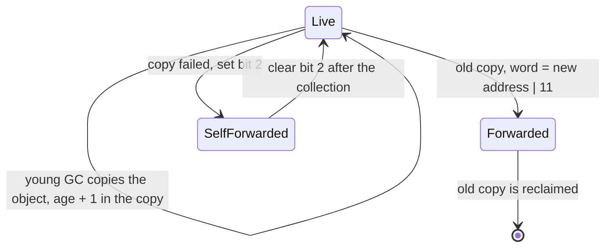
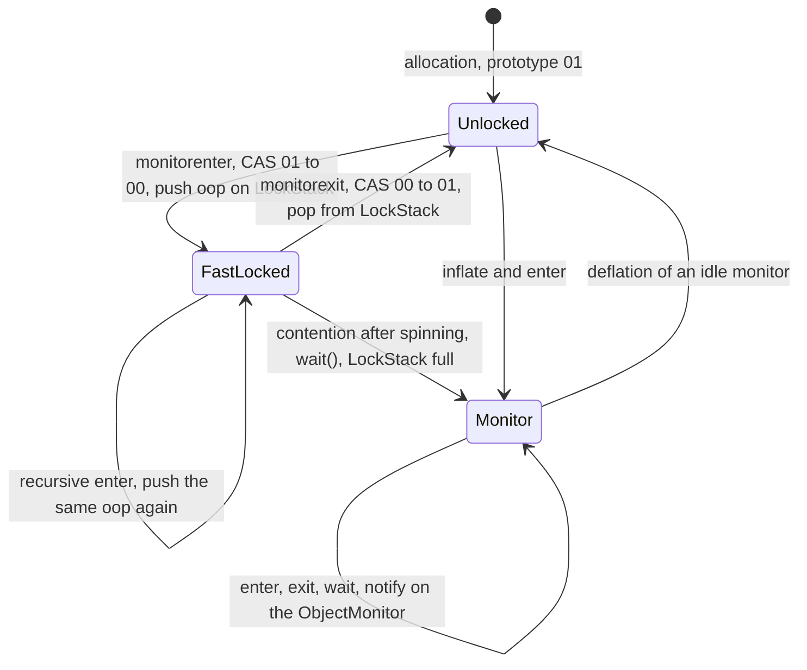

This post describes the HotSpot representation of a Java object: the object header and its mark word, how locking, hashing and garbage collection share that word, and how C++ code inside the VM refers to Java objects.
<!--more-->

# Part 1 — Heap objects
## 1.1 Overview
Every Java object in HotSpot is an `oopDesc` in the Java heap. VM code refers to it through an `oop` ("ordinary object pointer"), which is a typed pointer to that `oopDesc`. The object starts with a header, followed by the instance fields or the array elements.

**Everything in this blog is for JDK 27 with the default settings.**

The header is the mark word (`markWord`), one machine word:
1. The **class identity** is the 22-bit identifier in bits 63..42. It decodes to the object's `Klass`, which lives in Metaspace and describes the type: layout, vtable, and size.
2. The rest of the word holds per-object runtime state: the identity hash, the GC age, the lock state, and the GC forwarding state.

```plantuml
class oopDesc {
    - volatile markWord _mark
    - narrowKlass _compressed_klass
    + markWord mark() const
    + Klass* klass() const
    + static int header_size()
    + size_t size()
}
class instanceOopDesc
class arrayOopDesc {
    + static int length_offset_in_bytes()
    + static int base_offset_in_bytes(BasicType type)
}
class objArrayOopDesc
class typeArrayOopDesc
class stackChunkOopDesc
class markWord {
    - uintptr_t _value
}
class Klass {
    - jint _layout_helper
    - markWord _prototype_header
}
class Handle {
    - oop* _handle
}

oopDesc <|-- instanceOopDesc
oopDesc <|-- arrayOopDesc
instanceOopDesc <|-- stackChunkOopDesc
arrayOopDesc <|-- objArrayOopDesc
arrayOopDesc <|-- typeArrayOopDesc
oopDesc *-- markWord : _mark
oopDesc --> Klass : klass bits
Handle --> oopDesc : oop slot
```

The mark word is shared by three VM subsystems:
- **Hashing** stores the identity hash in it once the hash is first requested.
- **Locking** uses its two low bits to record whether the object is unlocked, fast-locked by a thread, or associated with an inflated `ObjectMonitor`.
- **The garbage collector** uses it for object age, marking, and forwarding during evacuation.

C++ code inside the VM does not hold raw `oop`s to these heap objects across safepoints. It refers to them through `Handle`s, which are themselves VM-side C++ objects and are managed outside the Java heap (Part 2).

## 1.2 Mark word layout
The mark word is the whole header: one 8-byte machine word, with the class identifier in the top 22 bits. The first field, or the array length, starts at offset 8. Bit 0 is the least significant bit.

```
header      0                               8
            +-------------------------------+
            |  mark word (includes klass)   |
            +-------------------------------+
 63                    42 41                              11 10    7 6     3   2   1  0
+------------------------+----------------------------------+-------+-------+-----+-----+
|        klass:22        |             hash:31              | vlh:4 | age:4 | sf:1| lk:2|
+------------------------+----------------------------------+-------+-------+-----+-----+

lk = lock, sf = self-fwd, vlh = valhalla (reserved)
```

- `lk` (bits 1..0) is the lock tag. It selects the state, and the state decides how the other bits are read.
- `sf` (bit 2) is the self-forwarded bit, set by a GC that forwards an object to itself.
- `age` (bits 6..3) counts the young collections the object has survived, up to 15.
- `vlh` (bits 10..7) is reserved for Project Valhalla.
- `hash` (bits 41..11) is the identity hash; 0 means no hash has been assigned yet.
- `klass` (bits 63..42) holds the class identifier.

### States
The class bits stay in the word in every state except a young-GC forwarding pointer.

```
unlocked (new object, or after unlock)
+------------------------+----------------------------------+-------+-------+-----+-----+
|         klass          |          hash or 0               |   0   |  age  |  0  | 01  |
+------------------------+----------------------------------+-------+-------+-----+-----+

fast-locked (owner recorded in the thread's LockStack)
+------------------------+----------------------------------+-------+-------+-----+-----+
|         klass          |          hash or 0               |   0   |  age  |  0  | 00  |
+------------------------+----------------------------------+-------+-------+-----+-----+

monitor (ObjectMonitor recorded in the monitor table)
+------------------------+----------------------------------+-------+-------+-----+-----+
|         klass          |          hash or 0               |   0   |  age  |  0  | 10  |
+------------------------+----------------------------------+-------+-------+-----+-----+

forwarded (young GC copied the object; old copy points to the new one)
+---------------------------------------------------------------------------+-----+-----+
|                      forwardee address (bits 63..3)                       |  0  | 11  |
+---------------------------------------------------------------------------+-----+-----+

self-forwarded (GC failed to copy the object; it stays in place)
+------------------------+----------------------------------+-------+-------+-----+-----+
|         klass          |          hash or 0               |   0   |  age  |  1  | lk  |
+------------------------+----------------------------------+-------+-------+-----+-----+
```

The unlocked, fast-locked and monitor states differ only in the two tag bits, so the class, the hash and the age stay in the object while it is locked. The forwarded state is the one that replaces the word with a pointer. Bit 2 of that pointer is 0, because heap addresses are 8-byte aligned, which is how `sf` can share the bit.

One object's mark word, with the class bits shown as 0. Only the hash, the age and the tag change:

```
new object                          0x0000000000000001   hash 0, age 0, tag 01
identityHashCode() = 0x1234567      0x000000091A2B3801   0x1234567 << 11 | 01
after surviving two young GCs       0x000000091A2B3811   age 2 << 3
synchronized, uncontended           0x000000091A2B3810   tag 01 -> 00
synchronized, contended             0x000000091A2B3812   tag 01 -> 10
```

### Hash and GC state changes
The identity hash is installed by CAS while Java code runs. It is created on the first `Object.hashCode()` or `System.identityHashCode()` call and written into bits 41..11. It never changes afterwards; it is random, not the address, so it survives object moves.

The GC state changes happen only inside a collection, while Java threads are stopped:



- **Age.** When a young collection copies a survivor, the copy keeps the header with `age` + 1. At the tenuring threshold, the object is copied into the old generation instead.
- **Forwarding.** The old copy's word becomes `new address | 11`, so every other reference to the old copy can find the new one. The original header is not lost, because the new copy carries it.
- **Self-forwarding.** If the copy cannot be allocated, the object stays where it is and only bit 2 is set, so hash, age and lock bits are kept. The bit is cleared when the collection finishes.
- **Full GC.** Compaction overwrites the header of an object that is itself kept. Headers that carry a hash or a lock are saved before the overwrite and restored afterwards; all others are reset to the prototype. The forwarding value keeps the 22 class bits and stores the destination in bits 41..2 as a word offset from the heap base.

See [JVM garbage collection](/post/java/jvm/gc/) for the collectors that apply these steps.

## 1.3 Object lock
Every Java object can be used as a lock. The Java language exposes it in two forms:
- `synchronized` blocks and methods provide mutual exclusion; the lock is reentrant.
- `Object.wait`, `notify` and `notifyAll` provide a condition queue. They may only be called by the thread that holds the object's lock.

HotSpot records the lock state in the two low bits of the mark word (section 1.2), with two lock levels:
1. A **fast lock** (tag `00`) costs one CAS and allocates nothing. The owner is recorded in the owning thread's `LockStack`.
2. An **inflated lock** (tag `10`) uses an `ObjectMonitor`, found through the monitor table. The monitor adds an entry queue for blocked threads and a wait set for `wait()`.

### Java usage
The class below uses each form. The comments name the VM path and the lock state the object is in at that point.

```java
public class Mailbox {
    private final Object lock = new Object();
    private String message;              // guarded by lock
    private static int created;          // guarded by Mailbox.class

    public Mailbox() {
        // static synchronized: the lock object is the Class mirror Mailbox.class
        register();
    }

    private static synchronized void register() {
        created++;
    }

    // synchronized block: javac emits monitorenter / monitorexit on `lock`
    public void put(String m) throws InterruptedException {
        synchronized (lock) {            // uncontended: lock fast-locked, tag 01 -> 00
            while (message != null) {
                lock.wait();             // wait needs a wait set: lock is inflated, tag -> 10
            }
            message = m;
            lock.notifyAll();            // moves waiters from the wait set to the entry queue
        }                                // monitorexit
    }

    public String take() throws InterruptedException {
        synchronized (lock) {            // contended (another thread holds lock): blocks in the entry queue
            while (message == null) {
                lock.wait();
            }
            String m = message;
            message = null;
            lock.notifyAll();
            return m;
        }
    }

    // synchronized method: ACC_SYNCHRONIZED, the lock object is `this`
    public synchronized boolean isEmpty() {
        return peek() == null;
    }

    // reentrant: the thread already holds `this`, so this enter is recursive
    private synchronized String peek() {
        synchronized (lock) {            // nested lock on a second object: both are on the LockStack
            return message;
        }
    }
}
```

Calling `lock.wait()` or `lock.notify()` without holding `lock` throws `IllegalMonitorStateException`. Calling `lock.notify()` while `lock` is still fast-locked returns immediately, because a lock that was never inflated has no wait set and therefore no waiters.

### From bytecode to the VM
A `synchronized` block compiles to `monitorenter` before the body and `monitorexit` after it. javac also adds an exception handler covering the body, which executes `monitorexit` and rethrows, so the lock is released on every exit path. A `synchronized` method has no such bytecodes; the method carries the `ACC_SYNCHRONIZED` flag, and the interpreter's method entry (`TemplateInterpreterGenerator::lock_method`) locks the receiver, or the class mirror for a static method.

Each lock held by an interpreted frame occupies a `BasicObjectLock` slot in that frame. The slot pairs the object with a `BasicLock`, which caches the `ObjectMonitor*` once the lock is inflated. The interpreter's runtime entry points pass that slot to `ObjectSynchronizer`:

```cpp
// InterpreterRuntime.monitorenter
JRT_ENTRY_NO_ASYNC(void, InterpreterRuntime::monitorenter(JavaThread* current, BasicObjectLock* elem))
  ...
  // 1. wrap the object in a Handle: entering may block, and the object may move meanwhile
  Handle h_obj(current, elem->obj());
  // 2. fast-lock, or inflate and enter; elem->lock() is the frame's BasicLock
  ObjectSynchronizer::enter(h_obj, elem->lock(), current);
  ...
JRT_END

// InterpreterRuntime.monitorexit
JRT_LEAF(void, InterpreterRuntime::monitorexit(BasicObjectLock* elem))
  oop obj = elem->obj();
  // 1. a JNI MonitorExit may already have released it
  if (obj->is_unlocked()) {
    if (CheckJNICalls) {
      fatal("Object has been unlocked by JNI");
    }
    return;
  }
  // 2. pop the fast lock, or exit the ObjectMonitor
  ObjectSynchronizer::exit(obj, elem->lock(), JavaThread::current());
  // 3. free the slot so that exception unwinding does not unlock it a second time
  elem->set_obj(nullptr);
JRT_END
```

JIT-compiled code inlines the fast-lock CAS and the `LockStack` push, and calls into the runtime only when that fails.

### Lock states and transitions
Each transition is a CAS on the mark word, except deflation, which is done by the `MonitorDeflationThread`:



`ObjectSynchronizer::enter` tries the cheapest step first:
1. **Recursive fast lock.** If the object is already on top of the thread's `LockStack`, push it again.
2. **Recursive, but not on top.** If the thread holds the object further down the stack, inflate it and enter the monitor recursively.
3. **Fast lock.** If the tag is `01`, CAS it to `00` and push the object. If the `LockStack` (8 entries per `JavaThread`) is full, contended entries or the oldest entry are inflated first to make room.
4. **Spin.** If another thread holds the fast lock, spin with exponential backoff, retrying the CAS, while the object is not inflated.
5. **Inflate and enter.** Create or look up the `ObjectMonitor`, set the tag to `10`, and enter the monitor, blocking in its entry queue if it is owned.

`ObjectSynchronizer::exit` reverses these steps:
- a recursive fast lock is popped from the `LockStack`;
- the last fast lock CASes the tag back from `00` to `01`;
- an inflated lock is released through `ObjectMonitor::exit`.

When a thread inflates an object that another thread holds fast-locked, it cannot tell which thread is the owner, so it gives the monitor an *anonymous* owner. The real owner finds the object on its own `LockStack` at the next `exit`, `wait` or `notify`. It then takes ownership and sets the recursion count from the number of stack entries.

### ObjectMonitor
```plantuml
class JavaThread {
    - LockStack _lock_stack
}
class LockStack {
    - uint32_t _top
    - oop _base[CAPACITY]
}
class ObjectMonitor {
    - volatile uintptr_t _metadata
    - WeakHandle _object
    - int64_t volatile _owner
    - volatile intx _recursions
    - ObjectWaiter* volatile _entry_list
    - ObjectWaiter* volatile _entry_list_tail
    - int _contentions
    - ObjectWaiter* volatile _wait_set
    - volatile int _waiters
}
class ObjectWaiter {
    - JavaThread* _thread
    - TStates TState
}
class BasicLock {
    - ObjectMonitor* volatile _monitor
}
class BasicObjectLock {
    - BasicLock _lock
    - oop _obj
}

JavaThread *-- LockStack
BasicObjectLock *-- BasicLock
BasicLock --> ObjectMonitor : cache
ObjectMonitor o-- ObjectWaiter : entry list
ObjectMonitor o-- ObjectWaiter : wait set
```

`_owner` identifies the owning thread, or holds the anonymous or deflater marker. `_metadata` holds the object's hash. `_object` is a weak reference back to the locked object.

`wait` and `notify` reach the monitor through `inflate_locked_or_imse`. It throws `IllegalMonitorStateException` when the object is unlocked or fast-locked by another thread, inflates when the caller holds a fast lock, and claims an anonymous owner for the caller:

```cpp
// ObjectSynchronizer.inflate_locked_or_imse
ObjectMonitor* ObjectSynchronizer::inflate_locked_or_imse(oop obj, ObjectSynchronizer::InflateCause cause, TRAPS) {
  JavaThread* current = THREAD;

  for (;;) {
    markWord mark = obj->mark_acquire();
    // 1. not locked at all: the caller cannot be the owner
    if (mark.is_unlocked()) {
      THROW_MSG_(vmSymbols::java_lang_IllegalMonitorStateException(),
                 "current thread is not owner", nullptr);
    }

    // 2. fast-locked: only the thread that has it on its LockStack may inflate it
    if (mark.is_fast_locked()) {
      if (!current->lock_stack().contains(obj)) {
        THROW_MSG_(vmSymbols::java_lang_IllegalMonitorStateException(),
                   "current thread is not owner", nullptr);
      } else {
        return inflate_fast_locked_object(obj, cause, current, current);
      }
    }

    // 3. already inflated: claim an anonymous owner if the caller holds the fast lock
    assert(mark.has_monitor(), "must be");
    ObjectMonitor* monitor = ObjectSynchronizer::read_monitor(obj, mark);
    if (monitor != nullptr) {
      if (monitor->has_anonymous_owner()) {
        LockStack& lock_stack = current->lock_stack();
        if (lock_stack.contains(obj)) {
          monitor->set_owner_from_anonymous(current);
          monitor->set_recursions(lock_stack.remove(obj) - 1);
        } else {
          THROW_MSG_(vmSymbols::java_lang_IllegalMonitorStateException(),
                     "current thread is not owner", nullptr);
        }
      }
      return monitor;
    }
    // 4. the monitor was deflated concurrently: re-read the mark word and retry
    ...
  }
}
```

The monitor then implements the Java semantics:
- **`wait(millis)`**
  1. Throws `InterruptedException` at once if the thread is already interrupted.
  2. Adds an `ObjectWaiter` node to `_wait_set` and increments `_waiters`.
  3. Saves `_recursions` and sets it to 0, then fully exits the monitor, so that other threads can enter even when the waiter had entered recursively.
  4. Parks until notified, interrupted, or timed out.
  5. Re-enters the monitor and restores the saved recursion count.
- **`notify()`** returns at once if `_wait_set` is empty. Otherwise it dequeues one waiter and moves it to `_entry_list`. The waiter does not run yet: it competes for the monitor once the notifier exits.
- **`notifyAll()`** moves every waiter from `_wait_set` to `_entry_list`, one at a time.
- **Deflation.** `MonitorDeflationThread` periodically deflates monitors that are not busy: no owner, no waiters, an empty entry list, and no contentions. Deflation detaches the monitor and sets the tag back to `01`, so the object can be fast-locked again.

# Part 2 — VM objects
## 2.1 Allocation base classes and StackObj
The Java objects of Part 1 live in the Java heap and are reclaimed by the garbage collector. The C++ objects that HotSpot itself uses are managed differently: the VM must never call the global `operator new` / `operator delete` directly. Every VM class therefore derives from one of the allocation base classes, and the base class fixes where instances of that class may live.

| Base class | Storage | Released by |
|------------|---------|-------------|
| `CHeapObj<MT>` | C heap (`malloc`), tracked by NMT under memory tag `MT` | explicit `delete` |
| `ResourceObj` | thread-local resource area | the enclosing `ResourceMark` |
| `MetaspaceObj` | Metaspace (class metadata, including `Klass`) | class unloading; `delete` is not allowed |
| `StackObj` | the native (C++) stack only | leaving the C++ scope |
| `AllStatic` | none; the class is only a namespace | not applicable |

`StackObj` is the base class for objects that may only be local variables, or by-value members of other stack objects. It declares no fields and no virtual functions. It only deletes the heap operators, so any attempt to allocate it on the heap fails at compile time:

```cpp
// StackObj
class StackObj {
 public:
  void* operator new(size_t size) = delete;
  void* operator new [](size_t size) = delete;
  void  operator delete(void* p) = delete;
  void  operator delete [](void* p) = delete;
};
```

A `StackObj` therefore lives exactly as long as the C++ block that declares it. HotSpot uses this for scope guards: the constructor saves or acquires something, and the destructor restores or releases it when the block exits. That includes early exits through `return` and through the `CHECK` macros that propagate a pending exception.

```plantuml
class StackObj {
    + void* operator new(size_t size) = delete
    + void* operator new [](size_t size) = delete
    + void operator delete(void* p) = delete
    + void operator delete [](void* p) = delete
}
class ResourceMark {
    - const ResourceMarkImpl _impl
}
class HandleMarkCleaner {
    - Thread* _thread
}
class NoHandleMark
class ResetNoHandleMark {
    - int _no_handle_mark_nesting
}
class MutexLockerImpl
class MutexLocker
class ObjectLocker {
    - JavaThread* _thread
    - Handle _obj
    - BasicLock _lock
    - NoPreemptMark _npm
    - bool _skip_exit
}
class ThreadStateTransition
class ThreadInVMfromJava
class ThreadInVMfromNative
class JavaCallArguments
class methodHandle {
    - Method* _value
    - Thread* _thread
}
class constantPoolHandle {
    - ConstantPool* _value
    - Thread* _thread
}
class Handle {
    - oop* _handle
}

StackObj <|-- ResourceMark
StackObj <|-- HandleMarkCleaner
StackObj <|-- NoHandleMark
StackObj <|-- ResetNoHandleMark
StackObj <|-- MutexLockerImpl
MutexLockerImpl <|-- MutexLocker
StackObj <|-- ObjectLocker
StackObj <|-- ThreadStateTransition
ThreadStateTransition <|-- ThreadInVMfromJava
ThreadStateTransition <|-- ThreadInVMfromNative
StackObj <|-- JavaCallArguments
StackObj <|-- methodHandle
StackObj <|-- constantPoolHandle
ObjectLocker *-- Handle
```

The subclasses fall into three groups:
1. **Arena marks.**
   - `ResourceMark` records the top of the thread's resource area and rolls it back in its destructor. That frees every `ResourceObj` and resource array allocated inside the scope.
   - `HandleMarkCleaner` does the same for the handle area.
   - `NoHandleMark` allocates nothing; in debug builds it asserts that no handle is created inside its scope. `ResetNoHandleMark` lifts that restriction for a nested scope.
2. **Lock and state guards.**
   - `MutexLocker` locks a VM `Mutex` and unlocks it on exit.
   - `ObjectLocker` enters the monitor of a Java object and leaves it when the scope ends.
   - `ThreadInVMfromJava` and `ThreadInVMfromNative` switch the thread state for the scope and switch it back.
3. **Call frames and metadata handles.**
   - `JavaCallArguments` collects the arguments for a call from the VM into Java and lives only for that call.
   - `methodHandle` and `constantPoolHandle` register a `Method*` or `ConstantPool*` with the thread, so that `RedefineClasses` does not reclaim the metadata while the handle is alive. The destructor unregisters it.

## 2.2 Handles
C++ code in the VM must not keep a raw `oop` across a safepoint. A moving collector can relocate the `oopDesc` (section 1.2), and the raw pointer would then be stale. A `Handle` adds one indirection:
- Its `_handle` points to a slot in the thread's `HandleArea`.
- The slot holds the `oop`.
- The GC visits and updates every slot through `HandleArea::oops_do`.

```cpp
// Handle.Handle
inline Handle::Handle(Thread* thread, oop obj) {
  assert(thread == Thread::current(), "sanity check");
  if (obj == nullptr) {
    // 1. a null oop needs no slot
    _handle = nullptr;
  } else {
    // 2. bump-allocate one oop-sized slot in the thread-local handle area and store obj in it;
    //    the GC updates this slot when obj moves
    _handle = thread->handle_area()->allocate_handle(obj);
  }
}
```

`Handle` itself does not derive from `StackObj`. It is a value object that is copied by value and returned from functions, and the slot it points to is freed by the arena mark that encloses it.

`HandleMark` is not a `StackObj` either, because one `HandleMark` is heap-allocated when a thread is created. `HandleMarkCleaner` is the `StackObj` variant: it reuses the `HandleMark` that `JavaCalls::call_helper` already placed further down the stack.

```cpp
// HandleMarkCleaner.HandleMarkCleaner
inline HandleMarkCleaner::HandleMarkCleaner(Thread* thread) {
  _thread = thread;
  // 1. save the current top of the handle area in the thread's last HandleMark
  _thread->last_handle_mark()->push();
}

// HandleMarkCleaner.~HandleMarkCleaner
inline HandleMarkCleaner::~HandleMarkCleaner() {
  // 2. at scope exit, reset the handle area to the saved top;
  //    every Handle created in between now refers to a released slot
  _thread->last_handle_mark()->pop_and_restore();
}
```

A handle therefore must not escape the mark that encloses it. Converting it back to an `oop`, or to a JNI local handle, is the only way to carry the reference across the mark boundary.

## 2.3 ObjectLocker
`ObjectLocker` is the VM's C++ equivalent of a `synchronized` block, and it uses the locking path of section 1.3 directly:
- The object is held through a `Handle`, so it can move while the thread blocks.
- The `BasicLock` is a by-value field and therefore sits in the C++ stack frame. It caches the `ObjectMonitor*` when the lock is inflated, which is the same role as the `BasicLock` inside an interpreter frame's `BasicObjectLock`.

```cpp
// ObjectLocker.ObjectLocker
ObjectLocker::ObjectLocker(Handle obj, TRAPS) : _thread(THREAD), _obj(obj),
  _npm(_thread, _thread->at_preemptable_init() /* ignore_mark */), _skip_exit(false) {
  assert(!_thread->preempting(), "");

  // 1. the thread must be in a state where it may block at a safepoint
  _thread->check_for_valid_safepoint_state();

  if (_obj() != nullptr) {
    // 2. fast-lock or inflate-and-enter, using the stack-resident _lock as the monitor cache
    ObjectSynchronizer::enter(_obj, &_lock, _thread);

    if (_thread->preempting()) {
      // 3. virtual-thread preemption was cancelled after freezing; exit is deferred to the destructor
      ...
    }
  }
}

// ObjectLocker.~ObjectLocker
ObjectLocker::~ObjectLocker() {
  // 4. at scope exit, leave the lock unless wait_uninterruptibly handed it to preemption
  if (_obj() != nullptr && !_skip_exit) {
    ObjectSynchronizer::exit(_obj(), &_lock, _thread);
  }
}
```

Because the lock record and the guard share the C++ frame, the lock is released on every path out of the block. This is the property that `StackObj` exists to guarantee.

Related: [JVM thread internals](/post/java/jvm/thread/) for `JavaThread`, its `LockStack` and the memory model; [java concurrency - synchronizer framework](/post/java/concurrency/synchronizer-framework/) for the `java.util.concurrent` locks built on AQS rather than on the mark word.
