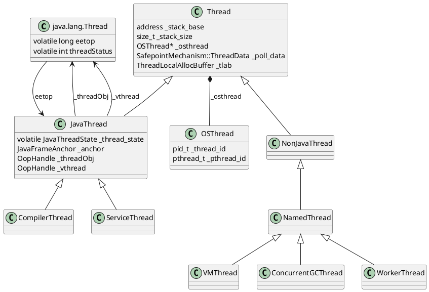
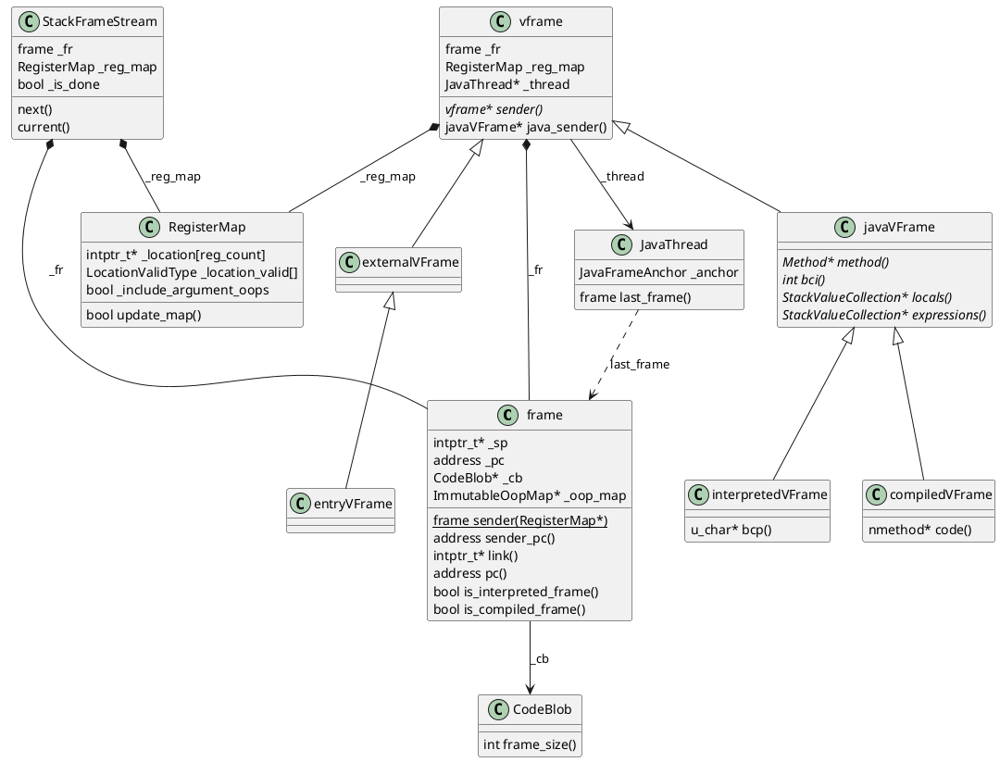
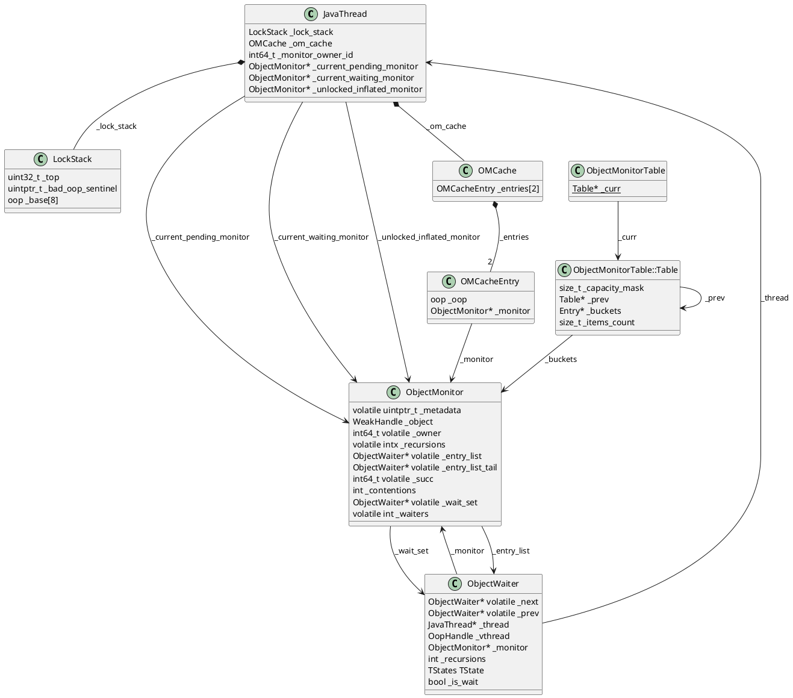
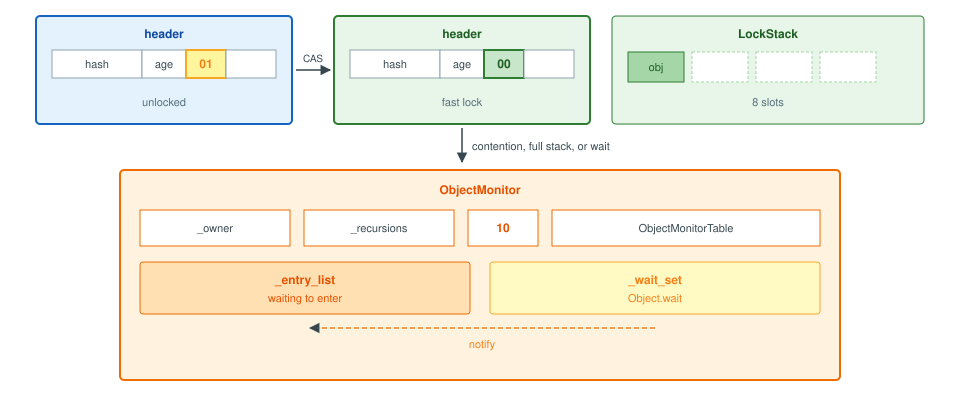
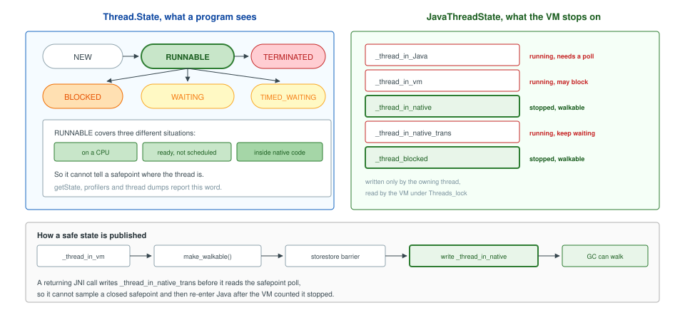
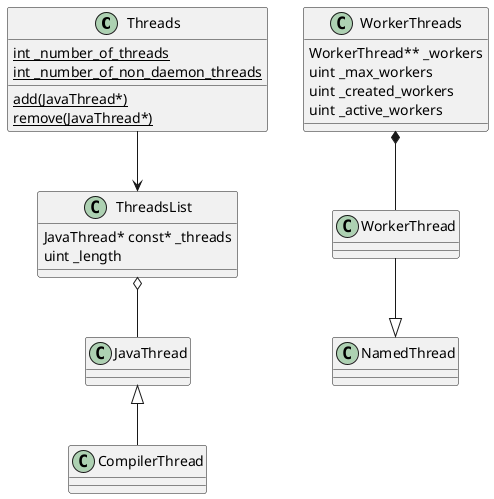
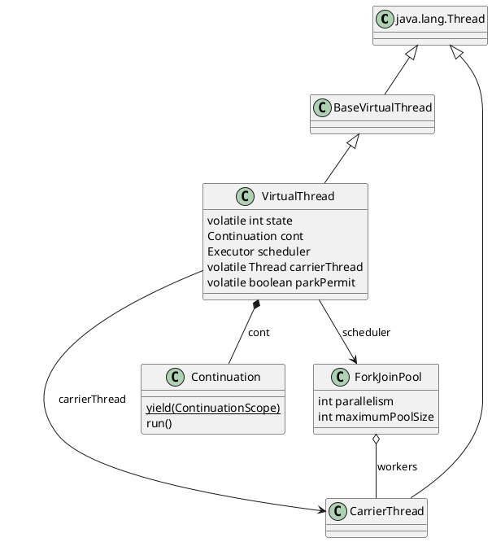
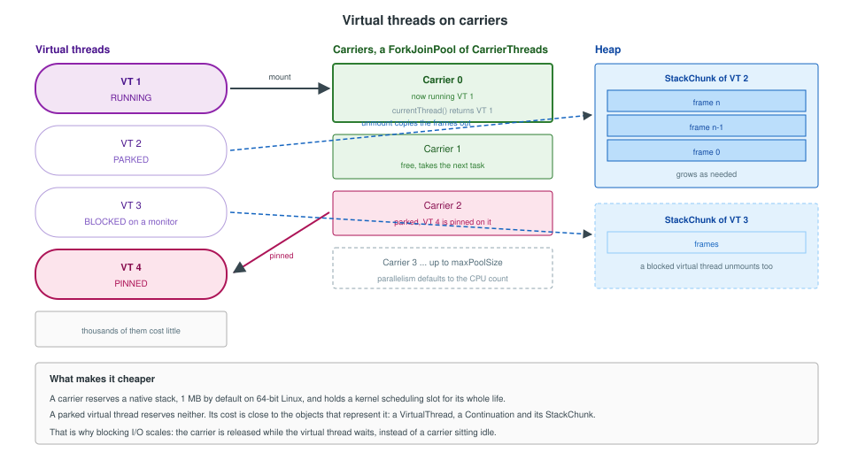

A Java thread is one logical thread with three representations: the `java.lang.Thread` object a program creates, the HotSpot `JavaThread` the VM schedules and scans, and the operating system thread that actually runs. Such a thread owns a native stack, and carries a state word that the VM reads when it must stop the thread. A virtual thread keeps the first representation and drops the other two while it sits unmounted.

<!--more-->

---

## 1. Overview

`java.lang.Thread` is the Java object a program holds. `Thread.ofPlatform()` creates an ordinary one, and `Thread.ofVirtual()` creates a `VirtualThread`, a subclass through the sealed `BaseVirtualThread` that `isVirtual()` tests for.

Behind an ordinary `Thread` the VM keeps two more objects: a `JavaThread` and an `OSThread` wrapping a pthread. The Java object and the `JavaThread` point at each other, through `eetop` and `_threadObj`, so the VM can follow the link from either side.



HotSpot threads split in two. A **`JavaThread`** can execute Java: the threads that run bytecode and JNI methods, plus the compiler threads and the service thread. A **`NonJavaThread`** runs VM and GC work: the VM thread, which runs safepoints and VM operations, and the GC driver and worker threads. Only `JavaThread`s carry a `JavaThreadState` and a Java stack.

## 2. Thread stack and execution frames

A thread uses its **stack** to execute methods. A call puts its arguments, its locals, and the intermediate values of the expression it is computing on the stack. A return removes that call's values and hands the result to the caller. Calls nest, so a caller stays on the stack, its expression unfinished, for the whole time its callee runs.

A **frame** is one call on that stack. It holds the return address, the instruction the caller resumes at, and the saved frame pointer, which locates the caller's frame. The other words in the frame are this call's locals and expression values.



`frame` is that call as the VM walks it. `vframe` is one Java method in the call. Inlining puts several `vframe`s in one `frame`.

### 2.1 x86 registers

A bytecode runs as machine code on the CPU. The interpreter is that machine code: it reads one opcode and carries the opcode out through the processor's registers and through the memory the stack pointer addresses. Compiled code has the same shape with the interpreter left out, so the method's own instructions use the registers directly.

A core has one set of registers and runs one thread with them. Many threads share the core across time. A switch happens in the kernel, once a timer interrupt or a blocking call has entered it. That entry pushes the thread's general registers onto its own kernel stack, as a `pt_regs` record, and stores the floating-point and vector registers in the task's FPU state. The scheduler keeps the kernel stack pointer in the task's `thread.sp`. Loading the next task's `thread.sp` continues the CPU on that thread's kernel stack, which pops the registers saved there. The Java stack stays as it was. The `rsp` inside the saved `pt_regs` is the address that points back into it.

The registers used for that execution are:

| Register | Size | Contents |
|---|---|---|
| `rax` | 64-bit | cached top of the expression stack for an `int`, a `long`, or a reference. An `int` result returns in `rax` |
| `rbx` | 64-bit | the callee's `Method*` at a call and on entry. After dispatch, the opcode of the bytecode now running |
| `rcx` | 64-bit | scratch |
| `rdx` | 64-bit | scratch. `iadd` and `imul` pop their second operand here |
| `rsp` | 64-bit | stack pointer. A push writes a word at `rsp` and subtracts 8 |
| `rbp` | 64-bit | frame pointer of the interpreter frame now running. In compiled code it is saved on the stack, and it is the frame pointer when `PreserveFramePointer` is set |
| `rsi` | 64-bit | on Linux, the first `int` argument of a compiled call (`j_rarg0`) |
| `xmm0` | 128-bit | cached top of the expression stack for a `float` or a `double` |
| `r10` | 64-bit | scratch (`rscratch1`) |
| `r11` | 64-bit | scratch (`rscratch2`) |
| `r13` | 64-bit | bytecode pointer (`rbcp`) |
| `r14` | 64-bit | address of local 0 (`rlocals`) |
| `r15` | 64-bit | the `JavaThread` executing this method |

At a call, and on entry to the callee, `rbx` holds the callee's `Method*`. Dispatch then loads the next opcode into `rbx` and indexes the dispatch table with it, so for the duration of a bytecode `rbx` is that opcode. The `Method*` stays in the frame. `rcx`, `rdx`, `r10`, and `r11` are scratch. `iadd` and `imul` pop their second operand into `rdx`.

Compiled code uses the same registers under the Java calling convention. On Linux the first `int` argument arrives in `rsi` (`j_rarg0`) and the `int` result leaves in `rax`. `r15` is still the `JavaThread`. `rbp` is saved on the stack, and with `PreserveFramePointer` it is also the compiled frame pointer.

### 2.2 Execution in x86, the interpreter

**Call.** `invokestatic` loads the resolved `Method*` into `rbx`. `prepare_invoke` pushes the return address, an interpreter return entry chosen from `invoke_return_entry_table_for` by the result type, so the caller later resumes in the interpreter with the result in the matching register. `jump_from_interpreted` records the caller's outgoing sp and jumps to the callee's `from_interpreted` entry. When interpreter events can be posted and the thread's `interp_only_mode` byte is set, the same site jumps to `interpreter_entry`, so the method stays in the interpreter.

```cpp
// templateTable_x86.cpp
void TemplateTable::invokestatic(int byte_no) {
  transition(vtos, vtos);
  load_resolved_method_entry_special_or_static(rcx, rbx, rdx); // rbx = Method*
  prepare_invoke(rcx, rcx, rdx);
  __ profile_call(rax);
  __ profile_arguments_type(rax, rbx, rbcp, false);
  __ jump_from_interpreted(rbx, rax);
}

// prepare_invoke: flags selects the row of the return-entry table
const address table_addr = (address) Interpreter::invoke_return_entry_table_for(code);
ExternalAddress table(table_addr);
__ lea(rscratch1, table);
__ movptr(flags, Address(rscratch1, flags, Address::times_ptr));
__ push(flags);
```

```cpp
// interp_masm_x86.cpp
void InterpreterMacroAssembler::prepare_to_jump_from_interpreted() {
  lea(_bcp_register, Address(rsp, wordSize)); // sender sp, above the return address
  mov(rcx, _bcp_register);
  subptr(rcx, rbp);
  sarptr(rcx, LogBytesPerWord);
  movptr(Address(rbp, frame::interpreter_frame_last_sp_offset * wordSize), rcx);
}

void InterpreterMacroAssembler::jump_from_interpreted(Register method, Register temp) {
  prepare_to_jump_from_interpreted();
  if (JvmtiExport::can_post_interpreter_events()) {
    Label run_compiled_code;
    cmpb(Address(r15_thread, JavaThread::interp_only_mode_offset()), 0);
    jccb(Assembler::zero, run_compiled_code);
    jmp(Address(method, Method::interpreter_entry_offset()));
    bind(run_compiled_code);
  }
  jmp(Address(method, Method::from_interpreted_offset()));
}
```

**Entry.** `generate_normal_entry` pops that return address into `rax`, points `rlocals` at the parameters, and pushes a zero word for each local beyond the parameter count. `generate_fixed_frame` then writes the frame's metadata below `rbp`. `enter()` is the two instructions that make `fp` name the saved `rbp`, which places the return address at `fp[1]`. The entry dispatches the first bytecode with an empty expression stack, state `vtos`.

```cpp
// templateInterpreterGenerator_x86.cpp
__ pop(rax); // return address
__ lea(rlocals, Address(rsp, rcx, Interpreter::stackElementScale(), -wordSize));
// push NULL_WORD once per extra local
generate_fixed_frame(false);
__ dispatch_next(vtos);
```

```cpp
void TemplateInterpreterGenerator::generate_fixed_frame(bool native_call) {
  // rax: return address, rbx: Method*, rlocals: locals, rbcp: sender sp
  __ push(rax);        // return address; enter() leaves it at fp[1]
  __ enter();          // push rbp; mov rbp, rsp
  __ push(rbcp);       // sender sp, at fp[-1]

  __ movptr(rax, Address(rbx, Method::const_offset()));
  __ lea(rbcp, Address(rax, ConstMethod::codes_offset()));
  __ movptr(rax, Address(rax, ConstMethod::constants_offset()));

  __ push(NULL_WORD);  // last_sp
  __ push(rbx);        // Method*

  __ movptr(rdx, Address(rax, ConstantPool::pool_holder_offset()));
  __ movptr(rdx, Address(rdx, in_bytes(Klass::java_mirror_offset())));
  __ resolve_oop_handle(rdx, rscratch2);
  __ push(rdx);        // mirror, a GC root for this Method*

  if (ProfileInterpreter) {
    Label method_data_continue;
    __ movptr(rdx, Address(rbx, in_bytes(Method::method_data_offset())));
    __ testptr(rdx, rdx);
    __ jccb(Assembler::zero, method_data_continue);
    __ addptr(rdx, in_bytes(MethodData::data_offset()));
    __ bind(method_data_continue);
    __ push(rdx);      // method data pointer
  } else {
    __ push(NULL_WORD);
  }

  __ movptr(rdx, Address(rax, ConstantPool::cache_offset()));
  __ push(rdx);        // constant pool cache

  __ movptr(rax, rlocals);
  __ subptr(rax, rbp);
  __ shrptr(rax, Interpreter::logStackElementSize);
  __ push(rax);        // locals, as a distance from fp

  if (native_call) {
    __ push(NULL_WORD); // no bcp
  } else {
    __ push(rbcp);      // bytecode pointer
  }
  __ push(frame::interpreter_frame_initial_sp_offset);
}

void MacroAssembler::enter() {
  push(rbp);
  mov(rbp, rsp);
}
```

**Bytecodes.** `dispatch_next(state)` loads the next opcode and jumps through `Interpreter::dispatch_table(state)`. The top value of an int expression lives in `rax` (`itos`); the words under it live at `rsp`. A template written for an empty top of stack (`vtos`) therefore begins, on its `itos` entry, by pushing `rax` onto the expression stack:

```cpp
// templateInterpreterGenerator_x86.cpp
iep = __ pc();
__ push_i_or_ptr();   // itos entry of a vtos template
vep = __ pc();        // vtos entry falls through
```

`push_i` is a hardware push. `pop_i` loads the word at `rsp` and adds one word to `rsp`. `iadd` and `imul` are `iop2`: the top operand is already in `rax`, and the second is popped into `rdx`.

```cpp
// interp_masm_x86.cpp
void InterpreterMacroAssembler::push_i(Register r) {
  push(r);
}

void InterpreterMacroAssembler::pop_i(Register r) {
  movl(r, Address(rsp, 0));
  addptr(rsp, wordSize);
}

// templateTable_x86.cpp
void TemplateTable::iop2(Operation op) {
  transition(itos, itos);
  switch (op) {
  case add: __ pop_i(rdx); __ addl (rax, rdx); break;
  case mul: __ pop_i(rdx); __ imull(rax, rdx); break;
  }
}
```

**Return.** `ireturn` runs `_return(itos)`. The template tests the thread's polling word and, when the poll bit is set, calls into the runtime and then continues. It narrows `rax` when the method's result type is smaller than `int`, and `remove_activation` drops the frame. The template then jumps through the return address that was at `fp[1]`.

```cpp
// templateTable_x86.cpp
void TemplateTable::_return(TosState state) {
  transition(state, state);
  if (_desc->bytecode() != Bytecodes::_return_register_finalizer) {
    Label no_safepoint;
    __ testb(Address(r15_thread, JavaThread::polling_word_offset()),
             SafepointMechanism::poll_bit());
    __ jcc(Assembler::zero, no_safepoint);
    __ push(state);
    __ push_cont_fastpath();
    __ call_VM(noreg, CAST_FROM_FN_PTR(address, InterpreterRuntime::at_safepoint));
    __ pop_cont_fastpath();
    __ pop(state);
    __ bind(no_safepoint);
  }
  if (state == itos) {
    __ narrow(rax);
  }
  __ remove_activation(state, rbcp);
  __ jmp(rbcp);
}
```

```cpp
// interp_masm_x86.cpp, tail of remove_activation
movptr(rbx, Address(rbp, frame::interpreter_frame_sender_sp_offset * wordSize));
leave();            // mov rsp, rbp; pop rbp
pop(ret_addr);      // return address from fp[1]
mov(rsp, rbx);      // caller's expression stack, arguments included
```

The return entry restores `rsp` from the `last_sp` recorded at the call, clears that slot, pops the outgoing arguments, and dispatches the caller's next bytecode in the result state. The result stays in `rax`.

```cpp
// templateInterpreterGenerator_x86.cpp — invokestatic takes the u2 index arm
__ movptr(rcx, Address(rbp, frame::interpreter_frame_last_sp_offset * wordSize));
__ lea(rsp, Address(rbp, rcx, Address::times_ptr));
__ movptr(Address(rbp, frame::interpreter_frame_last_sp_offset * wordSize), NULL_WORD);
__ restore_bcp();
__ restore_locals();
__ load_method_entry(rbx, rcx);
__ load_unsigned_short(rbx, Address(rbx, in_bytes(ResolvedMethodEntry::num_parameters_offset())));
__ lea(rsp, Address(rsp, rbx, Interpreter::stackElementScale()));
__ dispatch_next(state, step);
```

A stack walk reads the same words the return uses. `sender_for_interpreter_frame` takes the caller's fp from `link()`, the return pc from `sender_pc()`, and the caller's unextended sp from the saved sender sp at `fp[-1]`.

### 2.3 Execution in x86, compiled code

**Call.** C2 emits a hardware `call`. `CallStaticJavaDirect` is opcode `0xE8`: the processor pushes the return address and jumps to the callee's verified entry. An `int` result comes back in `rax`, and a single `int` argument is passed in `j_rarg0`.

**Prolog.** `C2_MacroAssembler::verified_entry` subtracts the return address from the frame size, because that word is already on the stack, checks for overflow, saves `rbp`, and subtracts the rest of the frame in one instruction. The `CodeBlob` records the distance from the callee's `sp` up to the caller's `sp`, in words, as `frame_size()`.

```cpp
// c2_MacroAssembler_x86.cpp
void C2_MacroAssembler::verified_entry(int framesize, int stack_bang_size,
                                      bool fp_mode_24b, bool is_stub) {
  framesize -= wordSize;                 // return address already pushed
  if (stack_bang_size > 0) {
    generate_stack_overflow_check(stack_bang_size);
    push(rbp);
    if (PreserveFramePointer) {
      mov(rbp, rsp);                     // fp chains to the caller
    }
    framesize -= wordSize;               // saved rbp
    if (framesize) {
      subptr(rsp, framesize);
    }
  }
}
```

The prologue always executes `push(rbp)`. With `PreserveFramePointer` it then copies `rsp` into `rbp`, the same chain `enter()` builds. When `stack_bang_size` is zero or below, `verified_entry` skips the overflow check: `rsp` is subtracted first, and the saved `rbp` is stored at the top of that region. C1's `build_frame` follows the banging path: overflow check, `push(rbp)`, the same optional copy into `rbp`, then `decrement(rsp, frame_size_in_bytes)`.

**Body.** Spills and outgoing arguments occupy the region just subtracted from `rsp`. The register allocator assigns the rest to registers. The `int` result is left in `rax`.

**Epilog.** `MachEpilogNode::emit` adds back the frame bytes below the saved `rbp`, pops `rbp`, and polls the safepoint word. The following `ret` pops the return address and jumps to it. C1's `remove_frame` adds the frame size and pops `rbp` before that `ret`.

```cpp
// x86.ad, MachEpilogNode::emit, then instruct Ret
framesize -= 2 * wordSize;              // saved rbp and return address
if (framesize) {
  __ addq(rsp, framesize);
}
__ popq(rbp);
// safepoint poll when the method returns
__ ret(0);
```

**Sender.** The walk of a compiled frame adds the recorded size to the current sp. The return address is the word immediately above that sender sp, and the saved `rbp` is the word below the return address.

```cpp
// frame_x86.inline.hpp
intptr_t* sender_sp = unextended_sp() + _cb->frame_size();
address sender_pc = (address) *(sender_sp - 1);
```

### 2.4 Example

```java
public class Chain {
    static int middle(int n) { return inner(n) * 2; }
    static int inner(int n)  { return n + 3; }

    public static void main(String[] args) {
        System.out.println(middle(7));
    }
}
```

`middle(7)` is the bytecodes `iload_0`, `invokestatic inner`, `iconst_2`, `imul`, `ireturn`. `inner(7)` is `iload_0`, `iconst_3`, `iadd`, `ireturn`. For the whole of `inner`, `rbp` is `inner`'s frame pointer, `r14` addresses local 0 (the parameter 7), and `r15` is the thread. `rax` is the cached top of the expression, and `rdx` receives the second operand of each arithmetic bytecode:

| Bytecode | TOS in | `rax` | `rdx` | Word at `rsp` |
|---|---|---|---|---|
| `iload_0` | `vtos` | 7 | | empty |
| `iconst_3` | `itos` | 3 | | 7 |
| `iadd` | `itos` | 10 | 7 | empty |
| `ireturn` | `itos` | 10 | | frame removed |
| return entry in `middle` | `itos` | 10 | | arguments popped |
| `iconst_2` | `itos` | 2 | | 10 |
| `imul` | `itos` | 20 | 10 | empty |
| `ireturn` of `middle` | `itos` | 20 | | frame removed |

After `iconst_3` and before `iadd`, the parameter 7 still sits above the return address, a second 7 is the word at `rsp`, and `rax` is 3. `iadd` pops that word into `rdx` and leaves 10 in `rax`. `middle` resumes with that 10 in `rax` and returns 20 in `rax`.

Compiled, each call is one hardware `call`. `inner` receives 7 in `rsi` (`j_rarg0`), its prologue saves `rbp` and subtracts `frame_size()`, and the body leaves 10 in `rax`. The epilog pops `rbp` and `ret` returns to `middle`, which multiplies `rax` by 2 and returns 20 in `rax`. The words between the saved `rbp` and `rsp` are the spills the allocator chose for that nmethod, and `frame_size()` is the distance a walker adds to reach the caller's sp.

## 3. Lock in the thread

A thread keeps the locks it holds on its `JavaThread`. An uncontended `synchronized` is a fast lock. The object header records that the object is locked, and `_lock_stack` records that this thread is the owner.

When another thread contends, the lock stack is full, or the owner calls `wait`, the fast lock inflates into an `ObjectMonitor`. The monitor records the owner, the threads waiting to enter, and the threads waiting inside `wait`. Every inflated monitor is stored in `ObjectMonitorTable`. The thread records the owner in `_monitor_owner_id`, a monitor it is entering in `_current_pending_monitor`, a monitor it is waiting on in `_current_waiting_monitor`, and a monitor a fast unlock still has to finish in `_unlocked_inflated_monitor`. `_om_cache` remembers only the two object and monitor pairs this thread used most recently.



### 3.1 Fast lock

A fast lock is what happens when a thread enters `synchronized` and no other thread holds that monitor. The VM flips two bits in the object header and writes the object into a small list on the thread, `_lock_stack`. An `ObjectMonitor` is created later, when another thread contends, the list is full, or the owner calls `wait`.

`_lock_stack` is that list. It holds the objects this thread currently fast-locks, eight slots at most. Entering pushes the object. Leaving pops it. Locking the same object again pushes it a second time, so the depth of a recursive `synchronized` is the number of times the object appears on the list.

The header and the list answer different questions. The mark word's lock bits are `01` while the object is free and `00` while a fast lock holds it. Hash and age stay in the header, so the bits say that the object is locked. Which thread locked it is the thread whose `_lock_stack` contains the object.

The list lives inside the `JavaThread`. That object is allocated on the native heap with `AllocateHeap`, which calls `os::malloc`, and it stays there for the life of the thread. `java.lang.Thread` is a different object, on the Java heap. The two heaps are separate address ranges in the same process: the garbage collector manages the Java heap, and `malloc` does not hand out memory from that range. The thread stack is a third range and holds the frames. The CPU finds `_lock_stack` from `r15`, the register that holds the current `JavaThread`.

The interpreter and C1 run the enter as the instructions below. `thread` is `r15`. The code loads the mark and the list top. Eight slots already filled means the slow path. The object already sitting at the top means a recursive enter, and the code only pushes. Otherwise it compare-and-swaps the lock bits from `01` to `00`, then stores the object at `_top`:

```cpp
// macroAssembler_x86.cpp
movptr(reg_rax, Address(obj, oopDesc::mark_offset_in_bytes()));
movl(top, Address(thread, JavaThread::lock_stack_top_offset()));

cmpl(top, LockStack::end_offset());
jcc(Assembler::greaterEqual, slow);          // eight slots already used

cmpptr(obj, Address(thread, top, Address::times_1, -oopSize));
jcc(Assembler::equal, push);                 // recursive: top is already obj

testptr(reg_rax, markWord::monitor_value);   // 0b10, already inflated
jcc(Assembler::notZero, slow);

// Transition lock bits 0b01 => 0b00
movptr(tmp, reg_rax);
andptr(tmp, ~(int32_t)markWord::unlocked_value);
orptr(reg_rax, markWord::unlocked_value);
lock(); cmpxchgptr(tmp, Address(obj, oopDesc::mark_offset_in_bytes()));
jcc(Assembler::notEqual, slow);

bind(push);
movptr(Address(thread, top), obj);
incrementl(top, oopSize);
movl(Address(thread, JavaThread::lock_stack_top_offset()), top);
```

The same two writes exist in C++ for the runtime path. `set_fast_locked` clears the lock bits, the compare-and-swap publishes that header, and `push` records the owner:

```cpp
// synchronizer.cpp
markWord locked_mark = mark.set_fast_locked();
mark = obj->cas_set_mark(locked_mark, old_mark);
if (old_mark == mark) {
  lock_stack.push(obj);
  return true;
}
```

```cpp
// markWord.hpp
static const uintptr_t locked_value   = 0;
static const uintptr_t unlocked_value = 1;
markWord set_fast_locked() const {
  return markWord(value() & ~lock_mask_in_place);
}
```

The list holds eight objects. A ninth fast lock takes the slow path. The runtime frees a slot by inflating an object already on the list: one whose header already points at a monitor, otherwise the oldest. The new enter can then still be a fast lock. One more recursive enter of an object already on a full list inflates that object instead:

```cpp
// synchronizer.cpp
void ObjectSynchronizer::ensure_lock_stack_space(JavaThread* current) {
  LockStack& lock_stack = current->lock_stack();
  if (lock_stack.is_full()) {
    LockStackInflateContendedLocks().inflate(current);
    if (lock_stack.is_full()) {
      inflate_fast_locked_object(lock_stack.bottom(),
                                 ObjectSynchronizer::inflate_cause_vm_internal,
                                 current, current);
    }
  }
}
```

Leaving the monitor reverses the two writes, and only if this object is the top of the list. The pop comes first. If the new top is still the same object, the thread still holds it recursively and the header stays `00`. The pop that removes the last copy compare-and-swaps the bits back to `01`:

```cpp
// macroAssembler_x86.cpp
movl(top, Address(thread, JavaThread::lock_stack_top_offset()));
cmpptr(obj, Address(thread, top, Address::times_1, -oopSize));
jcc(Assembler::notEqual, slow);

subl(Address(thread, JavaThread::lock_stack_top_offset()), oopSize);

cmpptr(obj, Address(thread, top, Address::times_1, -2 * oopSize));
jcc(Assembler::equal, unlocked);             // still held recursively

// Transition lock bits 0b00 => 0b01
movptr(reg_rax, Address(obj, oopDesc::mark_offset_in_bytes()));
movptr(tmp, reg_rax);
orptr(tmp, markWord::unlocked_value);
lock(); cmpxchgptr(tmp, Address(obj, oopDesc::mark_offset_in_bytes()));
```

### 3.2 Monitors

A fast lock inflates into an `ObjectMonitor` when another thread contends, `_lock_stack` is full, or the owner calls `wait`. The monitor is the heavyweight lock. It records the owner, the recursion count, and the threads waiting to enter or waiting inside `wait`.

The saved monitors live in `ObjectMonitorTable`, one table for the process. Inflation allocates the `ObjectMonitor` and `add_monitor` inserts it. The object's hash, still in the header, selects the bucket. The table starts at 128 slots and doubles when it fills. Deflation removes the entry. The header no longer holds the monitor address.

```cpp
// synchronizer.cpp
ObjectMonitor* ObjectSynchronizer::add_monitor(ObjectMonitor* monitor, oop obj) {
  assert(UseObjectMonitorTable, "must be");
  assert(obj == monitor->object(), "must be");

  intptr_t hash = obj->mark().hash();
  assert(hash != 0, "must be set when claiming the object monitor");
  monitor->set_hash(hash);

  return ObjectMonitorTable::monitor_put_get(monitor, obj);
}
```

```cpp
// objectMonitorTable.cpp
ObjectMonitor* ObjectMonitorTable::monitor_get(oop obj) {
  const intptr_t hash = obj->mark().hash();
  Table* curr = _curr.load_acquire();
  ObjectMonitor* monitor = curr->get(obj, hash);
  return monitor;
}
```

`_om_cache` is not that table. It is an array of two entries on the `JavaThread`, each an object and its `ObjectMonitor`. `get_monitor` compares the object with those two slots. A hit skips the table. `set_monitor` keeps the newest pair and lets the older one fall off the end. The monitor that leaves the cache stays in `ObjectMonitorTable`.

`_monitor_owner_id` is the `tid` this thread writes as the owner of an inflated monitor. `JVM_SetCurrentThread` updates it when the Java thread running on this `JavaThread` changes, so a mounted virtual thread owns its monitors under its own `tid`.

`_current_pending_monitor` is the `ObjectMonitor` the thread is blocked trying to enter. `_current_waiting_monitor` is the `ObjectMonitor` the thread has released and is waiting on after `Object.wait`. In either case the thread parks with `_thread_blocked`, and its Java frames stay walkable for a GC. `_unlocked_inflated_monitor` is set by the fast-unlock path after it has cleared `_owner` and still has to wake a successor; `monitor_exit_helper` reads it and finishes that exit.

The entry list and the wait set are lists of `ObjectWaiter`. Each waiter names the `JavaThread` or the virtual thread that is blocked, the monitor it belongs to, and whether it is waiting or entering. `_owner` on the monitor is this thread's `_monitor_owner_id`. `_succ` is the waiter chosen to try the lock next.



`Object.wait` and `Object.notify` run on a monitor the caller already owns. `wait` inflates the object into an `ObjectMonitor`, then calls `wait` on that monitor.

```cpp
// synchronizer.cpp
// NOTE: must use heavy weight monitor to handle wait()
int ObjectSynchronizer::wait(Handle obj, jlong millis, TRAPS) {
  JavaThread* current = THREAD;
  if (millis < 0) {
    THROW_MSG_0(vmSymbols::java_lang_IllegalArgumentException(), "timeout value is negative");
  }

  ObjectMonitor* monitor;
  monitor = ObjectSynchronizer::inflate_locked_or_imse(obj(), inflate_cause_wait, CHECK_0);

  DTRACE_MONITOR_WAIT_PROBE(monitor, obj(), current, millis);
  monitor->wait(millis, true, THREAD);
```

`wait` checks that this thread is the owner. It builds an `ObjectWaiter`, marks it `TS_WAIT`, and links it onto `_wait_set`, a circular list. It remembers the recursion count, drops that count to zero, and `exit`s the monitor, so the lock is fully released. The thread records the monitor in `_current_waiting_monitor` and parks.

```cpp
// objectMonitor.cpp, ObjectMonitor::wait
current->set_current_waiting_monitor(this);
ObjectWaiter node(current);
node.TState = ObjectWaiter::TS_WAIT;
current->_ParkEvent->reset();
OrderAccess::fence();

{
  SpinCriticalSection scs(&_wait_set_lock);
  add_waiter(&node);
}

intx save = _recursions;
_waiters++;
_recursions = 0;
exit(current);
```

The park is later in the same function, and only while the node is still `TS_WAIT`:

```cpp
} else if (node.TState == ObjectWaiter::TS_WAIT) {
  if (millis <= 0) {
    current->_ParkEvent->park();
  } else {
    ret = current->_ParkEvent->park(millis);
  }
}
```

`notify` also checks ownership. An empty wait set returns immediately. Otherwise `notify_internal` takes the first waiter off `_wait_set` and pushes it onto `_entry_list` with state `TS_ENTER`. The notifying thread still holds the lock. The waiter is now someone who must acquire the monitor again, in line with threads that were blocked on enter.

```cpp
// objectMonitor.cpp
void ObjectMonitor::notify(TRAPS) {
  JavaThread* current = THREAD;
  CHECK_OWNER();
  if (_wait_set == nullptr) {
    return;
  }
  quick_notify(current);
}
```

`notify_internal` takes the head of `_wait_set`. `add_to_entry_list` is what marks that waiter as entering:

```cpp
ObjectWaiter* iterator = dequeue_waiter();
```

```cpp
void ObjectMonitor::add_to_entry_list(JavaThread* current, ObjectWaiter* node) {
  node->_prev   = nullptr;
  node->TState  = ObjectWaiter::TS_ENTER;

  for (;;) {
    ObjectWaiter* head = AtomicAccess::load(&_entry_list);
    node->_next = head;
    if (AtomicAccess::cmpxchg(&_entry_list, head, node) == head) {
      return;
    }
  }
}
```

When the owner later leaves the monitor, `exit` selects one thread from `_entry_list` as `_succ` and unparks it. The waiting thread then re-enters. If `notify` had moved it to the entry list, it enters from that node. If the park ended because of a timeout or an interrupt, it enters directly. After the lock is held again, the saved recursion count is written back and `_current_waiting_monitor` is cleared.

```cpp
// objectMonitor.cpp, end of ObjectMonitor::wait
current->set_current_waiting_monitor(nullptr);

guarantee(_recursions == 0, "invariant");
int relock_count = JvmtiDeferredUpdates::get_and_reset_relock_count_after_wait(current);
_recursions =   save
              + relock_count;
_waiters--;
```

`notifyAll` repeats the move until `_wait_set` is empty. The waiters are pushed onto the entry list in reverse order of arrival, and they still take the lock one at a time.

The header layout and the `ObjectMonitor` queues are described in [Heap objects](/post/java/jvm/object/).

## 4. Thread state

Two words describe a thread's state, and a reader has to keep them apart.



**`Thread.State`** is what `getState()` returns and what a profiler shows. It lives in `threadStatus` on the Java object and classifies the thread for the programmer: `NEW`, `RUNNABLE`, `BLOCKED` while waiting to enter a monitor, `WAITING`, `TIMED_WAITING`, and `TERMINATED`. `RUNNABLE` deliberately covers three different situations: a thread on a CPU, a thread ready and waiting for one, and a thread executing inside a native method.

**`JavaThreadState`** is what the VM reads when it must stop the thread, for a safepoint or a GC. It lives on the `JavaThread`, is written only by the owning thread, and answers a different question: is this thread executing Java, inside the VM, in native code, or blocked?

| State | The thread is | Counted as stopped |
|---|---|---|
| `_thread_in_Java` | in the interpreter or in compiled code | still running, it must reach a poll |
| `_thread_in_vm` | inside the VM, for example in a runtime call | still running, until it blocks or leaves |
| `_thread_in_native` | in JNI or other native code | stopped, once its anchor is walkable |
| `_thread_in_native_trans` | returning from native code, before the poll | still running, the VM keeps waiting |
| `_thread_blocked` | on a monitor, parked, or on a safepoint barrier | stopped, the anchor is already walkable |

The distinction matters because `Thread.State` leaves out whether the thread is in Java or in native code, and a safepoint must treat a thread in native code differently from one running bytecode. The VM reads this word under the lock that also guards the thread list, so the set of threads stays fixed during a scan.

The two states that count as stopped are published after the frame anchor becomes walkable. Leaving the VM for native code or for a blocking call first makes the anchor walkable, then adds a store-store barrier, then writes the state. A reader that sees `_thread_in_native` or `_thread_blocked` can therefore walk that thread's Java frames at once, which is exactly what a GC root scan does.

`_thread_in_native_trans` covers the return trip. A thread coming back from JNI writes that state before it reads the safepoint poll. Read in the other order, the thread could sample a closed safepoint in native code, be preempted, and re-enter Java after the VM had already counted it as stopped. With the transition state visible first, the VM keeps waiting, and the poll the thread reads then blocks or passes.

## 5. Managing threads

The VM keeps every live `JavaThread` on one list. `Thread.start` creates that `JavaThread` and its OS thread, and `Threads::add` links it in under `Threads_lock`. Exit calls `Threads::remove`. An application thread is created for one `java.lang.Thread` and deleted when that thread ends. The VM does not keep idle application threads waiting for the next task.

```cpp
// threads.cpp
void Threads::add(JavaThread* p, bool force_daemon) {
  assert(Threads_lock->owned_by_self(), "must have threads lock");
  p->set_on_thread_list();
  _number_of_threads++;
  // a non-daemon also increments _number_of_non_daemon_threads
  ThreadsSMRSupport::add_thread(p);
}
```

`_number_of_non_daemon_threads` is what keeps the VM alive. The VM exits when that count reaches zero. Readers of the list, a safepoint or a GC, take a stable `ThreadsList` through safe memory reclamation, so a thread can leave the list while a scan is still walking the old one.



The pools are for VM work, and the threads in them stay alive across tasks. GC work uses `WorkerThreads`. The gang is created up to `_max_workers`. `set_active_workers` chooses how many of those already created threads run the next `WorkerTask`, and `run_task` returns when they finish. Between collections the workers wait on a semaphore. They are not started and destroyed for each collection.

Compiler threads are the same idea with a fixed size. `CompileBroker::make_thread` creates `CICompilerCount` `CompilerThread`s at startup, each bound to a `CompileQueue`. A compilation is a task on that queue. The thread takes the next task and stays in the queue for the life of the VM.

The VM thread, the service thread, and the monitor deflation thread are single long-lived threads, each with one job. A `NonJavaThread` is linked on its own list, separate from `Threads::add`.

Virtual-thread carriers are the one pool of Java threads the JDK keeps ready. That pool is a `ForkJoinPool`, described with virtual threads below. Each carrier is still an ordinary `JavaThread` on the VM list while it is alive.

## 6. Memory ordering

Threads share memory, but a write in one thread becomes visible in another only along a defined edge. The Java Memory Model defines those edges: program order within a thread, and a synchronizes-with edge between threads, such as an unlock and a later lock of the same monitor, a volatile write and a later read of the same variable, or a thread start and that thread's first action. The relation is transitive, and each edge is a release on the writing side and an acquire on the reading side.

HotSpot implements this with `OrderAccess`. On x86 the hardware already keeps loads with loads, stores with stores, and a load with a later store, so most barriers stay compiler barriers. The one order x86 leaves unordered is a store followed by a load, so that barrier, and a full fence, emit a locked instruction.

| Operation | x86 |
|---|---|
| `LoadLoad`, `StoreStore`, `LoadStore`, `acquire`, `release` | compiler barrier |
| `StoreLoad`, `fence` | `lock addl $0, (%rsp)` |

```cpp
inline void OrderAccess::loadload()   { compiler_barrier(); }
inline void OrderAccess::storestore() { compiler_barrier(); }
inline void OrderAccess::loadstore()  { compiler_barrier(); }
inline void OrderAccess::storeload()  { fence(); }

inline void OrderAccess::acquire()    { compiler_barrier(); }
inline void OrderAccess::release()    { compiler_barrier(); }

inline void OrderAccess::fence() {
  // always use locked addl since mfence is sometimes expensive
  __asm__ volatile ("lock; addl $0,0(%%rsp)" : : : "cc", "memory");
  compiler_barrier();
}
```

A volatile field write uses the same rule in the interpreter: store the value, then emit `StoreLoad | StoreStore`. A volatile read stays a plain load on x86, because it already stays ahead of the loads and stores that follow it. The thread lifecycle builds on this ordering. Publishing `eetop` is a release store, and clearing it before notifying `join` is a release store, so a reader that observes either change also sees everything published before it.

## 7. Virtual threads

A virtual thread runs on a carrier thread, holding a `Continuation` and a scheduler reference in place of an OS thread of its own. `Thread.ofVirtual()` creates a `VirtualThread`, a subclass of `java.lang.Thread` through the sealed `BaseVirtualThread`. It runs while a carrier runs its continuation for it; the carrier is a `CarrierThread`, itself a `ForkJoinWorkerThread`, so it has a `JavaThread` and an `OSThread` of its own.





The gain is in cost per thread. A carrier reserves a native stack, typically a megabyte of address space, and holds a kernel scheduling slot for its whole life. A virtual thread holds its Java frames in a `StackChunk` on the heap while it sits unmounted, and borrows a native stack only through the carrier that runs it. A program can keep hundreds of thousands of virtual threads parked, waiting on I/O, at a cost close to that of the objects that represent them.

The default scheduler is a `ForkJoinPool` whose workers are carrier threads. Its parallelism defaults to the number of processors, its pool may grow to at least 256, and it takes tasks in FIFO order. `jdk.virtualThreadScheduler.parallelism`, `maxPoolSize`, and `minRunnable` override those values, and a virtual thread may be given a different `Executor`.

Starting a virtual thread schedules a task rather than starting an OS thread. `start` moves its state from `NEW` to `STARTED` with a compare-and-set, so a second start fails, and submits the continuation to the scheduler. A carrier that picks the task up sets the state to `RUNNING`, mounts, and runs the continuation. Mounting binds the pair for the duration of the slice: the virtual thread records its carrier, and the carrier's `JavaThread` records the virtual thread, so `Thread.currentThread()` on the carrier returns the virtual thread and stack walks see its frames. Unmounting clears both and returns the carrier to the pool.

The value of the model comes from what happens when a virtual thread would block. A `LockSupport.park`, an `Object.wait`, a blocked monitor entry, or a `Thread.yield` makes the continuation yield, and the carrier goes back to the pool to run another virtual thread. `afterYield` then inspects the virtual thread's state and decides what happens next: a parked thread becomes `PARKED` and waits for an `unpark`, a thread blocked on a monitor waits in `BLOCKED`, and a yielded thread is resubmitted immediately. If an `unpark` or an unblock arrived while the thread was in transition, the permit is consumed and the thread is resubmitted at once, so the wakeup stays pending across the handoff.

## 8. Pinning

Some blocks stall the continuation. A continuation stays frozen-out while it sits inside a native method, and also inside a section the JDK pins explicitly, for example while a `ForkJoinPool` task is submitted from a virtual thread. In that case the yield reports failure, the virtual thread stays mounted, and it parks the carrier thread instead. This is **pinning**: an unpark then goes to the carrier, and the carrier serves that virtual thread for the whole block.

Blocking on a monitor now belongs on the yielding side. Since JDK 24 ([JEP 491](https://openjdk.org/jeps/491)) a virtual thread blocked on `monitorenter` unmounts like any other blocked virtual thread, because the monitor records the waiting virtual thread in place of holding a mounted carrier.

Pinning is a throughput problem rather than a correctness one, and the VM records a park that had to stay mounted as the `jdk.VirtualThreadPinned` JFR event. A program that blocks through a library calling back into native code while holding a lock still finds the carrier count a limit on concurrency.

## 9. What changes for the programmer

Thread identity is the first difference. `Thread.currentThread()` returns the virtual thread while it is mounted, in place of the carrier, and the mapping changes on every mount: two calls in the same virtual thread may run on different carriers. Code that captures the current thread and compares it later must account for that.

The second is `ThreadLocal`. Its values live on the thread object, so a virtual thread's locals follow it across carriers rather than appearing in another virtual thread that shares a carrier. That is what makes thread-local state safe here, and it also means a virtual thread with a large `ThreadLocal` map keeps that memory for its lifetime.

The third is blocking behaviour. A virtual thread that blocks where the scheduler can see it, such as a socket read or a queue take, frees its carrier and keeps only its heap frames while parked. A virtual thread that blocks where the continuation stays frozen-out keeps a carrier occupied. The first is the case virtual threads are built for; the second is where a program that used to scale by adding threads hits the carrier count.
