本文介绍springBoot架构与实现
<!--more-->

Spring Boot adds a launch path, auto-configuration, an embedded web server, typed configuration binding, logging setup, startup failure reports, Actuator endpoints, and an executable archive layout.

# Auto Configuration

`@SpringBootApplication` pulls in `@EnableAutoConfiguration`. That annotation is meta-annotated with `@AutoConfigurationPackage` and `@Import(AutoConfigurationImportSelector.class)`. During configuration-class parsing, `AutoConfigurationImportSelector.getAutoConfigurationEntry` decides which auto-configuration classes become bean definitions.

1. `isEnabled` reads `spring.boot.enableautoconfiguration` (default `true`). `false` returns an empty entry and imports nothing.
2. `getCandidateConfigurations` loads class names from `META-INF/spring/org.springframework.boot.autoconfigure.AutoConfiguration.imports` through `ImportCandidates`. The selector's annotation type defaults to `@AutoConfiguration`, not `@EnableAutoConfiguration`. This list is not `META-INF/spring.factories`.
3. Duplicates are removed. Exclusions come from the annotation attributes `exclude` / `excludeName` and from the property `spring.autoconfigure.exclude`.
4. `ConfigurationClassFilter` drops candidates whose `@Conditional` checks fail (on class, on bean, on property, and the other auto-configuration conditions).
5. `AutoConfigurationImportEvent` is fired with the surviving list.

Each surviving class is an `@AutoConfiguration`. Boot registers it as an imported configuration. Conditions on the class decide whether its beans are created.

```plantuml
@startuml
top to bottom direction

interface Aware
interface BeanClassLoaderAware {
  +void setBeanClassLoader(ClassLoader classLoader)
}
interface BeanFactoryAware {
  +void setBeanFactory(BeanFactory beanFactory)
}
interface ResourceLoaderAware {
  +void setResourceLoader(ResourceLoader resourceLoader)
}
interface EnvironmentAware {
  +void setEnvironment(Environment environment)
}
interface Ordered {
  +int getOrder()
}
interface ImportSelector {
  +String[] selectImports(AnnotationMetadata importingClassMetadata)
  +Predicate<String> getExclusionFilter()
}
interface DeferredImportSelector {
  +Class<? extends Group> getImportGroup()
}
interface "DeferredImportSelector.Group" as Group {
  +void process(AnnotationMetadata metadata, DeferredImportSelector selector)
  +Iterable<Entry> selectImports()
}
interface Condition {
  +boolean matches(ConditionContext context, AnnotatedTypeMetadata metadata)
}
interface ConfigurationCondition {
  +ConfigurationPhase getConfigurationPhase()
}

Aware <|-- BeanClassLoaderAware
Aware <|-- BeanFactoryAware
Aware <|-- ResourceLoaderAware
Aware <|-- EnvironmentAware
ImportSelector <|-- DeferredImportSelector
Condition <|-- ConfigurationCondition

annotation EnableAutoConfiguration {
  +Class<?>[] exclude()
  +String[] excludeName()
}
class AutoConfigurationImportSelector {
  -ConfigurationClassFilter configurationClassFilter
  +String[] selectImports(AnnotationMetadata annotationMetadata)
  +Class<? extends Group> getImportGroup()
  #AutoConfigurationEntry getAutoConfigurationEntry(AnnotationMetadata annotationMetadata)
  #List<String> getCandidateConfigurations(AnnotationMetadata metadata, AnnotationAttributes attributes)
  #Set<String> getExclusions(AnnotationMetadata metadata, AnnotationAttributes attributes)
  #List<AutoConfigurationImportFilter> getAutoConfigurationImportFilters()
  #List<AutoConfigurationImportListener> getAutoConfigurationImportListeners()
}
class "AutoConfigurationImportSelector.AutoConfigurationGroup" as AutoConfigurationGroup {
  -Map<String, AnnotationMetadata> entries
  -List<AutoConfigurationEntry> autoConfigurationEntries
  +void process(AnnotationMetadata annotationMetadata, DeferredImportSelector deferredImportSelector)
  +Iterable<Entry> selectImports()
}
class "AutoConfigurationImportSelector.ConfigurationClassFilter" as ConfigurationClassFilter {
  -AutoConfigurationMetadata autoConfigurationMetadata
  -List<AutoConfigurationImportFilter> filters
  ~List<String> filter(List<String> configurations)
}
class "AutoConfigurationImportSelector.AutoConfigurationEntry" as AutoConfigurationEntry {
  -List<String> configurations
  -Set<String> exclusions
}
class ImportCandidates {
  +{static} ImportCandidates load(Class<?> annotation, ClassLoader classLoader)
  +List<String> getCandidates()
}
class AutoConfigurationSorter {
  ~List<String> getInPriorityOrder(Collection<String> classNames)
}
interface AutoConfigurationImportFilter {
  +boolean[] match(String[] autoConfigurationClasses, AutoConfigurationMetadata autoConfigurationMetadata)
}
abstract class SpringBootCondition {
  +final boolean matches(ConditionContext context, AnnotatedTypeMetadata metadata)
  +{abstract} ConditionOutcome getMatchOutcome(ConditionContext context, AnnotatedTypeMetadata metadata)
}
abstract class FilteringSpringBootCondition {
  +boolean[] match(String[] autoConfigurationClasses, AutoConfigurationMetadata autoConfigurationMetadata)
  #{abstract} ConditionOutcome[] getOutcomes(String[] autoConfigurationClasses, AutoConfigurationMetadata autoConfigurationMetadata)
}
class OnClassCondition
class OnBeanCondition
class OnWebApplicationCondition
interface AutoConfigurationImportListener {
  +void onAutoConfigurationImportEvent(AutoConfigurationImportEvent event)
}
class ConditionEvaluationReportAutoConfigurationImportListener
class AutoConfigurationImportEvent {
  -List<String> candidateConfigurations
  -Set<String> exclusions
}

SpringBootCondition <|-- FilteringSpringBootCondition
AutoConfigurationImportFilter <|.. FilteringSpringBootCondition
FilteringSpringBootCondition <|-- OnClassCondition
FilteringSpringBootCondition <|-- OnBeanCondition
FilteringSpringBootCondition <|-- OnWebApplicationCondition
AutoConfigurationImportListener <|.. ConditionEvaluationReportAutoConfigurationImportListener

EnableAutoConfiguration ..> AutoConfigurationImportSelector : @Import
AutoConfigurationImportSelector ..> AutoConfigurationGroup : getImportGroup
AutoConfigurationImportSelector *-- ConfigurationClassFilter : configurationClassFilter
AutoConfigurationImportSelector ..> ImportCandidates : META-INF/spring/*.imports
AutoConfigurationImportSelector ..> AutoConfigurationEntry : create
AutoConfigurationImportSelector ..> AutoConfigurationImportEvent : fire
ConfigurationClassFilter o-- "N" AutoConfigurationImportFilter : filters
AutoConfigurationGroup o-- "N" AutoConfigurationEntry : autoConfigurationEntries
AutoConfigurationGroup ..> AutoConfigurationSorter : sort
AutoConfigurationImportListener ..> AutoConfigurationImportEvent

DeferredImportSelector <|.. AutoConfigurationImportSelector
BeanClassLoaderAware <|.. AutoConfigurationImportSelector
ResourceLoaderAware <|.. AutoConfigurationImportSelector
BeanFactoryAware <|.. AutoConfigurationImportSelector
EnvironmentAware <|.. AutoConfigurationImportSelector
Ordered <|.. AutoConfigurationImportSelector
Group <|.. AutoConfigurationGroup
BeanClassLoaderAware <|.. AutoConfigurationGroup
BeanFactoryAware <|.. AutoConfigurationGroup
ResourceLoaderAware <|.. AutoConfigurationGroup
Condition <|.. SpringBootCondition
BeanFactoryAware <|.. FilteringSpringBootCondition
BeanClassLoaderAware <|.. FilteringSpringBootCondition
ConfigurationCondition <|.. OnBeanCondition
BeanFactoryAware <|.. ConditionEvaluationReportAutoConfigurationImportListener
@enduml
```

Processing starts at the application class. `@SpringBootApplication` includes `@EnableAutoConfiguration`, which imports `AutoConfigurationImportSelector`. Because the selector is a `DeferredImportSelector`, configuration-class parsing does not call it immediately; it records the selector and runs it after every configuration class of the current pass has been parsed. At that point the selector's group, `AutoConfigurationGroup`, calls `getAutoConfigurationEntry` in `process`, and `selectImports` on the group sorts the survivors with `AutoConfigurationSorter` (`@AutoConfigureBefore` / `@AutoConfigureAfter` / `@AutoConfigureOrder`). Those class names are imported as configuration classes.

```java
// ---- 0. Application class: the bean that triggers auto-configuration ----
@SpringBootApplication // @SpringBootConfiguration + @EnableAutoConfiguration + @ComponentScan
public class DemoApplication {
    public static void main(String[] args) {
// SpringApplication.run
        run(DemoApplication.class, args);
    }
}

@AutoConfigurationPackage
@Import(AutoConfigurationImportSelector.class)
public @interface EnableAutoConfiguration {
    String ENABLED_OVERRIDE_PROPERTY = "spring.boot.enableautoconfiguration";
    Class<?>[] exclude() default {};
    String[] excludeName() default {};
}

// ---- 1. Shape of a class named in AutoConfiguration.imports ----
@AutoConfiguration // @Configuration(proxyBeanMethods = false)
@ConditionalOnClass(DataSource.class)
@ConditionalOnMissingBean(DataSource.class)
public class DataSourceAutoConfiguration {
    @Bean
    DataSource dataSource() { /* created only when the conditions match */ }
}

// ---- 2. DeferredImportSelector entry: AutoConfigurationImportSelector ----
// AutoConfigurationImportSelector.selectImports
public String[] selectImports(AnnotationMetadata annotationMetadata) {
    if (!isEnabled(annotationMetadata)) {
        return NO_IMPORTS;
    }
    AutoConfigurationEntry entry = getAutoConfigurationEntry(annotationMetadata);
    return StringUtils.toStringArray(entry.getConfigurations());
}

// AutoConfigurationImportSelector.getImportGroup
public Class<? extends Group> getImportGroup() {
    return AutoConfigurationGroup.class;
}

// ---- 3. Candidate list, exclusions, condition filter, event ----
// AutoConfigurationImportSelector.getAutoConfigurationEntry
protected AutoConfigurationEntry getAutoConfigurationEntry(
        AnnotationMetadata annotationMetadata) {
    if (!isEnabled(annotationMetadata)) {
        return EMPTY_ENTRY;
    }
    AnnotationAttributes attributes = getAttributes(annotationMetadata); // @EnableAutoConfiguration
    List<String> configurations = getCandidateConfigurations(annotationMetadata, attributes);
    configurations = removeDuplicates(configurations);
    Set<String> exclusions = getExclusions(annotationMetadata, attributes);
    checkExcludedClasses(configurations, exclusions);
    configurations.removeAll(exclusions);
    configurations = getConfigurationClassFilter().filter(configurations);
    fireAutoConfigurationImportEvents(configurations, exclusions);
    return new AutoConfigurationEntry(configurations, exclusions);
}

// AutoConfigurationImportSelector.isEnabled
protected boolean isEnabled(AnnotationMetadata metadata) {
    return getEnvironment().getProperty(
            EnableAutoConfiguration.ENABLED_OVERRIDE_PROPERTY, Boolean.class, true);
}

// ---- 4. Read META-INF/spring/....AutoConfiguration.imports ----
// AutoConfigurationImportSelector.getCandidateConfigurations
protected List<String> getCandidateConfigurations(
        AnnotationMetadata metadata, AnnotationAttributes attributes) {
    ImportCandidates importCandidates = ImportCandidates.load(AutoConfiguration.class, getBeanClassLoader());
    List<String> configurations = importCandidates.getCandidates();
    // empty list is an error: packaging dropped the imports file
    return configurations;
}

// ---- 5. Annotation exclude / excludeName and spring.autoconfigure.exclude ----
// AutoConfigurationImportSelector.getExclusions
protected Set<String> getExclusions(
        AnnotationMetadata metadata, AnnotationAttributes attributes) {
    Set<String> excluded = new LinkedHashSet<>();
    excluded.addAll(asList(attributes, "exclude"));
    excluded.addAll(asList(attributes, "excludeName"));
    excluded.addAll(getExcludeAutoConfigurationsProperty()); // Binder "spring.autoconfigure.exclude"
    return getAutoConfigurationReplacements().replaceAll(excluded);
}

// AutoConfigurationImportSelector.getExcludeAutoConfigurationsProperty
protected List<String> getExcludeAutoConfigurationsProperty() {
    return Binder.get(getEnvironment())
            .bind("spring.autoconfigure.exclude", String[].class)
            .map(Arrays::asList)
            .orElse(Collections.emptyList());
}

// ---- 6. OnClass / OnBean condition filters from spring.factories ----
// AutoConfigurationImportSelector.ConfigurationClassFilter.filter
List<String> filter(List<String> configurations) {
    String[] candidates = StringUtils.toStringArray(configurations);
    for (AutoConfigurationImportFilter filter : this.filters) {
        boolean[] match = filter.match(candidates, this.autoConfigurationMetadata);
        for (int i = 0; i < match.length; i++) {
            if (!match[i]) {
                candidates[i] = null;
            }
        }
    }
    // drop nulls and return the classes that still match
    return result;
}

// ---- 7. Group: collect, drop exclusions again, sort, hand names back to the parser ----
// AutoConfigurationImportSelector.AutoConfigurationGroup.process
public void process(
        AnnotationMetadata annotationMetadata, DeferredImportSelector selector) {
    AutoConfigurationEntry entry = ((AutoConfigurationImportSelector) selector)
            .getAutoConfigurationEntry(annotationMetadata);
    this.autoConfigurationEntries.add(entry);
    for (String importClassName : entry.getConfigurations()) {
        this.entries.putIfAbsent(importClassName, annotationMetadata);
    }
}

// AutoConfigurationImportSelector.AutoConfigurationGroup.selectImports
public Iterable<Entry> selectImports() {
    Set<String> processed = /* configurations minus exclusions */;
    return sortAutoConfigurations(processed, getAutoConfigurationMetadata()).stream()
            .map(this::getEntry)
            .toList();
    // AutoConfigurationSorter.getInPriorityOrder uses @AutoConfigureBefore/After/Order
    // the parser then registers each Entry as an imported configuration class
}
```

## Import group

A `DeferredImportSelector` can name a `DeferredImportSelector.Group` through `getImportGroup()`. The parser puts all deferred selectors that name the same group class into one bucket and asks a single group instance for the final list in two steps:

1. `process(metadata, selector)` is called once per selector in the bucket. The group collects that selector's candidates.
2. `selectImports()` is called once for the bucket. The group returns the merged list as `Entry(importingClassMetadata, className)` pairs, and the parser imports each class on behalf of the configuration class that declared the selector.

A selector without a group gets a private default group, which imports exactly what the selector's own `selectImports` returns.

`AutoConfigurationImportSelector` and its subclass `ImportAutoConfigurationImportSelector` (behind `@ImportAutoConfiguration`) both return `AutoConfigurationGroup`, so every auto-configuration request in the application shares one group:

- `process` runs `getAutoConfigurationEntry` for each selector and keeps each `AutoConfigurationEntry` (candidates plus exclusions).
- `selectImports` merges the candidates of all entries, removes the union of all exclusions, and sorts the result once.

An exclusion therefore applies regardless of which annotation declared it, and the before/after/order rules hold across all auto-configuration classes, not only within one selector's list.

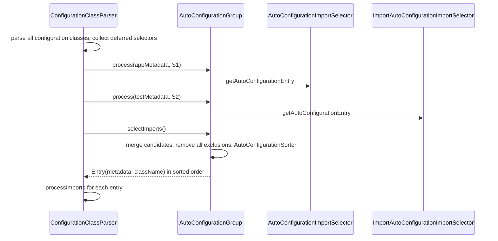

# Bootstrap process

## SpringApplication

`SpringApplication.run` is the launch path. `createBootstrapContext` runs first, then run listeners, then the environment, the application context, refresh, runners, and the ready event.

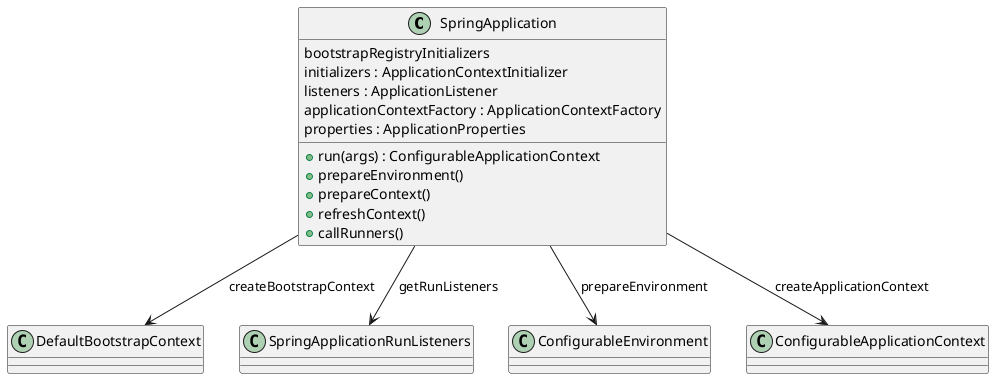

`createBootstrapContext` constructs a `DefaultBootstrapContext` and applies every `BootstrapRegistryInitializer`. `getRunListeners` loads `SpringApplicationRunListener` instances from `META-INF/spring.factories` (`EventPublishingRunListener` in the core jar) and calls `starting`.

`prepareEnvironment` constructs the Boot `Environment`, attaches `ConfigurationPropertySources`, and publishes `environmentPrepared`. Config files are not read during construction; they are imported by `EnvironmentPostProcessor`s on that event. After the event, `bindToSpringApplication` binds `spring.main` onto `ApplicationProperties`.

`prepareContext` sets that environment on the context, runs `ApplicationContextInitializer`s, publishes context-prepared, closes the bootstrap context, registers the singletons `springApplicationArguments` and `springBootBanner`, and `load`s the user's `@SpringBootApplication` sources as bean definitions. `refreshContext` calls `ApplicationContext.refresh`. `listeners.started` then `callRunners` (`ApplicationRunner`, then `CommandLineRunner`). If the context is still running, `listeners.ready` publishes readiness.

### BootstrapContext

`DefaultBootstrapContext` implements `ConfigurableBootstrapContext`. It is alive from `createBootstrapContext` until `prepareContext` calls `bootstrapContext.close(context)`. Run listeners and `EnvironmentPostProcessor`s use it to share objects before the application context exists. Closing it promotes registered instances into the application context where the registration asked for that.

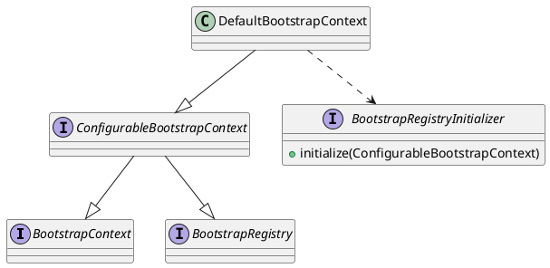

### SpringApplicationRunListeners

`SpringApplicationRunListeners` holds the `SpringApplicationRunListener` list and fans each callback out. The listener registered in core `spring.factories` is `EventPublishingRunListener`. It does not run environment post-processors itself. It multicasts Boot events through a `SimpleApplicationEventMulticaster` that still holds the listeners loaded from `spring.factories` under `org.springframework.context.ApplicationListener` (`EnvironmentPostProcessorApplicationListener`, `LoggingApplicationListener`, `FileEncodingApplicationListener`), because the application context does not exist yet. `contextLoaded` moves that list onto the running application.

| Callback | Event |
|----------|--------|
| `starting` | `ApplicationStartingEvent` |
| `environmentPrepared` | `ApplicationEnvironmentPreparedEvent` |
| `contextPrepared` | `ApplicationContextInitializedEvent` |
| `contextLoaded` | moves listeners onto the context, then `ApplicationPreparedEvent` |
| `started` | `ApplicationStartedEvent`, liveness `CORRECT` |
| `ready` | `ApplicationReadyEvent`, readiness `ACCEPTING_TRAFFIC` |

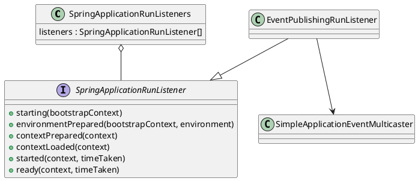

## ApplicationContextFactory

`ApplicationContextFactory` creates both the `Environment` and the `ApplicationContext` for a `WebApplicationType`. `ApplicationContextFactory.DEFAULT` is `DefaultApplicationContextFactory`. It loads every `ApplicationContextFactory` from `spring.factories` and uses the first candidate that returns non-null.

| `WebApplicationType` | Factory | Environment | Context |
|----------------------|---------|-------------|---------|
| `SERVLET` | `ServletWebServerApplicationContextFactory` | `ApplicationServletEnvironment` | `AnnotationConfigServletWebServerApplicationContext` |
| `REACTIVE` | `ReactiveWebServerApplicationContextFactory` | reactive servlet-less environment | reactive web-server context |
| `NONE` | no factory matches | `ApplicationEnvironment` | `AnnotationConfigApplicationContext` |

When AOT generated artifacts are in use, the servlet factory returns a plain `ServletWebServerApplicationContext` and the default factory returns a `GenericApplicationContext`, because bean definitions are already generated.

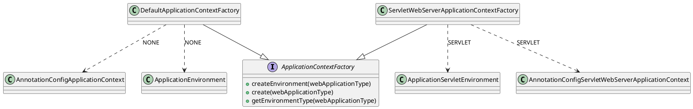

# Environment

The environment is a `ConfigurableEnvironment` of `PropertySource`s. Construction only chooses the Boot type and seeds a few sources. `application.properties`, `application.yaml`, profile documents, and `spring.config.import` are loaded later, on `ApplicationEnvironmentPreparedEvent`.

`getOrCreateEnvironment` asks `ApplicationContextFactory.createEnvironment` for the `WebApplicationType`. A servlet app receives `ApplicationServletEnvironment`. Anything the factories decline falls back to `ApplicationEnvironment`. Both types install Boot's `ConfigurationPropertySources` resolver, so `Binder` accepts relaxed names (`server.port`, `SERVER_PORT`, `SPRING_MAIN_WEB_APPLICATION_TYPE`). Both also return `null` from `doGetActiveProfilesProperty` and `doGetDefaultProfilesProperty`, so a profile named only in a config file is not read at construction time.

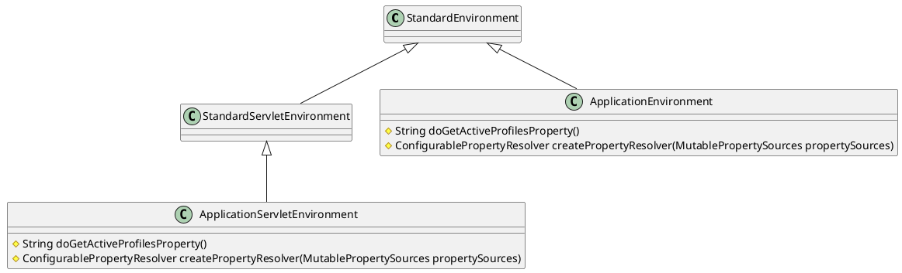

`configureEnvironment` then seeds sources that already exist before any file is opened:

1. `ApplicationConversionService` is installed when conversion is enabled.
2. `SpringApplication.defaultProperties`, if set, become a `DefaultPropertiesPropertySource`.
3. Command-line arguments, when present, become a `SimpleCommandLinePropertySource` at the front of the list.
4. `ApplicationInfoPropertySource` is added at the end.

`ConfigurationPropertySources.attach` wraps that list so later `Binder` calls see the same sources. `listeners.environmentPrepared` then publishes the event. After every `EnvironmentPostProcessor` has run, `ApplicationInfoPropertySource` and `DefaultPropertiesPropertySource` are moved to the end so files and command-line arguments outrank them, and `spring.main` is bound onto `ApplicationProperties`. If the environment type does not match the context factory, `EnvironmentConverter` replaces it and attaches configuration property sources again.

An `EnvironmentPostProcessor` is not a bean. Implementations are listed under `org.springframework.boot.EnvironmentPostProcessor` in `META-INF/spring.factories`. Constructors may take `DeferredLogFactory`, `ConfigurableBootstrapContext`, or a `Log`. `EnvironmentPostProcessorApplicationListener` is a `SmartApplicationListener` on `ApplicationEnvironmentPreparedEvent`. It loads those processors and calls `postProcessEnvironment` on each, in `Ordered` order. On `ApplicationPreparedEvent` or `ApplicationFailedEvent` it switches deferred logs over to the real logging system.

| Processor | Order | Role |
|-----------|-------|------|
| `RandomValuePropertySourceEnvironmentPostProcessor` | `HIGHEST_PRECEDENCE + 1` | Adds `RandomValuePropertySource`. Names under `random.` resolve here: `random.int`, `random.long`, `random.uuid`, and any other suffix as random bytes. |
| `SystemEnvironmentPropertySourceEnvironmentPostProcessor` | `HIGHEST_PRECEDENCE + 4` | Replaces the existing system-environment `PropertySource` with an origin-aware source, and applies an environment prefix when `SpringApplication` has one. |
| `SpringApplicationJsonEnvironmentPostProcessor` | `HIGHEST_PRECEDENCE + 5` | Parses the `spring.application.json` property or the `SPRING_APPLICATION_JSON` variable into a map `PropertySource` placed above system properties. |
| `CloudFoundryVcapEnvironmentPostProcessor` | `ConfigData` order − 5 | Parses `VCAP_APPLICATION` and `VCAP_SERVICES` into property sources when those variables are set. |
| `ConfigDataEnvironmentPostProcessor` | `HIGHEST_PRECEDENCE + 10` | Loads `application.properties` and `application.yaml`, including profile-specific files and `spring.config.import`, and adds them as `PropertySource`s on the `Environment`. |

`ConfigDataEnvironmentPostProcessor` is the processor that puts `application.properties` on the environment. The classpath file `spring.properties` is a different file: `SpringProperties` reads it in a static initializer and keeps those entries as library flags.

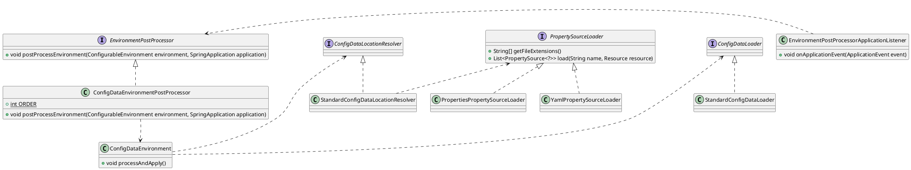

`ConfigDataEnvironmentPostProcessor.postProcessEnvironment` builds a `ConfigDataEnvironment` from the current environment, resource loader, additional profiles, and bootstrap context, then calls `processAndApply`.

The constructor first wraps every existing `PropertySource` as a contributor (command line, system properties, system environment, and the rest), keeping `DefaultPropertiesPropertySource` for the end of that list. It then adds initial import contributors from three properties, each bound from the environment as it stands before any file is read:

| Property | If absent |
|----------|-----------|
| `spring.config.import` | no extra locations |
| `spring.config.additional-location` | no extra locations |
| `spring.config.location` | `optional:classpath:/;optional:classpath:/config/` and `optional:file:./;optional:file:./config/;optional:file:./config/*/` |

Locations in each property are contributed last-to-first, so a later location in the list outranks an earlier one. `spring.config.location` replaces the default search; `additional-location` and `import` add to it. A location may be marked `optional:`. `spring.config.on-not-found` (`FAIL` by default) decides what happens when a mandatory location is missing.

A directory location is expanded by `StandardConfigDataLocationResolver`. The file name is `spring.config.name` (default `application`) plus each `PropertySourceLoader` extension: `properties` and `xml` from `PropertiesPropertySourceLoader`, `yml` and `yaml` from `YamlPropertySourceLoader`. A profile-specific file is `application-{profile}.{ext}`. A concrete file location is used as given. Resolvers and loaders themselves come from `spring.factories` (`ConfigTreeConfigDataLocationResolver` and `SystemEnvironmentConfigDataLocationResolver` sit beside the standard file resolver).

`processAndApply` walks contributors in four import passes. `ConfigDataImporter` resolves each `spring.config.import` (and the initial locations) through `ConfigDataLocationResolver`, loads each resource once through `ConfigDataLoader`, and records children on the contributor. A YAML file can yield several documents; each document becomes its own contributor.

1. `processInitial` imports contributors that do not need an activation context.
2. `createActivationContext` binds early properties from what has been loaded so far.
3. `processWithoutProfiles` imports documents that are not profile-specific.
4. `withProfiles` builds `Profiles` from `spring.profiles.active`, `spring.profiles.default`, `spring.profiles.include`, `spring.profiles.group`, and any additional profiles on `SpringApplication`.
5. `processWithProfiles` imports `application-{profile}.*` and other profile-specific resources.
6. `applyToEnvironment` adds each active `BOUND_IMPORT` `PropertySource` with `addLast`, moves default properties to the end, and calls `setActiveProfiles` / `setDefaultProfiles`.

`spring.config.import` on a loaded document is an ordinary property. Binding it (`ConfigDataProperties`) adds child locations, which the same loop resolves. `spring.config.activate.on-profile` and `spring.config.activate.on-cloud-platform` decide whether that document is active. An inactive source is not applied. `spring.profiles` as a document key in config data is rejected; the replacement is `spring.config.activate.on-profile`.

Contributor iteration visits after-profile-activation children first, then before-profile-activation children, then the parent. Combined with `addLast`, profile-specific sources therefore sit above the non-profile file they were imported from, and file locations sit above classpath locations. Command-line and system sources remain at the front, where `configurePropertySources` put them.

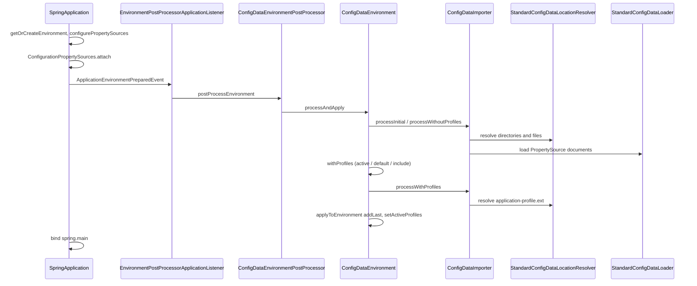

```java
// SpringApplication.prepareEnvironment
private ConfigurableEnvironment prepareEnvironment(SpringApplicationRunListeners listeners,
        DefaultBootstrapContext bootstrapContext, ApplicationArguments applicationArguments) {
    ConfigurableEnvironment environment = getOrCreateEnvironment();
    configureEnvironment(environment, applicationArguments.getSourceArgs());
    ConfigurationPropertySources.attach(environment);
    listeners.environmentPrepared(bootstrapContext, environment);
    ApplicationInfoPropertySource.moveToEnd(environment);
    DefaultPropertiesPropertySource.moveToEnd(environment);
    Assert.state(!environment.containsProperty("spring.main.environment-prefix"),
            "Environment prefix cannot be set via properties.");
    bindToSpringApplication(environment);
    if (!this.isCustomEnvironment) {
        EnvironmentConverter environmentConverter = new EnvironmentConverter(getClassLoader());
        environment = environmentConverter.convertEnvironmentIfNecessary(environment, deduceEnvironmentClass());
    }
    ConfigurationPropertySources.attach(environment);
    return environment;
}

// SpringApplication.configurePropertySources
protected void configurePropertySources(ConfigurableEnvironment environment, String[] args) {
    MutablePropertySources sources = environment.getPropertySources();
    if (!CollectionUtils.isEmpty(this.defaultProperties)) {
        DefaultPropertiesPropertySource.addOrMerge(this.defaultProperties, sources);
    }
    if (this.addCommandLineProperties && args.length > 0) {
        String name = CommandLinePropertySource.COMMAND_LINE_PROPERTY_SOURCE_NAME;
        PropertySource<?> source = sources.get(name);
        if (source != null) {
            CompositePropertySource composite = new CompositePropertySource(name);
            composite
                .addPropertySource(new SimpleCommandLinePropertySource("springApplicationCommandLineArgs", args));
            composite.addPropertySource(source);
            sources.replace(name, composite);
        }
        else {
            sources.addFirst(new SimpleCommandLinePropertySource(args));
        }
    }
    environment.getPropertySources().addLast(new ApplicationInfoPropertySource(this.mainApplicationClass));
}

// ApplicationEnvironment.doGetActiveProfilesProperty
protected String doGetActiveProfilesProperty() {
    return null;
}

// ApplicationEnvironment.createPropertyResolver
protected ConfigurablePropertyResolver createPropertyResolver(MutablePropertySources propertySources) {
    return ConfigurationPropertySources.createPropertyResolver(propertySources);
}

// EnvironmentPostProcessorApplicationListener.onApplicationEnvironmentPreparedEvent
private void onApplicationEnvironmentPreparedEvent(ApplicationEnvironmentPreparedEvent event) {
    ConfigurableEnvironment environment = event.getEnvironment();
    SpringApplication application = event.getSpringApplication();
    List<EnvironmentPostProcessor> postProcessors = getEnvironmentPostProcessors(application.getResourceLoader(),
            event.getBootstrapContext());
    addAotGeneratedEnvironmentPostProcessorIfNecessary(postProcessors, application);
    for (EnvironmentPostProcessor postProcessor : postProcessors) {
        postProcessor.postProcessEnvironment(environment, application);
    }
}

// ConfigDataEnvironmentPostProcessor.postProcessEnvironment
public void postProcessEnvironment(ConfigurableEnvironment environment, SpringApplication application) {
    postProcessEnvironment(environment, application.getResourceLoader(), application.getAdditionalProfiles());
}

// ConfigDataEnvironment.processAndApply
void processAndApply() {
    ConfigDataImporter importer = new ConfigDataImporter(this.logFactory, this.notFoundAction, this.resolvers,
            this.loaders);
    registerBootstrapBinder(this.contributors, null, DENY_INACTIVE_BINDING);
    ConfigDataEnvironmentContributors contributors = processInitial(this.contributors, importer);
    ConfigDataActivationContext activationContext = createActivationContext(
            contributors.getBinder(null, BinderOption.FAIL_ON_BIND_TO_INACTIVE_SOURCE));
    contributors = processWithoutProfiles(contributors, importer, activationContext);
    activationContext = withProfiles(contributors, activationContext);
    contributors = processWithProfiles(contributors, importer, activationContext);
    applyToEnvironment(contributors, activationContext, importer.getLoadedLocations(),
            importer.getOptionalLocations());
}

// ConfigDataEnvironment.getInitialImportContributors
private List<ConfigDataEnvironmentContributor> getInitialImportContributors(Binder binder) {
    List<ConfigDataEnvironmentContributor> initialContributors = new ArrayList<>();
    addInitialImportContributors(initialContributors, bindLocations(binder, IMPORT_PROPERTY, EMPTY_LOCATIONS));
    addInitialImportContributors(initialContributors,
            bindLocations(binder, ADDITIONAL_LOCATION_PROPERTY, EMPTY_LOCATIONS));
    addInitialImportContributors(initialContributors,
            bindLocations(binder, LOCATION_PROPERTY, DEFAULT_SEARCH_LOCATIONS));
    return initialContributors;
}

// StandardConfigDataLocationResolver.getConfigNames
private String[] getConfigNames(Binder binder) {
    String[] configNames = binder.bind(CONFIG_NAME_PROPERTY, String[].class).orElse(DEFAULT_CONFIG_NAMES);
    for (String configName : configNames) {
        validateConfigName(configName);
    }
    return configNames;
}

// ConfigDataEnvironment.applyToEnvironment
private void applyToEnvironment(ConfigDataEnvironmentContributors contributors,
        ConfigDataActivationContext activationContext, Set<ConfigDataLocation> loadedLocations,
        Set<ConfigDataLocation> optionalLocations) {
    checkForInvalidProperties(contributors);
    checkMandatoryLocations(contributors, activationContext, loadedLocations, optionalLocations);
    MutablePropertySources propertySources = this.environment.getPropertySources();
    applyContributor(contributors, activationContext, propertySources);
    DefaultPropertiesPropertySource.moveToEnd(propertySources);
    Profiles profiles = activationContext.getProfiles();
    Assert.state(profiles != null, "'profiles' must not be null");
    this.environment.setDefaultProfiles(StringUtils.toStringArray(profiles.getDefault()));
    this.environment.setActiveProfiles(StringUtils.toStringArray(profiles.getActive()));
    this.environmentUpdateListener.onSetProfiles(profiles);
}
```

# Embedded web server

A servlet application does not deploy a WAR. `ServletWebServerApplicationContext.onRefresh` calls `createWebServer` before the context finishes refreshing. `getWebServerFactory` requires exactly one `ServletWebServerFactory` bean. Auto-configuration contributes that bean from the server on the classpath (`TomcatServletWebServerFactory` or `JettyServletWebServerFactory`). A reactive app uses a Netty (or other reactive) factory instead. `factory.getWebServer` builds the server and registers two lifecycles: `webServerStartStop` starts it when the context starts, and `webServerGracefulShutdown` stops accepting traffic first when `server.shutdown=graceful`.

If a `ServletContext` already exists, Boot does not create a server. `SpringBootServletInitializer` is the path that runs the same application inside an external servlet container.

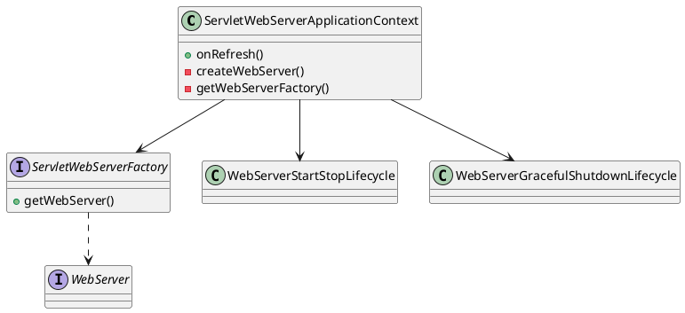

A reactive application uses `ReactiveWebServerApplicationContextFactory` and a reactive `WebServerFactory` the same way. `WebApplicationType.NONE` creates neither.

# Configuration properties

`@ConfigurationProperties` binds a prefix from the environment onto a bean. `ConfigurationPropertiesBindingPostProcessor` is registered under its own class name and runs at `HIGHEST_PRECEDENCE + 1`, before ordinary initialization. `postProcessBeforeInitialization` builds a `ConfigurationPropertiesBean` and `ConfigurationPropertiesBinder.bind` copies matching properties into the instance. Constructor-bound value objects are skipped here; they are bound when the bean is created. `@EnableConfigurationProperties` and `@ConfigurationPropertiesScan` register the beans that this post-processor then fills.

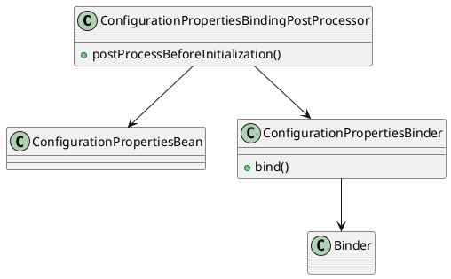

Binding uses the same relaxed names as config data (`server.port`, `SERVER_PORT`). A failed bind throws `ConfigurationPropertiesBindException` and startup stops.

# Logging

`LoggingApplicationListener` is one of the early Boot listeners. On `ApplicationEnvironmentPreparedEvent` it calls `LoggingSystem.get` for the classpath (Logback, Log4j2, or `java.util.logging`) and `initialize`. That applies `logging.file.name` / `logging.config`, then `logging.level.*`. Earlier events only set a temporary level so startup logs are not lost. On `ApplicationPreparedEvent` the chosen `LoggingSystem` is registered as the bean `springBootLoggingSystem`. `EnvironmentPostProcessor`s log through `DeferredLogFactory` until this listener switches those logs onto the real system.

# Failure analysis

If `run` throws, `handleRunFailure` asks `FailureAnalyzers`, a `SpringBootExceptionReporter` loaded from `spring.factories`. `reportException` walks every `FailureAnalyzer`. The first `analyze` that returns a `FailureAnalysis` wins. `FailureAnalysisReporter` implementations then print it. The core reporter is `LoggingFailureAnalysisReporter`, which is why a missing port or a bad config file ends as a short description and action instead of only a stack trace.

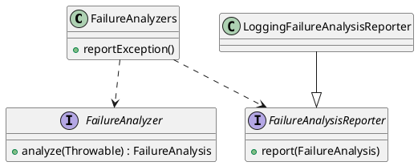

# Actuator

Actuator is optional. With it on the classpath, auto-configuration exposes operations as endpoints. `WebEndpointDiscoverer` scans beans for endpoint annotations and builds web operations. `management.endpoints.web.exposure.include` decides which ids are mapped. `HealthEndpoint` reads a `HealthContributorRegistry`: each contributor (disk, database, custom) returns a `Health`, and the endpoint aggregates them into one descriptor. HTTP mapping lives under `management.endpoints.web.base-path` (default `/actuator`). JMX uses `JmxEndpointDiscoverer` when that exposure is enabled. The application does not call these types; a request to the endpoint does.

# Fat jar

A fat jar is one ZIP that `java -jar` can start. The JVM loads `Main-Class` from the archive root and then from classpath URLs that point at files. A JAR nested inside another JAR is not a classpath entry for the platform class loader. Boot therefore writes two layers into one archive: loader classes at the root, so the JVM can construct `JarLauncher`, and the application plus its libraries under `BOOT-INF/`, so they do not collide with the loader and can be opened as nested JARs.

The Maven `repackage` goal calls `Repackager`. That type takes the project's ordinary JAR (classes at the root, no nested libraries) and rewrites it. A file that already has `Spring-Boot-Version` in its manifest is left unchanged. Gradle `bootJar` writes the same layout through `BootJar` and `BootZipCopyAction` instead of calling `Repackager`.

```
demo.jar
├── META-INF/MANIFEST.MF
├── org/springframework/boot/loader/...
├── BOOT-INF/
│   ├── classes/          application classes and resources
│   ├── lib/              nested dependency JARs
│   ├── classpath.idx
│   └── layers.idx        only when layers are enabled
```

`Layouts.forFile` chooses the layout from the source name. A `.jar` uses `Layouts.Jar`. A `.war` uses `Layouts.War`. A directory or `.zip` uses `Layouts.Expanded`.

| Layout | Launcher (`Main-Class`) | Application classes | Libraries |
|--------|-------------------------|---------------------|-----------|
| `Jar` | `JarLauncher` | `BOOT-INF/classes/` | `BOOT-INF/lib/` |
| `War` | `WarLauncher` | `WEB-INF/classes/` | `WEB-INF/lib/`, provided scope in `WEB-INF/lib-provided/` |
| `Expanded` | `PropertiesLauncher` | same as `Jar` | same as `Jar` |
| `None` | none; not executable | same as `Jar` | same as `Jar` |

`Jar` implements `RepackagingLayout`. During the rewrite, every transformable entry of the source JAR is moved under `BOOT-INF/classes/`. `META-INF/` stays at the root except `META-INF/aop.xml`, `META-INF/services/`, and `*.kotlin_module`, which move with the application. `BOOT-INF/` entries and `module-info.class` are left as they are. A WAR is already laid out under `WEB-INF/`, so `War` is not a `RepackagingLayout` and those paths are not rewritten.

The written manifest always records the Boot version. For an executable layout it also records:

| Attribute | Typical jar value |
|-----------|-------------------|
| `Main-Class` | `org.springframework.boot.loader.launch.JarLauncher` |
| `Start-Class` | the application's `main` class |
| `Spring-Boot-Classes` | `BOOT-INF/classes/` |
| `Spring-Boot-Lib` | `BOOT-INF/lib/` |
| `Spring-Boot-Classpath-Index` | `BOOT-INF/classpath.idx` |
| `Spring-Boot-Layers-Index` | `BOOT-INF/layers.idx` when layers are enabled |

`Start-Class` comes from `Repackager.setMainClass`, else from the source `Main-Class`, else from a search that prefers a class annotated with `@SpringBootApplication`. `Main-Class` is then overwritten with the layout's launcher. `java -jar` therefore starts the loader; the loader starts the application.

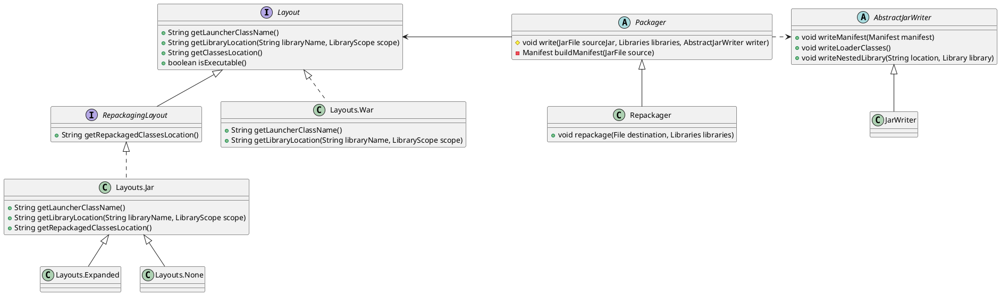

On the Maven path, `Packager.write` fills the archive in this order:

1. `writeManifest` writes the attributes above.
2. `writeLoaderClasses` copies class files from the `spring-boot-loader` JAR onto the archive root (`org/springframework/boot/loader/...`). Those are the only application-facing types the JVM can load before a nested class loader exists.
3. `writeEntries` copies the source JAR through `RepackagingEntryTransformer`, which prefixes application entries with `BOOT-INF/classes/` when the layout is a `RepackagingLayout`.
4. Each dependency that is itself a ZIP is written as a nested library under `BOOT-INF/lib/` (or the WAR locations). `JarModeLibrary.TOOLS` is added unless that is disabled.
5. `BOOT-INF/classpath.idx` lists those library paths in write order. When layers are enabled, `BOOT-INF/layers.idx` lists every file under `dependencies`, `spring-boot-loader`, `snapshot-dependencies`, or `application`, so an image build can copy unchanged dependency bytes into their own layer.

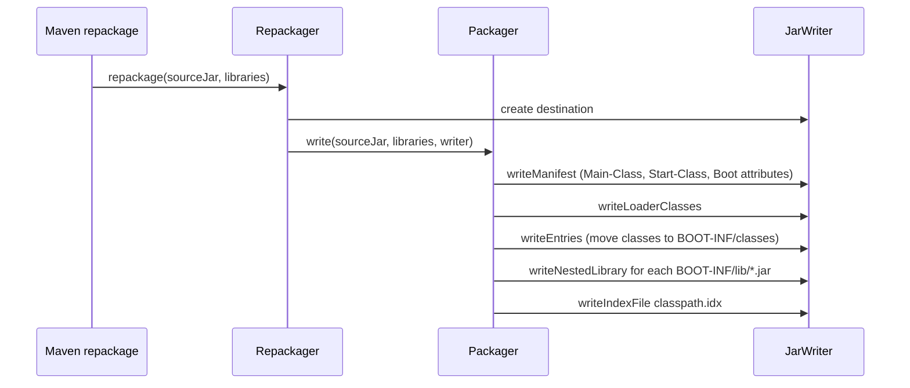

A nested library is written as `ZipEntry.STORED`: uncompressed, with a known CRC and size. `ZipContent` can parse a ZIP that lives as a byte range inside another file only when that range is itself a complete ZIP. A DEFLATE-compressed nested JAR would not be. The classpath URL for such an entry is `jar:nested:/path/demo.jar/!BOOT-INF/lib/foo.jar!/`. `Handlers.register` adds `org.springframework.boot.loader.net.protocol` to `java.protocol.handler.pkgs` so the `nested:` handler and Boot's `jar:` handler are found. `NestedJarFile` then opens `ZipContent` on the outer file plus the entry name and behaves as a `JarFile`.

A library that must be a real file (typically one with JNI natives) is marked to unpack. The writer stores the comment `UNPACK`. `JarFileArchive` copies that entry to a temporary file and puts that file on the classpath instead of a nested URL.

```java
// Packager.write
private void write(JarFile sourceJar, AbstractJarWriter writer, PackagedLibraries libraries) throws IOException {
    if (isLayered()) {
        writer.useLayers(this.layers, this.layersIndex);
    }
    writer.writeManifest(buildManifest(sourceJar));
    writeLoaderClasses(writer);
    writer.writeEntries(sourceJar, getEntityTransformer(), libraries.getUnpackHandler(),
            libraries.getLibraryLookup());
    Map<String, Library> writtenLibraries = libraries.write(writer);
    writeNativeImageArgFile(writer, sourceJar, writtenLibraries);
    if (isLayered()) {
        writeLayerIndex(writer);
    }
    writeSignatureFileIfNecessary(writtenLibraries, writer);
}

// Packager.addMainAndStartAttributes
private void addMainAndStartAttributes(JarFile source, Manifest manifest) throws IOException {
    String mainClass = getMainClass(source, manifest);
    String launcherClass = getLayout().getLauncherClassName();
    if (launcherClass != null) {
        Assert.state(mainClass != null, "Unable to find main class");
        manifest.getMainAttributes().putValue(MAIN_CLASS_ATTRIBUTE, launcherClass);
        manifest.getMainAttributes().putValue(START_CLASS_ATTRIBUTE, mainClass);
    }
    else if (mainClass != null) {
        manifest.getMainAttributes().putValue(MAIN_CLASS_ATTRIBUTE, mainClass);
    }
}

// Packager.RepackagingEntryTransformer.transformName
private String transformName(String name) {
    return this.layout.getRepackagedClassesLocation() + name;
}

// AbstractJarWriter.writeNestedLibrary
public void writeNestedLibrary(String location, Library library) throws IOException {
    JarArchiveEntry entry = new JarArchiveEntry(location + library.getName());
    entry.setTime(getNestedLibraryTime(library));
    new StoredEntryPreparator(library.openStream(), new LibraryUnpackHandler(library).requiresUnpack(location))
        .prepareStoredEntry(entry);
    try (InputStream inputStream = library.openStream()) {
        writeEntry(entry, library, new InputStreamEntryWriter(inputStream));
    }
}

// AbstractJarWriter.StoredEntryPreparator.prepareStoredEntry
void prepareStoredEntry(ZipArchiveEntry entry) {
    entry.setSize(this.size);
    entry.setCompressedSize(this.size);
    entry.setCrc(this.crc.getValue());
    entry.setMethod(ZipEntry.STORED);
    if (this.unpack) {
        entry.setComment("UNPACK");
    }
}
```

`java -jar demo.jar` loads `JarLauncher` from the archive root. The `JarLauncher` constructor builds an `Archive` for that file (`JarFileArchive`) or, if the same tree was exploded, an `ExplodedArchive`. `launch` then:

1. Calls `Handlers.register` unless the archive is exploded.
2. Collects classpath URLs: the `BOOT-INF/classes/` directory and every `BOOT-INF/lib/` entry (`WarLauncher` uses the `WEB-INF/` equivalents, including `lib-provided`).
3. Builds a `LaunchedClassLoader` (`JarUrlClassLoader`) whose parent is the launcher's own class loader. Application types therefore resolve from the nested URLs; loader types stay on the parent.
4. Reads `Start-Class` from the manifest. If the `jarmode` system property is set, `JarModeRunner` is used instead and loads a `JarMode` from `spring.factories`.
5. Sets the thread context class loader and invokes `main`.

On an exploded archive, `classpath.idx` is loaded and appended so the directory order matches the original fat jar. A packed archive already has that order in its ZIP entries, so the index is not applied at launch.

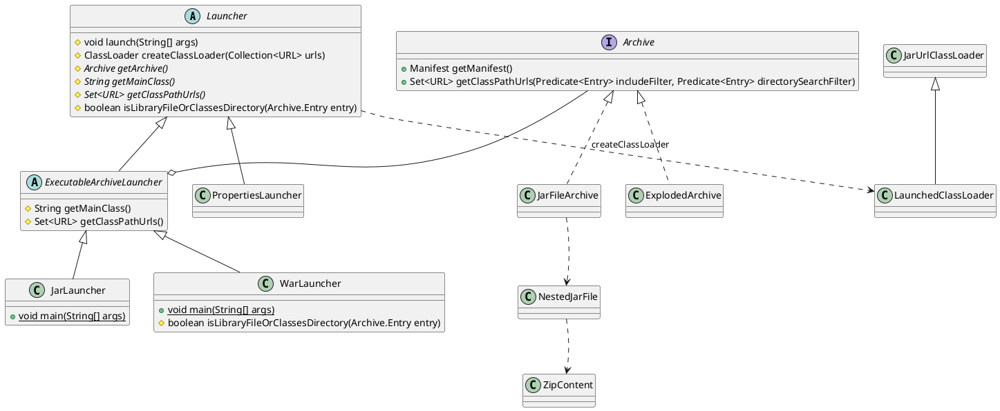

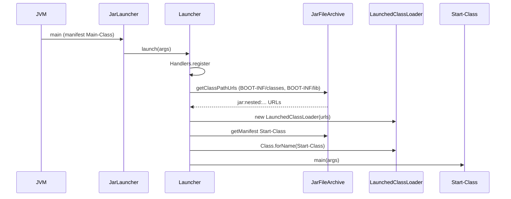

```java
// JarLauncher.main
public static void main(String[] args) throws Exception {
    new JarLauncher().launch(args);
}

// Launcher.launch
protected void launch(String[] args) throws Exception {
    if (!isExploded()) {
        Handlers.register();
    }
    try {
        ClassLoader classLoader = createClassLoader(getClassPathUrls());
        String jarMode = System.getProperty("jarmode");
        String mainClassName = hasLength(jarMode) ? JAR_MODE_RUNNER_CLASS_NAME : getMainClass();
        launch(classLoader, mainClassName, args);
    }
    catch (UncheckedIOException ex) {
        throw ex.getCause();
    }
}

// ExecutableArchiveLauncher.getMainClass
protected String getMainClass() throws Exception {
    Manifest manifest = this.archive.getManifest();
    String mainClass = (manifest != null) ? manifest.getMainAttributes().getValue(START_CLASS_ATTRIBUTE) : null;
    if (mainClass == null) {
        throw new IllegalStateException("No 'Start-Class' manifest entry specified in " + this);
    }
    return mainClass;
}

// Launcher.isLibraryFileOrClassesDirectory
protected boolean isLibraryFileOrClassesDirectory(Archive.Entry entry) {
    String name = entry.name();
    if (entry.isDirectory()) {
        return name.equals("BOOT-INF/classes/");
    }
    return name.startsWith("BOOT-INF/lib/");
}

// Handlers.register
public static void register() {
    String packages = System.getProperty(PROTOCOL_HANDLER_PACKAGES, "");
    packages = (!packages.isEmpty() && !packages.contains(PACKAGE)) ? packages + "|" + PACKAGE : PACKAGE;
    System.setProperty(PROTOCOL_HANDLER_PACKAGES, packages);
    resetCachedUrlHandlers();
}

// JarUrl.create
public static URL create(File file, String nestedEntryName, String path) {
    try {
        path = (path != null) ? path : "";
        return new URL(null, "jar:" + getJarReference(file, nestedEntryName) + "!/" + path, Handler.INSTANCE);
    }
    catch (MalformedURLException ex) {
        throw new IllegalStateException("Unable to create JarFileArchive URL", ex);
    }
}
```

# Startup

`SpringApplication.run` is the ordered call. The bootstrap section names the types; this is the order they are used.

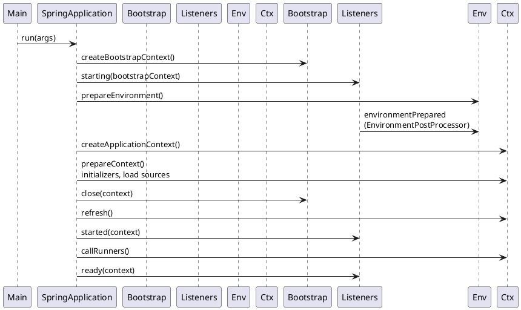

Auto-configuration import runs inside `refresh`, after this sequence has already chosen the web-server context and loaded config data. The embedded server (Tomcat, Jetty, or Netty) is started by that Boot web-server context, not by a separate step in `run`.
