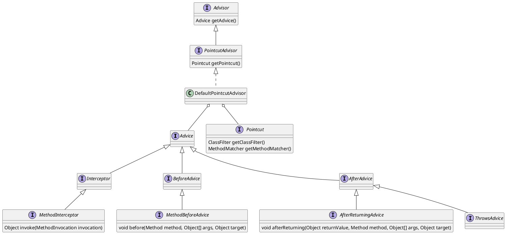
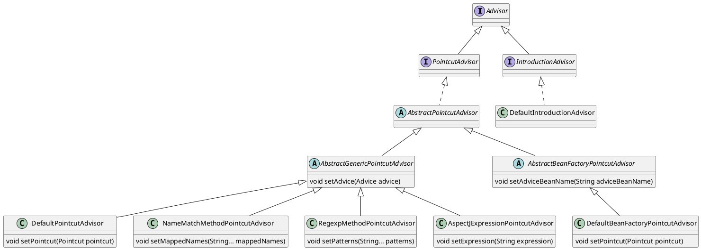

本文记录 spring aop 架构与实现
<!--more-->


# Overview

`Aspect-oriented Programming (AOP)` is a programming paradigm that increases modularity by separating cross-cutting concerns, such as transactions, security checks, and logging, from business code. The extra behavior is added to existing methods without changing those methods.

## Concepts

- **Join point**: a point in program execution. In Spring AOP it is always a method invocation on a bean.
- **Pointcut**: a predicate that selects join points, for example `execution(* com.example.service.*.*(..))`, `within(...)`, or `@annotation(...)`.
- **Advice**: the action run at a selected join point. The types are before, after returning, after throwing, after (finally), and around.
- **Advisor**: Spring's unit that holds one advice and the pointcut that decides where it applies.
- **Aspect**: a module that groups pointcuts and advice for one concern.
- **Proxy**: the object that Spring puts in place of the bean. A call on the proxy runs the matching advice chain, then the target method. A JDK dynamic proxy is used when the target implements an interface; otherwise CGLIB generates a subclass.

Whichever way advice is declared, it reaches the proxy as an `Advisor`. The auto-proxy creator collects every `Advisor` that applies to a bean and wraps that bean in a proxy.

## Advice interfaces

The first way is to implement Spring's advice interfaces and pair the advice with a pointcut in an `Advisor` bean. `MethodInterceptor` comes from AOP Alliance and covers around advice. Before, after-returning, and throws advice are Spring interfaces that are adapted to `MethodInterceptor` when the chain is built.



```java
public class TimingInterceptor implements MethodInterceptor {
    public Object invoke(MethodInvocation invocation) throws Throwable {
        long start = System.nanoTime();
        try {
            return invocation.proceed(); // next advice or the target method
        }
        finally {
            log.info(invocation.getMethod().getName() + " took " + (System.nanoTime() - start));
        }
    }
}

@Bean
public Advisor timingAdvisor() {
    AspectJExpressionPointcut pointcut = new AspectJExpressionPointcut();
    pointcut.setExpression("execution(* com.example.service.*.*(..))");
    return new DefaultPointcutAdvisor(pointcut, new TimingInterceptor());
}
```

### Ready-made advisors

Spring provides `Advisor` classes that can be declared as beans without writing a pointcut class. Each one fixes the kind of pointcut and takes the advice from `setAdvice`, or from `setAdviceBeanName` for the bean-factory variant.



| Advisor | Selects methods by |
|---|---|
| `DefaultPointcutAdvisor` | any `Pointcut` passed in; with only an advice, `Pointcut.TRUE` (every method) |
| `NameMatchMethodPointcutAdvisor` | method names, with `*` wildcards (`get*`, `*Order`) |
| `RegexpMethodPointcutAdvisor` | regular expressions on the fully qualified method name |
| `AspectJExpressionPointcutAdvisor` | an AspectJ pointcut expression |
| `DefaultBeanFactoryPointcutAdvisor` | any `Pointcut`; the advice is a bean looked up by name, created lazily |
| `DefaultIntroductionAdvisor` | classes, not methods; adds interfaces to the proxy (introduction) |

`DefaultPointcutAdvisor` is the general one: any `Pointcut` plus any `Advice`. The pointcut can be a built-in one or a small class that implements the match.

```java
@Target(ElementType.METHOD)
@Retention(RetentionPolicy.RUNTIME)
public @interface Timed {}

// built-in pointcut: methods annotated with @Timed
@Bean
public Advisor timedAdvisor() {
    Pointcut pointcut = AnnotationMatchingPointcut.forMethodAnnotation(Timed.class);
    return new DefaultPointcutAdvisor(pointcut, new TimingInterceptor());
}

// custom pointcut: public methods of classes in the service package
@Bean
public Advisor servicePublicMethodsAdvisor() {
    Pointcut pointcut = new StaticMethodMatcherPointcut() {
        public boolean matches(Method method, Class<?> targetClass) {
            return Modifier.isPublic(method.getModifiers())
                    && targetClass.getPackageName().startsWith("com.example.service");
        }
    };
    return new DefaultPointcutAdvisor(pointcut, new TimingInterceptor());
}

// no pointcut: Pointcut.TRUE, every method of every proxied bean
@Bean
public Advisor everyMethodAdvisor() {
    return new DefaultPointcutAdvisor(new TimingInterceptor());
}

@Service
public class OrderService {
    @Timed
    public void placeOrder(Order order) { ... } // timedAdvisor applies
}
```

```java
@Bean
public Advisor nameAdvisor() {
    NameMatchMethodPointcutAdvisor advisor = new NameMatchMethodPointcutAdvisor(new TimingInterceptor());
    advisor.setMappedNames("save*", "delete*");
    return advisor;
}

@Bean
public Advisor regexpAdvisor() {
    RegexpMethodPointcutAdvisor advisor = new RegexpMethodPointcutAdvisor(new TimingInterceptor());
    advisor.setPatterns(".*Service\\..*");
    return advisor;
}

@Bean
public Advisor expressionAdvisor() {
    AspectJExpressionPointcutAdvisor advisor = new AspectJExpressionPointcutAdvisor();
    advisor.setExpression("execution(* com.example.service.*.*(..))");
    advisor.setAdvice(new TimingInterceptor());
    return advisor;
}
```

## @Aspect annotation

The second way is an AspectJ-style class annotated with `@Aspect`. Its methods carry `@Pointcut`, `@Before`, `@AfterReturning`, `@AfterThrowing`, `@After`, or `@Around`. No advice interface is implemented. With `@EnableAspectJAutoProxy`, `AnnotationAwareAspectJAutoProxyCreator` finds `@Aspect` beans through `BeanFactoryAspectJAdvisorsBuilder`. `ReflectiveAspectJAdvisorFactory` then turns each advice method into an `InstantiationModelAwarePointcutAdvisorImpl`, whose pointcut is an `AspectJExpressionPointcut` and whose advice wraps the method.

| Annotation | Advice created by `ReflectiveAspectJAdvisorFactory` |
|---|---|
| `@Before` | `AspectJMethodBeforeAdvice` |
| `@AfterReturning` | `AspectJAfterReturningAdvice` |
| `@AfterThrowing` | `AspectJAfterThrowingAdvice` |
| `@After` | `AspectJAfterAdvice` |
| `@Around` | `AspectJAroundAdvice` |

```java
@Aspect
@Component
public class TimingAspect {

    @Pointcut("execution(* com.example.service.*.*(..))")
    void serviceMethods() {}

    @Before("serviceMethods()")
    public void before(JoinPoint joinPoint) {
        log.info("enter " + joinPoint.getSignature());
    }

    @Around("serviceMethods()")
    public Object time(ProceedingJoinPoint joinPoint) throws Throwable {
        long start = System.nanoTime();
        try {
            return joinPoint.proceed(); // next advice or the target method
        }
        finally {
            log.info(joinPoint.getSignature() + " took " + (System.nanoTime() - start));
        }
    }
}
```

Both forms end up in the same list. `AnnotationAwareAspectJAutoProxyCreator.findCandidateAdvisors` returns the `Advisor` beans from the first form plus the advisors built from `@Aspect` classes.

```java
// AnnotationAwareAspectJAutoProxyCreator.findCandidateAdvisors
protected List<Advisor> findCandidateAdvisors() {
    List<Advisor> advisors = super.findCandidateAdvisors(); // Advisor beans
    if (this.aspectJAdvisorsBuilder != null) {
        advisors.addAll(this.aspectJAdvisorsBuilder.buildAspectJAdvisors()); // @Aspect methods
    }
    return advisors;
}
```

# AOP during Bean creation
AOP uses either JDK dynamic proxies or CGLIB to create proxy
`dynamicProxy` only works when proxied object  implements at least one  interface

`ProxyCreator` implements `PostProcessor` interface, when `postProcessAfterInitialization` get invoked, a proxy object is created with the target advisor encapsulated, the proxy object will replace the origial bean.


```plantuml
interface ImportBeanDefinitionRegistrar {
+ void registerBeanDefinitions()
}

class AspectJAutoProxyRegistrar implements ImportBeanDefinitionRegistrar {
}


class AnnotationAwareAspectJAutoProxyCreator extends AspectJAwareAdvisorAutoProxyCreator{
- List<Pattern> includePatterns
- AspectJAdvisorFactory aspectJAdvisorFactory
- BeanFactoryAspectJAdvisorsBuilder aspectJAdvisorsBuilder
+ void setIncludePatterns(List<String>)
+ void setAspectJAdvisorFactory(AspectJAdvisorFactory)

}

class AspectJAwareAdvisorAutoProxyCreator extends AbstractAdvisorAutoProxyCreator {
}


abstract class AbstractAdvisorAutoProxyCreator extends AbstractAutoProxyCreator {
- BeanFactoryAdvisorRetrievalHelper advisorRetrievalHelper
+ void setBeanFactory(BeanFactory)
# void initBeanFactory(ConfigurableListableBeanFactory)
# Object[] getAdvicesAndAdvisorsForBean(Class<?>,String,TargetSource)
# List<Advisor> findEligibleAdvisors(Class<?>,String)
# List<Advisor> findCandidateAdvisors()
# List<Advisor> findAdvisorsThatCanApply(List<Advisor>,Class<?>,String)
# boolean isEligibleAdvisorBean(String)
# List<Advisor> sortAdvisors(List<Advisor>)

}


abstract class AbstractAutoProxyCreator extends ProxyProcessorSupport implements SmartInstantiationAwareBeanPostProcessor, BeanFactoryAware {

- AdvisorAdapterRegistry advisorAdapterRegistry
- boolean freezeProxy
- String[] interceptorNames
- boolean applyCommonInterceptorsFirst
- TargetSourceCreator[] customTargetSourceCreators
- BeanFactory beanFactory
- Set<String> targetSourcedBeans
- Map<Object,Object> earlyBeanReferences
- Map<Object,Class<?>> proxyTypes
- Map<Object,Boolean> advisedBeans

+ void setAdvisorAdapterRegistry(AdvisorAdapterRegistry)
+ void setCustomTargetSourceCreators(TargetSourceCreator)
+ void setInterceptorNames(String)
+ void setApplyCommonInterceptorsFirst(boolean)
+ void setBeanFactory(BeanFactory)
+ Class<?> predictBeanType(Class<?>,String)
+ Class<?> determineBeanType(Class<?>,String)
+ Constructor<?>[] determineCandidateConstructors(Class<?>,String)
+ Object getEarlyBeanReference(Object,String)
+ Object postProcessBeforeInstantiation(Class<?>,String)
+ PropertyValues postProcessProperties(PropertyValues,Object,String)
+ Object postProcessAfterInitialization(Object,String)

}

class ProxyProcessorSupport {
- int order
- ClassLoader proxyClassLoader
- boolean classLoaderConfigured
+ void setOrder(int)
+ int getOrder()
+ void setProxyClassLoader(ClassLoader)
# ClassLoader getProxyClassLoader()
+ void setBeanClassLoader(ClassLoader)
# void evaluateProxyInterfaces(Class<?>,ProxyFactory)
# boolean isConfigurationCallbackInterface(Class<?>)
# boolean isInternalLanguageInterface(Class<?>)
}

interface AopProxy

AspectJAutoProxyRegistrar  -right-> AnnotationAwareAspectJAutoProxyCreator:register

```


# Target Source


`TargetClassAware` Minimal interface for exposing the target class behind a proxy

`TargetSource` is used to obtain the current target of the AOP invocation, which will be invoked via reflection if no around advice chooses to end the interceptor chain itself

```plantuml
interface TargetClassAware {
    Class<?> getTargetClass()
}

interface TargetSource extends TargetClassAware {
    Object getTarget()
    void releaseTarget(Object target)
}

abstract class AbstractBeanFactoryBasedTargetSource implements TargetSource, BeanFactoryAware {
    String targetBeanName
    Class<?> targetClass
    BeanFactory beanFactory
    void setBeanFactory(BeanFactory beanFactory)
}

class SimpleBeanTargetSource extends AbstractBeanFactoryBasedTargetSource
```

# Transactional AOP
`ProxyTransactionManagementConfiguration` a `@Configuration` class that registers the spring Infrastructure beans necessary to enable proxy-based annotation-driven transaction management.
`BeanFactoryTransactionAttributeSourceAdvisor`  Advisor used to include a transactional advice bean for method that are transactional

```plantuml
top to bottom direction
title: transactional AOP
interface Advisor {
    Advice getAdvice()
}
interface PointcutAdvisor extends Advisor {
    Pointcut getPointcut()
}
abstract class AbstractPointcutAdvisor implements PointcutAdvisor {
    String adviceBeanName
    BeanFactory beanFactory
    transient volatile Advice advice

}
abstract class AbstractBeanFactoryPointcutAdvisor extends AbstractPointcutAdvisor {

}
class BeanFactoryTransactionAttributeSourceAdvisor extends AbstractBeanFactoryPointcutAdvisor {
    TransactionAttributeSourcePointcut pointcut
    Advice TransactionInterceptor
}


class ProxyTransactionManagementConfiguration {

}


interface Advice 
interface BeanFactoryAware 
interface Interceptor  extends Advice
interface MethodInterceptor  extends Interceptor {
    Object invoke(invocation) throws Throwable
}
class TransactionAspectSupport implements BeanFactoryAware
class TransactionInterceptor extends TransactionAspectSupport implements MethodInterceptor


ProxyTransactionManagementConfiguration -> BeanFactoryTransactionAttributeSourceAdvisor:createBean
ProxyTransactionManagementConfiguration -down> TransactionInterceptor:createBean
BeanFactoryTransactionAttributeSourceAdvisor *-- TransactionInterceptor
```