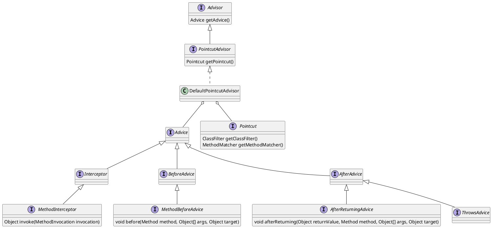
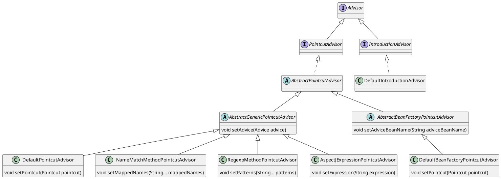
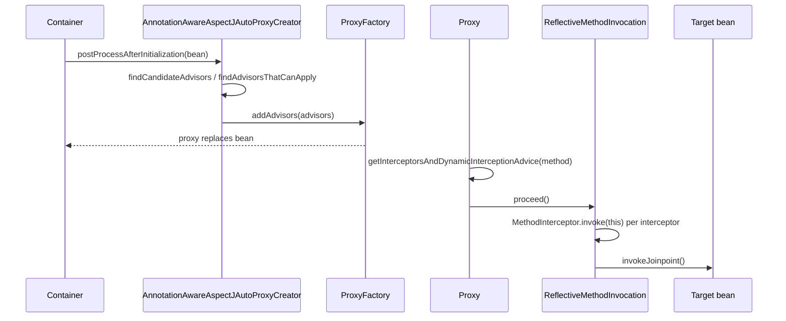

本文记录 spring aop 架构与实现
<!--more-->


# Overview

`Aspect-oriented Programming (AOP)` is a programming paradigm that increases modularity by separating cross-cutting concerns, such as transactions, security checks, and logging, from business code. The extra behavior is added to existing methods without changing those methods.

## Concepts

- **Join point**: a point in program execution. In Spring AOP it is always a method invocation on a bean.
- **Pointcut**: a predicate that selects join points, for example `execution(* com.example.service.*.*(..))`, `within(...)`, or `@annotation(...)`.
- **Advice**: the action run at a selected join point. The types are before, after returning, after throwing, after (finally), and around.
- **Advisor**: Spring's unit that holds one advice and the pointcut that decides where it applies.
- **Aspect**: a module that groups pointcuts and advice for one concern.
- **Proxy**: the object that Spring puts in place of the bean. A call on the proxy runs the matching advice chain, then the target method. A JDK dynamic proxy is used when the target implements an interface; otherwise CGLIB generates a subclass.

Whichever way advice is declared, it reaches the proxy as an `Advisor`. The auto-proxy creator collects every `Advisor` that applies to a bean and wraps that bean in a proxy.

## Advice interfaces

The first way is to implement Spring's advice interfaces and pair the advice with a pointcut in an `Advisor` bean. `MethodInterceptor` comes from AOP Alliance and covers around advice. Before, after-returning, and throws advice are Spring interfaces that are adapted to `MethodInterceptor` when the chain is built.



```java
public class TimingInterceptor implements MethodInterceptor {
    public Object invoke(MethodInvocation invocation) throws Throwable {
        long start = System.nanoTime();
        try {
            return invocation.proceed(); // next advice or the target method
        }
        finally {
            log.info(invocation.getMethod().getName() + " took " + (System.nanoTime() - start));
        }
    }
}

@Bean
public Advisor timingAdvisor() {
    AspectJExpressionPointcut pointcut = new AspectJExpressionPointcut();
    pointcut.setExpression("execution(* com.example.service.*.*(..))");
    return new DefaultPointcutAdvisor(pointcut, new TimingInterceptor());
}
```

### Ready-made advisors

Spring provides `Advisor` classes that can be declared as beans without writing a pointcut class. Each one fixes the kind of pointcut and takes the advice from `setAdvice`, or from `setAdviceBeanName` for the bean-factory variant.



| Advisor | Selects methods by |
|---|---|
| `DefaultPointcutAdvisor` | any `Pointcut` passed in; with only an advice, `Pointcut.TRUE` (every method) |
| `NameMatchMethodPointcutAdvisor` | method names, with `*` wildcards (`get*`, `*Order`) |
| `RegexpMethodPointcutAdvisor` | regular expressions on the fully qualified method name |
| `AspectJExpressionPointcutAdvisor` | an AspectJ pointcut expression |
| `DefaultBeanFactoryPointcutAdvisor` | any `Pointcut`; the advice is a bean looked up by name, created lazily |
| `DefaultIntroductionAdvisor` | classes, not methods; adds interfaces to the proxy (introduction) |

`DefaultPointcutAdvisor` is the general one: any `Pointcut` plus any `Advice`. The pointcut can be a built-in one or a small class that implements the match.

```java
@Target(ElementType.METHOD)
@Retention(RetentionPolicy.RUNTIME)
public @interface Timed {}

// built-in pointcut: methods annotated with @Timed
@Bean
public Advisor timedAdvisor() {
    Pointcut pointcut = AnnotationMatchingPointcut.forMethodAnnotation(Timed.class);
    return new DefaultPointcutAdvisor(pointcut, new TimingInterceptor());
}

// custom pointcut: public methods of classes in the service package
@Bean
public Advisor servicePublicMethodsAdvisor() {
    Pointcut pointcut = new StaticMethodMatcherPointcut() {
        public boolean matches(Method method, Class<?> targetClass) {
            return Modifier.isPublic(method.getModifiers())
                    && targetClass.getPackageName().startsWith("com.example.service");
        }
    };
    return new DefaultPointcutAdvisor(pointcut, new TimingInterceptor());
}

// no pointcut: Pointcut.TRUE, every method of every proxied bean
@Bean
public Advisor everyMethodAdvisor() {
    return new DefaultPointcutAdvisor(new TimingInterceptor());
}

@Service
public class OrderService {
    @Timed
    public void placeOrder(Order order) { ... } // timedAdvisor applies
}
```

```java
@Bean
public Advisor nameAdvisor() {
    NameMatchMethodPointcutAdvisor advisor = new NameMatchMethodPointcutAdvisor(new TimingInterceptor());
    advisor.setMappedNames("save*", "delete*");
    return advisor;
}

@Bean
public Advisor regexpAdvisor() {
    RegexpMethodPointcutAdvisor advisor = new RegexpMethodPointcutAdvisor(new TimingInterceptor());
    advisor.setPatterns(".*Service\\..*");
    return advisor;
}

@Bean
public Advisor expressionAdvisor() {
    AspectJExpressionPointcutAdvisor advisor = new AspectJExpressionPointcutAdvisor();
    advisor.setExpression("execution(* com.example.service.*.*(..))");
    advisor.setAdvice(new TimingInterceptor());
    return advisor;
}
```

## @Aspect annotation

The second way is an AspectJ-style class annotated with `@Aspect`. Its methods carry `@Pointcut`, `@Before`, `@AfterReturning`, `@AfterThrowing`, `@After`, or `@Around`. No advice interface is implemented. With `@EnableAspectJAutoProxy`, `AnnotationAwareAspectJAutoProxyCreator` finds `@Aspect` beans through `BeanFactoryAspectJAdvisorsBuilder`. `ReflectiveAspectJAdvisorFactory` then turns each advice method into an `InstantiationModelAwarePointcutAdvisorImpl`, whose pointcut is an `AspectJExpressionPointcut` and whose advice wraps the method.

| Annotation | Advice created by `ReflectiveAspectJAdvisorFactory` |
|---|---|
| `@Before` | `AspectJMethodBeforeAdvice` |
| `@AfterReturning` | `AspectJAfterReturningAdvice` |
| `@AfterThrowing` | `AspectJAfterThrowingAdvice` |
| `@After` | `AspectJAfterAdvice` |
| `@Around` | `AspectJAroundAdvice` |

```java
@Aspect
@Component
public class TimingAspect {

    @Pointcut("execution(* com.example.service.*.*(..))")
    void serviceMethods() {}

    @Before("serviceMethods()")
    public void before(JoinPoint joinPoint) {
        log.info("enter " + joinPoint.getSignature());
    }

    @Around("serviceMethods()")
    public Object time(ProceedingJoinPoint joinPoint) throws Throwable {
        long start = System.nanoTime();
        try {
            return joinPoint.proceed(); // next advice or the target method
        }
        finally {
            log.info(joinPoint.getSignature() + " took " + (System.nanoTime() - start));
        }
    }
}
```

Both forms end up in the same list. `AnnotationAwareAspectJAutoProxyCreator.findCandidateAdvisors` returns the `Advisor` beans from the first form plus the advisors built from `@Aspect` classes.

```java
// AnnotationAwareAspectJAutoProxyCreator.findCandidateAdvisors
protected List<Advisor> findCandidateAdvisors() {
    List<Advisor> advisors = super.findCandidateAdvisors(); // Advisor beans
    if (this.aspectJAdvisorsBuilder != null) {
        advisors.addAll(this.aspectJAdvisorsBuilder.buildAspectJAdvisors()); // @Aspect methods
    }
    return advisors;
}
```

# AOP during Bean creation
AOP uses either JDK dynamic proxies or CGLIB to create proxy
`dynamicProxy` only works when proxied object  implements at least one  interface

`ProxyCreator` implements `PostProcessor` interface, when `postProcessAfterInitialization` get invoked, a proxy object is created with the target advisor encapsulated, the proxy object will replace the origial bean.


```plantuml
interface ImportBeanDefinitionRegistrar {
+ void registerBeanDefinitions()
}

class AspectJAutoProxyRegistrar implements ImportBeanDefinitionRegistrar {
}


class AnnotationAwareAspectJAutoProxyCreator extends AspectJAwareAdvisorAutoProxyCreator{
- List<Pattern> includePatterns
- AspectJAdvisorFactory aspectJAdvisorFactory
- BeanFactoryAspectJAdvisorsBuilder aspectJAdvisorsBuilder
+ void setIncludePatterns(List<String>)
+ void setAspectJAdvisorFactory(AspectJAdvisorFactory)

}

class AspectJAwareAdvisorAutoProxyCreator extends AbstractAdvisorAutoProxyCreator {
}


abstract class AbstractAdvisorAutoProxyCreator extends AbstractAutoProxyCreator {
- BeanFactoryAdvisorRetrievalHelper advisorRetrievalHelper
+ void setBeanFactory(BeanFactory)
# void initBeanFactory(ConfigurableListableBeanFactory)
# Object[] getAdvicesAndAdvisorsForBean(Class<?>,String,TargetSource)
# List<Advisor> findEligibleAdvisors(Class<?>,String)
# List<Advisor> findCandidateAdvisors()
# List<Advisor> findAdvisorsThatCanApply(List<Advisor>,Class<?>,String)
# boolean isEligibleAdvisorBean(String)
# List<Advisor> sortAdvisors(List<Advisor>)

}


abstract class AbstractAutoProxyCreator extends ProxyProcessorSupport implements SmartInstantiationAwareBeanPostProcessor, BeanFactoryAware {

- AdvisorAdapterRegistry advisorAdapterRegistry
- boolean freezeProxy
- String[] interceptorNames
- boolean applyCommonInterceptorsFirst
- TargetSourceCreator[] customTargetSourceCreators
- BeanFactory beanFactory
- Set<String> targetSourcedBeans
- Map<Object,Object> earlyBeanReferences
- Map<Object,Class<?>> proxyTypes
- Map<Object,Boolean> advisedBeans

+ void setAdvisorAdapterRegistry(AdvisorAdapterRegistry)
+ void setCustomTargetSourceCreators(TargetSourceCreator)
+ void setInterceptorNames(String)
+ void setApplyCommonInterceptorsFirst(boolean)
+ void setBeanFactory(BeanFactory)
+ Class<?> predictBeanType(Class<?>,String)
+ Class<?> determineBeanType(Class<?>,String)
+ Constructor<?>[] determineCandidateConstructors(Class<?>,String)
+ Object getEarlyBeanReference(Object,String)
+ Object postProcessBeforeInstantiation(Class<?>,String)
+ PropertyValues postProcessProperties(PropertyValues,Object,String)
+ Object postProcessAfterInitialization(Object,String)

}

class ProxyProcessorSupport {
- int order
- ClassLoader proxyClassLoader
- boolean classLoaderConfigured
+ void setOrder(int)
+ int getOrder()
+ void setProxyClassLoader(ClassLoader)
# ClassLoader getProxyClassLoader()
+ void setBeanClassLoader(ClassLoader)
# void evaluateProxyInterfaces(Class<?>,ProxyFactory)
# boolean isConfigurationCallbackInterface(Class<?>)
# boolean isInternalLanguageInterface(Class<?>)
}

interface AopProxy {
+ Object getProxy(ClassLoader)
}

' advisor lookup
class BeanFactoryAdvisorRetrievalHelper {
+ List<Advisor> findAdvisorBeans()
}
class BeanFactoryAspectJAdvisorsBuilder {
- Map<String,List<Advisor>> advisorsCache
- Map<String,MetadataAwareAspectInstanceFactory> aspectFactoryCache
+ List<Advisor> buildAspectJAdvisors()
}
interface AspectJAdvisorFactory {
+ boolean isAspect(Class<?>)
+ List<Advisor> getAdvisors(MetadataAwareAspectInstanceFactory)
+ Advisor getAdvisor(Method,MetadataAwareAspectInstanceFactory,int,String)
+ Advice getAdvice(Method,AspectJExpressionPointcut,MetadataAwareAspectInstanceFactory,int,String)
}
abstract class AbstractAspectJAdvisorFactory implements AspectJAdvisorFactory
class ReflectiveAspectJAdvisorFactory extends AbstractAspectJAdvisorFactory
interface MetadataAwareAspectInstanceFactory
class BeanFactoryAspectInstanceFactory implements MetadataAwareAspectInstanceFactory

' advisors and advice built from @Aspect methods
interface Advisor
interface PointcutAdvisor extends Advisor
interface InstantiationModelAwarePointcutAdvisor extends PointcutAdvisor
class InstantiationModelAwarePointcutAdvisorImpl implements InstantiationModelAwarePointcutAdvisor {
- AspectJExpressionPointcut declaredPointcut
- Method aspectJAdviceMethod
- Advice instantiatedAdvice
+ Advice getAdvice()
}
class AspectJExpressionPointcut {
+ void setExpression(String)
+ boolean matches(Method,Class<?>)
}
interface Advice
interface MethodInterceptor
interface MethodBeforeAdvice
interface AfterReturningAdvice
abstract class AbstractAspectJAdvice implements Advice {
# Object invokeAdviceMethod(...)
}
class AspectJAroundAdvice extends AbstractAspectJAdvice implements MethodInterceptor
class AspectJMethodBeforeAdvice extends AbstractAspectJAdvice implements MethodBeforeAdvice
class AspectJAfterAdvice extends AbstractAspectJAdvice implements MethodInterceptor
class AspectJAfterReturningAdvice extends AbstractAspectJAdvice implements AfterReturningAdvice
class AspectJAfterThrowingAdvice extends AbstractAspectJAdvice implements MethodInterceptor

' proxy creation and invocation
class ProxyConfig
class AdvisedSupport extends ProxyConfig {
- List<Advisor> advisors
- AdvisorChainFactory advisorChainFactory
+ void addAdvisors(Advisor...)
+ List<Object> getInterceptorsAndDynamicInterceptionAdvice(Method,Class<?>)
}
class ProxyCreatorSupport extends AdvisedSupport {
- AopProxyFactory aopProxyFactory
}
class ProxyFactory extends ProxyCreatorSupport {
+ Object getProxy(ClassLoader)
}
interface AopProxyFactory
class DefaultAopProxyFactory implements AopProxyFactory
class JdkDynamicAopProxy implements AopProxy {
+ Object invoke(Object,Method,Object[])
}
class CglibAopProxy implements AopProxy
class ObjenesisCglibAopProxy extends CglibAopProxy
interface AdvisorChainFactory
class DefaultAdvisorChainFactory implements AdvisorChainFactory
interface AdvisorAdapterRegistry {
+ MethodInterceptor[] getInterceptors(Advisor)
}
class DefaultAdvisorAdapterRegistry implements AdvisorAdapterRegistry
interface ProxyMethodInvocation
class ReflectiveMethodInvocation implements ProxyMethodInvocation {
# List<?> interceptorsAndDynamicMethodMatchers
- int currentInterceptorIndex
+ Object proceed()
}

AspectJAutoProxyRegistrar  -right-> AnnotationAwareAspectJAutoProxyCreator:register
AbstractAdvisorAutoProxyCreator *-- BeanFactoryAdvisorRetrievalHelper : advisorRetrievalHelper
AnnotationAwareAspectJAutoProxyCreator *-- BeanFactoryAspectJAdvisorsBuilder : aspectJAdvisorsBuilder
AnnotationAwareAspectJAutoProxyCreator o-- AspectJAdvisorFactory : aspectJAdvisorFactory
BeanFactoryAspectJAdvisorsBuilder --> AspectJAdvisorFactory : getAdvisors
BeanFactoryAspectJAdvisorsBuilder --> BeanFactoryAspectInstanceFactory : new
ReflectiveAspectJAdvisorFactory --> InstantiationModelAwarePointcutAdvisorImpl : new
ReflectiveAspectJAdvisorFactory --> AbstractAspectJAdvice : getAdvice
InstantiationModelAwarePointcutAdvisorImpl *-- AspectJExpressionPointcut
InstantiationModelAwarePointcutAdvisorImpl o-- AbstractAspectJAdvice
AbstractAspectJAdvice o-- MetadataAwareAspectInstanceFactory : aspect bean
AbstractAutoProxyCreator --> ProxyFactory : createProxy
ProxyCreatorSupport o-- AopProxyFactory
DefaultAopProxyFactory --> JdkDynamicAopProxy : interfaces
DefaultAopProxyFactory --> ObjenesisCglibAopProxy : target class
AdvisedSupport o-- AdvisorChainFactory
DefaultAdvisorChainFactory --> AdvisorAdapterRegistry : getInterceptors
JdkDynamicAopProxy --> ReflectiveMethodInvocation : proceed

```


## Advisor resolution and interceptor chain

A `MethodInterceptor` is not injected into the target bean. It is carried by an `Advisor`, copied into the proxy's `ProxyFactory`, and called by the proxy on each method invocation. An `@Aspect` class implements no advisor or advice interface; the auto-proxy creator builds `Advisor` objects from its annotated methods, and from then on they follow the same path.

1. **Register the auto-proxy creator.** `@EnableAspectJAutoProxy` imports `AspectJAutoProxyRegistrar`, which registers `AnnotationAwareAspectJAutoProxyCreator` as a `BeanPostProcessor`.
2. **Find the advisors.** After a bean is initialized, `postProcessAfterInitialization` calls `wrapIfNecessary`. `findCandidateAdvisors` returns two lists. `findAdvisorsThatCanApply` then keeps those whose pointcut matches some method of the bean class.
   - **`Advisor` beans:** `BeanFactoryAdvisorRetrievalHelper` collects every bean of type `Advisor`.
   - **`@Aspect` beans:** `BeanFactoryAspectJAdvisorsBuilder.buildAspectJAdvisors` lists every bean name, reads each bean type without creating the bean, and keeps types annotated with `@Aspect`. The class must already be a bean (for example `@Component`); `@Aspect` alone registers nothing. For each advice method (`@Before`, `@AfterReturning`, `@AfterThrowing`, `@After`, `@Around`; `@Pointcut` methods are skipped), `ReflectiveAspectJAdvisorFactory.getAdvisor` builds an `AspectJExpressionPointcut` from the annotation value and an `InstantiationModelAwarePointcutAdvisorImpl` holding that pointcut and the method. Its advice is created by `getAdvice`, which picks `AspectJMethodBeforeAdvice`, `AspectJAroundAdvice`, and so on by annotation type; each calls the method on the aspect bean by reflection. The result is cached per aspect bean, so this reflection runs once.
3. **Build the proxy.** `createProxy` adds those advisors to a `ProxyFactory`, which returns a JDK or CGLIB proxy. The proxy replaces the bean in the container.
4. **Build the chain per method.** On a call, the proxy asks `DefaultAdvisorChainFactory` for the interceptors of that method. `DefaultAdvisorAdapterRegistry.getInterceptors` uses a `MethodInterceptor` as-is and adapts `MethodBeforeAdvice`, `AfterReturningAdvice`, and `ThrowsAdvice` into one.
5. **Run the chain.** `ReflectiveMethodInvocation.proceed` calls each interceptor in turn. Each one calls `invocation.proceed()`, and the last call invokes the target method.

A `MethodInterceptor` bean that is not wrapped in an `Advisor` is ignored by the advisor lookup. It must be wrapped (for example in `DefaultPointcutAdvisor`), named in `setInterceptorNames` on an auto-proxy creator, or added with `ProxyFactory.addAdvice`, which wraps it in a `DefaultPointcutAdvisor` with `Pointcut.TRUE`.



```java
// AbstractAutoProxyCreator.wrapIfNecessary
protected Object wrapIfNecessary(Object bean, String beanName, Object cacheKey) {
    Object[] specificInterceptors = getAdvicesAndAdvisorsForBean(bean.getClass(), beanName, null);
    if (specificInterceptors != DO_NOT_PROXY) {
        return createProxy(bean.getClass(), beanName, specificInterceptors, new SingletonTargetSource(bean));
    }
    return bean;
}

// AbstractAdvisorAutoProxyCreator.findEligibleAdvisors
protected List<Advisor> findEligibleAdvisors(Class<?> beanClass, String beanName) {
    List<Advisor> candidateAdvisors = findCandidateAdvisors(); // Advisor beans + @Aspect advisors
    List<Advisor> eligibleAdvisors = findAdvisorsThatCanApply(candidateAdvisors, beanClass, beanName);
    extendAdvisors(eligibleAdvisors);
    return sortAdvisors(eligibleAdvisors); // @Order / Ordered
}

// BeanFactoryAdvisorRetrievalHelper.findAdvisorBeans
advisorNames = BeanFactoryUtils.beanNamesForTypeIncludingAncestors(this.beanFactory, Advisor.class, true, false);
advisors.add(this.beanFactory.getBean(name, Advisor.class));

// AnnotationAwareAspectJAutoProxyCreator.findCandidateAdvisors
protected List<Advisor> findCandidateAdvisors() {
    List<Advisor> advisors = super.findCandidateAdvisors(); // Advisor beans
    if (this.aspectJAdvisorsBuilder != null) {
        advisors.addAll(this.aspectJAdvisorsBuilder.buildAspectJAdvisors()); // @Aspect beans
    }
    return advisors;
}

// BeanFactoryAspectJAdvisorsBuilder.buildAspectJAdvisors
String[] beanNames = BeanFactoryUtils.beanNamesForTypeIncludingAncestors(this.beanFactory, Object.class, true, false);
for (String beanName : beanNames) {
    Class<?> beanType = this.beanFactory.getType(beanName, false); // do not create the bean
    if (this.advisorFactory.isAspect(beanType)) {                 // @Aspect on the class
        MetadataAwareAspectInstanceFactory factory = new BeanFactoryAspectInstanceFactory(this.beanFactory, beanName);
        List<Advisor> classAdvisors = this.advisorFactory.getAdvisors(factory); // one per advice method
        this.advisorsCache.put(beanName, classAdvisors);
        advisors.addAll(classAdvisors);
    }
}

// ReflectiveAspectJAdvisorFactory.getAdvisor
public Advisor getAdvisor(Method candidateAdviceMethod, MetadataAwareAspectInstanceFactory aspectInstanceFactory,
        int declarationOrderInAspect, String aspectName) {
    AspectJExpressionPointcut expressionPointcut = getPointcut(
            candidateAdviceMethod, aspectInstanceFactory.getAspectMetadata().getAspectClass());
    if (expressionPointcut == null) {
        return null; // not an advice method
    }
    return new InstantiationModelAwarePointcutAdvisorImpl(expressionPointcut, candidateAdviceMethod,
            this, aspectInstanceFactory, declarationOrderInAspect, aspectName);
}

// ReflectiveAspectJAdvisorFactory.getPointcut
private AspectJExpressionPointcut getPointcut(Method candidateAdviceMethod, Class<?> candidateAspectClass) {
    AspectJAnnotation aspectJAnnotation = findAspectJAnnotationOnMethod(candidateAdviceMethod);
    if (aspectJAnnotation == null) {
        return null;
    }
    AspectJExpressionPointcut ajexp = new AspectJExpressionPointcut(candidateAspectClass, new String[0], new Class<?>[0]);
    ajexp.setExpression(aspectJAnnotation.getPointcutExpression()); // e.g. "serviceMethods()"
    return ajexp;
}

// ReflectiveAspectJAdvisorFactory.getAdvice
switch (aspectJAnnotation.getAnnotationType()) {
    case AtAround -> springAdvice = new AspectJAroundAdvice(candidateAdviceMethod, expressionPointcut, aspectInstanceFactory);
    case AtBefore -> springAdvice = new AspectJMethodBeforeAdvice(candidateAdviceMethod, expressionPointcut, aspectInstanceFactory);
    case AtAfter -> springAdvice = new AspectJAfterAdvice(candidateAdviceMethod, expressionPointcut, aspectInstanceFactory);
    case AtAfterReturning -> springAdvice = new AspectJAfterReturningAdvice(candidateAdviceMethod, expressionPointcut, aspectInstanceFactory);
    case AtAfterThrowing -> springAdvice = new AspectJAfterThrowingAdvice(candidateAdviceMethod, expressionPointcut, aspectInstanceFactory);
}

// AbstractAutoProxyCreator.buildProxy
Advisor[] advisors = buildAdvisors(beanName, specificInterceptors);
proxyFactory.addAdvisors(advisors);
proxyFactory.setTargetSource(targetSource);
return proxyFactory.getProxy(classLoader);

// JdkDynamicAopProxy.invoke
List<Object> chain = this.advised.getInterceptorsAndDynamicInterceptionAdvice(method, targetClass);
if (chain.isEmpty()) {
    retVal = AopUtils.invokeJoinpointUsingReflection(target, method, argsToUse);
}
else {
    MethodInvocation invocation = new ReflectiveMethodInvocation(proxy, target, method, args, targetClass, chain);
    retVal = invocation.proceed();
}

// DefaultAdvisorChainFactory.getInterceptorsAndDynamicInterceptionAdvice
for (Advisor advisor : config.getAdvisors()) {
    if (advisor instanceof PointcutAdvisor pointcutAdvisor
            && pointcutAdvisor.getPointcut().getClassFilter().matches(actualClass)
            && pointcutAdvisor.getPointcut().getMethodMatcher().matches(method, actualClass)) {
        interceptorList.addAll(Arrays.asList(registry.getInterceptors(advisor)));
    }
}

// DefaultAdvisorAdapterRegistry.getInterceptors
public MethodInterceptor[] getInterceptors(Advisor advisor) {
    List<MethodInterceptor> interceptors = new ArrayList<>(3);
    Advice advice = advisor.getAdvice();
    if (advice instanceof MethodInterceptor methodInterceptor) {
        interceptors.add(methodInterceptor); // used as-is
    }
    for (AdvisorAdapter adapter : this.adapters) { // before / after-returning / throws
        if (adapter.supportsAdvice(advice)) {
            interceptors.add(adapter.getInterceptor(advisor));
        }
    }
    return interceptors.toArray(new MethodInterceptor[0]);
}

// ReflectiveMethodInvocation.proceed
public Object proceed() throws Throwable {
    if (this.currentInterceptorIndex == this.interceptorsAndDynamicMethodMatchers.size() - 1) {
        return invokeJoinpoint(); // target method
    }
    Object interceptor = this.interceptorsAndDynamicMethodMatchers.get(++this.currentInterceptorIndex);
    return ((MethodInterceptor) interceptor).invoke(this); // interceptor calls proceed() again
}
```

# Target Source


`TargetClassAware` Minimal interface for exposing the target class behind a proxy

`TargetSource` is used to obtain the current target of the AOP invocation, which will be invoked via reflection if no around advice chooses to end the interceptor chain itself

```plantuml
interface TargetClassAware {
    Class<?> getTargetClass()
}

interface TargetSource extends TargetClassAware {
    Object getTarget()
    void releaseTarget(Object target)
}

abstract class AbstractBeanFactoryBasedTargetSource implements TargetSource, BeanFactoryAware {
    String targetBeanName
    Class<?> targetClass
    BeanFactory beanFactory
    void setBeanFactory(BeanFactory beanFactory)
}

class SimpleBeanTargetSource extends AbstractBeanFactoryBasedTargetSource
```

# Transactional AOP
`ProxyTransactionManagementConfiguration` a `@Configuration` class that registers the spring Infrastructure beans necessary to enable proxy-based annotation-driven transaction management.
`BeanFactoryTransactionAttributeSourceAdvisor`  Advisor used to include a transactional advice bean for method that are transactional

```plantuml
top to bottom direction
title: transactional AOP
interface Advisor {
    Advice getAdvice()
}
interface PointcutAdvisor extends Advisor {
    Pointcut getPointcut()
}
abstract class AbstractPointcutAdvisor implements PointcutAdvisor {
    String adviceBeanName
    BeanFactory beanFactory
    transient volatile Advice advice

}
abstract class AbstractBeanFactoryPointcutAdvisor extends AbstractPointcutAdvisor {

}
class BeanFactoryTransactionAttributeSourceAdvisor extends AbstractBeanFactoryPointcutAdvisor {
    TransactionAttributeSourcePointcut pointcut
    Advice TransactionInterceptor
}


class ProxyTransactionManagementConfiguration {

}


interface Advice 
interface BeanFactoryAware 
interface Interceptor  extends Advice
interface MethodInterceptor  extends Interceptor {
    Object invoke(invocation) throws Throwable
}
class TransactionAspectSupport implements BeanFactoryAware
class TransactionInterceptor extends TransactionAspectSupport implements MethodInterceptor


ProxyTransactionManagementConfiguration -> BeanFactoryTransactionAttributeSourceAdvisor:createBean
ProxyTransactionManagementConfiguration -down> TransactionInterceptor:createBean
BeanFactoryTransactionAttributeSourceAdvisor *-- TransactionInterceptor
```