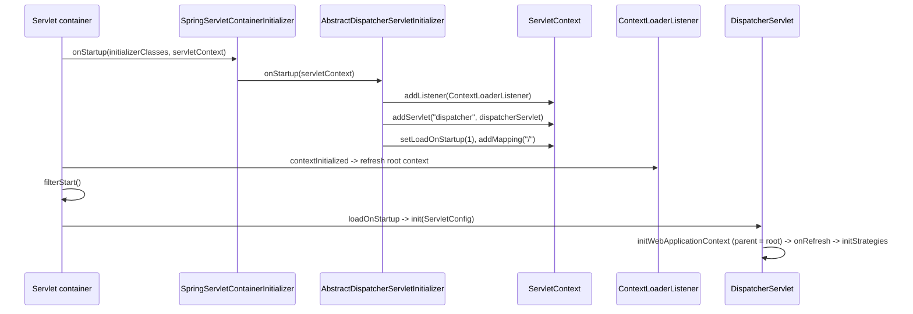
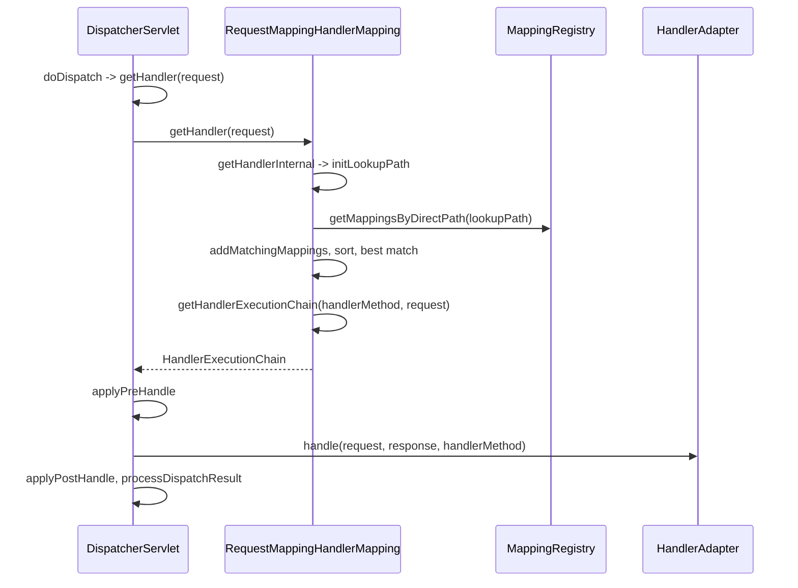
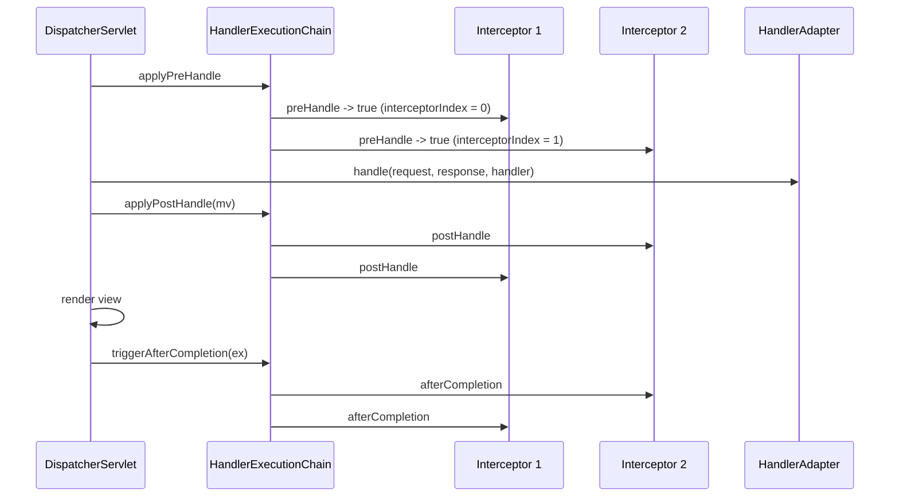

This article describes Spring MVC
<!--more-->


# web on servlet
Servlet-stack web applications built on the servlet API and deployed to Servlet containers


## ServletContext

`ServletContext` Defines a set of methods that a servlet uses to communicate with its servlet container

spring uses `ContextLoaderListener` to listen to the initialization of `ServletContext`, then init spring `WebApplicationContext`

```plantuml
top to bottom direction

package Tomcat {
    interface ServletContextListener {
        + void contextInitialized( sce)
        + void contextDestroyed( sce)
    }

    interface ServletContext {
        + ServletContext getContext(String)
        + URL getResource(String)
        + RequestDispatcher getRequestDispatcher(String)
        + boolean setInitParameter(String,String)
        + void setAttribute(String,Object)
        + ServletRegistration.Dynamic addServlet(String,String)
        + ServletRegistration getServletRegistration(String)
        + FilterRegistration.Dynamic addFilter(String,Filter)
        + SessionCookieConfig getSessionCookieConfig()
        + void addListener(Class<? extends EventListener>)
        + ClassLoader getClassLoader()
        + void setSessionTimeout(int)
    }

    class "ApplicationContext" as TomcatApplicationContext {
        Map<String,Object> attributes
    }
    note "org.apache.catalina.core.ApplicationContext\nTomcat's ServletContext, not Spring's ApplicationContext" as TomcatNote
    TomcatApplicationContext .. TomcatNote
    ServletContext <|.. TomcatApplicationContext
}

package Spring {
    interface ApplicationContext
    interface ConfigurableApplicationContext
    interface WebApplicationContext {
        ServletContext getServletContext()
    }
    interface ConfigurableWebApplicationContext {
        void setServletContext(ServletContext)
        void setServletConfig(ServletConfig)
    }
    abstract class AbstractRefreshableConfigApplicationContext

    class ContextLoader {
        {static} Map<ClassLoader, WebApplicationContext> currentContextPerThread
        {static} volatile  currentContext
        WebApplicationContext context
        initWebApplicationContext(sc)
        createWebApplicationContext(sc)
        closeWebApplicationContext(sc)
    }
    class ContextLoaderListener   {
        
        contextInitialized(sce)
        contextDestroyed(sce)
    }

    abstract class AbstractRefreshableWebApplicationContext  {
        ServletContext servletContext
        ServletConfig servletConfig
    }

    class XmlWebApplicationContext extends AbstractRefreshableWebApplicationContext {

    }
    ContextLoader <|-up- ContextLoaderListener
    ContextLoader -left-> XmlWebApplicationContext : create

    ApplicationContext <|-- ConfigurableApplicationContext
    ApplicationContext <|-- WebApplicationContext
    WebApplicationContext <|-- ConfigurableWebApplicationContext
    ConfigurableApplicationContext <|-- ConfigurableWebApplicationContext
    AbstractRefreshableConfigApplicationContext <|-- AbstractRefreshableWebApplicationContext
    ConfigurableWebApplicationContext <|.. AbstractRefreshableWebApplicationContext
}

ServletContextListener <|.[norank]. ContextLoaderListener
TomcatNote -[hidden]down- ApplicationContext
AbstractRefreshableWebApplicationContext o-[norank]- ServletContext : servletContext

```

# DispatcherServlet

Spring MVC is designed aroud the front controller pattern where a central `servlet`, the `DispatcherServlet`, provides a shared algorithm for request processing, while actual work is performed by configurable delegate components.


```plantuml

package Tomcat {
    interface Servlet {
    + void init(ServletConfig)
    + ServletConfig getServletConfig()
    + void service(ServletRequest,ServletResponse)
    + String getServletInfo()
    + void destroy()
    }

    interface ServletConfig {
    + String getServletName()
    + ServletContext getServletContext()
    + String getInitParameter(String)
    + Enumeration<String> getInitParameterNames()
    }

    abstract class GenericServlet {
    - ServletConfig config
    }

    abstract class HttpServlet {
    - Object cachedAllowHeaderValueLock
    - String cachedAllowHeaderValue
    - boolean cachedUseLegacyDoHead

    # void doGet(HttpServletRequest,HttpServletResponse)
    # long getLastModified(HttpServletRequest)
    # void doHead(HttpServletRequest,HttpServletResponse)
    # void doPatch(HttpServletRequest,HttpServletResponse)
    # void doPost(HttpServletRequest,HttpServletResponse)
    # void doPut(HttpServletRequest,HttpServletResponse)
    # void doDelete(HttpServletRequest,HttpServletResponse)
    # void doOptions(HttpServletRequest,HttpServletResponse)
    # void doTrace(HttpServletRequest,HttpServletResponse)
    # boolean isSensitiveHeader(String)
    # void service(HttpServletRequest,HttpServletResponse)
    + void service(ServletRequest,ServletResponse)
    }
}

package Spring {
    abstract class HttpServletBean  {
        ConfigurableEnvironment environment
        void initServletBean()
    }

    abstract class FrameworkServlet extends HttpServletBean {
        WebApplicationContext webApplicationContext
        String contextId
        String namespace
        String contextConfigLocation
        void processRequest( request,  response)
        abstract void doService( request,  response)
    }

    class DispatcherServlet extends FrameworkServlet {
        List<HandlerMapping> handlerMappings
        List<HandlerAdapter> handlerAdapters
        List<HandlerExceptionResolver> handlerExceptionResolvers
        protected void doService( request,  response) 
        protected void doDispatch( request,  response)
    }
}


Servlet <|.. GenericServlet
ServletConfig <|.. GenericServlet
GenericServlet <|-- HttpServlet
HttpServlet<|-- HttpServletBean
```

# Servlet registration

A servlet container learns about servlets, filters and listeners from three sources: `web.xml`, annotations such as `@WebServlet`, and programmatic calls to `ServletContext.addServlet`, `addFilter` and `addListener`. Programmatic calls are accepted only while the web application is starting, from a `ServletContainerInitializer.onStartup` or a `ServletContextListener.contextInitialized` callback. Spring MVC uses the programmatic path to register `ContextLoaderListener` and `DispatcherServlet` without `web.xml`; a classic `web.xml` that declares the same two classes produces the same result.

The container then runs three callbacks in a fixed order, and that order defines Spring's initialization order:

| Container callback | Spring work |
|--------------------|-------------|
| `ServletContainerInitializer.onStartup` | `SpringServletContainerInitializer` calls each `WebApplicationInitializer`, which registers the listener, the `DispatcherServlet` and filters |
| `ServletContextListener.contextInitialized` | `ContextLoaderListener` refreshes the root `WebApplicationContext` and stores it as a `ServletContext` attribute |
| `Filter.init` | filters initialize; `DelegatingFilterProxy` can already resolve its delegate bean from the root context |
| `Servlet.init` for load-on-startup servlets | `DispatcherServlet` creates and refreshes its own context with the root context as parent, then initializes its strategies |

The Tomcat side of this sequence is described in [Tomcat startup](/post/java/tomcat/).

## SpringServletContainerInitializer

`spring-web` ships `SpringServletContainerInitializer` as a service entry in `META-INF/services/jakarta.servlet.ServletContainerInitializer`. It declares `@HandlesTypes(WebApplicationInitializer.class)`, so Tomcat passes every class that implements `WebApplicationInitializer` to `onStartup`. The SCI instantiates each concrete class, sorts the instances by `@Order`/`Ordered`, and calls `WebApplicationInitializer.onStartup(servletContext)` on each one.

```plantuml
top to bottom direction

package Tomcat {
    interface ServletContainerInitializer {
        + void onStartup(Set<Class<?>> c, ServletContext ctx)
    }
    interface ServletContext {
        + ServletRegistration.Dynamic addServlet(String,Servlet)
        + FilterRegistration.Dynamic addFilter(String,Filter)
        + void addListener(T)
    }
    interface "ServletRegistration.Dynamic" as ServletDynamic {
        + Set<String> addMapping(String...)
        + void setLoadOnStartup(int)
        + void setAsyncSupported(boolean)
    }
    class ApplicationServletRegistration {
        - Wrapper wrapper
        - Context context
    }
    ServletDynamic <|.. ApplicationServletRegistration
    note "org.apache.catalina.core.ApplicationServletRegistration\nreturned by ApplicationContext.addServlet" as RegistrationNote
    ApplicationServletRegistration .. RegistrationNote
}

package Spring {
    class SpringServletContainerInitializer {
        + void onStartup(Set<Class<?>> webAppInitializerClasses, ServletContext servletContext)
    }
    interface WebApplicationInitializer {
        + void onStartup(ServletContext servletContext)
    }
    abstract class AbstractContextLoaderInitializer {
        + void onStartup(ServletContext servletContext)
        # void registerContextLoaderListener(ServletContext servletContext)
        # {abstract} WebApplicationContext createRootApplicationContext()
    }
    abstract class AbstractDispatcherServletInitializer {
        + {static} String DEFAULT_SERVLET_NAME = "dispatcher"
        + void onStartup(ServletContext servletContext)
        # void registerDispatcherServlet(ServletContext servletContext)
        # FrameworkServlet createDispatcherServlet(WebApplicationContext servletAppContext)
        # {abstract} WebApplicationContext createServletApplicationContext()
        # {abstract} String[] getServletMappings()
        # Filter[] getServletFilters()
        # FilterRegistration.Dynamic registerServletFilter(ServletContext servletContext, Filter filter)
    }
    abstract class AbstractAnnotationConfigDispatcherServletInitializer {
        # WebApplicationContext createRootApplicationContext()
        # WebApplicationContext createServletApplicationContext()
        # {abstract} Class<?>[] getRootConfigClasses()
        # {abstract} Class<?>[] getServletConfigClasses()
    }

    WebApplicationInitializer <|.. AbstractContextLoaderInitializer
    AbstractContextLoaderInitializer <|-- AbstractDispatcherServletInitializer
    AbstractDispatcherServletInitializer <|-- AbstractAnnotationConfigDispatcherServletInitializer
    SpringServletContainerInitializer --> "N" WebApplicationInitializer : onStartup
}

ServletContainerInitializer <|.[norank]. SpringServletContainerInitializer
AbstractDispatcherServletInitializer .[norank].> ServletContext : addServlet / addFilter
RegistrationNote -[hidden]down- SpringServletContainerInitializer
```

`AbstractDispatcherServletInitializer.onStartup` first lets the superclass register a `ContextLoaderListener` that wraps the root context (`createRootApplicationContext`), and then registers the `DispatcherServlet`:

```java
// SpringServletContainerInitializer.onStartup
public void onStartup(@Nullable Set<Class<?>> webAppInitializerClasses, ServletContext servletContext)
        throws ServletException {
    List<WebApplicationInitializer> initializers = Collections.emptyList();
    if (webAppInitializerClasses != null) {
        initializers = new ArrayList<>(webAppInitializerClasses.size());
        for (Class<?> waiClass : webAppInitializerClasses) {
            if (!waiClass.isInterface() && !Modifier.isAbstract(waiClass.getModifiers()) &&
                    WebApplicationInitializer.class.isAssignableFrom(waiClass)) {
                initializers.add((WebApplicationInitializer)
                        ReflectionUtils.accessibleConstructor(waiClass).newInstance());
            }
        }
    }
    if (initializers.isEmpty()) {
        servletContext.log("No Spring WebApplicationInitializer types detected on classpath");
        return;
    }
    AnnotationAwareOrderComparator.sort(initializers);
    for (WebApplicationInitializer initializer : initializers) {
        initializer.onStartup(servletContext);
    }
}

// AbstractDispatcherServletInitializer.onStartup
public void onStartup(ServletContext servletContext) throws ServletException {
    super.onStartup(servletContext);          // registerContextLoaderListener
    registerDispatcherServlet(servletContext);
}

// AbstractContextLoaderInitializer.registerContextLoaderListener
protected void registerContextLoaderListener(ServletContext servletContext) {
    WebApplicationContext rootAppContext = createRootApplicationContext();
    if (rootAppContext != null) {
        ContextLoaderListener listener = new ContextLoaderListener(rootAppContext, servletContext);
        listener.setContextInitializers(getRootApplicationContextInitializers());
        servletContext.addListener(listener);
    }
}

// AbstractDispatcherServletInitializer.registerDispatcherServlet
protected void registerDispatcherServlet(ServletContext servletContext) {
    String servletName = getServletName();
    WebApplicationContext servletAppContext = createServletApplicationContext();
    FrameworkServlet dispatcherServlet = createDispatcherServlet(servletAppContext);
    dispatcherServlet.setContextInitializers(getServletApplicationContextInitializers());

    ServletRegistration.Dynamic registration = servletContext.addServlet(servletName, dispatcherServlet);
    if (registration == null) {
        throw new IllegalStateException("Failed to register servlet with name '" + servletName + "'. " +
                "Check if there is another servlet registered under the same name.");
    }
    registration.setLoadOnStartup(1);
    registration.addMapping(getServletMappings());
    registration.setAsyncSupported(isAsyncSupported());

    Filter[] filters = getServletFilters();
    if (!ObjectUtils.isEmpty(filters)) {
        for (Filter filter : filters) {
            registerServletFilter(servletContext, filter);
        }
    }
    customizeRegistration(registration);
}
```

An application supplies only the configuration classes and mappings:

```java
public class WebInitializer extends AbstractAnnotationConfigDispatcherServletInitializer {

    @Override
    protected Class<?>[] getRootConfigClasses() {
        return new Class<?>[] { ServiceConfig.class };
    }

    @Override
    protected Class<?>[] getServletConfigClasses() {
        return new Class<?>[] { WebMvcConfig.class };
    }

    @Override
    protected String[] getServletMappings() {
        return new String[] { "/" };
    }
}
```

## From addServlet to Servlet.init

The container's `addServlet` returns `null` when a servlet with the same name is already fully registered, which is why `registerDispatcherServlet` treats `null` as a name conflict.

`setLoadOnStartup(1)` makes the container initialize the servlet at the end of web application start, after listeners and filters, by calling `DispatcherServlet.init(ServletConfig)`. `HttpServletBean.init` binds init parameters and calls `FrameworkServlet.initServletBean`, which calls `initWebApplicationContext`: the root context is read from the `ServletContext` attribute that `ContextLoaderListener` set in `contextInitialized`, set as the parent of the servlet's context, and the servlet's context is refreshed. `DispatcherServlet.onRefresh` then runs `initStrategies` to load handler mappings, adapters and resolvers. Without `loadOnStartup`, the same initialization happens on the first request that maps to the servlet.



# Filter registration

Tomcat stores a filter registered through `ServletContext.addFilter` as a `FilterDef`, and every `addMappingForUrlPatterns` or `addMappingForServletNames` call appends a `FilterMap`. Filters are initialized after `ServletContextListener.contextInitialized` and before load-on-startup servlets; for each request Tomcat builds an `ApplicationFilterChain` from the matching mappings and calls the servlet at the end of the chain. The container mechanics are described in the [Tomcat post](/post/java/tomcat/). Spring contributes filters to that chain in two ways: filters bound to the `DispatcherServlet` by the initializer, and `DelegatingFilterProxy`, which forwards to a filter bean.

## DispatcherServlet filters and DelegatingFilterProxy

`AbstractDispatcherServletInitializer.getServletFilters()` returns filters that apply only to the `DispatcherServlet`. `registerServletFilter` derives the filter name from the class (`Conventions.getVariableName`), appends `#0`, `#1`, … on name conflicts, and maps the filter by servlet name, not by URL pattern:

```java
// AbstractDispatcherServletInitializer.registerServletFilter
protected FilterRegistration.Dynamic registerServletFilter(ServletContext servletContext, Filter filter) {
    String filterName = Conventions.getVariableName(filter);
    Dynamic registration = servletContext.addFilter(filterName, filter);
    if (registration == null) {
        int counter = 0;
        while (registration == null) {
            if (counter == 100) {
                throw new IllegalStateException("Failed to register filter with name '" + filterName + "'. " +
                        "Check if there is another filter registered under the same name.");
            }
            registration = servletContext.addFilter(filterName + "#" + counter, filter);
            counter++;
        }
    }
    registration.setAsyncSupported(isAsyncSupported());
    registration.addMappingForServletNames(getDispatcherTypes(), false, getServletName());
    return registration;
}
```

The dispatcher types are `REQUEST`, `FORWARD`, `INCLUDE`, plus `ASYNC` when `isAsyncSupported()` returns `true` (the default).

A filter registered this way is an object created by the initializer, not a Spring bean. `DelegatingFilterProxy` bridges the two: it is registered with the container under a name, and on `initFilterBean` (from `Filter.init`) or on the first `doFilter` it looks up the `WebApplicationContext` from the `ServletContext` and fetches the bean whose name equals `targetBeanName`, defaulting to the filter name. Every request is then forwarded to that bean. Spring Security's `springSecurityFilterChain` is registered through this proxy.

```java
// DelegatingFilterProxy.doFilter
public void doFilter(ServletRequest request, ServletResponse response, FilterChain filterChain)
        throws ServletException, IOException {
    Filter delegateToUse = this.delegate;
    if (delegateToUse == null) {
        this.delegateLock.lock();
        try {
            delegateToUse = this.delegate;
            if (delegateToUse == null) {
                WebApplicationContext wac = findWebApplicationContext();
                if (wac == null) {
                    throw new IllegalStateException("No WebApplicationContext found: " +
                            "no ContextLoaderListener or DispatcherServlet registered?");
                }
                delegateToUse = initDelegate(wac);
            }
            this.delegate = delegateToUse;
        }
        finally {
            this.delegateLock.unlock();
        }
    }
    invokeDelegate(delegateToUse, request, response, filterChain);
}

// DelegatingFilterProxy.initDelegate
protected Filter initDelegate(WebApplicationContext wac) throws ServletException {
    String targetBeanName = getTargetBeanName();
    Assert.state(targetBeanName != null, "No target bean name set");
    Filter delegate = wac.getBean(targetBeanName, Filter.class);
    if (isTargetFilterLifecycle()) {
        delegate.init(getFilterConfig());
    }
    return delegate;
}
```

The lazy path in `doFilter` exists because the root context may not be refreshed yet when the proxy's `Filter.init` runs; with `ContextLoaderListener`, `contextInitialized` runs before `Filter.init`, and the delegate is usually resolved in `initFilterBean`.

# Handler mapping

An endpoint in Spring MVC is a handler: for annotated controllers, a `HandlerMethod` that pairs a controller bean with one of its `@RequestMapping` methods. `DispatcherServlet` does not know how handlers are declared; it asks an ordered list of `HandlerMapping` strategies for a `HandlerExecutionChain`, which is the handler plus the interceptors that apply to the request. Mapping therefore has two halves: registering endpoints when the application context starts, and looking up the endpoint for each request.

`DispatcherServlet.initStrategies` fills the list in `initHandlerMappings`. With `detectAllHandlerMappings` (the default) it collects every `HandlerMapping` bean from its own context and the root context and sorts them by `Ordered`/`@Order`. If no bean exists, it instantiates the defaults listed in `DispatcherServlet.properties`: `BeanNameUrlHandlerMapping`, `RequestMappingHandlerMapping` and `RouterFunctionMapping`. With `@EnableWebMvc`, which imports `DelegatingWebMvcConfiguration`, `WebMvcConfigurationSupport.requestMappingHandlerMapping` declares the `RequestMappingHandlerMapping` bean with order `0` and passes it the interceptors from `WebMvcConfigurer.addInterceptors`.

```plantuml
top to bottom direction

interface HandlerMapping {
    + HandlerExecutionChain getHandler(HttpServletRequest request)
}
interface InitializingBean {
    + void afterPropertiesSet()
}
abstract class AbstractHandlerMapping {
    - List<Object> interceptors
    - List<HandlerInterceptor> adaptedInterceptors
    - int order
    + final HandlerExecutionChain getHandler(HttpServletRequest request)
    # {abstract} Object getHandlerInternal(HttpServletRequest request)
    # HandlerExecutionChain getHandlerExecutionChain(Object handler, HttpServletRequest request)
}
abstract class "AbstractHandlerMethodMapping<T>" as AbstractHandlerMethodMapping {
    - MappingRegistry mappingRegistry
    + void afterPropertiesSet()
    # void initHandlerMethods()
    # void detectHandlerMethods(Object handler)
    # void registerHandlerMethod(Object handler, Method method, T mapping)
    # HandlerMethod getHandlerInternal(HttpServletRequest request)
    # HandlerMethod lookupHandlerMethod(String lookupPath, HttpServletRequest request)
    # {abstract} boolean isHandler(Class<?> beanType)
    # {abstract} T getMappingForMethod(Method method, Class<?> handlerType)
}
abstract class RequestMappingInfoHandlerMapping
class RequestMappingHandlerMapping {
    # boolean isHandler(Class<?> beanType)
    # RequestMappingInfo getMappingForMethod(Method method, Class<?> handlerType)
}
class MappingRegistry {
    - Map<T, MappingRegistration<T>> registry
    - MultiValueMap<String, T> pathLookup
    - Map<String, List<HandlerMethod>> nameLookup
    - Map<HandlerMethod, CorsConfiguration> corsLookup
    - ReentrantReadWriteLock readWriteLock
    + void register(T mapping, Object handler, Method method)
}
class RequestMappingInfo {
    - PathPatternsRequestCondition pathPatternsCondition
    - RequestMethodsRequestCondition methodsCondition
    - ParamsRequestCondition paramsCondition
    - HeadersRequestCondition headersCondition
    - ConsumesRequestCondition consumesCondition
    - ProducesRequestCondition producesCondition
}
class HandlerMethod {
    - Object bean
    - Method method
}

HandlerMapping <|.. AbstractHandlerMapping
AbstractHandlerMapping <|-- AbstractHandlerMethodMapping
InitializingBean <|.. AbstractHandlerMethodMapping
AbstractHandlerMethodMapping <|-- RequestMappingInfoHandlerMapping
RequestMappingInfoHandlerMapping <|-- RequestMappingHandlerMapping
AbstractHandlerMethodMapping *-- MappingRegistry : mappingRegistry
MappingRegistry o-- "N" RequestMappingInfo : registry key
MappingRegistry o-- "N" HandlerMethod : registry value
```

`HandlerMethod.method` is declared in its parent class `AnnotatedMethod`; it is shown on `HandlerMethod` for brevity.

## Endpoint registration

`AbstractHandlerMethodMapping` implements `InitializingBean`, so registration runs once, in `afterPropertiesSet`, while the mapping bean is initialized during the refresh of the context that declares it (normally the `DispatcherServlet`'s context). It walks every bean name in the context, keeps beans whose type `isHandler` accepts, and for each such bean builds one mapping per annotated method:

1. `RequestMappingHandlerMapping.isHandler` accepts a type annotated with `@Controller`, directly or through a meta-annotation such as `@RestController`.
2. `detectHandlerMethods` calls `MethodIntrospector.selectMethods`, which visits the user class (unwrapping CGLIB subclasses) and its interfaces and keeps every method for which `getMappingForMethod` returns a non-null mapping.
3. `getMappingForMethod` builds a `RequestMappingInfo` from the method's `@RequestMapping` (or `@GetMapping`, `@PostMapping`, …), combines it with the type-level `@RequestMapping`, and applies a configured path prefix.
4. `registerHandlerMethod` passes the mapping to `MappingRegistry.register`, which creates the `HandlerMethod`, rejects a second method with an equal mapping (`Ambiguous mapping`), indexes the mapping under each pattern without wildcards (`pathLookup`), and records CORS configuration from `@CrossOrigin`.

```java
// AbstractHandlerMethodMapping.afterPropertiesSet
public void afterPropertiesSet() {
    initHandlerMethods();
}

// AbstractHandlerMethodMapping.initHandlerMethods
protected void initHandlerMethods() {
    for (String beanName : getCandidateBeanNames()) {
        if (!beanName.startsWith(SCOPED_TARGET_NAME_PREFIX)) {
            processCandidateBean(beanName);
        }
    }
    handlerMethodsInitialized(getHandlerMethods());
}

// AbstractHandlerMethodMapping.processCandidateBean
protected void processCandidateBean(String beanName) {
    Class<?> beanType = null;
    try {
        beanType = obtainApplicationContext().getType(beanName);
    }
    catch (Throwable ex) {
        // unresolvable bean type, ignored
    }
    if (beanType != null && isHandler(beanType)) {
        detectHandlerMethods(beanName);
    }
}

// AbstractHandlerMethodMapping.detectHandlerMethods
protected void detectHandlerMethods(Object handler) {
    Class<?> handlerType = (handler instanceof String beanName ?
            obtainApplicationContext().getType(beanName) : handler.getClass());
    if (handlerType != null) {
        Class<?> userType = ClassUtils.getUserClass(handlerType);
        Map<Method, T> methods = MethodIntrospector.selectMethods(userType,
                (MethodIntrospector.MetadataLookup<T>) method -> getMappingForMethod(method, userType));
        methods.forEach((method, mapping) -> {
            Method invocableMethod = AopUtils.selectInvocableMethod(method, userType);
            registerHandlerMethod(handler, invocableMethod, mapping);
        });
    }
}

// RequestMappingHandlerMapping.isHandler
protected boolean isHandler(Class<?> beanType) {
    return AnnotatedElementUtils.hasAnnotation(beanType, Controller.class);
}

// RequestMappingHandlerMapping.getMappingForMethod
protected @Nullable RequestMappingInfo getMappingForMethod(Method method, Class<?> handlerType) {
    validateCglibProxyMethodVisibility(method, handlerType);
    RequestMappingInfo info = createRequestMappingInfo(method);
    if (info != null) {
        RequestMappingInfo typeInfo = createRequestMappingInfo(handlerType);
        if (typeInfo != null) {
            info = typeInfo.combine(info);
        }
        if (info.isEmptyMapping()) {
            info = info.mutate().paths("", "/").options(this.config).build();
        }
        String prefix = getPathPrefix(handlerType);
        if (prefix != null) {
            info = RequestMappingInfo.paths(prefix).options(this.config).build().combine(info);
        }
    }
    return info;
}

// AbstractHandlerMethodMapping.MappingRegistry.register
public void register(T mapping, Object handler, Method method) {
    this.readWriteLock.writeLock().lock();
    try {
        HandlerMethod handlerMethod = createHandlerMethod(handler, method);
        validateMethodMapping(handlerMethod, mapping);

        Set<String> directPaths = AbstractHandlerMethodMapping.this.getDirectPaths(mapping);
        for (String path : directPaths) {
            this.pathLookup.add(path, mapping);
        }

        String name = null;
        if (getNamingStrategy() != null) {
            name = getNamingStrategy().getName(handlerMethod, mapping);
            addMappingName(name, handlerMethod);
        }

        CorsConfiguration corsConfig = initCorsConfiguration(handler, method, mapping);
        if (corsConfig != null) {
            corsConfig.validateAllowCredentials();
            corsConfig.validateAllowPrivateNetwork();
            this.corsLookup.put(handlerMethod, corsConfig);
        }

        handlerMethod = handlerMethod.createWithValidateFlags();
        this.registry.put(mapping,
                new MappingRegistration<>(mapping, handlerMethod, directPaths, name, corsConfig != null));
    }
    finally {
        this.readWriteLock.writeLock().unlock();
    }
}
```

The handler is registered by bean name, so the `HandlerMethod` initially holds a `String`; `createWithResolvedBean` replaces it with the bean instance at lookup time, which keeps lazy and scoped controllers working.

For a controller

```java
@RestController
@RequestMapping("/orders")
class OrderController {

    @GetMapping("/{id}")
    Order get(@PathVariable long id) { ... }

    @PostMapping(consumes = "application/json")
    Order create(@RequestBody Order order) { ... }
}
```

the registry holds two `RequestMappingInfo` keys: `{GET [/orders/{id}]}` and `{POST [/orders], consumes [application/json]}`. Only the second is a direct path and appears in `pathLookup` under `/orders`.

## Endpoint lookup

For each request, `DispatcherServlet.doDispatch` calls `getHandler`, which asks the mappings in order and takes the first non-null chain. `AbstractHandlerMapping.getHandler` is a template method: the subclass resolves the handler in `getHandlerInternal`, and the base class wraps it with interceptors in `getHandlerExecutionChain`. When no mapping returns a handler, `noHandlerFound` sends `404` or throws `NoHandlerFoundException`.

`lookupHandlerMethod` first tries the mappings indexed under the exact lookup path and scans all mappings only when none of them match. Each candidate's `RequestMappingInfo.getMatchingCondition(request)` checks every condition (pattern, method, params, headers, consumes, produces, version) and returns a condition narrowed to this request, or `null`. When several candidates match, they are sorted by specificity (for example `/orders/{id}` before `/orders/**`, an explicit `GET` before no method), and two equally specific matches raise `Ambiguous handler methods`.



```java
// DispatcherServlet.getHandler
protected @Nullable HandlerExecutionChain getHandler(HttpServletRequest request) throws Exception {
    if (this.handlerMappings != null) {
        for (HandlerMapping mapping : this.handlerMappings) {
            HandlerExecutionChain handler = mapping.getHandler(request);
            if (handler != null) {
                return handler;
            }
        }
    }
    return null;
}

// AbstractHandlerMapping.getHandler
public final @Nullable HandlerExecutionChain getHandler(HttpServletRequest request) throws Exception {
    initApiVersion(request);
    Object handler = getHandlerInternal(request);
    if (handler == null) {
        handler = getDefaultHandler();
    }
    if (handler == null) {
        return null;
    }
    if (handler instanceof String handlerName) {
        handler = obtainApplicationContext().getBean(handlerName);
    }
    if (!ServletRequestPathUtils.hasCachedPath(request)) {
        initLookupPath(request);
    }
    HandlerExecutionChain executionChain = getHandlerExecutionChain(handler, request);
    // ... CORS handling
    return executionChain;
}

// AbstractHandlerMethodMapping.getHandlerInternal
protected @Nullable HandlerMethod getHandlerInternal(HttpServletRequest request) throws Exception {
    String lookupPath = initLookupPath(request);
    this.mappingRegistry.acquireReadLock();
    try {
        HandlerMethod handlerMethod = lookupHandlerMethod(lookupPath, request);
        return (handlerMethod != null ? handlerMethod.createWithResolvedBean() : null);
    }
    finally {
        this.mappingRegistry.releaseReadLock();
    }
}

// AbstractHandlerMethodMapping.lookupHandlerMethod
protected @Nullable HandlerMethod lookupHandlerMethod(String lookupPath, HttpServletRequest request) throws Exception {
    List<Match> matches = new ArrayList<>();
    List<T> directPathMatches = this.mappingRegistry.getMappingsByDirectPath(lookupPath);
    if (directPathMatches != null) {
        addMatchingMappings(directPathMatches, matches, request);
    }
    if (matches.isEmpty()) {
        addMatchingMappings(this.mappingRegistry.getRegistrations().keySet(), matches, request);
    }
    if (!matches.isEmpty()) {
        Match bestMatch = matches.get(0);
        if (matches.size() > 1) {
            Comparator<Match> comparator = new MatchComparator(getMappingComparator(request));
            matches.sort(comparator);
            bestMatch = matches.get(0);
            // ... CORS pre-flight handling
            Match secondBestMatch = matches.get(1);
            if (comparator.compare(bestMatch, secondBestMatch) == 0) {
                Method m1 = bestMatch.getHandlerMethod().getMethod();
                Method m2 = secondBestMatch.getHandlerMethod().getMethod();
                String uri = request.getRequestURI();
                throw new IllegalStateException(
                        "Ambiguous handler methods mapped for '" + uri + "': {" + m1 + ", " + m2 + "}");
            }
        }
        request.setAttribute(BEST_MATCHING_HANDLER_ATTRIBUTE, bestMatch.getHandlerMethod());
        handleMatch(bestMatch.mapping, lookupPath, request);
        return bestMatch.getHandlerMethod();
    }
    else {
        return handleNoMatch(this.mappingRegistry.getRegistrations().keySet(), lookupPath, request);
    }
}
```

`handleMatch` (in `RequestMappingInfoHandlerMapping`) stores URI template variables, matrix variables and producible media types as request attributes; `@PathVariable` arguments are later resolved from those attributes. `handleNoMatch` distinguishes a path that exists with the wrong method or media type, and raises `HttpRequestMethodNotSupportedException` (`405`), `HttpMediaTypeNotSupportedException` (`415`), `HttpMediaTypeNotAcceptableException` (`406`) or `UnsatisfiedServletRequestParameterException` (`400`) instead of returning `null`.

# Handler interceptors

A `HandlerInterceptor` runs inside `DispatcherServlet`, around the handler chosen by the handler mapping. Unlike a servlet `Filter`, it is selected per handler mapping, it receives the resolved handler object (for a controller, the `HandlerMethod` with its annotations), and it has three callbacks that bracket handler invocation and view rendering:

| Callback | Called | Order across interceptors |
|----------|--------|---------------------------|
| `boolean preHandle(request, response, handler)` | before the `HandlerAdapter` invokes the handler; returning `false` stops processing | registration order |
| `void postHandle(request, response, handler, modelAndView)` | after the handler returns and before the view is rendered; skipped when the handler throws | reverse order |
| `void afterCompletion(request, response, handler, ex)` | after rendering or after an exception, for every interceptor whose `preHandle` returned `true` | reverse order |

```plantuml
top to bottom direction

interface WebMvcConfigurer {
    + void addInterceptors(InterceptorRegistry registry)
}
class InterceptorRegistry {
    - List<InterceptorRegistration> registrations
    + InterceptorRegistration addInterceptor(HandlerInterceptor interceptor)
    # List<Object> getInterceptors()
}
class InterceptorRegistration {
    - HandlerInterceptor interceptor
    - List<String> includePatterns
    - List<String> excludePatterns
    - int order
    + InterceptorRegistration addPathPatterns(String... patterns)
    + InterceptorRegistration excludePathPatterns(String... patterns)
    + InterceptorRegistration order(int order)
    # Object getInterceptor()
}
interface HandlerInterceptor {
    + boolean preHandle(request, response, Object handler)
    + void postHandle(request, response, Object handler, ModelAndView modelAndView)
    + void afterCompletion(request, response, Object handler, Exception ex)
}
class MappedInterceptor {
    - PatternAdapter[] includePatterns
    - PatternAdapter[] excludePatterns
    - HandlerInterceptor interceptor
    + boolean matches(HttpServletRequest request)
}
abstract class AbstractHandlerMapping {
    - List<Object> interceptors
    - List<HandlerInterceptor> adaptedInterceptors
    # void initApplicationContext()
    # HandlerExecutionChain getHandlerExecutionChain(Object handler, HttpServletRequest request)
}
class HandlerExecutionChain {
    - Object handler
    - List<HandlerInterceptor> interceptorList
    - int interceptorIndex
    ~ boolean applyPreHandle(request, response)
    ~ void applyPostHandle(request, response, ModelAndView mv)
    ~ void triggerAfterCompletion(request, response, Exception ex)
}

WebMvcConfigurer ..> InterceptorRegistry : addInterceptors
InterceptorRegistry *-- "N" InterceptorRegistration : registrations
InterceptorRegistration ..> MappedInterceptor : getInterceptor
HandlerInterceptor <|.. MappedInterceptor
MappedInterceptor o-[norank]- HandlerInterceptor : interceptor
AbstractHandlerMapping o-[norank]- "N" HandlerInterceptor : adaptedInterceptors
AbstractHandlerMapping ..> HandlerExecutionChain : create per request
HandlerExecutionChain o-[norank]- "N" HandlerInterceptor : interceptorList
```

## Interceptor registration

Interceptors are attached to handler mappings, not to the servlet. With `@EnableWebMvc`, `WebMvcConfigurationSupport.getInterceptors` creates an `InterceptorRegistry`, calls `addInterceptors` (which `DelegatingWebMvcConfiguration` forwards to every `WebMvcConfigurer` bean), appends two framework interceptors that expose the conversion service and the resource URL provider as request attributes, and passes the sorted list to each handler mapping through `setInterceptors`. `InterceptorRegistration.getInterceptor` returns the interceptor itself when no path or HTTP method patterns are set, and otherwise wraps it in a `MappedInterceptor`.

```java
// WebMvcConfigurationSupport.getInterceptors
protected final Object[] getInterceptors(
        FormattingConversionService mvcConversionService,
        ResourceUrlProvider mvcResourceUrlProvider) {
    if (this.interceptors == null) {
        InterceptorRegistry registry = new InterceptorRegistry();
        addInterceptors(registry);
        registry.addInterceptor(new ConversionServiceExposingInterceptor(mvcConversionService));
        registry.addInterceptor(new ResourceUrlProviderExposingInterceptor(mvcResourceUrlProvider));
        this.interceptors = registry.getInterceptors();
    }
    return this.interceptors.toArray();
}

// InterceptorRegistry.getInterceptors
protected List<Object> getInterceptors() {
    return this.registrations.stream()
            .sorted(INTERCEPTOR_ORDER_COMPARATOR)
            .map(InterceptorRegistration::getInterceptor)
            .toList();
}
```

The handler mapping finalizes its list when it receives the application context. `AbstractHandlerMapping.initApplicationContext` adds every `MappedInterceptor` bean found in the context hierarchy (so a `MappedInterceptor` can also be declared as a bean) and adapts the configured interceptors into `adaptedInterceptors`. At request time, `getHandlerExecutionChain` copies plain interceptors into the chain unconditionally and adds a `MappedInterceptor`'s delegate only when `matches(request)` accepts the lookup path and HTTP method:

```java
// AbstractHandlerMapping.initApplicationContext
protected void initApplicationContext() throws BeansException {
    extendInterceptors(this.interceptors);
    detectMappedInterceptors(this.adaptedInterceptors);
    initInterceptors();
}

// AbstractHandlerMapping.getHandlerExecutionChain
protected HandlerExecutionChain getHandlerExecutionChain(Object handler, HttpServletRequest request) {
    HandlerExecutionChain chain = (handler instanceof HandlerExecutionChain handlerExecutionChain ?
            handlerExecutionChain : new HandlerExecutionChain(handler));
    for (HandlerInterceptor interceptor : this.adaptedInterceptors) {
        if (interceptor instanceof MappedInterceptor mappedInterceptor) {
            if (mappedInterceptor.matches(request)) {
                chain.addInterceptor(mappedInterceptor.getInterceptor());
            }
        }
        else {
            chain.addInterceptor(interceptor);
        }
    }
    // ... API version deprecation interceptor
    return chain;
}
```

A typical configuration registers an interceptor for part of the URL space:

```java
@Configuration
@EnableWebMvc
class WebMvcConfig implements WebMvcConfigurer {

    @Override
    public void addInterceptors(InterceptorRegistry registry) {
        registry.addInterceptor(new AuthInterceptor())
                .addPathPatterns("/api/**")
                .excludePathPatterns("/api/public/**")
                .order(1);
    }
}

class AuthInterceptor implements HandlerInterceptor {

    @Override
    public boolean preHandle(HttpServletRequest request, HttpServletResponse response, Object handler)
            throws Exception {
        if (request.getHeader("Authorization") == null) {
            response.sendError(HttpServletResponse.SC_UNAUTHORIZED);
            return false;
        }
        return true;
    }
}
```

## Interceptor execution

`HandlerExecutionChain` records in `interceptorIndex` the last interceptor whose `preHandle` returned `true`. If an interceptor returns `false`, the chain immediately calls `afterCompletion` on the interceptors before it, in reverse order, and `doDispatch` returns without invoking the handler. `postHandle` runs in reverse order only when the handler completes normally. `afterCompletion` runs from `processDispatchResult` after the view is rendered, or from `triggerAfterCompletion` when dispatch fails, and walks back from `interceptorIndex`, so every interceptor that was entered is also exited.



```java
// HandlerExecutionChain.applyPreHandle
boolean applyPreHandle(HttpServletRequest request, HttpServletResponse response) throws Exception {
    for (int i = 0; i < this.interceptorList.size(); i++) {
        HandlerInterceptor interceptor = this.interceptorList.get(i);
        if (!interceptor.preHandle(request, response, this.handler)) {
            triggerAfterCompletion(request, response, null);
            return false;
        }
        this.interceptorIndex = i;
    }
    return true;
}

// HandlerExecutionChain.applyPostHandle
void applyPostHandle(HttpServletRequest request, HttpServletResponse response, @Nullable ModelAndView mv)
        throws Exception {
    for (int i = this.interceptorList.size() - 1; i >= 0; i--) {
        HandlerInterceptor interceptor = this.interceptorList.get(i);
        interceptor.postHandle(request, response, this.handler, mv);
    }
}

// HandlerExecutionChain.triggerAfterCompletion
void triggerAfterCompletion(HttpServletRequest request, HttpServletResponse response, @Nullable Exception ex) {
    for (int i = this.interceptorIndex; i >= 0; i--) {
        HandlerInterceptor interceptor = this.interceptorList.get(i);
        try {
            interceptor.afterCompletion(request, response, this.handler, ex);
        }
        catch (Throwable ex2) {
            logger.error("HandlerInterceptor.afterCompletion threw exception", ex2);
        }
    }
}
```

For `@ResponseBody` methods the response body is written by the `HandlerAdapter` inside `handle`, so `postHandle` sees an already committed response and cannot change headers; `ResponseBodyAdvice` is the hook for that case. When a handler starts asynchronous processing, `postHandle` and `afterCompletion` are not called on the first dispatch; `AsyncHandlerInterceptor.afterConcurrentHandlingStarted` is called instead, and the full callbacks run on the async re-dispatch.

# Request Handling

url and form-data parameters will transformed to parameters of request, and binds to the Controller method args.
Request body will read by the converters, and convert to controller args.

## parameter handling
`@RequestBody` indicates a method parameter should be bound to the body of web request.

`@RequestParam` indicates a method parameter should be bound to a web request parameter in url or form-data.

`@ModelAttribute` binds a method parameter or method return value to a named model attribute.


`@PathVariable` indicates that a method parameter should be bound to a URI template variable.
```
@GetMapping("/hello/{name}/{age}")

public void select(@PathVariable("name") String name,
                    @PathVariable("age") int age)
```

`RequestParam` indicates that a method parameter should be bound to a web request parameter.
In spring mvc, request parameters map to a query parameters, form data and parts in multipart request.
