本文介绍springBoot架构与实现
<!--more-->

Spring Boot adds a launch path, auto-configuration, an embedded web server, typed configuration binding, logging setup, startup failure reports, Actuator endpoints, and an executable archive layout.

# Automatic Configuration

`@SpringBootApplication` pulls in `@EnableAutoConfiguration`. That annotation is meta-annotated with `@AutoConfigurationPackage` and `@Import(AutoConfigurationImportSelector.class)`. During configuration-class parsing, `AutoConfigurationImportSelector.getAutoConfigurationEntry` decides which auto-configuration classes become bean definitions.

1. `isEnabled` reads `spring.boot.enableautoconfiguration` (default `true`). `false` returns an empty entry and imports nothing.
2. `getCandidateConfigurations` loads class names from `META-INF/spring/org.springframework.boot.autoconfigure.AutoConfiguration.imports` through `ImportCandidates`. The selector's annotation type defaults to `@AutoConfiguration`, not `@EnableAutoConfiguration`. This list is not `META-INF/spring.factories`.
3. Duplicates are removed. Exclusions come from the annotation attributes `exclude` / `excludeName` and from the property `spring.autoconfigure.exclude`.
4. `ConfigurationClassFilter` drops candidates whose `@Conditional` checks fail (on class, on bean, on property, and the other auto-configuration conditions).
5. `AutoConfigurationImportEvent` is fired with the surviving list.

Each surviving class is an `@AutoConfiguration`. Boot registers it as an imported configuration. Conditions on the class decide whether its beans are created.

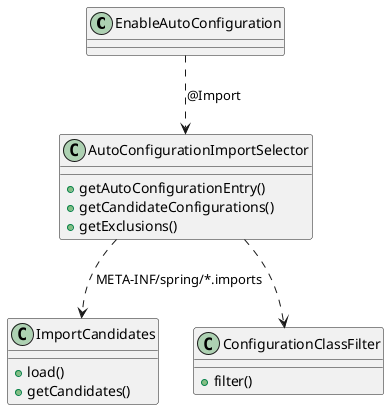

Processing starts at the application class. `@SpringBootApplication` includes `@EnableAutoConfiguration`, which imports `AutoConfigurationImportSelector`. Configuration-class parsing calls `selectImports`. Because `getImportGroup` returns `AutoConfigurationGroup`, the parser defers the selector and later calls `process`, which runs `getAutoConfigurationEntry`. `selectImports` on the group then sorts the survivors with `AutoConfigurationSorter` (`@AutoConfigureBefore` / `@AutoConfigureAfter` / `@AutoConfigureOrder`) and those class names are imported as configuration beans.

```java
// ---- 0. Application class: the bean that triggers auto-configuration ----
@SpringBootApplication // @SpringBootConfiguration + @EnableAutoConfiguration + @ComponentScan
public class DemoApplication {
    public static void main(String[] args) {
        SpringApplication.run(DemoApplication.class, args);
    }
}

@AutoConfigurationPackage
@Import(AutoConfigurationImportSelector.class)
public @interface EnableAutoConfiguration {
    String ENABLED_OVERRIDE_PROPERTY = "spring.boot.enableautoconfiguration";
    Class<?>[] exclude() default {};
    String[] excludeName() default {};
}

// ---- 1. Shape of a class named in AutoConfiguration.imports ----
@AutoConfiguration // @Configuration(proxyBeanMethods = false)
@ConditionalOnClass(DataSource.class)
@ConditionalOnMissingBean(DataSource.class)
public class DataSourceAutoConfiguration {
    @Bean
    DataSource dataSource() { /* created only when the conditions match */ }
}

// ---- 2. DeferredImportSelector entry: AutoConfigurationImportSelector ----
public String[] AutoConfigurationImportSelector.selectImports(AnnotationMetadata annotationMetadata) {
    if (!isEnabled(annotationMetadata)) {
        return NO_IMPORTS;
    }
    AutoConfigurationEntry entry = getAutoConfigurationEntry(annotationMetadata);
    return StringUtils.toStringArray(entry.getConfigurations());
}

public Class<? extends Group> AutoConfigurationImportSelector.getImportGroup() {
    return AutoConfigurationGroup.class;
}

// ---- 3. Candidate list, exclusions, condition filter, event ----
protected AutoConfigurationEntry AutoConfigurationImportSelector.getAutoConfigurationEntry(
        AnnotationMetadata annotationMetadata) {
    if (!AutoConfigurationImportSelector.isEnabled(annotationMetadata)) {
        return EMPTY_ENTRY;
    }
    AnnotationAttributes attributes = getAttributes(annotationMetadata); // @EnableAutoConfiguration
    List<String> configurations = getCandidateConfigurations(annotationMetadata, attributes);
    configurations = removeDuplicates(configurations);
    Set<String> exclusions = getExclusions(annotationMetadata, attributes);
    checkExcludedClasses(configurations, exclusions);
    configurations.removeAll(exclusions);
    configurations = getConfigurationClassFilter().filter(configurations);
    fireAutoConfigurationImportEvents(configurations, exclusions);
    return new AutoConfigurationEntry(configurations, exclusions);
}

protected boolean AutoConfigurationImportSelector.isEnabled(AnnotationMetadata metadata) {
    return getEnvironment().getProperty(
            EnableAutoConfiguration.ENABLED_OVERRIDE_PROPERTY, Boolean.class, true);
}

// ---- 4. Read META-INF/spring/....AutoConfiguration.imports ----
protected List<String> AutoConfigurationImportSelector.getCandidateConfigurations(
        AnnotationMetadata metadata, AnnotationAttributes attributes) {
    ImportCandidates importCandidates = ImportCandidates.load(AutoConfiguration.class, getBeanClassLoader());
    List<String> configurations = importCandidates.getCandidates();
    // empty list is an error: packaging dropped the imports file
    return configurations;
}

// ---- 5. Annotation exclude / excludeName and spring.autoconfigure.exclude ----
protected Set<String> AutoConfigurationImportSelector.getExclusions(
        AnnotationMetadata metadata, AnnotationAttributes attributes) {
    Set<String> excluded = new LinkedHashSet<>();
    excluded.addAll(asList(attributes, "exclude"));
    excluded.addAll(asList(attributes, "excludeName"));
    excluded.addAll(getExcludeAutoConfigurationsProperty()); // Binder "spring.autoconfigure.exclude"
    return getAutoConfigurationReplacements().replaceAll(excluded);
}

protected List<String> AutoConfigurationImportSelector.getExcludeAutoConfigurationsProperty() {
    return Binder.get(getEnvironment())
            .bind("spring.autoconfigure.exclude", String[].class)
            .map(Arrays::asList)
            .orElse(Collections.emptyList());
}

// ---- 6. OnClass / OnBean condition filters from spring.factories ----
List<String> AutoConfigurationImportSelector.ConfigurationClassFilter.filter(List<String> configurations) {
    String[] candidates = StringUtils.toStringArray(configurations);
    for (AutoConfigurationImportFilter filter : this.filters) {
        boolean[] match = filter.match(candidates, this.autoConfigurationMetadata);
        for (int i = 0; i < match.length; i++) {
            if (!match[i]) {
                candidates[i] = null;
            }
        }
    }
    // drop nulls and return the classes that still match
    return result;
}

// ---- 7. Group: collect, drop exclusions again, sort, hand names back to the parser ----
public void AutoConfigurationImportSelector.AutoConfigurationGroup.process(
        AnnotationMetadata annotationMetadata, DeferredImportSelector selector) {
    AutoConfigurationEntry entry = ((AutoConfigurationImportSelector) selector)
            .getAutoConfigurationEntry(annotationMetadata);
    this.autoConfigurationEntries.add(entry);
    for (String importClassName : entry.getConfigurations()) {
        this.entries.putIfAbsent(importClassName, annotationMetadata);
    }
}

public Iterable<Entry> AutoConfigurationImportSelector.AutoConfigurationGroup.selectImports() {
    Set<String> processed = /* configurations minus exclusions */;
    return sortAutoConfigurations(processed, getAutoConfigurationMetadata()).stream()
            .map(this::getEntry)
            .toList();
    // AutoConfigurationSorter.getInPriorityOrder uses @AutoConfigureBefore/After/Order
    // the parser then registers each Entry as an imported configuration class
}
```

# Bootstrap process

## SpringApplication

`SpringApplication.run` is the launch path. `createBootstrapContext` runs first, then run listeners, then the environment, the application context, refresh, runners, and the ready event.

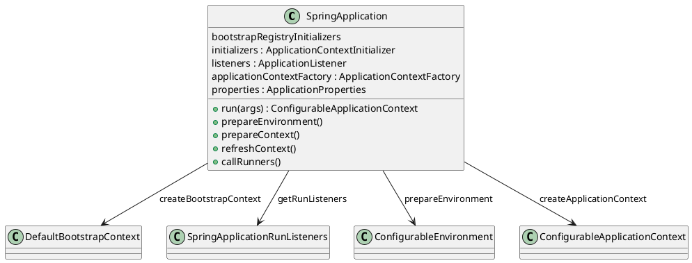

`createBootstrapContext` constructs a `DefaultBootstrapContext` and applies every `BootstrapRegistryInitializer`. `getRunListeners` loads `SpringApplicationRunListener` instances from `META-INF/spring.factories` (`EventPublishingRunListener` in the core jar) and calls `starting`.

`prepareEnvironment` then:

1. `getOrCreateEnvironment` asks `ApplicationContextFactory.createEnvironment` for the `WebApplicationType`. A servlet app receives `ApplicationServletEnvironment`. Anything the factories decline falls back to `ApplicationEnvironment`.
2. `configureEnvironment` installs `ApplicationConversionService`, adds a `SimpleCommandLinePropertySource` at the front when arguments are present, and adds `ApplicationInfoPropertySource` at the end.
3. `ConfigurationPropertySources.attach` wraps the environment so `Binder` can read relaxed names (`spring.main.*`).
4. `listeners.environmentPrepared` publishes `ApplicationEnvironmentPreparedEvent`. That is where `EnvironmentPostProcessor`s, including config-data loading, run.
5. `ApplicationInfoPropertySource` and `DefaultPropertiesPropertySource` are moved to the end so files and command-line arguments outrank defaults.
6. `bindToSpringApplication` binds `spring.main` onto `ApplicationProperties`. If the environment type does not match the context factory, `EnvironmentConverter` replaces it and attaches configuration property sources again.

`prepareContext` sets that environment on the context, runs `ApplicationContextInitializer`s, publishes context-prepared, closes the bootstrap context, registers the singletons `springApplicationArguments` and `springBootBanner`, and `load`s the user's `@SpringBootApplication` sources as bean definitions. `refreshContext` calls `ApplicationContext.refresh`. `listeners.started` then `callRunners` (`ApplicationRunner`, then `CommandLineRunner`). If the context is still running, `listeners.ready` publishes readiness.

### BootstrapContext

`DefaultBootstrapContext` implements `ConfigurableBootstrapContext`. It is alive from `createBootstrapContext` until `prepareContext` calls `bootstrapContext.close(context)`. Run listeners and `EnvironmentPostProcessor`s use it to share objects before the application context exists. Closing it promotes registered instances into the application context where the registration asked for that.

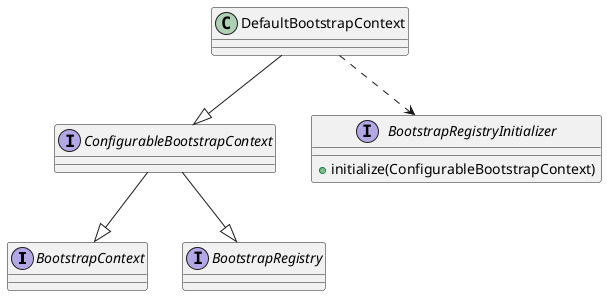

### SpringApplicationRunListeners

`SpringApplicationRunListeners` holds the `SpringApplicationRunListener` list and fans each callback out. The listener registered in core `spring.factories` is `EventPublishingRunListener`. It does not run environment post-processors itself. It multicasts Boot events through a `SimpleApplicationEventMulticaster` that still holds the listeners loaded from `spring.factories`, because the application context does not exist yet.

| Callback | Event |
|----------|--------|
| `starting` | `ApplicationStartingEvent` |
| `environmentPrepared` | `ApplicationEnvironmentPreparedEvent` |
| `contextPrepared` | `ApplicationContextInitializedEvent` |
| `contextLoaded` | moves listeners onto the context, then `ApplicationPreparedEvent` |
| `started` | `ApplicationStartedEvent`, liveness `CORRECT` |
| `ready` | `ApplicationReadyEvent`, readiness `ACCEPTING_TRAFFIC` |

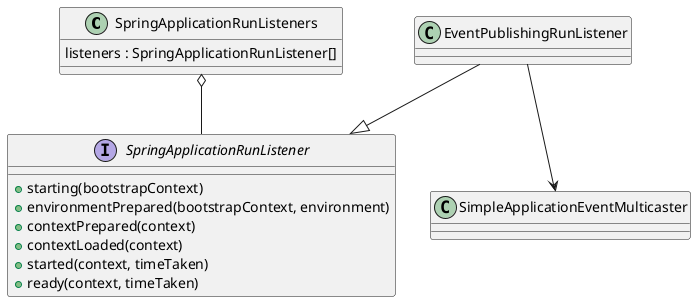

## ApplicationContextFactory

`ApplicationContextFactory` creates both the `Environment` and the `ApplicationContext` for a `WebApplicationType`. `ApplicationContextFactory.DEFAULT` is `DefaultApplicationContextFactory`. It loads every `ApplicationContextFactory` from `spring.factories` and uses the first candidate that returns non-null.

| `WebApplicationType` | Factory | Environment | Context |
|----------------------|---------|-------------|---------|
| `SERVLET` | `ServletWebServerApplicationContextFactory` | `ApplicationServletEnvironment` | `AnnotationConfigServletWebServerApplicationContext` |
| `REACTIVE` | `ReactiveWebServerApplicationContextFactory` | reactive servlet-less environment | reactive web-server context |
| `NONE` | no factory matches | `ApplicationEnvironment` | `AnnotationConfigApplicationContext` |

When AOT generated artifacts are in use, the servlet factory returns a plain `ServletWebServerApplicationContext` and the default factory returns a `GenericApplicationContext`, because bean definitions are already generated.

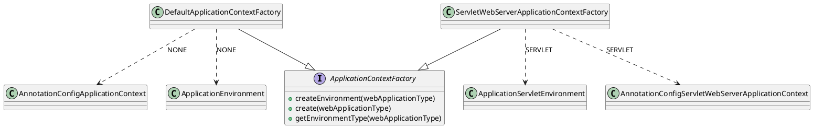

## Boot environment

`getOrCreateEnvironment` does not load `application.properties` or `application.yaml`. It only chooses the Boot environment type and then `configureEnvironment` adds command-line arguments and `ApplicationInfoPropertySource`. File and `spring.config.import` loading happen later, in `environmentPrepared`.

`ApplicationEnvironment` and `ApplicationServletEnvironment` both install Boot's `ConfigurationPropertySources` resolver, so `Binder` accepts relaxed names such as `SPRING_MAIN_WEB_APPLICATION_TYPE`. Both also skip reading active and default profiles from system properties at construction time. Profile selection waits until config data has been loaded, so a profile named in `application.yaml` is visible.

Boot listeners registered under `org.springframework.context.ApplicationListener` in `META-INF/spring.factories` are created in the `SpringApplication` constructor. `EventPublishingRunListener` delivers the early Boot events to that list. `contextLoaded` moves the same listeners onto the running application so `ApplicationStartedEvent` and `ApplicationReadyEvent` still reach them. The core list includes `EnvironmentPostProcessorApplicationListener`, `LoggingApplicationListener`, and `FileEncodingApplicationListener`.

### EnvironmentPostProcessorApplicationListener

This type is a `SmartApplicationListener`, not a `SpringApplicationRunListener`. `supportsEventType` accepts `ApplicationEnvironmentPreparedEvent`, `ApplicationPreparedEvent`, and `ApplicationFailedEvent`. On the environment-prepared event it loads `EnvironmentPostProcessor`s and calls `postProcessEnvironment` on each. On prepared or failed it switches deferred logs over to the real logging system.

The default factory is `EnvironmentPostProcessorsFactory.fromSpringFactories`, which reads the `org.springframework.boot.EnvironmentPostProcessor` key. In the core jar that list is `CloudFoundryVcapEnvironmentPostProcessor`, `ConfigDataEnvironmentPostProcessor`, `RandomValuePropertySourceEnvironmentPostProcessor`, `SpringApplicationJsonEnvironmentPostProcessor`, and `SystemEnvironmentPropertySourceEnvironmentPostProcessor`. Order comes from `Ordered` or `@Order`. `ConfigDataEnvironmentPostProcessor.ORDER` is `Ordered.HIGHEST_PRECEDENCE + 10`.

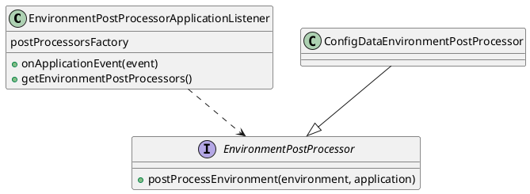

## EnvironmentPostProcessor

An `EnvironmentPostProcessor` customizes the `ConfigurableEnvironment` before `refresh`. Implementations are not picked up as beans. They must be listed in `META-INF/spring.factories`. Constructors may take `DeferredLogFactory`, `ConfigurableBootstrapContext`, or a `Log`. That is why they can log before logging is fully configured, and why they can see the bootstrap context.

### ConfigDataEnvironmentPostProcessor

`postProcessEnvironment` builds a `ConfigDataEnvironment` with the current environment, resource loader, additional profiles, and bootstrap context, then calls `processAndApply`.

`ConfigDataEnvironment.processAndApply`:

1. Builds a `ConfigDataImporter` from the `ConfigDataLocationResolver` and `ConfigDataLoader` lists, also loaded from `spring.factories` (`StandardConfigDataLocationResolver` for `application.properties` / `application.yaml` and `config/` trees, plus optional and import locations).
2. `processInitial` imports contributors that do not need an activation context.
3. `createActivationContext` binds early properties, including which profiles are active.
4. `processWithoutProfiles` imports documents that are not profile-specific.
5. `withProfiles` updates the activation context from `spring.profiles.active` and `spring.profiles.default` found so far.
6. `processWithProfiles` imports profile documents.
7. `applyToEnvironment` inserts the loaded `PropertySource`s into the `Environment`.

`spring.config.import` is an ordinary property on a contributor. Importing it adds child contributors, which the same loop resolves. `Binder` reads the contributor chain with configuration-property rules, so `spring.config.activate.on-profile` can skip a document without removing it from the chain.

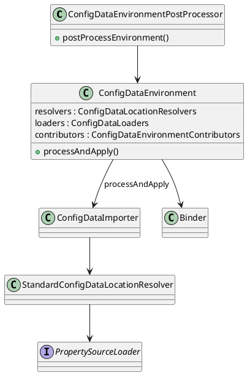

`PropertySourceLoader` instances (`PropertiesPropertySourceLoader`, `YamlPropertySourceLoader`) turn a resolved resource into `PropertySource`s. One YAML file can contribute several documents. Each document becomes its own contributor and can activate a different profile.

# Embedded web server

A servlet application does not deploy a WAR. `ServletWebServerApplicationContext.onRefresh` calls `createWebServer` before the context finishes refreshing. `getWebServerFactory` requires exactly one `ServletWebServerFactory` bean. Auto-configuration contributes that bean from the server on the classpath (`TomcatServletWebServerFactory` or `JettyServletWebServerFactory`). A reactive app uses a Netty (or other reactive) factory instead. `factory.getWebServer` builds the server and registers two lifecycles: `webServerStartStop` starts it when the context starts, and `webServerGracefulShutdown` stops accepting traffic first when `server.shutdown=graceful`.

If a `ServletContext` already exists, Boot does not create a server. `SpringBootServletInitializer` is the path that runs the same application inside an external servlet container.

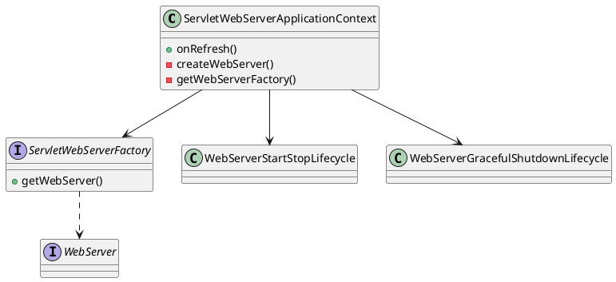

A reactive application uses `ReactiveWebServerApplicationContextFactory` and a reactive `WebServerFactory` the same way. `WebApplicationType.NONE` creates neither.

# Configuration properties

`@ConfigurationProperties` binds a prefix from the environment onto a bean. `ConfigurationPropertiesBindingPostProcessor` is registered under its own class name and runs at `HIGHEST_PRECEDENCE + 1`, before ordinary initialization. `postProcessBeforeInitialization` builds a `ConfigurationPropertiesBean` and `ConfigurationPropertiesBinder.bind` copies matching properties into the instance. Constructor-bound value objects are skipped here; they are bound when the bean is created. `@EnableConfigurationProperties` and `@ConfigurationPropertiesScan` register the beans that this post-processor then fills.

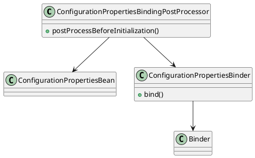

Binding uses the same relaxed names as config data (`server.port`, `SERVER_PORT`). A failed bind throws `ConfigurationPropertiesBindException` and startup stops.

# Logging

`LoggingApplicationListener` is one of the early Boot listeners. On `ApplicationEnvironmentPreparedEvent` it calls `LoggingSystem.get` for the classpath (Logback, Log4j2, or `java.util.logging`) and `initialize`. That applies `logging.file.name` / `logging.config`, then `logging.level.*`. Earlier events only set a temporary level so startup logs are not lost. On `ApplicationPreparedEvent` the chosen `LoggingSystem` is registered as the bean `springBootLoggingSystem`. `EnvironmentPostProcessor`s log through `DeferredLogFactory` until this listener switches those logs onto the real system.

# Failure analysis

If `run` throws, `handleRunFailure` asks `FailureAnalyzers`, a `SpringBootExceptionReporter` loaded from `spring.factories`. `reportException` walks every `FailureAnalyzer`. The first `analyze` that returns a `FailureAnalysis` wins. `FailureAnalysisReporter` implementations then print it. The core reporter is `LoggingFailureAnalysisReporter`, which is why a missing port or a bad config file ends as a short description and action instead of only a stack trace.

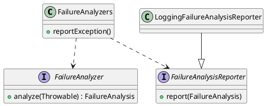

# Actuator

Actuator is optional. With it on the classpath, auto-configuration exposes operations as endpoints. `WebEndpointDiscoverer` scans beans for endpoint annotations and builds web operations. `management.endpoints.web.exposure.include` decides which ids are mapped. `HealthEndpoint` reads a `HealthContributorRegistry`: each contributor (disk, database, custom) returns a `Health`, and the endpoint aggregates them into one descriptor. HTTP mapping lives under `management.endpoints.web.base-path` (default `/actuator`). JMX uses `JmxEndpointDiscoverer` when that exposure is enabled. The application does not call these types; a request to the endpoint does.

# Executable archive

`JarLauncher.main` is the entry point of a Boot repackaged jar. `launch` registers a jar URL handler, builds a class loader from `BOOT-INF/lib` and `BOOT-INF/classes`, and reads `Start-Class` from the manifest. That class is the application's `main`, the one with `@SpringBootApplication`. `java -jar` therefore starts the loader, and the loader starts the application. `jarmode` swaps in a tools main instead of `Start-Class`.

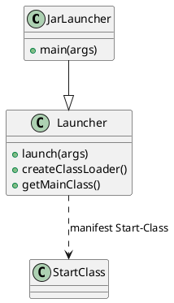

# Startup

`SpringApplication.run` is the ordered call. The bootstrap section names the types; this is the order they are used.

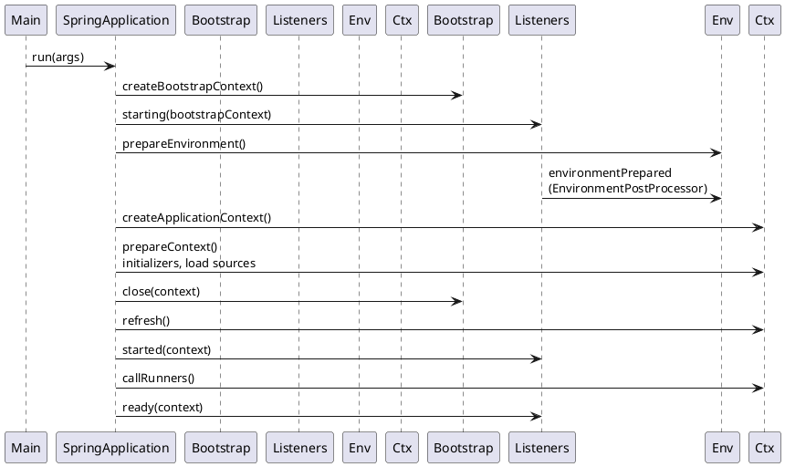

Auto-configuration import runs inside `refresh`, after this sequence has already chosen the web-server context and loaded config data. The embedded server (Tomcat, Jetty, or Netty) is started by that Boot web-server context, not by a separate step in `run`.
