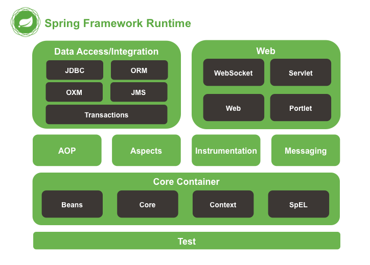
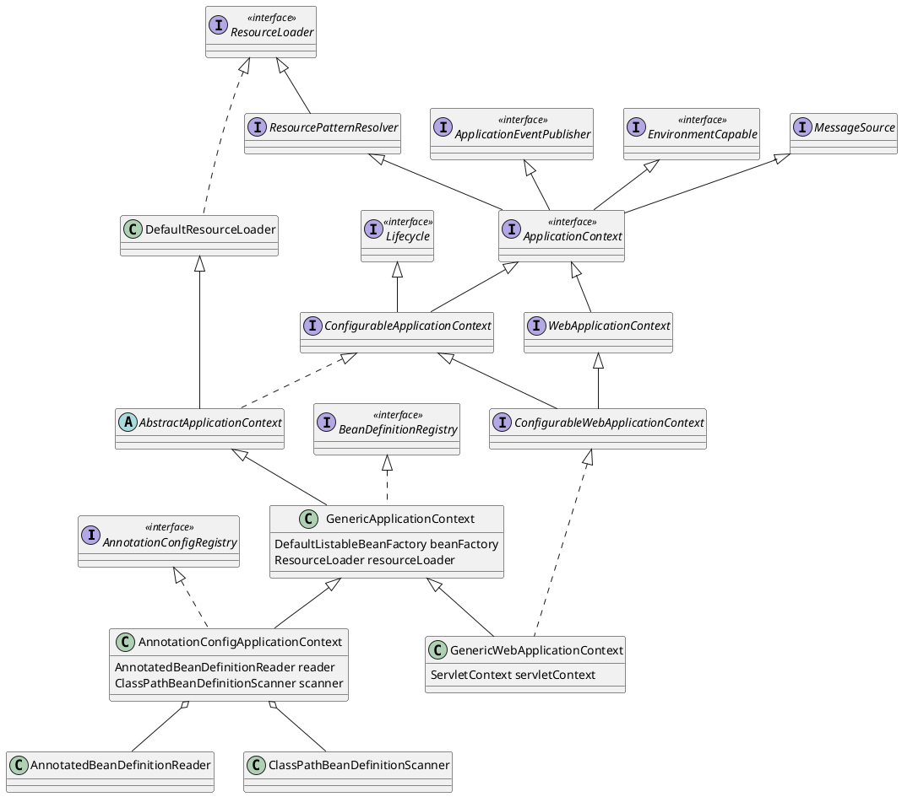
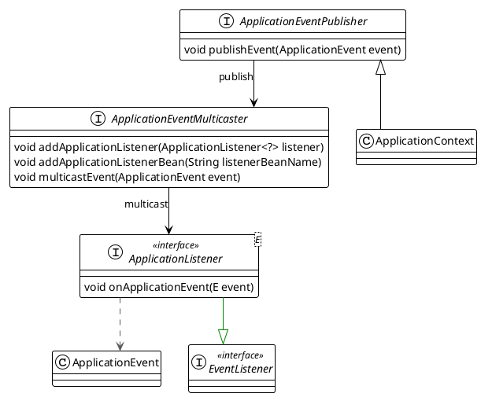
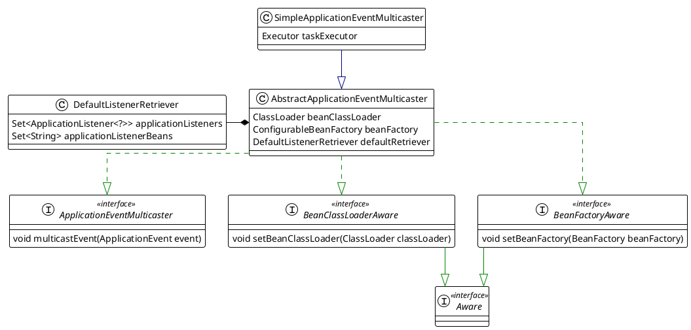
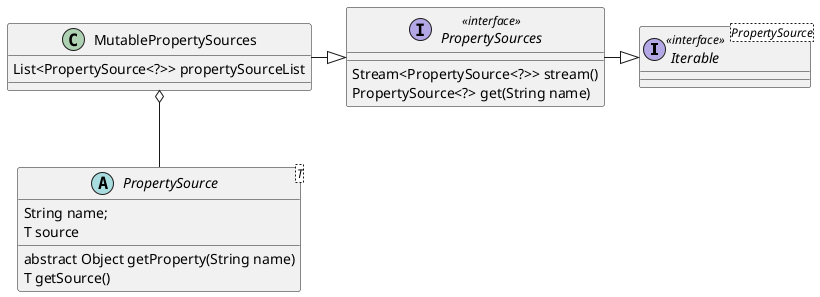
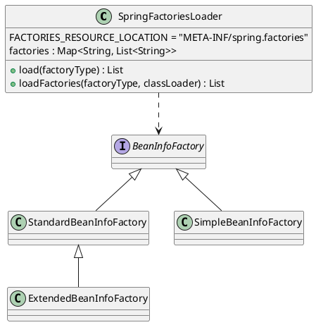
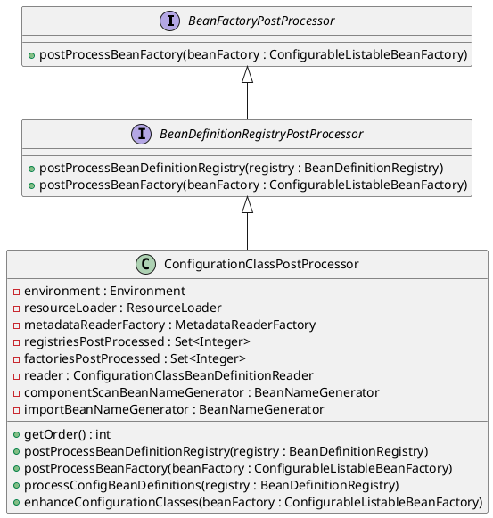
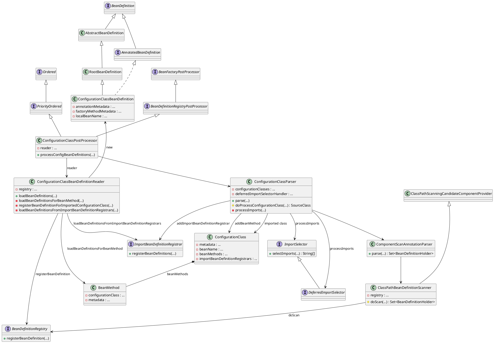

本文介绍spring Core Container
<!--more-->




# 1. Overview

The core container turns configuration into objects. A **bean** is one of those objects. A **`BeanDefinition`** is the metadata for a bean, held before the instance exists. A **`BeanFactory`** is the registry that stores those definitions and later returns instances. An **`ApplicationContext`** is a `BeanFactory` that also loads resources, owns an **`Environment`**, and publishes events. The environment's **`PropertySource`** list is where property values come from: system properties, environment variables, and later files declared with `@PropertySource`.

## Bean

Beans are created with the configuration metadata that you supply to the container.
In the container, the bean definitions are represented as `BeanDefinition` objects, contains:
1. class
2. Name
3. Scope
4. Construct arguments
5. Properties
6. Autowiring mode
7. Initialization method
8. Destruction method


## BeanDefinition

A `BeanDefinition` describes a bean instance, which has property values, constructor argument values. 
This allow a `BeanFactoryPostProcessor` to introspect and modify property values and other bean metadata.

`RootBeanDefinition` represents the merged bean definition at runtime

```plantuml
interface BeanDefinition extends AttributeAccessor,BeanMetadataElement
interface AnnotatedBeanDefinition extends BeanDefinition {
    AnnotationMetadata getMetadata()
    MethodMetadata getFactoryMethodMetadata()
}
abstract class AbstractBeanDefinition implements BeanDefinition {
    Object beanClass
    String[] dependsOn
}
class GenericBeanDefinition extends AbstractBeanDefinition
class RootBeanDefinition extends AbstractBeanDefinition
```

## BeanFactory

The root interface for accessing a spring bean container.
`BeanFactory` is a central registry of application components, and centralizes configuration components.

```plantuml

interface BeanFactory  {
    Object getBean(...)
}
interface ListableBeanFactory extends BeanFactory
interface HierarchicalBeanFactory extends BeanFactory
interface ConfigurableBeanFactory extends HierarchicalBeanFactory, SingletonBeanRegistry {
    void registerScope(String scopeName, Scope scope)
}
interface ConfigurableListableBeanFactory extends ListableBeanFactory, AutowireCapableBeanFactory, ConfigurableBeanFactory
class DefaultListableBeanFactory extends AbstractAutowireCapableBeanFactory implements ConfigurableListableBeanFactory, BeanDefinitionRegistry {
    Map<String, BeanDefinition> beanDefinitionMap
    Map<Class<?>, String[]> allBeanNamesByType
    Map<Class<?>, String[]> singletonBeanNamesByType
}

abstract class AbstractBeanFactory extends FactoryBeanRegistrySupport implements ConfigurableBeanFactory {
    BeanFactory parentBeanFactory
    List<BeanPostProcessor> beanPostProcessors
    Map<String, RootBeanDefinition> mergedBeanDefinitions
    Set<String> alreadyCreated
    Map<String, Scope> scopes

}

abstract class AbstractAutowireCapableBeanFactory extends AbstractBeanFactory implements AutowireCapableBeanFactory {
    InstantiationStrategy instantiationStrategy
}
```

## Context

`ApplicationContext` central interface to provide configuration for an application

* Bean factory methods for accessing application components. Inherited from `ListableBeanFactory`
* The ability to load file resources. Inherited from `ResourceLoader` interface.
* The ability to publish events to registered listeners. Inherited from the `ApplicationEventPublisher`



### Event

 
`ApplicationListener` can generically declare the event type that it is interested in. When registered with a Spring `ApplicationContext`, event will be filtered accordingly, with the listener getting invoked for matching event objects.

`ApplicationListener` beans are picked up by `ClassPathBeanDefinitionScanner`. `AbstractApplicationContext.registerListeners` registers them on the multicaster.

`ApplicationEventMulticaster` Interface to be implemented by objects that can manage a number of `Applicationlistener` objects and publish events to them.

`SimpleApplicationEventMulticaster` is the simple implementation of the `ApplicationEventMulticaster` interface.Multicasts all events to all registered listeners.






## Environment

Environment Interface is an abstraction in container that models 2 key aspects of application environment. 

A profile is a named, logical group of bean definitions to be registered with the container only if the given profile is active

Properties play an important role in almost all applications and may originate from a variety of sources: properties files, JVM system properties, system environment variables, JNDI, servlet context parameters, ad-hoc Properties objects, Map objects, and so on


```plantuml
title: Environment
skinparam linetype ortho


' Declare interfaces
interface PropertyResolver <<interface>> {
    boolean containsProperty(String key)
    String getProperty(String key)
}
interface ConfigurablePropertyResolver <<interface>>
interface Environment <<interface>>
interface ConfigurableEnvironment <<interface>> {
    MutablePropertySources getPropertySources()
}
interface ConfigurableWebEnvironment <<interface>>
class MutablePropertySources {
    PropertySource<?> get(String name)
    void addFirst(PropertySource<?> propertySource)
    void addLast(PropertySource<?> propertySource)
    void addBefore(String relativePropertySourceName, PropertySource<?> propertySource)
    void addAfter(String relativePropertySourceName, PropertySource<?> propertySource)
    void replace(String name, PropertySource<?> propertySource)
    PropertySource<?> remove(String name)
}

' Declare classes
class AbstractEnvironment {
    Set<String> activeProfiles
    Set<String> defaultProfiles
    MutablePropertySources propertySources
    ConfigurablePropertyResolver propertyResolver
    MutablePropertySources getPropertySources()
    String getProperty(String key)
    protected void customizePropertySources(propertySources)
    protected ConfigurablePropertyResolver createPropertyResolver( propertySources)
}
class StandardEnvironment {
    protected void customizePropertySources(propertySources)
}
note "system properties system envs" as p1
StandardEnvironment .. p1
class StandardServletEnvironment {
    protected void customizePropertySources(propertySources)
}


' Define relationships with arrow pointing from class to interface (left to right)
PropertyResolver <|-- ConfigurablePropertyResolver
Environment <|-- ConfigurableEnvironment
PropertyResolver <|-- Environment
ConfigurablePropertyResolver<|-- ConfigurableEnvironment
ConfigurableEnvironment <|-- ConfigurableWebEnvironment
ConfigurableEnvironment <|-- AbstractEnvironment
AbstractEnvironment  <|-- StandardEnvironment
 StandardEnvironment  <-- StandardServletEnvironment
ConfigurableWebEnvironment  <|-- StandardServletEnvironment
AbstractEnvironment *-- MutablePropertySources
```

`getPropertySources()` returns the environment's own `MutablePropertySources`, so adding to that list changes later lookups directly. The list is ordered: index 0 has the highest precedence, and `getProperty` returns the first non-null value.

```java
// AbstractEnvironment.getPropertySources
public MutablePropertySources getPropertySources() {
    return this.propertySources;
}

// MutablePropertySources.get
public PropertySource<?> get(String name) {
    for (PropertySource<?> propertySource : this.propertySourceList) {
        if (propertySource.getName().equals(name)) {
            return propertySource;
        }
    }
    return null;
}

// MutablePropertySources.addFirst — highest precedence
public void addFirst(PropertySource<?> propertySource) {
    synchronized (this.propertySourceList) {
        removeIfPresent(propertySource); // same name moves, not duplicated
        this.propertySourceList.add(0, propertySource);
    }
}

// MutablePropertySources.addLast — lowest precedence
public void addLast(PropertySource<?> propertySource) {
    synchronized (this.propertySourceList) {
        removeIfPresent(propertySource);
        this.propertySourceList.add(propertySource);
    }
}

// MutablePropertySources.addBefore — just above the named source
public void addBefore(String relativePropertySourceName, PropertySource<?> propertySource) {
    synchronized (this.propertySourceList) {
        removeIfPresent(propertySource);
        int index = assertPresentAndGetIndex(relativePropertySourceName);
        addAtIndex(index, propertySource);
    }
}

// PropertySourcesPropertyResolver.getProperty — first source with the key wins
protected <T> T getProperty(String key, Class<T> targetValueType, boolean resolveNestedPlaceholders) {
    for (PropertySource<?> propertySource : this.propertySources) {
        Object value = propertySource.getProperty(key);
        if (value != null) {
            if (resolveNestedPlaceholders && value instanceof String string) {
                value = resolveNestedPlaceholders(string); // ${...}
            }
            return convertValueIfNecessary(value, targetValueType);
        }
    }
    return null;
}

// usage
ConfigurableEnvironment env = context.getEnvironment();
MutablePropertySources sources = env.getPropertySources();
sources.addFirst(new MapPropertySource("override", Map.of("app.timeout", "30")));
sources.addAfter("systemProperties", new PropertiesPropertySource("app", appProperties));
PropertySource<?> sys = sources.get("systemProperties");
String timeout = env.getProperty("app.timeout"); // "30", from "override"
```

## PropertySource

`PropertySource` Abstract base class representing a source of name/value property pairs. The underlying `source` object may be of any type `T` that encapsulates properties. 
 
Examples include `java.util.Properties` objects,`java.uti.Map` objects,`ServletContext` and `Sevletconfig` objects.





# 2. BeanDefinition loading

```java
// AbstractApplicationContext.refresh — definitions first, singletons last
public void refresh() {
    prepareRefresh();                                          // Environment
    ConfigurableListableBeanFactory beanFactory = obtainFreshBeanFactory();
    prepareBeanFactory(beanFactory);
    postProcessBeanFactory(beanFactory);
    invokeBeanFactoryPostProcessors(beanFactory);              // getBeanFactoryPostProcessors()
    registerBeanPostProcessors(beanFactory);                   // register only
    finishBeanFactoryInitialization(beanFactory);              // create singletons
}
```

## SpringFactoriesLoader

`SpringFactoriesLoader` reads `META-INF/spring.factories` from every jar. The key is a factory interface. The value is implementation class names. `load` instantiates that type's implementations. `CachedIntrospectionResults` loads `BeanInfoFactory` this way.



```java
// SpringFactoriesLoader.loadFactories — usual entry
public static <T> List<T> loadFactories(Class<T> factoryType, ClassLoader classLoader) {
    return SpringFactoriesLoader.forDefaultResourceLocation(classLoader).load(factoryType);
}

// SpringFactoriesLoader.forResourceLocation — parse every jar, cache by class loader
public static SpringFactoriesLoader forResourceLocation(
        String resourceLocation, ClassLoader classLoader) {
    ClassLoader resourceClassLoader = (classLoader != null)
            ? classLoader : SpringFactoriesLoader.class.getClassLoader();
    Map<String, Factories> factoriesCache = cache.computeIfAbsent(
            resourceClassLoader, key -> new ConcurrentReferenceHashMap<>());
    Factories factories = factoriesCache.computeIfAbsent(resourceLocation,
            key -> new Factories(loadFactoriesResource(resourceClassLoader, resourceLocation)));
    return new SpringFactoriesLoader(classLoader, factories.byType());
}

// SpringFactoriesLoader.loadFactoriesResource — key = interface, value = impl names
protected static Map<String, List<String>> loadFactoriesResource(
        ClassLoader classLoader, String resourceLocation) {
    Map<String, List<String>> result = new LinkedHashMap<>();
    Enumeration<URL> urls = classLoader.getResources(resourceLocation); // META-INF/spring.factories
    while (urls.hasMoreElements()) {
        Properties properties = PropertiesLoaderUtils.loadProperties(new UrlResource(urls.nextElement()));
        properties.forEach((name, value) -> {
            String[] implementationNames = StringUtils.commaDelimitedListToStringArray((String) value);
            List<String> implementations = result.computeIfAbsent(((String) name).trim(), key -> new ArrayList<>());
            for (String implementationName : implementationNames) {
                implementations.add(implementationName.trim());
            }
        });
    }
    result.replaceAll(SpringFactoriesLoader::toDistinctUnmodifiableList); // drop duplicate class names
    return Collections.unmodifiableMap(result);
}

// SpringFactoriesLoader.load — names for this factory type, then one instance each
public <T> List<T> load(Class<T> factoryType, ArgumentResolver argumentResolver,
        FailureHandler failureHandler) {
    List<String> implementationNames = this.factories.getOrDefault(factoryType.getName(), Collections.emptyList());
    List<T> result = new ArrayList<>();
    for (String implementationName : implementationNames) {
        T factory = instantiateFactory(implementationName, factoryType, argumentResolver, failureHandler);
        if (factory != null) {
            result.add(factory);
        }
    }
    AnnotationAwareOrderComparator.sort(result);
    return result;
}

// SpringFactoriesLoader.instantiateFactory — Class.forName, then the resolvable constructor
protected <T> T instantiateFactory(String implementationName, Class<T> type,
        ArgumentResolver argumentResolver, FailureHandler failureHandler) {
    Class<?> implementationClass = ClassUtils.forName(implementationName, this.classLoader);
    // implementationClass must be assignable to type
    FactoryInstantiator<T> instantiator = FactoryInstantiator.forClass(implementationClass);
    return instantiator.instantiate(argumentResolver); // constructor.newInstance(resolved args)
}
```

## BeanFactoryPostProcessor

A `BeanFactoryPostProcessor` changes bean definitions before any normal singleton is created. `ConfigurationClassPostProcessor` is the one that parses `@Configuration` classes.



`invokeBeanFactoryPostProcessors` does not walk the processors once. One processor may register another. `getBeanNamesForType(..., allowEagerInit=false)` only lists names. `getBean` creates the processor, so a lower-priority processor must not be created until every higher-priority processor has finished `postProcessBeanDefinitionRegistry`. `processedBeans` skips a name already run. `PriorityOrdered` extends `Ordered`, so that skip also keeps the first group out of the second pass.

**Registry callback** (`postProcessBeanDefinitionRegistry`):

1. Instances from `addBeanFactoryPostProcessor`, passed in by `getBeanFactoryPostProcessors()`. Registry processors run now. Plain processors are saved. `ConfigurationClassPostProcessor` is not in this list.
2. `PriorityOrdered` registry beans. `ConfigurationClassPostProcessor` parses `@Configuration` here.
3. `Ordered` registry beans, scanned again. Skip `processedBeans`.
4. Remaining registry beans, repeated until a scan finds none.

**Factory callback** (`postProcessBeanFactory`):

5. Registry processors from steps 1–4, then the plain processors saved in step 1.
6. Other `BeanFactoryPostProcessor` beans: `PriorityOrdered`, then `Ordered`, then the rest. Skip `processedBeans`.
7. `clearMetadataCache()`.

```java
// PostProcessorRegistrationDelegate.invokeBeanFactoryPostProcessors
// Several loops on purpose: a processor may register more processors.
// getBean() of an Ordered processor must not run before every PriorityOrdered
// processor has already called postProcessBeanDefinitionRegistry.
public static void invokeBeanFactoryPostProcessors(
        ConfigurableListableBeanFactory beanFactory, List<BeanFactoryPostProcessor> beanFactoryPostProcessors) {

    Set<String> processedBeans = new HashSet<>();

    if (beanFactory instanceof BeanDefinitionRegistry registry) {
        List<BeanFactoryPostProcessor> regularPostProcessors = new ArrayList<>();
        List<BeanDefinitionRegistryPostProcessor> registryProcessors = new ArrayList<>();

        // Loop 1 — getBeanFactoryPostProcessors(), filled by addBeanFactoryPostProcessor before refresh().
        // Not beans in the factory. Registry processors run now. Plain ones are saved.
        for (BeanFactoryPostProcessor postProcessor : beanFactoryPostProcessors) {
            if (postProcessor instanceof BeanDefinitionRegistryPostProcessor registryProcessor) {
                registryProcessor.postProcessBeanDefinitionRegistry(registry);
                registryProcessors.add(registryProcessor);
            }
            else {
                regularPostProcessors.add(postProcessor);
            }
        }

        // allowEagerInit=false: collect names without creating FactoryBeans.
        // Loop 2 — BeanDefinitionRegistryPostProcessor beans that implement PriorityOrdered.
        // ConfigurationClassPostProcessor is in this pass (PriorityOrdered, lowest order value).
        String[] postProcessorNames =
                beanFactory.getBeanNamesForType(BeanDefinitionRegistryPostProcessor.class, true, false);
        List<BeanDefinitionRegistryPostProcessor> current = new ArrayList<>();
        for (String ppName : postProcessorNames) {
            if (beanFactory.isTypeMatch(ppName, PriorityOrdered.class)) {
                current.add(beanFactory.getBean(ppName, BeanDefinitionRegistryPostProcessor.class));
                processedBeans.add(ppName);
            }
        }
        sortPostProcessors(current, beanFactory); // OrderComparator / dependency comparator
        registryProcessors.addAll(current);
        invokeBeanDefinitionRegistryPostProcessors(current, registry); // postProcessBeanDefinitionRegistry
        current.clear();

        // Loop 3 — rescan names. PriorityOrdered processors may have registered Ordered ones.
        // Skip names already in processedBeans. PriorityOrdered also implements Ordered, so the skip matters.
        postProcessorNames = beanFactory.getBeanNamesForType(BeanDefinitionRegistryPostProcessor.class, true, false);
        for (String ppName : postProcessorNames) {
            if (!processedBeans.contains(ppName) && beanFactory.isTypeMatch(ppName, Ordered.class)) {
                current.add(beanFactory.getBean(ppName, BeanDefinitionRegistryPostProcessor.class));
                processedBeans.add(ppName);
            }
        }
        sortPostProcessors(current, beanFactory);
        registryProcessors.addAll(current);
        invokeBeanDefinitionRegistryPostProcessors(current, registry);
        current.clear();

        // Loop 4 — while. Anything left, including processors registered by the previous iteration.
        // reiterate stays true when this scan found at least one new name.
        boolean reiterate = true;
        while (reiterate) {
            reiterate = false;
            postProcessorNames = beanFactory.getBeanNamesForType(BeanDefinitionRegistryPostProcessor.class, true, false);
            for (String ppName : postProcessorNames) {
                if (!processedBeans.contains(ppName)) {
                    current.add(beanFactory.getBean(ppName, BeanDefinitionRegistryPostProcessor.class));
                    processedBeans.add(ppName);
                    reiterate = true;
                }
            }
            sortPostProcessors(current, beanFactory);
            registryProcessors.addAll(current);
            invokeBeanDefinitionRegistryPostProcessors(current, registry);
            current.clear();
        }

        // Loop inside invokeBeanFactoryPostProcessors: postProcessBeanFactory, not the registry callback.
        // Registry processors first, then the plain ones saved in loop 1.
        invokeBeanFactoryPostProcessors(registryProcessors, beanFactory);
        invokeBeanFactoryPostProcessors(regularPostProcessors, beanFactory);
    }
    else {
        invokeBeanFactoryPostProcessors(beanFactoryPostProcessors, beanFactory);
    }

    // Loop 5 — every BeanFactoryPostProcessor name. Skip processedBeans (registry processors already ran both callbacks).
    // Split into three lists before any further getBean(), so Ordered beans are not created while sorting PriorityOrdered.
    String[] postProcessorNames = beanFactory.getBeanNamesForType(BeanFactoryPostProcessor.class, true, false);
    List<BeanFactoryPostProcessor> priorityOrderedPostProcessors = new ArrayList<>();
    List<String> orderedPostProcessorNames = new ArrayList<>();
    List<String> nonOrderedPostProcessorNames = new ArrayList<>();
    for (String ppName : postProcessorNames) {
        if (processedBeans.contains(ppName)) {
            // already ran postProcessBeanFactory above
        }
        else if (beanFactory.isTypeMatch(ppName, PriorityOrdered.class)) {
            priorityOrderedPostProcessors.add(beanFactory.getBean(ppName, BeanFactoryPostProcessor.class));
        }
        else if (beanFactory.isTypeMatch(ppName, Ordered.class)) {
            orderedPostProcessorNames.add(ppName); // name only
        }
        else {
            nonOrderedPostProcessorNames.add(ppName);
        }
    }

    // Loop 6 — postProcessBeanFactory for PriorityOrdered, then Ordered, then the rest.
    sortPostProcessors(priorityOrderedPostProcessors, beanFactory);
    invokeBeanFactoryPostProcessors(priorityOrderedPostProcessors, beanFactory);

    List<BeanFactoryPostProcessor> orderedPostProcessors = new ArrayList<>();
    for (String postProcessorName : orderedPostProcessorNames) {
        orderedPostProcessors.add(beanFactory.getBean(postProcessorName, BeanFactoryPostProcessor.class));
    }
    sortPostProcessors(orderedPostProcessors, beanFactory);
    invokeBeanFactoryPostProcessors(orderedPostProcessors, beanFactory);

    List<BeanFactoryPostProcessor> nonOrderedPostProcessors = new ArrayList<>();
    for (String postProcessorName : nonOrderedPostProcessorNames) {
        nonOrderedPostProcessors.add(beanFactory.getBean(postProcessorName, BeanFactoryPostProcessor.class));
    }
    invokeBeanFactoryPostProcessors(nonOrderedPostProcessors, beanFactory);

    beanFactory.clearMetadataCache(); // definitions may have changed placeholders
}

// ConfigurationClassPostProcessor.postProcessBeanDefinitionRegistry
public void postProcessBeanDefinitionRegistry(BeanDefinitionRegistry registry) {
    processConfigBeanDefinitions(registry); // parse @Configuration, register BeanDefinitions
}

// AbstractApplicationContext.registerBeanPostProcessors — register only, do not create singletons
protected void registerBeanPostProcessors(ConfigurableListableBeanFactory beanFactory) {
    PostProcessorRegistrationDelegate.registerBeanPostProcessors(beanFactory, this);
}
```

## Configuration processing

`ConfigurationClassParser.doProcessConfigurationClass` walks one configuration class in this order. A `@Bean` method is not registered yet. The parser stores it as a `BeanMethod` on the `ConfigurationClass`.

`ConfigurationClassBeanDefinitionReader` runs after `parse` returns. `loadBeanDefinitions` walks those `BeanMethod`s. `loadBeanDefinitionsForBeanMethod` builds a `ConfigurationClassBeanDefinition` whose factory method is that `@Bean` method, then `BeanDefinitionRegistry.registerBeanDefinition` stores it.

`@Import` is handled in `processImports`, not as a `BeanMethod`. An `ImportSelector` returns class names and `processImports` runs again. An `ImportBeanDefinitionRegistrar` is kept on the `ConfigurationClass` and invoked later by `loadBeanDefinitionsFromImportBeanDefinitionRegistrars`. Any other imported class is parsed as another `ConfigurationClass`, and `registerBeanDefinitionForImportedConfigurationClass` registers that class itself.

A `DeferredImportSelector` is not expanded in that call. The parser stores it until every configuration class in this pass has been parsed, then runs `selectImports` and parses the returned classes. Selectors that share a `Group` are collected first and selected together. Auto-configuration can use this path so its imports run after the application's configuration classes.

```java
// ConfigurationClassPostProcessor.postProcessBeanDefinitionRegistry
public void postProcessBeanDefinitionRegistry(BeanDefinitionRegistry registry) {
    this.registriesPostProcessed.add(System.identityHashCode(registry)); // run once per registry
    processConfigBeanDefinitions(registry);
}

// ConfigurationClassPostProcessor.processConfigBeanDefinitions
public void processConfigBeanDefinitions(BeanDefinitionRegistry registry) {
    List<BeanDefinitionHolder> configCandidates = new ArrayList<>();
    String[] candidateNames = registry.getBeanDefinitionNames();
    for (String beanName : candidateNames) {
        BeanDefinition beanDef = registry.getBeanDefinition(beanName);
        if (ConfigurationClassUtils.checkConfigurationClassCandidate(beanDef, this.metadataReaderFactory)) {
            configCandidates.add(new BeanDefinitionHolder(beanDef, beanName)); // @Configuration, @Component, ...
        }
    }
    configCandidates.sort(...); // @Order

    ConfigurationClassParser parser = new ConfigurationClassParser(
            this.metadataReaderFactory, this.problemReporter, this.environment,
            this.resourceLoader, this.componentScanBeanNameGenerator, registry);
    Set<BeanDefinitionHolder> candidates = new LinkedHashSet<>(configCandidates);
    Set<ConfigurationClass> alreadyParsed = new HashSet<>();
    do {
        parser.parse(candidates);   // ConfigurationClassParser: BeanMethod, imports, scan
        parser.validate();
        Set<ConfigurationClass> configClasses = new LinkedHashSet<>(parser.getConfigurationClasses());
        configClasses.removeAll(alreadyParsed);
        this.reader.loadBeanDefinitions(configClasses); // ConfigurationClassBeanDefinitionReader: register
        alreadyParsed.addAll(configClasses);

        candidates.clear();
        // new definitions not parsed yet (e.g. from a registrar) become the next candidates
    }
    while (!candidates.isEmpty());
}

// ConfigurationClassParser.parse
public void parse(Set<BeanDefinitionHolder> configCandidates) {
    for (BeanDefinitionHolder holder : configCandidates) {
        BeanDefinition bd = holder.getBeanDefinition();
        if (bd instanceof AnnotatedBeanDefinition annotatedBeanDef) {
            parse(annotatedBeanDef, holder.getBeanName());
        }
        else if (bd instanceof AbstractBeanDefinition abstractBeanDef && abstractBeanDef.hasBeanClass()) {
            parse(abstractBeanDef.getBeanClass(), holder.getBeanName());
        }
        else {
            parse(bd.getBeanClassName(), holder.getBeanName());
        }
    }
    this.deferredImportSelectorHandler.process(); // DeferredImportSelector after this pass
}

// ConfigurationClassParser.parse
private ConfigurationClass parse(AnnotatedBeanDefinition beanDef, String beanName) {
    ConfigurationClass configClass = new ConfigurationClass(
            beanDef.getMetadata(), beanName, (beanDef instanceof ScannedGenericBeanDefinition));
    processConfigurationClass(configClass, DEFAULT_EXCLUSION_FILTER);
    return configClass;
}

// ConfigurationClassParser.parse
private ConfigurationClass parse(Class<?> clazz, String beanName) {
    ConfigurationClass configClass = new ConfigurationClass(clazz, beanName);
    processConfigurationClass(configClass, DEFAULT_EXCLUSION_FILTER);
    return configClass;
}

// ConfigurationClassParser.parse
ConfigurationClass parse(String className, String beanName) {
    MetadataReader reader = this.metadataReaderFactory.getMetadataReader(className);
    ConfigurationClass configClass = new ConfigurationClass(reader, beanName);
    processConfigurationClass(configClass, DEFAULT_EXCLUSION_FILTER);
    return configClass;
}

// ConfigurationClassParser.processConfigurationClass
protected void processConfigurationClass(ConfigurationClass configClass, Predicate<String> filter) {
    SourceClass sourceClass = asSourceClass(configClass, filter);
    do {
        sourceClass = doProcessConfigurationClass(configClass, sourceClass, filter);
    }
    while (sourceClass != null); // once per class in the superclass chain
    this.configurationClasses.put(configClass, configClass);
}

// ConfigurationClassParser.doProcessConfigurationClass
protected SourceClass doProcessConfigurationClass(
        ConfigurationClass configClass, SourceClass sourceClass, Predicate<String> filter) {
    processMemberClasses(configClass, sourceClass, filter);          // nested classes
    propertySourceRegistry.processPropertySource(propertySource);    // @PropertySource
    for (AnnotationAttributes componentScan : componentScans) {      // @ComponentScan → BeanDefinitions
        Set<BeanDefinitionHolder> scannedBeanDefinitions =
                this.componentScanParser.parse(componentScan, sourceClass.getMetadata().getClassName());
        for (BeanDefinitionHolder holder : scannedBeanDefinitions) {
            BeanDefinition bdCand = holder.getBeanDefinition().getOriginatingBeanDefinition();
            if (bdCand == null) {
                bdCand = holder.getBeanDefinition();
            }
            if (ConfigurationClassUtils.checkConfigurationClassCandidate(bdCand, this.metadataReaderFactory)) {
                parse(bdCand.getBeanClassName(), holder.getBeanName()); // step into parse(String, String)
            }
        }
    }
    processImports(configClass, sourceClass, getImports(sourceClass), filter, true); // @Import
    configClass.addImportedResource(resolvedResource, readerClass);  // @ImportResource
    configClass.addBeanMethod(new BeanMethod(methodMetadata, configClass)); // @Bean
    processInterfaces(configClass, sourceClass);
    return superclass; // continue with the superclass
}

// ConfigurationClassParser.processImports
private void processImports(ConfigurationClass configClass, SourceClass currentSourceClass,
        Collection<SourceClass> importCandidates, Predicate<String> filter, boolean checkForCircularImports) {
    for (SourceClass candidate : importCandidates) {
        if (candidate.isAssignable(ImportSelector.class)) {
            ImportSelector selector = ParserStrategyUtils.instantiateClass(candidate.loadClass(),
                    ImportSelector.class, this.environment, this.resourceLoader, this.registry);
            if (selector instanceof DeferredImportSelector deferredImportSelector) {
                this.deferredImportSelectorHandler.handle(configClass, deferredImportSelector); // store, do not select yet
            }
            else {
                String[] importClassNames = selector.selectImports(currentSourceClass.getMetadata());
                processImports(configClass, currentSourceClass, asSourceClasses(importClassNames, filter), filter, false);
            }
        }
        else if (candidate.isAssignable(ImportBeanDefinitionRegistrar.class)) {
            ImportBeanDefinitionRegistrar registrar = ParserStrategyUtils.instantiateClass(candidate.loadClass(),
                    ImportBeanDefinitionRegistrar.class, this.environment, this.resourceLoader, this.registry);
            configClass.addImportBeanDefinitionRegistrar(registrar, currentSourceClass.getMetadata());
        }
        else {
            processConfigurationClass(candidate.asConfigClass(configClass), filter); // imported @Configuration
        }
    }
}

// ConfigurationClassParser.DeferredImportSelectorHandler
void handle(ConfigurationClass configClass, DeferredImportSelector importSelector) {
    this.deferredImportSelectors.add(new DeferredImportSelectorHolder(configClass, importSelector));
}

// ConfigurationClassParser.DeferredImportSelectorHandler
void process() {
    List<DeferredImportSelectorHolder> deferredImports = this.deferredImportSelectors;
    deferredImports.sort(DEFERRED_IMPORT_COMPARATOR);
    DeferredImportSelectorGroupingHandler handler = new DeferredImportSelectorGroupingHandler();
    deferredImports.forEach(handler::register); // selectors that share a Group go into one grouping
    handler.processGroupImports();
}

// ConfigurationClassParser.DeferredImportSelectorGrouping
Iterable<Group.Entry> getImports() {
    for (DeferredImportSelectorHolder deferredImport : this.deferredImports) {
        this.group.process(deferredImport.getConfigurationClass().getMetadata(),
                deferredImport.getImportSelector()); // default group calls selectImports
    }
    return this.group.selectImports();
}

// ConfigurationClassParser.DeferredImportSelectorGroupingHandler
void processGroupImports() {
    for (DeferredImportSelectorGrouping grouping : this.groupings.values()) {
        Predicate<String> filter = grouping.getCandidateFilter();
        for (Group.Entry entry : grouping.getImports()) {
            ConfigurationClass configurationClass = this.configurationClasses.get(entry.getMetadata());
            processImports(configurationClass, asSourceClass(configurationClass, filter),
                    Collections.singleton(asSourceClass(entry.getImportClassName(), filter)), filter, false);
        }
    }
}
```

`ClassPathBeanDefinitionScanner.doScan` registers candidates annotated with `@Component`, `@Repository`, `@Service`, or `@Controller`, and creates a scoped proxy when `@Scope` asks for one.



## Environment and property sources

```java
// AbstractApplicationContext.getEnvironment — create once
public ConfigurableEnvironment getEnvironment() {
    if (this.environment == null) {
        this.environment = createEnvironment(); // StandardEnvironment, web: StandardServletEnvironment
    }
    return this.environment;
}

// AbstractEnvironment constructor
protected AbstractEnvironment(MutablePropertySources propertySources) {
    this.propertySources = propertySources;
    this.propertyResolver = createPropertyResolver(propertySources);
    customizePropertySources(propertySources);
}

// StandardEnvironment.customizePropertySources — first match wins on later lookup
protected void customizePropertySources(MutablePropertySources propertySources) {
    propertySources.addLast(new PropertiesPropertySource("systemProperties", getSystemProperties()));
    propertySources.addLast(new SystemEnvironmentPropertySource("systemEnvironment", getSystemEnvironment()));
}

// StandardServletEnvironment.customizePropertySources — stubs replaced in prepareRefresh
protected void customizePropertySources(MutablePropertySources propertySources) {
    propertySources.addLast(new StubPropertySource("servletConfigInitParams"));
    propertySources.addLast(new StubPropertySource("servletContextInitParams"));
    super.customizePropertySources(propertySources);
}

// AbstractRefreshableWebApplicationContext.initPropertySources
protected void initPropertySources() {
    ((ConfigurableWebEnvironment) getEnvironment()).initPropertySources(this.servletContext, this.servletConfig);
}

// AbstractApplicationContext.prepareBeanFactory
beanFactory.registerSingleton("environment", getEnvironment());
// ${...} in definitions: Environment.resolvePlaceholders
// @PropertySource is added later by ConfigurationClassParser, not here
```

# 3. Bean loading

A non-lazy singleton is created in `preInstantiateSingletons` → `getBean` → `createBean`. `FactoryBean` and scope change what `getBean` returns.

## Lifecycle

```java
// AbstractAutowireCapableBeanFactory.initializeBean
protected Object initializeBean(String beanName, Object bean, RootBeanDefinition mbd) {
    invokeAwareMethods(beanName, bean); // BeanNameAware, BeanClassLoaderAware, BeanFactoryAware
    wrappedBean = applyBeanPostProcessorsBeforeInitialization(wrappedBean, beanName);
    invokeInitMethods(beanName, wrappedBean, mbd); // InitializingBean.afterPropertiesSet, then init-method
    wrappedBean = applyBeanPostProcessorsAfterInitialization(wrappedBean, beanName);
    return wrappedBean;
}

// ApplicationContextAwareProcessor sets EnvironmentAware, EmbeddedValueResolverAware,
// ResourceLoaderAware, ApplicationEventPublisherAware, MessageSourceAware,
// ApplicationContextAware, ServletContextAware before the BeanPostProcessor loop above.

// DisposableBeanAdapter.destroy — shutdown
postProcessBeforeDestruction(); // DestructionAwareBeanPostProcessor
((DisposableBean) bean).destroy();
invokeCustomDestroyMethod();    // destroy-method
```

## createBean

```java
// DefaultListableBeanFactory.preInstantiateSingletons
public void preInstantiateSingletons() {
    for (String beanName : beanNames) {
        if (isSingleton && !isLazy) {
            getBean(beanName);
        }
    }
}

// AbstractAutowireCapableBeanFactory.createBean
protected Object createBean(String beanName, RootBeanDefinition mbd, Object[] args) {
    resolveBeanClass(mbd, beanName);
    Object early = resolveBeforeInstantiation(beanName, mbd); // InstantiationAwareBeanPostProcessor may return a proxy
    if (early != null) {
        return early;
    }
    Object beanInstance = doCreateBean(beanName, mbd, args);
    return beanInstance;
}

// AbstractAutowireCapableBeanFactory.doCreateBean
protected Object doCreateBean(String beanName, RootBeanDefinition mbd, Object[] args) {
    instanceWrapper = createBeanInstance(beanName, mbd, args); // supplier, @Bean factory method, or constructor
    applyMergedBeanDefinitionPostProcessors(mbd, beanType, beanName); // @Autowired metadata
    populateBean(beanName, mbd, instanceWrapper);
    exposedObject = initializeBean(beanName, exposedObject, mbd);
    registerDisposableBeanIfNecessary(beanName, bean, mbd);
    return exposedObject;
}

// FactoryBean: getBean("name") calls FactoryBean.getObject(); getBean("&name") returns the factory.
// A lazy-init definition stays uncreated until getBean.
```

## BeanPostProcessor

Factory hook that allows for custom modification of new bean instances

```plantuml
interface BeanPostProcessor {
+ Object postProcessBeforeInitialization(Object,String)
+ Object postProcessAfterInitialization(Object,String)
}

interface MergedBeanDefinitionPostProcessor extends BeanPostProcessor  {
    void postProcessMergedBeanDefinition()
}
interface InstantiationAwareBeanPostProcessor extends BeanPostProcessor {
    default Object postProcessBeforeInstantiation(Class<?> beanClass, String beanName)
    default boolean postProcessAfterInstantiation(Object bean, String beanName)
    default PropertyValues postProcessProperties()
}
interface SmartInstantiationAwareBeanPostProcessor extends InstantiationAwareBeanPostProcessor
class AutowiredAnnotationBeanPostProcessor implements SmartInstantiationAwareBeanPostProcessor ,MergedBeanDefinitionPostProcessor
```

### AutowiredAnnotationBeanPostProcessor
`BeanPostProcessor` implementation that autowires annotated fields,setter methods, and arbitrary config methods. Members to be injected are detected through annotations `@Autowired` and `@Value`

## Scope

Strategy interface used by `ConfigurableBeanFactory` representing a target scope to hold bean instances in. common scope
* singleton 
* prototype
* request
* session

```plantuml

interface Scope {
    Object get(String name, ObjectFactory<?> objectFactory)
    Object remove(String name)
}

```

## FactoryBean

Interface to be implemented by objects used within a `BeanFactory` which are themselves factories for individual objects. 
A bean that implements this interface cannot be used as normal bean.

The container stores the `FactoryBean`. A normal lookup does not return that object: `getBean(name)` calls `FactoryBean.getObject()` and returns the product. Prefix the name with `&` to obtain the factory itself (`BeanFactory.FACTORY_BEAN_PREFIX`).

```java
public class Client {
    private final String endpoint;
    public Client(String endpoint) { this.endpoint = endpoint; }
    public String endpoint() { return endpoint; }
}

public class ClientFactoryBean implements FactoryBean<Client> {
    private String endpoint;

    public void setEndpoint(String endpoint) { this.endpoint = endpoint; }

    @Override
    public Client getObject() {
        return new Client(endpoint);
    }

    @Override
    public Class<?> getObjectType() {
        return Client.class;
    }

    @Override
    public boolean isSingleton() {
        return true; // container caches getObject() for this name
    }
}
```

```java
@Configuration
public class AppConfig {
    @Bean
    public ClientFactoryBean client() {
        ClientFactoryBean factory = new ClientFactoryBean();
        factory.setEndpoint("https://api.example.com");
        return factory;
    }
}
```

```java
ApplicationContext ctx = new AnnotationConfigApplicationContext(AppConfig.class);

Client product = ctx.getBean("client", Client.class);
// product.endpoint() == "https://api.example.com"
// type is Client, not ClientFactoryBean

ClientFactoryBean factory = (ClientFactoryBean) ctx.getBean("&client");
// the FactoryBean instance registered under the name "client"
```

`isSingleton() == true` means later `getBean("client")` calls reuse the same `Client`. `isSingleton() == false` makes `getObject()` run on each lookup. Dependents that declare `Client` receive the product; dependents that declare `ClientFactoryBean` receive the factory.
