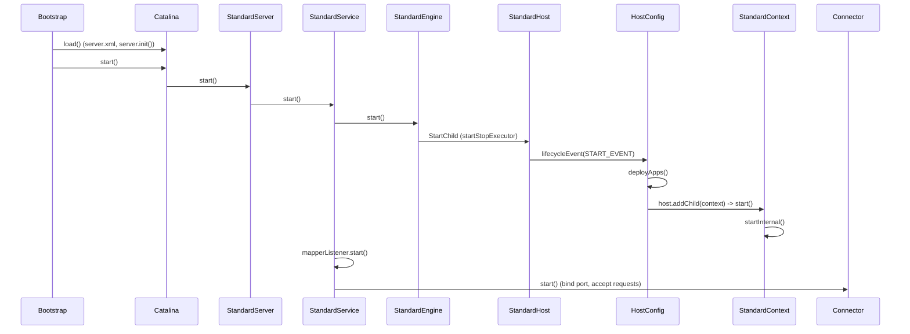
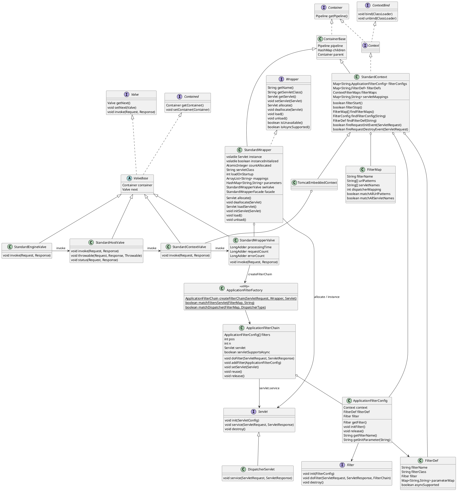
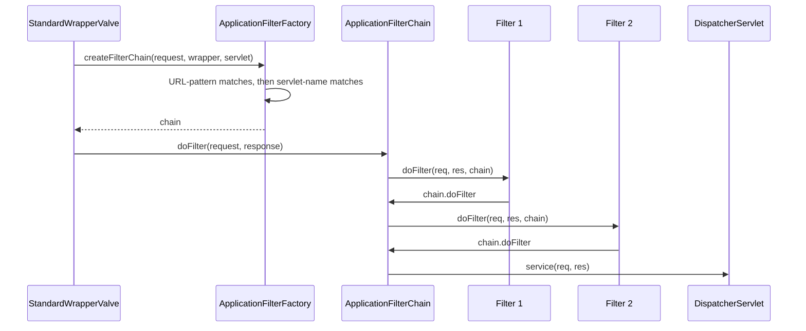

本文记录tomcat 架构与实现
<!--more-->

tomcat works as a servlet/jsp container.

# Tomcat Architecture


`Server` represents the whole container


A `service` is an intermediate component which lives inside a server and ties one or more Connectors to exactly one Engine


A `Connector` handles communications with the client. 


`LifeCycle` common interface for Catalina components to implement in order to provide a consistent mechanism to start and stop the component

The `LifecycleEvent`s fired during state changes are defined in the methods that trigger the change


```plantuml

title: Tomcat Architecture
cloud http
    package Tomcat {
    
        
        component c  [ 
            listener
            globl naming resouce
            jndi
        ] 
        component services {
            component connector
            component Engine {
                component Host {
                    Component Context {
                        Component Servlet
                    }
                }
            }
        }
        
        c -right-> services
    }

http -right-> Tomcat
```

```plantuml

skinparam linetype ortho

interface Lifecycle {

+ void addLifecycleListener(LifecycleListener)
+ LifecycleListener[] findLifecycleListeners()
+ void removeLifecycleListener(LifecycleListener)
+ void init()
+ void start()
+ void stop()
+ void destroy()
+ LifecycleState getState()
}

interface Server extends Lifecycle {
+ String getAddress()
+ ClassLoader getParentClassLoader()
+ void setParentClassLoader(ClassLoader)
+ Catalina getCatalina()
+ void setCatalina(Catalina)
+ File getCatalinaBase()
+ File getCatalinaHome()
+ int getUtilityThreads()
+ void setUtilityThreads(int)
+ void addService(Service)
+ void await()
}

interface Service extends Lifecycle {
+ Engine getContainer()
+ void setContainer(Engine)
+ String getName()
+ Server getServer()
+ ClassLoader getParentClassLoader()
+ void setParentClassLoader(ClassLoader)
+ String getDomain()
+ Connector[] findConnectors()
+ Executor getExecutor(String)
+ Mapper getMapper()
}

abstract class LifecycleBase implements Lifecycle {

- List<LifecycleListener> lifecycleListeners
- LifecycleState state
+ void init()
# {abstract}void initInternal()
+ void start()
# {abstract}void startInternal()
+ void stop()
# {abstract}void stopInternal()
+ void destroy()
# {abstract}void destroyInternal()

}


abstract class LifecycleMBeanBase extends LifecycleBase  {
}

interface Container extends Lifecycle {
    Pipeline getPipeline()
}

interface Engine extends Container {
+ String getDefaultHost()
+ void setDefaultHost(String)
+ String getJvmRoute()
+ void setJvmRoute(String)
+ Service getService()
+ void setService(Service)
}

interface Host extends Container {
}


class Connector extends LifecycleMBeanBase {
# Service service
# String scheme
# ProtocolHandler protocolHandler
# Adapter adapter
+ EncodedSolidusHandling getEncodedSolidusHandlingInternal()
+ Request createRequest(org.apache.coyote.Request)
+ Response createResponse(org.apache.coyote.Response)
}

Server o-- Service
Service o-- Connector
Service o-- Engine
Engine --> Host: invoke

```

## Container
container is an object that can execute requests received from a client, and return responses based on those requests
A container may optionally support a pipeline of Valves that processes the request in an order configured at runtime, by implementing the pipeline interface as well.
Containers will exist at several levels within catalina:
1. engine
2. host
3. context
4. wrapper

A container may also be associated with a number of support components that provide functionality which may be shared (by attaching it to a parent container) or individually customized. the following support components are currently recognized.
1. loader
2. logger
3. manager  manager for the pool of sessions
4. realm read-only interface to a security domain, for authenticating user identities and their corresponding roles.
5. resources JNDI directory context enabling access to static resources.


```plantuml
title: Tomcat Container Architecture
skinparam linetype ortho


interface Container  {

+ Pipeline getPipeline()
+ Container getParent()
+ Realm getRealm()
+ {static} String getConfigPath(Container,String)
+ {static} Service getService(Container)
+ void addChild(Container)
+ void addContainerListener(ContainerListener)
+ void fireContainerEvent(String,Object)
+ void logAccess(Request,Response,long,boolean)
+ File getCatalinaBase()
+ File getCatalinaHome()
}

interface Engine extends Container {
+ String getDefaultHost()
+ void setDefaultHost(String)
+ String getJvmRoute()
+ void setJvmRoute(String)
+ Service getService()
+ void setService(Service)
}

class StandardEngine extends ContainerBase implements Engine {
    Service service

}

interface Host extends Container {

+ String getXmlBase()
+ void setXmlBase(String)
+ File getConfigBaseFile()
+ String getAppBase()
+ File getAppBaseFile()
+ void setAppBase(String)
}

abstract class ContainerBase implements Container {
# Pipeline pipeline
# HashMap<String,Container> children
# Container parent
# List<ContainerListener> listeners
# String name
# ClassLoader parentClassLoader
- Realm realm
# ExecutorService startStopExecutor
}
class StandardHost extends ContainerBase implements Host {
- String appBase
- File appBaseFile
- String xmlBase
- File hostConfigBase
- String configClass
- String contextClass
- String workDir
- boolean createDirs
- Map<ClassLoader,String> childClassLoaders
}


interface Contained {
    Container getContainer()
    void setContainer(Container container)
}

interface Pipeline extends Contained {
    Valve getBasic()
    void setBasic(Valve valve)
    void addValve(Valve valve)
    Valve[] getValves()
    Valve getFirst()
}

class StandardPipeline implements Pipeline {
    Valve basic
    Container container
    Valve first
}

interface Valve {
    Valve getNext()
    void setNext(Valve valve)
    void backgroundProcess()
    void invoke(Request request, Response response)
}

abstract class ValveBase  implements Contained, Valve {
    Container container
    Log containerLog
    Valve next

}
class StandardEngineValve extends ValveBase

class StandardHostValve extends ValveBase

StandardEngine *-- StandardEngineValve

StandardHost *-- StandardHostValve
Engine o-- Host
Container *-- Pipeline
Pipeline o-- Valve


```


### Engine
Engine represents request processing pipeline for a specific service. As a Service may have multiple Connectors, the Engine receives and processes all requests from these connectors, handling the response back to the appropriate connector for transmission to the client.

### Host
A Host is a Container that represents a virtual host in the catalina servlet engine. 
Multiple host can be configured in catalina, each has its own request processing logic 

### Context
A context is a container that represents a servlet context, and therefore an individual web application, in the catalina servlet engine. A host may contain multiple contexts,each with a unique path.

### wrapper
A wrapper is a container that represents an individual sevlet definition from the deployment descriptor of the web application. 
It provides mechanism to use interceptors that see every single request to the servlet represented by this definition.
Implementations are responsible for managing the sevlet life circle.

### Valve
A valve is a request processing component associated with a Container. A series of Valves are associated with each other into a pipeline.

`StandardWrapperValve` in tomcat call FilterChain to filter request before invoke servlet.


# Tomcat startup

Tomcat is a tree of lifecycle components. `StandardServer` owns one or more `StandardService`s; each service owns one `StandardEngine` (the request-processing container) and the `Connector`s that accept network traffic. Below the engine, containers nest as `StandardHost` (virtual host) → `StandardContext` (one web application, one `ServletContext`) → `StandardWrapper` (one servlet). Every component extends `LifecycleBase`, whose `start()` moves the state to `STARTING_PREP`, calls the subclass `startInternal()`, and then moves to `STARTED`.

```plantuml
top to bottom direction

abstract class LifecycleBase {
    + void start()
    # {abstract} void startInternal()
}
abstract class ContainerBase {
    # HashMap<String,Container> children
    # ExecutorService startStopExecutor
    # void startInternal()
}
class StandardServer {
    - Service[] services
}
class StandardService {
    - Engine engine
    # Connector[] connectors
    # MapperListener mapperListener
}
class Connector
class StandardEngine
class StandardHost
class StandardContext {
    # ApplicationContext context
    - Map<String,FilterDef> filterDefs
    - ContextFilterMaps filterMaps
    - Map<String,ApplicationFilterConfig> filterConfigs
    - Map<ServletContainerInitializer,Set<Class<?>>> initializers
    # void startInternal()
}
class StandardWrapper {
    # volatile Servlet instance
    + void load()
}
class HostConfig {
    + void lifecycleEvent(LifecycleEvent)
    # void deployApps()
}
class ContextConfig {
    + void lifecycleEvent(LifecycleEvent)
    # void webConfig()
}
class "ApplicationContext" as TomcatApplicationContext

LifecycleBase <|-- StandardServer
LifecycleBase <|-- StandardService
LifecycleBase <|-- Connector
LifecycleBase <|-- ContainerBase
ContainerBase <|-- StandardEngine
ContainerBase <|-- StandardHost
ContainerBase <|-- StandardContext
ContainerBase <|-- StandardWrapper

StandardServer *-- "N" StandardService : services
StandardService *-- "1" StandardEngine : engine
StandardService *-- "N" Connector : connectors
StandardEngine *-- "N" StandardHost : children
StandardHost *-- "N" StandardContext : children
StandardContext *-- "N" StandardWrapper : children
StandardContext *-- TomcatApplicationContext : context
StandardHost o-- HostConfig : lifecycle listener
StandardContext o-- ContextConfig : lifecycle listener
```

`LifecycleBase`, `ContainerBase` and the `Standard*` classes are simplified here; `StandardServer`, `StandardService` and `Connector` extend `LifecycleMBeanBase`, which extends `LifecycleBase`. The `ApplicationContext` box is Tomcat's `org.apache.catalina.core.ApplicationContext`, the `ServletContext` implementation, not Spring's `ApplicationContext`.

## Start sequence

Tomcat starts from `Bootstrap.main`, which calls `Catalina.load()` (parse `server.xml`, `getServer().init()`) and then `Catalina.start()` (`getServer().start()`). Each component starts its children before it becomes available:

- `StandardServer.startInternal` starts every service.
- `StandardService.startInternal` starts the engine first, then the `MapperListener` (which builds the URL → host/context/wrapper `Mapper`), and the connectors last. A port therefore accepts requests only after all web applications have started.
- `ContainerBase.startInternal` submits every child to `startStopExecutor` as a `StartChild` task and waits for all results, then starts its pipeline and fires `START_EVENT`.
- On a host, `START_EVENT` reaches `HostConfig.start()`, which calls `deployApps()`: deploy context XML descriptors, then WARs, then expanded directories. Each deployment creates a `StandardContext` and calls `host.addChild(context)`, which starts the context because the host is already starting.



## Web application start

`StandardContext.startInternal` brings up one web application. The order of its phases is fixed and determines what each phase can see:

| Order | Phase | Effect |
|-------|-------|--------|
| 1 | resources and `WebappLoader` start | `WEB-INF/classes` and `WEB-INF/lib` become loadable through the webapp class loader |
| 2 | `fireLifecycleEvent(CONFIGURE_START_EVENT)` | `ContextConfig.configureStart` → `webConfig`: parse `web.xml` and fragments, scan annotations, discover `ServletContainerInitializer`s, apply servlets, filters and listeners to the context |
| 3 | start child wrappers and pipeline | servlets declared so far exist as `StandardWrapper`s, not yet initialized |
| 4 | `mergeParameters()` | context init parameters become visible through `ServletContext.getInitParameter` |
| 5 | `ServletContainerInitializer.onStartup(classes, servletContext)` | programmatic registration of servlets, filters and listeners |
| 6 | `listenerStart()` | instantiate listeners, then call `ServletContextListener.contextInitialized` |
| 7 | `filterStart()` | create an `ApplicationFilterConfig` for every `FilterDef`, which instantiates the filter and calls `Filter.init` |
| 8 | `loadOnStartup(findChildren())` | call `wrapper.load()` → `Servlet.init` for wrappers with `loadOnStartup >= 0`, ascending by that value |

```java
// StandardContext.startInternal
protected void startInternal() throws LifecycleException {
    // ... resources, WebappLoader, naming
    fireLifecycleEvent(CONFIGURE_START_EVENT, null);   // ContextConfig.configureStart -> webConfig
    for (Container child : findChildren()) {
        if (!child.getState().isAvailable()) {
            child.start();
        }
    }
    // ... pipeline, manager
    mergeParameters();
    for (Map.Entry<ServletContainerInitializer,Set<Class<?>>> entry : initializers.entrySet()) {
        entry.getKey().onStartup(entry.getValue(), getServletContext());
    }
    if (ok) {
        if (!listenerStart()) { ok = false; }          // ServletContextListener.contextInitialized
    }
    if (ok) {
        if (!filterStart()) { ok = false; }            // new ApplicationFilterConfig -> Filter.init
    }
    if (ok) {
        if (!loadOnStartup(findChildren())) { ok = false; }   // Servlet.init
    }
    // ...
}
```

A `ServletContainerInitializer` (SCI) is a service provider: a jar declares an implementation by containing the file `META-INF/services/jakarta.servlet.ServletContainerInitializer`, whose lines are implementation class names. `spring-web`, for example, lists `org.springframework.web.SpringServletContainerInitializer` there. `ContextConfig.processServletContainerInitializers` reads these files through `WebappServiceLoader` rather than `java.util.ServiceLoader`, because the servlet specification adds rules that a single class loader lookup cannot express: files from the container class loader (Tomcat's `lib`) are read first and can be excluded with the context's `containerSciFilter`, then files from the web application class loader (`WEB-INF/classes`, `WEB-INF/lib`); when `web.xml` declares an absolute ordering, only the listed jars are read, in that order. Each class name is loaded and instantiated with the web application class loader.

If an SCI class carries `@HandlesTypes`, every listed type is recorded in `typeInitializerMap`; the class scan in `processClasses` collects each application class that implements, extends or is annotated with such a type, and `webConfig` finally calls `context.addServletContainerInitializer(sci, classes)` so that phase 5 passes those classes to `onStartup`.

```java
// ContextConfig.processServletContainerInitializers
protected void processServletContainerInitializers() {
    List<ServletContainerInitializer> detectedScis;
    WebappServiceLoader<ServletContainerInitializer> loader = new WebappServiceLoader<>(context);
    detectedScis = loader.load(ServletContainerInitializer.class);
    for (ServletContainerInitializer sci : detectedScis) {
        initializerClassMap.put(sci, new HashSet<>());
        HandlesTypes ht = sci.getClass().getAnnotation(HandlesTypes.class);
        if (ht == null) {
            continue;
        }
        for (Class<?> type : ht.value()) {
            typeInitializerMap.computeIfAbsent(type, k -> new HashSet<>()).add(sci);
        }
    }
}
```

## Programmatic registration

Programmatic registration through `ServletContext.addServlet`, `addFilter` and `addListener` is accepted only while the context is in `STARTING_PREP`; `ApplicationContext.checkState` throws `IllegalStateException` otherwise. In practice this restricts registration to phases 5 and 6, before any filter or servlet is initialized.

`addServlet` creates a `StandardWrapper`, adds it as a child of the context, and stores the servlet instance in it; the returned `ApplicationServletRegistration` writes mappings and the load-on-startup value directly into the wrapper and the context. `addServlet` returns `null` when a complete registration with that name already exists, so callers must treat `null` as a name conflict.

```java
// ApplicationContext.addServlet (Tomcat)
private ServletRegistration.Dynamic addServlet(String servletName, String servletClass, Servlet servlet,
        Map<String,String> initParams) throws IllegalStateException {
    checkState("applicationContext.addServlet.ise");          // only in STARTING_PREP
    Wrapper wrapper = (Wrapper) context.findChild(servletName);
    if (wrapper == null) {
        wrapper = context.createWrapper();
        wrapper.setName(servletName);
        context.addChild(wrapper);
    } else {
        if (wrapper.getName() != null && wrapper.getServletClass() != null) {
            if (wrapper.isOverridable()) {
                wrapper.setOverridable(false);
            } else {
                return null;
            }
        }
    }
    if (servlet == null) {
        wrapper.setServletClass(servletClass);
    } else {
        wrapper.setServletClass(servlet.getClass().getName());
        wrapper.setServlet(servlet);
    }
    // ... init parameters, @ServletSecurity
    return new ApplicationServletRegistration(wrapper, context);
}
```


# Request handling pipeline

In `Container` section, we see that `Container` contains `Pipeline`,`Pipeline` contains `Valves` in order. the request handling is actually invoke the `Valves` in the `Pipeline` of the specified container one by one. 

Valve chain ends at `StandardWrapperValve`. That valve allocates the servlet, builds a `FilterChain`, then calls `filterChain.doFilter(...)` — which walks matching filters and finally invokes `servlet.service()`.



### Filter in the pipeline

Filters are a Context-level concern, not a Valve. `StandardContext` keeps three related structures:

1. `FilterDef` — `<filter>` from web.xml / programmatic registration (`filterName`, `filterClass`, init params, asyncSupported)
2. `FilterMap` — `<filter-mapping>` (`url-pattern` and/or `servlet-name`, plus dispatcher types REQUEST/FORWARD/INCLUDE/ERROR/ASYNC)
3. `ApplicationFilterConfig` — runtime `FilterConfig`; created in `filterStart()` when the Context starts, holds the live `Filter` instance after `init()`

#### Registration: `FilterDef` and `FilterMap`

`ServletContext.addFilter` creates the `FilterDef`; `FilterRegistration.Dynamic.addMappingForUrlPatterns` and `addMappingForServletNames` append a `FilterMap`, either after existing maps (`isMatchAfter = true`) or before the maps declared in `web.xml` (`false`).

```java
// ApplicationContext.addFilter (Tomcat)
private FilterRegistration.Dynamic addFilter(String filterName, String filterClass, Filter filter)
        throws IllegalStateException {
    checkState("applicationContext.addFilter.ise");           // only in STARTING_PREP
    FilterDef filterDef = context.findFilterDef(filterName);
    if (filterDef == null) {
        filterDef = new FilterDef();
        filterDef.setFilterName(filterName);
        context.addFilterDef(filterDef);
    } else {
        if (filterDef.getFilterName() != null && filterDef.getFilterClass() != null) {
            return null;
        }
    }
    if (filter == null) {
        filterDef.setFilterClass(filterClass);
    } else {
        filterDef.setFilterClass(filter.getClass().getName());
        filterDef.setFilter(filter);
    }
    return new ApplicationFilterRegistration(filterDef, context);
}

// ApplicationFilterRegistration.addMappingForUrlPatterns
public void addMappingForUrlPatterns(EnumSet<DispatcherType> dispatcherTypes, boolean isMatchAfter,
        String... urlPatterns) {
    FilterMap filterMap = new FilterMap();
    filterMap.setFilterName(filterDef.getFilterName());
    if (dispatcherTypes != null) {
        for (DispatcherType dispatcherType : dispatcherTypes) {
            filterMap.setDispatcher(dispatcherType.name());
        }
    }
    if (urlPatterns != null) {
        for (String urlPattern : urlPatterns) {
            filterMap.addURLPattern(urlPattern);
        }
        if (isMatchAfter) {
            context.addFilterMap(filterMap);
        } else {
            context.addFilterMapBefore(filterMap);
        }
    }
}
```

During web application start (phase 7 in the Tomcat startup section), `filterStart` turns every `FilterDef` into an `ApplicationFilterConfig`; its constructor instantiates the filter if only a class name was given and calls `Filter.init(filterConfig)`. Filters therefore initialize after `ServletContextListener.contextInitialized` and before load-on-startup servlets.

#### Build chain: `ApplicationFilterFactory`

`StandardWrapperValve.invoke` does roughly:

1. `servlet = wrapper.allocate()`
2. set `DISPATCHER_TYPE_ATTR` / `DISPATCHER_REQUEST_PATH_ATTR` on the request
3. `filterChain = ApplicationFilterFactory.createFilterChain(request, wrapper, servlet)`
4. `filterChain.doFilter(request.getRequest(), response.getResponse())`
5. `filterChain.release()` then `wrapper.deallocate(servlet)`

`createFilterChain` reuses an `ApplicationFilterChain` cached on the Coyote `Request` when possible, sets the target servlet, then walks `context.findFilterMaps()` twice:

1. **URL mappings first** — dispatcher type matches, and `FilterUtil.matchFiltersURL(filterMap, requestPath)` matches the context-relative path
2. **Servlet-name mappings second** — dispatcher type matches, and servlet name equals the mapping (or `*`)

Matched maps resolve to `ApplicationFilterConfig` via `context.findFilterConfig(filterName)` and are appended with `filterChain.addFilter(...)`. The same filter config is not added twice.

Order in the chain follows declaration order of filter maps (url-mapped filters before servlet-name-mapped ones for the same request).

#### Run chain: `ApplicationFilterChain`

`ApplicationFilterChain` implements `jakarta.servlet.FilterChain`. Fields `filters[]`, `pos`, `n`, and `servlet` drive execution:

```text
doFilter(request, response):
  if pos < n:
    filter = filters[pos++].getFilter()
    // if filter does not support async, clear ASYNC_SUPPORTED on request
    filter.doFilter(request, response, this)   // filter must call chain.doFilter to continue
    return
  else:
    servlet.service(request, response)         // end of chain
```

Each filter receives the same chain instance and must call `chain.doFilter` to advance. When `pos` reaches `n`, the chain falls through to the servlet. After the request finishes, `release()` nulls filter references and resets counters so the chain object can be reused on the next request (`reuse()` only resets `pos`).

```plantuml
top to bottom direction

class StandardContext {
    - Map<String,FilterDef> filterDefs
    - ContextFilterMaps filterMaps
    - Map<String,ApplicationFilterConfig> filterConfigs
    + boolean filterStart()
    + FilterMap[] findFilterMaps()
}
class FilterDef {
    - String filterName
    - String filterClass
    - Filter filter
}
class FilterMap {
    - String filterName
    - String[] servletNames
    - String[] urlPatterns
    - int dispatcherMapping
}
class ApplicationFilterConfig {
    - FilterDef filterDef
    - Filter filter
}
class ApplicationFilterFactory {
    + {static} ApplicationFilterChain createFilterChain(ServletRequest, Wrapper, Servlet)
}
class ApplicationFilterChain {
    - ApplicationFilterConfig[] filters
    - int pos
    - int n
    - Servlet servlet
    + void doFilter(ServletRequest, ServletResponse)
}
class StandardWrapperValve {
    + void invoke(Request, Response)
}

StandardContext *-- "N" FilterDef : filterDefs
StandardContext *-- "N" FilterMap : filterMaps
StandardContext *-- "N" ApplicationFilterConfig : filterConfigs
ApplicationFilterConfig o-- FilterDef
StandardWrapperValve --> ApplicationFilterFactory : per request
ApplicationFilterFactory --> ApplicationFilterChain : create
ApplicationFilterChain o-- "N" ApplicationFilterConfig : filters
```



Valve vs Filter: Valves sit on every Container pipeline (Engine → Host → Context → Wrapper) and are Catalina-specific; Filters are Servlet-spec, scoped to a Context, selected per request by URL/servlet-name/dispatcher, and only run after the request has been routed to a concrete Wrapper.


## Connector Internals

`Adapter` represents the entry point in a coyote-based servlet container.

`ProtocolHandler` abstract the protocol implementation, including threading.

`EndPoint` handles the low level interactions with network socket.

`Poller` 

```plantuml

interface Handler<S> {
    SocketState process(socket,SocketEvent status)
}

class ConnectionHandler<S> implements Handler<S> {
    AbstractProtocol<S> proto
    RecycledProcessors recycledProcessors
}
abstract class AbstractEndpoint<S,U> {
    SynchronizedStack<SocketProcessorBase<S>> processorCache
    Map<U, SocketWrapperBase<S>> connections
    int port
    InetAddress address
    Acceptor<U> acceptor
    Executor executor
    Handler<S> handler
    HashMap<String, Object> attributes
    abstract void bind()
    boolean processSocket(SocketWrapperBase<S> socketWrapper,
            SocketEvent event, boolean dispatch)
    abstract SocketProcessorBase<S> createSocketProcessor(
            SocketWrapperBase<S> socketWrapper, SocketEvent event)
}


class Acceptor<U> implements Runnable{
    AbstractEndpoint<?,U> endpoint

}
abstract class AbstractNetworkChannelEndpoint<S extends Channel, U extends NetworkChannel> extends AbstractEndpoint {
    abstract NetworkChannel getServerSocket()
    abstract S createChannel(SocketBufferHandler buffer)
}
class NioEndpoint extends AbstractNetworkChannelEndpoint {
    ServerSocketChannel serverSock
    CountDownLatch stopLatch
    SynchronizedStack<PollerEvent> eventCache
    Poller poller
    SocketProcessorBase<NioChannel> createSocketProcessor(
            SocketWrapperBase<NioChannel> socketWrapper, SocketEvent event)
}

abstract class SocketProcessorBase<S> implements Runnable {
    SocketWrapperBase<S> socketWrapper
    SocketEvent event
    AtomicReference<Object> currentProcessor
    abstract void doRun()
}

class Http11Processor extends AbstractProcessor {
    AbstractHttp11Protocol<?> protocol
    Http11InputBuffer inputBuffer
    Http11OutputBuffer outputBuffer
    HttpParser httpParser
    SendfileDataBase sendfileData
}

class SocketProcessor extends SocketProcessorBase<NioChannel> {

}

interface Adapter {
    void service(Request req,Response res)
    boolean prepare(Request req, Response res)
}
interface ProtocolHandler {
    Adaptor getAdaptor()
    void setAdaptor(Adaptor adaptor)
    Executor getExecutor()
    void init()
    void start()
    void stop()
    void destroy()
}

abstract class AbstractProtocol<S> implements ProtocolHandler {
    AbstractEndpoint<S, ?> endpoint
    Handler<S> handler
    Adapter adapter
    Set<Processor> waitingProcessors
    ScheduledFuture<?> timeoutFuture
    Processor createProcessor()
}

abstract class AbstractHttp11Protocol<S> extends AbstractProtocol

class Http11NioProtocol extends AbstractHttp11Protocol {
    Processor createProcessor()
}

interface Processor {
    SocketState process(SocketWrapperBase<?> socketWrapper, SocketEvent status)
}

abstract class AbstractProcessorLight implements Processor {
    Set<DispatchType> dispatches
}

abstract class AbstractProcessor extends AbstractProcessorLight implements ActionHook {
    Adapter adapter
    AsyncStateMachine asyncStateMachine
    Request request
    Response response
    SocketWrapperBase<?> socketWrapper
}


class Connector {
    ProtocolHandler protocolHandler
    Service service
    Adapter adapter
}

class CoyoteAdapter implements Adapter {
    Connector connector
}

class Poller implements Runnable {
    Selector selector
    SynchronizedQueue<PollerEvent> events
    register(NioSocketWrapper socketWrapper)
    boolean events()
    void processKey(SelectionKey key, NioSocketWrapper socketWrapper)
}

class PollerEvent {
    NioSocketWrapper socketWrapper
    int interestOps
}

abstract class NioSocketWrapper extends SocketWrapperBase<NioChannel> {
    SynchronizedStack<NioChannel> nioChannels
    Poller poller
    int interestOps
    SendfileData sendfileData
    long lastRead
    long lastWrite
    Object readLock
    volatile boolean readBlocking
    Object writeLock
    volatile boolean writeBlocking
}

abstract class SocketWrapperBase<E> {
    E socket
    AbstractEndpoint<E,?> endpoint
    ReentrantLock lock
    ServletConnection servletConnection
    SocketBufferHandler socketBufferHandler
    WriteBuffer nonBlockingWriteBuffer
    Semaphore readPending
    OperationState<?> readOperation
    Semaphore writePending
    OperationState<?> writeOperation
}


AbstractEndpoint *-left- ConnectionHandler
AbstractProtocol *-down- AbstractEndpoint

Connector *-down- ProtocolHandler
Connector *-left- Adapter
NioEndpoint -right-> SocketProcessor: createSocketProcessor
NioEndpoint *-- Poller
NioEndpoint *-- Acceptor
Poller o-- PollerEvent
PollerEvent *-- NioSocketWrapper
Http11NioProtocol -right-> Http11Processor
```


## EndPoint Internals

```plantuml


!theme plain
top to bottom direction
skinparam linetype ortho

class AbstractEndpoint<S, U>
class AbstractJsseEndpoint<S, U>
class NioEndpoint {
    ServerSocketChannel serverSock
    CountDownLatch stopLatch
    SynchronizedStack<PollerEvent> eventCache
    SynchronizedStack<NioChannel> nioChannels
    Poller poller
    initServerSocket()
}

AbstractJsseEndpoint  -[#000082,plain]-^  AbstractEndpoint     
NioEndpoint           -[#000082,plain]-^  AbstractJsseEndpoint 


```


# Servlet

Tomcat use Jakarta servlet API.
Jakarta servlet defines a server-side  API for handling HTTP requests and responses.

`servlet` is a small Java program that runs within a Web server. Servlets receive and respond to requests from Web clients, usually across HTTP, the HyperText Transfer Protocol.

`ServletRequest` is an object to provide client request information to a servlet. The servlet container creates a `ServletRequest` object and passes it as an argument to the servlet's `service` method.
`ServletRequest` object provides data including parameter name and values, attributes, and an inputstream.


```plantuml
package Tomcat {
    interface Servlet {
    + void init(ServletConfig)
    + ServletConfig getServletConfig()
    + void service(ServletRequest,ServletResponse)
    + String getServletInfo()
    + void destroy()
    }

    interface ServletConfig {
    + String getServletName()
    + ServletContext getServletContext()
    + String getInitParameter(String)
    + Enumeration<String> getInitParameterNames()
    }

    abstract class GenericServlet {
    - ServletConfig config
    }

    abstract class HttpServlet {
    # void service(HttpServletRequest,HttpServletResponse)
    + void service(ServletRequest,ServletResponse)
    }

    interface ServletRequest {
        Object getAttribute(String name)
        int getContentLength()
        String getContentType()
        ServletInputStream getInputStream()
        String getParameter(String name)
        String getRemoteAddr()
        RequestDispatcher getRequestDispatcher(String path)
    }
    interface HttpServletRequest extends ServletRequest

    interface ServletResponse {
        ServletOutputStream getOutputStream()

    }
    interface HttpServletResponse extends ServletResponse

    class Request implements HttpServletRequest {
        byte[] postData
        ParameterMap<String,String[]> parameterMap
        Collection<Part> parts
        HttpServletRequest applicationRequest
        Connector connector
        RequestFacade facade
    }
}
Servlet <|.. GenericServlet
ServletConfig <|.. GenericServlet
GenericServlet <|-- HttpServlet
HttpServletRequest -right-> HttpServlet
HttpServlet -right-> HttpServletResponse

```

## servlet processing 
```plantuml
interface Context extends Container, ContextBind{

}

class StandardContext extends ContainerBase implements Context {
    
    Loader loader
    NamingResourcesImpl namingResources
    Map<String,String> mimeMappings
    Map<String,String> parameters
    Map<String,String> roleMappings
    Map<String,String> servletMappings
    Class<?> wrapperClass
    Set<Servlet> createdServlets
}


interface Wrapper extends Container  {

+ long getAvailable()
+ void setAvailable(long)
+ Servlet getServlet()
+ void setServlet(Servlet)
+ void addInitParameter(String,String)
+ void addMapping(String)
+ void addSecurityReference(String,String)
+ Servlet allocate()
+ void deallocate(Servlet)
+ void load()
+ void unload()
}


class StandardWrapper extends ContainerBase implements  Wrapper {
# StandardWrapperFacade facade
# Servlet instance
# StandardWrapperValve swValve
}

class StandardWrapperValve extends ValveBase {
    invoke(request,response)
}
StandardWrapper *-right- StandardWrapperValve


```