Dubbo is an RPC framework. A service is defined as an ordinary interface, implemented in a provider process, and called from a consumer process as though it were a local object, with a registry telling the consumer where the provider is and a metadata service telling it what that interface looks like. Dubbo has implementations in Go, Python, PHP, Erlang, Rust, and Node.js, and this post covers the Java one.

<!--more-->

---

## 1. Overview

As an RPC framework, Dubbo organises a cluster into four roles.

- A **provider** hosts the implementation. It declares which interfaces it serves and listens on a port to answer calls.
- A **consumer** calls those interfaces as if they were local. It keeps a local list of provider addresses and picks one per call.
- A **registry** holds addresses only. It knows which provider processes exist and tells each consumer when that list changes. It does not store interface definitions.
- A **metadata service** holds the definitions. Every provider exports one alongside its business services; a consumer asks it what an interface looks like — methods, parameter types, method-level settings — for a given revision.

The split between the last two is the change newer Dubbo made. Older versions stored everything about each interface in the registry, so the registry was large and any change meant rewriting a registration. From Dubbo 3 the definitions moved out to the metadata service, and the registry keeps only addresses plus a revision that points at the right definition. Adding an interface now changes that revision instead of churning every consumer's address list.

The loop is short: provider registers, consumer subscribes, consumer receives addresses, consumer calls the provider directly. The registry is not in the call path, and the metadata service is consulted once per revision and then cached.


### A minimal example

One shared interface module, so both sides compile against the same type:

```java
public interface GreetingService {
    String greet(String name);
}
```

The provider implements it and exports the interface. The annotation is enough; the same result is available from XML or from the programmatic API.

```java
@DubboService
public class GreetingServiceImpl implements GreetingService {
    public String greet(String name) {
        return "hello, " + name;
    }
}
```

```yaml
dubbo:
  application:
    name: greeting-provider
  registry:
    address: nacos://127.0.0.1:8848
```

The consumer declares a field of the interface type and marks it for injection. It never constructs the implementation and never opens a socket.

```java
@DubboReference
private GreetingService greetingService;

String reply = greetingService.greet("dubbo");
```

Three things happen behind that call. At startup the provider exported `GreetingService` and registered its address and revision with Nacos; the consumer subscribed to the provider's application and got the address list back; and the call itself went from the injected proxy over a TCP connection to the provider's port, where the implementation ran. The interface object the consumer holds is a proxy generated at startup, which is why a call looks like a local method call.

---

## 2. Extension architecture

Dubbo is structured around a microkernel and plugin design pattern. The framework core defines contracts as Service Provider Interfaces (SPIs) — `Protocol`, `Exchanger`, `Transporter`, `Codec2`, `Serialization`, `ThreadPool`, `LoadBalance`, `StateRouterFactory`, and `Filter` — and contains no hard-coded dependency on any concrete transport, serializer, or cluster strategy. Unlike `java.util.ServiceLoader`, which instantiates every declared provider eagerly from a flat list, Dubbo's SPI combines five design patterns into a single container:

- **Name-indexed lazy loading**: implementations are declared as `name=class` pairs in resource files and loaded only when that name is requested.
- **URL-driven late binding (Adaptive Proxy)**: every remote call is described by a `URL` carrying configuration parameters (`protocol=dubbo`, `transporter=netty`, `serialization=hessian2`, `loadbalance=random`). Because collaborators are wired at startup before any service `URL` exists, the container supplies a generated *adaptive* proxy that defers implementation lookup to call time by reading the parameter from the invocation's `URL`.
- **Decorator composition (Wrapper)**: cross-cutting concerns such as filter chains, listener hooks, and reference counting are implemented as wrapper classes around the SPI interface and stacked automatically around every concrete instance.
- **Rule-based chain assembly (Activation)**: ordered pipelines such as `Filter` and `StateRouterFactory` are selected as a group when `@Activate` predicates match the `URL`, rather than looked up one name at a time.
- **Scoped IoC and lifecycle**: extensions live inside a three-tier hierarchy (`FrameworkModel` -> `ApplicationModel` -> `ModuleModel`) and receive collaborator SPIs through setter injection of adaptive instances.

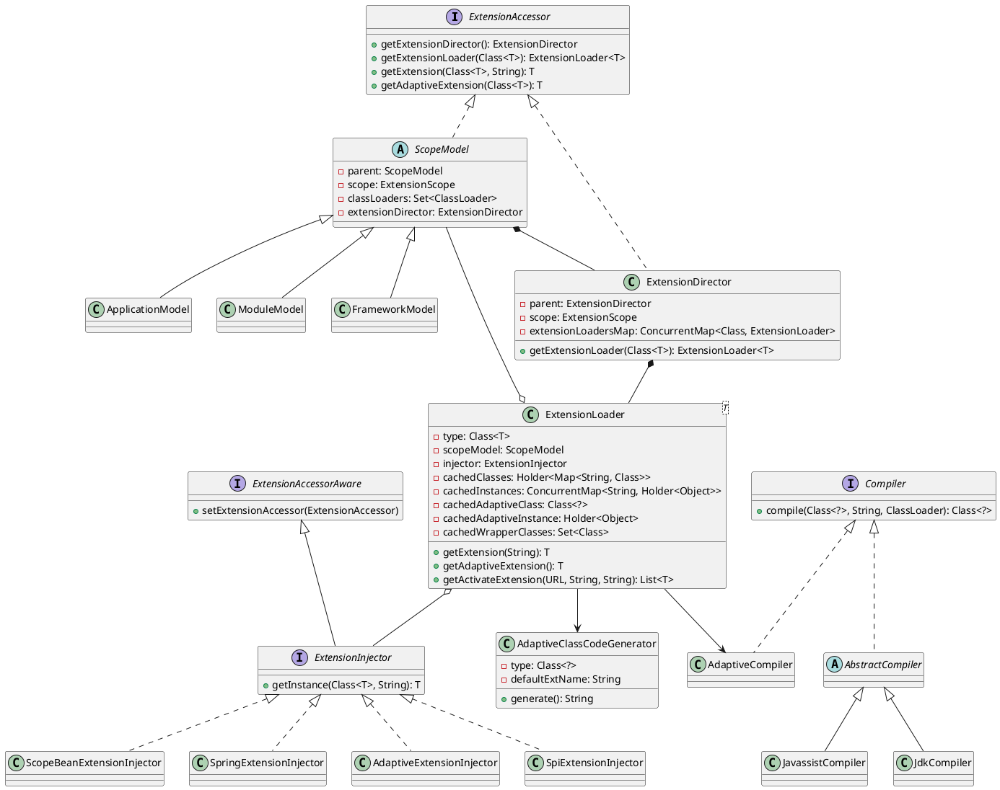

Both `ScopeModel` and `ExtensionDirector` implement `ExtensionAccessor`, exposing a uniform entry point (`getExtensionLoader`, `getExtension`, `getAdaptiveExtension`) at every tier of the container.

```java
public interface ExtensionAccessor {
    ExtensionDirector getExtensionDirector();

    default <T> ExtensionLoader<T> getExtensionLoader(Class<T> type) {
        return getExtensionDirector().getExtensionLoader(type);
    }

    default <T> T getExtension(Class<T> type, String name) {
        ExtensionLoader<T> extensionLoader = getExtensionLoader(type);
        return extensionLoader != null ? extensionLoader.getExtension(name) : null;
    }

    default <T> T getAdaptiveExtension(Class<T> type) {
        ExtensionLoader<T> extensionLoader = getExtensionLoader(type);
        return extensionLoader != null ? extensionLoader.getAdaptiveExtension() : null;
    }
}
```

An extension point is declared by annotating an interface with `@SPI`, whose `value` sets the default implementation name and whose `scope` sets instance visibility (`APPLICATION` when omitted):

```java
@Documented
@Retention(RetentionPolicy.RUNTIME)
@Target({ElementType.TYPE})
public @interface SPI {
    String value() default "";
    ExtensionScope scope() default ExtensionScope.APPLICATION;
}
```

The `ExtensionScope` controls which `ScopeModel` owns the `ExtensionLoader` and what state an instance may reach. `FRAMEWORK`-scoped extensions (`Protocol`, `Serialization`) share one loader on the root `FrameworkModel` across the JVM; `APPLICATION`-scoped extensions (`RegistryFactory`) isolate state per application while sharing across its modules; `MODULE`-scoped extensions (`Filter`) instantiate per module; and `SELF` creates a dedicated instance per owner. `ExtensionDirector.getExtensionLoader` enforces these boundaries by resolving in three steps:

```java
ExtensionLoader<T> loader = extensionLoadersMap.get(type);   // 1. local cache
if (loader == null && scope == ExtensionScope.SELF) {
    loader = createExtensionLoader0(type);                    //    SELF never inherits
}
if (loader == null && this.parent != null) {
    loader = this.parent.getExtensionLoader(type);            // 2. delegate to parent scope
}
if (loader == null) {
    loader = createExtensionLoader(type);                     // 3. create at owning scope
}
```

Each `ExtensionLoader<T>` discovers implementations by scanning three classpath directories in order of decreasing priority:

- `META-INF/dubbo/internal/`: framework built-ins.
- `META-INF/dubbo/`: user or third-party extensions, permitted to override lower-priority entries.
- `META-INF/services/`: `ServiceLoader` compatibility.

Each file is named after the fully qualified interface and contains `name=class` lines, such as `dubbo=org.apache.dubbo.rpc.protocol.dubbo.DubboProtocol`. While reading the file, the loader classifies each class without instantiating it: a class annotated `@Adaptive` becomes the single `cachedAdaptiveClass`; a class whose constructor takes the SPI interface itself goes into `cachedWrapperClasses`; all remaining classes are indexed by name as ordinary implementations, with any `@Activate` metadata recorded alongside them. Duplicate names within the same priority tier fail at startup.

```java
private void loadClass(..., Map<String, Class<?>> extensionClasses, ..., Class<?> clazz, String name, boolean overridden) {
    if (clazz.isAnnotationPresent(Adaptive.class)) {
        cacheAdaptiveClass(clazz, overridden);         // -> cachedAdaptiveClass
    } else if (isWrapperClass(clazz)) {
        cacheWrapperClass(clazz);                      // -> cachedWrapperClasses
    } else {
        String[] names = NAME_SEPARATOR.split(name);
        cacheActivateClass(clazz, names[0]);           // -> cachedActivates
        for (String n : names) {
            cacheName(clazz, n);
            saveInExtensionClass(extensionClasses, clazz, n, overridden); // -> cachedClasses
        }
    }
}
```

An adaptive extension acts as a stateless runtime resolver and dispatcher in front of `getExtension(name)`. When `getAdaptiveExtension()` is called, `ExtensionLoader` checks `cachedAdaptiveClass`: if an implementation class itself is annotated `@Adaptive` (used only by bootstrap components such as `AdaptiveCompiler` and `AdaptiveExtensionInjector` to avoid circular code generation), it instantiates that class directly; otherwise `AdaptiveClassCodeGenerator` emits `<Interface>$Adaptive` source code and compiles it in memory via the `Compiler` SPI:

```java
private Class<?> getAdaptiveExtensionClass() {
    getExtensionClasses();
    if (cachedAdaptiveClass != null) {
        return cachedAdaptiveClass;
    }
    return cachedAdaptiveClass = createAdaptiveExtensionClass();
}

private Class<?> createAdaptiveExtensionClass() {
    ClassLoader classLoader = type.getClassLoader();
    String code = new AdaptiveClassCodeGenerator(type, cachedDefaultName).generate();
    Compiler compiler = extensionDirector
            .getExtensionLoader(Compiler.class)
            .getAdaptiveExtension();
    return compiler.compile(type, code, classLoader);
}
```

Inside each generated `@Adaptive` method (methods without `@Adaptive` throw `UnsupportedOperationException`), execution follows four steps on every call:

1. **Locate `URL`**: reads a `URL` argument directly, or invokes a `URL` getter on an argument (such as `invoker.getUrl()`). In application code this `URL` is rarely built by hand — `ServiceConfig` and `ReferenceConfig` assemble it automatically from `@DubboService`, `@DubboReference`, YAML/XML configuration, and registry metadata.
2. **Resolve `extName`**: evaluates the keys declared in `@Adaptive({"k1", "k2"})` (or splits the interface's camel-case name with dots when omitted), reading `url.getProtocol()` for `"protocol"`, `url.getMethodParameter(methodName, key, defaultExtName)` when an `Invocation` parameter is present, or `url.getParameter(key, defaultExtName)` with `@SPI`'s value as fallback.
3. **Resolve target extension**: obtains the `ScopeModel` from `url.getScopeModel()` and calls `scopeModel.getExtensionLoader(Type.class).getExtension(extName)`.
4. **Dispatch**: forwards the original arguments to the resolved instance.

When a concrete name is resolved through `getExtension(name)`, `createExtension` instantiates the target class, runs `injectExtension` across public setters (querying `AdaptiveExtensionInjector` across `SpiExtensionInjector`, `ScopeBeanExtensionInjector`, and `SpringExtensionInjector`, skipping unresolved setters and `@DisableInject`, and supplying `ScopeModelAware` / `ExtensionAccessorAware` callbacks), applies matching wrappers, and invokes `Lifecycle.initialize()` on the outermost object. For multi-element pipelines rather than single named targets, `getActivateExtension(url, key, group)` evaluates `@Activate(group, value, before, after, order)` against the `URL` and merges explicit additions or removals from the `URL` parameter named by `key` (`service.filter` on `provider`, `reference.filter` on `consumer`).

```java
public T getExtension(String name, boolean wrap) {
    if ("true".equals(name)) {
        return getDefaultExtension();
    }
    String cacheKey = wrap ? name : name + "_origin";
    final Holder<Object> holder = getOrCreateHolder(cacheKey);
    Object instance = holder.get();
    if (instance == null) {
        synchronized (holder) {
            instance = holder.get();
            if (instance == null) {
                instance = createExtension(name, wrap);
                holder.set(instance);
            }
        }
    }
    return (T) instance;
}

private T createExtension(String name, boolean wrap) {
    Class<?> clazz = getExtensionClasses().get(name);
    T instance = (T) extensionInstances.get(clazz);
    if (instance == null) {
        extensionInstances.putIfAbsent(clazz, createExtensionInstance(clazz));
        instance = (T) extensionInstances.get(clazz);
        instance = postProcessBeforeInitialization(instance, name);
        injectExtension(instance);
        instance = postProcessAfterInitialization(instance, name);
    }

    if (wrap && cachedWrapperClasses != null) {
        List<Class<?>> wrapperClassesList = new ArrayList<>(cachedWrapperClasses);
        wrapperClassesList.sort(WrapperComparator.COMPARATOR);
        Collections.reverse(wrapperClassesList);
        for (Class<?> wrapperClass : wrapperClassesList) {
            if (matchesWrapper(wrapperClass, name)) {
                instance = (T) wrapperClass.getConstructor(type).newInstance(instance);
                instance = postProcessBeforeInitialization(instance, name);
                injectExtension(instance);
                instance = postProcessAfterInitialization(instance, name);
            }
        }
    }
    initExtension(instance);
    return instance;
}

private T injectExtension(T instance) {
    for (Method method : instance.getClass().getMethods()) {
        if (!isSetter(method) || method.isAnnotationPresent(DisableInject.class)) {
            continue;
        }
        Class<?> pt = method.getParameterTypes()[0];
        if (ReflectUtils.isPrimitives(pt)) {
            continue;
        }
        String property = getSetterProperty(method);
        Object object = injector.getInstance(pt, property);
        if (object != null) {
            method.invoke(instance, object);
        }
    }
    return instance;
}
```

### Example: Adaptive and Wrapper

```java
package com.example.spi;

import org.apache.dubbo.common.URL;
import org.apache.dubbo.common.extension.Adaptive;
import org.apache.dubbo.common.extension.SPI;

@SPI("stripe")
public interface PaymentGateway {
    @Adaptive("gateway")
    String pay(URL url, int amountCents);
}
```

```java
package com.example.spi;

import org.apache.dubbo.common.URL;

public class StripeGateway implements PaymentGateway {
    @Override
    public String pay(URL url, int amountCents) {
        return "Stripe charged " + amountCents + " cents";
    }
}

public class PaypalGateway implements PaymentGateway {
    @Override
    public String pay(URL url, int amountCents) {
        return "PayPal charged " + amountCents + " cents";
    }
}
```

```java
package com.example.spi;

import org.apache.dubbo.common.URL;

public class LoggingPaymentWrapper implements PaymentGateway {
    private final PaymentGateway delegate;

    public LoggingPaymentWrapper(PaymentGateway delegate) {
        this.delegate = delegate;
    }

    @Override
    public String pay(URL url, int amountCents) {
        System.out.println("[Before] paying " + amountCents);
        String receipt = delegate.pay(url, amountCents);
        System.out.println("[After]  result = " + receipt);
        return receipt;
    }
}
```

`META-INF/dubbo/com.example.spi.PaymentGateway`:

```properties
stripe=com.example.spi.StripeGateway
paypal=com.example.spi.PaypalGateway
logging=com.example.spi.LoggingPaymentWrapper
```

Generated `PaymentGateway$Adaptive` compiled at runtime by `AdaptiveClassCodeGenerator`:

```java
package com.example.spi;

import org.apache.dubbo.rpc.model.ScopeModel;
import org.apache.dubbo.rpc.model.ScopeModelUtil;

public class PaymentGateway$Adaptive implements com.example.spi.PaymentGateway {
    public java.lang.String pay(org.apache.dubbo.common.URL arg0, int arg1) {
        if (arg0 == null) throw new IllegalArgumentException("url == null");
        org.apache.dubbo.common.URL url = arg0;
        String extName = url.getParameter("gateway", "stripe");
        if (extName == null)
            throw new IllegalStateException("Failed to get extension (com.example.spi.PaymentGateway) name from url (" + url.toString() + ") use keys([gateway])");
        ScopeModel scopeModel = ScopeModelUtil.getOrDefault(url.getScopeModel(), com.example.spi.PaymentGateway.class);
        com.example.spi.PaymentGateway extension = (com.example.spi.PaymentGateway) scopeModel
                .getExtensionLoader(com.example.spi.PaymentGateway.class)
                .getExtension(extName);
        return extension.pay(arg0, arg1);
    }
}
```

```java
ExtensionLoader<PaymentGateway> loader = ApplicationModel.defaultModel()
        .getExtensionLoader(PaymentGateway.class);

PaymentGateway gateway = loader.getAdaptiveExtension();

URL url1 = URL.valueOf("test://localhost/order");
gateway.pay(url1, 500);

URL url2 = URL.valueOf("test://localhost/order?gateway=paypal");
gateway.pay(url2, 1200);
```

```text
[Before] paying 500
[After]  result = Stripe charged 500 cents
[Before] paying 1200
[After]  result = PayPal charged 1200 cents
```

---

## 3. Startup deployer

A Dubbo process is typically both a service provider and a downstream consumer at the same time. Before it can safely accept live traffic, startup has to complete four ordered tasks across the process:

1. **Configuration assembly**: pull remote dynamic configuration (when a config center is enabled) and merge it with local properties and annotations into validated application-wide settings (registries, wire protocols, metadata store, metrics) and module-scoped defaults (provider/consumer templates, service and reference definitions).
2. **Local service exposure**: adapt provider implementations into executable invokers, bind local server ports (alongside in-process `injvm` endpoints), and start the internal `MetadataService` — while keeping the node hidden from service discovery.
3. **Downstream reference warming**: subscribe all declared consumer references to the registry, resolve upstream provider metadata, assemble routing and cluster failover chains, and establish outbound client connections.
4. **Service discovery publication**: compute the metadata revision over all exported services and register the live application instance in the registry last, ensuring incoming requests never land on a node whose own downstream dependencies are still uninitialized (with graceful shutdown running the exact reverse order: unregister first, drain in-flight calls, unexport services, and close clients and servers).

Rather than hard-coding those four tasks into a monolithic bootstrap class, Dubbo structures startup around its three-tier `ScopeModel` hierarchy (`FrameworkModel` $\rightarrow$ `ApplicationModel` $\rightarrow$ `ModuleModel`). Constructing each scope triggers SPI bootstrap hooks declared under `META-INF/dubbo/internal/` to attach its configuration store and deployer; deployer initialization populates two-tier configuration (`ConfigManager` at application scope and `ModuleConfigManager` at module scope); and the module deployer then drives export, reference subscription, and instance registration through `@Adaptive` proxies, `Wrapper` decorator chains, and `@Activate` pipelines.

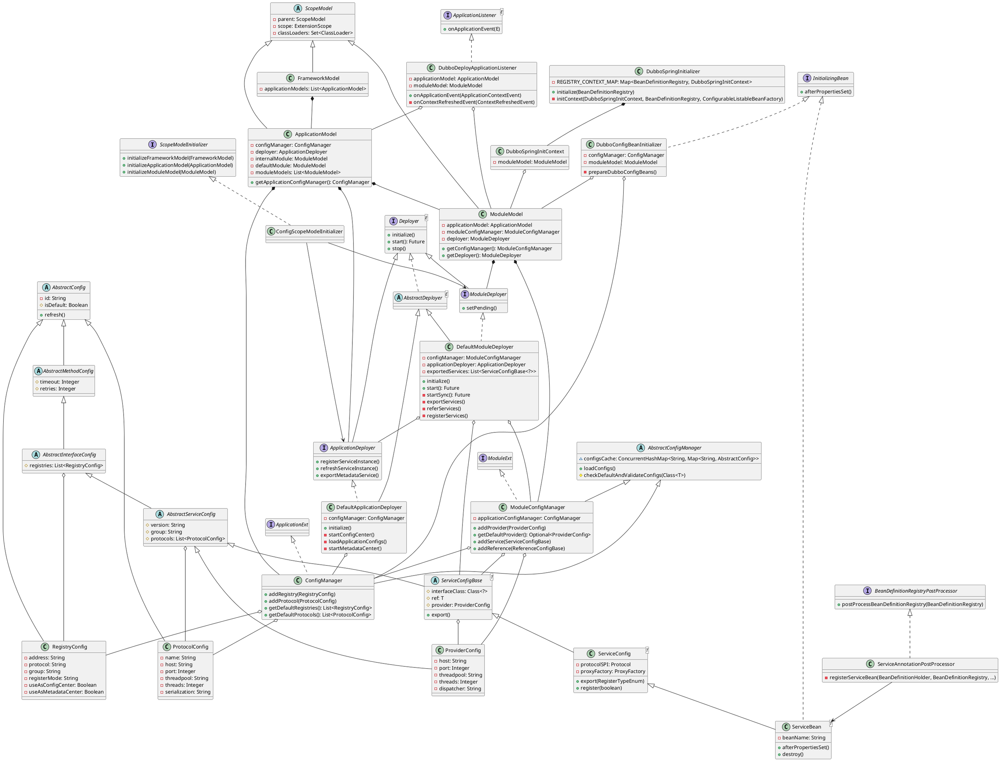

### 3.1 Extension declarations and startup activation

Every extension loaded during startup is registered as `name=implementationClass` under `META-INF/dubbo/internal/<interface>` and bound to one of the three `ScopeModel` tiers:

- **Framework level (`FrameworkModel`)**:
  - **`ExtensionInjector`** — `META-INF/dubbo/internal/org.apache.dubbo.common.extension.ExtensionInjector`:
    ```properties
    adaptive=org.apache.dubbo.common.extension.inject.AdaptiveExtensionInjector
    spi=org.apache.dubbo.common.extension.inject.SpiExtensionInjector
    scopeBean=org.apache.dubbo.common.beans.ScopeBeanExtensionInjector
    spring=org.apache.dubbo.config.spring.extension.SpringExtensionInjector
    ```
    ```java
    // AdaptiveExtensionInjector.initialize() (called from ScopeModel.initialize() -> ExtensionDirector)
    ExtensionLoader<ExtensionInjector> loader = extensionAccessor.getExtensionLoader(ExtensionInjector.class);
    injectors = loader.getSupportedExtensions().stream()
            .map(loader::getExtension)
            .collect(Collectors.toList());
    ```
  - **`ScopeModelInitializer`** — `META-INF/dubbo/internal/org.apache.dubbo.rpc.model.ScopeModelInitializer`:
    ```properties
    dubbo-common=org.apache.dubbo.common.CommonScopeModelInitializer
    dubbo-config-api=org.apache.dubbo.config.ConfigScopeModelInitializer
    dubbo-registry-api=org.apache.dubbo.registry.RegistryScopeModelInitializer
    dubbo-metadata-api=org.apache.dubbo.metadata.report.MetadataScopeModelInitializer
    dubbo-cluster=org.apache.dubbo.rpc.cluster.ClusterScopeModelInitializer
    ```
    ```java
    // FrameworkModel.<init>()
    Set<ScopeModelInitializer> initializers =
            this.getExtensionLoader(ScopeModelInitializer.class).getSupportedExtensionInstances();
    for (ScopeModelInitializer initializer : initializers) {
        initializer.initializeFrameworkModel(this);
    }
    ```
  - **`Compiler`** — `META-INF/dubbo/internal/org.apache.dubbo.common.compiler.Compiler`:
    ```properties
    adaptive=org.apache.dubbo.common.compiler.support.AdaptiveCompiler
    javassist=org.apache.dubbo.common.compiler.support.JavassistCompiler
    jdk=org.apache.dubbo.common.compiler.support.JdkCompiler
    ```
    ```java
    // ExtensionLoader.createAdaptiveExtensionClass()
    String code = new AdaptiveClassCodeGenerator(type, cachedDefaultName).generate();
    Compiler compiler = extensionDirector.getExtensionLoader(Compiler.class).getAdaptiveExtension();
    return compiler.compile(type, code, classLoader);
    ```
  - **`Protocol` and `ProxyFactory`** — `META-INF/dubbo/internal/org.apache.dubbo.rpc.Protocol` and `ProxyFactory`:
    ```properties
    # META-INF/dubbo/internal/org.apache.dubbo.rpc.Protocol
    dubbo=org.apache.dubbo.rpc.protocol.dubbo.DubboProtocol
    tri=org.apache.dubbo.rpc.protocol.tri.TripleProtocol
    injvm=org.apache.dubbo.rpc.protocol.injvm.InjvmProtocol
    service-discovery-registry=org.apache.dubbo.registry.integration.RegistryProtocol
    registry=org.apache.dubbo.registry.integration.InterfaceCompatibleRegistryProtocol
    filter=org.apache.dubbo.rpc.cluster.filter.ProtocolFilterWrapper
    listener=org.apache.dubbo.rpc.protocol.ProtocolListenerWrapper
    qos=org.apache.dubbo.qos.protocol.QosProtocolWrapper

    # META-INF/dubbo/internal/org.apache.dubbo.rpc.ProxyFactory
    javassist=org.apache.dubbo.rpc.proxy.javassist.JavassistProxyFactory
    jdk=org.apache.dubbo.rpc.proxy.jdk.JdkProxyFactory
    stub=org.apache.dubbo.rpc.proxy.wrapper.StubProxyFactoryWrapper
    ```
    ```java
    // ServiceConfig / ReferenceConfig.postProcessAfterScopeModelChanged()
    protocolSPI = this.getExtensionLoader(Protocol.class).getAdaptiveExtension();
    proxyFactory = this.getExtensionLoader(ProxyFactory.class).getAdaptiveExtension();
    ```
  - **Transport, framing, serialization, and threading (`Exchanger`, `Transporter`, `Codec2`, `Serialization`, `ThreadPool`, `Dispatcher`)**:
    ```properties
    # META-INF/dubbo/internal/org.apache.dubbo.remoting.exchange.Exchanger
    header=org.apache.dubbo.remoting.exchange.support.header.HeaderExchanger
    # META-INF/dubbo/internal/org.apache.dubbo.remoting.Transporter
    netty=org.apache.dubbo.remoting.transport.netty4.NettyTransporter
    # META-INF/dubbo/internal/org.apache.dubbo.remoting.Codec2
    dubbo=org.apache.dubbo.rpc.protocol.dubbo.DubboCountCodec
    # META-INF/dubbo/internal/org.apache.dubbo.common.serialize.Serialization
    hessian2=org.apache.dubbo.common.serialize.hessian2.Hessian2Serialization
    fastjson2=org.apache.dubbo.common.serialize.fastjson2.FastJson2Serialization
    # META-INF/dubbo/internal/org.apache.dubbo.common.threadpool.ThreadPool
    fixed=org.apache.dubbo.common.threadpool.support.fixed.FixedThreadPool
    limited=org.apache.dubbo.common.threadpool.support.limited.LimitedThreadPool
    # META-INF/dubbo/internal/org.apache.dubbo.remoting.Dispatcher
    all=org.apache.dubbo.remoting.transport.dispatcher.all.AllDispatcher
    ```
    ```java
    // Validated eagerly in ConfigValidationUtils.validateProtocolConfig() / validateProviderConfig():
    scopeModel.getExtensionLoader(Transporter.class).hasExtension(config.getTransporter());

    // Loaded lazily when DubboProtocol binds a server or connects a client:
    Exchanger exchanger = url.getOrDefaultFrameworkModel().getExtensionLoader(Exchanger.class).getExtension(type);
    Transporter transporter = url.getOrDefaultFrameworkModel().getExtensionLoader(Transporter.class).getAdaptiveExtension();
    Codec2 codec = frameworkModel.getExtensionLoader(Codec2.class).getExtension(codecName);
    Serialization serialization = url.getOrDefaultFrameworkModel().getExtensionLoader(Serialization.class).getExtension(s);
    ExecutorService executor = (ExecutorService) extensionAccessor.getExtensionLoader(ThreadPool.class).getAdaptiveExtension().getExecutor(url);
    ChannelHandler wrapped = url.getOrDefaultFrameworkModel().getExtensionLoader(Dispatcher.class).getAdaptiveExtension().dispatch(handler, url);
    ```

- **Application level (`ApplicationModel` & `DefaultApplicationDeployer`)**:
  - **`ApplicationExt` and `DefaultApplicationDeployer`** — `META-INF/dubbo/internal/org.apache.dubbo.common.context.ApplicationExt`:
    ```properties
    config=org.apache.dubbo.config.context.ConfigManager
    environment=org.apache.dubbo.common.config.Environment
    ```
    ```java
    // ApplicationModel.<init>() -> initApplicationExts() & ConfigScopeModelInitializer.initializeApplicationModel()
    Set<ApplicationExt> exts = this.getExtensionLoader(ApplicationExt.class).getSupportedExtensionInstances();
    for (ApplicationExt ext : exts) {
        ext.initialize();                                       // Environment, ConfigManager
    }
    ApplicationDeployer applicationDeployer = beanFactory.registerBean(DefaultApplicationDeployer.class);
    applicationModel.setDeployer(applicationDeployer);
    ```
  - **`DynamicConfigurationFactory` and application config initialization** — `META-INF/dubbo/internal/org.apache.dubbo.common.config.configcenter.DynamicConfigurationFactory`:
    ```properties
    nop=org.apache.dubbo.common.config.configcenter.nop.NopDynamicConfigurationFactory
    nacos=org.apache.dubbo.configcenter.support.nacos.NacosDynamicConfigurationFactory
    zookeeper=org.apache.dubbo.configcenter.support.zookeeper.ZookeeperDynamicConfigurationFactory
    ```
    ```java
    // DefaultApplicationDeployer.initialize() -> startConfigCenter() & loadApplicationConfigs()
    configManager.loadConfigsOfTypeFromProps(ApplicationConfig.class);
    configManager.loadConfigsOfTypeFromProps(ConfigCenterConfig.class);
    useRegistryAsConfigCenterIfNecessary();                     // checks getExtensionLoader(DynamicConfigurationFactory.class).hasExtension(protocol)
    DynamicConfigurationFactory factory = applicationModel
            .getExtensionLoader(DynamicConfigurationFactory.class)
            .getOrDefaultExtension(protocol);
    environment.setDynamicConfiguration(factory.getDynamicConfiguration(configCenter.toUrl()));

    configManager.loadConfigs();                                // binds ProtocolConfig, RegistryConfig (isRequired == false), MetadataReportConfig
    ```
  - **`MetadataReportFactory` and metrics (`MetricsReporterFactory`, `MetricsServiceExporter`)**:
    ```properties
    # META-INF/dubbo/internal/org.apache.dubbo.metadata.report.MetadataReportFactory
    nacos=org.apache.dubbo.metadata.store.nacos.NacosMetadataReportFactory
    zookeeper=org.apache.dubbo.metadata.store.zookeeper.ZookeeperMetadataReportFactory
    # META-INF/dubbo/internal/org.apache.dubbo.metrics.report.MetricsReporterFactory
    default=org.apache.dubbo.metrics.report.DefaultMetricsReporterFactory
    prometheus=org.apache.dubbo.metrics.prometheus.PrometheusMetricsReporterFactory
    # META-INF/dubbo/internal/org.apache.dubbo.metrics.service.MetricsServiceExporter
    default=org.apache.dubbo.config.deploy.DefaultMetricsServiceExporter
    ```
    ```java
    // DefaultApplicationDeployer.initMetricsReporter() / initMetricsService() / startMetadataCenter()
    MetricsReporterFactory reporterFactory = getExtensionLoader(MetricsReporterFactory.class).getAdaptiveExtension();
    MetricsServiceExporter metricsExporter = getExtensionLoader(MetricsServiceExporter.class).getDefaultExtension();

    useRegistryAsMetadataCenterIfNecessary();                   // checks getExtensionLoader(MetadataReportFactory.class).hasExtension(protocol)
    MetadataReportFactory metadataReportFactory =
            applicationModel.getExtensionLoader(MetadataReportFactory.class).getAdaptiveExtension();
    MetadataReport metadataReport = metadataReportFactory.getMetadataReport(url);
    ```
  - **Discovery, mapping, clustering, and instance customization (`RegistryFactory`, `ServiceDiscoveryFactory`, `ServiceNameMapping`, `Cluster`, `LoadBalance`, `ServiceInstanceCustomizer`)**:
    ```properties
    # META-INF/dubbo/internal/org.apache.dubbo.registry.RegistryFactory
    service-discovery-registry=org.apache.dubbo.registry.client.ServiceDiscoveryRegistryFactory
    nacos=org.apache.dubbo.registry.nacos.NacosRegistryFactory
    # META-INF/dubbo/internal/org.apache.dubbo.registry.client.ServiceDiscoveryFactory
    nacos=org.apache.dubbo.registry.nacos.NacosServiceDiscoveryFactory
    # META-INF/dubbo/internal/org.apache.dubbo.metadata.ServiceNameMapping
    metadata=org.apache.dubbo.registry.client.metadata.MetadataServiceNameMapping
    # META-INF/dubbo/internal/org.apache.dubbo.rpc.cluster.Cluster
    mock=org.apache.dubbo.rpc.cluster.support.wrapper.MockClusterWrapper
    failover=org.apache.dubbo.rpc.cluster.support.FailoverCluster
    zone-aware=org.apache.dubbo.rpc.cluster.support.registry.ZoneAwareCluster
    # META-INF/dubbo/internal/org.apache.dubbo.rpc.cluster.LoadBalance
    random=org.apache.dubbo.rpc.cluster.loadbalance.RandomLoadBalance
    # META-INF/dubbo/internal/org.apache.dubbo.registry.client.ServiceInstanceCustomizer
    protocol-ports=org.apache.dubbo.registry.client.metadata.ProtocolPortsMetadataCustomizer
    instance-metadata=org.apache.dubbo.registry.client.metadata.ServiceInstanceMetadataCustomizer
    metadata-url=org.apache.dubbo.config.metadata.MetadataServiceURLParamsMetadataCustomizer
    ```
    ```java
    // RegistryProtocol, ServiceConfig, ReferenceConfig, and ServiceInstanceMetadataUtils
    Registry registry = applicationModel.getExtensionLoader(RegistryFactory.class).getAdaptiveExtension().getRegistry(registryUrl);
    ServiceDiscovery discovery = applicationModel.getExtensionLoader(ServiceDiscoveryFactory.class).getAdaptiveExtension().getServiceDiscovery(registryURL);
    ServiceNameMapping.getDefaultExtension(scopeModel).map(url);
    Invoker<?> clusterInvoker = Cluster.getCluster(scopeModel, clusterName).join(directory, true);
    LoadBalance lb = ScopeModelUtil.getExtensionLoader(LoadBalance.class, moduleModel).getExtension(loadbalanceName);
    applicationModel.getExtensionLoader(ServiceInstanceCustomizer.class)
            .getSupportedExtensionInstances()
            .forEach(customizer -> customizer.customize(instance, applicationModel));
    ```

- **Module level (`ModuleModel` & `DefaultModuleDeployer`)**:
  - **`ModuleExt` and `DefaultModuleDeployer`** — `META-INF/dubbo/internal/org.apache.dubbo.common.context.ModuleExt`:
    ```properties
    moduleEnvironment=org.apache.dubbo.common.config.ModuleEnvironment
    moduleConfig=org.apache.dubbo.config.context.ModuleConfigManager
    ```
    ```java
    // ModuleModel.<init>() -> initModuleExt() & ConfigScopeModelInitializer.initializeModuleModel()
    Set<ModuleExt> exts = this.getExtensionLoader(ModuleExt.class).getSupportedExtensionInstances();
    for (ModuleExt ext : exts) {
        ext.initialize();                                       // ModuleEnvironment, ModuleConfigManager (delegates shared lookups to ConfigManager)
    }
    ModuleDeployer moduleDeployer = beanFactory.registerBean(DefaultModuleDeployer.class);
    moduleModel.setDeployer(moduleDeployer);
    ```
  - **Module config initialization (`DefaultModuleDeployer.initialize()` $\rightarrow$ `ModuleConfigManager.loadConfigs()`)**:
    ```java
    // ModuleConfigManager.loadConfigs(): ProviderConfig has isRequired == true (synthesizes blank default with null fields if absent)
    loadConfigsOfTypeFromProps(ProviderConfig.class);
    loadConfigsOfTypeFromProps(ConsumerConfig.class);
    loadConfigsOfTypeFromProps(ModuleConfig.class);
    checkDefaultAndValidateConfigs(ProviderConfig.class);       // inherited in ServiceConfig.preProcessRefresh() via getDefaultProvider()
    checkDefaultAndValidateConfigs(ConsumerConfig.class);
    checkDefaultAndValidateConfigs(ModuleConfig.class);
    ```
  - **`Filter`, `ClusterFilter`, `StateRouterFactory`, and `GovernanceRuleRepository` during `DefaultModuleDeployer.startSync()`**:
    ```properties
    # META-INF/dubbo/internal/org.apache.dubbo.rpc.Filter
    context=org.apache.dubbo.rpc.filter.ContextFilter
    echo=org.apache.dubbo.rpc.filter.EchoFilter
    generic=org.apache.dubbo.rpc.filter.GenericFilter
    timeout=org.apache.dubbo.rpc.filter.TimeoutFilter
    exception=org.apache.dubbo.rpc.filter.ExceptionFilter
    # META-INF/dubbo/internal/org.apache.dubbo.rpc.cluster.filter.ClusterFilter
    consumercontext=org.apache.dubbo.rpc.cluster.filter.support.ConsumerContextFilter
    future=org.apache.dubbo.rpc.protocol.dubbo.filter.FutureFilter
    # META-INF/dubbo/internal/org.apache.dubbo.rpc.cluster.router.state.StateRouterFactory
    condition=org.apache.dubbo.rpc.cluster.router.condition.ConditionStateRouterFactory
    tag=org.apache.dubbo.rpc.cluster.router.tag.TagStateRouterFactory
    # META-INF/dubbo/internal/org.apache.dubbo.rpc.cluster.governance.GovernanceRuleRepository
    default=org.apache.dubbo.rpc.cluster.governance.DefaultGovernanceRuleRepositoryImpl
    ```
    ```java
    // DefaultModuleDeployer.startSync() -> DefaultFilterChainBuilder, RouterChain, and AbstractStateRouter
    private synchronized Future startSync() {
        initialize();
        exportServices();                                       // 1. bind local server + injvm (register=false)
        prepareInternalModule();                                // 2. start internalModule (MetadataService)
        referServices();                                        // 3. subscribe & connect @DubboReference beans
        onModuleStarted();                                      // 4. customize & register ServiceInstance
        registerServices();                                     // 5. publish MetadataInfo + refresh instance last
        return startFuture;
    }

    List<Filter> filters = ScopeModelUtil.getExtensionLoader(Filter.class, moduleModel).getActivateExtension(url, key, group);
    List<ClusterFilter> clusterFilters = ScopeModelUtil.getExtensionLoader(ClusterFilter.class, moduleModel).getActivateExtension(url, key, group);
    List<StateRouterFactory> routers = moduleModel.getExtensionLoader(StateRouterFactory.class).getActivateExtension(url, ROUTER_KEY);
    GovernanceRuleRepository ruleRepo = moduleModel.getExtensionLoader(GovernanceRuleRepository.class).getDefaultExtension();
    ```

---

## 4. Protocol

`Protocol` is the core RPC boundary extension in Dubbo. It reduces remote service exposure and consumption to two operations: `export` turns a provider-side `Invoker` into a reachable `Exporter`, and `refer` turns a target `URL` into a consumer-side `Invoker`.

```java
@SPI(value = "dubbo", scope = ExtensionScope.FRAMEWORK)
public interface Protocol {
    @Adaptive <T> Exporter<T> export(Invoker<T> invoker) throws RpcException;
    @Adaptive <T> Invoker<T> refer(Class<T> type, URL url) throws RpcException;
    int getDefaultPort();
}
```

Every call into `Protocol` is driven by a `URL` that carries not only the network endpoint, but also the interface, version, group, timeout, serializer, thread pool, and load balancer:

```text
dubbo://10.0.0.7:20880/org.apache.dubbo.GreetingService
  ?interface=org.apache.dubbo.GreetingService
  &version=1.0.0
  &group=blue
  &timeout=3000
  &serialization=hessian2
  &threadpool=limited
  &loadbalance=random
```

Parameters may be method-specific: `getMethodParameter(method, "timeout", 1000)` checks `methodName.timeout`, then `timeout`, then returns the default, allowing per-method timeouts and retries inside one flat `URL`.

`Protocol` coordinates export and refer through three shared mechanisms:

- **Per-method adaptive dispatch**: `export` and `refer` are marked `@Adaptive` (dispatching on `url.getProtocol()`), whereas `getDefaultPort()` has no `URL` parameter and throws `UnsupportedOperationException` on `Protocol$Adaptive`. The provider path enters through `export(Invoker)` (extracting `invoker.getUrl()`), while the consumer path enters through `refer(Class, URL)`. Because `RegistryProtocol` receives `Protocol$Adaptive` via `setProtocol(Protocol)`, a registry-backed export or refer traverses `Protocol$Adaptive` twice — first on the registry scheme and then on the wire scheme.
- **Shared state in `AbstractProtocol`**: wire and local protocols extend `AbstractProtocol`, which maintains `exporterMap` (keyed by `group/path:version:port` on the provider), `invokers` (active consumer `Invoker` references), and `serverMap` (reusing one `ProtocolServer` per `host:port` across all exported services on that port).
- **Automatic wrapper chain**: `ExtensionLoader` wraps every concrete `Protocol` with `ProtocolFilterWrapper` (builds provider/consumer `Filter` chains), `ProtocolListenerWrapper` (fires exporter/invoker listeners), `ProtocolSerializationWrapper` and `ProtocolSecurityWrapper` (enforce serialization allow-lists), `InvokerCountWrapper` (tracks active references), and `QosProtocolWrapper` (starts the QoS diagnostic server). Concrete protocol classes therefore contain no filter, listener, or security boilerplate.

Dubbo ships the following `Protocol` implementations across its modules:

- **`service-discovery-registry` (`RegistryProtocol`) and `registry` (`InterfaceCompatibleRegistryProtocol`)**: outer registry-integration protocols that register/subscribe endpoints in the registry and delegate local binding and remote invoker creation to a wire protocol.
- **`dubbo` (`DubboProtocol`, default port `20880`)**: Dubbo's default TCP binary RPC protocol built over `Exchanger` and `Transporter`.
- **`tri` (`TripleProtocol`, default port `50051`), `grpc` (`GrpcProtocol`), and `rest2` (`RestProtocol`)**: HTTP/2 and HTTP/1.1 protocols supporting unary and streaming RPC, gRPC interoperability, and RESTful mapping.
- **`injvm` (`InjvmProtocol`)**: local in-process protocol that invokes providers in the same JVM directly without network I/O or serialization.
- **`mock` (`MockProtocol`)**: consumer-side stub and fallback protocol used for service degradation.

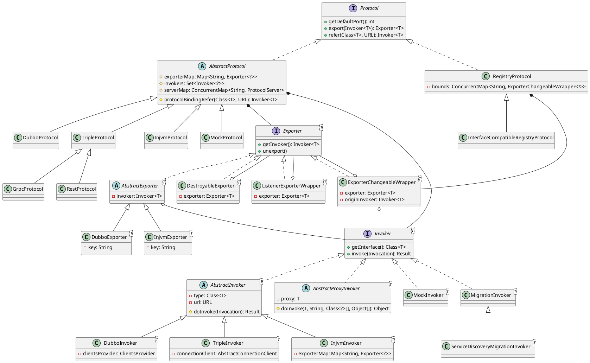

### 4.1 Export: the provider runtime

`export` is the provider-side pipeline that turns a `ServiceConfig` declaration into a live, discoverable RPC endpoint across three functions:

- **Endpoint exposure**: adapts the business object into a reflection-free `Invoker` and binds the local wire server (alongside an in-process `injvm` endpoint) to accept incoming requests.
- **Metadata publication**: aggregates the exported service's interface, version, group, and method signatures into the application's `MetadataInfo` (served by the local `MetadataService` or uploaded to a remote metadata center) and publishes the interface-to-application mapping.
- **Instance registration**: computes the metadata revision digest over all exported services and registers a single application instance record (host, port, and revision) with the registry.

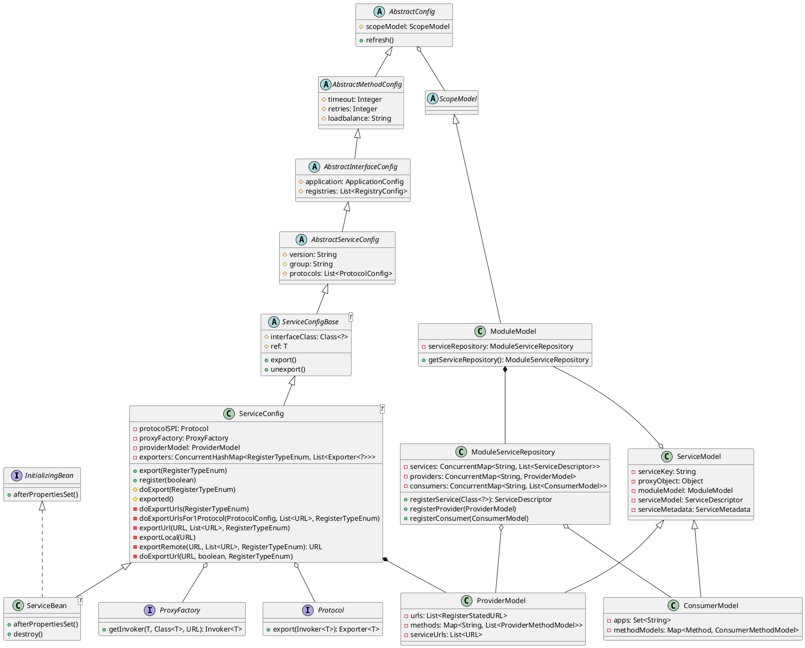

```java
// 1. ServiceConfig.export(): prepare module deployer, refresh config, initialize metadata, and delegate to doExport()
public void export(RegisterTypeEnum registerType) {
    if (this.exported) {
        return;
    }
    if (getScopeModel().isLifeCycleManagedExternally()) {
        getScopeModel().getDeployer().prepare();
    } else {
        getScopeModel().getDeployer().start();
    }

    synchronized (this) {
        if (this.exported) {
            return;
        }
        if (!this.isRefreshed()) {
            this.refresh();                                     // binds YAML/properties -> calls postProcessRefresh()
        }
        if (this.shouldExport()) {
            this.init();                                        // assemble ServiceMetadata and sub-configs
            if (shouldDelay()) {
                doDelayExport();
            } else if (Integer.valueOf(-1).equals(getDelay())
                    && Boolean.parseBoolean(ConfigurationUtils.getProperty(
                            getScopeModel(), CommonConstants.DubboProperty.DUBBO_MANUAL_REGISTER_KEY, "false"))) {
                doExport(RegisterTypeEnum.MANUAL_REGISTER);
            } else {
                doExport(registerType);                         // calls doExportUrls(registerType) -> exported()
            }
        }
    }

    getScopeModel().getDeployer().registerServiceInstance();
}

// 2. ServiceConfig.checkAndUpdateSubConfigs() & AbstractInterfaceConfig.convertRegistryIdsToRegistries()
private void checkAndUpdateSubConfigs() {
    completeCompoundConfigs();                                  // inherit registries / protocols from ProviderConfig or ModuleConfig
    checkProtocol();                                            // populate protocols from protocolIds or ConfigManager.getDefaultProtocols()

    List<ConfigInitializer> configInitializers = this.getExtensionLoader(ConfigInitializer.class)
            .getActivateExtension(URL.valueOf("configInitializer://", getScopeModel()), (String[]) null);
    configInitializers.forEach(e -> e.initServiceConfig(this));

    if (!isOnlyInJvm()) {
        checkRegistry();                                        // calls AbstractInterfaceConfig.convertRegistryIdsToRegistries()
    }
    // ... resolve interfaceClass, checkRef(), checkStubAndLocal(interfaceClass)
    ConfigValidationUtils.validateServiceConfig(this);
    postProcessConfig();
}

private void convertRegistryIdsToRegistries() {                 // AbstractInterfaceConfig: resolves protected List<RegistryConfig> registries
    computeValidRegistryIds();
    if (StringUtils.isEmpty(registryIds)) {
        if (CollectionUtils.isEmpty(registries)) {
            List<RegistryConfig> registryConfigs = getConfigManager().getDefaultRegistries();
            registryConfigs = new ArrayList<>(registryConfigs);
            setRegistries(registryConfigs);
        }
    } else {
        String[] ids = COMMA_SPLIT_PATTERN.split(registryIds);
        List<RegistryConfig> tmpRegistries = new ArrayList<>();
        Arrays.stream(ids).forEach(id -> {
            if (tmpRegistries.stream().noneMatch(reg -> reg.getId().equals(id))) {
                Optional<RegistryConfig> globalRegistry = getConfigManager().getRegistry(id);
                if (globalRegistry.isPresent()) {
                    tmpRegistries.add(globalRegistry.get());
                } else {
                    throw new IllegalStateException("Registry not found: " + id);
                }
            }
        });
        setRegistries(tmpRegistries);
    }
}

// 3. ServiceConfig.doExport() -> doExportUrls() -> doExportUrlsFor1Protocol() -> exportUrl() -> exportRemote()
protected synchronized void doExport(RegisterTypeEnum registerType) {
    if (unexported) {
        throw new IllegalStateException("The service " + interfaceClass.getName() + " has already unexported!");
    }
    if (exported) {
        return;
    }
    if (StringUtils.isEmpty(path)) {
        path = interfaceName;
    }
    doExportUrls(registerType);
    exported();
}

private void doExportUrls(RegisterTypeEnum registerType) {
    ModuleServiceRepository repository = getScopeModel().getServiceRepository();
    ServiceDescriptor serviceDescriptor;
    final boolean serverService = ref instanceof ServerService;
    if (serverService) {
        serviceDescriptor = ((ServerService) ref).getServiceDescriptor();
        if (!this.provider.getUseJavaPackageAsPath()) {
            this.path = serviceDescriptor.getInterfaceName();
        }
        repository.registerService(serviceDescriptor);
    } else {
        serviceDescriptor = repository.registerService(getInterfaceClass());
    }
    providerModel = new ProviderModel(
            serviceMetadata.getServiceKey(),
            ref,
            serviceDescriptor,
            getScopeModel(),
            serviceMetadata,
            interfaceClassLoader);
    providerModel.setConfig(this);
    providerModel.setDestroyRunner(getDestroyRunner());
    repository.registerProvider(providerModel);

    // Rewrites nacos://127.0.0.1:8848 -> service-discovery-registry://127.0.0.1:8848?registry=nacos
    List<URL> registryURLs = !Boolean.FALSE.equals(isRegister())
            ? ConfigValidationUtils.loadRegistries(this, true)
            : Collections.emptyList();

    // protocols holds only configured wire ProtocolConfigs (e.g. "dubbo", port 20880) — NOT a separate "injvm" ProtocolConfig
    for (ProtocolConfig protocolConfig : protocols) {
        String pathKey = URL.buildKey(
                getContextPath(protocolConfig).map(p -> p + "/" + path).orElse(path), group, version);
        if (!serverService) {
            repository.registerService(pathKey, interfaceClass);
        }
        doExportUrlsFor1Protocol(protocolConfig, registryURLs, registerType);
    }

    providerModel.setServiceUrls(urls);
}

private void doExportUrlsFor1Protocol(
        ProtocolConfig protocolConfig, List<URL> registryURLs, RegisterTypeEnum registerType) {
    Map<String, String> map = buildAttributes(protocolConfig);
    map.keySet().removeIf(key -> StringUtils.isEmpty(key) || StringUtils.isEmpty(map.get(key)));
    serviceMetadata.getAttachments().putAll(map);

    URL url = buildUrl(protocolConfig, map);                    // single wire URL: dubbo://10.0.0.7:20880/GreetingService?...
    processServiceExecutor(url);

    if (CollectionUtils.isEmpty(registryURLs)) {
        registerType = RegisterTypeEnum.NEVER_REGISTER;
    }
    exportUrl(url, registryURLs, registerType);                 // fans one wire URL out to both injvm and remote exports
    initServiceMethodMetrics(url);
}

private void exportUrl(URL url, List<URL> registryURLs, RegisterTypeEnum registerType) {
    String scope = url.getParameter(SCOPE_KEY);                 // default scope is null -> BOTH branches execute
    if (!SCOPE_NONE.equalsIgnoreCase(scope)) {
        if (!SCOPE_REMOTE.equalsIgnoreCase(scope)) {
            exportLocal(url);                                   // 1st export: clone dubbo:// URL -> injvm:// -> InjvmProtocol
        }
        if (!SCOPE_LOCAL.equalsIgnoreCase(scope)) {
            url = exportRemote(url, registryURLs, registerType); // 2nd export: wrap dubbo:// URL -> RegistryProtocol -> DubboProtocol
            if (!isGeneric(generic) && !getScopeModel().isInternal()) {
                MetadataUtils.publishServiceDefinition(url, providerModel.getServiceModel(), getApplicationModel());
            }
            // ... extra protocols (ext.protocol) omitted
        }
    }
    this.urls.add(url);
}

private void exportLocal(URL url) {
    // Rewrites the wire URL's scheme/address to injvm://127.0.0.1:0/... without needing a ProtocolConfig("injvm")
    URL local = URLBuilder.from(url)
            .setProtocol(LOCAL_PROTOCOL)
            .setHost(LOCALHOST_VALUE)
            .setPort(0)
            .build();
    local = local.setScopeModel(getScopeModel()).setServiceModel(providerModel);
    local = local.addParameter(EXPORTER_LISTENER_KEY, LOCAL_PROTOCOL); // notifies InjvmExporterListener -> ScopeClusterInvoker
    doExportUrl(local, false, RegisterTypeEnum.AUTO_REGISTER);  // Protocol$Adaptive routes "injvm" -> InjvmProtocol.export()
}

private URL exportRemote(URL url, List<URL> registryURLs, RegisterTypeEnum registerType) {
    if (CollectionUtils.isNotEmpty(registryURLs) && registerType != RegisterTypeEnum.NEVER_REGISTER) {
        for (URL registryURL : registryURLs) {
            if (SERVICE_REGISTRY_PROTOCOL.equals(registryURL.getProtocol())) {
                url = url.addParameterIfAbsent(SERVICE_NAME_MAPPING_KEY, "true");
            }
            if (LOCAL_PROTOCOL.equalsIgnoreCase(url.getProtocol())) { // skip registry if user explicitly configured protocol=injvm
                continue;
            }
            url = url.addParameterIfAbsent(DYNAMIC_KEY, registryURL.getParameter(DYNAMIC_KEY));
            URL monitorUrl = ConfigValidationUtils.loadMonitor(this, registryURL);
            if (monitorUrl != null) {
                url = url.putAttribute(MONITOR_KEY, monitorUrl);
            }
            String proxy = url.getParameter(PROXY_KEY);
            if (StringUtils.isNotEmpty(proxy)) {
                registryURL = registryURL.addParameter(PROXY_KEY, proxy);
            }
            // Attach wire URL under EXPORT_KEY; Protocol$Adaptive routes "service-discovery-registry" -> RegistryProtocol.export()
            doExportUrl(registryURL.putAttribute(EXPORT_KEY, url), true, registerType);
        }
    } else {
        doExportUrl(url, true, registerType);                   // no registry: Protocol$Adaptive routes "dubbo" -> DubboProtocol.export()
    }
    return url;
}

// 4. ServiceConfig.doExportUrl() & exported(): shared sink called by BOTH exportLocal() and exportRemote()
private void doExportUrl(URL url, boolean withMetaData, RegisterTypeEnum registerType) {
    if (!url.getParameter(REGISTER_KEY, true)) {
        registerType = RegisterTypeEnum.MANUAL_REGISTER;
    }
    if (registerType == RegisterTypeEnum.NEVER_REGISTER
            || registerType == RegisterTypeEnum.MANUAL_REGISTER
            || registerType == RegisterTypeEnum.AUTO_REGISTER_BY_DEPLOYER) {
        url = url.addParameter(REGISTER_KEY, false);            // defer registration until all services finish binding
    }

    Invoker<?> invoker = proxyFactory.getInvoker(ref, (Class) interfaceClass, url); // Javassist Wrapper, no reflection
    if (withMetaData) {
        invoker = new DelegateProviderMetaDataInvoker(invoker, this);
    }
    Exporter<?> exporter = protocolSPI.export(invoker);         // Protocol$Adaptive dispatches on url.getProtocol()
    ConcurrentHashMapUtils.computeIfAbsent(exporters, registerType, k -> new CopyOnWriteArrayList<>())
            .add(exporter);
}

protected void exported() {
    exported = true;
    List<URL> exportedURLs = this.getExportedUrls();
    exportedURLs.forEach(url -> {
        if (url.getParameter(SERVICE_NAME_MAPPING_KEY, false)) {
            ServiceNameMapping serviceNameMapping = ServiceNameMapping.getDefaultExtension(getScopeModel());
            ScheduledExecutorService scheduledExecutor = getScopeModel()
                    .getBeanFactory()
                    .getBean(FrameworkExecutorRepository.class)
                    .getSharedScheduledExecutor();
            mapServiceName(url, serviceNameMapping, scheduledExecutor); // invokes serviceNameMapping.map(url)
        }
    });
    onExported();
    if (hasRegistrySpecified()) {
        getScopeModel().getDeployer().getApplicationDeployer().exportMetadataService();
    }
}
```

### 4.2 Refer: the consumer side

`refer` turns a service interface and target `URL` into a local proxy backed by remote providers. When backed by a registry, `ReferenceConfig` delegates through `Protocol$Adaptive` to `RegistryProtocol.refer`, which resolves `Cluster` from the `cluster` parameter (`failover` when unset), stores that instance on `MigrationInvoker`, and later calls `cluster.join` to subscribe a `Directory` and place the discovered provider `Invoker`s behind one `ClusterInvoker`. A direct `url` skips the registry and calls `Cluster.getCluster` from `ReferenceConfig.createInvoker`. `LoadBalance` is not retained by either object: `AbstractClusterInvoker.invoke` loads it on each call from the candidate URL's `loadbalance` parameter, default `random`. The joined `Directory` is itself a hierarchy under `AbstractDirectory`: `StaticDirectory` keeps a fixed invoker list for a direct URL, while `DynamicDirectory` implements `NotifyListener` and subscribes to a registry. `RegistryDirectory` refreshes that list from interface-level provider URLs (`isServiceDiscovery()` returns false); `ServiceDiscoveryRegistryDirectory` refreshes it from application instance addresses (`isServiceDiscovery()` returns true).

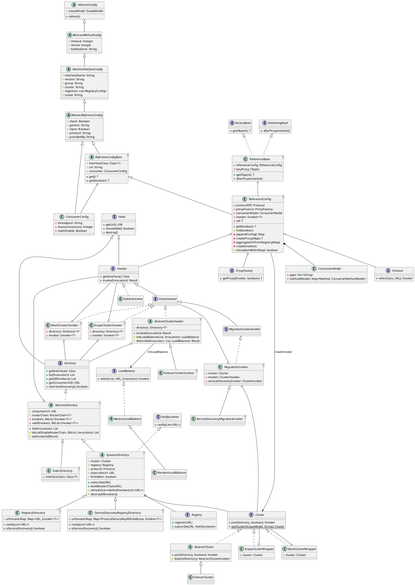

```java
// 1. ReferenceConfig refers the target URL via Protocol$Adaptive and wraps the Invoker in a dynamic proxy
invoker = protocolSPI.refer(interfaceClass, curUrl);            // dispatches to RegistryProtocol.refer() for registry URLs
return (T) proxyFactory.getProxy(invoker, ProtocolUtils.isGeneric(generic));

// 2. InvokerInvocationHandler intercepts application calls on the generated proxy
RpcInvocation rpcInvocation = new RpcInvocation(serviceModel, method.getName(),
        invoker.getInterface().getName(), protocolServiceKey,
        method.getParameterTypes(), args);
return InvocationUtil.invoke(invoker, rpcInvocation);           // sets RpcContext, invokes, calls recreate()
```

#### Cluster invocation

```java
// FailoverClusterInvoker.doInvoke (default Cluster = "failover")
int len = calculateInvokeTimes(methodName);                     // retries + 1 (default 3 attempts)
List<Invoker<T>> invoked = new ArrayList<>(copyInvokers.size());
for (int i = 0; i < len; i++) {
    if (i > 0) {
        copyInvokers = list(invocation);                        // re-fetch routed candidates before retry
        checkInvokers(copyInvokers, invocation);
    }
    // select applies sticky check, availablecheck, LoadBalance (default weighted random), and skips invoked
    Invoker<T> invoker = select(loadbalance, invocation, copyInvokers, invoked);
    invoked.add(invoker);
    try {
        return invokeWithContext(invoker, invocation);          // runs ClusterFilter + reference.filter chains
    } catch (RpcException e) {
        if (e.isBiz()) throw e;                                 // business exception: never retried
        le = e;                                                 // framework exception: failover to next node
    }
}
throw le;
```

### 4.3 RegistryProtocol

`RegistryProtocol` (`service-discovery-registry`) and its subclass `InterfaceCompatibleRegistryProtocol` (`registry`) do no socket framing or network transport themselves; they implement `Protocol` solely to bridge `ServiceConfig` and `ReferenceConfig` to the `Registry` / `ServiceDiscovery` SPI without special-casing registry logic in the config layer:

- **On `export`**: unwraps the registry `URL` (`getRegistryUrl`) and the nested wire `URL` (`EXPORT_KEY`), delegates local port binding to `protocol.export(...)` (`ExporterChangeableWrapper`), and hands the provider `URL` to `registry.register(...)` (wrapped in `DestroyableExporter` so `unexport()` unregisters before closing).
- **On `refer`**: resolves the `Registry` and `Cluster` SPIs, constructs a `ServiceDiscoveryMigrationInvoker` (capable of switching between application-level `ServiceDiscoveryRegistryDirectory` and interface-level `RegistryDirectory`), and subscribes the `Directory` to provider address changes. When a direct point-to-point `URL` (`dubbo://host:port`) is configured instead of a registry, `Protocol$Adaptive` bypasses `RegistryProtocol` completely and dispatches straight to the wire protocol.

`getRegistry` loads `RegistryFactory` from the registry URL protocol on each call. `service-discovery-registry` selects `ServiceDiscoveryRegistryFactory`. Its `createRegistry` restores the `registry` parameter (`nacos`) and returns a `ServiceDiscoveryRegistry`, which holds the `ServiceDiscovery` created by `ServiceDiscoveryFactory` (`NacosServiceDiscovery` for Nacos). `InterfaceCompatibleRegistryProtocol` rewrites `registry://` to that inner protocol before the same lookup, so interface-level export receives a `NacosRegistry` from `NacosRegistryFactory`. Its application-level refer path calls the parent `getRegistryUrl` and still receives a `ServiceDiscoveryRegistry`.

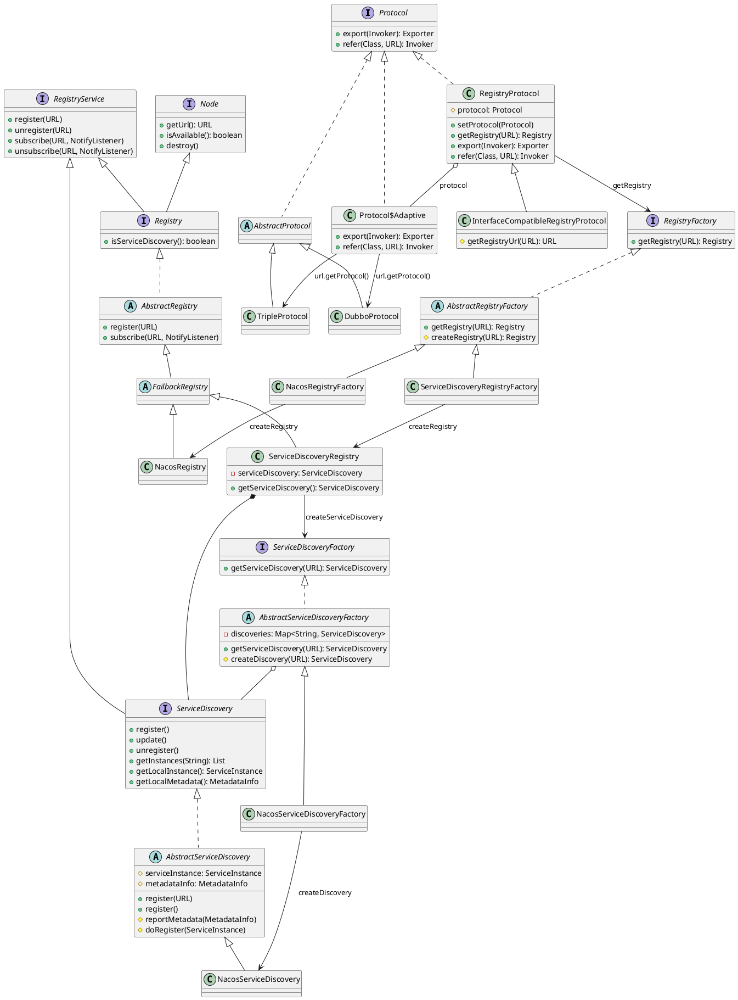

```java
// SPI init: ExtensionLoader.injectExtension calls setProtocol the first time RegistryProtocol is created.
private T createExtension(String name, boolean wrap) {
    Class<?> clazz = getExtensionClasses().get(name);           // "service-discovery-registry" -> RegistryProtocol
    T instance = (T) extensionInstances.get(clazz);
    if (instance == null) {
        extensionInstances.putIfAbsent(clazz, createExtensionInstance(clazz));
        instance = (T) extensionInstances.get(clazz);
        instance = postProcessBeforeInitialization(instance, name);
        injectExtension(instance);                              // setter injection before any Protocol wrapper
        instance = postProcessAfterInitialization(instance, name);
    }
    // ... wrap with ProtocolFilterWrapper, ProtocolListenerWrapper, ... then initExtension(instance)
    return instance;
}

private T injectExtension(T instance) {
    for (Method method : instance.getClass().getMethods()) {
        if (!isSetter(method)) {                                // public, name starts with "set", one parameter
            continue;
        }
        Class<?> pt = method.getParameterTypes()[0];
        if (ReflectUtils.isPrimitives(pt)) {
            continue;
        }
        String property = getSetterProperty(method);            // setProtocol -> "protocol"
        Object object = injector.getInstance(pt, property);     // Protocol.class, "protocol"
        if (object != null) {
            method.invoke(instance, object);                    // RegistryProtocol.setProtocol(...)
        }
    }
    return instance;
}

// SpiExtensionInjector sees that Protocol is @SPI and returns Protocol$Adaptive, not DubboProtocol.
public <T> T getInstance(final Class<T> type, final String name) {
    if (!type.isInterface() || !type.isAnnotationPresent(SPI.class)) {
        return null;
    }
    ExtensionLoader<T> loader = extensionAccessor.getExtensionLoader(type);
    if (loader == null) {
        return null;
    }
    if (!loader.getSupportedExtensions().isEmpty()) {
        return loader.getAdaptiveExtension();                   // name "protocol" is ignored
    }
    return null;
}

public void setProtocol(Protocol protocol) {
    this.protocol = protocol;                                   // Protocol$Adaptive, reused by export and refer
}

// The concrete wire scheme stays on the provider URL (dubbo, tri, ...) written by ServiceConfig.buildUrl.
private URL buildUrl(ProtocolConfig protocolConfig, Map<String, String> params) {
    String name = protocolConfig.getName();
    if (StringUtils.isEmpty(name)) {
        name = DUBBO;                                           // default scheme "dubbo"
    }
    String host = findConfiguredHosts(protocolConfig, provider, params);
    Integer port = findConfiguredPort(
            protocolConfig, provider, this.getExtensionLoader(Protocol.class), name, params);
    URL url = new ServiceConfigURL(
            name, null, null, host, port,
            getContextPath(protocolConfig).map(p -> p + "/" + path).orElse(path),
            params);                                            // URL scheme is protocolConfig.name, not the RegistryProtocol field
    if (this.getExtensionLoader(ConfiguratorFactory.class).hasExtension(url.getProtocol())) {
        url = this.getExtensionLoader(ConfiguratorFactory.class)
                .getExtension(url.getProtocol())
                .getConfigurator(url)
                .configure(url);
    }
    url = url.setScopeModel(getScopeModel());
    url = url.setServiceModel(providerModel);
    return url;
}

// 1. Provider export: RegistryProtocol.export() -> doLocalExport()
public <T> Exporter<T> export(final Invoker<T> originInvoker) throws RpcException {
    URL registryUrl = getRegistryUrl(originInvoker);            // rewrite service-discovery-registry:// -> nacos://127.0.0.1:8848
    URL providerUrl = getProviderUrl(originInvoker);            // read EXPORT_KEY -> dubbo://10.0.0.7:20880/...

    final URL overrideSubscribeUrl = getSubscribedOverrideUrl(providerUrl);
    final OverrideListener overrideSubscribeListener = new OverrideListener(overrideSubscribeUrl, originInvoker);
    providerUrl = overrideUrlWithConfig(providerUrl, overrideSubscribeListener);

    final ExporterChangeableWrapper<T> exporter = doLocalExport(originInvoker, providerUrl); // second Protocol$Adaptive pass on providerUrl

    final Registry registry = getRegistry(registryUrl);
    final URL registeredProviderUrl = customizeURL(providerUrl, registryUrl);

    boolean register = providerUrl.getParameter(REGISTER_KEY, true) && registryUrl.getParameter(REGISTER_KEY, true);
    if (register) {
        register(registry, registeredProviderUrl);              // skipped during exportServices() because register=false
    }

    registerStatedUrl(registryUrl, registeredProviderUrl, register);
    exporter.setRegisterUrl(registeredProviderUrl);
    exporter.setSubscribeUrl(overrideSubscribeUrl);
    exporter.setNotifyListener(overrideSubscribeListener);
    exporter.setRegistered(register);

    notifyExport(exporter);
    return new DestroyableExporter<>(exporter);
}

private <T> ExporterChangeableWrapper<T> doLocalExport(final Invoker<T> originInvoker, URL providerUrl) {
    String providerUrlKey = getProviderUrlKey(originInvoker);
    String registryUrlKey = getRegistryUrlKey(originInvoker);
    Invoker<?> invokerDelegate = new InvokerDelegate<>(originInvoker, providerUrl);

    ReferenceCountExporter<?> exporter =
            exporterFactory.createExporter(providerUrlKey, () -> protocol.export(invokerDelegate)); // protocol is the injected Protocol$Adaptive; url.getProtocol() selects DubboProtocol
    return (ExporterChangeableWrapper<T>) ConcurrentHashMapUtils.computeIfAbsent(
            ConcurrentHashMapUtils.computeIfAbsent(bounds, providerUrlKey, k -> new ConcurrentHashMap<>()),
            registryUrlKey,
            s -> new ExporterChangeableWrapper<>((ReferenceCountExporter<T>) exporter, originInvoker));
}

// 2. Provider registration: ServiceConfig.register(true) -> ExporterChangeableWrapper.register() -> AbstractServiceDiscovery
public void register(boolean byDeployer) {                      // ServiceConfig
    if (!this.exported) {
        return;
    }
    synchronized (this) {
        if (!this.exported) {
            return;
        }
        for (Exporter<?> exporter : exporters.getOrDefault(RegisterTypeEnum.AUTO_REGISTER, Collections.emptyList())) {
            exporter.register();
        }
        if (byDeployer) {
            for (Exporter<?> exporter :
                    exporters.getOrDefault(RegisterTypeEnum.AUTO_REGISTER_BY_DEPLOYER, Collections.emptyList())) {
                exporter.register();                            // DestroyableExporter -> ExporterChangeableWrapper.register()
            }
        }
    }
}

public void register() {                                        // RegistryProtocol.ExporterChangeableWrapper
    if (registered.compareAndSet(false, true)) {
        URL registryUrl = getRegistryUrl(originInvoker);
        Registry registry = getRegistry(registryUrl);
        RegistryProtocol.register(registry, getRegisterUrl());  // -> registry.register(registeredProviderUrl)
        // ... mark RegisterStatedURL as registered on ProviderModel
    }
}

public void register(URL url) {                                 // AbstractServiceDiscovery
    metadataInfo.addService(url);                               // record interface, version, group, protocol, and method params
}

// 3. Instance publication: AbstractServiceDiscovery.register() & reportMetadata()
public synchronized void register() throws RuntimeException {
    if (isDestroy) {
        return;
    }
    if (this.serviceInstance == null) {
        ServiceInstance serviceInstance = createServiceInstance(this.metadataInfo);
        if (!isValidInstance(serviceInstance)) {
            return;
        }
        this.serviceInstance = serviceInstance;
    }
    boolean revisionUpdated = calOrUpdateInstanceRevision(this.serviceInstance); // compute dubbo.metadata.revision digest
    if (revisionUpdated) {
        try {
            reportMetadata(this.metadataInfo);
            doRegister(this.serviceInstance);                   // NacosServiceDiscovery -> namingService.registerInstance(...)
        } catch (Exception e) {
            this.serviceInstance = null;
            throw e;
        }
    }
}

protected void reportMetadata(MetadataInfo metadataInfo) {
    if (metadataInfo == null) {
        return;
    }
    if (metadataReport != null) {
        SubscriberMetadataIdentifier identifier =
                new SubscriberMetadataIdentifier(serviceName, metadataInfo.getRevision());
        if ((DEFAULT_METADATA_STORAGE_TYPE.equals(metadataType) && metadataReport.shouldReportMetadata())
                || REMOTE_METADATA_STORAGE_TYPE.equals(metadataType)) {
            MetricsEventBus.post(MetadataEvent.toPushEvent(applicationModel), () -> {
                metadataReport.publishAppMetadata(identifier, metadataInfo);
                return null;
            });
        }
    }
    MetadataInfo clonedMetadataInfo = metadataInfo.clone();
    metadataInfos.put(metadataInfo.getRevision(), new MetadataInfoStat(clonedMetadataInfo)); // served by MetadataService
}

// 4. Consumer refer: RegistryProtocol.refer() -> doRefer() -> doCreateInvoker()
public <T> Invoker<T> refer(Class<T> type, URL url) throws RpcException {
    url = getRegistryUrl(url);                                  // rewrite service-discovery-registry:// -> nacos://...
    Registry registry = getRegistry(url);
    if (RegistryService.class.equals(type)) {
        return proxyFactory.getInvoker((T) registry, type, url);
    }

    Map<String, String> qs = (Map<String, String>) url.getAttribute(REFER_KEY);
    String group = qs.get(GROUP_KEY);
    if (StringUtils.isNotEmpty(group)) {
        if ((COMMA_SPLIT_PATTERN.split(group)).length > 1 || "*".equals(group)) {
            return doRefer(Cluster.getCluster(url.getScopeModel(), MERGEABLE_CLUSTER_NAME), registry, type, url, qs);
        }
    }

    Cluster cluster = Cluster.getCluster(url.getScopeModel(), qs.get(CLUSTER_KEY));
    return doRefer(cluster, registry, type, url, qs);
}

protected <T> Invoker<T> doRefer(
        Cluster cluster, Registry registry, Class<T> type, URL url, Map<String, String> parameters) {
    Map<String, Object> consumerAttribute = new HashMap<>(url.getAttributes());
    consumerAttribute.remove(REFER_KEY);
    String p = isEmpty(parameters.get(PROTOCOL_KEY)) ? CONSUMER : parameters.get(PROTOCOL_KEY);
    URL consumerUrl = new ServiceConfigURL(
            p, null, null, parameters.get(REGISTER_IP_KEY), 0, getPath(parameters, type), parameters, consumerAttribute);
    url = url.putAttribute(CONSUMER_URL_KEY, consumerUrl);
    ClusterInvoker<T> migrationInvoker = getMigrationInvoker(this, cluster, registry, type, url, consumerUrl);
    return interceptInvoker(migrationInvoker, url, consumerUrl); // triggers MigrationRuleListener.onRefer()
}

protected <T> ClusterInvoker<T> doCreateInvoker(
        DynamicDirectory<T> directory, Cluster cluster, Registry registry, Class<T> type) {
    directory.setRegistry(registry);
    directory.setProtocol(protocol);                            // same injected Protocol$Adaptive; each discovered provider URL is referred by its own wire scheme
    Map<String, String> parameters = new HashMap<>(directory.getConsumerUrl().getParameters());
    URL urlToRegistry = new ServiceConfigURL(
            parameters.get(PROTOCOL_KEY) == null ? CONSUMER : parameters.get(PROTOCOL_KEY),
            parameters.remove(REGISTER_IP_KEY),
            0,
            getPath(parameters, type),
            parameters);
    urlToRegistry = urlToRegistry.setScopeModel(directory.getConsumerUrl().getScopeModel());
    urlToRegistry = urlToRegistry.setServiceModel(directory.getConsumerUrl().getServiceModel());
    if (directory.isShouldRegister()) {
        directory.setRegisteredConsumerUrl(urlToRegistry);
        registry.register(directory.getRegisteredConsumerUrl());
    }
    directory.buildRouterChain(urlToRegistry);                  // assemble activated StateRouters
    directory.subscribe(toSubscribeUrl(urlToRegistry));         // subscribe addresses + revisions
    return (ClusterInvoker<T>) cluster.join(directory, true);   // wrap Directory in ClusterInvoker
}
```

### 4.4 DubboProtocol

`DubboProtocol` is Dubbo's default protocol (`dubbo://`, port `20880`). It exports a `DubboExporter` and refers a `DubboInvoker`. It does not read or write a `Request` or a `Response`. `createServer` calls `Exchangers.bind`, and `initClient` calls `Exchangers.connect`.

#### Provider side

The provider side records each exported service. `export` puts a `DubboExporter` in `exporterMap` under `group/path:version:port` and keeps one `ExchangeServer` per `host:port` in `serverMap`. `requestHandler` is the `ExchangeHandler` passed into `Exchangers.bind`. When that handler is called, `getInvoker` reads `exporterMap` and `invoker.invoke` runs the service. The `Result` is returned to the exchanger.

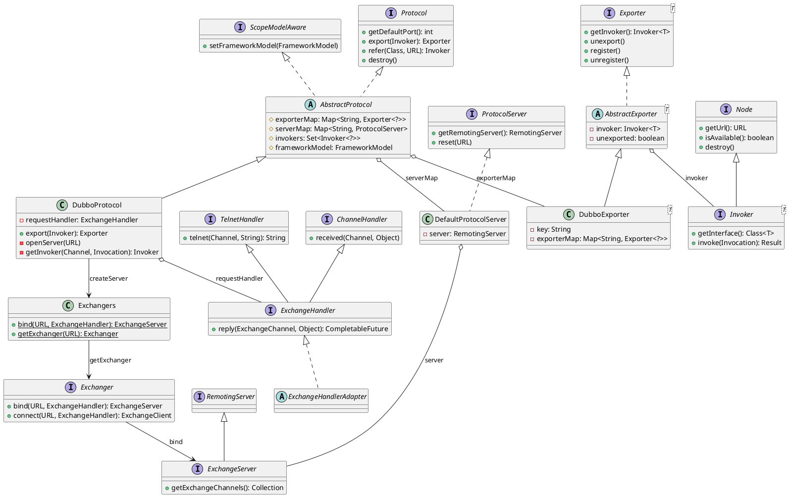

```java
// DubboProtocol.export: one DubboExporter per service key, one server per host:port
public <T> Exporter<T> export(Invoker<T> invoker) throws RpcException {
    URL url = invoker.getUrl();
    String key = serviceKey(url);                              // group/path:version:port
    DubboExporter<T> exporter = new DubboExporter<>(invoker, key, exporterMap);
    openServer(url);
    return exporter;
}

private void openServer(URL url) {
    String key = url.getAddress();                             // one Netty server per host:port
    if (url.getParameter(IS_SERVER_KEY, true)) {
        ProtocolServer server = serverMap.get(key);
        if (server == null) {
            synchronized (this) {
                if (serverMap.get(key) == null) {
                    serverMap.put(key, createServer(url));     // Exchangers.bind(url, requestHandler)
                    return;
                }
            }
        }
        server.reset(url);
    }
}

private ProtocolServer createServer(URL url) {
    url = URLBuilder.from(url)
            .addParameter(CODEC_KEY, DubboCodec.NAME)          // codec name only; framing is Codec2
            .build();
    ExchangeServer server = Exchangers.bind(url, requestHandler); // HeaderExchanger.bind owns the server
    return new DefaultProtocolServer(server);
}

// requestHandler.reply receives an Invocation from the exchanger and returns a Result future
public CompletableFuture<Object> reply(ExchangeChannel channel, Object message) throws RemotingException {
    Invocation inv = (Invocation) message;
    Invoker<?> invoker = getInvoker(channel, inv);             // exporterMap lookup by group/path:version:port
    Result result = invoker.invoke(inv);                       // provider filter chain and service method
    return result.thenApply(Function.identity());              // exchanger turns this Result into a Response
}
```

#### Consumer side

The consumer side records each reference. `protocolBindingRefer` stores a `DubboInvoker` in `invokers` and gives it a `ClientsProvider`. `initClient` obtains the `ExchangeClient` from `Exchangers.connect`. `doInvoke` selects one client and returns the future from `ExchangeClient.request`. Completing that future is the exchanger's work.

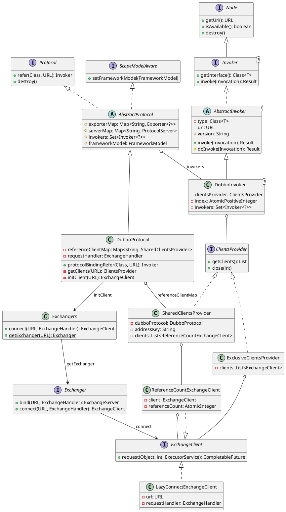

```java
// DubboProtocol.protocolBindingRefer: one DubboInvoker, clients chosen by connections
public <T> Invoker<T> protocolBindingRefer(Class<T> serviceType, URL url) throws RpcException {
    DubboInvoker<T> invoker = new DubboInvoker<>(serviceType, url, getClients(url), invokers);
    invokers.add(invoker);
    return invoker;
}

private ClientsProvider getClients(URL url) {
    int connections = url.getParameter(CONNECTIONS_KEY, 0);
    if (connections == 0) {
        String shareConnectionsStr = StringUtils.isBlank(url.getParameter(SHARE_CONNECTIONS_KEY, (String) null))
                ? ConfigurationUtils.getProperty(
                        url.getOrDefaultApplicationModel(), SHARE_CONNECTIONS_KEY, DEFAULT_SHARE_CONNECTIONS)
                : url.getParameter(SHARE_CONNECTIONS_KEY, (String) null);
        // default 1; SharedClientsProvider holds ReferenceCountExchangeClient, one socket per address
        return getSharedClient(url, Integer.parseInt(shareConnectionsStr));
    }
    // connections=n: n exclusive clients, round-robined in doInvoke
    List<ExchangeClient> clients =
            IntStream.range(0, connections).mapToObj((i) -> initClient(url)).collect(Collectors.toList());
    return new ExclusiveClientsProvider(clients);
}

// initClient: lazy=true defers connect; otherwise HeaderExchangeClient via Exchangers.connect
private ExchangeClient initClient(URL url) {
    return url.getParameter(LAZY_CONNECT_KEY, false)
            ? new LazyConnectExchangeClient(url, requestHandler)
            : Exchangers.connect(url, requestHandler);
}

// DubboInvoker.doInvoke: two-way Request, callback executor default "cached"
protected Result doInvoke(final Invocation invocation) throws Throwable {
    RpcInvocation inv = (RpcInvocation) invocation;
    final String methodName = RpcUtils.getMethodName(invocation);
    List<? extends ExchangeClient> exchangeClients = clientsProvider.getClients();
    ExchangeClient currentClient = exchangeClients.size() == 1
            ? exchangeClients.get(0)
            : exchangeClients.get(index.getAndIncrement() % exchangeClients.size());
    int timeout = RpcUtils.calculateTimeout(getUrl(), invocation, methodName, DEFAULT_TIMEOUT); // default 1000ms
    invocation.setAttachment(TIMEOUT_KEY, String.valueOf(timeout));
    Request request = new Request();
    request.setData(inv);
    request.setVersion(Version.getProtocolVersion());
    request.setTwoWay(true);
    ExecutorService executor = getCallbackExecutor(getUrl(), inv);
    CompletableFuture<AppResponse> appResponseFuture =
            currentClient.request(request, timeout, executor).thenApply(AppResponse.class::cast);
    return new AsyncRpcResult(appResponseFuture, inv);
}
```

---

## 5. Exchanger

`Exchanger` sits between the protocol and the transport, and it is where request/response semantics enter. The transport moves bytes and knows nothing about correlation; the exchanger adds request identity, two-way versus one-way, event frames, and futures.

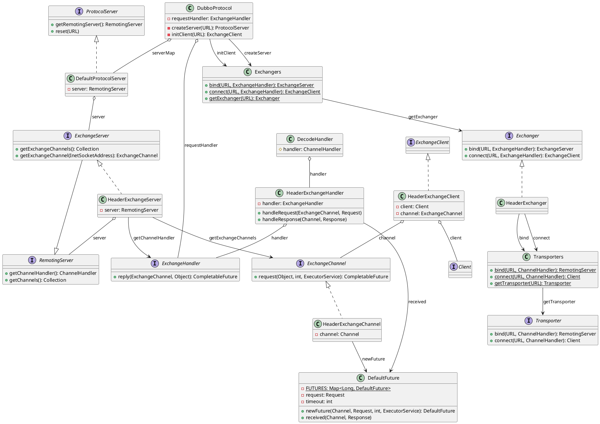

```java
@SPI(value = HeaderExchanger.NAME, scope = ExtensionScope.FRAMEWORK)
public interface Exchanger {
    @Adaptive({Constants.EXCHANGER_KEY}) ExchangeServer bind(URL url, ExchangeHandler handler);
    @Adaptive({Constants.EXCHANGER_KEY}) ExchangeClient connect(URL url, ExchangeHandler handler);
}
```

`@SPI` names the default `header`. The registration file is the map `ExtensionLoader` reads for that name:

```properties
# META-INF/dubbo/internal/org.apache.dubbo.remoting.exchange.Exchanger
header=org.apache.dubbo.remoting.exchange.support.header.HeaderExchanger
```

`Exchangers.getExchanger` loads `url.getParameter("exchanger", "header")` from that file. `DubboProtocol.createServer` and `initClient` stop at `Exchangers.bind` and `Exchangers.connect`. `HeaderExchanger` wraps the protocol `ExchangeHandler` and calls `Transporters`. `HeaderExchangeChannel` correlates each two-way call with a `DefaultFuture`.

```java
// HeaderExchanger: request/response wrapper around the transport. DubboProtocol passes requestHandler in.
public ExchangeServer bind(URL url, ExchangeHandler handler) throws RemotingException {
    return new HeaderExchangeServer(Transporters.bind(
            url, new DecodeHandler(new HeaderExchangeHandler(handler))));
}

public ExchangeClient connect(URL url, ExchangeHandler handler) throws RemotingException {
    return new HeaderExchangeClient(
            Transporters.connect(url, new DecodeHandler(new HeaderExchangeHandler(handler))), true);
}

// HeaderExchangeHandler.handleRequest: DubboProtocol.reply runs the service; the Response is written when it completes
void handleRequest(final ExchangeChannel channel, Request req) throws RemotingException {
    Response res = new Response(req.getId(), req.getVersion());
    CompletionStage<Object> future = handler.reply(channel, req.getData());
    future.whenComplete((appResult, t) -> {
        if (t == null) {
            res.setStatus(Response.OK);                        // status 20
            res.setResult(appResult);
        } else {
            res.setStatus(Response.SERVICE_ERROR);             // status 70
            res.setErrorMessage(StringUtils.toString(t));
        }
        channel.send(res);
    });
}

// HeaderExchangeChannel.request: register the future before send. HashedWheelTimer arms the timeout.
public CompletableFuture<Object> request(Object request, int timeout, ExecutorService executor)
        throws RemotingException {
    Request req = (Request) request;
    DefaultFuture future = DefaultFuture.newFuture(channel, req, timeout, executor); // FUTURES keyed by request id
    try {
        channel.send(req);
    } catch (RemotingException e) {
        future.cancel();
        throw e;
    }
    return future;
}

// HeaderExchangeHandler.handleResponse: complete that future. A response whose id is already gone is dropped.
static void handleResponse(Channel channel, Response response) throws RemotingException {
    if (response != null && !response.isHeartbeat()) {
        DefaultFuture.received(channel, response);
    }
}
```

---

## 6. Transporter

`Transporter` is the network implementation: it opens server sockets and client connections. The name is chosen by `server` for binding and `client` for connecting, both falling back to `transporter`, with `netty` as the default.

```java
@SPI(value = "netty", scope = ExtensionScope.FRAMEWORK)
public interface Transporter {
    @Adaptive({SERVER_KEY, TRANSPORTER_KEY}) RemotingServer bind(URL url, ChannelHandler handler);
    @Adaptive({CLIENT_KEY, TRANSPORTER_KEY}) Client connect(URL url, ChannelHandler handler);
}
```

`NettyTransporter` returns a `NettyServer` or a `NettyClient`; the state and behaviour live in `AbstractServer`/`AbstractClient`, which handle bind retry, port detection, channel bookkeeping, and the connection listener set, while the subclass builds only the Netty `ServerBootstrap`. The SPI name `netty` maps to the Netty 4 module; the Netty 3 module registers as `netty3`. `NettyServer` wraps the exchanger's handler before the socket is opened, and `AllChannelHandler` is the default dispatcher that moves each received message onto the business pool.

```java
// NettyServer calls ChannelHandlers.wrap. Default dispatcher name is "all".
protected ChannelHandler wrapInternal(ChannelHandler handler, URL url) {
    return new MultiMessageHandler(new HeartbeatHandler(
            url.getOrDefaultFrameworkModel()
                    .getExtensionLoader(Dispatcher.class)
                    .getAdaptiveExtension()
                    .dispatch(handler, url)));                 // AllChannelHandler around DecodeHandler
}

// AllChannelHandler.received: decode and the service method run off the Netty I/O thread
public void received(Channel channel, Object message) throws RemotingException {
    ExecutorService executor = getPreferredExecutorService(message); // threadpool=fixed, threads=200, queues=0
    try {
        executor.execute(new ChannelEventRunnable(channel, handler, ChannelState.RECEIVED, message));
    } catch (Throwable t) {
        if (message instanceof Request && t instanceof RejectedExecutionException) {
            sendFeedback(channel, (Request) message, t);       // Response status 100 SERVER_THREADPOOL_EXHAUSTED_ERROR
            return;
        }
        throw new ExecutionException(message, channel, getClass() + " error when process received event .", t);
    }
}
```

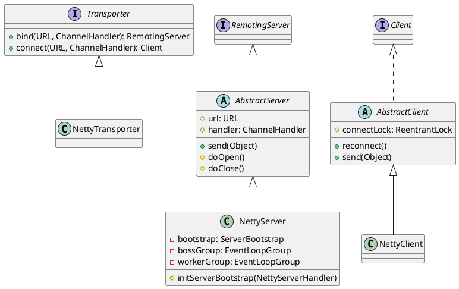

---

## 7. Codec2

`Codec2` converts between a `ChannelBuffer` and a message object. It is a separate extension from the protocol so that the framing can be reused: the `dubbo` protocol's codec also serves the telnet path through inheritance.

```java
@SPI(scope = ExtensionScope.FRAMEWORK)
public interface Codec2 {
    @Adaptive({CODEC_KEY}) void encode(Channel channel, ChannelBuffer buffer, Object message) throws IOException;
    @Adaptive({CODEC_KEY}) Object decode(Channel channel, ChannelBuffer buffer) throws IOException;
    enum DecodeResult { NEED_MORE_INPUT, SKIP_SOME_INPUT }
}
```

The adaptive key is `codec`, but the transport does not require it: `AbstractEndpoint.getChannelCodec` falls back to the protocol name when the parameter is absent, which is how `dubbo://` resolves `DubboCountCodec` with no configuration. `decode` returning `NEED_MORE_INPUT` is the contract that lets a partial frame stay in the buffer instead of being parsed twice.

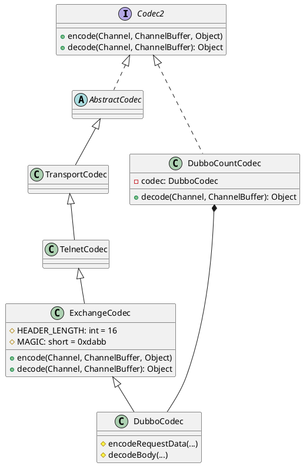

`ExchangeCodec` fixes the 16-byte header. `DubboCodec.encodeRequestData` writes the body. The status byte is meaningful on a response: `20` OK, `25` serialization error, `30` client timeout, `31` server timeout, `35` channel inactive, `40` bad request, `50` bad response, `60` service not found, `70` service error, `80` server error, `90` client error, `100` server threadpool exhausted.

| Offset | Size | Content |
|--------|------|---------|
| 0 | 2 | Magic `0xdabb` |
| 2 | 1 | Bit 7: request; bit 6: two-way; bit 5: event; bits 0–4: serialization id |
| 3 | 1 | Status |
| 4 | 8 | Request id |
| 12 | 4 | Body length |
| 16 | var | Body: `version \| service \| service version \| method \| parameter descriptor \| arguments \| attachments` |

---

## 8. Serialization

`Serialization` is the body format, and it is the one extension chosen per request rather than per connection. Its two methods return stream wrappers rather than byte arrays, so a large argument can be written without materialising it.

```java
@SPI(scope = ExtensionScope.FRAMEWORK)
public interface Serialization {
    byte getContentTypeId();
    String getContentType();
    @Adaptive ObjectOutput serialize(URL url, OutputStream output) throws IOException;
    @Adaptive ObjectInput deserialize(URL url, InputStream input) throws IOException;
}
```

`getContentTypeId` is constrained to five bits because the `dubbo` header stores it there. The implementations registered in this tree are `hessian2` and `fastjson2`; others exist in separate modules, and `DefaultSerializationExceptionWrapper` wraps whichever is selected to normalise exception handling. Selection order is `prefer.serialization`, then `serialization`, then the framework default.

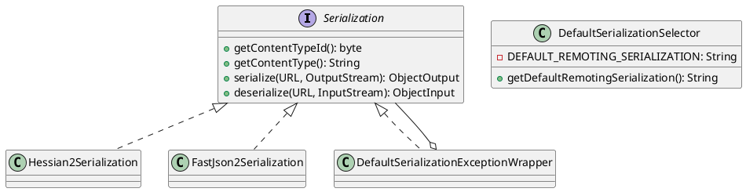

---

## 9. ThreadPool

`ThreadPool` decides how a decoded request reaches business code. Its single method returns a `java.util.concurrent.Executor` configured from the URL.

```java
@SPI(value = "fixed", scope = ExtensionScope.FRAMEWORK)
public interface ThreadPool {
    @Adaptive({THREADPOOL_KEY}) Executor getExecutor(URL url);
}
```

Four implementations differ only in the queue and the sizing: `fixed` uses a fixed worker count with a `SynchronousQueue` by default, `cached` allows growth and idle reclamation, `limited` grows to a maximum and then queues, and `eager` hands work to a new thread before queuing. All four share `AbortPolicyWithReport` as the rejection handler, which is what produces the `SERVER_THREADPOOL_EXHAUSTED_ERROR` response instead of a silent drop. The pool is owned by `DefaultExecutorRepository`, not by the protocol, so one executor serves every service on a port.

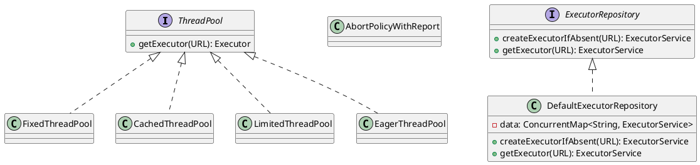

---

## 10. LoadBalance

`LoadBalance` picks one invoker from the candidates routing left behind.

```java
@SPI(RandomLoadBalance.NAME)
public interface LoadBalance {
    @Adaptive("loadbalance") <T> Invoker<T> select(List<Invoker<T>> invokers, URL url, Invocation invocation);
}
```

Six implementations: `random`, `roundrobin`, `leastactive`, `shortestresponse`, `consistenthash`, and `adaptive`. All six extend `AbstractLoadBalance`, which supplies the weight calculation including the warm-up ramp. The method-level key means a single service can use different strategies per method, and the lookup happens per call rather than at refer time.

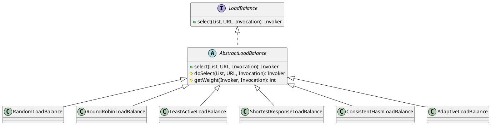

---

## 11. StateRouterFactory

Routing narrows the candidate list before load balancing sees it, and in this version the live interface is `StateRouterFactory` rather than the older `RouterFactory`, which is kept only for compatibility.

```java
@SPI
public interface StateRouterFactory {
    <T> StateRouter<T> getRouter(Class<T> interfaceClass, URL url);
}
```

Factories registered in this tree are `condition`, `tag`, `script-app`, `app`, `service`, `provider-app`, `standard-mesh-rule`, and `mock`. A router factory is not named by a call-site parameter: `RouterChain.buildSingleChain` collects them with `getActivateExtension(url, ROUTER_KEY)`, so which routers exist is decided by the URL conditions on each factory. `getRouter` is itself `@Adaptive` on the `protocol` key, which matters when a factory has several internal variants.

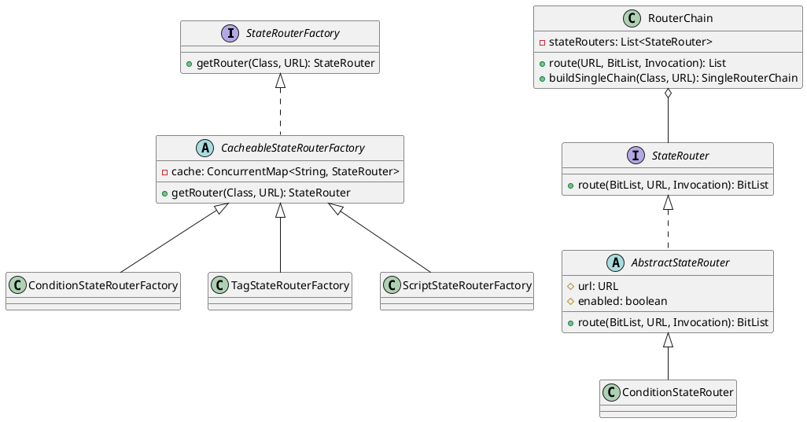

---

## 12. Filter

`Filter` is the extension with the most implementations, and the only one applied twice per call — once on the consumer side and once on the provider side.

```java
@SPI(scope = ExtensionScope.MODULE)
public interface Filter extends BaseFilter {}
```

A filter is a pair of callbacks, not a single method: `invoke` runs before the next node, and the `Listener` methods `onResponse` and `onError` run after it. Eighteen are registered in the core module, among them `echo`, `generic`, `token`, `accesslog`, `classloader`, `context`, `exception`, `timeout`, and `tps`. Selection is entirely by `@Activate`: the consumer chain takes group `consumer` filtered by the `reference.filter` parameter, the provider chain takes group `provider` filtered by `service.filter`, and order comes from the annotation's `order`. A filter therefore never appears at a call site by name.

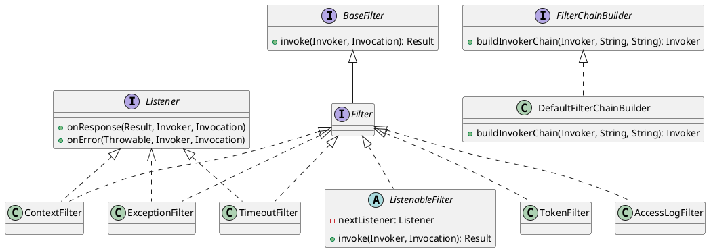

---

## 13. The registry

The registry answers one question: which provider processes are running and where do they listen. It holds no interface definitions, only an address and a revision per instance.

`NacosServiceDiscovery` extends `AbstractServiceDiscovery`, which extends `AbstractRegistry`, which `FailbackRegistry` builds on. The layering is inherited from the interface-level registry that predates application-level discovery, and it is still where the useful mechanics live: `AbstractRegistry` maintains the registered/subscribed/notified maps and a local disk cache, `FailbackRegistry` retries failed operations, and `NacosServiceDiscovery` maps Dubbo concepts onto Nacos naming.

### 13.1 The address model

At application level a Nacos service name is the application name, and one instance represents one provider process:

```java
// NacosServiceDiscovery.doRegister
Instance instance = toInstance(serviceInstance);   // ip, port, metadata = revision, storage-type, endpoints
service.registerInstance(instance.getServiceName(), group, instance);
```

The instance metadata is deliberately small. `dubbo.metadata.revision` identifies the interface definitions the process currently exports, `dubbo.metadata.storage-type` says where a consumer should resolve that revision, and `dubbo.endpoints` lists the protocol/port pairs. Nothing describes a single interface. A provider deploying five interfaces produces one registration, and adding a sixth changes the revision rather than the address list.

The registry `group` defaults to `DEFAULT_GROUP` and is overridable by `nacos.group`. Names containing `$` — nested interfaces from generated stubs — are rewritten to `___` before reaching the Nacos client, because Nacos restricts service-name characters.

### 13.2 Subscription

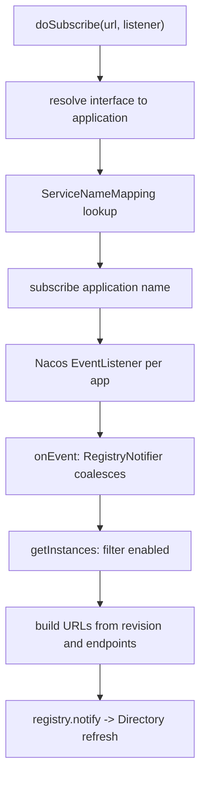

`ServiceDiscoveryRegistry.doSubscribe` first resolves the interface to a set of application names, then registers one `ServiceInstancesChangedListener` per application. `NacosServiceDiscovery.addServiceInstancesChangedListener` maps each application to a single Nacos `EventListener`, shared by every interface that application serves — so a consumer of three interfaces from one application holds one subscription, not three.

Two behaviours matter here. Instances with `enabled=false` are dropped before addresses are built. And an empty notification is not treated as a scale-to-zero: `ServiceDiscoveryRegistryDirectory` keeps the previous address list and logs it as empty protection, because an empty notification is far more often a transient Nacos fault than a real teardown.

The mapping from interface to application is not in Nacos naming. `ServiceNameMapping` maintains it (with `provided-by` on the consumer URL and a metadata-center mapping), and `ServiceDiscoveryRegistry.doSubscribe` consults the mapping before subscribing; with no mapping it stops and waits for the mapping listener, because a consumer cannot name an application it has never been told about. The Nacos client side of that model is covered in [Nacos service and configuration management](/post/java/spring-cloud/nacos/).

### 13.3 Coalescing, failure recovery, and local cache

`RegistryNotifier` bounds the cost of a flapping provider set. The first ten notifications are delivered immediately (`DEFAULT_DELAY_EXECUTE_TIMES = 10`); afterwards the notifier enforces the `delay-notification` window (default 5000 ms) and keeps only the most recent payload, comparing a timestamp so that a superseded task produces no notification. A burst of registrations at deployment time therefore yields one directory refresh instead of one per instance.

`FailbackRegistry` handles transport-level failures with a `HashedWheelTimer`. `register`, `unregister`, `subscribe`, and `unsubscribe` each catch exceptions, throw immediately when `check=true` (so a bad configuration fails fast at startup), and otherwise record a task that is retried every `retry.period` (default 5000 ms) until it succeeds. `SkipFailbackWrapperException` bypasses the retry when retrying cannot succeed.

`AbstractRegistry` persists every notified address set into a local properties file at `~/.dubbo/dubbo-registry-{application}-{registry-address}.cache`. The file is loaded into memory at construction. Its purpose is the failure path: when `doSubscribe` throws, `FailbackRegistry.subscribe` calls `getCacheUrls`, which prefers the in-memory `notified` map and falls back to the file, and if it finds entries it notifies the listener with them before logging the failure — so the consumer starts from the last known provider list rather than an empty directory. Writes are serialized through `lastCacheChanged` and written asynchronously unless `save.file=true`, and `file-cache=false` disables the mechanism entirely.

`APPLICATION_FIRST` is the consumer-side default for the migration rule. In a configuration that still publishes both levels — `register-mode=all`, the provider default for a plain `nacos://` URL — the application-level invoker is preferred and the interface-level one remains available as a fallback, which is why `RegistryProtocol.refer` returns a `MigrationInvoker` holding up to two cluster invokers and switching between them by rule:

| Step | Selection |
|------|-----------|
| `APPLICATION_FIRST` (default) | Application-level, falling back to interface-level when its address count is below the threshold; a `promotion` percentage below 100 sends only that fraction of calls to the application-level invoker |
| `FORCE_APPLICATION` | Always the application-level invoker, destroying the interface-level one |
| `FORCE_INTERFACE` | Always the interface-level invoker, the compatibility mode |

---

## 14. MetadataService

The metadata service answers the other question: what does that interface look like. It is an ordinary RPC service exported by every provider, so a consumer reaches it the same way it reaches a business service, without going through the registry again.

### 14.1 The service itself

`MetadataService` is a small fixed interface. It exposes `getMetadataInfo(revision)` and `getMetadataInfos()`, plus `getServiceDefinition(serviceKey)` for a single interface. Because it is an ordinary service, it is exported through the same `ServiceConfig` machinery as business services: `ConfigurableMetadataServiceExporter` builds a `ServiceConfig` for it with its own protocol and port (`metadata-service-protocol`, `metadata-service-port`) and exports it on startup. A consumer refers it through `MetadataUtils.referMetadataService`, which builds a URL from the coordinates in the instance metadata and calls it like any other remote service.

The definition returned is a `MetadataInfo`: the set of services the provider exports, each with its interface name, version, group, protocol, and method signatures with parameter type descriptors.

### 14.2 Resolving the revision

`dubbo.metadata.revision` is the link back to the interface definitions. It is a digest computed by `MetadataInfo.calRevision` over the application name and the description of every exported service, so it changes whenever the set or shape of those services changes. A consumer reads the revision from the instance and resolves it via the provider's `MetadataService`. `AbstractServiceDiscovery.getRemoteMetadata` performs that resolution behind a revision-keyed cache, retrying three times with a one-second pause before giving up with an empty `MetadataInfo`. The cache is what keeps the per-revision fetch off the steady-state path.


---

## References

- [Apache Dubbo source repository](https://github.com/apache/dubbo)
- [Apache Dubbo documentation](https://dubbo.apache.org/)
- [Nacos naming service](https://nacos.io/docs/latest/guide/user/open-api/)
- [Hessian 2 serialization specification](http://hessian.caucho.com/doc/hessian-serialization.html)
