Dubbo is an RPC framework. A service is defined as an ordinary interface, implemented in a provider process, and called from a consumer process as though it were a local object, with a registry telling the consumer where the provider is and a metadata service telling it what that interface looks like. Dubbo has implementations in Go, Python, PHP, Erlang, Rust, and Node.js, and this post covers the Java one.

<!--more-->

---

## 1. Overview

As an RPC framework, Dubbo organises a cluster into four roles.

- A **provider** hosts the implementation. It declares which interfaces it serves and listens on a port to answer calls.
- A **consumer** calls those interfaces as if they were local. It keeps a local list of provider addresses and picks one per call.
- A **registry** holds addresses only. It knows which provider processes exist and tells each consumer when that list changes. It does not store interface definitions.
- A **metadata service** holds the definitions. Every provider exports one alongside its business services; a consumer asks it what an interface looks like — methods, parameter types, method-level settings — for a given revision.

The split between the last two is the change newer Dubbo made. Older versions stored everything about each interface in the registry, so the registry was large and any change meant rewriting a registration. From Dubbo 3 the definitions moved out to the metadata service, and the registry keeps only addresses plus a revision that points at the right definition. Adding an interface now changes that revision instead of churning every consumer's address list.

The loop is short: provider registers, consumer subscribes, consumer receives addresses, consumer calls the provider directly. The registry is not in the call path, and the metadata service is consulted once per revision and then cached.

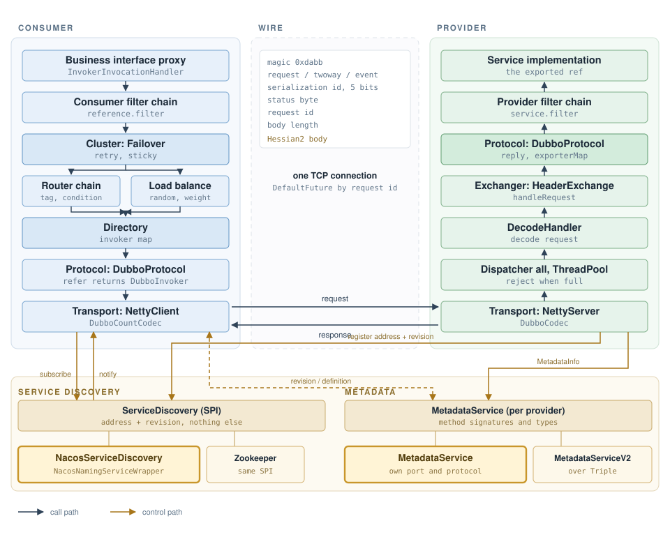

### A minimal example

One shared interface module, so both sides compile against the same type:

```java
public interface GreetingService {
    String greet(String name);
}
```

The provider implements it and exports the interface. The annotation is enough; the same result is available from XML or from the programmatic API.

```java
@DubboService
public class GreetingServiceImpl implements GreetingService {
    public String greet(String name) {
        return "hello, " + name;
    }
}
```

```yaml
dubbo:
  application:
    name: greeting-provider
  registry:
    address: nacos://127.0.0.1:8848
```

The consumer declares a field of the interface type and marks it for injection. It never constructs the implementation and never opens a socket.

```java
@DubboReference
private GreetingService greetingService;

String reply = greetingService.greet("dubbo");
```

Three things happen behind that call. At startup the provider exported `GreetingService` and registered its address and revision with Nacos; the consumer subscribed to the provider's application and got the address list back; and the call itself went from the injected proxy over a TCP connection to the provider's port, where the implementation ran. The interface object the consumer holds is a proxy generated at startup, which is why a call looks like a local method call.

---

## 2. Extension architecture

Dubbo is structured around a microkernel and plugin design pattern. The framework core defines contracts as Service Provider Interfaces (SPIs) — `Protocol`, `Exchanger`, `Transporter`, `Codec2`, `Serialization`, `ThreadPool`, `LoadBalance`, `StateRouterFactory`, and `Filter` — and contains no hard-coded dependency on any concrete transport, serializer, or cluster strategy. Unlike `java.util.ServiceLoader`, which instantiates every declared provider eagerly from a flat list, Dubbo's SPI combines five design patterns into a single container:

- **Name-indexed lazy loading**: implementations are declared as `name=class` pairs in resource files and loaded only when that name is requested.
- **URL-driven late binding (Adaptive Proxy)**: every remote call is described by a `URL` carrying configuration parameters (`protocol=dubbo`, `transporter=netty`, `serialization=hessian2`, `loadbalance=random`). Because collaborators are wired at startup before any service `URL` exists, the container supplies a generated *adaptive* proxy that defers implementation lookup to call time by reading the parameter from the invocation's `URL`.
- **Decorator composition (Wrapper)**: cross-cutting concerns such as filter chains, listener hooks, and reference counting are implemented as wrapper classes around the SPI interface and stacked automatically around every concrete instance.
- **Rule-based chain assembly (Activation)**: ordered pipelines such as `Filter` and `StateRouterFactory` are selected as a group when `@Activate` predicates match the `URL`, rather than looked up one name at a time.
- **Scoped IoC and lifecycle**: extensions live inside a three-tier hierarchy (`FrameworkModel` -> `ApplicationModel` -> `ModuleModel`) and receive collaborator SPIs through setter injection of adaptive instances.

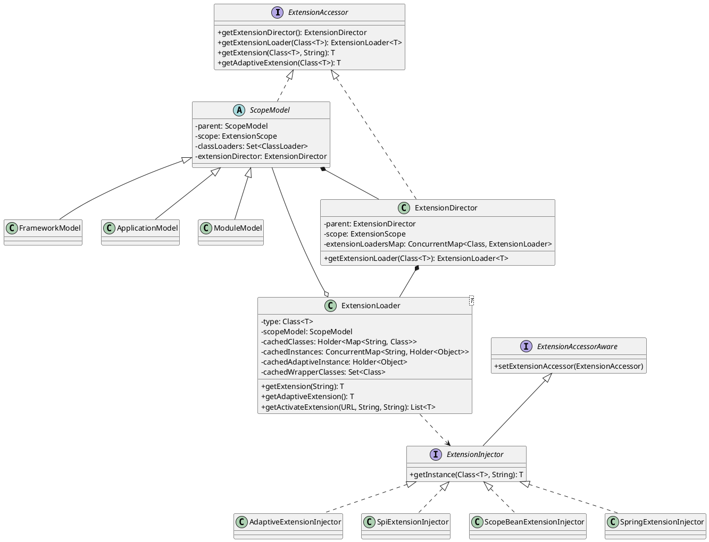

Both `ScopeModel` and `ExtensionDirector` implement `ExtensionAccessor`, exposing a uniform entry point (`getExtensionLoader`, `getExtension`, `getAdaptiveExtension`) at every tier of the container.

```java
public interface ExtensionAccessor {
    ExtensionDirector getExtensionDirector();

    default <T> ExtensionLoader<T> getExtensionLoader(Class<T> type) {
        return getExtensionDirector().getExtensionLoader(type);
    }

    default <T> T getExtension(Class<T> type, String name) {
        ExtensionLoader<T> extensionLoader = getExtensionLoader(type);
        return extensionLoader != null ? extensionLoader.getExtension(name) : null;
    }

    default <T> T getAdaptiveExtension(Class<T> type) {
        ExtensionLoader<T> extensionLoader = getExtensionLoader(type);
        return extensionLoader != null ? extensionLoader.getAdaptiveExtension() : null;
    }
}
```

An extension point is declared by annotating an interface with `@SPI`, whose `value` sets the default implementation name and whose `scope` sets instance visibility (`APPLICATION` when omitted):

```java
@Documented
@Retention(RetentionPolicy.RUNTIME)
@Target({ElementType.TYPE})
public @interface SPI {
    String value() default "";
    ExtensionScope scope() default ExtensionScope.APPLICATION;
}
```

The `ExtensionScope` controls which `ScopeModel` owns the `ExtensionLoader` and what state an instance may reach. `FRAMEWORK`-scoped extensions (`Protocol`, `Serialization`) share one loader on the root `FrameworkModel` across the JVM; `APPLICATION`-scoped extensions (`RegistryFactory`) isolate state per application while sharing across its modules; `MODULE`-scoped extensions (`Filter`) instantiate per module; and `SELF` creates a dedicated instance per owner. `ExtensionDirector.getExtensionLoader` enforces these boundaries by resolving in three steps:

```java
ExtensionLoader<T> loader = extensionLoadersMap.get(type);   // 1. local cache
if (loader == null && scope == ExtensionScope.SELF) {
    loader = createExtensionLoader0(type);                    //    SELF never inherits
}
if (loader == null && this.parent != null) {
    loader = this.parent.getExtensionLoader(type);            // 2. delegate to parent scope
}
if (loader == null) {
    loader = createExtensionLoader(type);                     // 3. create at owning scope
}
```

Each `ExtensionLoader<T>` discovers implementations by scanning three classpath directories in order of decreasing priority:

- `META-INF/dubbo/internal/`: framework built-ins.
- `META-INF/dubbo/`: user or third-party extensions, permitted to override lower-priority entries.
- `META-INF/services/`: `ServiceLoader` compatibility.

Each file is named after the fully qualified interface and contains `name=class` lines, such as `dubbo=org.apache.dubbo.rpc.protocol.dubbo.DubboProtocol`. While reading the file, the loader classifies each class without instantiating it: a class annotated `@Adaptive` becomes the single `cachedAdaptiveClass`; a class whose constructor takes the SPI interface itself goes into `cachedWrapperClasses`; all remaining classes are indexed by name as ordinary implementations, with any `@Activate` metadata recorded alongside them. Duplicate names within the same priority tier fail at startup.

```java
private void loadClass(..., Map<String, Class<?>> extensionClasses, ..., Class<?> clazz, String name, boolean overridden) {
    if (clazz.isAnnotationPresent(Adaptive.class)) {
        cacheAdaptiveClass(clazz, overridden);         // -> cachedAdaptiveClass
    } else if (isWrapperClass(clazz)) {
        cacheWrapperClass(clazz);                      // -> cachedWrapperClasses
    } else {
        String[] names = NAME_SEPARATOR.split(name);
        cacheActivateClass(clazz, names[0]);           // -> cachedActivates
        for (String n : names) {
            cacheName(clazz, n);
            saveInExtensionClass(extensionClasses, clazz, n, overridden); // -> cachedClasses
        }
    }
}
```

Calling `getAdaptiveExtension()` returns an instance of `cachedAdaptiveClass` if one is hand-written, or generates `<Interface>$Adaptive` via `AdaptiveClassCodeGenerator` and compiles it at runtime through the `Compiler` SPI (cached once per loader in a `Holder`):

```java
public class Protocol$Adaptive implements Protocol {
    public Exporter export(Invoker arg0) {
        URL url = arg0.getUrl();                       // URL extracted from argument
        String extName = (url.getProtocol() == null ? "dubbo" : url.getProtocol());
        Protocol extension = (Protocol) ScopeModelUtil
                .getOrDefault(url.getScopeModel(), Protocol.class)
                .getExtensionLoader(Protocol.class)
                .getExtension(extName);
        return extension.export(arg0);
    }
}
```

The parameter key read from the `URL` comes from `@Adaptive({"key1", "key2"})`, or, when omitted, from splitting the interface's camel-case name with dots (`YyyInvokerWrapper` -> `yyy.invoker.wrapper`). When the method signature includes `Invocation`, lookup goes through `url.getMethodParameter(methodName, key, defaultValue)` so method-level configuration overrides service-level settings (as `LoadBalance` does for `@Adaptive("loadbalance")`). `Protocol` is a special case whose derived key `protocol` reads `url.getProtocol()` directly rather than a query parameter. Methods without `@Adaptive` throw `UnsupportedOperationException` on the generated proxy.

When a concrete name is finally resolved through `getExtension(name)`, `createExtension` runs a fixed instantiation pipeline. First, it constructs the target class. Second, `injectExtension` iterates over public setters: for non-primitive parameters not marked `@DisableInject`, it queries `AdaptiveExtensionInjector` — which delegates across `SpiExtensionInjector`, `ScopeBeanExtensionInjector`, and `SpringExtensionInjector` — and passes the collaborator's adaptive instance (for example, injecting `ProxyFactory$Adaptive` into `AbstractProxyProtocol.setProxyFactory`); unresolved setters are skipped so optional dependencies require no special wiring, and `ScopeModelAware` / `ExtensionAccessorAware` callbacks supply the owning scope. Third, every matching class in `cachedWrapperClasses` (filtered by `@Wrapper(matches, mismatches, order)` and sorted by `WrapperComparator`) wraps the instance in turn, with setter injection repeated on each wrapper layer. Fourth, `initExtension` invokes `Lifecycle.initialize()` on the outermost object. For multi-element pipelines rather than single named targets, `getActivateExtension(url, key, group)` evaluates `@Activate(group, value, before, after, order)` against the `URL` and merges explicit additions or removals from the `URL` parameter named by `key` (`service.filter` on `provider`, `reference.filter` on `consumer`).

```java
public T getExtension(String name, boolean wrap) {
    if ("true".equals(name)) {
        return getDefaultExtension();
    }
    String cacheKey = wrap ? name : name + "_origin";
    final Holder<Object> holder = getOrCreateHolder(cacheKey);
    Object instance = holder.get();
    if (instance == null) {
        synchronized (holder) {
            instance = holder.get();
            if (instance == null) {
                instance = createExtension(name, wrap);
                holder.set(instance);
            }
        }
    }
    return (T) instance;
}

private T createExtension(String name, boolean wrap) {
    Class<?> clazz = getExtensionClasses().get(name);
    T instance = (T) extensionInstances.get(clazz);
    if (instance == null) {
        extensionInstances.putIfAbsent(clazz, createExtensionInstance(clazz));
        instance = (T) extensionInstances.get(clazz);
        instance = postProcessBeforeInitialization(instance, name);
        injectExtension(instance);
        instance = postProcessAfterInitialization(instance, name);
    }

    if (wrap && cachedWrapperClasses != null) {
        List<Class<?>> wrapperClassesList = new ArrayList<>(cachedWrapperClasses);
        wrapperClassesList.sort(WrapperComparator.COMPARATOR);
        Collections.reverse(wrapperClassesList);
        for (Class<?> wrapperClass : wrapperClassesList) {
            if (matchesWrapper(wrapperClass, name)) {
                instance = (T) wrapperClass.getConstructor(type).newInstance(instance);
                instance = postProcessBeforeInitialization(instance, name);
                injectExtension(instance);
                instance = postProcessAfterInitialization(instance, name);
            }
        }
    }
    initExtension(instance);
    return instance;
}

private T injectExtension(T instance) {
    for (Method method : instance.getClass().getMethods()) {
        if (!isSetter(method) || method.isAnnotationPresent(DisableInject.class)) {
            continue;
        }
        Class<?> pt = method.getParameterTypes()[0];
        if (ReflectUtils.isPrimitives(pt)) {
            continue;
        }
        String property = getSetterProperty(method);
        Object object = injector.getInstance(pt, property);
        if (object != null) {
            method.invoke(instance, object);
        }
    }
    return instance;
}
```

### 2.1 Protocol

`Protocol` is the outermost extension and the one that defines the other two verbs of the framework: `export` turns an invoker into something reachable, `refer` turns a URL into an invoker that can call a remote service. Its default is `dubbo`; `tri`, `grpc`, and `rest2` are alternatives registered beside it.

```java
@SPI(value = "dubbo", scope = ExtensionScope.FRAMEWORK)
public interface Protocol {
    @Adaptive <T> Exporter<T> export(Invoker<T> invoker) throws RpcException;
    @Adaptive <T> Invoker<T> refer(Class<T> type, URL url) throws RpcException;
    int getDefaultPort();
}
```

Both methods are `@Adaptive`, so the extension name is read from `url.getProtocol()`. One `protocolSPI` reference therefore serves both a `registry://` URL and a `dubbo://` URL: the first dispatches to `RegistryProtocol`, which wraps a registry and delegates the export, the second to `DubboProtocol`, which owns the socket.

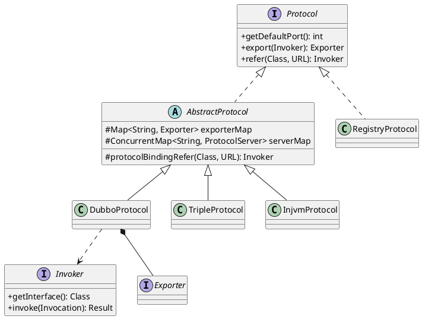

`Protocol` is also the interface that carries the most wrappers. `ProtocolFilterWrapper` inserts the filter chain, `ProtocolListenerWrapper` adds exporter and invoker listeners, `ProtocolSerializationWrapper` installs the serializer allow-list, and `InvokerCountWrapper` maintains reference counts. Because these are wrappers rather than implementations, `DubboProtocol` contains none of that logic.

### 2.2 Exchanger

`Exchanger` sits between the protocol and the transport, and it is where request/response semantics enter. The transport moves bytes and knows nothing about correlation; the exchanger adds request identity, two-way versus one-way, event frames, and futures.

```java
@SPI(value = HeaderExchanger.NAME, scope = ExtensionScope.FRAMEWORK)
public interface Exchanger {
    @Adaptive ExchangeServer bind(URL url, ExchangeHandler handler);
    @Adaptive ExchangeClient connect(URL url, ExchangeHandler handler);
}
```

`HeaderExchanger` is the only implementation. `bind` wraps the handler as `HeaderExchangeHandler` inside the transport's server, `connect` wraps the channel as `HeaderExchangeClient`. `HeaderExchangeHandler.handleResponse` routes a `Response` to `DefaultFuture.received`, the single point where a waiting call is completed, and `HeaderExchangeClient` owns the heartbeat and reconnect timers.

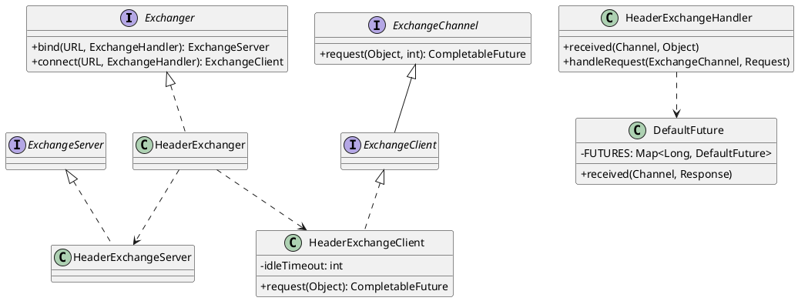

### 2.3 Transporter

`Transporter` is the network implementation: it opens server sockets and client connections. The name is chosen by `server` for binding and `client` for connecting, both falling back to `transporter`, with `netty` as the default.

```java
@SPI(value = "netty", scope = ExtensionScope.FRAMEWORK)
public interface Transporter {
    @Adaptive({SERVER_KEY, TRANSPORTER_KEY}) RemotingServer bind(URL url, ChannelHandler handler);
    @Adaptive({CLIENT_KEY, TRANSPORTER_KEY}) Client connect(URL url, ChannelHandler handler);
}
```

`NettyTransporter` returns a `NettyServer` or a `NettyClient`; the state and behaviour live in `AbstractServer`/`AbstractClient`, which handle bind retry, port detection, channel bookkeeping, and the connection listener set, while the subclass builds only the Netty `ServerBootstrap`. The SPI name `netty` maps to the Netty 4 module; the Netty 3 module registers as `netty3`.

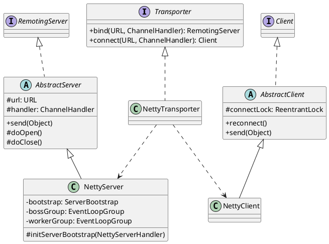

### 2.4 Codec2

`Codec2` converts between a `ChannelBuffer` and a message object. It is a separate extension from the protocol so that the framing can be reused: the `dubbo` protocol's codec also serves the telnet path through inheritance.

```java
@SPI(scope = ExtensionScope.FRAMEWORK)
public interface Codec2 {
    @Adaptive({CODEC_KEY}) void encode(Channel channel, ChannelBuffer buffer, Object message) throws IOException;
    @Adaptive({CODEC_KEY}) Object decode(Channel channel, ChannelBuffer buffer) throws IOException;
    enum DecodeResult { NEED_MORE_INPUT, SKIP_SOME_INPUT }
}
```

The adaptive key is `codec`, but the transport does not require it: `AbstractEndpoint.getChannelCodec` falls back to the protocol name when the parameter is absent, which is how `dubbo://` resolves `DubboCountCodec` with no configuration. `decode` returning `NEED_MORE_INPUT` is the contract that lets a partial frame stay in the buffer instead of being parsed twice.

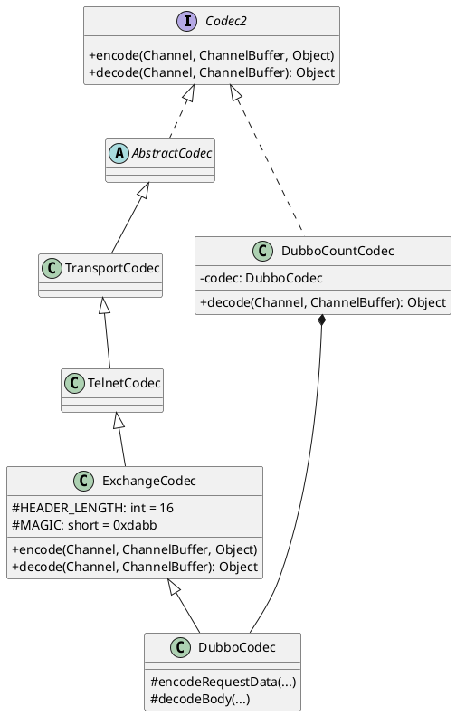

### 2.5 Serialization

`Serialization` is the body format, and it is the one extension chosen per request rather than per connection. Its two methods return stream wrappers rather than byte arrays, so a large argument can be written without materialising it.

```java
@SPI(scope = ExtensionScope.FRAMEWORK)
public interface Serialization {
    byte getContentTypeId();
    String getContentType();
    @Adaptive ObjectOutput serialize(URL url, OutputStream output) throws IOException;
    @Adaptive ObjectInput deserialize(URL url, InputStream input) throws IOException;
}
```

`getContentTypeId` is constrained to five bits because the `dubbo` header stores it there. The implementations registered in this tree are `hessian2` and `fastjson2`; others exist in separate modules, and `DefaultSerializationExceptionWrapper` wraps whichever is selected to normalise exception handling. Selection order is `prefer.serialization`, then `serialization`, then the framework default.

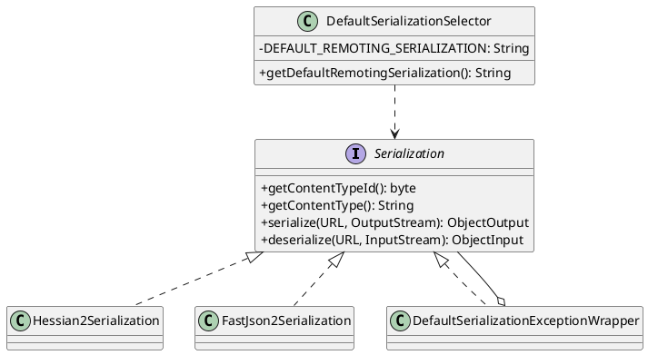

### 2.6 ThreadPool

`ThreadPool` decides how a decoded request reaches business code. Its single method returns a `java.util.concurrent.Executor` configured from the URL.

```java
@SPI(value = "fixed", scope = ExtensionScope.FRAMEWORK)
public interface ThreadPool {
    @Adaptive({THREADPOOL_KEY}) Executor getExecutor(URL url);
}
```

Four implementations differ only in the queue and the sizing: `fixed` uses a fixed worker count with a `SynchronousQueue` by default, `cached` allows growth and idle reclamation, `limited` grows to a maximum and then queues, and `eager` hands work to a new thread before queuing. All four share `AbortPolicyWithReport` as the rejection handler, which is what produces the `SERVER_THREADPOOL_EXHAUSTED_ERROR` response instead of a silent drop. The pool is owned by `DefaultExecutorRepository`, not by the protocol, so one executor serves every service on a port.

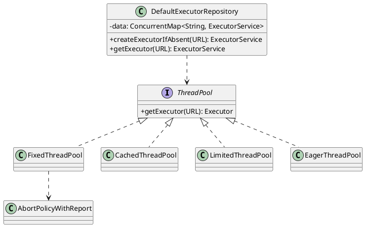

### 2.7 LoadBalance

`LoadBalance` picks one invoker from the candidates routing left behind.

```java
@SPI(RandomLoadBalance.NAME)
public interface LoadBalance {
    @Adaptive("loadbalance") <T> Invoker<T> select(List<Invoker<T>> invokers, URL url, Invocation invocation);
}
```

Six implementations: `random`, `roundrobin`, `leastactive`, `shortestresponse`, `consistenthash`, and `adaptive`. All six extend `AbstractLoadBalance`, which supplies the weight calculation including the warm-up ramp. The method-level key means a single service can use different strategies per method, and the lookup happens per call rather than at refer time.

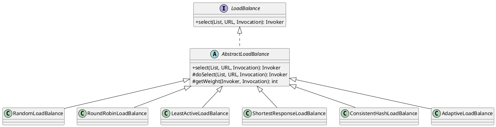

### 2.8 StateRouterFactory

Routing narrows the candidate list before load balancing sees it, and in this version the live interface is `StateRouterFactory` rather than the older `RouterFactory`, which is kept only for compatibility.

```java
@SPI
public interface StateRouterFactory {
    <T> StateRouter<T> getRouter(Class<T> interfaceClass, URL url);
}
```

Factories registered in this tree are `condition`, `tag`, `script-app`, `app`, `service`, `provider-app`, `standard-mesh-rule`, and `mock`. A router factory is not named by a call-site parameter: `RouterChain.buildSingleChain` collects them with `getActivateExtension(url, ROUTER_KEY)`, so which routers exist is decided by the URL conditions on each factory. `getRouter` is itself `@Adaptive` on the `protocol` key, which matters when a factory has several internal variants.

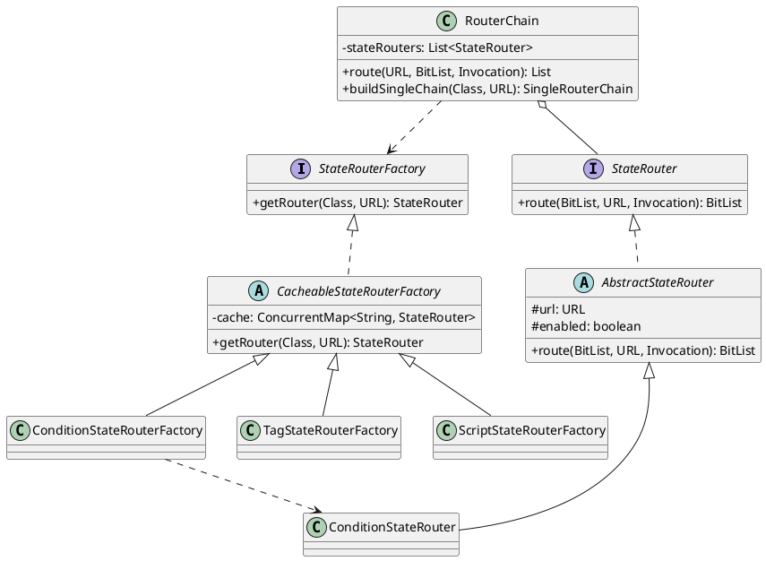

### 2.9 Filter

`Filter` is the extension with the most implementations, and the only one applied twice per call — once on the consumer side and once on the provider side.

```java
@SPI(scope = ExtensionScope.MODULE)
public interface Filter extends BaseFilter {}
```

A filter is a pair of callbacks, not a single method: `invoke` runs before the next node, and the `Listener` methods `onResponse` and `onError` run after it. Eighteen are registered in the core module, among them `echo`, `generic`, `token`, `accesslog`, `classloader`, `context`, `exception`, `timeout`, and `tps`. Selection is entirely by `@Activate`: the consumer chain takes group `consumer` filtered by the `reference.filter` parameter, the provider chain takes group `provider` filtered by `service.filter`, and order comes from the annotation's `order`. A filter therefore never appears at a call site by name.

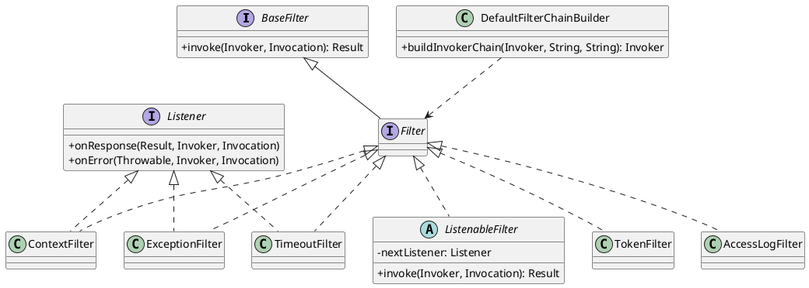

---

## 3. RPC implementation

A call has to be described before it can be made, and Dubbo describes it with a `URL`. Not merely an address: the URL carries the interface, the version and group, the timeout, the serializer, the thread pool, and the load balancer, so one flat string is enough to configure an invocation.

```text
dubbo://10.0.0.7:20880/org.apache.dubbo.GreetingService
  ?interface=org.apache.dubbo.GreetingService
  &version=1.0.0
  &group=blue
  &timeout=3000
  &serialization=hessian2
  &threadpool=limited
  &loadbalance=random
```

Parameters may be method-specific. `getMethodParameter(method, "timeout", 1000)` first looks for `methodName.timeout`, then `timeout`, then returns the default, which is how one service can carry per-method timeouts and retries in a single flat URL.

Both ends of a call reduce every interface to the same small set of types. The figure shows how they relate; the sections that follow take each in turn.

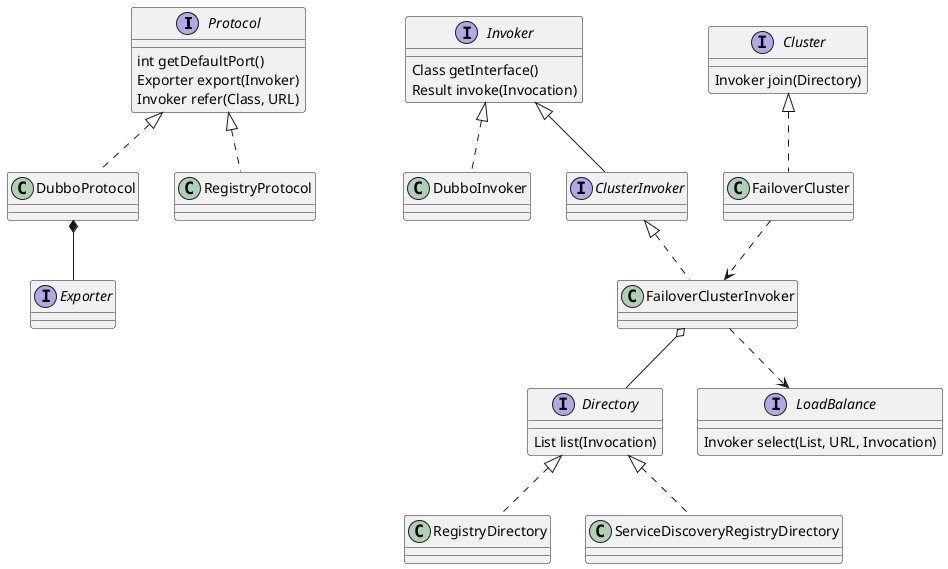

### 3.1 Export: the provider runtime

Export begins in `ServiceConfig`, which builds one URL per protocol configuration and per registry, then hands the URL to the configured proxy factory and to the adaptive `Protocol`.

```java
Invoker<?> invoker = proxyFactory.getInvoker(ref, interfaceClass, url);
Exporter<?> exporter = protocolSPI.export(invoker);
```

`proxyFactory` is `JavassistProxyFactory` by default. `getInvoker` does not use reflection: it obtains a generated `Wrapper` for the service class and produces an `AbstractProxyInvoker` whose `doInvoke` calls the generated `invokeMethod` with the argument array. The provider-side invocation therefore costs a virtual dispatch plus generated argument casting, not `Method.invoke`.

The URL passed to `export` is a `registry://...` URL, so the adaptive dispatch reaches `RegistryProtocol.export`. That method performs three distinct actions, in order:

1. `doLocalExport` exports the service through the real protocol (`dubbo://...`), producing the local exporter that owns the server socket.
2. `registry.register(...)` publishes the record: a service instance under application-level discovery, or a provider URL under the interface-level compatibility mode.
3. For the interface-level mode only, it subscribes to `configurators` override rules for the provider URL, so a later configuration change re-exports the service with new parameters. The application-level path handles configuration through the revision instead.

Local export descends through the protocol wrappers and reaches `DubboProtocol.export`:

```java
String key = serviceKey(url);                       // group/path:version:port
DubboExporter<T> exporter = new DubboExporter<>(invoker, key, exporterMap);
openServer(url);
```

`openServer` keeps one server per `host:port` in `serverMap`, so all services sharing a port share a single Netty server; `server.reset(url)` applies URL changes to the existing server. `createServer` binds through `Exchangers.bind(url, requestHandler)`, which resolves the `Exchanger` SPI (`header` by default), whose `HeaderExchanger.bind` wraps the handler as `DecodeHandler(HeaderExchangeHandler(handler))` and delegates to `Transporters.bind` — `NettyServer` with the `DubboCountCodec` on the pipeline. The `EventLoop` and `ChannelPipeline` mechanics underneath are those of [Netty](/post/java/netty/); Dubbo adds one codec and one handler chain on top of a standard bootstrap.

The `exporterMap` key is what the provider uses to route an incoming request. `AbstractProtocol.serviceKey` composes `group/path:version:port`, with the port included so two services with the same interface on different ports do not collide.

### 3.2 Provider-side dispatch and threading

An arriving frame is decoded on the Netty I/O thread into a `Request` whose payload is a `DecodeableRpcInvocation`; the argument bytes are not yet deserialized. The handler chain installed by `ChannelHandlers.wrap` is:

```text
MultiMessageHandler -> HeartbeatHandler -> Dispatcher(all) -> DecodeHandler -> HeaderExchangeHandler
```

`AllChannelHandler.received` submits a `ChannelEventRunnable` to the business thread pool, so `DecodeHandler` — and therefore argument deserialization — runs on a business thread, not on the event loop. `decode.in.io.thread=false` is the default and exists to keep long deserialization off the I/O threads.

`HeaderExchangeHandler.handleRequest` then calls the `ExchangeHandler.reply` implemented inside `DubboProtocol`:

```java
Invocation inv = (Invocation) message;
Invoker<?> invoker = inv.getInvoker() == null ? getInvoker(channel, inv) : inv.getInvoker();
RpcContext.getServiceContext().setRemoteAddress(channel.getRemoteAddress());
Result result = invoker.invoke(inv);
return result.thenApply(Function.identity());
```

`getInvoker` extracts `path`, `version`, and `group` from the invocation attachments, rebuilds the service key with the local port, and looks it up in `exporterMap`. A miss produces a `RemotingException` naming the key and the channel pair, which the caller observes as a "not found exported service" error rather than a timeout. On a hit the invocation is stamped with the provider's `ServiceModel`, which is what lets the subsequent filter chain and the generated wrapper resolve methods and switch the context class loader.

The reply is completed asynchronously: `HeaderExchangeHandler` attaches a completion stage that writes a `Response` with status `OK` on success, or status `70` (`SERVICE_ERROR`) with the exception text. Because the `Result` may complete on a different thread than the one that received the request, the response write is not tied to the business thread that ran the service method.

The thread pool itself is the `ThreadPool` extension selected by the `threadpool` parameter. Its SPI default is `fixed`, which is also what a provider gets when nothing is configured: `threads` (default `200`) fixed-size workers, `SynchronousQueue` when `queues=0` (the default), and `AbortPolicyWithReport` as the rejection handler. `cached` is the default for *client* URLs, because a consumer's executor services replies and callbacks rather than business methods; `limited` and `eager` are also available. Saturation is not silent: the rejection policy throws, and `AllChannelHandler.sendFeedback` converts that into a `Response` with status `100` (`SERVER_THREADPOOL_EXHAUSTED_ERROR`) for two-way requests, so the consumer receives an immediate server-side rejection instead of waiting for its timeout.

### 3.3 Shutdown

`DubboProtocol` participates in `DubboGracefulShutdown`. The server sends a read-only event to every connected channel; the consumer's `HeaderExchangeHandler` records the event on the channel and marks the corresponding client unavailable, so the directory stops selecting new invocations toward it while in-flight requests complete. The server then waits for the configured shutdown timeout before closing.

### 3.4 Refer: the consumer side

`ReferenceConfig` builds the consumer URL, then calls the adaptive protocol with the registry URL:

```java
invoker = protocolSPI.refer(interfaceClass, registryUrl);
return (T) proxyFactory.getProxy(invoker, ProtocolUtils.isGeneric(generic));
```

Dispatch reaches `RegistryProtocol.refer`, which resolves the registry (the `registry://` wrapper is unwrapped by `InterfaceCompatibleRegistryProtocol.getRegistryUrl`, turning `registry://host:port?registry=nacos` into `nacos://host:port`), builds a consumer URL, and creates the migration invoker. The application-level cluster invoker is produced by `cluster.join(directory, true)` over a `ServiceDiscoveryRegistryDirectory`, which subscribes to the application names the interface maps to:

```java
directory.setRegisteredConsumerUrl(urlToRegistry);
if (directory.isShouldRegister()) {
    registry.register(directory.getRegisteredConsumerUrl());
}
directory.buildRouterChain(urlToRegistry);
directory.subscribe(toSubscribeUrl(urlToRegistry));
```

The subscription carries only address and revision information, because that is all the registry holds; the interface definitions arrive separately through `MetadataService` and are attached to each `InstanceAddressURL` before the invoker is built.

The final object returned to the application is a JDK dynamic proxy (`JdkProxyFactory`) or a generated one (`JavassistProxyFactory`, the default, which falls back to JDK proxies when code generation fails). Both attach an `InvokerInvocationHandler`:

```java
RpcInvocation rpcInvocation = new RpcInvocation(serviceModel, method.getName(),
        invoker.getInterface().getName(), protocolServiceKey,
        method.getParameterTypes(), args);
return InvocationUtil.invoke(invoker, rpcInvocation);
```

`InvocationUtil.invoke` stores the consumer URL in `RpcContext`, calls `invoker.invoke(rpcInvocation)`, and converts the `Result` back to a return value with `recreate()`, which rethrows the provider's exception on the caller thread. `toString`, `hashCode`, `equals`, and `$destroy` are intercepted before this point so they never reach the network.

### 3.5 Directory refresh

`ServiceDiscoveryRegistryDirectory.notify` is the boundary between registry data and invokers.

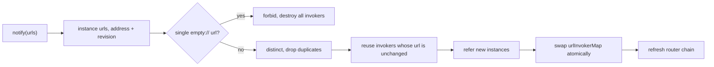

Conversion is incremental. Provider URLs already present in the previous map with unchanged parameters are reused, so a notification that adds one instance does not rebuild every client connection. URLs that disappeared are destroyed. The map swap is a single volatile write, and `list(invocation)` reads under a read lock into a clone before applying routers, so an in-flight call never observes a half-built map.

The `empty://` protocol is the explicit "no providers" signal: a single such URL sets the directory to forbidden and destroys all invokers, so callers fail immediately with "no provider available". An ordinary empty list is not treated as the same event — the directory keeps the previous addresses and logs it as empty protection, because an empty notification is far more often a transient registry or network fault than a real scale-to-zero.

### 3.6 Cluster invocation

`Cluster` is also an SPI, default `failover`. `FailoverClusterInvoker.doInvoke` is the default execution strategy:

```java
int len = calculateInvokeTimes(methodName);        // retries + 1, default 3 attempts
for (int i = 0; i < len; i++) {
    if (i > 0) { copyInvokers = list(invocation); checkInvokers(copyInvokers, invocation); }
    Invoker<T> invoker = select(loadbalance, invocation, copyInvokers, invoked);
    invoked.add(invoker);
    try {
        return invokeWithContext(invoker, invocation);
    } catch (RpcException e) {
        if (e.isBiz()) throw e;                    // business exception: never retried
        le = e;
    }
}
```

Three properties follow from this loop. The candidate list is re-fetched before each retry, so a retry can use a provider registered after the first failure. The `invoked` list is passed to `select`, which reselects when the load balancer returns an address already tried in this call. Business exceptions are rethrown immediately — retrying a method that already executed would duplicate its side effects, which is why only framework-level `RpcException`s are failover-eligible.

`select` adds two refinements on top of the load balancer. With `sticky=true` it reuses the last successful invoker for the same method while it remains available. And `doSelect` invalidates an invoker found unavailable (`availablecheck`, default true) so that subsequent calls skip it until the transport recovers.

Load balancing is `random` by default, weighted: weights are read from each provider URL (`weight`, default 100) and scaled down during the first ten minutes of a provider's life (`warmup`), so a freshly started instance does not receive its full share while its JIT is still cold. The weighted selection uses a cumulative prefix array with binary search for more than four candidates, and falls back to uniform selection when all weights are equal. `roundrobin`, `leastactive`, `shortestresponse`, `consistenthash`, and `adaptive` are available by name.

Filters bracket the whole consumer call. `ProtocolFilterWrapper.refer` builds the consumer chain from the `reference.filter` `@Activate` extensions, and `AbstractCluster.join` additionally wraps the cluster invoker in the `ClusterFilter` chain selected by the same key with group `consumer`. `ConsumerContextFilter` (order `Integer.MIN_VALUE`) propagates attachments to the provider and `RouterSnapshotFilter` records the routing decision for diagnostics. The provider chain is assembled the same way from `service.filter` with group `provider`: `ContextFilter` restores incoming attachments into the server-side `RpcContext`, `ExceptionFilter` decides how an exception is wrapped before it becomes a `Response`, and `TimeoutFilter` logs a warning when the `TIME_COUNTDOWN` attachment shows the caller's budget already expired while the method was running.


### 3.7 Frame layout

The protocol layer on both sides reduces to one frame format. `ExchangeCodec` fixes a 16-byte header for both directions, followed by a serialized body.

| Offset | Size | Content |
|--------|------|---------|
| 0 | 2 | Magic `0xdabb` |
| 2 | 1 | Bit 7: request; bit 6: two-way; bit 5: event; bits 0–4: serialization id |
| 3 | 1 | Status, meaningful in responses only |
| 4 | 8 | Request id |
| 12 | 4 | Body length |
| 16 | var | Serialized body |

The request flag in bit 7 and the serialization id in the low five bits of byte 2 give a reader everything needed to classify the frame and pick a body codec before any deserialization. A request sets bit 7; a response leaves it clear and fills byte 3 with a status code. The status byte is present but ignored in requests, so the fixed layout is symmetric and cheap to parse. Responses carry `20` (`OK`), `30` (`CLIENT_TIMEOUT`), `35` (`CHANNEL_INACTIVE`), `40` (`BAD_REQUEST`), `50` (`BAD_RESPONSE`), `60` (`SERVICE_NOT_FOUND`), `70` (`SERVICE_ERROR`), `90` (`CLIENT_ERROR`), or `100` (`SERVER_THREADPOOL_EXHAUSTED_ERROR`).

Requests are encoded by `DubboCodec.encodeRequestData`, which writes a fixed sequence into the serialized stream:

```text
protocol version (UTF) | service name (UTF) | service version (UTF) |
method name (UTF) | parameter type descriptor (UTF) | arguments | attachments
```

The service name is taken from the `interface` attachment with the `path` attachment as fallback. The parameter descriptor is a JVM type descriptor string (`Ljava/lang/String;IZ`) rather than a serialized `Class[]`; the provider resolves the `Method` from its own service model, so a consumer compiled against the same interface can invoke it without transmitting class metadata. Attachments (trace ids, timeouts, tags) travel in the same body, so the invocation context is carried by the protocol rather than by a side channel.

Responses are typed by a leading byte: value, null, exception, and each with attachments. Attachments on the response are omitted for peers older than protocol version 2.0.2, detected by parsing the version string from the request.

`DubboCountCodec` decodes in a loop, accumulating messages until the buffer is exhausted or decoding returns `NEED_MORE_INPUT`, rewinding the reader index in the latter case. A single `decode` call therefore yields one `MultiMessage` holding every complete frame in the buffer, and `MultiMessageHandler` at the head of the handler chain dispatches each element in turn, isolating a failure in one message from the rest of the batch. One TCP read carrying several small requests costs one decode call, not one per read event.

Payload size is enforced by `checkPayload` against the `payload` parameter, default 8 MiB, on both encode and decode. Exceeding it on the response path is converted into a `BAD_RESPONSE` frame so the consumer fails immediately rather than waiting for a timeout.

Serialization is negotiated per request, not per connection. `DubboCodec.getSerialization` checks the `Invocation` for a `serialization id` attachment and, when present, uses that codec id; otherwise it resolves `UrlUtils.serializationOrDefault(url)`, which tries `prefer.serialization` in order, then `serialization`, then the framework default — `hessian2` unless `DUBBO_DEFAULT_SERIALIZATION` overrides it. On the provider, the `AppResponse` carries its `Invocation`, so the reply is encoded with the same id the request used. Because that id occupies the low five bits of the header, the receiver needs no out-of-band agreement, and one connection can carry requests encoded with different serializers.

### 3.8 Request/response correlation and timeouts

The RPC layer is synchronous in appearance but asynchronous in structure. `DubboInvoker.doInvoke` builds a `Request` with `twoWay=true`, then:

```java
CompletableFuture<AppResponse> appResponseFuture =
        currentClient.request(request, timeout, executor).thenApply(AppResponse.class::cast);
AsyncRpcResult result = new AsyncRpcResult(appResponseFuture, inv);
```

`HeaderExchangeChannel.request` creates a `DefaultFuture` before sending, registers it in a static `FUTURES` map keyed by request id, and arms a `HashedWheelTimer` timeout task. When a `Response` arrives, `HeaderExchangeHandler.handleResponse` calls `DefaultFuture.received`, which removes the entry, cancels the timeout task, and completes the future. An id with no live future — a response that arrived after its timeout — is logged and discarded.

A late response is therefore not an error path in the transport; it is simply dropped. The consequence is that a timed-out request may still execute on the provider, which is why the fault-tolerance policy treats timeouts as retryable only under the caller's explicit configuration, and why the retry loop excludes business exceptions.

Timeout values compose before the call. `RpcUtils.calculateTimeout` honours a `TIME_COUNTDOWN` attachment (used for nested calls that must fit inside the caller's remaining budget), otherwise reads `methodName.timeout` then `timeout`, defaulting to 1000 ms. When a countdown is present, or when `enable-timeout-countdown` is set on the method, the resolved value is written into a `TIMEOUT_ATTACHMENT_KEY` attachment so the provider can apply the same budget.

Connection loss is handled explicitly. `DefaultFuture.closeChannel` walks the channels for uncompleted futures, waits up to the configured close timeout for a response, and then synthesizes a `CHANNEL_INACTIVE` response, so a broken connection fails fast instead of consuming the RPC timeout.

### 3.9 Keepalive and reconnection

`HeaderExchangeClient` owns two timer tasks per client. `HeartbeatTimerTask` sends an event request when neither a read nor a write has occurred within `heartbeat` (default 60 s); `HeartbeatHandler` answers heartbeat requests on the I/O thread, without entering the business pool. `ReconnectTimerTask` reconnects a channel that is not connected, and also one whose last read is older than the idle timeout, which defaults to three heartbeat intervals. `getCloseTimeout` enforces the corresponding invariant: the close timeout may not be shorter than twice the heartbeat interval, and the idle timeout may not be either.

One client per provider address is the default: `connections=0` selects shared clients (`shareconnections`, default `1`), which are reference counted (`ReferenceCountExchangeClient`) so that two services on the same port share one connection and closing one does not close the socket. `connections=n` with `n>0` instead creates `n` dedicated clients per service, round-robined by `DubboInvoker`. `lazy=true` defers the TCP connect to the first call.

### 3.10 One invocation across the boundary

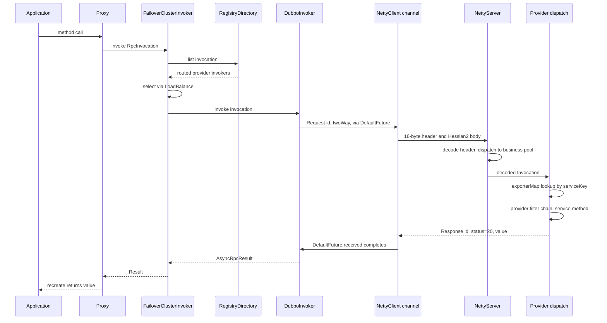

The provider filter chain runs inside `invoker.invoke(inv)` on the business thread, so the service key resolution, the context class loader switch, and the filters all precede the business method, while the response is written from the completion callback that `HeaderExchangeHandler` attaches to the returned stage — on the business thread for a synchronous service method, and on whichever thread completes the future otherwise.

---

## 4. The registry

The registry answers one question: which provider processes are running and where do they listen. It holds no interface definitions, only an address and a revision per instance.

`NacosServiceDiscovery` extends `AbstractServiceDiscovery`, which extends `AbstractRegistry`, which `FailbackRegistry` builds on. The layering is inherited from the interface-level registry that predates application-level discovery, and it is still where the useful mechanics live: `AbstractRegistry` maintains the registered/subscribed/notified maps and a local disk cache, `FailbackRegistry` retries failed operations, and `NacosServiceDiscovery` maps Dubbo concepts onto Nacos naming.

### 4.1 The address model

At application level a Nacos service name is the application name, and one instance represents one provider process:

```java
// NacosServiceDiscovery.doRegister
Instance instance = toInstance(serviceInstance);   // ip, port, metadata = revision, storage-type, endpoints
service.registerInstance(instance.getServiceName(), group, instance);
```

The instance metadata is deliberately small. `dubbo.metadata.revision` identifies the interface definitions the process currently exports, `dubbo.metadata.storage-type` says where a consumer should resolve that revision, and `dubbo.endpoints` lists the protocol/port pairs. Nothing describes a single interface. A provider deploying five interfaces produces one registration, and adding a sixth changes the revision rather than the address list.

The registry `group` defaults to `DEFAULT_GROUP` and is overridable by `nacos.group`. Names containing `$` — nested interfaces from generated stubs — are rewritten to `___` before reaching the Nacos client, because Nacos restricts service-name characters.

### 4.2 Subscription

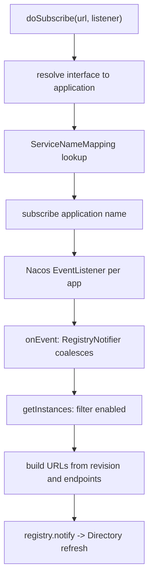

`ServiceDiscoveryRegistry.doSubscribe` first resolves the interface to a set of application names, then registers one `ServiceInstancesChangedListener` per application. `NacosServiceDiscovery.addServiceInstancesChangedListener` maps each application to a single Nacos `EventListener`, shared by every interface that application serves — so a consumer of three interfaces from one application holds one subscription, not three.

Two behaviours matter here. Instances with `enabled=false` are dropped before addresses are built. And an empty notification is not treated as a scale-to-zero: `ServiceDiscoveryRegistryDirectory` keeps the previous address list and logs it as empty protection, because an empty notification is far more often a transient Nacos fault than a real teardown.

The mapping from interface to application is not in Nacos naming. `ServiceNameMapping` maintains it (with `provided-by` on the consumer URL and a metadata-center mapping), and `ServiceDiscoveryRegistry.doSubscribe` consults the mapping before subscribing; with no mapping it stops and waits for the mapping listener, because a consumer cannot name an application it has never been told about. The Nacos client side of that model is covered in [Nacos service and configuration management](/post/java/spring-cloud/nacos/).

### 4.3 Coalescing, failure recovery, and local cache

`RegistryNotifier` bounds the cost of a flapping provider set. The first ten notifications are delivered immediately (`DEFAULT_DELAY_EXECUTE_TIMES = 10`); afterwards the notifier enforces the `delay-notification` window (default 5000 ms) and keeps only the most recent payload, comparing a timestamp so that a superseded task produces no notification. A burst of registrations at deployment time therefore yields one directory refresh instead of one per instance.

`FailbackRegistry` handles transport-level failures with a `HashedWheelTimer`. `register`, `unregister`, `subscribe`, and `unsubscribe` each catch exceptions, throw immediately when `check=true` (so a bad configuration fails fast at startup), and otherwise record a task that is retried every `retry.period` (default 5000 ms) until it succeeds. `SkipFailbackWrapperException` bypasses the retry when retrying cannot succeed.

`AbstractRegistry` persists every notified address set into a local properties file at `~/.dubbo/dubbo-registry-{application}-{registry-address}.cache`. The file is loaded into memory at construction. Its purpose is the failure path: when `doSubscribe` throws, `FailbackRegistry.subscribe` calls `getCacheUrls`, which prefers the in-memory `notified` map and falls back to the file, and if it finds entries it notifies the listener with them before logging the failure — so the consumer starts from the last known provider list rather than an empty directory. Writes are serialized through `lastCacheChanged` and written asynchronously unless `save.file=true`, and `file-cache=false` disables the mechanism entirely.

`APPLICATION_FIRST` is the consumer-side default for the migration rule. In a configuration that still publishes both levels — `register-mode=all`, the provider default for a plain `nacos://` URL — the application-level invoker is preferred and the interface-level one remains available as a fallback, which is why `RegistryProtocol.refer` returns a `MigrationInvoker` holding up to two cluster invokers and switching between them by rule:

| Step | Selection |
|------|-----------|
| `APPLICATION_FIRST` (default) | Application-level, falling back to interface-level when its address count is below the threshold; a `promotion` percentage below 100 sends only that fraction of calls to the application-level invoker |
| `FORCE_APPLICATION` | Always the application-level invoker, destroying the interface-level one |
| `FORCE_INTERFACE` | Always the interface-level invoker, the compatibility mode |

## 5. MetadataService

The metadata service answers the other question: what does that interface look like. It is an ordinary RPC service exported by every provider, so a consumer reaches it the same way it reaches a business service, without going through the registry again.

### 5.1 The service itself

`MetadataService` is a small fixed interface. It exposes `getMetadataInfo(revision)` and `getMetadataInfos()`, plus `getServiceDefinition(serviceKey)` for a single interface. Because it is an ordinary service, it is exported through the same `ServiceConfig` machinery as business services: `ConfigurableMetadataServiceExporter` builds a `ServiceConfig` for it with its own protocol and port (`metadata-service-protocol`, `metadata-service-port`) and exports it on startup. A consumer refers it through `MetadataUtils.referMetadataService`, which builds a URL from the coordinates in the instance metadata and calls it like any other remote service.

The definition returned is a `MetadataInfo`: the set of services the provider exports, each with its interface name, version, group, protocol, and method signatures with parameter type descriptors.

### 5.2 Resolving the revision

`dubbo.metadata.revision` is the link back to the interface definitions. It is a digest computed by `MetadataInfo.calRevision` over the application name and the description of every exported service, so it changes whenever the set or shape of those services changes. A consumer reads the revision from the instance and resolves it via the provider's `MetadataService`. `AbstractServiceDiscovery.getRemoteMetadata` performs that resolution behind a revision-keyed cache, retrying three times with a one-second pause before giving up with an empty `MetadataInfo`. The cache is what keeps the per-revision fetch off the steady-state path.


---

## References

- [Apache Dubbo source repository](https://github.com/apache/dubbo)
- [Apache Dubbo documentation](https://dubbo.apache.org/)
- [Nacos naming service](https://nacos.io/docs/latest/guide/user/open-api/)
- [Hessian 2 serialization specification](http://hessian.caucho.com/doc/hessian-serialization.html)
