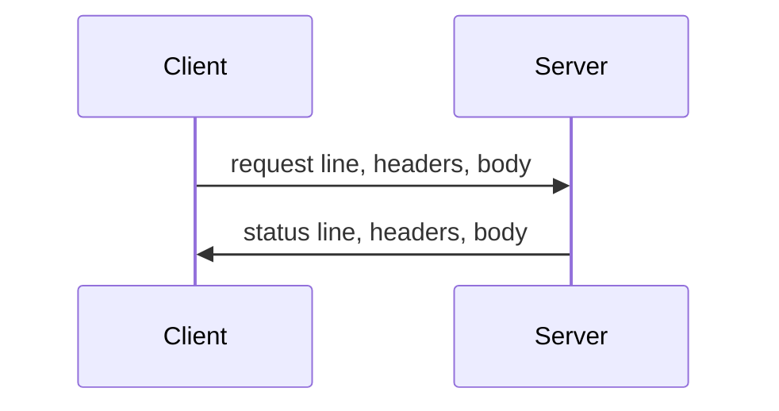

HTTP is the application protocol of the request and the response. HTTP/1.1 writes that exchange as text on a TCP connection. HTTP/2 carries the same methods, headers, and bodies as binary frames, many streams at once, on one connection.

<!--more-->

---

## 1. Overview

A client opens a connection and sends a request: a method, a target, header fields, and an optional body. The server sends one response: a status code, header fields, and an optional body. The server keeps no application memory of that exchange for the next request. Anything that must survive, such as a login, is carried again by the client, usually in a header.

Two versions put those same fields on the wire differently.

| Version | On the wire | Requests on one connection |
|---------|-------------|----------------------------|
| HTTP/1.1 | Text request line, text headers, body | One at a time. The next request waits for the current response |
| HTTP/2 | Binary frames. Pseudo-headers replace the request line | Many streams, interleaved |

`http://` uses port 80. `https://` is HTTP after a TLS handshake, port 443. Browsers select HTTP/2 with the ALPN token `h2` during that handshake.

---

## 2. HTTP/1.1 messages

An HTTP/1.1 request is text. The request line names the method, the target, and the version. Header fields follow, one per line, then a blank line, then the body when the method has one.

```text
POST / HTTP/1.1
Host: foo.com
Content-Type: application/x-www-form-urlencoded
Content-Length: 13

say=Hi&to=Mom
```

`POST` sends a body. `Content-Type` names the body's media type. `Content-Length` is the body size in bytes. `Host` is the authority the request is for. The response uses the same shape: a status line, headers, a blank line, and a body.



`GET` carries no body. The same fields travel in the query string of the target.

```text
GET /?say=Hi&to=Mom HTTP/1.1
Host: foo.com
```

`application/x-www-form-urlencoded` is the body media type for those same pairs. Each name and value is separated by `=`, pairs are separated by `&`, and reserved characters are percent-encoded. `say=Hi&to=Mom` is 13 bytes, which is the `Content-Length` above.

`multipart/form-data` packs several parts into one body. The `Content-Type` header carries a boundary token. Each part starts with that boundary and has its own headers. A file part adds a filename and the file's media type. The closing boundary ends with `--`.

```text
POST /foo HTTP/1.1
Host: foo.com
Content-Length: 68137
Content-Type: multipart/form-data; boundary=---------------------------974767299852498929531610575

-----------------------------974767299852498929531610575
Content-Disposition: form-data; name="description"

some text
-----------------------------974767299852498929531610575
Content-Disposition: form-data; name="myFile"; filename="foo.txt"
Content-Type: text/plain

(content of the uploaded file foo.txt)
-----------------------------974767299852498929531610575--
```

On one connection the client sends the next request only after the current response has arrived. A slow response holds every request behind it.

---

## 3. HTTP/2

HTTP/2 is HTTP written as binary frames. It was published in 2015 as RFC 7540 and restated in 2022 as RFC 9113. The methods and headers are the same as HTTP/1.1. Many requests share one connection, and repeated headers are compressed. Browsers use it on `https` when the server selects `h2`.

It is the usual protocol for a browser page. The 2024 Web Almanac loaded 71% of desktop home pages and 70% of mobile home pages over HTTP/2. About 22% were still HTTP/1.1. W3Techs counted HTTP/2 on 5.6% of websites in early 2016 and on about half in early 2021. In October 2026 the same count is 35% of all websites and about 65% of the top 10,000. HTTP/3 accounts for much of the rest: 41% of websites in that survey.

`h2` is chosen inside TLS 1.3, before any HTTP byte is sent. The client offers `h2` and `http/1.1` in the `ClientHello`. The server picks one name and returns it in `EncryptedExtensions`. A name of `h2` means the application data is HTTP/2. A name of `http/1.1` means the application data is a text request. Messages in braces are encrypted with the handshake keys derived from the two `key_share` values.

```text
ClientHello
  server_name: foo.com
  supported_versions: TLS 1.3
  supported_groups: x25519
  signature_algorithms: ecdsa_secp256r1_sha256, rsa_pss_rsae_sha256
  key_share: x25519, client share
  ALPN: h2, http/1.1

ServerHello
  supported_versions: TLS 1.3
  cipher_suite: TLS_AES_128_GCM_SHA256
  key_share: x25519, server share

{EncryptedExtensions}
  ALPN: h2

{Certificate}
  certificate for foo.com

{CertificateVerify}
  signature over the handshake

{Finished}
  verify_data

{Finished}
  verify_data
```

The first `Finished` is the server's. The second is the client's. After the client's `Finished`, the next application data from the client is the HTTP/2 preface.

### 3.1 Frames

Every frame is a 9-byte header followed by `length` bytes of payload. Bit 0 is the high bit of its byte. The header is 3 bytes of length, 1 byte of type, 1 byte of flags, and 4 bytes of stream id.

```text
 0               1               2               3
 0 1 2 3 4 5 6 7 0 1 2 3 4 5 6 7 0 1 2 3 4 5 6 7 0 1 2 3 4 5 6 7
+-+-+-+-+-+-+-+-+-+-+-+-+-+-+-+-+-+-+-+-+-+-+-+-+-+-+-+-+-+-+-+-+
|                length (24)                    | type          |
+-+-+-+-+-+-+-+-+-+-+-+-+-+-+-+-+-+-+-+-+-+-+-+-+-+-+-+-+-+-+-+-+
 4               5               6               7
 0 1 2 3 4 5 6 7 0 1 2 3 4 5 6 7 0 1 2 3 4 5 6 7 0 1 2 3 4 5 6 7
+-+-+-+-+-+-+-+-+-+-+-+-+-+-+-+-+-+-+-+-+-+-+-+-+-+-+-+-+-+-+-+-+
| flags         |R|              stream id (31)                 |
+-+-+-+-+-+-+-+-+-+-+-+-+-+-+-+-+-+-+-+-+-+-+-+-+-+-+-+-+-+-+-+-+
 8
 0 1 2 3 4 5 6 7
+-+-+-+-+-+-+-+-+
| stream id     |
+-+-+-+-+-+-+-+-+
| payload ...   |
+---------------+
```

`length` counts the payload only. The default maximum is 16,384 bytes. `SETTINGS_MAX_FRAME_SIZE` can raise it, up to 2^24−1. `type` selects the frame. `R`, bit 0 of byte 5, is 0. Stream id 0 is the connection itself. A non-zero stream id is one request and its response.

The same `POST` as the HTTP/1.1 example is these frames. The preface is the only plain text. Each line of nine bytes is length, type, flags, and stream id.

```text
50 52 49 20 2a 20 48 54 54 50 2f 32 2e 30 0d 0a 0d 0a 53 4d 0d 0a 0d 0a
preface, 24 bytes: PRI * HTTP/2.0\r\n\r\nSM\r\n\r\n

00 00 00 | 04 | 00 | 00 00 00 00
length 0 | SETTINGS | flags 0 | stream 0

00 00 33 | 01 | 04 | 00 00 00 01
length 51 | HEADERS | END_HEADERS | stream 1
83 87 84
:method POST, :scheme https, :path /
41 07 66 6f 6f 2e 63 6f 6d
:authority foo.com
5f 21 61 70 70 6c 69 63 61 74 69 6f 6e 2f 78 2d 77 77 77 2d 66 6f 72 6d 2d 75 72 6c 65 6e 63 6f 64 65 64
content-type application/x-www-form-urlencoded
5c 02 31 33
content-length 13

00 00 0d | 00 | 01 | 00 00 00 01
length 13 | DATA | END_STREAM | stream 1
73 61 79 3d 48 69 26 74 6f 3d 4d 6f 6d
say=Hi&to=Mom
```

`83`, `87`, and `84` are static-table indexes for `:method POST`, `:scheme https`, and `:path /`. `41`, `5f`, and `5c` name `:authority`, `content-type`, and `content-length` by static-table index and then give the value as a raw string. The server answers in the same format. `88` is `:status 200`. Flags `0x05` are `END_HEADERS` and `END_STREAM`, so stream 1 is closed and the connection stays open.

```text
00 00 00 | 04 | 00 | 00 00 00 00
length 0 | SETTINGS | flags 0 | stream 0

00 00 0d | 01 | 05 | 00 00 00 01
length 13 | HEADERS | END_HEADERS and END_STREAM | stream 1
88
:status 200
5f 0a 74 65 78 74 2f 70 6c 61 69 6e
content-type text/plain
```

| Type | Value | Role |
|------|-------|------|
| `DATA` | `0x0` | Body bytes of a stream |
| `HEADERS` | `0x1` | Header block for a stream |
| `RST_STREAM` | `0x3` | Aborts one stream |
| `SETTINGS` | `0x4` | Connection settings. Stream id 0 |
| `PUSH_PROMISE` | `0x5` | Announces a pushed response |
| `PING` | `0x6` | Round trip on stream 0 |
| `GOAWAY` | `0x7` | Stops new streams. Names the last stream the sender will process |
| `WINDOW_UPDATE` | `0x8` | Adds to the flow-control window |
| `CONTINUATION` | `0x9` | More of a header block |

`HEADERS` and `DATA` set `END_STREAM` on the last frame of that direction. A header block that spans frames sets `END_HEADERS` on the last one. `CONTINUATION` follows that `HEADERS` immediately: no other frame, on any stream, is placed between them.

### 3.2 Header compression

HPACK sends the header block inside `HEADERS` and `CONTINUATION`. A static table holds common field names and values, such as `:method GET` and `:status 200`. A dynamic table, private to the connection and to each direction, holds fields seen earlier on that connection.

An indexed representation sends only the table index, when the name and the value are already stored. A literal representation sends the value, and the name is either an index or a new string. The encoder can mark a literal to be inserted into the dynamic table, so a later block on that connection cites it by index. String literals may be Huffman coded.

The dynamic table has a maximum size, set by `SETTINGS_HEADER_TABLE_SIZE`. The encoder evicts the oldest fields to stay inside that size. Because the table is built in order, both sides must decode header blocks in the order they were written. One connection therefore has one HPACK encoder and one decoder in each direction, shared by all of its streams.

---

## 4. References

- [RFC 9112, HTTP/1.1](https://www.rfc-editor.org/rfc/rfc9112)
- [RFC 9113, HTTP/2](https://www.rfc-editor.org/rfc/rfc9113)
- [HTTP Archive, Web Almanac 2024: HTTP](https://almanac.httparchive.org/en/2024/http)
- [W3Techs, usage of HTTP/2, October 2026](https://w3techs.com/technologies/details/ce-http2)
- [RFC 7541, HPACK](https://www.rfc-editor.org/rfc/rfc7541)
- [RFC 9110, HTTP semantics](https://www.rfc-editor.org/rfc/rfc9110)
- [RFC 8446, TLS 1.3](https://www.rfc-editor.org/rfc/rfc8446)
