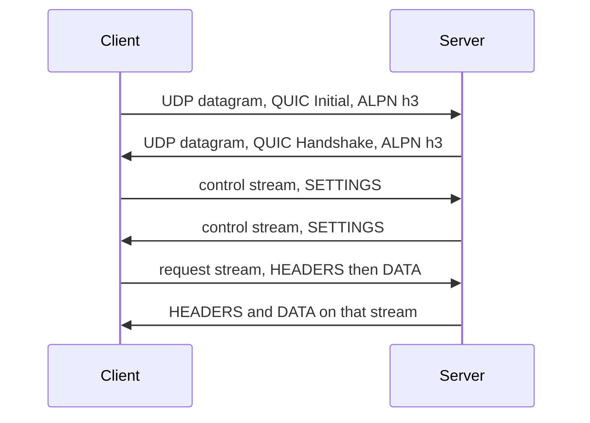
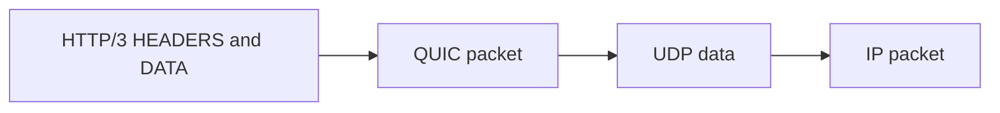

UDP is the transport that sends one datagram and then forgets it. The datagram is an 8-byte header and a payload, and the network may drop it or deliver it out of order. HTTP/3 puts QUIC in that payload, so a request is a QUIC stream inside a UDP datagram.

<!--more-->

---

## 1. Overview

A UDP endpoint is an IP address and a port. The sender writes a datagram. The network may deliver it, drop it, reorder it, or duplicate it. The receiver gets each datagram by itself. Nothing in UDP ties one datagram to the next.

The header is 8 bytes: source port, destination port, length, and checksum. The length counts the header and the data, so the smallest datagram is 8 bytes and the largest value the field can hold is 65,535. The path MTU is usually smaller than that, and a datagram that does not fit is dropped rather than split by UDP.

| Field | Bytes | Meaning |
|-------|-------|---------|
| Source port | 2 | Sender's port. 0 when the sender has no port |
| Destination port | 2 | The socket that receives the datagram |
| Length | 2 | Header plus data, in bytes |
| Checksum | 2 | Covers a pseudo-header, the UDP header, and the data |

IPv4 allows a checksum of 0, which means the sender computed none. IPv6 requires the checksum. A computed checksum of 0 is sent as `0xffff`.

---

## 2. Datagram

Bit 0 is the high bit of its byte. The four header fields occupy bytes 0 through 7. The data starts at byte 8.

```text
 0               1               2               3
 0 1 2 3 4 5 6 7 0 1 2 3 4 5 6 7 0 1 2 3 4 5 6 7 0 1 2 3 4 5 6 7
+-+-+-+-+-+-+-+-+-+-+-+-+-+-+-+-+-+-+-+-+-+-+-+-+-+-+-+-+-+-+-+-+
|          source port          |       destination port        |
+-+-+-+-+-+-+-+-+-+-+-+-+-+-+-+-+-+-+-+-+-+-+-+-+-+-+-+-+-+-+-+-+
 4               5               6               7
 0 1 2 3 4 5 6 7 0 1 2 3 4 5 6 7 0 1 2 3 4 5 6 7 0 1 2 3 4 5 6 7
+-+-+-+-+-+-+-+-+-+-+-+-+-+-+-+-+-+-+-+-+-+-+-+-+-+-+-+-+-+-+-+-+
|            length             |           checksum            |
+-+-+-+-+-+-+-+-+-+-+-+-+-+-+-+-+-+-+-+-+-+-+-+-+-+-+-+-+-+-+-+-+
| data ...                                                          |
+-------------------------------------------------------------------+
```

The checksum also covers a pseudo-header that is not sent: the source and destination IP addresses, a zero byte, the protocol number 17, and the UDP length. The receiver drops a datagram whose checksum does not match. An application that wants its own reliability builds it above UDP.

The server opens by binding a socket to a port and then waiting. That wait sends nothing. Each datagram that arrives is one message, with the sender's address attached, and the server goes back to waiting. It stays there until the process closes the socket. Closing sends nothing, so a client cannot tell that the server has stopped.

The client opens a socket, which also sends nothing, and sends one datagram when it has bytes to deliver. It does not wait for an accept. A later datagram is a new message to the same port. Closing the client socket sends nothing.

A datagram from `192.0.2.1` port 50000 to `192.0.2.2` port 443, carrying the two bytes `hi`, has length 10. The checksum of that pseudo-header and this header and data is `0x4e61`. It is the only packet in the exchange.

```text
c3 50 | 01 bb | 00 0a | 4e 61 | 68 69
50000 | 443   | 10    | csum  | h  i
```

TLS is not part of this exchange. DTLS and QUIC put a handshake and a close into the UDP data. The HTTP/3 example in §3 is that case. The `hi` datagram has neither.

---

## 3. HTTP/3

HTTP/3 is HTTP on QUIC, and a QUIC packet is the data of a UDP datagram. RFC 9114 defines the mapping. QUIC, RFC 9000, runs TLS 1.3 inside its own handshake. The ALPN token is `h3`. Browsers usually learn the token from an `Alt-Svc: h3=":443"` header on an earlier response, or from an HTTPS DNS record, and send the next connection as UDP to port 443. The October 2026 W3Techs count records HTTP/3 on 41% of websites.

Methods, status codes, and header names are the same as in [HTTP](/post/network/http/). What changes is loss. QUIC streams are independent, so a lost UDP datagram blocks only the stream whose bytes were in it. HTTP/2 on TCP stalls every stream when one segment is lost.

### 3.1 QUIC packet

The UDP data is one QUIC packet. The first byte selects a long header or a short header. On the wire, header protection masks the packet number and the low bits of byte 0. The layout below is before that mask.

```text
long header, byte 0
 0 1 2 3 4 5 6 7
+-+-+-+-+-+-+-+-+
|1|1| type  |rest|
+-+-+-+-+-+-+-+-+

 0               1               2               3
 0 1 2 3 4 5 6 7 0 1 2 3 4 5 6 7 0 1 2 3 4 5 6 7 0 1 2 3 4 5 6 7
+-+-+-+-+-+-+-+-+-+-+-+-+-+-+-+-+-+-+-+-+-+-+-+-+-+-+-+-+-+-+-+-+
|                          version                              |
+-+-+-+-+-+-+-+-+-+-+-+-+-+-+-+-+-+-+-+-+-+-+-+-+-+-+-+-+-+-+-+-+
| DCID length   | destination connection id ...                 |
+-+-+-+-+-+-+-+-+-+-+-+-+-+-+-+-+-+-+-+-+-+-+-+-+-+-+-+-+-+-+-+-+
| SCID length   | source connection id ...                      |
+-+-+-+-+-+-+-+-+-+-+-+-+-+-+-+-+-+-+-+-+-+-+-+-+-+-+-+-+-+-+-+-+
| type-specific fields: token, length, packet number, payload  |
+---------------------------------------------------------------+
```

| Bits | Name | Value |
|------|------|-------|
| 0 | Header form | 1, long header |
| 1 | Fixed bit | 1 |
| 2–3 | Long packet type | 0 Initial, 1 0-RTT, 2 Handshake, 3 Retry |
| 4–5 | Reserved | 0. Unused, and ignored, when the type is Retry |
| 6–7 | Packet number length | The length in bytes is this value plus 1. Unused when the type is Retry |

Version 1 is `00 00 00 01`. The Initial first byte in the example below is `c0`. The Handshake first byte is `e0`.

| Bytes after byte 0 | Name |
|--------------------|------|
| 1–4 | Version |
| 5 | Destination connection id length |
| Next, that many | Destination connection id, 0 to 20 bytes |
| Next 1 | Source connection id length |
| Next, that many | Source connection id, 0 to 20 bytes |
| Remainder | Initial and 0-RTT: token length, token, packet length, packet number, payload. Handshake: packet length, packet number, payload. Retry: retry token, retry integrity tag |

```text
short header, byte 0
 0 1 2 3 4 5 6 7
+-+-+-+-+-+-+-+-+
|0|1|S|R R|K|P P|
+-+-+-+-+-+-+-+-+
| destination connection id, length fixed at the handshake |
| packet number                                            |
| payload                                                  |
+----------------------------------------------------------+
```

| Bits of byte 0 | Name | Value |
|-----------------|------|-------|
| 0 | Header form | 0, short header |
| 1 | Fixed bit | 1 |
| 2 | Spin | 0 or 1, flipped by the sender as a passive signal |
| 3–4 | Reserved | 0 |
| 5 | Key phase | Which packet-protection key produced this packet |
| 6–7 | Packet number length | The length in bytes is this value plus 1 |

| Bytes after byte 0 | Name |
|--------------------|------|
| Next, the negotiated length | Destination connection id. No length byte is sent |
| Next, 1 to 4 | Packet number |
| Remainder | Payload. A `STREAM` frame here carries the HTTP/3 frames |

The short header carries no version and no source connection id.



The same `POST` as in the HTTP post, from `192.0.2.1` port 50000 to `192.0.2.2` port 443, goes through those steps. The QUIC payload is encrypted, so steps 1 and 2 show the UDP header and the QUIC long header. Steps 3 to 5 show the HTTP/3 bytes after decryption.

```text
1. Client Initial, one UDP datagram
c3 50 | 01 bb | length | checksum
50000 | 443
UDP data, QUIC Initial long header:
c0 | 00 00 00 01 | 08 01 02 03 04 05 06 07 08 | 08 11 12 13 14 15 16 17 18 | 00
Initial | version 1 | DCID len and id | SCID len and id | token length 0
then the packet length, the packet number, and the encrypted CRYPTO frame
whose TLS ClientHello offers ALPN h3

2. Server Handshake, one UDP datagram back to port 50000
UDP data, QUIC Handshake long header, first byte e0
encrypted flight: EncryptedExtensions ALPN h3, certificate, Finished

3. Each side opens its control stream. The first bytes are the stream
type 0x00 and one empty SETTINGS frame (type 0x04, length 0):
00 04 00

4. Client request stream 0, after decryption. HEADERS then DATA.
The two bytes before the field lines are Required Insert Count 0 and Base 0.
01 | 36 | 00 00 d4 d7 c1 50 07 66 6f 6f 2e 63 6f 6d
         5f 20 21 61 70 70 6c 69 63 61 74 69 6f 6e 2f 78 2d 77 77 77
         2d 66 6f 72 6d 2d 75 72 6c 65 6e 63 6f 64 65 64 54 02 31 33
HEADERS | length 54 | :method POST, :scheme https, :path /,
                      :authority foo.com,
                      content-type application/x-www-form-urlencoded,
                      content-length 13
00 | 0d | 73 61 79 3d 48 69 26 74 6f 3d 4d 6f 6d
DATA   | 13 | say=Hi&to=Mom
The QUIC stream ends here, which ends the request.

5. Server response on the same QUIC stream:
01 | 10 | 00 00 d9 5f 26 0a 74 65 78 74 2f 70 6c 61 69 6e
HEADERS | length 16 | :status 200, content-type text/plain
The QUIC stream ends here, which ends the response.
```

`d4`, `d7`, and `c1` are QPACK static-table indexes for `:method POST`, `:scheme https`, and `:path /`. `d9` is `:status 200`. `50`, `5f 20`, and `54` name `:authority`, `content-type`, and `content-length` and are followed by the value bytes.



An HTTP/3 frame has no stream id. The QUIC stream is the stream. The frame is a variable-length integer for the type, a variable-length integer for the length, and then the payload. The two high bits of a variable-length integer say how long it is: `00` is one byte, `01` two, `10` four, `11` eight. `DATA` is type `0x00` and `HEADERS` is type `0x01`, so each of those types fits in a single byte.

```text
+-------------------+----------------------+------------------+
| type, varint      | length, varint       | payload          |
+-------------------+----------------------+------------------+
```

| Type | Value | Role |
|------|-------|------|
| `DATA` | `0x00` | Body bytes |
| `HEADERS` | `0x01` | QPACK header block |
| `SETTINGS` | `0x04` | Sent once, as the first frame on the control stream |
| `GOAWAY` | `0x07` | Sent on the control stream. Names the last request the sender will accept |

There is no `END_STREAM` flag and no `CONTINUATION` frame. The end of the QUIC stream ends that direction. Flow control and the packet numbers belong to QUIC, so HTTP/3 has no `WINDOW_UPDATE` and no `PING` frame.

The client opens one bidirectional QUIC stream per request. Those stream ids are 0, 4, 8, and so on. The first frame on a request stream is `HEADERS`. `DATA` frames follow when the request has a body. The server writes the response `HEADERS` and `DATA` on the same stream. Each side also opens one unidirectional control stream, type `0x00`, and the first frame on it is `SETTINGS`. Two more unidirectional streams, types `0x02` and `0x03`, carry QPACK table updates. Those updates travel beside the request streams, so one stream's header block does not have to wait for another's.

QPACK is the header compression. It uses a static table and a dynamic table, as HPACK does. The dynamic-table instructions go on the encoder and decoder streams. A request stream can refer to the table without being the only place the table is updated. That is what lets QUIC deliver streams independently.

---

## 4. References

- [RFC 768, UDP](https://www.rfc-editor.org/rfc/rfc768)
- [RFC 9000, QUIC](https://www.rfc-editor.org/rfc/rfc9000)
- [RFC 9114, HTTP/3](https://www.rfc-editor.org/rfc/rfc9114)
- [RFC 9204, QPACK](https://www.rfc-editor.org/rfc/rfc9204)
- [HTTP](/post/network/http/)
