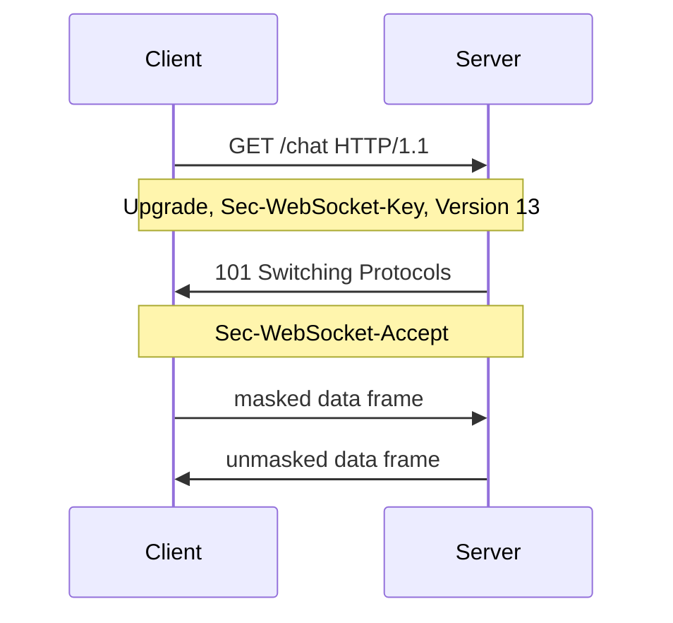
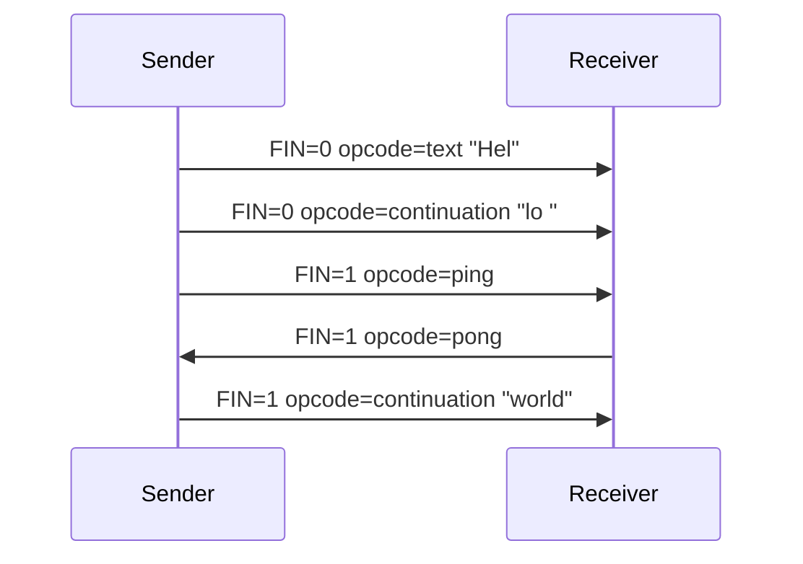
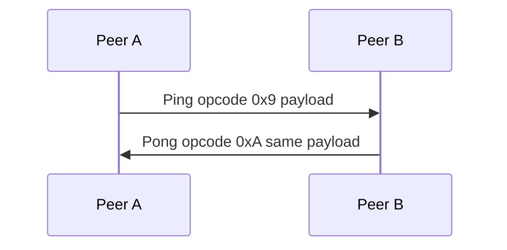
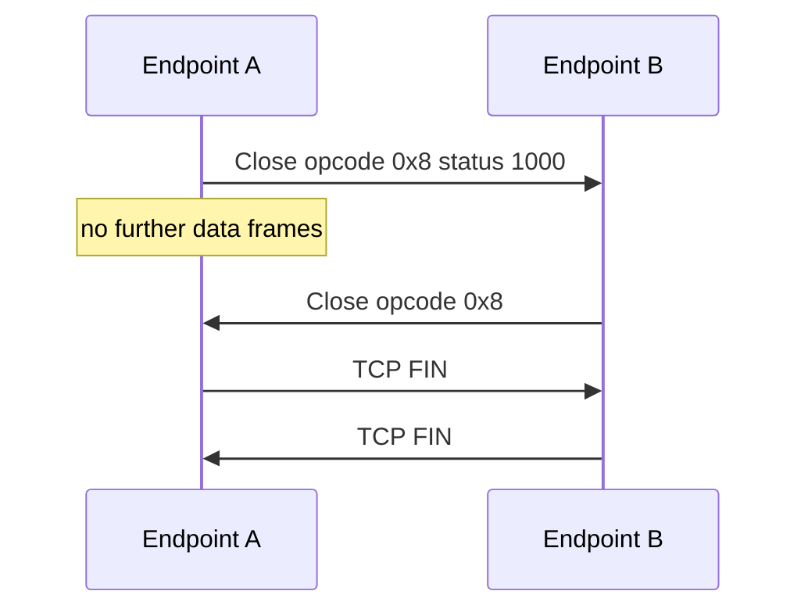
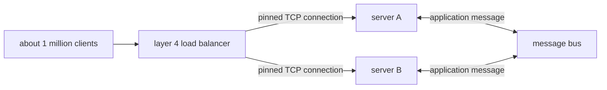

WebSocket carries full-duplex messages on one TCP connection. The connection opens with an HTTP upgrade, then both peers exchange masked or unmasked frames until a close frame ends the session.

<!--more-->

---

## 1. Overview

A WebSocket URI uses the scheme `ws` or `wss`. `ws` is the protocol on a TCP connection, default port 80. `wss` is the same protocol after a TLS handshake, default port 443. The resource name is the path and query of that URI.

Two peers share the connection. Either peer may send a data message at any time. A message is one frame or a sequence of frames. Data messages are text or binary. Control messages are close, ping, and pong, and each control message is a single frame.

The opening exchange is an HTTP request and response. After the server returns status 101, the bytes on the connection are WebSocket frames. The TCP connection stays up for the life of the session. Closing the WebSocket session is a close frame in each direction, followed by the TCP close.

| Item | Value |
|------|--------|
| Protocol version | 13, sent as `Sec-WebSocket-Version` |
| Data opcodes | `0x1` text, `0x2` binary, `0x0` continuation |
| Control opcodes | `0x8` close, `0x9` ping, `0xA` pong |
| Client frames | `MASK` = 1, 4-byte masking key present |
| Server frames | `MASK` = 0, no masking key |
| Text payload | UTF-8 |

---

## 2. Opening handshake

The client sends an HTTP/1.1 GET with `Upgrade: websocket` and `Connection: Upgrade`. `Sec-WebSocket-Key` is 16 random bytes encoded in base64. `Sec-WebSocket-Version` is 13. `Sec-WebSocket-Protocol` lists subprotocols the client can speak, comma-separated. `Origin` is present when the client is a browser.

```text
GET /chat HTTP/1.1
Host: server.example.com
Upgrade: websocket
Connection: Upgrade
Sec-WebSocket-Key: dGhlIHNhbXBsZSBub25jZQ==
Origin: http://example.com
Sec-WebSocket-Protocol: chat, superchat
Sec-WebSocket-Version: 13
```

The server accepts by returning `101 Switching Protocols`, repeating the upgrade headers, and returning `Sec-WebSocket-Accept`. If it selects a subprotocol, `Sec-WebSocket-Protocol` names exactly one token from the client's list. A response that omits that header means no subprotocol was selected.

```text
HTTP/1.1 101 Switching Protocols
Upgrade: websocket
Connection: Upgrade
Sec-WebSocket-Accept: s3pPLMBiTxaQ9kYGzzhZRbK+xOo=
Sec-WebSocket-Protocol: chat
```



`Sec-WebSocket-Accept` is the base64 encoding of the SHA-1 digest of the concatenation of `Sec-WebSocket-Key` and the GUID `258EAFA5-E914-47DA-95CA-C5AB0DC85B11`. For the key above the concatenation hashes to `s3pPLMBiTxaQ9kYGzzhZRbK+xOo=`. The client checks that value before it sends a frame. A mismatch, or any status other than 101, means the upgrade failed and the client sends no WebSocket frame on that connection.

A server that does not implement version 13 answers `426 Upgrade Required` and lists `Sec-WebSocket-Version: 13`.

HTTP/2 opens the same session with an extended CONNECT rather than status 101. The request sets `:method` to `CONNECT` and `:protocol` to `websocket`, and still carries `sec-websocket-key` and `sec-websocket-version`. A successful response is a 2xx status that includes `sec-websocket-accept`, computed with the same GUID. The bytes that follow on that stream are the frames below.

---

## 3. Frame

### 3.1 Layout

Every frame has the same header. The payload follows the masking key when `MASK` is 1.

```text
 0               1               2               3
 0 1 2 3 4 5 6 7 0 1 2 3 4 5 6 7 0 1 2 3 4 5 6 7 0 1 2 3 4 5 6 7
+-+-+-+-+-------+-+-------------+-------------------------------+
|F|R|R|R| opcode|M| Payload len |    Extended payload length    |
|I|S|S|S|  (4)  |A|     (7)     |             (16/64)            |
|N|V|V|V|       |S|             |   (if payload len==126/127)    |
| |1|2|3|       |K|             |                               |
+-+-+-+-+-------+-+-------------+ - - - - - - - - - - - - - - - +
|     Extended payload length continued, if payload len == 127  |
+ - - - - - - - - - - - - - - - +-------------------------------+
|                               | Masking-key, if MASK set to 1 |
+-------------------------------+-------------------------------+
| Masking-key (continued)       |          Payload Data         |
+-------------------------------- - - - - - - - - - - - - - - - +
:                     Payload Data continued ...                :
+---------------------------------------------------------------+
```

| Field | Bits | Meaning |
|-------|------|---------|
| FIN | 1 | 1 when this frame is the last frame of the message |
| RSV1, RSV2, RSV3 | 1 each | 0 unless a negotiated extension defines the bit |
| Opcode | 4 | Message type, or continuation |
| MASK | 1 | 1 when a 4-byte masking key follows the length |
| Payload len | 7 | Length of the payload, or the code 126 or 127 |
| Extended payload length | 16 or 64 | Present when payload len is 126 or 127 |
| Masking key | 32 | Present when MASK is 1 |
| Payload data | variable | Extension data, then application data |

The 7-bit length is the payload length when it is 0 through 125. The value 126 means the next two bytes are an unsigned 16-bit length in network byte order, and that length is 126 or greater. The value 127 means the next eight bytes are an unsigned 64-bit length in network byte order, with the most significant bit 0. A minimal header is therefore two bytes. A masked frame adds four bytes for the key. A 16-bit length adds two bytes. A 64-bit length adds eight.

| Opcode | Name | Role |
|--------|------|------|
| `0x0` | Continuation | Follows a data frame whose FIN was 0 |
| `0x1` | Text | UTF-8 data message |
| `0x2` | Binary | Opaque data message |
| `0x3`–`0x7` | Reserved data | Unused unless an extension defines them |
| `0x8` | Close | Ends the session |
| `0x9` | Ping | Asks for a pong |
| `0xA` | Pong | Answers a ping, or a one-way heartbeat |
| `0xB`–`0xF` | Reserved control | Unused unless an extension defines them |

A single-frame text message has FIN = 1 and opcode `0x1`. The text "Hi" (`0x48 0x69`) from the client, with masking key `0x37 0xfa 0x21 0x3d`, is this frame:

```text
81 82 37 fa 21 3d 7f 93
```

`0x81` is FIN and opcode text. `0x82` is MASK and a payload length of 2. The next four bytes are the key. `0x7f 0x93` is the masked payload. The server's unmasked echo of the same text is `81 02 48 69`: FIN, opcode text, MASK clear, length 2, then the raw UTF-8 bytes.

An opcode in the reserved range, or an RSV bit set when no extension was negotiated, is a protocol error. The peer closes with status 1002.

---

### 3.2 Masking

The client sets MASK to 1 on every frame it sends, data and control alike, and chooses a new 4-byte key for that frame. The server sets MASK to 0 on every frame it sends. A server that receives an unmasked client frame, or a client that receives a masked server frame, closes the connection with status 1002.

The key is not a secret. It stops an intermediary that does not understand the upgrade from treating the payload bytes as a cacheable HTTP response. The receiver recovers each payload byte by XOR with the key, cycling every four bytes:

```text
payload[i] = wire[i] XOR key[i mod 4]
```

For the "Hi" frame above:

| i | Wire byte | Key byte | Payload byte |
|---|-----------|----------|--------------|
| 0 | `0x7f` | `0x37` | `0x48` (`H`) |
| 1 | `0x93` | `0xfa` | `0x69` (`i`) |

The length field counts the unmasked payload, not the key. The key itself is not part of the payload.

---

### 3.3 Fragmentation

A data message may be split across frames when the sender does not yet know the full length. The first frame carries opcode `0x1` or `0x2` and FIN = 0. Each following frame of that message carries opcode `0x0`. The last frame of the message carries opcode `0x0` and FIN = 1. The receiver concatenates the payloads in order and interprets the result with the opcode of the first frame.



The message delivered to the application is the text `Hello world`. The ping between the fragments is a separate control message. Control frames are allowed between fragments of a data message. A control frame itself is one frame: FIN is 1, and its payload length is at most 125, so it uses the 7-bit length and never the extended length.

A text message, after reassembly, must be valid UTF-8. Invalid UTF-8 closes the connection with status 1007. A binary message is an opaque byte string.

---

### 3.4 Control frames

Ping is opcode `0x9`. Pong is opcode `0xA`. A peer that receives a ping sends a pong whose payload is a copy of the ping payload. A pong may also be sent with no ping, as a heartbeat. An unsolicited pong requires no reply. After a close frame has been received, a further ping needs no pong.



Close is opcode `0x8`. The payload is empty, or a 2-byte status code in network byte order followed by a UTF-8 reason. An empty payload means no status was supplied. A payload of one byte is illegal. The reason, when present, is valid UTF-8.

| Code | Name | On the wire |
|------|------|-------------|
| 1000 | Normal closure | Yes |
| 1001 | Going away | Yes |
| 1002 | Protocol error | Yes |
| 1003 | Unsupported data | Yes |
| 1007 | Invalid payload data | Yes |
| 1008 | Policy violation | Yes |
| 1009 | Message too big | Yes |
| 1010 | Mandatory extension | Yes, sent by the client |
| 1011 | Internal error | Yes |
| 1005 | No status received | No |
| 1006 | Abnormal closure | No |
| 1015 | TLS handshake failure | No |

1005, 1006, and 1015 name conditions the local endpoint observes. They are absent from the close frame. 1010 is the client's report that the server did not accept an extension the client required.

---

### 3.5 Closing the connection

Either peer may start the close. It sends a close frame and then sends no further data frames. It may still send a pong in answer to a ping that arrives before the peer's close. The other peer answers with a close frame of its own. After both close frames have been sent, each peer closes the TCP connection.



A close with status 1000 and no reason, sent by the client, is the masked frame `88 82` plus a 4-byte key plus the two masked status bytes. `0x88` is FIN and opcode close. `0x82` is MASK and length 2. The status bytes on the wire are `0x03 0xE8` XOR the first two key bytes. The server's matching unmasked close is `88 02 03 e8`.

If the TCP connection ends before a close frame arrives, the local endpoint records 1006. That code is not written into a frame. If the TLS handshake fails on `wss`, the local endpoint records 1015, again without a close frame.

---

## 4. Scaling

A million WebSocket clients are a million TCP connections, spread across machines. A layer 4 load balancer owns the virtual address the clients connect to. It forwards TCP segments and does not read the HTTP upgrade or the frame opcode. On the SYN it chooses a live server and records the 4-tuple — client address, client port, virtual address, virtual port — against that server. Every later segment of the connection, including the upgrade and the frames, matches that record and reaches the same process.

Moving a live session is a new handshake from the client. `wss` adds a TLS session on the same connection, so the machine that finished the handshake also holds that TLS state.

Each server holds only the sockets the balancer assigned to it. A message that must reach clients on both machines is published once to a bus both servers subscribe to. Each server writes a WebSocket frame on its own sockets. The bus carries the application message. It does not carry the TCP connection.



The bus is a pub/sub service. Redis is the usual one: each server process is a client of it. When the handshake finishes, the server adds that socket to a local table, `channel → sockets on this process`, and subscribes to the channel if it has not already:

```text
SUBSCRIBE room:42
```

The table is not shared. Server A cannot look up a socket that lives on server B.

A client frame that must reach the room is not written to other machines' sockets. The server that read it publishes the application payload:

```text
PUBLISH room:42 <payload>
```

Redis keeps no copy of that payload. It writes the payload to every server that has a live `SUBSCRIBE` on `room:42`, including the publisher. A server that was disconnected for the publish misses it.

On receipt, each server looks up `room:42` in its own table and writes one unmasked data frame on each listed socket. The frame is built locally. The bus never sends the WebSocket header. The publishing server writes only from this receipt, so a client on that server is not given a second copy from a write done before the `PUBLISH`. The socket that sent the client frame is left out of the write when the room should not echo the message back to its author.

Ten servers subscribed to the channel produce ten deliveries on the bus. Each of those servers then writes to its own share of the million sockets. A payload addressed to one user uses the same publish, with the user id in the message. Every server receives it, and the server whose local table contains that user writes the one frame.

A message sent to every client is one frame per connection. A 200-byte payload to one million clients is 200 MB of payload, plus the frame headers, written on one million sockets. Ping and pong are the same shape at a smaller size: a 30-second ping on one million connections is about 33,000 pings each second, and the same number of pongs. The protocol does not choose that interval. An idle path that the network drops, with no close frame, is recorded locally as status 1006.

---

## 5. References

- [RFC 6455, The WebSocket Protocol](https://www.rfc-editor.org/rfc/rfc6455)
- [RFC 8441, Bootstrapping WebSockets with HTTP/2](https://www.rfc-editor.org/rfc/rfc8441)
